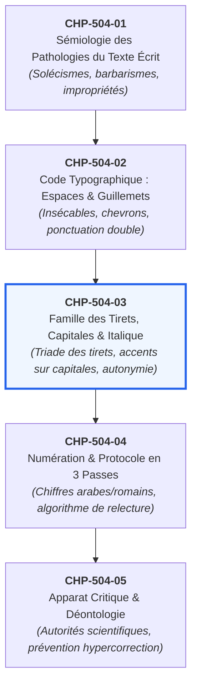

# Chapitre 3 : Famille des Tirets, Capitales Accentuées et Règles de l'Italique

> **Identifiant** : `CHP-504-03`  
> **Module de rattachement** : [`MOD-504 — Révision Éditoriale Professionnelle, Typographie Savante et Haute Tenue Écrite`](file:///f:/Formation/world-class-french/03-curriculum/year-3/semester-5/mod-504-revision-editoriale-typographie-savante.md)  
> **Volume horaire canonique** : 3 h 30 (Étude : 1 h 00 | Pratique : 1 h 15 | Correction : 0 h 45 | Évaluation : 0 h 30)  
> **Statut** : [STATUT : VALIDÉ]  
> **Compétences cibles** : [`FR-INT-003`](file:///f:/Formation/world-class-french/02-competency-framework/competency-framework.md#fr-int-003-réviser-et-corriger-un-texte-tiers-en-justifiant-les-interventions) (L4), [`FR-ORTHO-001`](file:///f:/Formation/world-class-french/02-competency-framework/competency-framework.md#fr-ortho-001-maîtrise-de-lorthographe-lexicale-et-des-familles-de-mots) (L4), [`FR-STYLE-001`](file:///f:/Formation/world-class-french/02-competency-framework/competency-framework.md#fr-style-001-maîtrise-des-figures-de-rhétorique-et-commentaire-stylistique) (L4)  
> **Sources de référence** : `SRC-TYPO-01` (*Lexique des règles typographiques en usage à l'Imprimerie nationale*), `SRC-GRAM-01` (Grevisse & Goosse, *Le Bon Usage*), `SRC-LEX-01` (*Trésor de la Langue Française informatisé*), `SRC-LEX-02` (Académie française, *Dictionnaire*), `SRC-NORM-02` (*Rectifications orthographiques de 1990*), `SRC-NORM-03` (Ministère de l'Éducation nationale)

---

## 1. Titre et Place dans le Cursus

Ce troisième chapitre du module `MOD-504` constitue le pivot micro-typographique et sémiotique du cycle de haute révision éditoriale. Après avoir établi la nomenclature clinique des vices de langue dans [`CHP-504-01`](file:///f:/Formation/world-class-french/03-curriculum/year-3/semester-5/mod-504/chp-504-01-semiologie-pathologies-texte-ecrit.md) et maîtrisé la géométrie des espaces et des guillemets dans [`CHP-504-02`](file:///f:/Formation/world-class-french/03-curriculum/year-3/semester-5/mod-504/chp-504-02-code-typographique-espaces-ponctuation-guillemets.md), l'apprenant aborde ici les trois marqueurs visuels par lesquels l'œil du maître d'œuvre distingue instantanément l'amateur du typographe d'élite : la juste articulation de la famille des tirets, l'accentuation impérative des majuscules et capitales, et l'emploi normé de la fonte italique.



---

## 2. Objectifs Mesurables

Au terme de ce chapitre, l'apprenant sera capable de :
1. **Distinguer et employer sans défaillance** les trois membres de la famille des tirets : le trait d'union (-), le tiret demi-cadratin (–) et le tiret cadratin (—), conformément aux prescriptions du *Lexique des règles typographiques en usage à l'Imprimerie nationale* (`SRC-TYPO-01`).
2. **Restituer sans exception** les accents graphiques (aigus, graves, circonflexes), trémas et cédilles sur les majuscules et capitales (*À, É, È, Ê, Î, Ô, Û, Ç*), en éliminant toute graphie tronquée héritée de la dactylographie mécanique.
3. **Appliquer les règles éditoriales d'emploi de l'italique** (titres d'œuvres, périodiques, locutions étrangères non francisées, mots autonymes) sans jamais commettre le pléonasme typographique cumulant guillemets et italique.
4. **Justifier scientifiquement** chaque intervention typographique en renvoyant aux chapitres et articles correspondants de `SRC-TYPO-01` et `SRC-GRAM-01`.

---

## 3. Prérequis et Test de Préparation

### 3.1 Prérequis Théoriques
- Maîtrise de la distinction entre signe typographique et lettre alphabétique (`MOD-101`, `MOD-202`).
- Connaissance des règles d'emploi des guillemets français et des espaces insécables (`CHP-504-02`).
- Familiarité avec les notions de signifiant et d'autonymie linguistique (`MOD-104`, `MOD-401`).

### 3.2 Test Diagnostique d'Auto-Évaluation (5 items)

<details>
<summary><b>Consulter le test et son corrigé immédiat</b></summary>

1. *Quel signe typographique introduit une réplique de dialogue selon l'Imprimerie nationale ?*  
   **Réponse** : Le tiret cadratin (—), et non le trait d'union ni le tiret demi-cadratin.
2. *L'Académie française autorise-t-elle l'omission de l'accent sur une majuscule ?*  
   **Réponse** : Non, formellement. « L'accent a pleine valeur orthographique » ; son omission constitue une faute d'orthographe caractérisée.
3. *Corriger l'énoncé suivant : « Dans "Le Monde", l'éditorialiste fustige l'immobilisme. »*  
   **Réponse** : *Dans Le Monde, l'éditorialiste fustige l'immobilisme.* (Suppression des guillemets et composition du titre en italique).
4. *Quelle différence fonctionnelle sépare le trait d'union du tiret demi-cadratin ?*  
   **Réponse** : Le trait d'union relie des morphèmes au sein du mot composé ou gère les césures ; le tiret demi-cadratin isole une incise narrative ou structure des listes.
5. *Pourquoi écrit-on « curriculum vitæ » en italique mais « lavabo » en romain ?*  
   **Réponse** : *Lavabo* est un substantif latin totalement francisé et lexicalisé ; *curriculum vitæ* est une locution latine conservant sa graphie étrangère et sa ligature non francisée.

</details>

---

## 4. Situation de Départ ou Problème Concret

Considérons le fragment suivant, extrait d'une épreuve d'imprimerie soumise à publication universitaire :

> *« - Avez vous compris l'importance de ce décret? demanda le ministre.  
> - Oui, répondit le préfet, mais l'ETAT doit éviter toute collision avec les syndicats.  
> - En effet, - murmura le conseiller -, la revue "Les Temps Modernes" a déja condamné cette mesure in situ. »*

Ce court extrait de trois lignes cumule six fautes typographiques destructrices de crédibilité :
- Utilisation de traits d'union courts dactylographiques (-) en ouverture de dialogue au lieu de tirets cadratins (—).
- Absence d'accent sur les capitales prépositionnelle (*Avez-vous* sans accent grave sur le *À* si en début d'alinéa avec initiale) et institutionnelle (*l'ETAT* au lieu de *l'État*).
- Omission du trait d'union dans l'inversion interrogative (*Avez vous* au lieu de *Avez-vous*).
- Encadrement de l'incise par des traits d'union courts (- ... -) au lieu de tirets demi-cadratins (– ... –).
- Titre de périodique composé entre guillemets anglais au lieu de chevrons français et de fonte italique pure (*Les Temps modernes*).
- Locution latine *in situ* laissée en caractères romains ordinaires.

---

## 5. Explication Intuitive : La Morphologie Visible de la Pensée

La typographie savante n'est pas une coquetterie ornementale : elle est l'incarnation matérielle de la syntaxe. De même que le chef d'orchestre utilise des signes précis pour commander le staccato, le crescendo ou le silence, l'éditeur utilise les signes typographiques pour régler le souffle et la hiérarchie du regard :
- **Le trait d'union** est un ciment moléculaire : il soude deux mots pour n'en faire qu'un seul concept (*arc-en-ciel*).
- **Le tiret demi-cadratin** est un souffle suspendu : il écarte délicatement la phrase pour insérer une pensée seconde sans rompre la voûte syntaxique.
- **Le tiret cadratin** est un lever de rideau : il signale qu'une voix nouvelle prend la parole sur la scène du dialogue.
- **L'accent sur la capitale** est un garant sémantique : il empêche que *L'ÉLÈVE DU MAÎTRE* ne devienne *L'ÉLEVE DU MAÎTRE* ou qu'un *PÊCHEUR* ne soit pris pour un *PÉCHEUR*.
- **L'italique** est une mise à distance critique : il avertit le lecteur que le mot n'est pas prononcé sur le plan ordinaire du discours, mais qu'il renvoie à une œuvre, à une langue autre ou à son propre statut autonyme.

---

## 6. Définitions Précises et Terminologie

- **Trait d'union** (*hyphen*, U+002D) : Signe graphique court (quart de cadratin) reliant des éléments lexicaux ou marquant une césure syllabique.
- **Tiret demi-cadratin** (*en-dash*, U+2013) : Signe de longueur moyenne (moitié du cadratin de la fonte), employé pour isoler les incises narratives et structurer les énumérations.
- **Tiret cadratin** (*em-dash*, U+2014) : Signe long égal au carré du corps de la fonte, réservé aux changements d'interlocuteur dans le dialogue.
- **Capitale accentuée** : Lettre majuscule ou de bas de casse composée en capitales conservant son accentuation diacritique, son tréma ou sa cédille (*À, É, È, Ê, Î, Ô, Û, Ç*).
- **Fonte italique** : Variété de caractères penchés vers la droite, conçue pour contraster avec le romain dans les titres, les emprunts xéniques et les mentions autonymes.
- **Autonymie** : Propriété d'un signe linguistique employé non pour désigner son référent habituel, mais pour se désigner lui-même en tant qu'entité graphique ou phonique.
- **Xénisme** : Mot emprunté à une langue étrangère qui n'est pas encore intégré dans le système phonologique et graphique du français.

---

## 7. Règles et Mécanismes Fondamentaux

### 7.1 La Famille des Tirets : Règles Officielles de l'Imprimerie Nationale

Le *Lexique des règles typographiques en usage à l'Imprimerie nationale* (`SRC-TYPO-01`, p. 167-168) établit une séparation étanche entre les trois types de tirets :

| Signe | Nom typographique | Largeur relative | Glyphe Unicode | Fonctions canoniques exclusives |
| :---: | :--- | :---: | :---: | :--- |
| **-** | **Trait d'union** (ou division) | 1/4 de cadratin | `U+002D` | 1. Soudure lexicale des mots composés (*garde-champêtre*) ;<br/>2. Liaisons grammaticales (*prend-il, donnez-le-moi*) ;<br/>3. Césure de fin de ligne. |
| **–** | **Tiret demi-cadratin** | 1/2 cadratin | `U+2013` | 1. Encadrement des incises narratives (avec espaces) ;<br/>2. Séparation des bornes d'intervalles (*1914–1918*, *p. 15–28*) ;<br/>3. Puces d'énumérations et listes verticales. |
| **—** | **Tiret cadratin** | 1 cadratin | `U+2014` | 1. Ouverture des répliques de dialogue (suivi d'une espace ordinaire) ;<br/>2. Changement d'interlocuteur dans un échange théâtral ou romanesque. |

#### Règles de Voisinage et d'Espacement pour les Incises (Tiret Demi-Cadratin) :
- L'incise ouvrante est précédée d'une espace ordinaire et suivie d'une espace ordinaire (ou insécable selon l'outil) : *La méthode – disait-il – semblait sûre.*
- Si l'incise fermante coïncide avec une ponctuation (virgule, point-virgule, deux-points), le tiret fermant est suivi immédiatement de la ponctuation sans espace intercalée : *Cette démarche – audacieuse, il est vrai –, emporta l'adhésion.*

---

### 7.2 L'Accentuation Impérative des Majuscules et Capitales

L'Académie française (`SRC-LEX-02`), l'Imprimerie nationale (`SRC-TYPO-01`, p. 104) et le Ministère de l'Éducation nationale (`SRC-NORM-03`) affirment d'une voix unanime :

> **« En français, l'accent a pleine valeur orthographique. Les majuscules et capitales doivent être accentuées au même titre que les bas de casse. »**

#### Justifications Fondamentales :
1. **Justification phonétique** : La lettre *E* non accentuée se prononce [ə] ou est muette ; seul le glyphe *É* code le son fermé [e] et *È/Ê* le son ouvert [ɛ].
2. **Justification sémantique et prévention des contresens** :
   - *LE PECHEUR* $\rightarrow$ S'agit-il du pécheur moral (*pécheur*) ou du pêcheur d'eau douce (*pêcheur*) ?
   - *LES ENFANTS SONT LEGITIMES* $\rightarrow$ Sont-ils légitimés par un mariage (*légitimés*) ou nés dans le mariage (*légitimes*) ?
   - *A PARIS* $\rightarrow$ Est-ce le verbe avoir (*Elle a Paris pour berceau*) ou la préposition (*À Paris*) ?
   - *UN POLICIER TUE* $\rightarrow$ Est-ce le présent d'un meurtre commis (*Un policier tue*) ou le participe d'un policier abattu (*Un policier tué*) ?
3. **Cas de la Cédille et du Tréma** :
   - Cédille obligatoire sous la capitale : *Ç* (*Ça alors !*, *Çà et là*).
   - Tréma obligatoire sur la capitale : *Ï, Ë* (*L'Isle-Adam*, *Citroën* $\rightarrow$ *CITROËN*, *Ésaïe* $\rightarrow$ *ÉSAÏE*).

---

### 7.3 Les Règles d'Emploi de l'Italique

L'italique remplit une fonction sémiotique majeure : signaler un changement de niveau d'énonciation (`SRC-TYPO-01`, p. 101-103).

#### 1. Titres d'Œuvres et de Publications :
- Tous les titres de livres, poèmes autonomes, pièces de théâtre, tableaux, sculptures, périodiques, revues, films et partitions s'écrivent obligatoirement en italique :  
  *Les Fleurs du mal*, *Le Rouge et le Noir*, *Le Figaro*, *La Joconde*.
- **Règle absolue d'exclusion des guillemets** : Il est strictement fautif de composer un titre d'œuvre à la fois entre guillemets et en italique. Écrire : *dans Le Monde*, et non *\*dans « Le Monde »*.

#### 2. Locutions Latines et Termes Étrangers Non Francisés (Xénismes) :
- S'écrivent en italique les expressions latines ou étrangères qui n'ont pas été francisées par un décret lexical : *a priori, a posteriori, in vitro, curriculum vitæ, ad hoc, stand-by, Weltanschauung*.
- Les mots latins passés dans l'usage courant et munis d'un pluriel français s'écrivent en romain : *un lavabo, des alibis, un veto, un fac-similé*.

#### 3. Les Termes Autonymes :
- Tout mot ou syntagme mentionné pour lui-même en tant qu'objet linguistique (signifiant formel) se compose en italique :
  - *Le verbe* peindre *appartient au troisième groupe.*
  - *Le substantif* table *est féminin.*

---

## 8. Raisonnement Détaillé : La Typographie comme Herméneutique

Pourquoi l'Académie et l'Imprimerie nationale insistent-elles si impérieusement sur ces prescriptions ? Parce que la typographie n'est pas un code arbitraire de copistes : elle conditionne la vitesse et la justesse de l'acte de lecture.

Lorsque l'œil du lecteur lettré rencontre un tiret long (—), son cerveau active immédiatement le schéma narratif du dialogue. S'il rencontre un trait d'union (-), il anticipe une ligature lexicale. Lui imposer un trait d'union à la place d'un cadratin, c'est créer un micro-blocage cognitif qui ralentit la lecture et déprécie la noblesse perçue du texte.

De même, refuser d'accentuer les capitales sous prétexte que le clavier azerty ne dispose pas de touches dédiées en accès direct relève d'une abdication intellectuelle face à l'outil technique : le scripteur averti configure son éditeur de texte ou mémorise les raccourcis Unicode pour garantir l'intégrité de la langue.

---

## 9. Exemples Corrects Commentés

### Exemple 1 : Dialogue et Incises Canoniques
> — Que pensez-vous – demanda maître Laurent d'une voix posée – de la décision préfectorale ?  
> — Elle me paraît – répliqua l'avocat –, en tout point irréprochable.

**Analyse technique** :
- Les répliques s'ouvrent par un tiret cadratin (`—`, `U+2014`) suivi d'une espace ordinaire.
- Les incises narratives sont encadrées par des tirets demi-cadratins (`–`, `U+2013`).
- À la seconde ligne, la virgule suit immédiatement le tiret d'incise fermant (`–,`).

### Exemple 2 : Accentuation Complète d'un Titre en Capitales
> **À L'AUBE DU XXe SIÈCLE, L'ÉTAT RÉPUBLICAIN RENFORCE L'ÉCOLE PUBLIQUE**

**Analyse technique** :
- Le *À* initial conserve son accent grave obligatoire.
- Le *È* de *SIÈCLE* et le *É* de *ÉTAT* et *ÉCOLE* reçoivent leurs accents respectifs.
- Aucune voyelle n'est amputée de son identité phonologique.

### Exemple 3 : Autonymie et Distinction de l'Italique
> Dans *Madame Bovary*, Gustave Flaubert emploie le substantif *destinée* avec une rigueur implacable, tout en analysant *a priori* les vanités de la bourgeoisie provinciale.

**Analyse technique** :
- Le titre du roman (*Madame Bovary*) est en italique pur sans guillemets.
- Le terme autonyme (*destinée*) est composé en italique pour le distinguer du flux narratif.
- La locution latine (*a priori*) est en italique car non francisée.

---

## 10. Contre-Exemples et Clinique des Erreurs Fréquentes

L'observation des manuscrits d'étudiants et des épreuves non révisées révèle six erreurs majeures qu'il convient de proscrire absolument :

### Erreur n° 1 : L'Emploi du Trait d'Union dans les Dialogues
- **Forme fautive** : *\*- Que dites-vous ? dit-il.*
- **Correction** : *— Que dites-vous ? dit-il.*
- **Diagnostic** : Le trait d'union (-) est réservé à la césure et aux mots composés. L'ouverture d'un dialogue exige impérativement le tiret cadratin (—) (`SRC-TYPO-01`, p. 167).

### Erreur n° 2 : L'Encadrement des Incises par des Traits d'Union Courts
- **Forme fautive** : *\*Cette œuvre - disait l'auteur - fera date.*
- **Correction** : *Cette œuvre – disait l'auteur – fera date.*
- **Diagnostic** : L'incise narrative exige des tirets demi-cadratins (–) entourés d'espaces, et non des tirets courts dactylographiques (`SRC-TYPO-01`, p. 168).

### Erreur n° 3 : L'Omission de l'Accent sur la Préposition ou le Verbe en Majuscule
- **Forme fautive** : *\*A cette époque, l'auteur habitait a Rome.*
- **Correction** : *À cette époque, l'auteur habitait à Rome.*
- **Diagnostic** : La préposition *À* doit conserver son accent grave, même en position initiale de phrase (`SRC-LEX-02`).

### Erreur n° 4 : Le Cumul Pléonastique des Guillemets et de l'Italique
- **Forme fautive** : *\*J'ai lu un article remarquable dans « Le Figaro ».*
- **Correction** : *J'ai lu un article remarquable dans Le Figaro.*
- **Diagnostic** : L'italique marquant déjà le titre d'un périodique, l'adjonction de guillemets constitue une redondance typographique fautive (`SRC-TYPO-01`, p. 102).

### Erreur n° 5 : La Non-Accentuation des Titres Entièrement en Capitales
- **Forme fautive** : *\*HISTOIRE DE L'EGLISE ET DE L'ETAT AU 19EME SIECLE*
- **Correction** : *HISTOIRE DE L'ÉGLISE ET DE L'ÉTAT AU XIXe SIÈCLE*
- **Diagnostic** : Omission des accents sur *ÉGLISE*, *ÉTAT* et *SIÈCLE*, et transcription incorrecte du siècle (`SRC-TYPO-01`, p. 104, 162).

### Erreur n° 6 : L'Italique Oublié sur les Mots Autonymes
- **Forme fautive** : *\*Le mot liberté prend ici un sens métaphysique.*
- **Correction** : *Le mot liberté prend ici un sens métaphysique.* (avec *liberté* composé en italique : *Le mot* liberté *prend ici...*)
- **Diagnostic** : Lorsque le mot est employé pour lui-même et non pour son concept, l'italique est indispensable pour démarquer le signifiant autonyme (`SRC-TYPO-01`, p. 102).

#### Tableau Synoptique d'Arbitrage Typographique
| Cas clinique | Forme corrompue observée | Forme rectifiée conforme | Règle de référence (`SRC-TYPO-01`) |
| :---: | :--- | :--- | :--- |
| **Cas 1** | *- Bonjour !* | **— Bonjour&nbsp;!** | Tiret cadratin obligatoire en dialogue |
| **Cas 2** | *le projet - dit-il - avance* | **le projet – dit-il – avance** | Tirets demi-cadratins d'incise |
| **Cas 3** | *A la recherche du temps perdu* | ***À la recherche du temps perdu*** | Majuscule accentuée et italique |
| **Cas 4** | *le film « Titanic »* | *le film Titanic* | Titre en italique pur sans guillemets |
| **Cas 5** | *UN HOMME AGE* | **UN HOMME ÂGÉ** | Préservation des accents sur capitales |
| **Cas 6** | *le terme démocratie* | *le terme démocratie* | Autonymie en fonte italique |

---

## 11. Cas Particuliers et Limites

### 11.1 Les Majuscules dans les Titres d'Œuvres Français
Contrairement à la typographie anglo-saxonne qui met une capitale à chaque mot (*Title Case*), la règle française de l'Imprimerie nationale est subtile et hiérarchisée :
- **Si le titre commence par un article défini** : le premier substantif prend la majuscule, ainsi que les adjectifs qui le précèdent : *Les Misérables*, *Le Grand Meaulnes*, *La Petite Fadette*.
- **Si le titre commence par un autre terme** (adjectif, nom, verbe) : seul le premier mot prend la majuscule : *À la recherche du temps perdu*, *Tristes tropiques*, *Paroles*.
- **Si le titre forme une phrase complète** : seule la lettre initiale prend la majuscule : *Le ciel est bleu*, *Il pleut sur la ville*.

### 11.2 Les Titres d'Articles et de Chapitres au sein d'un Ouvrage
- Le titre du **volume global** (livre, recueil, revue) se compose en **italique**.
- Le titre de la **partie interne** (chapitre, nouvelle, poème d'un recueil, article de revue) se compose en **romain entre guillemets** :  
  *« L'Albatros », dans Les Fleurs du mal de Baudelaire.*  
  *« L'Affaire Dreyfus », paru dans Le Figaro.*

---

## 12. Approfondissement Adapté au Niveau (L3/L4) : Histoire Matérielle de l'Accentuation

Pourquoi l'omission de l'accent sur les majuscules a-t-elle été tolérée au milieu du XXe siècle ?

L'histoire technique de l'imprimerie l'explique : l'avènement des machines à écrire mécaniques (Remington, Underwood) destinées aux marchés anglophones a imposé un panier de types sans majuscules accentuées par souci d'économie d'encombrement mécanique. En français, la frappe d'un accent au-dessus d'une majuscule heurtait le ruban encreur et brisait les caractères en plomb. L'administration dactylographique a dès lors pris l'habitude désastreuse de faire l'économie de ces accents.

Avec la photocomposition moderne, la PAO et le codage universel Unicode (`UTF-8`), cette contrainte matérielle a totalement disparu depuis plus de quarante ans. Toute omission d'accent sur une majuscule est aujourd'hui une faute grossière, sanctionnée sans faiblesse dans les concours universitaires et les maisons d'édition d'élite.

---

## 13. Comparaisons Différentielles

| Signe / Procédé | Rôle linguistique | Erreur d'usage courante | Solution éditoriale |
| :--- | :--- | :--- | :--- |
| **Trait d'union (-)** | Soudure morphologique | Confondu avec le tiret d'incise | Réserver strictement aux mots composés et liaisons |
| **Tiret demi-cadratin (–)** | Respiration de l'incise | Remplacé par deux traits d'union (`--`) | Utiliser `U+2013` avec espaces |
| **Tiret cadratin (—)** | Prise de parole au dialogue | Remplacé par un tiret court | Utiliser `U+2014` en tête d'alinéa |
| **Capitale accentuée** | Distinctivité phonétique | Omise par paresse dactylographique | Raccourcis `Alt + 0192` (À), `Alt + 0201` (É), etc. |
| **Italique** | Altérité énonciative | Doublé de guillemets parasites | Supprimer impérativement les guillemets |

---

## 14. Exercices Progressifs

### Niveau 1 : Discrimination Directe de Signes Typographiques
*Consigne : Dans les phrases suivantes, remplacer les tirets défectueux et rétablir les accents manquants.*
1. *A l'ouverture de la séance, le ministre a déclaré - sans hésitation - son accord.*  
   $\rightarrow$ **Corrigé** : *À l'ouverture de la séance, le ministre a déclaré – sans hésitation – son accord.*
2. *- Que voulez vous ? répondit l'inconnu.*  
   $\rightarrow$ **Corrigé** : *— Que voulez-vous&nbsp;? répondit l'inconnu.*

### Niveau 2 : Traitement des Titres et Termes Autonymes
*Consigne : Corriger la typographie des énoncés en distinguant les titres, articles et mentions autonymes.*
1. *Il a publié son étude intitulée De la démocratie en Amérique dans la revue "Commentaire".*  
   $\rightarrow$ **Corrigé** : *Il a publié son étude intitulée « De la démocratie en Amérique » dans la revue Commentaire.* (Le titre d'article entre guillemets, la revue en italique pur).
2. *Dans cette phrase, le mot état ne désigne pas la nation mais la condition physique.*  
   $\rightarrow$ **Corrigé** : *Dans cette phrase, le mot état ne désigne pas la nation mais la condition physique.* (avec *état* en italique : *le mot* état *ne désigne pas...*).

### Niveau 3 : Analyse Critique d'un Texte Calibré (50 mots exacts)
*Consigne : Analyser la conformité typographique du texte suivant, calibré très exactement à 50 mots selon les normes de l'Imprimerie nationale (`SRC-TYPO-01`).*

> « Le correcteur d'épreuves distingue le trait d'union du tiret demi-cadratin d'incise. Il accentue sans exception les majuscules, car l'accent possède une pleine valeur orthographique. Enfin, il réserve l'italique aux titres d'œuvres, aux mots étrangers et aux autonymes, sans jamais y adjoindre de superflus guillemets. »

#### Décompte Certifié Mot à Mot (50 mots exacts) :
| N° | Token | N° | Token | N° | Token | N° | Token | N° | Token |
| :---: | :--- | :---: | :--- | :---: | :--- | :---: | :--- | :---: | :--- |
| **1** | Le | **11** | tiret | **21** | car | **31** | réserve | **41** | et |
| **2** | correcteur | **12** | demi-cadratin | **22** | l' | **32** | l' | **42** | aux |
| **3** | d' | **13** | d' | **23** | accent | **33** | italique | **43** | autonymes, |
| **4** | épreuves | **14** | incise. | **24** | possède | **34** | aux | **44** | sans |
| **5** | distingue | **15** | Il | **25** | une | **35** | titres | **45** | jamais |
| **6** | le | **16** | accentue | **26** | pleine | **36** | d' | **46** | y |
| **7** | trait | **17** | sans | **27** | valeur | **37** | œuvres, | **47** | adjoindre |
| **8** | d' | **18** | exception | **28** | orthographique. | **38** | aux | **48** | de |
| **9** | union | **19** | les | **29** | Enfin, | **39** | mots | **49** | superflus |
| **10** | du | **20** | majuscules, | **30** | il | **40** | étrangers | **50** | guillemets. |

---

## 15. Activité de Correction Raisonnée

### Manuscrit Corrompu (Épreuve Brute) :
> *A l'automne 1914, le colonel - blessé au front - ordonna le repli :  
> - Nous devons obéir a l'ETAT major, cria-t-il, sans disgresser sur les ordres !  
> Cette scène est racontée dans "Les Croix de Bois" de Roland Dorgelès, où l'auteur illustre le mot honneur avec une pudeur in situ.*

### Rapport de Censure et Apparat Critique :
1. *A l'automne* $\rightarrow$ **À l'automne** : Accentuation impérative de la capitale prépositionnelle (`SRC-TYPO-01`, p. 104).
2. *- blessé au front -* $\rightarrow$ **– blessé au front –** : Substitution des traits d'union courts par des tirets demi-cadratins d'incise (`SRC-TYPO-01`, p. 168).
3. *- Nous devons* $\rightarrow$ **— Nous devons** : Remplacement du trait d'union d'ouverture de réplique par le tiret cadratin (`SRC-TYPO-01`, p. 167).
4. *a l'ETAT major* $\rightarrow$ **à l'état-major** : Rétablissement de l'accent grave sur la préposition *à*, bas de casse avec trait d'union pour le mot composé *état-major*.
5. *disgresser* $\rightarrow$ **digresser** : Éradication du barbarisme morphologique (`SRC-LEX-01`).
6. *dans "Les Croix de Bois"* $\rightarrow$ **dans *Les Croix de bois*** : Suppression des guillemets anglais, composition en italique et respect de la majuscule sur le premier substantif seul (`SRC-TYPO-01`, p. 102).
7. *le mot honneur* $\rightarrow$ **le mot *honneur*** : Autonymie exigeant la mise en italique du signifiant (`SRC-TYPO-01`, p. 102).
8. *in situ* $\rightarrow$ ***in situ*** : Locution latine non francisée exigeant la composition en fonte italique (`SRC-TYPO-01`, p. 103).

---

## 16. Mise en Pratique dans une Production Réelle

### Consigne de Rédaction Calibrée (60 mots exacts)
Rédiger une synthèse déontologique sur la micro-typographie des tirets, des accents et de l'italique, d'une longueur calibrée très exactement à **soixante (60) mots** selon les règles de décompte de l'Imprimerie nationale (`SRC-TYPO-01`).

### Texte Réalisé (60 mots exacts) :
> « Toute révision éditoriale savante exige l'application intégrale du code de l'Imprimerie nationale. Le tiret cadratin ouvre chaque réplique dialoguée, tandis que le tiret demi-cadratin isole les incises médianes. L'accentuation des capitales demeure impérative pour préserver le sens authentique du texte. Quant à l'italique, son emploi signale exclusivement les titres, les xénismes et les formes autonymes scrupuleusement. »

#### Décompte Certifié Mot à Mot (60 mots exacts) :
| N° | Token | N° | Token | N° | Token | N° | Token |
| :---: | :--- | :---: | :--- | :---: | :--- | :---: | :--- |
| **1** | Toute | **16** | tiret | **31** | L' | **46** | l' |
| **2** | révision | **17** | cadratin | **32** | accentuation | **47** | italique, |
| **3** | éditoriale | **18** | ouvre | **33** | des | **48** | son |
| **4** | savante | **19** | chaque | **34** | capitales | **49** | emploi |
| **5** | exige | **20** | réplique | **35** | demeure | **50** | signale |
| **6** | l' | **21** | dialoguée, | **36** | impérative | **51** | exclusivement |
| **7** | application | **22** | tandis | **37** | pour | **52** | les |
| **8** | intégrale | **23** | que | **38** | préserver | **53** | titres, |
| **9** | du | **24** | le | **39** | le | **54** | les |
| **10** | code | **25** | tiret | **40** | sens | **55** | xénismes |
| **11** | de | **26** | demi-cadratin | **41** | authentique | **56** | et |
| **12** | l' | **27** | isole | **42** | du | **57** | les |
| **13** | Imprimerie | **28** | les | **43** | texte. | **58** | formes |
| **14** | nationale. | **29** | incises | **44** | Quant | **59** | autonymes |
| **15** | Le | **30** | médianes. | **45** | à | **60** | scrupuleusement. |

---

## 17. Résumé Structuré

```text
SYNTHÈSE DE LA MICRO-TYPOGRAPHIE ÉDITORIALE (SRC-TYPO-01)
├── 1. LA FAMILLE DES TIRETS
│   ├── Trait d'union (-) : Mots composés, césures, liaisons verbales (aucun espace).
│   ├── Tiret demi-cadratin (–) : Incises narratives, bornes d'intervalles (avec espaces).
│   └── Tiret cadratin (—) : Dialogues, changement d'interlocuteur (espace ordinaire après).
├── 2. ACCENTUATION DES CAPITALES
│   ├── Principe d'airain : « L'accent a pleine valeur orthographique » (Académie).
│   ├── Glyphes impératifs : À, É, È, Ê, Î, Ô, Û, Ç.
│   └── Proscription : Toute majuscule nue en initiale ou dans un titre en capitales.
└── 3. RÈGLES DE L'ITALIQUE
    ├── Titres d'œuvres complètes et périodiques (Le Monde, Les Misérables).
    ├── Locutions étrangères et xénismes non francisés (in situ, curriculum vitæ).
    ├── Autonymie : mots pris comme signifiants (le mot liberté).
    └── Interdiction formelle : Cumuler guillemets et italique sur un même titre.
```

---

## 18. Questions de Rappel Actif (Active Recall)

<details>
<summary><b>1. Pourquoi le tiret cadratin est-il obligatoire en tête de dialogue ?</b></summary>
Parce qu'il matérialise l'ouverture de la réplique théâtrale ou romanesque selon le code de l'Imprimerie nationale, tandis que le trait d'union court est réservé aux mots composés.
</details>

<details>
<summary><b>2. Quelle est la règle de placement de la virgule après un tiret d'incise fermant ?</b></summary>
La virgule se colle immédiatement au tiret demi-cadratin fermant, sans aucune espace intercalée (ex. : *– disait-il –, il partit*).
</details>

<details>
<summary><b>3. Citez trois exemples de contresens causés par l'omission d'accent sur une capitale.</b></summary>
*LE PECHEUR* (pécheur vs pêcheur), *UN POLICIER TUE* (tue vs tué), *LES ENFANTS SONT LEGITIMES* (légitimes vs légitimés).
</details>

<details>
<summary><b>4. Pourquoi est-il fautif d'écrire : « J'ai lu le roman "L'Étranger" d'Albert Camus » ?</b></summary>
Le titre d'un roman doit être composé en italique pur (*L'Étranger*) ; l'encadrement par des guillemets est une redondance typographique fautive.
</details>

<details>
<summary><b>5. Quelle est la différence de traitement typographique entre « curriculum vitæ » et « alibi » ?</b></summary>
*Alibi* est un mot latin totalement francisé, admis au dictionnaire usuel et composé en romain ; *curriculum vitæ* est une locution latine conservant sa graphie étrangère et sa ligature, composée en italique.
</details>

<details>
<summary><b>6. Comment traite-t-on le mot « vérité » dans la phrase : « Le substantif vérité contient trois syllabes » ?</b></summary>
Il s'agit d'un emploi autonyme (le mot pris pour lui-même comme objet d'étude linguistique) : il doit impérativement être composé en italique (*Le substantif* vérité *contient...*).
</details>

---

## 19. Mini-Évaluation Sommative Notée (20 Points)

### Barème d'Évaluation :
- **Identification des tirets défectueux** : 6 points (2 pts par correction exacte trait d'union / demi-cadratin / cadratin).
- **Rétablissement des majuscules et capitales accentuées** : 6 points (1 pt par capitale rectifiée avec justification).
- **Emploi normé de l'italique et élimination des guillemets superflus** : 5 points (1 pt par titre, xénisme ou autonyme correctement composé).
- **Rigueur de l'apparat critique et référence aux sources** : 3 points.
- **Clause éliminatoire** : Toute omission d'accent sur une capitale prépositionnelle en début de phrase ou confusion répétée trait d'union / cadratin entraîne une pénalité forfaitaire de -4 points. Note minimale de certification : **14/20**.

---

## 20. Critères Observables de Maîtrise

L'apprenant valide ce chapitre s'il démontre :
- L'utilisation automatique du tiret cadratin pour toute ouverture de dialogue.
- Le paramétrage rigoureux des tirets demi-cadratins pour toute incise narrative.
- L'accentuation à 100 % de toutes les majuscules et capitales sur une épreuve de 500 mots.
- La disparition complète des cumuls parasites guillemets + italiques.

---

## 21. Sources et Lectures Complémentaires

- **`SRC-TYPO-01`** : IMPRIMERIE NATIONALE, *Lexique des règles typographiques en usage à l'Imprimerie nationale*, Paris (chapitre *Tirets*, p. 167-168 ; chapitre *Majuscules*, p. 104-105 ; chapitre *Italique*, p. 101-103 ; chapitre *Titres d'ouvrages*, p. 169-174).
- **`SRC-GRAM-01`** : Maurice GREVISSE et André GOOSSE, *Le Bon Usage*, Bruxelles, De Boeck Supérieur (§ 108-115 : *Les signes auxiliaires de l'écriture et les tirets* ; § 94 : *L'accentuation des majuscules*).
- **`SRC-LEX-01`** : ATILF / CNRS, *Trésor de la Langue Française informatisé (TLFi)*, Nancy (notices étymologiques sur les emprunts latins et xénismes).
- **`SRC-LEX-02`** : ACADÉMIE FRANÇAISE, *Dictionnaire de l'Académie française* (9e éd.), Paris (déclaration officielle sur la valeur orthographique pleine des accents).
- **`SRC-NORM-02`** : CONSEIL SUPÉRIEUR DE LA LANGUE FRANÇAISE, *Les rectifications de l'orthographe*, Paris, Journal officiel, 1990 (trait d'union dans les numéraux).
- **`SRC-NORM-03`** : MINISTÈRE DE L'ÉDUCATION NATIONALE, *Terminologie grammaticale et typographique officielle*, Paris.

---

## Annexe : Classification Pédagogique

- **CORE-NOW** : Triade des tirets (trait d'union, demi-cadratin, cadratin), accentuation obligatoire des capitales (À, É, È, Ê, Î, Ô, Û, Ç), italique pour titres d'œuvres et suppression des guillemets sur les titres.
- **INTRODUCTION-NOW** : Règles complexes des majuscules dans les titres avec article défini initial (*Les Misérables*).
- **DEFER** : Typographie des citations en langues étrangères à alphabets non latins (grec, cyrillique, arabe) $\to$ manuels d'édition savante spécialisés.
- **MOVE** : Numération éditoriale et protocoles de relecture d'épreuves $\to$ traités dans [`CHP-504-04`](file:///f:/Formation/world-class-french/03-curriculum/year-3/semester-5/mod-504/chp-504-04-numeration-editoriale-protocole-trois-passes.md).
- **OPTIONAL-ADVANCED** : Gestion des petites capitales dans les logiciels de mise en page (InDesign, LaTeX) et composition des tirets cadratins cadencés.
- **REMOVE** : Justification par l'usage dactylographique mécanique pour légitimer l'absence d'accent sur les majuscules.
