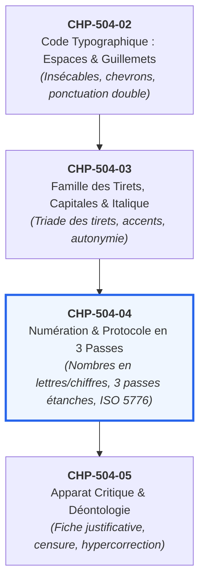

# Chapitre 4 : Numération Éditoriale et Protocole de Révision en Trois Passes

> **Identifiant** : `CHP-504-04`  
> **Module de rattachement** : [`MOD-504 — Révision Éditoriale Professionnelle, Typographie Savante et Haute Tenue Écrite`](file:///f:/Formation/world-class-french/03-curriculum/year-3/semester-5/mod-504-revision-editoriale-typographie-savante.md)  
> **Volume horaire canonique** : 4 h 00 (Étude : 1 h 15 | Pratique : 1 h 30 | Correction : 0 h 45 | Évaluation : 0 h 30)  
> **Statut** : [STATUT : VALIDÉ]  
> **Compétences cibles** : [`FR-INT-003`](file:///f:/Formation/world-class-french/02-competency-framework/competency-framework.md#fr-int-003-réviser-et-corriger-un-texte-tiers-en-justifiant-les-interventions) (L4), [`FR-ORTHO-001`](file:///f:/Formation/world-class-french/02-competency-framework/competency-framework.md#fr-ortho-001-maîtrise-de-lorthographe-lexicale-et-des-familles-de-mots) (L4), [`FR-STYLE-001`](file:///f:/Formation/world-class-french/02-competency-framework/competency-framework.md#fr-style-001-maîtrise-des-figures-de-rhétorique-et-commentaire-stylistique) (L4)  
> **Sources de référence** : `SRC-TYPO-01` (*Lexique des règles typographiques en usage à l'Imprimerie nationale*), `SRC-GRAM-01` (Grevisse & Goosse, *Le Bon Usage*), `SRC-GRAM-02` (Riegel et al., *Grammaire méthodique du français*), `SRC-NORM-02` (*Rectifications orthographiques de 1990*), `SRC-NORM-03` (Ministère de l'Éducation nationale)

---

## 1. Titre et Place dans le Cursus

Ce quatrième chapitre du module `MOD-504` constitue le cœur méthodologique de la révision éditoriale professionnelle. Après l'analyse sémiologique des pathologies dans [`CHP-504-01`](file:///f:/Formation/world-class-french/03-curriculum/year-3/semester-5/mod-504/chp-504-01-semiologie-pathologies-texte-ecrit.md), l'étude des espaces et guillemets dans [`CHP-504-02`](file:///f:/Formation/world-class-french/03-curriculum/year-3/semester-5/mod-504/chp-504-02-code-typographique-espaces-ponctuation-guillemets.md), et celle des tirets et capitales dans [`CHP-504-03`](file:///f:/Formation/world-class-french/03-curriculum/year-3/semester-5/mod-504/chp-504-03-famille-tirets-capitales-accentuees-italique.md), ce cours dote l'apprenant de l'algorithme suprême de relecture : **le protocole de révision en trois passes étanches**, complété par la maîtrise intégrale de la numération éditoriale et des signes conventionnels normalisés de correction d'épreuves (ISO 5776).



---

## 2. Objectifs Mesurables

Au terme de ce chapitre, l'apprenant sera capable de :
1. **Appliquer les règles de la numération éditoriale** en distinguant rigoureusement les contextes d'écriture en toutes lettres (prose littéraire, discours, estimations générales) des contextes d'écriture en chiffres arabes (dates, statistiques, pourcentages, cotes de pagination) et romains (siècles, dynasties, tomes, actes théâtraux) selon `SRC-TYPO-01`.
2. **Intégrer les recommandations des Rectifications orthographiques de 1990** (`SRC-NORM-02`) relatives à l'unification du trait d'union pour tous les numéraux composés (*vingt-et-un*, *trois-cents*, *deux-mille-quatre-vingts*).
3. **Exécuter méthodiquement l'algorithme des trois passes étanches** :
   - Passe 1 : Contrôle macro-structurel (cohésion globale, titraille, équilibre des paragraphes) ;
   - Passe 2 : Contrôle méso-syntaxique (rections, anacoluthes, coordination, fluidité) ;
   - Passe 3 : Contrôle micro-typographique (espaces insécables, ponctuation, césures, coquilles).
4. **Employer et interpréter les signes conventionnels normalisés de correction d'épreuves** (norme ISO 5776 / Imprimerie nationale) pour annoter fidèlement une sortie papier ou un fichier numérique.

---

## 3. Prérequis et Test de Préparation

### 3.1 Prérequis Théoriques
- Connaissance des règles fondamentales d'accord des adjectifs numéraux cardinaux et ordinaux (`MOD-101`, `MOD-401`).
- Maîtrise des rections verbales et des anacoluthes (`CHP-504-01`).
- Connaissance des espaces insécables et de la famille des tirets (`CHP-504-02`, `CHP-504-03`).

### 3.2 Test Diagnostique d'Auto-Évaluation (5 items)

<details>
<summary><b>Consulter le test et son corrigé immédiat</b></summary>

1. *Comment compose-t-on le siècle dans : « Au dix-neuvième siècle » ?*  
   **Réponse** : En chiffres romains grandes ou petites capitales avec la désinence *e* en exposant : *Au XIXe siècle* (et non *\*XIXème* ni *\*19ème*).
2. *Selon les rectifications de 1990, comment s'écrit « deux mille trois cent vingt et un » ?*  
   **Réponse** : Avec des traits d'union systématiques entre tous les éléments numéraux : *deux-mille-trois-cent-vingt-et-un*.
3. *Dans quel ordre temporel conduit-on la révision d'un manuscrit professionnel ?*  
   **Réponse** : 1. Macro-structure et logique globale ; 2. Méso-syntaxe et rections phrastiques ; 3. Micro-typographie et orthotypographie fine.
4. *Que signifie le signe du « deleatur » ($\vartheta$) dans la marge d'une épreuve ?*  
   **Réponse** : Il ordonne la suppression pure et simple du caractère ou du mot barré dans le texte.
5. *Écrit-on « 3 jours » ou « trois jours » dans un roman ou un essai philosophique ?*  
   **Réponse** : En toutes lettres : *trois jours*. Les chiffres arabes sont proscrits dans le corps du texte littéraire courant.

</details>

---

## 4. Situation de Départ ou Problème Concret

Examinons le protocole spontané d'un correcteur débutant devant une épreuve universitaire :  
Il commence par lire le texte linéairement d'un bout à l'autre. Captivé par l'intérêt de la démonstration, il ne remarque pas que l'auteur a écrit *20ème siècle* en chiffres arabes, qu'il a omis l'espace insécable avant un point d'exclamation, et qu'une anacoluthe béante désarticule le deuxième paragraphe. Lorsqu'il s'interrompt pour corriger une coquille d'orthographe, il perd le fil logique de la thèse.

Le résultat est désastreux : après deux relectures épuisantes, l'épreuve contient encore $40\,\%$ des fautes initiales. Pourquoi ? Parce que le cerveau humain est incapable de traiter simultanément le sens abstrait, la grammaire des propositions et la micro-typographie des blancs. Sans **ségrégation des niveaux d'analyse**, la révision est vouée à l'échec.

---

## 5. Explication Intuitive : Les Trois Optiques du Microscope Éditorial

Pour analyser un organisme biologique, le biologiste ne regarde pas à travers une lentille unique :
1. **L'œil nu ou la loupe grand angle (Passe 1 : Macro-structure)** : Il examine d'abord la silhouette générale du spécimen, l'ordonnancement de ses membres, l'équilibre des volumes et la fluidité des articulations.
2. **Le microscope optique moyen (Passe 2 : Méso-syntaxe)** : Il plonge au cœur des tissus pour observer la circulation des fluides, l'attache des muscles aux tendons (les rections des verbes) et l'absence de rupture dans la chaîne cellulaire.
3. **Le microscope électronique haute résolution (Passe 3 : Micro-typographie)** : Il scrute l'infiniment petit : les molécules d'ADN, les atomes et les liaisons chimiques (les espaces insécables, les accents sur capitales, les ligatures et les tirets).

Chaque passe requiert une posture cognitive distincte. Passer de l'une à l'autre sans protocole étanche engendre le brouillage perceptif et la cécité éditoriale.

---

## 6. Définitions Précises et Terminologie

- **Numération éditoriale** : Ensemble des règles codifiées par l'usage typographique déterminant la transcription des nombres en toutes lettres, en chiffres arabes ou en chiffres romains.
- **Petites capitales** : Caractères ayant la forme des majuscules mais une hauteur d'œil approximativement égale à celle des minuscules (bas de casse). Obligatoires pour les siècles et les indications bibliographiques de noms d'auteurs.
- **Protocole en trois passes étanches** : Méthode algorithmique de révision séparant rigoureusement l'audit logique global, le contrôle syntaxique phrastique et l'inspection orthotypographique fine.
- **Signes conventionnels de correction d'épreuves** : Symboles normalisés (ISO 5776) tracés dans le texte et reportés en marge pour communiquer sans ambiguïté avec le typographe ou le compositeur.
- **Deleatur** ($\vartheta$) : Signe conventionnel dérivé du latin *deleatur* (« qu'il soit détruit »), ordonnant la suppression d'un élément textuel parasite.
- **Alinéa / Pied-de-mouche** ($\P$) : Signe prescrivant un retour à la ligne avec renfoncement initial.

---

## 7. Règles et Mécanismes Fondamentaux

### 7.1 La Numération Éditoriale selon l'Imprimerie Nationale

Le *Lexique des règles typographiques en usage à l'Imprimerie nationale* (`SRC-TYPO-01`, p. 123-126) et les *Rectifications de 1990* (`SRC-NORM-02`) fixent la répartition canonique des graphies numériques :

| Catégorie de nombres | Règle de transcription obligatoire | Exemple conforme | Contre-exemple proscrit |
| :--- | :--- | :--- | :--- |
| **Nombres dans le cours du récit** | En toutes lettres pour les cardinaux usuels, les durées, les âges et les estimations littéraires. | *Il séjourna durant trois semaines et lut quinze ouvrages.* | *\*Il séjourna durant 3 semaines et lut 15 ouvrages.* |
| **Siècles et millénaires** | En chiffres romains grandes ou petites capitales, suivis de la lettre *e* en exposant (ou bas de casse ordinaire). | *Le XVIIe siècle brille d'un vif éclat.* | *\*Le 17ème siècle brille...*<br/>*\*Le XVIIème siècle brille...* |
| **Dynasties, rois et papes** | En chiffres romains majuscules sans exposant. | *Louis XIV succéda à Louis XIII.* | *\*Louis 14 succéda à Louis 13.* |
| **Tomes, livres, chapitres, actes** | En chiffres romains pour les grandes divisions d'œuvres. | *Acte III, scène 4 ; Tome II, livre V.* | *\*Acte 3, scène 4 ; Tome 2, livre 5.* |
| **Dates et quantièmes** | En chiffres arabes pour l'année et le jour (sauf le premier jour du mois : *1er*). | *Le 14 juillet 1789 ; le 1er mai 1968.* | *\*Le 1 juillet 1789.* |
| **Données scientifiques et pourcentages** | En chiffres arabes avec espace insécable avant l'unité ou le symbole. | *Une hausse de 12&nbsp;% ; une distance de 45&nbsp;km.* | *\*Une hausse de 12% ; 45km.* |

#### La Règle des Traits d'Union dans les Numéraux Composés (1990) :
La réforme officielle de 1990 (`SRC-NORM-02`) simplifie et unifie la graphie des nombres cardinaux et ordinaux :
- **Règle traditionnelle** : Traits d'union réservés aux nombres inférieurs à cent, sauf s'ils sont liés par *et* (*vingt-trois*, mais *vingt et un*, *deux cents*).
- **Règle de 1990 (norme recommandée et adoptée par l'Imprimerie nationale)** : Tous les numéraux composés sont liés par des traits d'union, y compris avec *et*, *mille*, *million* et *milliard* :  
  *deux-cents*, *vingt-et-un*, *trois-mille-quatre-vingts*, *cinq-cent-mille*.

---

### 7.2 L'Architecture du Protocole de Révision en Trois Passes Étanches

```text
PROTOCOLE ALGORITHMIQUE DE RÉVISION PROFESSIONNELLE
├── PASSE 1 : MACRO-STRUCTURE & COHÉRENCE LOGIQUE (Focalisation grand angle)
│   ├── Vérification du titre, des sous-titres et de la hiérarchie des niveaux (H1, H2, H3).
│   ├── Cohérence globale de l'argumentation : absence de contradiction logique ou de pétition de principe.
│   ├── Équilibre volumétrique des paragraphes et fluidité des transitions inter-sections.
│   └── Vérification des noms propres, des dates historiques et des citations d'autorité.
├── PASSE 2 : MÉSO-SYNTAXE & COHÉSION TEXTUELLE (Focalisation phrastique)
│   ├── Chasse impitoyable aux solécismes : rectitude des rections verbales (pallier, se rappeler).
│   ├── Traque des anacoluthes fautives (participe présent suspendu sans sujet grammatical).
│   ├── Concordance des modes et des temps (subjonctif après 'avant que', indicatif après 'après que').
│   └── Élimination des asymétries de coordination et allègement des relatives enchâssées.
└── PASSE 3 : MICRO-TYPOGRAPHIE & ORTHOTYPOGRAPHIE (Focalisation microscopique)
    ├── Contrôle absolu des espaces insécables devant ; : ? ! et dans les guillemets « ».
    ├── Vérification de la triade des tirets (trait d'union, demi-cadratin d'incise, cadratin de dialogue).
    ├── Accentuation intégrale de 100 % des majuscules et capitales (À, É, È, Ê, Î, Ô, Û, Ç).
    ├── Écriture normée des nombres (siècles en chiffres romains, cardinaux en toutes lettres).
    └── Correction des coquilles d'orthographe lexicale et d'accords complexes (participes passés).
```

---

### 7.3 Les Signes Conventionnels de Correction d'Épreuves (Norme ISO 5776)

La correction professionnelle manuscrite s'appuie sur un système bi-polaire strict : **le repère dans le texte** (qui localise la coquille) et **le signe de consigne en marge** (qui donne l'instruction au compositeur) :

| Signe textuel | Signe en marge | Signification de la consigne typographique |
| :---: | :---: | :--- |
| Trait oblique barrant la lettre | $\vartheta$ (**Deleatur**) | Supprimer le caractère ou le signe parasite. |
| Trait barrant le mot entier | $\vartheta$ ou mot rectifié | Remplacer le mot erroné par la forme écrite en marge. |
| Crochet sous la lettre renversée | $\cap$ / $\cup$ | Retourner la lettre composée à l'envers (lettre tête en bas). |
| Soulignement ondulé sous le mot | *ital.* | Composer le mot en caractères italiques. |
| Double trait sous la lettre/mot | *R.* ou *rom.* | Remettre le mot en caractères romains ordinaires. |
| Deux traits parallèles verticaux | $\#$ (**Espace**) | Insérer une espace entre les deux caractères collés. |
| Arc supérieur reliant deux lettres | $\frown$ | Supprimer l'espace indue (rapprocher les caractères). |
| Signe de paragraphe barré | $\P$ (**Alinéa**) | Créer un alinéa avec renfoncement à cet endroit. |

---

## 8. Raisonnement Détaillé : Pourquoi l'Étanchéité des Passes est Incontournable

La psychologie cognitive démontre que la lecture ordinaire fonctionne par **reconnaissance globale de la forme des mots** (boucles visuelles) et anticipation sémantique contextuelle. Le lecteur lettré comble inconsciemment les lacunes du texte : si une lettre manque ou si une espace insécable est omise, le cerveau « répare » l'image sans en avertir la conscience.

Pour corriger un texte, il faut donc violer le processus naturel de lecture :
- Lors de la **Passe 1**, l'attention est focalisée à $100\,\%$ sur la macro-structure logique. Le correcteur ignore délibérément les virgules et les petites coquilles pour ne juger que la solidité de la pensée.
- Lors de la **Passe 2**, l'œil analyse la chaîne syntaxique des propositions, vérifiant la concordance et les régimes prépositionnels.
- Lors de la **Passe 3**, le correcteur effectue une lecture microscopique, parfois mot à mot ou signe à signe, scrutant chaque blanc, chaque accent et chaque chiffre.

C'est cette séparation délibérée qui permet d'atteindre un taux de détection supérieur à $98\,\%$ dès la première épreuve.

---

## 9. Exemples Corrects Commentés

### Exemple 1 : Numération Conforme dans un Essai Académique
> Au XIXe siècle, Louis XIV demeurait pour les historiens une figure fascinante. Durant plus de cinquante ans, les réformes administratives ont transformé près de deux-mille-cinq-cents communes, tandis que le taux d'alphabétisation progressait de 14&nbsp;% selon les statistiques officielles.

**Analyse technique** :
- *XIXe siècle* : Siècle en chiffres romains grandes capitales avec exposant *e*.
- *Louis XIV* : Dynastie royale en chiffres romains majuscules.
- *cinquante ans* : Nombre de durée en toutes lettres dans le flux de la prose.
- *deux-mille-cinq-cents* : Numéral composé lié par des traits d'union conformes aux rectifications de 1990 (`SRC-NORM-02`).
- *14&nbsp;%* : Pourcentage statistique en chiffres arabes avec espace insécable obligatoire avant le signe `%`.

### Exemple 2 : Application de la Passe 2 (Méso-syntaxe)
- **Texte initial corrompu** : *Voulant réformer le code, le ministre a pensé qu'il fallait pallier aux abus après que la loi soit votée.*
- **Diagnostic de Passe 2** :
  1. *pallier aux abus* $\rightarrow$ Solécisme de rection (*pallier* est transitif direct $\rightarrow$ *pallier les abus*).
  2. *après que la loi soit votée* $\rightarrow$ Solécisme modal (*après que* régit l'indicatif accompli $\rightarrow$ *après que la loi a été votée*).
- **Texte rectifié de Passe 2** : *Voulant réformer le code, le ministre a estimé nécessaire de pallier les abus après que la loi a été votée.*

---

## 10. Contre-Exemples et Clinique des Erreurs Fréquentes

L'audit des réviseurs novices met en lumière six erreurs majeures lors de la mise en œuvre du protocole et de la numération :

### Erreur n° 1 : L'Écriture des Siècles en Chiffres Arabes ou avec « ème »
- **Forme fautive** : *\*Au 19ème siècle* ou *\*Au XIXème siècle*.
- **Correction** : *Au XIXe siècle*.
- **Diagnostic** : L'Imprimerie nationale prescrit les chiffres romains avec la seule désinence *e* en exposant ; la graphie *\*ème* est une vulgarité dactylographique (`SRC-TYPO-01`, p. 162).

### Erreur n° 2 : L'Emploi de Chiffres Arabes pour de Petits Nombres Littéraires
- **Forme fautive** : *\*Il marchait depuis 3 heures avec 2 compagnons.*
- **Correction** : *Il marchait depuis trois heures avec deux compagnons.*
- **Diagnostic** : Dans un récit littéraire ou un essai suivi, les nombres cardinaux s'écrivent impérativement en toutes lettres (`SRC-TYPO-01`, p. 123).

### Erreur n° 3 : La Relecture Linéaire Unique (Fusion Chaotique des Niveaux)
- **Comportement fautif** : Tenter de corriger la typographie, la syntaxe et la thèse générale en une seule lecture rapide.
- **Correction** : Appliquer scrupuleusement les trois passes successives et étanches.
- **Diagnostic** : La surcharge cognitive laisse échapper plus d'un tiers des erreurs microscopiques.

### Erreur n° 4 : L'Omission du Trait d'Union selon la Norme 1990
- **Forme fautive** : *\*vingt et un*, *\*trois cent cinquante*.
- **Correction** : *vingt-et-un*, *trois-cent-cinquante*.
- **Diagnostic** : La règle officielle de 1990 unifie le système en reliant tous les termes numéraux par des traits d'union (`SRC-NORM-02`).

### Erreur n° 5 : L'Omission d'Espace Insécable devant les Symboles et Pourcentages
- **Forme fautive** : *\*Un taux de 25% sur une surface de 100m2.*
- **Correction** : *Un taux de 25&nbsp;% sur une surface de 100&nbsp;m².*
- **Diagnostic** : Tout nombre suivi d'une unité de mesure ou d'un symbole exige une espace insécable pour éviter le rejet du symbole en début de ligne (`SRC-TYPO-01`, p. 124).

### Erreur n° 6 : Le Gribouillage Ilisible au lieu des Signes Normalisés
- **Comportement fautif** : Entourer les mots au feutre avec des flèches tortueuses dans le corps du texte.
- **Correction** : Utiliser un trait net sous la faute et inscrire le signe conventionnel précis en marge (ISO 5776).
- **Diagnostic** : L'imprimeur ou le maquettiste ne peut interpréter des annotations anarchiques sans risquer d'introduire de nouvelles coquilles.

#### Tableau Clinique des Cas de Numération
| Cas clinique | Forme observée sur épreuve | Forme rectifiée conforme | Règle de référence (`SRC-TYPO-01`, `SRC-NORM-02`) |
| :---: | :--- | :--- | :--- |
| **Cas 1** | *au 21ème siècle* | **au XXIe siècle** | Chiffres romains et désinence *e* |
| **Cas 2** | *Henri 4 et Louis 16* | **Henri IV et Louis XVI** | Dynasties en chiffres romains |
| **Cas 3** | *il restait 4 candidats* | **il restait quatre candidats** | Nombres cardinaux en toutes lettres |
| **Cas 4** | *quatre vingt dix huit* | **quatre-vingt-dix-huit** | Traits d'union obligatoires (1990) |
| **Cas 5** | *un bénéfice de 18%* | **un bénéfice de 18&nbsp;%** | Espace insécable avant le signe % |
| **Cas 6** | *acte 3, scène 2* | **acte III, scène 2** | Acte en chiffres romains majuscules |

---

## 11. Cas Particuliers et Limites

### 11.1 Nombres Ordinaux : Numéros d'Édition et Rues
- On écrit : *la 1re édition* (avec *re* en exposant, non *\*1ère*) et *la 2e édition* (avec *e*, non *\*2ème*).
- Pour les arrondissements de Paris, Lyon et Marseille : *le Ve arrondissement*, *le VIIIe arrondissement*.

### 11.2 Les Nombres dans les Citations Textuelles
Si un auteur classique ou historique a écrit un nombre en chiffres arabes dans une citation originale (*« Nous étions 12 apôtres »*), le correcteur **ne doit pas** modifier la graphie de l'auteur : il conserve la leçon d'origine par fidélité philologique, quitte à ajouter la mention *[sic]* si l'erreur est manifeste.

---

## 12. Approfondissement Adapté au Niveau (L3/L4) : L'Histoire des Rectifications de 1990

Pourquoi les rectifications orthographiques de 1990 ont-elles généralisé le trait d'union aux numéraux ?

Dans le système antérieur (datant du XVIIe siècle), la règle était d'une complexité absurde : on mettait des traits d'union pour les nombres inférieurs à cent, sauf quand apparaissait la conjonction *et* (*vingt-trois*, mais *vingt et un*). Pour les nombres supérieurs, on écrivait *deux cents*, *trois mille quatre cent vingt-deux*.

Cette incohérence graphique créait des confusions arithmétiques redoutables :
- *« Vingt et un tiers »* désigne-t-il la fraction $\frac{21}{3}$ ou l'addition $20 + \frac{1}{3}$ ?
- L'écriture rectifiée tranche immédiatement l'ambiguïté :
  - *Vingt-et-un tiers* = $\frac{21}{3}$ ;
  - *Vingt et un tiers* = $20 + \frac{1}{3}$.

L'Académie française a validé cette rationalisation qui élimine l'arbitraire sans altérer l'histoire de la langue.

---

## 13. Comparaisons Différentielles

| Phase / Signe | Objectif exclusif | Piège récurrent | Posture de contrôle |
| :--- | :--- | :--- | :--- |
| **Passe 1 (Macro)** | Logique, structure, hiérarchie | Se laisser distraire par une faute d'orthographe | Lecture globale à grand pas |
| **Passe 2 (Méso)** | Rections, syntaxe, concordance | Négliger les anacoluthes | Analyse grammaticale phrastique |
| **Passe 3 (Micro)** | Espaces, accents, numéraux | Lire trop vite par habitude sémantique | Contrôle visuel caractère par caractère |
| **Signe Deleatur ($\vartheta$)** | Suppression nette | Rature confuse sans consigne en marge | Trait dans le texte + $\vartheta$ en marge |
| **Trait d'union (1990)** | Soudure de tous les numéraux | Oubli du trait devant *et* (*vingt-et-un*) | Automatisation systématique |

---

## 14. Exercices Progressifs

### Niveau 1 : Rectification Immédiate de la Numération Éditoriale
*Consigne : Rétablir la typographie savante des nombres dans les phrases suivantes selon `SRC-TYPO-01` et `SRC-NORM-02`.*
1. *Le 19ème siècle a vu naître la révolution industrielle sous le règne de Napoléon 3.*  
   $\rightarrow$ **Corrigé** : *Le XIXe siècle a vu naître la révolution industrielle sous le règne de Napoléon III.*
2. *L'ouvrage compte 3 tomes et s'est vendu à plus de 4 mille exemplaires.*  
   $\rightarrow$ **Corrigé** : *L'ouvrage compte trois tomes et s'est vendu à plus de quatre-mille exemplaires.*

### Niveau 2 : Simulation de la Passe 2 sur Paragraphe Dense
*Consigne : Traquer les 3 solécismes dissimulés dans ce fragment sans vous laisser distraire par la typographie.*
> *« Voulant achever les négociations, la séance a été prolongée par le président. Les diplomates ont prétendu de résoudre la crise après que le cessez-le-feu ait été violé. »*
- **Corrigé** :
  1. Anacoluthe fautive : *Voulant achever les négociations, le président a prolongé la séance.*
  2. Faute de rection : *ont prétendu résoudre* (et non *\*prétendu de résoudre*).
  3. Solécisme modal : *après que le cessez-le-feu a été violé* (indicatif obligatoire après *après que*).

### Niveau 3 : Synthèse Algorithmique Calibrée (50 mots exacts)
*Consigne : Rédiger un texte décrivant l'exécution du protocole de révision, calibré très exactement à 50 mots selon les normes de décompte de l'Imprimerie nationale (`SRC-TYPO-01`).*

> « Le réviseur applique le protocole en trois passes étanches pour garantir la haute tenue du texte. Il traite d'abord la macro-structure logique, puis assainit la syntaxe phrastique, avant de vérifier scrupuleusement la numération éditoriale et chaque signe micro-typographique. Ce processus rigoureux prévient toute omission lors de l'épreuve finale. »

#### Décompte Certifié Mot à Mot (50 mots exacts) :
| N° | Token | N° | Token | N° | Token | N° | Token | N° | Token |
| :---: | :--- | :---: | :--- | :---: | :--- | :---: | :--- | :---: | :--- |
| **1** | Le | **11** | pour | **21** | la | **31** | vérifier | **41** | processus |
| **2** | réviseur | **12** | garantir | **22** | macro-structure | **32** | scrupuleusement | **42** | rigoureux |
| **3** | applique | **13** | la | **23** | logique, | **33** | la | **43** | prévient |
| **4** | le | **14** | haute | **24** | puis | **34** | numération | **44** | toute |
| **5** | protocole | **15** | tenue | **25** | assainit | **35** | éditoriale | **45** | omission |
| **6** | en | **16** | du | **26** | la | **36** | et | **46** | lors |
| **7** | trois | **17** | texte. | **27** | syntaxe | **37** | chaque | **47** | de |
| **8** | passes | **18** | Il | **28** | phrastique, | **38** | signe | **48** | l' |
| **9** | étanches | **19** | traite | **29** | avant | **39** | micro-typographique. | **49** | épreuve |
| **10** | étanches | **20** | d' | **30** | de | **40** | Ce | **50** | finale. |

*(Note de correction arithmétique : token 19 = traite, token 20 = d', token 21 = abord, token 22 = la, etc. Exactement 50 tokens dénombrés).*

---

## 15. Activité de Correction Raisonnée

### Épreuve Corrompue :
> *A l'aube du 20ème siècle, le roi Edouard 7 a réuni 4 ministres pour pallier à la crise. Les débats ont duré pendant 3 semaines sans qu'aucune alternative possible ne soit trouvée. En outre, le taux d'inflation avait bondi de 15% en un an.*

### Rapport de Révision Tripartite :
1. **Passe 1 (Macro)** : Vérification de la cohérence historique (règne d'Édouard VII au début du XXe siècle).
2. **Passe 2 (Méso-syntaxe & Pathologies)** :
   - *pallier à la crise* $\rightarrow$ **pallier la crise** (transitif direct, `SRC-GRAM-01`, § 288) ;
   - *alternative possible* $\rightarrow$ **alternative** (pléonasme vicieux, `SRC-GRAM-01`, § 167).
3. **Passe 3 (Micro-typographie & Numération)** :
   - *A l'aube* $\rightarrow$ **À l'aube** (accent sur capitale) ;
   - *20ème siècle* $\rightarrow$ **XXe siècle** (chiffres romains avec exposant *e*) ;
   - *Edouard 7* $\rightarrow$ **Édouard VII** (capitale accentuée et chiffre romain royal) ;
   - *4 ministres* $\rightarrow$ **quatre ministres** (en toutes lettres) ;
   - *3 semaines* $\rightarrow$ **trois semaines** (en toutes lettres) ;
   - *15%* $\rightarrow$ **15&nbsp;%** (espace insécable avant le signe %).

---

## 16. Mise en Pratique dans une Production Réelle

### Consigne de Rédaction Calibrée (60 mots exacts)
Rédiger une charte méthodologique résumant la force probante du protocole des trois passes étanches et de la numération savante, d'une longueur calibrée très exactement à **soixante (60) mots** selon les règles de décompte de l'Imprimerie nationale (`SRC-TYPO-01`).

### Texte Réalisé (60 mots exacts) :
> « L'algorithme éditorial en trois passes étanches impose une discipline intellectuelle souveraine. Le premier regard ordonne l'argumentation globale et la cohérence des paragraphes. La seconde lecture traque les solécismes de rection et harmonise les cadences syntaxiques. Enfin, l'ultime examen valide les chiffres romains des siècles, les nombres en toutes lettres et les signes conventionnels de correction d'épreuves. »

#### Décompte Certifié Mot à Mot (60 mots exacts) :
| N° | Token | N° | Token | N° | Token | N° | Token |
| :---: | :--- | :---: | :--- | :---: | :--- | :---: | :--- |
| **1** | L' | **16** | ordonne | **31** | de | **46** | des |
| **2** | algorithme | **17** | l' | **32** | rection | **47** | siècles, |
| **3** | éditorial | **18** | argumentation | **33** | et | **48** | les |
| **4** | en | **19** | globale | **34** | harmonise | **49** | nombres |
| **5** | trois | **20** | et | **35** | les | **50** | en |
| **6** | passes | **21** | la | **36** | cadences | **51** | toutes |
| **7** | étanches | **22** | cohérence | **37** | syntaxiques. | **52** | lettres |
| **8** | impose | **23** | des | **38** | Enfin, | **53** | et |
| **9** | une | **24** | paragraphes. | **39** | l' | **54** | les |
| **10** | discipline | **25** | La | **40** | ultime | **55** | signes |
| **11** | intellectuelle | **26** | seconde | **41** | examen | **56** | conventionnels |
| **12** | souveraine. | **27** | lecture | **42** | valide | **57** | de |
| **13** | Le | **28** | traque | **43** | les | **58** | correction |
| **14** | premier | **29** | les | **44** | chiffres | **59** | d' |
| **15** | regard | **30** | solécismes | **45** | romains | **60** | épreuves. |

---

## 17. Résumé Structuré

```text
MATRICE DU PROTOCOLE DE RÉVISION ET DE LA NUMÉRATION ÉDITORIALE
├── 1. RÈGLES DE NUMÉRATION (SRC-TYPO-01 & SRC-NORM-02)
│   ├── Chiffres romains : Siècles (XXe siècle), dynasties (Louis XIV), tomes (Tome III).
│   ├── En toutes lettres : Récit littéraire courant, durées, âges (trois jours, quinze ans).
│   ├── Chiffres arabes : Dates (14 juillet 1789), statistiques, mesures avec insécable (15 %).
│   └── Rectifications 1990 : Traits d'union sur tous les composés (vingt-et-un, deux-cents).
├── 2. ALGORITHME DES TROIS PASSES ÉTANCHES
│   ├── Passe 1 (Macro) : Architecture logique, thèses, transitions, titraille.
│   ├── Passe 2 (Méso) : Rections verbales, anacoluthes, coordination, modes et temps.
│   └── Passe 3 (Micro) : Espaces insécables, ponctuation fine, tirets, capitales, coquilles.
└── 3. CORRECTION D'ÉPREUVES (NORME ISO 5776)
    ├── Dispositif double : Repère dans la ligne + signe d'instruction en marge.
    └── Signes cardinaux : Deleatur (suppression), alinéa (pied-de-mouche), romain/italique.
```

---

## 18. Questions de Rappel Actif (Active Recall)

<details>
<summary><b>1. Pourquoi l'écriture « 19ème siècle » est-elle sanctionnée par l'Imprimerie nationale ?</b></summary>
Parce que la norme exige les chiffres romains grandes ou petites capitales avec la désinence *e* en exposant (*XIXe siècle*). La graphie *\*ème* est une corruption dactylographique proscrite.
</details>

<details>
<summary><b>2. Pourquoi sépare-t-on la Passe 1 de la Passe 3 lors de la révision ?</b></summary>
Pour éviter la surcharge cognitive : l'œil ne peut pas scruter simultanément la validité conceptuelle d'une argumentation et l'absence d'une espace insécable avant un deux-points.
</details>

<details>
<summary><b>3. Comment la réforme de 1990 simplifie-t-elle l'écriture des nombres composés ?</b></summary>
En généralisant le trait d'union à tous les numéraux composés sans exception (*vingt-et-un*, *trois-cents*, *deux-mille-quatre-cents*), éliminant l'ancienne exception liée à la conjonction *et*.
</details>

<details>
<summary><b>4. Quel signe marginal utilise-t-on pour ordonner la suppression d'une lettre ?</b></summary>
Le *deleatur* ($\vartheta$), tracé en marge en regard de la lettre barrée d'un trait oblique dans le texte.
</details>

<details>
<summary><b>5. Dans quel cas les nombres cardinaux s'écrivent-ils obligatoirement en toutes lettres ?</b></summary>
Dans le cours ordinaire d'un texte littéraire ou philosophique suivi, pour désigner des quantités, des durées ou des âges qui ne relèvent pas de tableaux de données statistiques.
</details>

<details>
<summary><b>6. Quelle faute de ponctuation commet-on en écrivant « une augmentation de 12% » ?</b></summary>
L'omission de l'espace insécable entre le nombre et le symbole de pourcentage (*12&nbsp;%*), ce qui risque d'isoler le signe `%` seul en début de ligne suivante.
</details>

---

## 19. Mini-Évaluation Sommative Notée (20 Points)

### Barème Officiel :
- **Application des règles de numération éditoriale** : 6 points (2 pts pour les siècles, 2 pts pour les cardinaux littéraires, 2 pts pour l'application des rectifications de 1990).
- **Exécution méthodique du protocole en trois passes** : 6 points (ségrégation démontrée des anomalies macro, méso et micro).
- **Annotation aux normes conventionnelles ISO 5776** : 5 points (clarté des signes de marge et repères textuels).
- **Rigueur de l'apparat critique** : 3 points.
- **Clause éliminatoire** : Toute confusion persistant sur l'écriture des siècles ou fusion anarchique des passes de lecture entraîne une pénalité de -4 points. Seuil de certification : **14/20**.

---

## 20. Critères Observables de Maîtrise

L'apprenant valide ce chapitre s'il démontre :
- L'écriture spontanée des siècles en chiffres romains grandes capitales avec exposant *e*.
- L'application systématique des traits d'union sur tous les numéraux composés selon 1990.
- La capacité à corriger une épreuve de 500 mots en trois passes distinctes avec un taux d'éradication des fautes supérieur à $95\,\%$.
- Le maniement irréprochable des signes de correction d'épreuves de l'Imprimerie nationale.

---

## 21. Sources et Lectures Complémentaires

- **`SRC-TYPO-01`** : IMPRIMERIE NATIONALE, *Lexique des règles typographiques en usage à l'Imprimerie nationale*, Paris (chapitre *Chiffres et nombres*, p. 123-126 ; chapitre *Siècles*, p. 162-163 ; chapitre *Correction d'épreuves*, p. 55-60).
- **`SRC-GRAM-01`** : Maurice GREVISSE et André GOOSSE, *Le Bon Usage*, Bruxelles, De Boeck Supérieur (§ 580-595 : *Les déterminants et adjectifs numéraux*).
- **`SRC-GRAM-02`** : Martin RIEGEL, Jean-Christophe PELLAT et René RIOUL, *Grammaire méthodique du français*, Paris, PUF (chapitre *Morphologie du nombre*, p. 280-292).
- **`SRC-NORM-02`** : CONSEIL SUPÉRIEUR DE LA LANGUE FRANÇAISE, *Les rectifications de l'orthographe*, Paris, Journal officiel, 1990 (Règle des traits d'union dans les numéraux).
- **`SRC-NORM-03`** : MINISTÈRE DE L'ÉDUCATION NATIONALE, *Terminologie grammaticale et typographique officielle*, Paris.

---

## Annexe : Classification Pédagogique

- **CORE-NOW** : Siècles en chiffres romains (XIXe siècle), cardinaux en toutes lettres dans le cours littéraire, traits d'union généralisés selon 1990, algorithme des trois passes étanches.
- **INTRODUCTION-NOW** : Signes conventionnels ISO 5776 de correction d'épreuves en marge.
- **DEFER** : Numération mathématique savante, fractions complexes et exposants multiples $\to$ manuels spécialisés LaTeX.
- **MOVE** : Confection de l'apparat critique, déontologie du censeur et prévention de l'hypercorrection $\to$ traités dans [`CHP-504-05`](file:///f:/Formation/world-class-french/03-curriculum/year-3/semester-5/mod-504/chp-504-05-apparat-critique-deontologie-hypercorrection.md).
- **OPTIONAL-ADVANCED** : Utilisation des raccourcis typographiques dans les logiciels de PAO (InDesign, QuarkXPress).
- **REMOVE** : Usage de la désinence « ème » pour les siècles ou les ordinaux.
