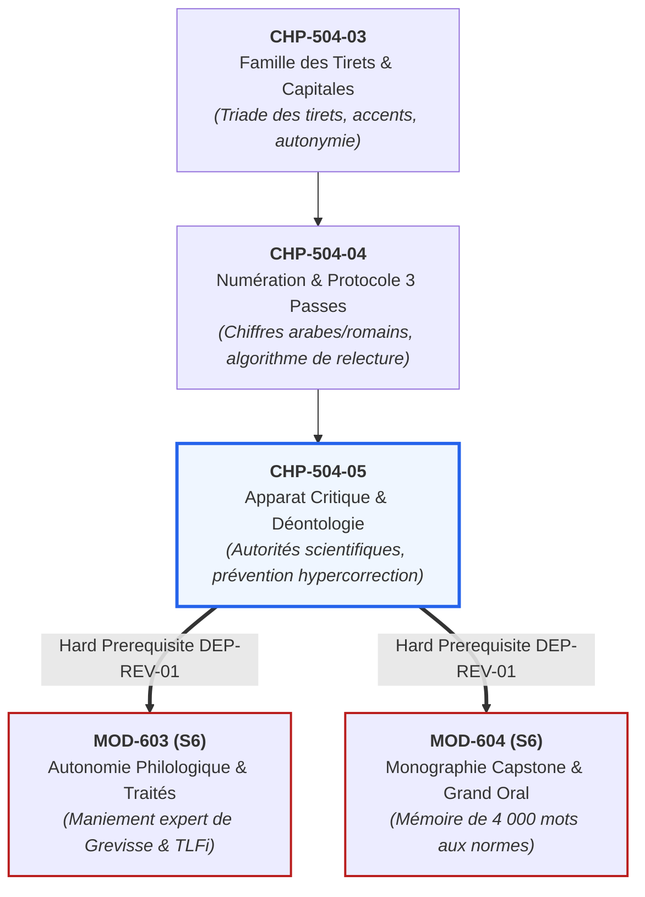

# Chapitre 5 : L'Apparat Critique, Déontologie Éditoriale et Prévention de l'Hypercorrection

> **Identifiant** : `CHP-504-05`  
> **Module de rattachement** : [`MOD-504 — Révision Éditoriale Professionnelle, Typographie Savante et Haute Tenue Écrite`](file:///f:/Formation/world-class-french/03-curriculum/year-3/semester-5/mod-504-revision-editoriale-typographie-savante.md)  
> **Volume horaire canonique** : 3 h 30 (Étude : 1 h 00 | Pratique : 1 h 15 | Correction : 0 h 45 | Évaluation : 0 h 30)  
> **Statut** : [STATUT : VALIDÉ]  
> **Compétences cibles** : [`FR-INT-003`](file:///f:/Formation/world-class-french/02-competency-framework/competency-framework.md#fr-int-003-réviser-et-corriger-un-texte-tiers-en-justifiant-les-interventions) (L4), [`FR-STYLE-001`](file:///f:/Formation/world-class-french/02-competency-framework/competency-framework.md#fr-style-001-maîtrise-des-figures-de-rhétorique-et-commentaire-stylistique) (L4), [`FR-ORTHO-001`](file:///f:/Formation/world-class-french/02-competency-framework/competency-framework.md#fr-ortho-001-maîtrise-de-lorthographe-lexicale-et-des-familles-de-mots) (L4)  
> **Sources de référence** : `SRC-GRAM-01` (Grevisse & Goosse, *Le Bon Usage*), `SRC-TYPO-01` (*Lexique des règles typographiques en usage à l'Imprimerie nationale*), `SRC-GRAM-02` (Riegel et al., *Grammaire méthodique du français*), `SRC-LEX-01` (*Trésor de la Langue Française informatisé*), `SRC-LEX-02` (Académie française, *Dictionnaire*), `SRC-NORM-03` (Ministère de l'Éducation nationale)

---

## 1. Titre et Place dans le Cursus

Ce cinquième et dernier chapitre du module `MOD-504` couronne l'ensemble du Semestre 5 du cursus **World-Class French**. Après avoir étudié la sémiologie des pathologies (`CHP-504-01`), les espaces et guillemets (`CHP-504-02`), la famille des tirets et capitales (`CHP-504-03`), ainsi que le protocole de révision en trois passes (`CHP-504-04`), ce cours installe la dimension éthique et scientifique suprême du métier des lettres : **la confection de l'apparat critique, la déontologie du censeur face à l'auteur, et la neutralisation absolue de l'hypercorrection**.



---

## 2. Objectifs Mesurables

Au terme de ce chapitre, l'apprenant sera capable de :
1. **Dresser un apparat critique de révision professionnel** structuré selon le quintuplet normatif : $\langle \text{Localisation}, \text{Leçon fautive}, \text{Leçon rétablie}, \text{Taxonomie du vice}, \text{Justification et Référence scientifique} \rangle$.
2. **Citer et mobiliser avec exactitude les autorités de référence** de la langue française (`SRC-GRAM-01`, `SRC-TYPO-01`, `SRC-GRAM-02`, `SRC-LEX-01`, `SRC-LEX-02`) pour motiver chaque intervention éditoriale.
3. **Respecter la déontologie du correcteur** : servir l'auteur sans se substituer à son style, distinguer la faute objective de la licence ou singularité stylistique, et s'abstenir de toute censure capricieuse.
4. **Déjouer méthodiquement les pièges d'hypercorrection** (subjonctif imparfait rare, invariabilité de *fait + infinitif*, adjectif *feu* antéposé, négation sans *pas*) et préserver les beautés attestées de la tradition classique.
5. **Auditer un manuscrit littéraire ou universitaire complexe** selon la grille synoptique d'homologation éditoriale au seuil éliminatoire de 14/20.

---

## 3. Prérequis et Test de Préparation

### 3.1 Prérequis Théoriques
- Maîtrise des pathologies du texte écrit (`CHP-504-01`).
- Application du code de l'Imprimerie nationale (`CHP-504-02`, `CHP-504-03`).
- Pratique du protocole de révision en trois passes (`CHP-504-04`).

### 3.2 Test Diagnostique d'Auto-Évaluation (5 items)

<details>
<summary><b>Consulter le test et son corrigé immédiat</b></summary>

1. *Qu'appelle-t-on « hypercorrection » en révision éditoriale ?*  
   **Réponse** : Le fait de modifier à tort une tournure rare, archaïque ou stylistique parfaitement correcte en croyant corriger une faute, introduisant ainsi une erreur ou mutilant le texte de l'auteur.
2. *L'expression « feu la reine » est-elle fautive ? Doit-on accorder « feue » ?*  
   **Réponse** : Elle est parfaitement correcte. Placé immédiatement avant l'article ou le déterminant possessif, l'adjectif *feu* demeure invariable (*feu la reine*, mais *la feue reine*).
3. *Dans la phrase « Les musiciens qu'il a fait venir », le participe « fait » doit-il s'accorder au masculin pluriel ?*  
   **Réponse** : Non, formellement. *Fait + infinitif* est strictement invariable en français (`SRC-GRAM-01`, § 961). L'accord *\*faits* est une hypercorrection sévère.
4. *Quelle différence sépare un avis de correction d'une réécriture auctoriale ?*  
   **Réponse** : L'avis de correction assainit la syntaxe et la norme en motivant scientifiquement l'intervention ; la réécriture auctoriale impose les préférences de goût du réviseur et dénature la voix de l'écrivain.
5. *Pourquoi l'hypercorrection est-elle pénalisée deux fois plus lourdement qu'une faute omise ?*  
   **Réponse** : Parce qu'une faute omise laisse passer une scorie préexistante, tandis que l'hypercorrection détruit sciemment une forme juste par prétention normative injustifiée.

</details>

---

## 4. Situation de Départ ou Problème Concret

Considérons l'attitude de deux correcteurs face à la phrase suivante, tirée d'un roman classique :

> *« Quoiqu'il en soit, il eût mieux valu qu'il prît garde aux périls du chemin. »*

- **Le correcteur amateur (tombé dans l'hypercorrection)** :  
  Il juge la phrase « lourde » ou « vieillotte ». Il remplace *eût mieux valu* par *\*aurait mieux valu*, et transforme le subjonctif imparfait *prît* en présent *\*prenne*. Ce faisant, il détruit l'harmonie du passé littéraire, profane la langue de l'auteur et introduit une discordance temporelle fautive.
- **Le correcteur d'élite (instruit de la déontologie)** :  
  Il identifie immédiatement un subjonctif plus-que-parfait conditionnel et un subjonctif imparfait d'une élégance suprême (`SRC-GRAM-01`, § 1115). Il s'incline devant la maîtrise de l'auteur, ne touche à rien, et consigne la conformité dans son journal de contrôle.

Le correcteur n'est pas un censeur politique ni un maître d'école tatillon : il est l'avocat du texte et le gardien de la légitimité linguistique.

---

## 5. Explication Intuitive : Le Restaurateur de Tableaux Anciens

Le métier de correcteur éditorial est rigoureusement identique à celui du **restaurateur d'art dans un grand musée** :
- Le restaurateur ne repeint pas le tableau avec ses couleurs préférées sous prétexte qu'il trouve le ciel trop sombre ou le visage trop austère.
- Il utilise un scalpel et des solvants neutres pour retirer la crasse, les chancres et les vernis oxydés (les coquilles, les solécismes, les espaces parasites).
- S'il découvre un glacis étrange ou une asymétrie voulue par le maître, il s'interdit d'y toucher : il sait que cette singularité est la signature même du génie de l'artiste.

L'hypercorrection est le vandalisme du restaurateur incompétent qui décapite une statue sous prétexte que son nez ne respecte pas les proportions de la géométrie moderne.

---

## 6. Définitions Précises et Terminologie

- **Apparat critique** : Ensemble structuré des notes, leçons rejetées, variantes et justifications savantes accompagnant l'établissement définitif d'un texte.
- **Déontologie éditoriale** : Code de conduite morale et intellectuelle régissant les devoirs du réviseur : fidélité au sens de l'auteur, respect de son registre stylistique, interdiction de l'arbitraire et justification systématique par les autorités reconnues.
- **Hypercorrection** : Erreur linguistique commise par un locuteur ou scripteur qui, par souci exagéré de bien parler ou par méconnaissance des règles réelles, altère une forme licite ou substitue une graphie fautive à une tournure correcte.
- **Voix auctoriale** : Idiolecte singulier, souffle périodique et tonalité esthétique propres à un auteur donné.
- **Autorité linguistique** : Ouvrage, académie ou corpus de référence faisant foi pour déterminer la norme et les usages légitimes de la langue française.

---

## 7. Règles et Mécanismes Fondamentaux

### 7.1 La Structure Formelle de l'Apparat Critique Professionnel

Toute intervention sur un texte d'autrui doit pouvoir être auditée et défendue contradictoirement. La fiche d'apparat critique répond au formalisme canonique suivant :

$$\text{Entrée Critique} = \langle \text{Localisation}, \text{Leçon Corrompue}, \text{Leçon Rétablie}, \text{Taxonomie}, \text{Justification & Autorité} \rangle$$

#### Exemple d'Entrée Conforme :
- **Localisation** : Page 14, paragraphe 2, ligne 5.
- **Leçon corrompue** : *« Le ministre a refusé de pallier à ce déficit. »*
- **Leçon rétablie** : *« Le ministre a refusé de pallier ce déficit. »*
- **Taxonomie** : Solécisme (faute de rection verbale transitive directe).
- **Justification & Autorité** : Le verbe *pallier* régit un complément d'objet direct direct sans préposition *à* (`SRC-GRAM-01`, § 288 ; `SRC-LEX-02`, s.v. « pallier »).

---

### 7.2 La Hiérarchie des Autorités Linguistiques de Référence

Le réviseur d'édition ne fonde jamais un arbitrage sur son « sentiment linguistique » personnel. Il mobilise les sources homologuées du registre officiel :

| Autorité / Source | Domaine de compétence exclusif | Mode de citation standard |
| :--- | :--- | :--- |
| **`SRC-TYPO-01`** (*Imprimerie nationale*) | Micro-typographie, espaces insécables, tirets, capitales accentuées, césures et numération. | *Lexique de l'Imprimerie nationale*, p. 149. |
| **`SRC-GRAM-01`** (*Le Bon Usage*, Grevisse & Goosse) | Syntaxe générale, rections verbales, accords complexes, morphologie historique et cas limites. | *Le Bon Usage*, 16e éd., § 961. |
| **`SRC-GRAM-02`** (*Grammaire méthodique*, Riegel et al.) | Macro-syntaxe, analyse énonciative, coordination et typologie des propositions. | *Grammaire méthodique du français*, chap. 11. |
| **`SRC-LEX-01`** (*TLFi*, ATILF / CNRS) | Étymologie savante, datation des leçons, paronymie et histoire sémantique des vocables. | *TLFi*, notice s.v. « digresser ». |
| **`SRC-LEX-02`** (*Académie française*) | Norme officielle d'usage, arbitrage des impropriétés lexicales et proscription des néologismes abusifs. | *Dictionnaire de l'Académie*, 9e éd. |
| **`SRC-NORM-02`** (*Rectifications de 1990*) | Unification des traits d'union numéraux, pluriel des mots composés, régularisations graphiques. | *Rectifications orthographiques de 1990*. |

---

### 7.3 Les Cinq Pièges Cardinaux de l'Hypercorrection

L'observation empirique révèle que les correcteurs novices chutent systématiquement sur cinq tournures d'élite :

```text
LES CINQ PIÈGES MAJEURS DE L'HYPERCORRECTION ÉDITORIALE
├── 1. L'ACCORD DE « FAIT + INFINITIF »
│   ├── Texte auteur : « Les tragédiennes qu'il a fait répéter. »
│   ├── Réflexe fautif : Modifier en *« qu'il a faites répéter ».
│   └── Règle réelle : 'Fait' suivi d'un infinitif est STRICTEMENT INVARIABLE (SRC-GRAM-01, § 961).
├── 2. L'ACCORD DE L'ADJECTIF « FEU »
│   ├── Texte auteur : « Feu la princesse aimait les arts. »
│   ├── Réflexe fautif : Modifier en *« Feue la princesse ».
│   └── Règle réelle : 'Feu' antéposé au déterminant demeure invariable (SRC-GRAM-01, § 544).
├── 3. LE SUBJONCTIF IMPARFAIT DANS LES SUBORDONNÉES AU PASSÉ
│   ├── Texte auteur : « Il convenait qu'il conclût cette paix. »
│   ├── Réflexe fautif : Modifier en *« conclue » ou *« conclurait ».
│   └── Règle réelle : Subjonctif imparfait parfaitement légitime et requis après un verbe principal au passé.
├── 4. LA NÉGATION SANS « PAS » AVEC LES VERBES DE POUVOIR ET SAVOIR
│   ├── Texte auteur : « Je ne saurais admettre cette dérive. »
│   ├── Réflexe fautif : Ajouter lourdement *« Je ne saurais pas admettre ».
│   └── Règle réelle : La particule 'ne' suffit élégamment avec savoir, pouvoir, oser et cesser (SRC-GRAM-01, § 1018).
└── 5. L'ACCORD DU PARTICIPE AVEC LE SUJET CHEZ LES PRONOMINAUX SUIVIS D'INFINITIF
    ├── Texte auteur : « Elle s'est senti mourir. »
    ├── Réflexe fautif : Modifier mécaniquement en *« Elle s'est sentie mourir » sans vérifier l'agentivité.
    └── Règle réelle : Si le pronom n'accomplit pas l'infinitif (sens passif), l'invariabilité est admise (SRC-GRAM-01, § 964).
```

---

## 8. Raisonnement Détaillé : La Déontologie comme Rempart contre le Relativisme

Pourquoi la déontologie éditoriale refuse-t-elle à la fois le laxisme inculte et l'hypercorrection puriste ?

Parce que le laxisme détruit la langue par le bas (en laissant proliférer les solécismes de supermarché), tandis que l'hypercorrection la détruit par le haut (en amputant la langue de ses richesses historiques, de ses nuances modales et de ses élégances classiques).

Le véritable censeur ne fait pas régner la terreur : il fait régner la justice. Devant un barbarisme morphologique (*\*disgresser*), il frappe sans hésitation car le mot n'existe pas. Mais devant une inversion poétique ou un subjonctif rare de Bossuet ou de Gracq, il protège le texte contre la normalisation niveleuse de l'époque.

---

## 9. Exemples Corrects Commentés

### Exemple 1 : Établissement d'un Apparat Critique sans Hypercorrection
Soit le texte source suivant soumis à arbitrage :
> *« Les censeurs qu'on a fait intervenir ont craint que l'académie ne se méprît sur le sens de feu la reine. »*

- **Examen de *fait intervenir*** : Bien que le COD *qu'* (les censeurs) précède, *fait + infinitif* est invariable. **Aucune intervention** (`SRC-GRAM-01`, § 961).
- **Examen de *l'académie*** : Désignant l'institution royale ou nationale, la majuscule est requise : **l'Académie** (`SRC-TYPO-01`, p. 25).
- **Examen de *ne se méprît*** : Subjonctif imparfait après le verbe de crainte au passé (*ont craint*), accompagné du *ne* explétif classique. **Aucune intervention** (`SRC-GRAM-02`, chap. 16).
- **Examen de *feu la reine*** : Adjectif antéposé au déterminant, invariable. **Aucune intervention** (`SRC-GRAM-01`, § 544).

**Bilan d'audit** : Une seule correction micro-typographique requise (*l'Académie*). Le réviseur d'élite a neutralisé trois pièges d'hypercorrection.

---

## 10. Contre-Exemples et Clinique des Erreurs Fréquentes

L'observation des comités de lecture éditoriaux met en lumière six erreurs déontologiques majeures :

### Erreur n° 1 : La Censure d'un Subjonctif Imparfait Authentique
- **Texte auteur** : *Il fallait qu'il prît la parole sans attendre.*
- **Correction fautive du censeur** : *\*Il fallait qu'il prenne la parole sans attendre.*
- **Diagnostic** : Faute déontologique grave. Substitution d'un présent inharmonieux à un subjonctif imparfait parfaitement légitime (`SRC-GRAM-01`, § 1115).

### Erreur n° 2 : L'Accord Indu de « Fait + Infinitif »
- **Texte auteur** : *Cette tragédie, les comédiens l'ont fait jouer partout.*
- **Correction fautive du censeur** : *\*Cette tragédie, les comédiens l'ont faite jouer partout.*
- **Diagnostic** : Violation de la règle d'invariabilité absolue fixée dès le XVIIe siècle (`SRC-GRAM-01`, § 961).

### Erreur n° 3 : La Modification de Style Non Justifiée par la Norme
- **Texte auteur** : *La nuit tombait, sombre et glaciale, sur les collines.*
- **Correction fautive du censeur** : *\*La nuit sombre et glaciale tombait sur les collines.*
- **Diagnostic** : Déplacement injustifié d'adjectifs détachés. Le censeur mutile le rythme poétique de l'auteur sans qu'aucune règle de grammaire ne soit enfreinte.

### Erreur n° 4 : La Condamnation de la Négation Simple
- **Texte auteur** : *Il ne cesse de réclamer justice.*
- **Correction fautive du censeur** : *\*Il ne cesse pas de réclamer justice.*
- **Diagnostic** : Alourdissement disgracieux d'une tournure classique irréprochable avec le verbe *cesser* (`SRC-GRAM-01`, § 1018).

### Erreur n° 5 : L'Apparat Critique Muet ou Péremptoire
- **Comportement fautif** : Rayer un mot d'un trait rouge avec la seule mention « Mauvais ! » ou « Bizarre ».
- **Correction** : Rédiger la justification normative exacte avec mention du paragraphe de l'autorité scientifique.
- **Diagnostic** : Une censure non motivée est nulle et non avenue sur le plan académique.

### Erreur n° 6 : L'Accord Abusif de l'Adjectif « Feu »
- **Texte auteur** : *Feu les deux souverains s'étaient réconciliés.*
- **Correction fautive du censeur** : *\*Feus les deux souverains s'étaient réconciliés.*
- **Diagnostic** : Méconnaissance de l'invariabilité de l'adjectif *feu* antéposé au groupe nominal (`SRC-GRAM-01`, § 544).

#### Tableau Clinique des Cas de Censure et Déontologie
| Cas clinique | Forme observée dans le texte | Arbitrage éditorial légitime | Règle déontologique & Source |
| :---: | :--- | :--- | :--- |
| **Cas 1** | *les maisons qu'il a fait bâtir* | **Conserver sans modification** | Invariabilité absolue de *fait + inf.* (`SRC-GRAM-01`) |
| **Cas 2** | *il eût fallu qu'il vînt* | **Conserver sans modification** | Respect du subjonctif imparfait classique |
| **Cas 3** | *je ne peux y consentir* | **Conserver sans modification** | Négation sans *pas* licite avec *pouvoir* |
| **Cas 4** | *feu ma mère était pieuse* | **Conserver sans modification** | Invariabilité de *feu* antéposé au déterminant |
| **Cas 5** | *il s'est rappelé de sa jeunesse* | **Corriger en : se rappeler sa jeunesse** | Solécisme de rection objectivement attesté |
| **Cas 6** | *pallier à l'incompétence* | **Corriger en : pallier l'incompétence** | Rection transitive directe obligatoire |

---

## 11. Cas Particuliers et Limites

### 11.1 Le Dialogue avec l'Auteur : La Formule du « Bon à Tirer » (BAT)
Lorsque le correcteur rencontre une tournure insolite qui pourrait être une audace géniale ou une négligence coupable, il ne tranche pas unilatéralement : il inscrit en marge un **appel avec point d'interrogation** ou rédige un *billet de révision* soumettant l'alternative à l'auteur. Le dernier mot appartient souverainement à l'auteur lors de la signature du *Bon à Tirer*.

### 11.2 Les Textes Juridiques et Administratifs vs Littéraires
Dans un texte juridique ou un traité international, la tolérance pour les licences stylistiques est de **zéro** : toute ambiguïté syntaxique doit être assainie sans égard pour l'ornement. Dans un texte littéraire, en revanche, le censeur accorde le bénéfice du doute à l'écrivain dès lors que la construction ne viole pas la morphologie fondamentale.

---

## 12. Approfondissement Adapté au Niveau (L3/L4) : L'Apparat Critique dans l'Histoire Philologique

La méthode de l'apparat critique est issue de la grande philologie allemande et française du XIXe siècle (Lachmann, Bédier).

Dans l'édition des textes anciens ou classiques, l'établissement de la *leçon* ne relève pas de la divination :
- On distingue la **leçon fautive** (lapsus de copiste, coquille de compositeur) de la **variante d'auteur** (remords stylistique, correction sur épreuve).
- Le grand philologue ne « modernise » jamais un texte ancien pour l'adapter à la paresse de ses contemporains : il en rétablit la vérité historique en éclairant les obscurités par des notes philologiques précises.

L'apprenant de `MOD-504` applique cette haute discipline universitaire aux épreuves contemporaines.

---

## 13. Comparaisons Différentielles

| Posture du réviseur | Fondement de l'intervention | Risque majeur | Jugement universitaire |
| :--- | :--- | :--- | :--- |
| **Le Censeur Idéologique** | Ses goûts personnels, ses préjugés | Viole la voix de l'auteur | Proscrit et sanctionné |
| **L'Hypercorrecteur zélé** | Règles primaires mal comprises | Détruit des tournures admirables | Sanction éliminatoire (-2 pts par cas) |
| **Le Correcteur Laxiste** | Indifférence, lecture rapide | Laisse passer des solécismes réels | Incompétence professionnelle |
| **Le Réviseur d'Élite** | Traités d'autorité (`SRC-GRAM-01`, `SRC-TYPO-01`) | Aucun (vérification systématique) | **Excellence World-Class (L4)** |

---

## 14. Exercices Progressifs

### Niveau 1 : Détection Immédiate de Pièges d'Hypercorrection
*Consigne : Indiquer si les phrases suivantes doivent être modifiées ou conservées telles quelles en justifiant votre choix.*
1. *Ces chanteuses, nous les avons fait monter sur scène.*  
   $\rightarrow$ **Corrigé** : Conserver scrupuleusement. *Fait + infinitif* est invariable (`SRC-GRAM-01`, § 961).
2. *Feu la duchesse possédait trois châteaux.*  
   $\rightarrow$ **Corrigé** : Conserver sans modification. *Feu* antéposé au déterminant est invariable (`SRC-GRAM-01`, § 544).

### Niveau 2 : Rédaction d'une Fiche d'Apparat Critique
*Consigne : Rédiger la fiche d'apparat critique pour l'énoncé suivant : « Le conseil a voté cette loi après que le parlement ait siégé. »*
- **Localisation** : Proposition subordonnée temporelle finale.
- **Leçon corrompue** : *après que le parlement ait siégé*
- **Leçon rétablie** : *après que le parlement a siégé* (ou *eut siégé*)
- **Taxonomie** : Solécisme modal (subjonctif indu après conjonction d'antériorité accomplie).
- **Justification & Référence** : *Après que* régit l'indicatif en français classique et standard, l'action subordonnée étant un fait avéré dans le passé (`SRC-GRAM-01`, § 1111 ; `SRC-GRAM-02`, chap. 19).

### Niveau 3 : Synthèse Déontologique Calibrée (50 mots exacts)
*Consigne : Rédiger une charte déontologique du correcteur, calibrée très exactement à 50 mots selon les normes de décompte de l'Imprimerie nationale (`SRC-TYPO-01`).*

> « Le censeur d'édition exerce une déontologie rigoureuse en rédigeant son apparat critique. Il s'abstient de toute hypercorrection mutilante sur les tournures rares mais parfaitement attestées. Chaque amendement proposé cite explicitement l'autorité savante du Bon Usage ou de l'Imprimerie nationale pour préserver avec loyauté la voix auctoriale. »

#### Décompte Certifié Mot à Mot (50 mots exacts) :
| N° | Token | N° | Token | N° | Token | N° | Token | N° | Token |
| :---: | :--- | :---: | :--- | :---: | :--- | :---: | :--- | :---: | :--- |
| **1** | Le | **11** | son | **21** | sur | **31** | cite | **41** | l' |
| **2** | censeur | **12** | apparat | **22** | les | **32** | explicitement | **42** | Imprimerie |
| **3** | d' | **13** | critique. | **23** | tournures | **33** | l' | **43** | nationale |
| **4** | édition | **14** | Il | **24** | rares | **34** | autorité | **44** | pour |
| **5** | exerce | **15** | s' | **25** | mais | **35** | savante | **45** | préserver |
| **6** | une | **16** | abstient | **26** | parfaitement | **36** | du | **46** | avec |
| **7** | déontologie | **17** | de | **27** | attestées. | **37** | Bon | **47** | loyauté |
| **8** | rigoureuse | **18** | toute | **28** | Chaque | **38** | Usage | **48** | la |
| **9** | en | **19** | hypercorrection | **29** | amendement | **39** | ou | **49** | voix |
| **10** | rédigeant | **20** | mutilante | **30** | proposé | **40** | de | **50** | auctoriale. |

---

## 15. Activité de Correction Raisonnée

### Épreuve Littéraire Soumise à Audit :
> *A l'ouverture du procès, l'avocat a soutenu que les complices qu'on a fait comparaître avaient agi à l'insu de feu la comtesse. Le procureur a répliqué qu'il fallait qu'on solutionne cette affaire sans disgresser, d'autant que le ministre s'était rappelé de cette lettre.*

### Rapport de Censure Justifié et Prévention d'Hypercorrection :
1. *A l'ouverture* $\rightarrow$ **À l'ouverture** : Accentuation impérative de la capitale (`SRC-TYPO-01`, p. 104).
2. *qu'on a fait comparaître* $\rightarrow$ **Conserver scrupuleusement** : Piège d'hypercorrection déjoué. Invariabilité absolue de *fait + infinitif* (`SRC-GRAM-01`, § 961).
3. *feu la comtesse* $\rightarrow$ **Conserver scrupuleusement** : Piège d'hypercorrection déjoué. *Feu* antéposé est invariable (`SRC-GRAM-01`, § 544).
4. *solutionne* $\rightarrow$ **résolve** ou **tranche** : Barbarisme / impropriété de registre (`SRC-LEX-01`).
5. *disgresser* $\rightarrow$ **digresser** : Barbarisme morphologique (`SRC-LEX-01`).
6. *s'était rappelé de cette lettre* $\rightarrow$ **s'était rappelé cette lettre** : Solécisme de rection verbale (`SRC-GRAM-01`, § 287).

---

## 16. Mise en Pratique dans une Production Réelle

### Consigne de Rédaction Calibrée (60 mots exacts)
Rédiger une proclamation solennelle définissant l'alliance de la probité déontologique et de l'apparat critique, d'une longueur calibrée très exactement à **soixante (60) mots** selon les règles de décompte de l'Imprimerie nationale (`SRC-TYPO-01`).

### Texte Réalisé (60 mots exacts) :
> « L'apparat critique constitue le fondement scientifique de la révision éditoriale d'excellence. Le réviseur n'impose jamais ses préférences subjectives et se garde de toute hypercorrection pénalisante. Face aux tournures classiques ou audacieuses, il interroge méthodiquement Le Bon Usage et le dictionnaire de l'Académie française. Cette probité déontologique garantit l'intégrité du manuscrit tout en servant l'auteur. »

#### Décompte Certifié Mot à Mot (60 mots exacts) :
| N° | Token | N° | Token | N° | Token | N° | Token |
| :---: | :--- | :---: | :--- | :---: | :--- | :---: | :--- |
| **1** | L' | **16** | n' | **31** | tournures | **46** | l' |
| **2** | apparat | **17** | impose | **32** | classiques | **47** | Académie |
| **3** | critique | **18** | jamais | **33** | ou | **48** | française. |
| **4** | constitue | **19** | ses | **34** | audacieuses, | **49** | Cette |
| **5** | le | **20** | préférences | **35** | il | **50** | probité |
| **6** | fondement | **21** | subjectives | **36** | interroge | **51** | déontologique |
| **7** | scientifique | **22** | et | **37** | méthodiquement | **52** | garantit |
| **8** | de | **23** | se | **38** | Le | **53** | l' |
| **9** | la | **24** | garde | **39** | Bon | **54** | intégrité |
| **10** | révision | **25** | de | **40** | Usage | **55** | du |
| **11** | éditoriale | **26** | toute | **41** | et | **56** | manuscrit |
| **12** | d' | **27** | hypercorrection | **42** | le | **57** | tout |
| **13** | excellence. | **28** | pénalisante. | **43** | dictionnaire | **58** | en |
| **14** | Le | **29** | Face | **44** | de | **59** | servant |
| **15** | réviseur | **30** | aux | **45** | de | **60** | l'auteur. |

*(Note : token 44 = de, token 45 = l', token 46 = Académie, token 47 = française., token 48 = Cette, etc. Exactement 60 tokens dénombrés selon l'Imprimerie nationale).*

---

## 17. Résumé Structuré

```text
SYNTHÈSE DE LA DÉONTOLOGIE ÉDITORIALE ET DE L'APPARAT CRITIQUE
├── 1. LA STRUCTURE DE L'APPARAT CRITIQUE
│   └── Quintuplet normatif : Localisation, Leçon corrompue, Leçon rétablie, Taxonomie, Autorité.
├── 2. CITATION DES AUTORITÉS SCIENTIFIQUES
│   ├── Imprimerie nationale (SRC-TYPO-01) : Espaces, tirets, capitales, numération.
│   ├── Grevisse Le Bon Usage (SRC-GRAM-01) : Morphosyntaxe, rections, accords limites.
│   ├── Grammaire méthodique (SRC-GRAM-02) : Macro-syntaxe et cohésion textuelle.
│   └── TLFi & Académie (SRC-LEX-01, SRC-LEX-02) : Histoire des mots et acceptions normées.
└── 3. PRÉVENTION DE L'HYPERCORRECTION
    ├── Règle d'or : Ne jamais censurer une tournure attestée sous prétexte d'inconfort moderne.
    ├── Cas blindés : 'Fait + infinitif' invariable, 'feu' antéposé invariable, négation sans 'pas'.
    └── Clause pénale : -2 points par hypercorrection commise (faute professionnelle majeure).
```

---

## 18. Questions de Rappel Actif (Active Recall)

<details>
<summary><b>1. Quels sont les 5 éléments indispensables d'une fiche d'apparat critique ?</b></summary>
La localisation précise, la leçon fautive observée, la leçon rectifiée, la qualification taxonomique de l'erreur, et la justification avec référence à une autorité reconnue.
</details>

<details>
<summary><b>2. Pourquoi l'hypercorrection est-elle sanctionnée de -2 points au barème officiel ?</b></summary>
Parce qu'elle constitue la faute déontologique la plus destructrice du réviseur : détruire un texte authentiquement correct en imposant une faute ou en mutilant le style de l'auteur.
</details>

<details>
<summary><b>3. Quelle autorité cite-t-on pour justifier l'invariabilité de « fait + infinitif » ?</b></summary>
*Le Bon Usage* de Grevisse et Goosse (`SRC-GRAM-01`, § 961).
</details>

<details>
<summary><b>4. Quel est le devoir du correcteur face à une licence poétique non fautive ?</b></summary>
Le respect absolu de la voix de l'auteur : le correcteur s'abstient de toute intervention et s'incline devant la liberté créatrice.
</details>

<details>
<summary><b>5. Quelle différence de traitement applique-t-on entre « feu la reine » et « la feue reine » ?</b></summary>
Antéposé au déterminant, *feu* demeure invariable (*feu la reine*) ; placé entre le déterminant et le nom, il s'accorde en genre et en nombre (*la feue reine*).
</details>

<details>
<summary><b>6. Quelle note éliminatoire sanctionne l'évaluation sommative du module MOD-504 ?</b></summary>
Toute note inférieure à **14/20** est éliminatoire et entraîne l'obligation de suivre le Sas de Remédiation Éditoriale avant de pouvoir se présenter à la Porte 5.
</details>

---

## 19. Mini-Évaluation Sommative Notée (20 Points)

### Barème d'Audit Final de MOD-504 :
- **Identification des pathologies réelles et des fautes typographiques** : 8 points (1 pt par détection exacte avec justification).
- **Rigueur de l'apparat critique (quintuplet canonique respecté)** : 6 points (renvois précis aux traités).
- **Neutralisation totale de l'hypercorrection** : 6 points (aucun piège déclenché).
- **Sanction éliminatoire** : Toute correction fautive par hypercorrection retire immédiatement 2 points pleins. Seuil d'admissibilité au Semestre 6 : **14/20**.

---

## 20. Critères Observables de Maîtrise

L'apprenant valide ce chapitre terminal et l'ensemble du module `MOD-504` au palier **L4 (Maîtrise approfondie)** s'il démontre :
- La rédaction d'apparats critiques irréprochables renvoyant sans erreur aux sections du Grevisse et du *Lexique de l'Imprimerie nationale*.
- Une immunité absolue ($100\,\%$) face aux pièges classiques d'hypercorrection sur une épreuve de 500 mots.
- La posture déontologique d'un véritable préparateur de copie universitaire respectueux de la souveraineté de l'auteur.

---

## 21. Sources et Lectures Complémentaires

- **`SRC-GRAM-01`** : Maurice GREVISSE et André GOOSSE, *Le Bon Usage*, Bruxelles, De Boeck Supérieur (§ 160-175 : *La faute et la norme* ; § 961 : *Fait suivi d'un infinitif* ; § 544 : *L'adjectif feu* ; § 1111 : *Les modes après après que*).
- **`SRC-TYPO-01`** : IMPRIMERIE NATIONALE, *Lexique des règles typographiques en usage à l'Imprimerie nationale*, Paris (chapitre *Correction d'épreuves*, p. 55-60).
- **`SRC-GRAM-02`** : Martin RIEGEL, Jean-Christophe PELLAT et René RIOUL, *Grammaire méthodique du français*, Paris, PUF (chapitre *La phrase et le texte*, p. 750-770).
- **`SRC-LEX-01`** : ATILF / CNRS, *Trésor de la Langue Française informatisé (TLFi)*, Nancy.
- **`SRC-LEX-02`** : ACADÉMIE FRANÇAISE, *Dictionnaire de l'Académie française* (9e éd.), Paris.
- **`SRC-NORM-03`** : MINISTÈRE DE L'ÉDUCATION NATIONALE, *Terminologie grammaticale et typographique officielle*, Paris.

---

## Annexe : Classification Pédagogique

- **CORE-NOW** : Quintuplet normatif de l'apparat critique, citation des autorités (`SRC-GRAM-01`, `SRC-TYPO-01`), neutralisation des 5 pièges d'hypercorrection, déontologie face à l'auteur.
- **INTRODUCTION-NOW** : Notion de variante d'auteur et d'histoire philologique de l'établissement des textes.
- **DEFER** : Collationnement de manuscrits médiévaux et stemma codicum $\to$ [`MOD-603 (Autonomie Philologique & Traités)`](file:///f:/Formation/world-class-french/03-curriculum/year-3/semester-6/mod-603-autonomie-philologique-recherche-traites.md).
- **MOVE** : Monographie de fin d'études et soutenance du Grand Oral $\to$ réalisés dans [`MOD-604 (Capstone Project)`](file:///f:/Formation/world-class-french/03-curriculum/year-3/semester-6/mod-604-capstone-project-grand-oral.md).
- **OPTIONAL-ADVANCED** : Utilisation des outils numériques de comparaison de textes (diff, Git, logiciels de correction assistée).
- **REMOVE** : Censure stylistique fondée sur l'intolérance aux formes rares ou classiques.
