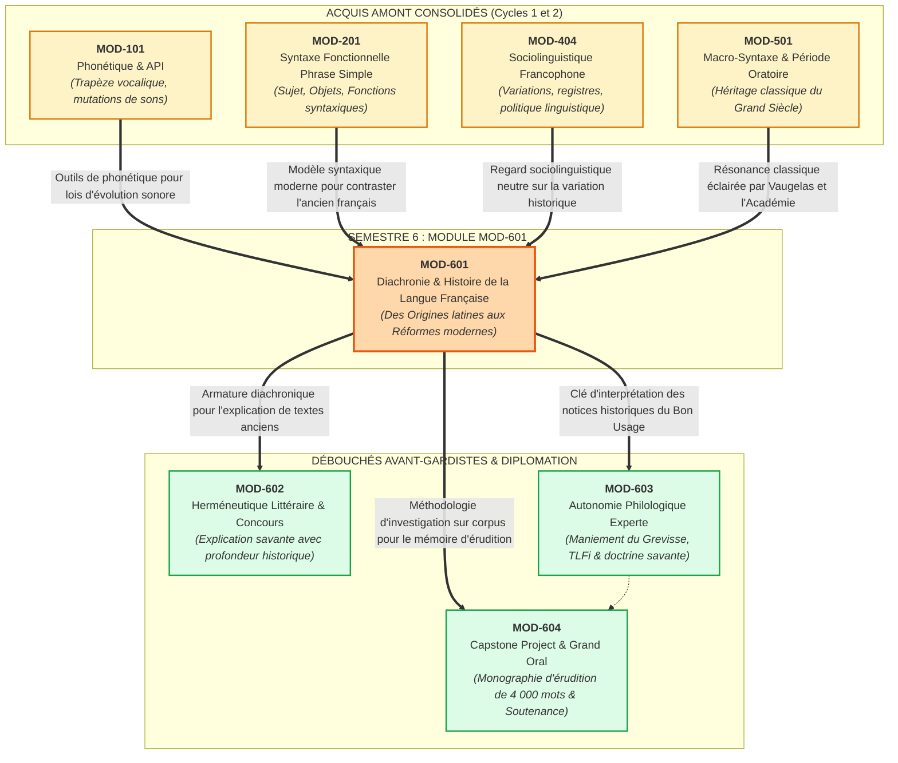

# Fiche Pédagogique Opérationnelle — Module MOD-601

> **Identifiant** : `MOD-601`  
> **Titre** : *Diachronie et Histoire de la Langue Française : Des Origines aux Réformes*  
> **Semestre** : Année 3 — Semestre 6 (S6)  
> **Domaines mobilisés** : DOM-01 (Phonétique et phonologie), DOM-02 (Orthographe et morphologie), DOM-05 (Lexicologie et sémantique), DOM-11 (Histoire des idées et sociolinguistique), DOM-13 (Compétences intégrées d'excellence)  
> **Volume horaire estimé** : 18 heures (Étude historique et lois phonétiques : 5 h 30 | Pratique délibérée : 6 h 30 | Correction raisonnée : 3 h 30 | Révision active et frises chronologiques : 2 h 30)  
> **Statut** : [STATUT : PROPOSÉ — EN ATTENTE DE VALIDATION]  
> **Alignement** : [`academic-structure.md` (S6)](file:///f:/Formation/world-class-french/01-architecture/academic-structure.md#7-fiche-détaillée--semestre-6-s6), [`dependency-graph.md` (DEP-HIS-01, DEP-LIN-02, DEP-LIN-03)](file:///f:/Formation/world-class-french/01-architecture/dependency-graph.md#27-axe-linguistique--philologie-du-fonctionnement-synchronique-à-la-diachronie), [`competency-framework.md` (FR-PHILOL-001, FR-LEXIC-001, FR-ORTHO-001)](file:///f:/Formation/world-class-french/02-competency-framework/competency-framework.md#fr-philol-001-autonomie-philologique-et-consultation-experte-des-sources), [`syllabus.md` (S6)](file:///f:/Formation/world-class-french/03-curriculum/year-3/semester-6/syllabus.md#module-mod-601--diachronie-et-histoire-de-la-langue-française--des-origines-aux-réformes), [`source-registry.md`](file:///f:/Formation/world-class-french/07-resources/source-registry.md)

---

## 1. Présentation et Intérêt du Module

Le module `MOD-601` ouvre le Semestre 6, semestre terminal d'excellence du cursus **World-Class French**. Après avoir exploré la description synchronique intégrale de la langue — de la décomposition articulatoire de l'alphabet phonétique international (`MOD-101`) à la macro-syntaxe de la période oratoire (`MOD-501`), en passant par la sociolinguistique des variations francophones (`MOD-404`) —, l'apprenant franchit le seuil épistémologique ultime : **l'analyse diachronique et l'histoire monumentale de la langue française**.

Dans la formation d'un maître de la langue, l'histoire n'est pas un ornement érudit accessoire : elle constitue **la clé rationnelle de compréhension du système linguistique contemporain**. Le français moderne présente en surface une multitude apparente d'« anomalies », d'« exceptions » et d'irrégularités morphologiques et graphiques :
- Pourquoi alterne-t-on *cheval* au singulier et *chevaux* au pluriel, alors que *chacal* fait *chacals* ?
- Pourquoi écrit-on *doigt* avec un *g* et un *t*, *vingt* avec un *g*, mais *poids* avec un *d* qui ne correspond à aucun étymon réel ?
- Pourquoi le verbe *aller* juxtapose-t-il trois radicaux radicalement hétérogènes (*je vais*, *nous allons*, *j'irai*) ?
- Pourquoi la règle d'accord du participe passé avec l'auxiliaire *avoir* dépend-elle de la position du Complément d'Objet Direct ?
- Pourquoi distingue-t-on des doublets lexicaux issus d'une même matrice latine tels que *frêle* et *fragile*, *chétif* et *captif*, *écouter* et *ausculter* ?

Pour le scripteur dépourvu de formation diachronique, ces phénomènes relèvent d'un arbitraire punitif imposé par la tradition scolaire. Pour le philologue averti, ils représentent **l'aboutissement régulier et prévisible de lois phonétiques séculaires, d'interventions politiques étatiques et de réaménagements graphiques cléricaux**.

Ce module poursuit cinq finalités intellectuelles majeures :
1. **Élucider la genèse de l'idiome roman** : Retracer le passage du latin vulgaire parlé en Gaule romaine aux premiers monuments textuels de la langue d'oïl — les *Serments de Strasbourg* (842) et la *Séquence de sainte Eulalie* (v. 880-881) —, en mesurant les apports respectifs du substrat celtique (gaulois) et du superstrat germanique (francique) [Réf. `SRC-GRAM-02`, chap. 2 ; `SRC-LEX-03`].
2. **Reconstituer le génie syntaxique et morphologique de l'ancien français (XIe-XIIIe s.)** : Maîtriser le fonctionnement rigoureux du **système bicasuel** (déclinaison à deux cas : Cas Sujet vs Cas Régime), comprendre l'effondrement des finales atones, l'apparition des diphtongues romanes et la liberté topologique de la phrase médiévale à verbe en seconde position (langue V2) [Réf. `SRC-GRAM-02`, chap. 2].
3. **Démonter les artifices de la latinisation graphique cléricale (XIVe-XVIe s.)** : Analyser l'entreprise des clercs et typographes du moyen français et de la Renaissance qui, pour combler le vide laissé par la perte des désinences orales et calquer le prestige du latin, ont surchargé l'orthographe de consonnes muettes étymologiques authentiques (*digitus* $\rightarrow$ *doigt*, *tempus* $\rightarrow$ *temps*) ou pseudo-étymologiques fantaisistes (*pensum* confondu avec *pondus* $\rightarrow$ *poids*) [Réf. `SRC-GRAM-01`, § 88 ; `SRC-LEX-03`].
4. **Analyser la politique linguistique d'État et le centralisme monarchique** : Mesurer la portée juridique de l'ordonnance de Villers-Cotterêts (1539), le manifeste poétique de Joachim Du Bellay (*Défense et Illustration*, 1549), et l'instauration de l'Académie française par Richelieu (1635) en tant qu'instrument régalien de centralisation étatique et de prestige diplomatique européen.
5. **Comprendre la fixation classique de la norme vaugelienne et les réformes ultérieures** : Examiner la doctrine de Claude Favre de Vaugelas dans ses *Remarques sur la langue françoise* (1647), fondée sur le « bon usage » de la Cour ; suivre l'évolution démocratique de l'instruction républicaine au XIXe siècle (rapport Grégoire, lois Ferry), la grande réforme de l'Académie de 1835 substituant la graphie *ai* à *oi* (*françois* $\rightarrow$ *français*), et les rectifications orthographiques officielles de 1990 [Réf. `SRC-NORM-02` ; `SRC-SOCIO-02`].

---

## 2. Place dans le Cursus

- **Position séquentielle** : Semaines 2 à 4 du Semestre 6 (S6). Il fait suite immédiate au séminaire de cadrage de la monographie terminale (S6-S1) et constitue le socle historique indispensable à l'ensemble du semestre d'excellence.
- **Rôle architectural** : Pivot central de l'axe *Linguistique, Diachronie & Philologie* ([`dependency-graph.md`, DEP-HIS-01 et DEP-LIN-02](file:///f:/Formation/world-class-french/01-architecture/dependency-graph.md#27-axe-linguistique--philologie-du-fonctionnement-synchronique-à-la-diachronie)). Il fournit l'assise historique sans laquelle l'autonomie philologique (`MOD-603`) et l'explication herméneutique de concours (`MOD-602`) demeureraient superficielles.
- **Relations fonctionnelles amont/aval** :
  - *En amont* :
    - `MOD-101` : La transcription phonétique (API), le trapèze vocalique et les notions d'aperture forment l'appareil technique requis pour décrire les mutations sonores diachroniques (diphtongaisons, palatalisations, vélarisations) ;
    - `MOD-201` : L'analyse fonctionnelle de la phrase simple permet de contraster l'ordre strict des mots en français moderne (SVO) avec la souplesse actancielle de l'ancien français régie par le bicasualisme ;
    - `MOD-404` (**Prérequis indispensable / Hard Prerequisite [DEP-HIS-01]**) : La sociolinguistique descriptive (variations diatopiques, diastratiques et diaphasiques) immunise l'apprenant contre tout mépris normatif et lui permet d'aborder l'histoire de la langue comme une succession dynamique d'états de langue légitimes ;
    - `MOD-501` : L'étude de la grande période oratoire classique du XVIIe siècle trouve son élucidation historique dans l'analyse de la doctrine vaugelienne et du style noble instauré sous Louis XIV.
  - *En aval* :
    - `MOD-603` (**Prolongement direct / Hard Prerequisite [DEP-LIN-03]**) : L'autonomie philologique dans *Le Bon Usage* de Grevisse et le *TLFi* exige de savoir interpréter les notices historiques, les étymons gallo-romans et les citations des auteurs du XVIe et XVIIe siècles ;
    - `MOD-604` : La filière *Philologie & Linguistique* de la Monographie Capstone repose directement sur la méthode d'investigation diachronique et de comparaison de corpus forgée dans `MOD-601`.

---

## 3. Prérequis et Diagnostic

### 3.1 Prérequis Formels Exigibles
1. **Validation certifiée du Semestre 5 (Porte 5)** avec une moyenne générale $\ge 14/20$.
2. **Maîtrise de l'Alphabet Phonétique International (API)** : Aptitude à transcrire sans hésitation les voyelles nasales, orales, semi-consonnes et consonnes du français standard (`MOD-101`).
3. **Analyse syntaxique fonctionnelle infaillible** : Distinction immédiate des catégories et fonctions syntaxiques fondamentales (Sujet, COD, COI, Attribut, Complément circonstanciel) (`MOD-201`).
4. **Conscience sociolinguistique des variations** : Capacité démontrée à distinguer un état de langue, un registre d'énonciation et une norme prescriptive sans jugement moralisateur (`MOD-404`).

### 3.2 Protocole Diagnostique d'Entrée (Semaine 2 — Durée : 45 minutes)
Le diagnostic évalue l'aptitude de l'apprenant à raisonner sur la variation formelle et l'étymologie à travers trois épreuves :

```text
DIAGNOSTIC D'ENTRÉE MOD-601 (45 MINUTES)
├── ÉPREUVE A : PHONÉTIQUE COMPARATIVE ET CORRESPONDANCES GRAPHO-PHONIQUES (15 min)
│   └── Corpus de 5 mots latins simples (faba, noctem, caballum, cantare, pedem) :
│       retrouver l'aboutissement français moderne et formuler l'hypothèse de transformation phonétique.
├── ÉPREUVE B : MORPHOSYNTAXE ET ANALYSE DE LA FLEXION DISPARUE (15 min)
│   └── Confrontation de 3 phrases latines simples et de leurs équivalents en français moderne :
│       identifier le rôle des désinences de cas par rapport à la position des mots dans la phrase.
└── ÉPREUVE C : RECONNAISSANCE DES DOUBLETS LEXICAUX POPULAIRES ET SAVANTS (15 min)
│   └── Liste de 6 paires lexicales (ex. forge/fabrique, poison/potion, parole/parabole) :
│       distinguer pour chaque paire le mot hérité par tradition orale ininterrompue de l'emprunt savant tardif.
```

- **Seuil de validation du diagnostic** : Note minimale de **14/20**.
- **Protocole de remédiation** : Tout score inférieur à $14/20$ déclenche 2 heures de tutorat intensif sur le tableau de l'API et la morphologie flexionnelle latine avant d'aborder les textes en ancien français du Chapitre 2.

---

## 4. Objectifs Pédagogiques Mesurables

Au terme des 18 heures d'enseignement, de travaux philologiques et de pratique délibérée du module `MOD-601`, l'apprenant doit être capable de :

1. **Jalonner scientifiquement les grandes étapes de l'histoire du français** :
   - Dater et situer avec exactitude les textes fondateurs et tournants institutionnels : *Serments de Strasbourg* (842), *Séquence de sainte Eulalie* (v. 880), *Ordonnance de Villers-Cotterêts* (1539), *La Deffence, et Illustration* (1549), création de l'Académie française (1635), *Remarques* de Vaugelas (1647), réforme orthographique de 1835 et rectifications de 1990 [Réf. `SRC-GRAM-02`, chap. 2].
2. **Analyser le système bicasuel de l'ancien français (XIe-XIIIe s.)** :
   - Décliner les types majeurs de substantifs masculins et féminins au Cas Sujet (CS) et au Cas Régime (CR), tant au singulier qu'au pluriel ;
   - Expliquer l'impact de la déclinaison à deux cas sur la liberté de placement du sujet et du complément dans la proposition médiévale (ordre V2, sujet nul) ;
   - Justifier pourquoi l'effondrement morphologique du bicasualisme au XIVe siècle a rendu obligatoire la fixation rigide de l'ordre Sujet-Verbe-Objet (SVO) [Réf. `SRC-GRAM-02`, chap. 2].
3. **Formuler les lois phonétiques régulières du passage du latin au français** :
   - Expliquer les mécanismes de la **syncope** des voyelles internes atones et de l'**apocope** des finales ;
   - Décrire la **vocalisation du [l] vélaire implosif** devant consonne ($[l] \rightarrow [w]$) et son rôle dans la formation des pluriels en *-aux* et *-eaux* (*caballos* $\rightarrow$ *chevaus* $\rightarrow$ *chevaux*) ;
   - Rendre compte des diphtongaisons romanes et françaises issues de voyelles accentuées libres [Réf. `SRC-PHON-01`, chap. 2 ; `SRC-GRAM-02`, chap. 2].
4. **Disséquer la latinisation graphique artificielle du moyen français et de la Renaissance** :
   - Identifier dans l'orthographe moderne les consonnes muettes introduites par les clercs pour mimer l'étymon latin authentique (*doigt* de *digitus*, *vingt* de *viginti*, *temps* de *tempus*) ;
   - Démontrer scientifiquement le mécanisme des **fausses étymologies cléricales** (*poids* rattaché à tort à *pondus* au lieu de *pensum* ; *legs* rattaché à tort à *legare* au lieu de *laissier*) [Réf. `SRC-GRAM-01`, § 88 ; `SRC-LEX-03`].
5. **Caractériser le concept vaugelien de « bon usage » et l'épuration classique du Grand Siècle** :
   - Définir les critères sociologiques de la norme vaugelienne (la Cour et les écrivains épurés) face au rationalisme grammatical ultérieur de Port-Royal ;
   - Analyser la constitution du style noble et l'élimination des termes bas, techniques ou dialectaux du lexique littéraire [Réf. `SRC-GRAM-01`, § 10 ; `SRC-SOCIO-02`].
6. **Rédiger une notice d'analyse diachronique rigoureuse** :
   - Produire une étude philologique autonome retraçant l'évolution phonétique, morphologique, sémantique et graphique d'une famille lexicale et d'anomalies de la grammaire moderne, avec appareil critique conforme [Réf. `SRC-GRAM-01` ; `SRC-LEX-01` ; `SRC-LEX-03`].

---

## 5. Compétences Visées et Niveaux de Maîtrise Attendus

| Identifiant | Intitulé officiel de la compétence | Palier d'entrée | Palier cible MOD-601 | Indicateur de preuve observable spécifique |
| :--- | :--- | :---: | :---: | :--- |
| [`FR-PHILOL-001`](file:///f:/Formation/world-class-french/02-competency-framework/competency-framework.md#fr-philol-001-autonomie-philologique-et-consultation-experte-des-sources) | **Autonomie philologique et consultation experte des sources** | L3 | **L4 / L5 (Maîtrise approfondie à Expertise transférable)** | Capacité à retracer l'itinéraire diachronique complet d'un mot ou d'un tour syntaxique en exploitant les rubriques historiques du *TLFi* et du *Dictionnaire historique d'Alain Rey*, en distinguant loi phonétique régulière, réfection analogique et intervention prescriptive d'autorité. |
| [`FR-LEXIC-001`](file:///f:/Formation/world-class-french/02-competency-framework/competency-framework.md#fr-lexic-001-précision-sémantique-nuances-synonymiques-et-collocations) | **Précision sémantique, nuances et formation du lexique** | L3 | **L4 (Maîtrise approfondie)** | Identification infaillible des doublets populaires vs savants au sein du lexique français moderne, avec explication de la divergence sémantique par la date et la voie d'emprunt. |
| [`FR-ORTHO-001`](file:///f:/Formation/world-class-french/02-competency-framework/competency-framework.md#fr-ortho-001-maîtrise-de-lorthographe-lexicale-et-flexionnelle) | **Maîtrise de l'orthographe lexicale et flexionnelle** | L4 | **L4 / L5 (Maîtrise souveraine)** | Explication historique systématique des lettres muettes, des irrégularités de flexion nominale (*-al / -aux*) et verbale (*aller*, *pouvoir*), permettant une mémorisation raisonnée exempte de tout psittacisme. |

### Description Observable des Paliers Cibles :
- **Pour `FR-PHILOL-001` (Palier L4/L5)** : L'apprenant ne considère plus aucune bizarrerie grammaticale comme arbitraire ; confronté à une forme controversée ou aberrante, il remonte avec méthode à l'étymon, identifie la phase historique de fixation et arbitre la légitimité de la graphie moderne avec des arguments philologiques irréfutables.
- **Pour `FR-LEXIC-001` (Palier L4)** : L'apprenant manipule les familles étymologiques étendues, détecte spontanément les racines savantes dissimulées sous l'évolution phonétique populaire (*évêque* / *épiscopal*, *œil* / *oculaire*, *eau* / *aquatique*) et enrichit son style d'une remarquable précision sémantique.
- **Pour `FR-ORTHO-001` (Palier L4/L5)** : L'apprenant maîtrise l'histoire des rectifications (1835, 1990) et fait la part exacte entre la fidélité étymologique réelle, les scories des fausses étymologies de la Renaissance et la logique des modernisations graphiques.

---

## 6. Plan Détaillé des Chapitres

```text
ARCHITECTURE DES ENSEIGNEMENTS DU MODULE MOD-601 (18 HEURES)
├── CHAPITRE 1 : DES ORIGINES LATINES À LA NAISSANCE DE LA LANGUE ROMANE (Ier - Xe s.) [3 h 30]
│   ├── 1.1 Du latin classique au latin vulgaire : accent d'intensité, simplification du système casuel et réduction vocalique
│   ├── 1.2 Le substrat gaulois (celtique) : lexique rural, numération vicésimale (quatre-vingts) et phonétique (passage de [u] à [y])
│   ├── 1.3 Le superstrat francique (germanique) : vocabulaire militaire et féodal, aspiration du h, suffixe -ard, ordre syntaxique
│   ├── 1.4 Les Serments de Strasbourg (14 février 842) : analyse philologique du premier texte en proto-français
│   └── 1.5 La Séquence de sainte Eulalie (v. 880-881) : la naissance de la poésie romane d'oïl
├── CHAPITRE 2 : L'ANCIEN FRANÇAIS CLASSIQUE ET LE SYSTÈME BICASUEL (XIe - XIIIe s.) [4 h 00]
│   ├── 2.1 Les lois phonétiques majeures : chute des voyelles atones (syncope, apocope), palatalisations par le yod
│   ├── 2.2 Diphtongaisons romanes et françaises : voyelles libres sous l'accent (ei -> oi, ou -> eu)
│   ├── 2.3 La vocalisation du [l] vélaire en [w] devant consonne : genèse des pluriels en -aux et des formes fol/fou, col/cou
│   ├── 2.4 Le système bicasuel : Cas Sujet (CS) vs Cas Régime (CR) pour les substantifs masculins et féminins
│   └── 2.5 Ordre des mots et syntaxe de l'ancien français : la langue V2, le statut du sujet nul et la mobilité topologique
├── CHAPITRE 3 : LE MOYEN FRANÇAIS ET LA RENAISSANCE : MUTATIONS ET LATINISATION GRAPHIQUE (XIVe - XVIe s.) [4 h 00]
│   ├── 3.1 L'effondrement du bicasualisme : triomphe du Cas Régime, homophonie et fixation progressive de l'ordre SVO
│   ├── 3.2 L'amuïssement des consonnes finales de liaison et la dissociation durable entre oral et écrit
│   ├── 3.3 L'invasion graphique cléricale : introduction délibérée de lettres muettes étymologiques (doigt, temps, corps, vingt)
│   ├── 3.4 Les fausses étymologies de la Renaissance : analyse des erreurs savantes (poids < pensum, legs < laissier, sçavoir < sapere)
│   ├── 3.5 L'Ordonnance de Villers-Cotterêts (1539, François Ier) : l'affirmation politique de la langue maternelle de l'État
│   └── 3.6 La Pléiade et Joachim Du Bellay (1549) : théorie de l'enrichissement lexical et dignité littéraire du français
├── CHAPITRE 4 : LE GRAND SIÈCLE ET LA FIXATION CLASSIQUE DE LA NORME (XVIIe s.) [3 h 30]
│   ├── 4.1 Claude Favre de Vaugelas et les Remarques sur la langue françoise (1647) : la théorie empirique du « bon usage »
│   ├── 4.2 La sociologie de la norme classique : la Cour du Louvre et les écrivains épurés contre la province et le peuple
│   ├── 4.3 La fondation de l'Académie française (1635, Richelieu) : monopole étatique sur le Dictionnaire, la Grammaire et la Rhétorique
│   ├── 4.4 L'épuration lexicale et la constitution du « style noble » : proscription des mots bas, techniques, archaïques et dialectaux
│   └── 4.5 Querelle des grammairiens : l'usage vivant (Vaugelas) face à la raison cartésienne universelle (Port-Royal, 1660)
└── CHAPITRE 5 : DES LUMIÈRES AUX RÉFORMES DE L'ORTHOGRAPHE (XVIIIe - XXe s.) [3 h 00]
    ├── 5.1 Le mythe de l'universalité du français au XVIIIe siècle : Rivarol (1784) et le préjugé de l'ordre direct naturel
    ├── 5.2 L'unification linguistique sous la Révolution : rapport de l'abbé Grégoire (1794) et lutte contre les patois
    ├── 5.3 L'école républicaine et la scolarisation de masse au XIXe siècle (lois Guizot 1833, lois Ferry 1881-1882)
    ├── 5.4 La grande réforme académique de 1835 : adoption de la graphie « ai » à la place de « oi » (françois -> français)
    └── 5.5 Les rectifications orthographiques de 1990 : fondements scientifiques, accueil social et état contemporain de la norme
```

---

## 7. Concepts Fondamentaux et Notions Avancées

### 7.1 Concepts Fondamentaux
- **Substrat, Superstrat et Adstrat** :
  - *Substrat* : Langue originelle d'un territoire qui s'efface devant une langue conquérante, mais en modifie certains traits phonétiques ou lexicaux. En Gaule, le **gaulois (celtique)** constitue le substrat du latin : il lègue environ 150 mots du monde agricole (*charrue*, *arpent*, *chêne*, *bouleau*, *mouton*, *alouette*), le système vicésimal de compte (*soixante-dix*, *quatre-vingts*) et la tendance à prononcer la voyelle [u] fermée en voyelle palatale antérieure [y] [Réf. `SRC-GRAM-02`, chap. 2 ; `SRC-LEX-03`].
  - *Superstrat* : Langue d'un peuple conquérant qui adopte finalement la langue des conquis mais y dépose un apport structurel substantiel. Le **francique (germanique)** constitue le superstrat de la langue d'oïl : il lègue des centaines de termes administratifs, militaires et féodaux (*guerre*, *trêve*, *fief*, *baron*, *hache*, *heaume*, *bannière*), des termes affectifs (*honte*, *orgueil*, *hardi*), le *h* aspiré initial empêchant la liaison (*la hache*, *le héros*), le suffixe *-ard* (*vieillard*, *bavard*) et renforce l'accent tonique d'intensité germanique qui a précipité la diphtongaison des voyelles latines [Réf. `SRC-GRAM-02`, chap. 2].
  - *Adstrat* : Influence réciproque de langues voisines en contact prolongé sans assimilation (ex. l'influence de l'arabe médiéval dans les sciences et le commerce : *zéro*, *chiffre*, *alchimie*, *azur*, *coton*) [Réf. `SRC-LEX-03`].
- **Le Bicasualisme Médiéval (Cas Sujet vs Cas Régime)** :
  - L'ancien français n'a pas conservé les six cas du latin classique, mais a réduit le système à **deux cas fondamentaux** :
    1. Le **Cas Sujet (CS)** : hérité du nominatif latin, utilisé pour le sujet grammatical et l'attribut du sujet ;
    2. Le **Cas Régime (CR)** : hérité de l'accusatif latin (ayant absorbé l'ablatif et le datif), utilisé pour tous les compléments de verbe (COD, COI) et les compléments prépositionnels.
  - *Paradigme régulier des masculins de type II (ex. mūrus)* :
    $$\begin{array}{|l|c|c|}
    \hline
    \textbf{Nombre} & \textbf{Cas Sujet (CS)} & \textbf{Cas Régime (CR)} \\
    \hline
    \text{Singulier} & \textit{li murs} \text{ (du latin } \textit{mūrus}\text{)} & \textit{le mur} \text{ (du latin } \textit{mūrum}\text{)} \\
    \hline
    \text{Pluriel} & \textit{li mur} \text{ (du latin } \textit{mūrī}\text{)} & \textit{les murs} \text{ (du latin } \textit{mūrōs}\text{)} \\
    \hline
    \end{array}$$
  - *Conséquence morphologique spectaculaire* : En ancien français, la présence de la désinence *-s* au singulier signale le sujet, tandis que son absence au pluriel signale également le sujet ! C'est l'inverse exact de la morphologie du français moderne où *-s* est la marque univoque du pluriel.

### 7.2 Notions Avancées
- **Amuïssement, Syncope et Apocope** :
  - *Amuïssement* : Disparition complète d'un phonème au sein de la chaîne parlée.
  - *Syncope* : Amuïssement d'une voyelle ou d'une consonne à l'intérieur d'un mot. En latin vulgaire et en proto-français, les voyelles atones post-toniques internes ont disparu très tôt sous la pression du renforcement de l'accent tonique :
    $$\textit{bonitātem} \rightarrow \textit{bon'tate} \rightarrow \textit{bonté} \quad ; \quad \textit{computāre} \rightarrow \textit{comp'tare} \rightarrow \textit{conter} / \textit{compter}$$
  - *Apocope* : Chute de la voyelle ou de la consonne finale. En français, toutes les voyelles finales latines autres que *-a* se sont amuïes (le *-a* s'étant affaibli en *e* caduc féminin dit « féminin sourd ») :
    $$\textit{portam} \rightarrow \textit{porte} \quad ; \quad \textit{murum} \rightarrow \textit{mur} \quad ; \quad \textit{patrem} \rightarrow \textit{père}$$
- **Vocalisation du [l] Vélaire et Genèse des Pluriels en *-aux*** :
  - En latin, le [l] devant consonne possédait une réalisation vélaire $[ɫ]$. Au cours de l'évolution vers l'ancien français (vers le Xe-XIe siècle), cette consonne liquide vélaire s'est vocalisée en semi-voyelle $[w]$ puis voyelle $[u]$ :
    $$\textit{caballos} \rightarrow \textit{chevals} \rightarrow \textit{chevaus} \rightarrow \textit{chevaux}$$
  - Au Moyen Âge, les copistes utilisaient la lettre *x* comme une abréviation sténographique pour noter la séquence finale *-us*. Les imprimeurs ont ensuite réinterprété cette abréviation comme une véritable consonne finale, figeant la graphie moderne en *-aux* et *-eaux* (*châteaux*, *manteaux*) [Réf. `SRC-GRAM-01`, § 95 ; `SRC-GRAM-02`, chap. 2].
  - Les mots entrés plus tardivement dans la langue par emprunt savant ou dialectal (comme *chacal*, *festival*, *carnaval*) n'ont pas subi cette loi phonétique médiévale et ont pris régulièrement un simple *-s* (*chacals*, *festivals*).
- **Latinisation Graphique Authentique vs Pseudo-Étymologique** :
  - *Latinisation authentique* : Réintroduction par les scribes des XIVe-XVe siècles d'une lettre muette rappelant l'étymon latin réel pour distinguer les homophones à l'écrit :
    - *doigt* avec *g* et *t* du latin *digitus* (distinguant *doigt* de *doit* du verbe *devoir*) ;
    - *vingt* avec *g* du latin *viginti* (distinguant *vingt* de *vent* et *vint*) ;
    - *temps* avec *p* et *s* du latin *tempus* ;
    - *corps* avec *p* et *s* du latin *corpus*.
  - *Pseudo-étymologie (ou étymologie fautive cléricale)* : Introduction arbitraire d'une consonne muette fondée sur un contresens étymologique des clercs :
    - **Le mot *poids*** : Issu du bas-latin *pēnsum* (la pesée, la tâche assignée, participe passé neutre de *pendere* / *pensare*, peser), qui a donné régulièrement *pois* en ancien français. Les lettrés du XVIe siècle l'ont rapproché à tort du latin classique *pondus, ponderis* (qui a donné le doublet savant *pondéral*), et lui ont greffé un **d** complètement anétymologique [Réf. `SRC-LEX-03`, s.v. *Poids*] ;
    - **Le mot *legs*** : Déverbal de l'ancien français *laissier* (ce que l'on laisse par testament, d'où le doublet *laisse*). Les juristes de la Renaissance l'ont rattaché par erreur au verbe latin *legāre* (léguer) et ont introduit un **g** fantaisiste [Réf. `SRC-LEX-03`, s.v. *Legs*] ;
    - **Le verbe *sçavoir*** : Issu du latin populaire *sapēre* (avoir du goût, être avisé), rattaché à tort au latin classique *scīre* (savoir), d'où l'orthographe aberrante *sçavoir* défendue mordicus jusqu'à l'édition de 1740 du Dictionnaire de l'Académie [Réf. `SRC-LEX-03`].
- **La Doctrine Vaugelienne du « Bon Usage » (1647)** :
  - Dans la préface des *Remarques sur la langue françoise*, Vaugelas pose un principe révolutionnaire mais élitiste : la langue n'est pas guidée par la logique mathématique ou la vérité philosophique, mais par l'**usage effectif des puissants** :
    > *« Il n'y a qu'un Maistre des langues, qui en est le vray Souverain, c'est l'Usage [...]. Le bon Usage est la façon de parler de la plus saine partie de la Cour, conformément à la façon d'escrire de la plus saine partie des Autheurs du temps. »*
  - Le critère de la « plus saine partie de la Cour » consacre la mainmise du pouvoir monarchique sur l'instrument linguistique et élimine de la norme toute expression provinciale, technique ou populaire.

---

## 8. Erreurs et Confusions Fréquentes

| Type d'anomalie / Idée reçue | Manifestation concrète / Citation erronée | Rectification scientifique et justification diachronique | Référence source |
| :--- | :--- | :--- | :--- |
| **L'anachronisme normatif (Juger l'ancien français à l'aune du moderne)** | Affirmer que les auteurs médiévaux écrivaient avec des « fautes d'accord » ou une syntaxe anarchique parce que le sujet est postposé ou absent. | **Autonomie grammaticale de l'ancien français** : L'ancien français est une langue à déclinaison (bicasualisme) où la fonction est portée par le cas (CS/CR) et non par la position du mot. La phrase médiévale obéit à la règle V2 (le verbe en deuxième position avec sujet antéposé ou postposé selon le focus). | [Réf. `SRC-GRAM-02`, chap. 2] |
| **Le préjugé décadentiste sur l'évolution linguistique** | Prétendre que l'histoire du français est une « dégradation continue » d'un idéal de perfection classique ou latin. | **Principe d'évolution fonctionnelle** : Une langue vivante évolue par économie articulatoire, analogie régulatrice et réorganisation structurelle. La perte du bicasualisme n'a pas affaibli le français, elle a déplacé la charge distinctive vers la syntaxe positionnelle (SVO). | [Réf. `SRC-SOCIO-02` ; `SRC-GRAM-02`] |
| **La confusion entre étymologie populaire et étymologie savante** | Croire que *nénuphar* prend un *ph* parce qu'il vient du grec, ou que *chaland* vient de *chalandise*. | **Démystification historique** : *Nénuphar* vient du persan/arabe *nīnūfar* (aucun lien avec le grec) ; le *ph* était une pédanterie pseudo-hellénique rectifiée en 1990 en *nénufar*. L'étymologie populaire projette des ressemblances de surface fallacieuses. | [Réf. `SRC-LEX-03` ; `SRC-NORM-02`] |
| **L'incompréhension des doublets populaires et savants** | Croire que des mots comme *frêle* et *fragile*, ou *naïf* et *natif*, sont des synonymes de racines indépendantes. | **Théorie des doublets** : Il s'agit du même étymon latin emprunté à deux époques distinctes : la forme populaire a subi toute l'érosion phonétique continue de l'oralité (*fragilem* $\rightarrow$ *frêle*), tandis que la forme savante a été calquée tardivement sur le texte écrit latin (*fragile* au XIVe s.). | [Réf. `SRC-LEX-03`, s.v. *Doublets*] |
| **La méconnaissance de l'origine de l'accord du participe passé avec avoir** | Croire que la règle d'accord du participe passé avec le COD antéposé est une vérité logique absolue issue du latin classique. | **Origine artificielle d'après l'italien (Clément Marot, 1538)** : Le latin classique accordait le participe comme un adjectif du COD (*habeo epistulam scriptam*). Au Moyen Âge, l'invariabilité dominait. Clément Marot a importé en 1538 une règle imitée de l'usage poétique italien de Pétrarque, fixée ensuite de manière rigide par Vaugelas et l'Académie. | [Réf. `SRC-GRAM-01`, § 948 ; `SRC-LEX-03`] |
| **L'illusion de l'antiquité des accents graphiques** | S'imaginer que les accents aigus, graves et circonflexes existent depuis l'origine de la langue française. | **Fixation graphique tardive** : Les accents ont été introduits timidement au XVIe siècle par les imprimeurs humanistes (Robert Estienne, Dolet) d'après le grec, et n'ont été officialisés par l'Académie française que dans la 3e édition de son Dictionnaire en 1740 (où l'accent circonflexe est venu remplacer le *s* amuï : *teste* $\rightarrow$ *tête*). | [Réf. `SRC-GRAM-01`, § 88 ; `SRC-TYPO-01`] |

---

## 9. Exemples Progressifs

### 9.1 Niveau Simple (Fondations : Du Latin Vulgaire au Proto-Français)
- **Texte témoin : Extrait des *Serments de Strasbourg* (14 février 842)** :
  > *« Pro Deo amur et pro christian poblo et nostro commun salvament, d'ist di en avant, in quant Deus savir et podir me dunat, si salvarai eo cist meon fradre Karlo... »*
- **Traduction en français moderne** :
  > *« Pour l'amour de Dieu et pour le peuple chrétien et notre commun salut, de ce jour en avant, en tant que Dieu me donne savoir et pouvoir, ainsi soutiendrai-je mon frère Charles... »*
- **Apparat diachronique et analyse philologique** :
  1. *Pro Deo amur* : juxtaposition génitive sans préposition (*pour l'amour [de] Dieu*), vestige du génitif latin.
  2. *salvament* : suffixe d'action *-mentum* latin évoluant vers le français *-ment*.
  3. *savir et podir* : infinitifs romans issus du latin vulgaire (*sapēre* et *potēre*, remplaçant *scīre* et *posse* du latin classique).
  4. *si salvarai eo* : construction du futur roman synthétique : radical infinitif *salvare* + présent du verbe avoir *ai* (*salvare-habeo* $\rightarrow$ *salvarai*). Prononciation du sujet pronominal *eo* ($< ego$).

---

### 9.2 Niveau Intermédiaire (Ancien Français : Le Système Bicasuel en Action)
- **Texte témoin : Extrait de la *Chanson de Roland* (vers 1093-1094, v. 1049-1052)** :
  > *« Rollant est pruz e Olivier est sages, / Ambedui unt merveillus curages. / Puis que il sunt as chevals e as armes, / Ja pur murir ne guerpirunt les batailles. »*
- **Apparat diachronique et analyse morphosyntaxique** :
  1. *Rollant est pruz* : *Rollant* est Cas Sujet (imparisyllabique sans *-s*) ; *pruz* est adjectif qualificatif attribut au Cas Sujet singulier avec *-s* de flexion (latin *prudens*).
  2. *Olivier est sages* : *Olivier* est au CS singulier ; *sages* porte le *-s* du CS singulier (du bas-latin *sapius*).
  3. *as chevals* : contraction de la préposition *a* + l'article défini accusatif pluriel *les* ($ad + illos \rightarrow as$). Le mot *chevals* est ici au Cas Régime pluriel avec désinence consonnantique avant la vocalisation complète en *-aux*.
  4. *Ja pur murir ne guerpirunt* : verbe *guerpirunt* d'origine francique/germanique (*werpan*, jeter, abandonner), illustrant l'intégration lexicale du superstrat.

---

### 9.3 Niveau Complexe : Moyen Français et Réfraction Classique
- **Texte témoin : François Villon, *Le Testament* (1461), Ballade des dames du temps jadis** :
  > *« Dictes moy ou, n'en quel pays, / Est Flora, la belle Rommaine ; / Archipiada, ne Thaïs, / Qui fut sa cousine germaine ; / Echo, parlant quant bruyt on maine / Dessus riviere ou sus estan, / Mais ou sont les neiges d'antan ! »*
- **Analyse diachronique détaillée et apparat critique** :
  1. *Perte du bicasualisme et hésitations graphiques* : La déclinaison bicasuelle est complètement effacée au XVe siècle ; les substantifs *pays*, *Rommaine*, *neiges* sont employés sous leur forme de Cas Régime unique.
  2. *Latinisation graphique* : Noter l'insertion de lettres étymologiques comme le *c* dans *Dictes* ($< dicite$) et le *y* dans *bruyt* pour orner l'écriture manuscrite.
  3. *Évolution phonétique de « d'antan »* : Du latin vulgaire *ante annum* (l'année précédente). Chute des consonnes finales, nasalisation des voyelles en contact avec les nasales (*an* / *tan*).
  4. *Confrontation avec la doctrine de Vaugelas (1647)* : Au XVIIe siècle, Vaugelas condamnera l'emploi de termes comme *antan* ou *sus* comme des archaïsmes gothiques indignes de la Cour, réservant la langue noble à un lexique resserré et épuré de toute saveur médiévale [Réf. `SRC-GRAM-01`, § 10].

---

## 10. Activités d'Observation et de Découverte

### Activité 1 : L'Autopsie Philologique des Faux Ancêtres Graphiques
- **Objectif** : Retracer l'histoire graphique d'une série de mots français pour isoler l'étymologie authentique de la fausse étymologie cléricale.
- **Protocole** :
  1. Consulter le *Dictionnaire historique de la langue française* d'Alain Rey [Réf. `SRC-LEX-03`] et le *TLFi* [Réf. `SRC-LEX-01`] pour les termes suivants : *poids*, *doigt*, *legs*, *vingt*, *nénuphar*, *chariot* (avec un seul *r* face à *charrette*).
  2. Compléter la matrice d'investigation :
     - Forme latine d'origine attestée ;
     - Forme régulière en ancien français (XIIe s.) ;
     - Consonne(s) introduite(s) aux XIVe-XVIe siècles ;
     - Motif de l'introduction : fidélité à l'étymon authentique OU fausse étymologie de clerc.
  3. Conclure sur le statut de la norme orthographique actuelle.

### Activité 2 : L'Énigme Morphologique de l'Inversion des Pluriels en Ancien Français
- **Objectif** : Comprendre pourquoi l'ancien français présentait des formes où le singulier prenait un *-s* et le pluriel n'en prenait pas.
- **Corpus d'étude** :
  - *Li cuens revient de la bataille* (Singulier) vs *Li conte reviennent de la bataille* (Pluriel) ;
  - *Li murs est hauz* (Singulier) vs *Li mur sont haut* (Pluriel).
- **Consigne de manipulation** : À l'aide de la morphologie latine de 2e et 3e déclinaisons (*comes / comitem / comites* ; *murus / murum / muri / muros*), démontrer l'origine strictement phonétique de cette opposition et formuler la raison de sa disparition à la fin du Moyen Âge.

### Activité 3 : La Trajectoire Diachronique du Son /wa/ : De l'Ancien Français à la Réforme de 1835
- **Objectif** : Comprendre pourquoi la graphie *oi* se prononçait jadis [oi], puis [we], puis s'est scindée en deux prononciations distinctes en français moderne : [wa] (*roi*, *loi*) et [ɛ] (*français*, *j'avais*).
- **Consigne** :
  - Reconstituer la controverse entre les partisans de la prononciation savante de la Cour ([we]) et la prononciation populaire parisienne ([wa]) au XVIe siècle ;
  - Analyser l'intervention de Voltaire au XVIIIe siècle réclamant l'écriture *français*, *connaître*, *j'avais* avec *ai* ;
  - Examiner la décision finale de l'Académie française dans sa 6e édition de 1835.

---

## 11. Exercices Progressifs (3 Niveaux)

### 11.1 Niveau 1 : Fondations Diachroniques et Mécanismes Réguliers
- **Exercice 1.1 — Déclinaison bicasuelle en ancien français** :
  - À partir du nom masculin *chevalier* (type II), construire le tableau complet des 4 formes : Cas Sujet singulier, Cas Régime singulier, Cas Sujet pluriel, Cas Régime pluriel.
  - Justifier la présence ou l'absence du *-s* final pour chaque case en vous référant aux cas latins correspondants (*caballarius*, *caballarium*, *caballarii*, *caballarios*).
- **Exercice 1.2 — Identification des doublets populaires et savants** :
  - Pour chacun des étymons latins suivants, identifier le doublet populaire (forme héritée par l'oralité) et le doublet savant (emprunt d'école tardif) en français moderne :
    1. *ministerium* $\rightarrow$ .................... / ....................
    2. *hospitale* $\rightarrow$ .................... / ....................
    3. *auscultare* $\rightarrow$ .................... / ....................
    4. *captivum* $\rightarrow$ .................... / ....................
    5. *navigare* $\rightarrow$ .................... / ....................
- **Exercice 1.3 — Détection des lettres muettes étymologiques** :
  - Isoler la consonne muette étymologique dans les mots modernes : *sept*, *corps*, *temps*, *vingt*, *doigt*, *sculpter*. Préciser l'étymon latin pour chacun.

---

### 11.2 Niveau 2 : Analyse Diachronique Guidée et Anomalies Verbales
- **Exercice 2.1 — La genèse du verbe *aller* et ses trois radicaux** :
  - Expliquer par l'histoire de la langue la cohabitation de trois bases étymologiques totalement hétérogènes dans la conjugaison du verbe *aller* :
    1. D'où vient la base de l'indicatif présent singulier (*je vais*, *tu vas*, *il va*) ?
    2. D'où vient la base du futur et du conditionnel (*j'irai*, *tu iras*) ?
    3. Quelles sont les hypothèses étymologiques majeures sur l'origine du radical *all-* (*nous allons*, *vous allez*) ?
- **Exercice 2.2 — L'alternance morphologique liée à l'accent tonique (Verbes à deux radicaux)** :
  - Expliquer pourquoi le verbe *mourir* alterne *je meurs* (avec diphtongue) et *nous mourons* (sans diphtongue), et pourquoi le verbe *pouvoir* présente les formes *je peux* / *nous pouvons* et la forme archaïque conservée *je puis*.
- **Exercice 2.3 — La vocalisation du [l] et les formes en *-aux*** :
  - Retracer étape par étape la chaîne de transformation phonétique et graphique de *bellos* aboutissant à *beaux*, et de *fol* aboutissant à *fou*.

---

### 11.3 Niveau 3 : Commentaire Philologique Complet et Rétro-Analyse
- **Exercice 3.1 — Analyse philologique d'un texte d'ancien français (15 lignes)** :
  - À partir d'un extrait non traduit de la *Chanson de Roland* ou du *Conte du Graal* de Chrétien de Troyes :
    1. Relever et classifier tous les substantifs au Cas Sujet et au Cas Régime ;
    2. Identifier les cas d'inversion verbe-sujet et expliquer la dynamique de l'ordre V2 ;
    3. Relever deux phénomènes de vocalisation ou de palatalisation remarquables.
- **Exercice 3.2 — Dissertation philologique brève (500 mots)** :
  - Sujet : *« L'orthographe française moderne est-elle le reflet fidèle de l'histoire de la langue ou le monument fossilisé des préjugés cléricaux de la Renaissance et du classicisme ? »*
  - Rédiger une argumentation rigoureuse étayée par des exemples précis de consonnes muettes, de fausses étymologies et d'arbitrages de l'Académie française.

---

## 12. Ateliers de Correction et de Révision

### 12.1 Protocole d'Audit Philologique d'un Fait de Langue (4 Étapes)
Pour résoudre n'importe quelle énigme d'histoire de la langue ou justifier une singularité moderne, l'apprenant applique le protocole d'investigation suivant :

```text
PROTOCOLE D'INVESTIGATION DIACHRONIQUE (4 ÉTAPES NORMATIVES)
├── ÉTAPE 1 : CONSTATION SYNCHRONIQUE DE LA FORME CONTEMPORAINE
│   ├── Isoler précisément l'anomalie apparente (lettre muette, pluriel atypique, alternance de radical).
│   └── Vérifier son comportement dans la norme actuelle (dictionnaires d'usage, rectifications de 1990).
├── ÉTAPE 2 : REMONTÉE À LA MATRICE ÉTYMOLOGIQUE ET IDENTIFICATION DE L'ÉTAT INITIAL
│   ├── Consulter le TLFi et le Dictionnaire historique d'Alain Rey [SRC-LEX-01, SRC-LEX-03].
│   └── Établir l'étymon latin classique ou vulgaire (forme avec cas, genre et accent tonique).
├── ÉTAPE 3 : TRAÇAGE DE L'ÉVOLUTION PHONÉTIQUE ET MORPHOLOGIQUE
│   ├── Vérifier si la forme a subi les lois phonétiques régulières (syncope, apocope, diphtongaison, vocalisation).
│   └── Reconstituer la forme en ancien français (XIe-XIIIe s.) sous l'angle du bicasualisme.
└── ÉTAPE 4 : ANALYSE DES INTERVENTIONS INSTITUTIONNELLES ET CLÉRICALES
    ├── Identifier les réfections graphiques des clercs des XIVe-XVIe siècles (lettre étymologique vs fausse étymologie).
    └── Vérifier l'arbitrage normatif de Vaugelas (1647), des dictionnaires de l'Académie (1694, 1740, 1835) et du CSLF (1990).
```

### 12.2 Atelier d'Évaluation Croisée en Binôme
Les apprenants échangent leurs notices philologiques de Niveau 3 et contrôlent réciproquement :
1. *L'exactitude des étymons cités* (pas d'étymon latin inventé, distinction rigoureuse entre nominatif et accusatif) ;
2. *L'absence absolue d'anachronisme* (ne pas projeter la règle moderne de l'accord du participe ou de l'ordre SVO sur un texte médiéval) ;
3. *La précision terminologique* (utilisation exacte des termes : *bicasualisme*, *apocope*, *syncope*, *vocalisation*, *doublet savant*, *analogie*).

---

## 13. Production Intégratrice

La validation sommative du module `MOD-601` repose sur la rédaction d'un **Mémoire d'Analyse Diachronique et Philologique** (durée : **2 heures**, volume exigé : **exactement 800 mots** [$\pm 10\,\%$]), à l'aide exclusive des ouvrages et dictionnaires de référence autorisés (`SRC-GRAM-01`, `SRC-GRAM-02`, `SRC-LEX-01`, `SRC-LEX-03`).

### 13.1 Cahier des Charges de l'Épreuve
Le mémoire se compose obligatoirement de deux sections complémentaires :

1. **Section 1 : La Biographie Diachronique d'une Famille Lexicale (450 mots)** :
   - Analyser l'évolution phonétique, morphologique et sémantique d'une famille de **cinq mots modernes** issus d'une matrice latine commune imposée par tirage au sort parmi :
     - *Matrice A* : Le latin *caput, capitis* ($\rightarrow$ *chef*, *tête*, *capitaine*, *chevet*, *chavirer*) ;
     - *Matrice B* : Le latin *pes, pedis* ($\rightarrow$ *pied*, *piéton*, *péage*, *pédestre*, *piétiner*) ;
     - *Matrice C* : Le latin *ministerium* / *minister* ($\rightarrow$ *métier*, *ministre*, *ministère*, *ménestrel*, *ménage*).
   - Pour chaque terme de la famille, le mémoire doit expliciter :
     - La forme d'arrivée en ancien français ;
     - La distinction entre évolution populaire par voie orale ininterrompue et emprunt savant tardif (doublets) ;
     - Les mutations de sens successives jusqu'au français contemporain.

2. **Section 2 : L'Élucidation Historique de Trois Anomalies Grammaticales Modernes (350 mots)** :
   - Expliquer scientifiquement, à l'aide des lois phonétiques, de la morphologie historique et des interventions normatives d'État, **trois singularités majeures de la grammaire moderne** choisies parmi les suivantes :
     1. *L'origine de la règle d'accord du participe passé avec l'auxiliaire avoir sur le COD antéposé* (l'emprunt à l'italien par Clément Marot en 1538 et sa fixation classique) ;
     2. *La discordance des pluriels en « -al / -aux » et l'exception des pluriels en « -als »* (la vocalisation du [l] vélaire en ancien français vs les emprunts savants récents) ;
     3. *La présence du « t » euphonique dans « aime-t-il » ou du « s » dans « vas-y »* (survivance de désinences verbales latines réactivées par analogie ou euphonie articulatoire).

3. **Appareil critique obligatoire** :
   - Mentionner expressément les références méthodologiques et historiques selon la norme officielle du registre : `[Réf. SRC-GRAM-01, § ...]`, `[Réf. SRC-GRAM-02, chap. 2]`, `[Réf. SRC-LEX-03, s.v. ...]`.

---

## 14. Évaluation et Barème

L'évaluation finale sommative du module `MOD-601` est notée sur **20 points**. Conformément aux exigences d'excellence du Semestre 6 (Paliers L4/L5), le seuil plancher d'admission est fixé à **14/20**.

| Domaines d'évaluation | Critères de performance et ventilation des points | Seuil plancher éliminatoire |
| :--- | :--- | :---: |
| **Domaine 1 : Rigueur méthodologique et phonétique historique (5 pts)** | • Reconstitution exacte des chaînes phonétiques et étymons latins réels (2 pts)<br/>• Maîtrise des lois phonétiques (syncope, apocope, diphtongaison, vocalisation) (2 pts)<br/>• Zéro étymologie fantaisiste ou populaire non qualifiée (1 pt) | $< 3,5/5$ |
| **Domaine 2 : Analyse morphosyntaxique et bicasualisme (5 pts)** | • Démonstration rigoureuse de l'impact de la déclinaison d'ancien français (2 pts)<br/>• Explication exacte de la transition du bicasualisme vers l'ordre SVO moderne (1,5 pt)<br/>• Analyse scientifique des anomalies verbales ou d'accord sélectionnées (1,5 pt) | $< 3,5/5$ |
| **Domaine 3 : Histoire institutionnelle et critique graphique (5 pts)** | • Distinction infaillible entre latinisation réelle et fausse étymologie de clerc (2 pts)<br/>• Contextualisation exacte de l'action de l'État (Villers-Cotterêts, Académie, 1835, 1990) (1,5 pt)<br/>• Restitution fidèle de la doctrine du « bon usage » de Vaugelas (1,5 pt) | $< 3,5/5$ |
| **Domaine 4 : Tenue philologique, appareil critique et style (5 pts)** | • Précision irréprochable de la terminologie linguistique (palatalisation, yod, etc.) (2 pts)<br/>• Qualité académique de la langue écrite et respect du calibrage (800 mots $\pm 10\,\%$) (1,5 pt)<br/>• Exactitude des renvois aux sources (`SRC-GRAM-01`, `SRC-LEX-03`) (1,5 pt) | $< 3,5/5$ |

### Clauses d'Élimination et Pénalités Forfaitaires Officielles :
- **Seuil d'admission globale** : Note totale $\ge 14/20$ (70 %).
- **Note éliminatoire** : Toute note globale inférieure à **14/20** interdit la validation du module et exige une session de rattrapage avant de pouvoir s'inscrire à `MOD-603`.
- **Pénalité pour anachronisme linguistique grave** : Tout contresens consistant à qualifier une forme médiévale régulière de « faute de grammaire » entraîne un retrait forfaitaire automatique de **-3 points** sur le Domaine 2.
- **Pénalité pour invention d'étymon (Faute philologique lourde)** : Citer un étymon inexistant ou inventé entraîne un retrait forfaitaire automatique de **-4 points** sur le Domaine 1.
- **Pénalité de calibrage textuel** : Tout mémoire inférieur à 720 mots ou supérieur à 880 mots subit une pénalité de **1 point par tranche de 50 mots hors tolérance**.

---

## 15. Critères de Maîtrise

Le module `MOD-601` est certifié aux paliers **L4 (Maîtrise approfondie)** et **L5 (Expertise transférable)** lorsque l'apprenant atteste, sous observation directe et à travers ses productions écrites, des compétences stables suivantes :

- **Sur le plan philologique et historique (`FR-PHILOL-001` - Palier L4/L5)** :
  - Il lit, segmente et analyse un court texte d'ancien français du XIIe siècle en explicitant le fonctionnement du bicasualisme et l'ordre des mots ;
  - Il restitue sans hésitation la chronologie des grandes mutations institutionnelles et des réformes de l'orthographe ;
  - Il démontre comment une controverse grammaticale moderne contemporaine s'enracine dans les débats classiques du XVIIe siècle entre partisans de l'usage de la Cour et rationalistes de Port-Royal.
- **Sur le plan lexicologique et étymologique (`FR-LEXIC-001` - Palier L4)** :
  - Il identifie au premier coup d'œil les doublets lexicaux populaires et savants au sein du lexique soutenu ;
  - Il retrace la biographie sémantique complète d'un terme rare en articulant l'étymon latin, les métaphores médiévales et la spécialisation classique.
- **Sur le plan de l'orthographe raisonnée (`FR-ORTHO-001` - Palier L4/L5)** :
  - Il sait justifier historiquement la présence de chaque consonne muette du français écrit moderne ;
  - Il distingue avec clarté les graphies issues d'une tradition étymologique réelle de celles qui résultent d'erreurs cléricales de la Renaissance (*poids*, *legs*), ce qui lui permet d'adopter une posture sereine et scientifique face aux rectifications orthographiques contemporaines.

---

## 16. Révisions Espacées Recommandées

Pour ancrer définitivement la profondeur diachronique dans les réflexes de l'apprenant jusqu'à la soutenance du Capstone Project, le protocole de réactivation suivant est programmé :

```text
CALENDRIER DE RAPPEL ACTIF — MODULE MOD-601
├── J+3 après validation : Quiz flash de déclinaison bicasuelle sur 5 phrases d'ancien français (15 min).
├── J+10 : Autopsie étymologique de 3 mots à consonnes muettes controversées avec le TLFi (20 min).
├── J+21 : Analyse comparative d'un extrait de moyen français (Villon) et d'un texte classique (Vaugelas) (30 min).
├── J+45 : Épreuve blanche de commentaire philologique de concours (45 min).
└── Réinvestissement continu dans le cursus :
    ├── Semaines 5 à 7 (MOD-602) : Détection des résonances diachroniques dans l'explication de texte littéraire.
    ├── Semaines 8 à 10 (MOD-603) : Exploitation des rubriques étymologiques et historiques du Bon Usage de Grevisse.
    ├── Semaines 11 à 14 (MOD-604) : Mobilisation de l'érudition diachronique dans la rédaction de la Monographie Capstone.
    └── Grand Oral terminal : Soutenance publique des thèses historiques devant le jury académique.
```

---

## 17. Sources de Référence Vérifiées

Toutes les analyses historiques, transcriptions phonétiques et doctrines grammaticales du module `MOD-601` s'appuient exclusivement sur les ouvrages faisant autorité et dûment enregistrés dans le répertoire officiel [`source-registry.md`](file:///f:/Formation/world-class-french/07-resources/source-registry.md) :

1. **Grevisse, Maurice & Goosse, André (2016)**. *Le Bon Usage* (16e éd.). Bruxelles : De Boeck Supérieur [Réf. `SRC-GRAM-01`].  
   $\rightarrow$ Autorité normative pour :
   - *Histoire de l'orthographe française* : l'écriture du moyen français, la latinisation graphique, les éditions successives du Dictionnaire de l'Académie (§ 85 à § 98) ;
   - *L'accord du participe passé avec avoir* : historique de la règle de Clément Marot et controverses classiques (§ 948) ;
   - *La doctrine du bon usage* : Vaugelas et la fixation classique (§ 10).
2. **Riegel, Martin, Pellat, Jean-Christophe & Rioul, René (2016)**. *Grammaire méthodique du français*. Paris : PUF, coll. « Quadrige » [Réf. `SRC-GRAM-02`].  
   $\rightarrow$ Traité universitaire fondamental pour :
   - *Chapitre 2 : Éléments d'histoire de la langue française* : du latin vulgaire aux langues romanes, l'ancien français et le système bicasuel, le moyen français et l'effondrement morphologique, le français classique, l'unification républicaine [Réf. `SRC-GRAM-02`, chap. 2] ;
   - *Chapitre 14 et 15 : Syntaxe et ordre des mots* : comparaison diachronique entre la phrase médiévale V2 et la phrase moderne SVO [Réf. `SRC-GRAM-02`, chap. 14 et 15].
3. **Rey, Alain (dir.) (2016)**. *Dictionnaire historique de la langue française*. Paris : Dictionnaires Le Robert [Réf. `SRC-LEX-03`].  
   $\rightarrow$ Ouvrage de référence pour :
   - L'étymologie, la datation précise des premières attestations et la filiation sémantique des mots (*poids*, *legs*, *doigt*, *chef*, *tête*, *aller*, etc.) ;
   - Les notices détaillées sur les familles de mots et les doublets populaires/savants.
4. **ATILF / CNRS (2026)**. *Trésor de la Langue Française informatisé (TLFi)*. En ligne : atilf.atilf.fr [Réf. `SRC-LEX-01`].  
   $\rightarrow$ Consultation des rubriques historiques, étymologiques et attestations textuelles anciennes du XIe au XXe siècle.
5. **Conseil supérieur de la langue française (1990)**. *Les rectifications de l'orthographe (Journal officiel de la République française)* [Réf. `SRC-NORM-02`].  
   $\rightarrow$ Recommandations officielles pour les régularisations graphiques, soudures et rectifications des anomalies étymologiques.
6. **Léon, Pierre (2011)**. *Phonétique du français contemporain*. Paris : Armand Colin [Réf. `SRC-PHON-01`].  
   $\rightarrow$ Principes acoustiques et articulatoires permettant de retracer l'évolution des voyelles et consonnes depuis le latin vulgaire.
7. **Queffélec, Ambroise et al. (1997 / 2002)**. *Le français en Afrique centrale / Afrique noire*. Didier Érudition / AUF [Réf. `SRC-SOCIO-01`].  
   $\rightarrow$ Mise en perspective de l'histoire de la diffusion du français et des dynamiques contemporaines de variation en milieu francophone africain.
8. **Calvet, Louis-Jean (2017)**. *La sociolinguistique*. Paris : PUF, coll. « Que sais-je ? » [Réf. `SRC-SOCIO-02`].  
   $\rightarrow$ Théorie des politiques linguistiques d'État, du centralisme jacobin et de l'imposition de la norme standard face aux langues régionales.

---

## 18. Liens avec les Modules Précédents et Suivants



### Matrice Récapitulative des Synergies Didactiques

| Module | Nature du lien avec `MOD-601` | Rôle pédagogique et transfert d'acquis |
| :--- | :--- | :--- |
| **`MOD-101`** | **Prérequis amont (Phonétique & API)** | Fournit le système notationnel rigoureux (Alphabet Phonétique International) sans lequel la description des diphtongaisons, de la palatalisation sous l'effet du yod et de la vocalisation du [l] serait impossible. |
| **`MOD-201`** | **Prérequis amont (Syntaxe fonctionnelle)** | Permet de comparer l'ordre rigide moderne Sujet-Verbe-Objet (SVO) avec la structure à verbe second (V2) et sujet nul de l'ancien français, régie par la déclinaison à deux cas (CS/CR). |
| **`MOD-404`** | **Prérequis amont indispensable (Hard Prerequisite)** | Développe la conscience sociolinguistique de la variation linguistique. L'apprenant aborde l'histoire de la langue sans préjugé puriste, comprenant que la norme est une construction socio-politique historiquement située. |
| **`MOD-501`** | **Prérequis amont (Période oratoire)** | Offre l'expérience stylistique de la grande prose classique du XVIIe siècle, dont `MOD-601` explicite les fondements doctrinaux à travers la politique linguistique de Richelieu et les *Remarques* de Vaugelas. |
| **`MOD-602`** | **Prolongement aval direct (Herméneutique savante)** | Permet à l'analyste de textes denses d'intégrer l'épaisseur diachronique du lexique et de la syntaxe dans ses explications de texte littéraires et philosophiques de niveau agrégation. |
| **`MOD-603`** | **Débouché philologique direct (Hard Prerequisite)** | Fournit la grille de lecture historique indispensable pour naviguer avec aisance dans les 1 600 pages du *Bon Usage* de Maurice Grevisse et décrypter les rubriques étymologiques du *TLFi*. |
| **`MOD-604`** | **Consécration terminale (Capstone Project & Grand Oral)** | Dote l'étudiant choisissant la filière *Philologie & Linguistique* de la méthode scientifique d'analyse sur corpus nécessaire pour rédiger sa monographie de 4 000 mots et soutenir publiquement ses thèses lors du Grand Oral. |
