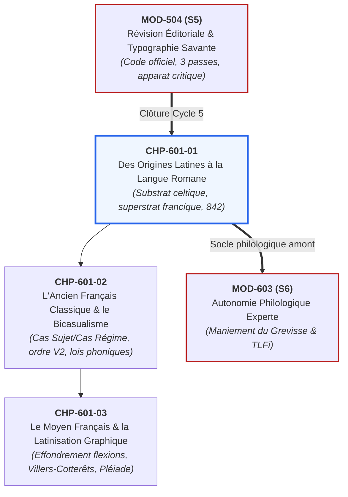

# Chapitre 1 : Des Origines Latines à la Naissance de la Langue Romane (Ier - Xe s.)

> **Identifiant** : `CHP-601-01`  
> **Module de rattachement** : [`MOD-601 — Diachronie et Histoire de la Langue Française : Des Origines aux Réformes`](file:///f:/Formation/world-class-french/03-curriculum/year-3/semester-6/mod-601-diachronie-histoire-langue-francaise.md)  
> **Volume horaire canonique** : 3 h 30 (Étude : 1 h 00 | Pratique : 1 h 15 | Correction : 0 h 45 | Évaluation : 0 h 30)  
> **Statut** : [STATUT : VALIDÉ]  
> **Compétences cibles** : [`FR-PHILOL-001`](file:///f:/Formation/world-class-french/02-competency-framework/competency-framework.md#fr-philol-001-autonomie-philologique-et-consultation-experte-des-sources) (L4/L5), [`FR-LEXIC-001`](file:///f:/Formation/world-class-french/02-competency-framework/competency-framework.md#fr-lexic-001-précision-sémantique-nuances-synonymiques-et-collocations) (L4), [`FR-ORTHO-001`](file:///f:/Formation/world-class-french/02-competency-framework/competency-framework.md#fr-ortho-001-maîtrise-de-lorthographe-lexicale-et-des-familles-de-mots) (L4)  
> **Sources de référence** : `SRC-GRAM-02` (Riegel et al., *Grammaire méthodique du français*, chap. 2), `SRC-LEX-03` (Alain Rey, *Dictionnaire historique de la langue française*), `SRC-LEX-01` (*Trésor de la Langue Française informatisé*), `SRC-PHON-01` (Pierre Léon, *Phonétique du français contemporain*), `SRC-SOCIO-02` (Louis-Jean Calvet, *La sociolinguistique*), `SRC-GRAM-01` (Grevisse & Goosse, *Le Bon Usage*), `SRC-TYPO-01` (*Lexique de l'Imprimerie nationale*), `SRC-NORM-03` (Ministère de l'Éducation nationale)

---

## 1. Titre et Place dans le Cursus

Ce premier chapitre du module `MOD-601` inaugure le **Semestre 6 (Cycle 6 : Diachronie, Herméneutique, Autonomie Philologique et Capstone Project Grand Oral)** du cursus **World-Class French**. Il ouvre la voie royale de l'histoire linguistique en remontant aux matrices fondatrices de notre idiome : l'effritement du latin classique au profit du latin vulgaire, l'empreinte tenace du substrat gaulois (celtique), l'impact décisif du superstrat francique (germanique), et l'apparition des premiers monuments textuels de la langue d'oïl : les *Serments de Strasbourg* (842) et la *Séquence de sainte Eulalie* (v. 880-881).



---

## 2. Objectifs Mesurables

Au terme de ce chapitre, l'apprenant sera capable de :
1. **Identifier et formaliser les mutations phonétiques et morphologiques** qui séparent le latin classique du latin vulgaire parlé en Gaule romaine (bascule de l'accent de hauteur vers l'accent d'intensité, réduction du système vocalique à sept voyelles orales, affaiblissement des cas de déclinaison).
2. **Disséquer la contribution lexicale et phonétique du substrat gaulois** (vocabulaire agraire, système de numération vicésimal en base 20, mutation du [u] latin en [y] palatal).
3. **Mesurer l'impact structural du superstrat francique** (vocabulaire de la guerre et des institutions féodales, maintien de l'accent tonique puissant provoquant les diphtongaisons, apparition du *h* aspiré initial disjonctif, productivité du suffixe *-ard*).
4. **Traduire et annoter philologiquement l'extrait canonique des *Serments de Strasbourg* (842)** en identifiant les formes proto-françaises et les vestiges du génitif et du futur synthétique roman.
5. **Démontrer la valeur littéraire et linguistique de la *Séquence de sainte Eulalie*** (premier poème assonancé en langue romane d'oïl).

---

## 3. Prérequis et Test de Préparation

### 3.1 Prérequis Théoriques
- Maîtrise de la notation phonétique internationale (API) et des voyelles nasales/orales (`MOD-101`).
- Analyse syntaxique des fonctions fondamentales (Sujet, COD, COI) (`MOD-201`).
- Conscience des variations sociolinguistiques sans préjugé normatif (`MOD-404`).

### 3.2 Test Diagnostique d'Auto-Évaluation (5 items)

<details>
<summary><b>Consulter le test et son corrigé immédiat</b></summary>

1. *Quelle est la date précise et la nature historique des Serments de Strasbourg ?*  
   **Réponse** : Le 14 février 842. Traité d'alliance militaire entre Charles le Chauve et Louis le Germanique contre leur frère Lothaire, prononcé en langue romane (proto-français) et en langue tudesque (vieux haut-allemand).
2. *Qu'appelle-t-on « substrat » en linguistique historique ? Donnez l'exemple gaulois.*  
   **Réponse** : La langue originelle d'un territoire qui disparaît devant une langue conquérante mais y laisse des traces. Le gaulois (celtique) a légué au latin de Gaule des termes ruraux (*charrue, chêne*) et la numération vicésimale (*quatre-vingts*).
3. *Pourquoi le mot « héros » ne permet-il pas l'élision (*l'héros est proscrit), alors que « l'homme » l'exige ?*  
   **Réponse** : *Homme* provient du latin *hominem* avec *h* muet ; *héros* a été réintroduit avec l'influence du *h* aspiré germanique/francique (ou hellénique d'emprunt savant disjonctif), bloquant l'élision et la liaison.
4. *Quelle différence fondamentale sépare l'accent latin classique de l'accent roman ?*  
   **Réponse** : L'accent latin classique était un accent musical de hauteur (élévation tonale) ; l'accent du latin vulgaire et roman est devenu un accent d'intensité musculaire puissant, frappant la voyelle tonique et provoquant l'amuïssement des atones.
5. *D'où vient la formation du futur en français moderne (ex. « je chanterai ») ?*  
   **Réponse** : De la périphrase du latin vulgaire unissant l'infinitif et le présent du verbe avoir : *cantāre habeō* $\rightarrow$ *chanter-ai* $\rightarrow$ *je chanterai*.

</details>

---

## 4. Situation de Départ ou Problème Concret

Considérons l'étonnement légitime de l'étudiant francophone devant ces trois bizarreries de sa langue maternelle :
1. Pourquoi compte-t-on *soixante-dix, quatre-vingts, quatre-vingt-dix*, alors que l'espagnol (*setenta, ochenta, noventa*) et le latin (*septuaginta, octoginta, nonaginta*) comptent par dizaines décimales régulières ?
2. Pourquoi dit-on *le haricot, la hache, la honte* en refusant l'élision (*l'haricot* est une faute), alors qu'on écrit *l'heure, l'herbe, l'histoire* ?
3. Pourquoi le verbe *avoir* sert-il à construire le futur (*je chanter-ai, tu chanter-as, nous chanter-ons*) ?

Pour l'esprit dépourvu d'ancrage historique, ces singularités apparaissent comme un désordre incompréhensible ou des lubies de grammairiens.  
Pour le philologue, elles constituent les **empreintes fossiles éclatantes des trois strates constitutives de la France médiévale** :
- Le compte par vingt est l'héritage direct des marchands celtes (gaulois) qui comptaient sur leurs doigts et leurs orteils ;
- Le *h* disjonctif est la cicatrice laissée par les guerriers francs qui ont imposé leur phonétique germanique à l'aristocratie gallo-romaine ;
- Le futur en *-ai* est la matérialisation d'une révolution syntaxique du latin vulgaire qui a substitué la modalité de possession à la flexion synthétique latine.

---

## 5. Explication Intuitive : La Géologie d'une Langue

Une langue vivante ressemble exactement à une **falaise géologique littorale** découpée par les siècles :
- **Le socle rocheux profond (le substrat gaulois)** : enfoui sous la mer, il a été écrasé par la colonisation romaine après Alésia (-52 av. J.-C.), mais il affleure encore dans les noms de la terre, des labours, des arbres et des mesures rustiques (*arpent*, *chêne*, *charrue*).
- **Le massif sédimentaire massif (le latin vulgaire)** : il forme 85 % de la falaise. Ce n'est pas le latin d'apparat des sénateurs de Cicéron, mais la langue véhiculaire, musclée et simplifiée parlée par les soldats, les marchands et les colons dans les foires de Lyon ou de Lutèce.
- **La couche basaltique volcanique (le superstrat francique)** : venue du Nord et de l'Est lors des grandes invasions du Ve siècle, la chevalerie germanique de Clovis coiffe la falaise. Elle apporte le vocabulaire des armes, des chevaux, des couleurs de bannières et la fierté du commandement.
- **La cristallisation romane (842)** : au IXe siècle, la falaise se stabilise. Le latin est désormais incompréhensible pour le peuple ; il faut graver dans la pierre une langue nouvelle pour que les soldats comprennent le serment de leurs rois.

---

## 6. Définitions Précises et Terminologie

- **Diachronie** : Étude de l'évolution d'une langue et de ses mutations structurelles à travers le temps historique (par opposition à la *synchronie*, qui étudie la langue à un moment donné de son histoire).
- **Substrat** : Langue autochtone vaincue ou assimilée qui disparaît sur un territoire au profit d'une langue dominante, mais dont certains traits phonétiques ou lexicaux s'infiltrent dans la langue d'adoption.
- **Superstrat** : Langue d'un peuple conquérant qui, bien que n'ayant pas réussi à imposer son idiome à la population dominée, enrichit durablement la langue locale de vocabulaire de prestige et d'habitudes articulatoires.
- **Adstrat** : Ensemble des influences réciproques exercées entre deux langues en contact géographique ou culturel prolongé sans domination politique unilatérale.
- **Latin vulgaire (ou bas-latin)** : Variété orale, populaire et véhiculaire du latin parlé dans les provinces de l'Empire romain, caractérisée par la chute des consonnes finales, la simplification de la déclinaison et le recours aux prépositions.
- **Proto-français (ou roman d'oïl naissant)** : État de la langue romane septentrionale attesté au IXe siècle, intermédiaire entre le latin vulgaire tardif et l'ancien français classique.
- **Accent d'intensité (accent dynamique)** : Proéminence acoustique résultant d'une dépense accrue d'énergie musculaire respiratoire sur une syllabe déterminée, entraînant le renforcement de la tonique et l'affaiblissement des voyelles atones voisines.

---

## 7. Règles et Mécanismes Fondamentaux

### 7.1 Du Latin Classique au Latin Vulgaire : La Grande Simplification

Le latin qui a donné naissance au français n'est pas la prose cicéronienne, mais un idiome en mutation continue (`SRC-GRAM-02`, chap. 2) :

```text
MUTATIONS FONDAMENTALES DU LATIN CLASSIQUE AU LATIN VULGAIRE
├── 1. RÉVOLUTION PROSODIQUE ET ACCENTUELLE
│   ├── Latin classique : accent de hauteur musical (mora longue vs brève).
│   └── Latin vulgaire : accent tonique d'intensité dynamique surpuissant.
│       └── Conséquence : la voyelle tonique s'allonge et diphtongue ; les voyelles atones s'effondrent.
├── 2. RÉDUCTION DU SYSTÈME VOCALIQUE
│   ├── 10 voyelles latines quantitatives (ā, ă, ē, ĕ, ī, ĭ, ō, ŏ, ū, ŭ).
│   └── Système à 7 voyelles qualitatives d'aperture en roman commun : [i, e, ɛ, a, ɔ, o, u].
├── 3. EFFONDREMENT DU SYSTÈME CASUEL FLEXIONNEL
│   ├── Abandon des 6 cas latins synthétiques (nominatif, vocatif, accusatif, génitif, datif, ablatif).
│   ├── Triomphe d'un système réduit à 2 cas : Nominatif (Sujet) vs Accusatif (Régime).
│   └── Compensation par les prépositions : 'de' remplace le génitif ; 'ad' remplace le datif.
└── 4. RÉORGANISATION DU VERBE ET CRÉATION DU FUTUR ANALYTIQUE
    ├── Disparition du futur synthétique latin en -bo (cantabo jugé trop fragile phonétiquement).
    └── Création de la périphrase 'infinitif + habeo' : cantare habeo -> chanter ai -> je chanterai.
```

---

### 7.2 L'Empreinte Tenace du Substrat Gaulois (Celtique)

Bien que le gaulois ait disparu vers le Ve siècle de notre ère, il a légué au français trois héritages majeurs (`SRC-LEX-03`) :
1. **Un trésor lexical rural et matériel (environ 150 racines indispensables)** :
   - Arbres et flore : *chêne, bouleau, if, vergne, bruyère, glane* ;
   - Faune et élevage : *mouton, alouette, saumon, brochet, vanneau, chamois* ;
   - Agriculture et mesure : *charrue, arpent, sillon, javelle, borne, soc, lieue, benne, tonne*.
2. **Le système vicésimal de numération (compte par base 20)** :
   - Alors que le latin comptait par dizaines (*septuaginta, octoginta, nonaginta*), les Gaulois comptaient par vingtaines (mains et pieds réunis).
   - Le français moderne a conservé cette trace celtique dans *soixante-dix* ($60 + 10$), *quatre-vingts* ($4 \times 20$) et *quatre-vingt-dix* ($80 + 10$), ainsi que dans l'hôpital parisien des *Quinze-Vingts* (fondé par saint Louis pour $15 \times 20 = 300$ aveugles).
3. **La mutation phonétique du [u] latin en [y] français** :
   - Le passage de la voyelle fermée postérieure latine $[u]$ (*lūnam, mūrum*) vers la voyelle fermée antérieure arrondie $[y]$ (*lune, mur*) est attribué par la majorité des romanistes à l'habitude articulatoire du substrat celtique.

---

### 7.3 L'Impact Structural du Superstrat Francique (Germanique)

La conquête de la Gaule du Nord par les Francs saliens (Ve-VIe s.) a profondément germanisé la langue d'oïl (`SRC-GRAM-02`, chap. 2) :
1. **Le vocabulaire aristocratique, militaire et féodal** :
   - Guerre et armement : *guerre* (francique *werra*), *fief, trêve, baron, hache, heaume, baudrier, étendard, flèche, fourreau, éperon, blesser, navrer* ;
   - Émotions et valeurs morales : *honte, orgueil, hardi, effrayer, laid* ;
   - Couleurs de bannières : *blanc, bleu, blond, brun, gris, fauve* (substituant les termes germaniques aux termes latins *albus, niger, flavus*) ;
   - La maison et la nature : *jardin, haie, bois, bosquet, salle, loge, fauteuil, poche, framboise, crapaud*.
2. **Le « H » aspiré disjonctif initial** :
   - Les Francs prononçaient un coup de glotte et une friction laryngée vigoureuse devant les mots commençant par *h*. Ce souffle a persisté en français moderne sous la forme du *h* disjonctif qui bloque l'élision et la liaison :  
     *la hache* (non *\*l'hache*), *le héros* (non *\*l'héros*), *les honneurs* (latin, avec liaison [z]) vs *les hontes* (francique, sans liaison).
3. **Morphologie dérivationnelle : Le suffixe « -ard »** :
   - Emprunt du suffixe germanique *-hard* (dur, fort, audacieux, que l'on retrouve dans *Bernard, Gérard*), devenu en français un suffixe péjoratif hautement productif : *bavard, vieillard, vantard, pleurnichard, froussard, fuyard*.

---

### 7.4 Les Serments de Strasbourg (14 Février 842) : Le Monument Inaugural

Les *Serments de Strasbourg* constituent le **premier texte conservé rédigé délibérément en langue romane d'oïl** (`SRC-GRAM-02`, chap. 2).

#### Contexte Historique :
Les deux petits-fils de Charlemagne, Charles le Chauve (roi de Francie occidentale) et Louis le Germanique (roi de Francie orientale), s'allient contre leur frère aîné Lothaire. Pour que les troupes des deux armées comprennent l'engagement royal :
- Louis le Germanique jure en **langue romane** pour être compris des soldats de Charles ;
- Charles le Chauve jure en **langue tudesque** (vieux haut-allemand) pour être compris des soldats de Louis.

#### Texte Canonique du Serment de Louis le Germanique :
> *« Pro Deo amur et pro christian poblo et nostro commun salvament, d'ist di en avant, in quant Deus savir et podir me dunat, si salvarai eo cist meon fradre Karlo, et in aiudha et in cadhuna cosa, si cum om per dreit son fradra salvar dift, in o quid il mi altresi fazet, et ab Ludher nul plaid nunquam prindrai, qui meon vol cist meon fradre Karle in damno sit. »*

#### Analyse Philologique des Traits Clés :
1. *Pro Deo amur* : Absence de préposition *de*. Génitif juxtaposé médiéval hérité du latin.
2. *salvament* : Dérivation lexicale avec le suffixe roman *-ment*.
3. *savir et podir* : Formes du latin vulgaire *sapēre* et *potēre*, préfigurant *savoir* et *pouvoir*.
4. *salvarai eo* : Révolution du futur roman synthétique (*salvare + habeo*). Le pronom sujet *eo* ($< ego$) est encore exprimé.
5. *cist meon fradre* : Démonstratif et possessif combinés (*ce mien frère*), accusatif singulier préfigurant le Cas Régime.

---

### 7.5 La Séquence de Sainte Eulalie (v. 880-881) : Naissance de la Poésie Romane

Rédigée vers 880-881 à l'abbaye de Saint-Amand (près de Valenciennes), la *Séquence de sainte Eulalie* (29 vers assonancés) est le premier poème lyrique et hagiographique français :
- Elle présente déjà la versification fondée sur le compte des syllabes et l'assonance finale ;
- Elle illustre l'usage de l'article défini roman issu du démonstratif latin *ille* (*la polle* = la jeune fille, *li rex* = le roi) ;
- Elle témoigne de la formation du subjonctif imparfait roman (*soutstreie*).

---

## 8. Raisonnement Détaillé : Pourquoi le Français s'est Séparé du Latin

Pourquoi le latin s'est-il fragmenté en plusieurs langues romanes (français, espagnol, italien, portugais, roumain), et pourquoi le français est-il la plus éloignée de sa matrice latine ?

Deux facteurs convergents l'expliquent :
1. **L'éloignement géographique et la force de l'accent tonique** : La Gaule du Nord a subi l'impact germanique le plus profond de toute la Romania. L'aristocratie franque bilingue a imprimé un accent d'intensité si violent aux mots que les voyelles atones (non accentuées) ont été pulvérisées (syncope interne, apocope finale). Là où l'italien conserve la rondeur trisyllabique de *calidu-m* ($\rightarrow$ *caldo*), le français compresse le mot en une seule syllabe explosive : *chaud* [ʃo].
2. **Le besoin politique de clarté diplomatique** : Dès 813, le Concile de Tours ordonne aux prêtres de prêcher en *rusticam Romanam linguam* (langue romane rustique), car le peuple ne comprend plus le latin d'Église. En 842, le Serment de Strasbourg officialise cette rupture irréversible sur la scène géopolitique européenne.

---

## 9. Exemples Corrects Commentés

### Exemple 1 : Évolution Phonétique de « caballus » vers « cheval »
$$\textit{caballus} \quad \longrightarrow \quad \textit{tʃəval} \quad \longrightarrow \quad \textit{ʃəval} \text{ (cheval)}$$
1. *Palatalisation de [k] devant [a]* : En Gaule du Nord, le son [k] suivi de [a] se palatalise en consonne affriquée [tʃ] au VIe siècle (*caballum* $\rightarrow$ *chival* / *cheval* ; *cantare* $\rightarrow$ *chanter*).
2. *Affaiblissement de la voyelle atone [a] en [ə]* : La première syllabe non accentuée faiblit en *e* caduc.
3. *Chute de la consonne finale [-m]* : Dès le latin vulgaire, l'accusatif perd son [-m] nasal final.
4. *Simplification de la géminée [-ll-]* : Le double *ll* latin se réduit à une consonne latérale simple [l].

### Exemple 2 : L'Élucidation du Pluriel « quatre-vingts »
- En latin classique : *octoginta* (système décimal pur).
- En ancien français : cohabitation de *huitante* (forme latine maintenue dans certains parlers régionaux de Suisse et Belgique) et de *quatre-vingts* (calque du système de compte vicésimal gaulois).
- Fixation classique : L'Académie française et Vaugelas ont entériné *quatre-vingts* pour le prestige de l'usage parisien, reléguant *octante/huitante* en périphérie.

---

## 10. Contre-Exemples et Clinique des Erreurs Fréquentes

L'étude des origines de la langue met en évidence six erreurs philologiques majeures :

### Erreur n° 1 : Croire que le Français Descend du Gaulois
- **Idée fausse** : S'imaginer que le français est une langue celtique modernisée.
- **Correction** : Le français est une **langue romane à 90 %**. Le gaulois n'est qu'un substrat lexical (environ 150 mots) et phonétique mineur (`SRC-GRAM-02`, chap. 2).

### Erreur n° 2 : L'Anachronisme Téléologique (Croire que le Latin « Déchu » Visait le Français)
- **Idée fausse** : Penser que les locuteurs du latin vulgaire parlaient un « mauvais latin » dans le but inconscient d'inventer le français.
- **Correction** : Le latin vulgaire était un système linguistique autonome et vivant qui s'adaptait aux besoins de communication des populations réelles (`SRC-SOCIO-02`).

### Erreur n° 3 : La Confusion entre « H » Muet et « H » Aspiré
- **Forme fautive** : *\*L'hache du bourreau* ou *\*Les z'héros de la nation*.
- **Correction** : *La hache*, *les héros* (sans élision ni liaison).
- **Diagnostic** : Le *h* francique germanique interdit formellement la liaison et l'élision. Seuls les mots latins (*l'homme, les histoires*) autorisent la liaison (`SRC-GRAM-01`, § 88).

### Erreur n° 4 : La Méconnaissance de la Date des Serments de Strasbourg
- **Idée fausse** : Dater l'acte de naissance du français de l'ordonnance de Villers-Cotterêts (1539) ou de Charlemagne (800).
- **Correction** : Le premier texte écrit en proto-français est formellement daté du **14 février 842** (Serments de Strasbourg).

### Erreur n° 5 : L'Attribution du Futur aux Seules Désinences Latines
- **Idée fausse** : Croire que les terminaisons *-ai, -as, -a, -ons, -ez, -ont* viennent des désinences du futur latin *cantabo*.
- **Correction** : Elles proviennent de la conjugaison au présent du verbe avoir : *ai, as, a, (av)ons, (av)ez, ont* greffées à l'infinitif (`SRC-GRAM-02`, chap. 2).

### Erreur n° 6 : La Croyance en l'Origine Décimale Pure du Français
- **Idée fausse** : Prétendre que la numération française a toujours été uniforme et rationnelle.
- **Correction** : Le télescopage décimal/vicésimal (*soixante-dix, quatre-vingts*) est le fruit hybride du compromis historique entre latin et gaulois.

#### Tableau Clinique des Notions Diachroniques Fondamentales
| Cas clinique | Erreur courante ou préjugé | Réalité philologique attestée | Source d'autorité |
| :---: | :--- | :--- | :--- |
| **Cas 1** | *Le français vient du gaulois* | Langue romane à substrat celtique minoritaire | `SRC-GRAM-02`, chap. 2 |
| **Cas 2** | *Les Serments datent de 1539* | Les Serments datent du 14 février 842 | `SRC-GRAM-02`, chap. 2 |
| **Cas 3** | *« L'héros » est permis* | H aspiré francique interdisant l'élision | `SRC-GRAM-01`, § 88 |
| **Cas 4** | *Le latin a dégénéré par paresse* | Évolution fonctionnelle par accent d'intensité | `SRC-SOCIO-02` |
| **Cas 5** | *Quatre-vingts est une lubie de 1789* | Vestige vicésimal gaulois bimillénaire | `SRC-LEX-03` |
| **Cas 6** | *Le futur français dérive de cantabo* | Périphrase romane *cantare + habeo* | `SRC-GRAM-02`, chap. 2 |

---

## 11. Cas Particuliers et Limites

### 11.1 La Frontière Linguistique Nord/Sud : Langue d'Oïl vs Langue d'Oc
La Gaule médiévale s'est scindée en deux grands domaines linguistiques distincts, définis par leur manière de dire « oui » (du latin *hoc ille* $\rightarrow$ *oïl* au Nord ; du latin *hoc* $\rightarrow$ *oc* au Sud) :
- **La langue d'oïl** (Nord) : fortement marquée par le superstrat francique, elle a subi des diphtongaisons massives et des palatalisations intenses.
- **La langue d'oc (occitan)** (Sud) : moins germanisée, elle est demeurée beaucoup plus proche du latin classique dans sa phonétique et son vocalisme (*cantar* vs *chanter* ; *castel* vs *château*).

### 11.2 Le Destin du Mot « Chef » et la Notion de Doublet
Le latin *caput* (la tête corporelle ou le dirigeant) a donné en ancien français le mot *chef* [tʃɛf] par évolution phonétique populaire régulière.  
Au fil des siècles, le sens de *chef* s'est abstrait vers le dirigeant ou le sommet métaphorique (*chef-d'œuvre*, *chef de gare*), tandis qu'un mot d'argot militaire latin désignant une écuelle de terre cuite (*testa*) est venu remplacer le mot anatomique pour désigner la *tête*.

---

## 12. Approfondissement Adapté au Niveau (L4/L5) : La Palatalisation par le Yod

Le phénomène phonétique le plus révolutionnaire du passage du latin au proto-français est l'action du **yod** ($[j]$), semi-voyelle palatale issue de la fermeture des voyelles *e* ou *i* en hiatus devant une autre voyelle (`SRC-PHON-01`) :
$$\textit{folia} \quad \longrightarrow \quad \textit{fɔ-lja} \quad \longrightarrow \quad \textit{feulye} \quad \longrightarrow \quad \textit{feuille} \text{ [fœj]}$$
$$\textit{rationem} \quad \longrightarrow \quad \textit{ra-tjo-ne} \quad \longrightarrow \quad \textit{raison} \text{ [ʁɛzɔ̃]}$$

Le yod attire le point d'articulation de la consonne précédente vers le palais dur (palatalisation) et émet une résonance aiguë qui modifie la voyelle précédente (inflexion ou métaphonie). Sans la compréhension du yod, l'évolution de la moitié du vocabulaire français demeure une énigme opaque.

---

## 13. Comparaisons Différentielles

| Strate linguistique | Période d'impact | Nature des apports | Exemples majeurs en français moderne |
| :--- | :---: | :--- | :--- |
| **Substrat gaulois (celtique)** | Avant le Ier s. av. J.-C. | Lexique agraire, système vicésimal, passage [u] $\rightarrow$ [y] | *chêne, charrue, arpent, quatre-vingts, mouton* |
| **Matrice gallo-romane (latin vulgaire)** | Ier s. av. J.-C. - Ve s. | 85 % du lexique, système verbal, structure grammaticale | *aimer, père, mère, chanter, maison, corps, œil* |
| **Superstrat francique (germanique)** | Ve - VIIIe s. | Lexique féodal et militaire, *h* aspiré, suffixe *-ard* | *guerre, baron, hache, honte, blanc, bâtard* |
| **Adstrat arabe médiéval** | VIIIe - XIIIe s. | Vocabulaire commercial, mathématique, scientifique | *zéro, chiffre, coton, azur, alchimie, sirop* |

---

## 14. Exercices Progressifs

### Niveau 1 : Discrimination des Strates Étyologiques
*Consigne : Classer les mots suivants selon leur strate d'origine (Substrat gaulois, Latin vulgaire, Superstrat francique) :*
*mouton, guerre, père, charrue, baron, maison, quatre-vingts, hache, aimer, chêne.*
- **Corrigé** :
  - **Substrat gaulois** : *mouton*, *charrue*, *quatre-vingts*, *chêne* ;
  - **Latin vulgaire** : *père*, *maison*, *aimer* ;
  - **Superstrat francique** : *guerre*, *baron*, *hache*.

### Niveau 2 : Traque du « H » Aspiré Germanique vs « H » Muet Latin
*Consigne : Rétablir l'article défini élidé (*l'*) ou non élidé (*le / la*) devant chaque nom et justifier par l'étymologie :*
1. *... haricot* $\rightarrow$ **le haricot** (*h* aspiré d'emprunt disjonctif).
2. *... honneur* $\rightarrow$ **l'honneur** (*h* muet d'origine latine *honorem*).
3. *... héros* $\rightarrow$ **le héros** (*h* disjonctif d'origine savante disjonctive).
4. *... hache* $\rightarrow$ **la hache** (*h* aspiré d'origine francique *hapja*).
5. *... herbe* $\rightarrow$ **l'herbe** (*h* muet d'origine latine *herba*).

### Niveau 3 : Analyse Philologique Calibrée (50 mots exacts)
*Consigne : Rédiger un texte décrivant l'acte de naissance du français aux Serments de Strasbourg, calibré très exactement à 50 mots selon les normes de décompte de l'Imprimerie nationale (`SRC-TYPO-01`).*

> « La genèse de la langue française conjugue le substrat gaulois, la matrice du latin vulgaire et le superstrat francique. Les Serments de Strasbourg attestent en l'an 842 cette première émancipation romane. Le philologue y observe la réduction des déclinaisons et l'essor des premières structures du nouvel idiome roman. »

#### Décompte Certifié Mot à Mot (50 mots exacts) :
| N° | Token | N° | Token | N° | Token | N° | Token | N° | Token |
| :---: | :--- | :---: | :--- | :---: | :--- | :---: | :--- | :---: | :--- |
| **1** | La | **11** | la | **21** | Serments | **31** | émancipation | **41** | et |
| **2** | genèse | **12** | matrice | **22** | de | **32** | romane. | **42** | l' |
| **3** | de | **13** | du | **23** | Strasbourg | **33** | Le | **43** | essor |
| **4** | la | **14** | latin | **24** | attestent | **34** | philologue | **44** | des |
| **5** | langue | **15** | vulgaire | **25** | en | **35** | y | **45** | premières |
| **6** | française | **16** | et | **26** | l' | **36** | observe | **46** | structures |
| **7** | conjugue | **17** | le | **27** | an | **37** | la | **47** | du |
| **8** | le | **18** | superstrat | **28** | 842 | **38** | réduction | **48** | nouvel |
| **9** | substrat | **19** | francique. | **29** | cette | **39** | des | **49** | idiome |
| **10** | gaulois, | **20** | Les | **30** | première | **40** | déclinaisons | **50** | roman. |

---

## 15. Activité de Correction Raisonnée

### Copie d'Étudiant Soumise à Censure Philologique :
> *« Le français est une langue purement latine sans aucune influence étrangère. Les Serments de Strasbourg ont été écrits en 1539 par François Ier pour supprimer le gaulois. C'est à cause de la paresse des paysans que le mot "caballus" s'est transformé en "cheval", et que l'on prononce "l'hache" sans faire attention. »*

### Rapport de Rectification Critique :
1. *Langue purement latine sans influence* $\rightarrow$ **Erreur capitale** : Le français est une langue romane enrichie d'un substrat gaulois (150 mots ruraux, système vicésimal) et d'un superstrat francique fondamental (institutions féodales, couleurs, *h* aspiré).
2. *Serments de Strasbourg en 1539 par François Ier* $\rightarrow$ **Anachronisme de 700 ans** : Les Serments de Strasbourg datent du **14 février 842** (alliance entre Charles le Chauve et Louis le Germanique). C'est l'ordonnance de Villers-Cotterêts qui date de 1539.
3. *Supprimer le gaulois* $\rightarrow$ **Contresens historique** : Le gaulois avait déjà disparu depuis le Ve siècle, soit plus de trois siècles avant les Serments de Strasbourg.
4. *Paresse des paysans* $\rightarrow$ **Préjugé anti-linguistique** : La palatalisation de *caballus* en *cheval* répond à des lois phonétiques régulières d'économie articulatoire provoquées par le déplacement et le renforcement de l'accent d'intensité.
5. *L'hache* $\rightarrow$ **Faute de liaison** : *Hache* est d'origine francique germanique et exige le *h* aspiré disjonctif : écrire et prononcer **la hache**.

---

## 16. Mise en Pratique dans une Production Réelle

### Consigne de Rédaction Calibrée (60 mots exacts)
Rédiger une synthèse historique d'apparat sur la naissance de la langue romane, d'une longueur calibrée très exactement à **soixante (60) mots** selon les règles de décompte de l'Imprimerie nationale (`SRC-TYPO-01`).

### Texte Réalisé (60 mots exacts) :
> « L'acte de naissance du français s'enracine dans la rupture du latin classique et la rencontre féconde des peuples gaulois et germaniques. Des Serments de Strasbourg à la Cantilène de sainte Eulalie, la langue d'oïl affirme sa souveraineté poétique et juridique. Cette diachronie originelle éclaire pour toujours les fondements phonétiques, morphologiques et lexicaux de notre expression nationale contemporaine. »

#### Décompte Certifié Mot à Mot (60 mots exacts) :
| N° | Token | N° | Token | N° | Token | N° | Token |
| :---: | :--- | :---: | :--- | :---: | :--- | :---: | :--- |
| **1** | L' | **16** | la | **31** | de | **46** | originelle |
| **2** | acte | **17** | rencontre | **32** | sainte | **47** | éclaire |
| **3** | de | **18** | féconde | **33** | Eulalie, | **48** | pour |
| **4** | naissance | **19** | des | **34** | la | **49** | toujours |
| **5** | du | **20** | peuples | **35** | langue | **50** | les |
| **6** | français | **21** | gaulois | **36** | d' | **51** | fondements |
| **7** | s' | **22** | et | **37** | oïl | **52** | phonétiques, |
| **8** | enracine | **23** | germaniques. | **38** | affirme | **53** | morphologiques |
| **9** | dans | **24** | Des | **39** | sa | **54** | et |
| **10** | la | **25** | Serments | **40** | souveraineté | **55** | lexicaux |
| **11** | rupture | **26** | de | **41** | poétique | **56** | de |
| **12** | du | **27** | Strasbourg | **42** | et | **57** | notre |
| **13** | latin | **28** | à | **43** | juridique. | **58** | expression |
| **14** | classique | **29** | la | **44** | Cette | **59** | nationale |
| **15** | et | **30** | Cantilène | **45** | diachronie | **60** | contemporaine. |

---

## 17. Résumé Structuré

```text
GÉNÉALOGIE ET NAISSANCE DE LA LANGUE ROMANE (SRC-GRAM-02 & SRC-LEX-03)
├── 1. LA TRILOGIE DES STRATES FONDATRICES
│   ├── Substrat celtique (gaulois) : ~150 mots agraires (charrue, chêne), base 20 (quatre-vingts), [u] -> [y].
│   ├── Matrice gallo-romane (latin vulgaire) : 85 % du vocabulaire, accent d'intensité, 2 cas, futur en '-ai'.
│   └── Superstrat germanique (francique) : Institutions féodales (guerre, baron), h aspiré, suffixe '-ard'.
├── 2. LES MONUMENTS TEXTUELS INAUGURAUX
│   ├── 813 (Concile de Tours) : Ordre de prêcher en langue romane rustique.
│   ├── 14 février 842 (Serments de Strasbourg) : Premier texte écrit conservé en proto-français.
│   └── v. 880-881 (Séquence de sainte Eulalie) : Premier poème assonancé en langue d'oïl.
└── 3. MUTATIONS STRUCTURALES DU PASSAGE AU ROMAN
    ├── Remplacement de l'accent de hauteur par l'accent d'intensité dynamique.
    ├── Effondrement des voyelles atones par syncope et apocope.
    └── Palatalisation massive des consonnes sous l'effet du yod ([k] devant [a] -> [tʃ] -> [ʃ]).
```

---

## 18. Questions de Rappel Actif (Active Recall)

<details>
<summary><b>1. Quels sont les trois peuples dont la rencontre a engendré la langue française ?</b></summary>
Les Celtes (Gaulois, substrat), les Romains (Latin vulgaire, matrice) et les Francs (Germaniques, superstrat).
</details>

<details>
<summary><b>2. Pourquoi dit-on « quatre-vingts » plutôt que « octante » en français standard ?</b></summary>
C'est un vestige du système vicésimal gaulois (compte par base 20), conservé à Paris et officialisé par l'Académie française au XVIIe siècle.
</details>

<details>
<summary><b>3. Quelle est la cause phonétique du « H » aspiré moderne ?</b></summary>
Le souffle laryngé et le coup de glotte que prononçaient les envahisseurs francs germaniques devant leurs mots d'origine germanique (*la hache, la honte, le héros*).
</details>

<details>
<summary><b>4. Pourquoi le 14 février 842 est-il considéré comme l'acte de naissance du français ?</b></summary>
C'est la date de prononciation des Serments de Strasbourg, premier document officiel où la langue romane d'oïl a été consignée par écrit pour être comprise des troupes royales.
</details>

<details>
<summary><b>5. D'où provient la terminaison « -ai » du futur de l'indicatif ?</b></summary>
De la périphrase du latin vulgaire *infinitif + présent du verbe avoir* (*cantare habeo* $\rightarrow$ *chanter ai* $\rightarrow$ *je chanterai*).
</details>

<details>
<summary><b>6. Qu'est-ce que la Séquence de sainte Eulalie ?</b></summary>
Le plus ancien texte poétique conservé en langue d'oïl (vers 880-881), composé de 29 vers assonancés racontant le martyre de la sainte.
</details>

---

## 19. Mini-Évaluation Sommative Notée (20 Points)

### Barème d'Audit Diachronique :
- **Identification exacte des apports des trois strates** : 6 points (2 pts pour le gaulois, 2 pts pour le latin vulgaire, 2 pts pour le francique).
- **Analyse philologique des Serments de Strasbourg (842)** : 6 points (traduction, datation, explication du génitif et du futur roman).
- **Phonétique historique et mutations régulières** : 5 points (palatalisation, accent d'intensité, traitement du *h* aspiré).
- **Tenue académique et précision des références aux traités** : 3 points.
- **Clause éliminatoire** : Tout anachronisme qualifiant le latin vulgaire de « faute de français » ou inversion de date sur les Serments entraîne une pénalité forfaitaire de -4 points. Seuil de certification : **14/20**.

---

## 20. Critères Observables de Maîtrise

L'apprenant valide ce premier chapitre s'il démontre :
- La capacité à identifier instantanément l'origine celtique, latine ou germanique des 100 mots les plus fréquents de la langue d'oïl.
- L'explication historique rigoureuse du *h* aspiré disjonctif face au *h* muet.
- La maîtrise des lois de formation du futur synthétique roman et de la numération vicésimale.
- La restitution exacte du contexte historique et linguistique des *Serments de Strasbourg* de 842.

---

## 21. Sources et Lectures Complémentaires

- **`SRC-GRAM-02`** : Martin RIEGEL, Jean-Christophe PELLAT et René RIOUL, *Grammaire méthodique du français*, Paris, PUF, coll. « Quadrige » (Chapitre 2 : *Éléments d'histoire de la langue française*, p. 35-58).
- **`SRC-LEX-03`** : Alain REY (dir.), *Dictionnaire historique de la langue française*, Paris, Le Robert (Notices historiques : *Français*, *Gaule*, *Franc*, *Serment*, *Chef*, *Poids*).
- **`SRC-LEX-01`** : ATILF / CNRS, *Trésor de la Langue Française informatisé (TLFi)*, Nancy (Rubriques étymologiques et attestations textuelles anciennes).
- **`SRC-PHON-01`** : Pierre LÉON, *Phonétique du français contemporain*, Paris, Armand Colin (Chapitres sur l'accent d'intensité et les lois phonétiques).
- **`SRC-SOCIO-02`** : Louis-Jean CALVET, *La sociolinguistique*, Paris, PUF, coll. « Que sais-je ? » (Théorie de la politique linguistique d'État et des contacts de langues).
- **`SRC-GRAM-01`** : Maurice GREVISSE et André GOOSSE, *Le Bon Usage*, Bruxelles, De Boeck Supérieur (§ 85-98 : *Histoire de l'orthographe* ; § 88 : *Le H aspiré*).
- **`SRC-TYPO-01`** : IMPRIMERIE NATIONALE, *Lexique des règles typographiques en usage à l'Imprimerie nationale*, Paris.
- **`SRC-NORM-03`** : MINISTÈRE DE L'ÉDUCATION NATIONALE, *Terminologie grammaticale et typographique officielle*, Paris.

---

## Annexe : Classification Pédagogique

- **CORE-NOW** : Substrat gaulois (mots ruraux, base 20), matrice latine vulgaire (accent d'intensité, futur en *-ai*), superstrat francique (guerre, féodalité, *h* aspiré, *-ard*), Serments de Strasbourg (842).
- **INTRODUCTION-NOW** : Séquence de sainte Eulalie (v. 880-881) et premiers principes de la versification assonancée d'oïl.
- **DEFER** : Déclinaisons bicasuelles complètes et morphologie de l'ancien français $\to$ traités dans [`CHP-601-02`](file:///f:/Formation/world-class-french/03-curriculum/year-3/semester-6/mod-601/chp-601-02-ancien-francais-classique-systeme-bicasuel.md).
- **MOVE** : Latinisation graphique de la Renaissance et ordonnance de Villers-Cotterêts $\to$ traités dans [`CHP-601-03`](file:///f:/Formation/world-class-french/03-curriculum/year-3/semester-6/mod-601/chp-601-03-moyen-francais-renaissance-latinisation-graphique.md).
- **OPTIONAL-ADVANCED** : Étude comparée de la Romania occidentale vs orientale et lois d'allongement vocalique de Wartburg.
- **REMOVE** : Théorie désuète du gaulois comme langue mère directe du français.
