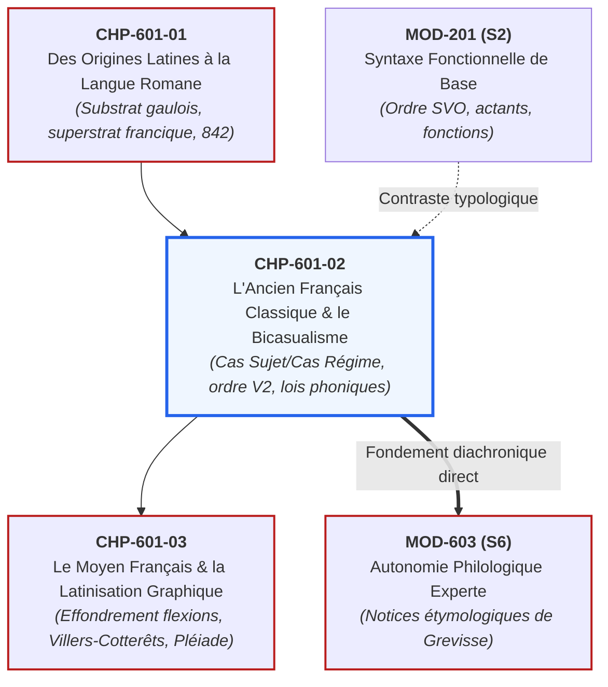
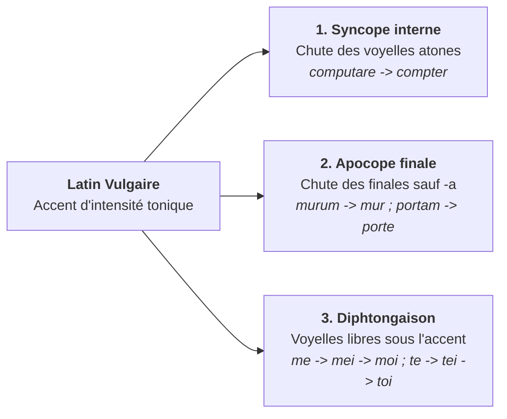

# Chapitre 2 : L'Ancien Français Classique et le Système Bicasuel (XIe - XIIIe s.)

> **Identifiant** : `CHP-601-02`  
> **Module de rattachement** : [`MOD-601 — Diachronie et Histoire de la Langue Française : Des Origines aux Réformes`](file:///f:/Formation/world-class-french/03-curriculum/year-3/semester-6/mod-601-diachronie-histoire-langue-francaise.md)  
> **Volume horaire canonique** : 4 h 00 (Étude : 1 h 15 | Pratique : 1 h 30 | Correction : 0 h 45 | Évaluation : 0 h 30)  
> **Statut** : [STATUT : VALIDÉ]  
> **Compétences cibles** : [`FR-PHILOL-001`](file:///f:/Formation/world-class-french/02-competency-framework/competency-framework.md#fr-philol-001-autonomie-philologique-et-consultation-experte-des-sources) (L4/L5), [`FR-LEXIC-001`](file:///f:/Formation/world-class-french/02-competency-framework/competency-framework.md#fr-lexic-001-précision-sémantique-nuances-synonymiques-et-collocations) (L4), [`FR-ORTHO-001`](file:///f:/Formation/world-class-french/02-competency-framework/competency-framework.md#fr-ortho-001-maîtrise-de-lorthographe-lexicale-et-des-familles-de-mots) (L4/L5)  
> **Sources de référence** : `SRC-GRAM-02` (Riegel et al., *Grammaire méthodique du français*, chap. 2), `SRC-LEX-03` (Alain Rey, *Dictionnaire historique de la langue française*), `SRC-LEX-01` (*Trésor de la Langue Française informatisé*), `SRC-PHON-01` (Pierre Léon, *Phonétique du français contemporain*), `SRC-GRAM-01` (Grevisse & Goosse, *Le Bon Usage*, § 85-98), `SRC-TYPO-01` (*Lexique de l'Imprimerie nationale*), `SRC-NORM-03` (Ministère de l'Éducation nationale)

---

## 1. Titre et Place dans le Cursus

Ce deuxième chapitre du module `MOD-601` plonge au cœur de la matrice morphologique et syntaxique de l'**ancien français classique (XIe-XIIIe siècle)**. C'est l'époque de la *Chanson de Roland*, de Chrétien de Troyes et des premiers grands récits en prose. L'ancien français n'est pas un français moderne balbutiant ou imparfait : il s'agit d'un **système linguistique complet, souverain et d'une rigueur mathématique exceptionnelle**, articulé autour de la déclinaison à deux cas (**le bicasualisme**) et d'une syntaxe à verbe second (**langue V2**).



---

## 2. Objectifs Mesurables

Au terme de ce chapitre, l'apprenant sera capable de :
1. **Disséquer le mécanisme du bicasualisme médiéval** : décliner sans erreur les substantifs et adjectifs masculins et féminins au Cas Sujet (CS) et au Cas Régime (CR), au singulier comme au pluriel, pour les types I, II et III imparisyllabiques (`SRC-GRAM-02`, chap. 2).
2. **Formuler et appliquer les lois phonétiques régulières** : expliquer la syncope des voyelles internes atones, l'apocope des finales et les diphtongaisons spontanées sous l'accent tonique libre (`SRC-PHON-01`).
3. **Élucider la vocalisation du [l] vélaire en [w] devant consonne** : reconstituer la filiation phonétique et graphique reliant *caballos* à *chevaux*, et justifier scientifiquement l'exception des emprunts savants modernes en *-als* (`SRC-GRAM-01`, § 95).
4. **Analyser la structure topologique de la phrase d'ancien français** : identifier la position du verbe fléchi (contrainte V2), le rôle du focus initial et le statut de la langue à sujet pronominal nul (*pro-drop*).
5. **Identifier les fossiles bicasuels du français moderne** : repérer dans le lexique contemporain les doublets issus de la scission d'un même étymon en deux mots distincts par figement du CS et du CR (*gars / garçon*, *on / homme*, *copain / compagnon*, *sire / seigneur*).

---

## 3. Prérequis et Test de Préparation

### 3.1 Prérequis Théoriques
- Maîtrise des notions de morphologie flexionnelle et de déclinaison latine (`CHP-601-01`).
- Distinction absolue des fonctions syntaxiques de Sujet, d'Attribut et de Complément d'Objet (`MOD-201`).
- Transcription en Alphabet Phonétique International (`MOD-101`).

### 3.2 Test Diagnostique d'Auto-Évaluation (5 items)

<details>
<summary><b>Consulter le test et son corrigé immédiat</b></summary>

1. *Quels sont les deux seuls cas conservés par l'ancien français à partir des six cas latins ?*  
   **Réponse** : Le Cas Sujet (CS), hérité du nominatif latin, et le Cas Régime (CR), hérité de l'accusatif latin (qui a absorbé le datif et l'ablatif).
2. *Dans la phrase d'ancien français « Li murs est hauz », pourquoi « murs » et « hauz » portent-ils un « -s » alors qu'ils sont au singulier ?*  
   **Réponse** : Parce qu'ils sont au Cas Sujet singulier masculin (type II, du latin *mūrus* et *altus*), où la désinence *-s* signale la fonction de sujet ou d'attribut du sujet.
3. *Qu'appelle-t-on la « vocalisation du [l] vélaire » ? Donnez un exemple.*  
   **Réponse** : La transformation de la consonne liquide [l] prononcée à l'arrière du palais en semi-voyelle [w] puis voyelle [u] lorsqu'elle se trouve devant une autre consonne (*al-ba* $\rightarrow$ *aube*, *chevals* $\rightarrow$ *chevaus* $\rightarrow$ *chevaux*).
4. *Quelle différence sépare une langue « V2 » d'une langue « SVO » ?*  
   **Réponse** : Une langue SVO impose le sujet en tête de phrase devant le verbe. Une langue V2 impose uniquement que le verbe conjugué apparaisse en deuxième position structurelle, le premier constituant pouvant être un complément, un adverbe ou le sujet indifféremment.
5. *Pourquoi a-t-on le mot « copain » et le mot « compagnon » en français contemporain ?*  
   **Réponse** : Ils proviennent du même étymon bas-latin *compāniō* (celui qui partage le pain) : *copain* est issu du Cas Sujet (*compān'yo*), tandis que *compagnon* est issu du Cas Régime accusatif (*compāniōnem*).

</details>

---

## 4. Situation de Départ ou Problème Concret

Considérons les trois interrogations légitimes d'un lecteur découvrant pour la première fois un manuscrit du XIIe siècle :
1. Pourquoi trouve-t-on dans la *Chanson de Roland* :  
   - *« Li cuens Rollant se pasmet »* (avec *-s* à *cuens*, alors que Roland est seul) ;  
   - et quelques vers plus loin : *« Li conte s'en repairent »* (sans *-s* à *conte*, alors qu'ils sont plusieurs) ?
2. Pourquoi notre grammaire moderne présente-t-elle l'alternance *un cheval / des chevaux*, mais *un chacal / des chacals*, *un festival / des festivals* ?
3. Pourquoi une phrase médiévale peut-elle s'écrire *« La dame vit li chevaliers »* sans que l'on sache, d'après l'ordre des mots, qui regarde qui ?

Pour le profane, ces tournures semblent relever de la fantaisie graphique ou d'une incohérence primitive.  
Pour le philologue, elles illustrent avec une limpidité parfaite la mécanique d'une **langue flexionnelle hautement sophistiquée** :
- Le *-s* du singulier *li cuens* indique qu'il est sujet ; l'absence de *-s* dans *li conte* au pluriel indique également qu'il est sujet ;
- La forme *chevaux* résulte de la vocalisation médiévale du *l* devant consonne au pluriel (*chevals* $\rightarrow$ *chevaus* $\rightarrow$ *chevaux*), tandis que *chacal* et *festival* sont des emprunts savants ou étrangers tardifs qui n'ont pas connu cette mutation médiévale ;
- Dans *« La dame vit li chevaliers »*, le mot *dame* est au Cas Régime (COD) et *li chevaliers* porte la marque *-s* du Cas Sujet : c'est donc incontestablement le chevalier qui voit la dame, quel que soit l'ordre des mots.

---

## 5. Explication Intuitive : L'Échiquier vs Le Rail d'Aiguillage

Pour comprendre le basculement de l'ancien français vers le français moderne, imaginons deux systèmes de transport ou de jeu :

- **Le système de l'échiquier (L'Ancien Français Bicasuel)** :  
  Sur un échiquier, chaque pièce porte son identité sur sa tête : le roi a sa couronne, le cavalier a sa tête de cheval, le fou a sa mitre. Peu importe où vous posez le roi sur l'échiquier — au centre, sur une aile, au fond —, il demeure le roi.  
  Le bicasualisme fonctionnait exactement de cette manière : grâce à la désinence *-s* (ou à son absence programmée), chaque substantif affichait ostensiblement sa fonction de Sujet (CS) ou de Régime (CR). L'écrivain pouvait placer le verbe au milieu et disposer le sujet et le complément avant ou après selon l'effet d'emphase ou de rythme souhaité, sans le moindre risque de malentendu.

- **Le système du rail d'aiguillage (Le Français Moderne SVO)** :  
  Lorsque les désinences phonétiques se sont effondrées à la fin du Moyen Âge, les mots ont perdu leurs « couronnes » distinctives : *murs* et *mur* ont fini par se prononcer exactement de la même manière. Pour éviter que la communication ne sombre dans le chaos, la langue a dû bâtir des rails fixes : **l'ordre obligatoire Sujet - Verbe - Complément**. Si vous dites aujourd'hui *« Le loup mange l'agneau »*, vous ne pouvez plus inverser les termes (*« L'agneau mange le loup »*) sans inverser le sens de la scène.

---

## 6. Définitions Précises et Terminologie

- **Ancien français classique** : État de la langue d'oïl parlée et écrite approximativement entre le milieu du XIe siècle et la fin du XIIIe siècle (de la *Vie de saint Alexis* v. 1040 à la mort de saint Louis en 1270).
- **Bicasualisme** : Système morphologique de déclinaison réduit à deux cas fonctionnels :
  - **Cas Sujet (CS)** : issu du nominatif latin, marquant le sujet grammatical, le vocatif et l'attribut du sujet ;
  - **Cas Régime (CR)** : issu de l'accusatif latin, marquant tous les compléments directs, indirects, prépositionnels et circonstanciels.
- **Syncope** : Chute d'un phonème ou d'une voyelle atone à l'intérieur d'un mot (*sanitatem* $\rightarrow$ *santé*).
- **Apocope** : Chute d'un phonème ou d'une voyelle atone à la fin d'un mot (*panem* $\rightarrow$ *pain*).
- **Vocalisation** : Transformation d'une consonne en voyelle ou semi-voyelle (ex. le passage de $[l]$ à $[w]$ devant consonne).
- **Langue V2 (Verb-Second)** : Propriété syntaxique imposant que le verbe conjugué de la proposition principale occupe rigoureusement la deuxième position structurelle, quel que soit l'élément placé en première position.
- **Sujet nul (*pro-drop*)** : Faculté d'une langue à omettre le pronom personnel sujet sans perte de clarté, la personne étant univoquement identifiable par la désinence verbale.

---

## 7. Règles et Mécanismes Fondamentaux

### 7.1 Les Grandes Lois Phonétiques de l'Ancien Français

Le passage du gallo-roman à l'ancien français est gouverné par trois mutations phonétiques régulières majeures (`SRC-GRAM-02`, chap. 2 ; `SRC-PHON-01`) :



1. **La Syncope des atones internes** :  
   Sous l'effet de l'accent tonique d'intensité hérité du germanique, toute voyelle brève placée immédiatement avant ou après la syllabe accentuée s'amuit :  
   $$\textit{cīvitātem} \rightarrow \textit{civ'tate} \rightarrow \textit{cité} \quad ; \quad \textit{bonitātem} \rightarrow \textit{bon'tate} \rightarrow \textit{bonté}$$
2. **L'Apocope des voyelles finales** :  
   Toutes les voyelles finales latines s'amuïssent, à la seule exception du **-a** latin qui s'affaiblit en **-e** muet féminin (dit « féminin sourd ») :  
   $$\textit{mūrum} \rightarrow \textit{mur} \quad ; \quad \textit{mare} \rightarrow \textit{mer} \quad ; \quad \textit{portam} \rightarrow \textit{porte}$$
3. **Les Diphtongaisons spontanées sous l'accent libre** :  
   Une voyelle accentuée en syllabe ouverte (non suivie de consonne dans la même syllabe) se fracture en diphtongue :  
   - $\bar{e}$ latin fermé $\rightarrow$ *ei* $\rightarrow$ *oi* (*habēre* $\rightarrow$ *aveir* $\rightarrow$ *avoir*) ;  
   - $\bar{o}$ latin fermé $\rightarrow$ *ou* $\rightarrow$ *eu* (*flōrem* $\rightarrow$ *flour* $\rightarrow$ *fleur*).

---

### 7.2 La Vocalisation du [l] Vélaire et la Genèse des Pluriels en « -aux »

En latin, la consonne $[l]$ placée devant une consonne possédaient une articulation vélaire sourde $[ɫ]$. Au cours du Xe siècle, cette consonne latérale s'est transformée en semi-voyelle $[w]$ puis voyelle $[u]$ :

$$\textit{caballos} \quad \longrightarrow \quad \textit{chevals} \quad \longrightarrow \quad \textit{chevaus} \quad \longrightarrow \quad \textit{chevaux}$$
$$\textit{bellos} \quad \longrightarrow \quad \textit{bels} \quad \longrightarrow \quad \textit{beaus} \quad \longrightarrow \quad \textit{beaux}$$
$$\textit{follum} \quad \longrightarrow \quad \textit{fol} \text{ (devant voyelle)} \quad / \quad \textit{fou} \text{ (devant consonne)}$$

#### L'Origine de la Lettre « x » dans les Pluriels Modernes :
Au Moyen Âge, les copistes utilisaient la lettre **x** comme un signe abréviatif sténographique valant pour la terminaison **-us** (comme on écrit aujourd'hui un symbole pour abréger).  
Lorsque les imprimeurs de la Renaissance ont typographié les textes médiévaux, ils ont confondu cette abréviation sténographique avec une véritable lettre consonantique : ils ont donc maintenu le *u* et ajouté le *x*, figeant la graphie moderne aberrante **-aux** (*cheva-u-x*) et **-eux** (*yeu-x*) (`SRC-GRAM-01`, § 95).

---

### 7.3 Les Paradigmes du Système Bicasuel Médiéval

L'ancien français classe les substantifs et adjectifs en trois types majeurs de déclinaison :

#### Type II : Masculins Réguliers en « -us » (Modèle *mūrus*)
C'est le modèle le plus fréquent, hérité de la 2e déclinaison latine. Il présente la singularité d'avoir un **-s au singulier du sujet** et une **absence de -s au pluriel du sujet** :

| Nombre | Cas Sujet (CS) | Cas Régime (CR) | Étymon latin explicatif |
| :--- | :---: | :---: | :--- |
| **Singulier** | *li murs* | *le mur* | Nominatif *mūrus* (-s conservé) / Accusatif *mūrum* (-m amuï) |
| **Pluriel** | *li mur* | *les murs* | Nominatif *mūrī* (pas de consonne finale) / Accusatif *mūrōs* (-s conservé) |

#### Type I : Féminins Réguliers en « -a » (Modèle *porta*)
Issu de la 1ère déclinaison latine, ce type ne possède pas de *-s* au singulier car le nominatif latin en *-a* et l'accusatif en *-am* ont tous deux abouti au *e* muet :

| Nombre | Cas Sujet (CS) | Cas Régime (CR) | Étymon latin explicatif |
| :--- | :---: | :---: | :--- |
| **Singulier** | *la porte* | *la porte* | Nominatif *porta* / Accusatif *portam* |
| **Pluriel** | *les portes* | *les portes* | Nominatif *portae* $\rightarrow$ *portas* / Accusatif *portas* |

#### Type III : Masculins Imparisyllabiques à Accent Mobile (Modèle *comes / comitem*)
Ces mots latins de la 3e déclinaison changeaient de nombre de syllabes et déplaçaient l'accent tonique entre le nominatif singulier et l'accusatif. L'ancien français a conservé deux radicaux totalement distincts :

| Étymon latin | Cas Sujet Singulier (CS sg) | Cas Régime Singulier (CR sg) | Cas Sujet Pluriel (CS pl) | Cas Régime Pluriel (CR pl) |
| :--- | :---: | :---: | :---: | :---: |
| *comes / comitem* | **li cuens** | **le conte** | **li conte** | **les contes** |
| *homo / hominem* | **li huem / on** | **le home** | **li home** | **les homes** |
| *infans / infantem* | **li enfes** | **l'enfant** | **li enfant** | **les enfants** |
| *pastor / pastorem* | **li pastre** | **le pasteur** | **li pasteur** | **les pasteurs** |
| *baro / baronem* | **li ber** | **le baron** | **li baron** | **les barons** |

---

### 7.4 La Syntaxe Médiévale : L'Ordre V2 et la Liberté Topologique

L'ancien français est une **langue V2** (comme l'allemand contemporain dans les propositions principales) :
1. **La position V2 absolue** : Le verbe conjugué se place en deuxième position structurale dans la proposition.
2. **Le choix du premier constituant (V1)** : Le premier constituant peut être le Sujet, le Complément d'Objet ou un Adverbe circonstanciel selon le thème que l'on veut mettre en valeur (focalisation).
3. **L'inversion du sujet sans cliticisation** : Si le premier constituant n'est pas le sujet, le sujet se place naturellement immédiatement après le verbe :  
   - *« Li chevaliers voit la dame »* (Sujet en V1, Verbe en V2, Objet en V3) ;  
   - *« La dame voit li chevaliers »* (Objet en V1, Verbe en V2, Sujet en V3) ;  
   - *« Hier vit li chevaliers la dame »* (Adverbe en V1, Verbe en V2, Sujet en V3, Objet en V4).
4. **Le sujet nul (*pro-drop*)** : Les pronoms personnels sujets (*je, tu, il*) ne sont pas obligatoires :  
   - *« Chante la chançon »* = *Il chante la chanson*. Le pronom n'était employé que pour marquer une insistance forte.

---

## 8. Raisonnement Détaillé : Pourquoi le Bicasualisme s'est-il Effondré ?

Une question fondamentale se pose : comment un système aussi rigoureux a-t-il pu disparaître totalement en moins de deux siècles pour laisser place au français moderne ?

La réponse réside dans la **vulnérabilité phonétique extrême de la désinence *-s*** :
1. **L'érosion phonétique continue** : Dès la fin du XIIe siècle en Île-de-France, la consonne finale [-s] a cessé d'être articulée devant une consonne suivante, puis s'est affaiblie en simple souffle [h] avant de s'amuer totalement dans la langue orale.
2. **L'homophonie destructrice** : Dès lors que le *-s* ne s'entendait plus, *li murs* (sujet singulier) et *le mur* (régime singulier), ainsi que *li mur* (sujet pluriel) et *les murs* (régime pluriel), sont devenus rigoureusement identiques à l'oreille.
3. **Le triomphe du Cas Régime par la loi du nombre** : Dans un discours, les substantifs apparaissent statistiquement deux à trois fois plus souvent comme compléments (COD, COI, compléments prépositionnels) que comme sujets. Lors de la fusion des formes au XIVe siècle, c'est presque systématiquement la forme du **Cas Régime** qui l'a emporté et a survécu pour former le mot unique du français moderne.

---

## 9. Exemples Corrects Commentés

### Exemple 1 : Analyse Philologique de la *Chanson de Roland* (v. 1049-1052)

> *« Rollant est pruz e Olivier est sages, / Ambedui unt merveillus curages. / Puis que il sunt as chevals e as armes, / Ja pur murir ne guerpirunt les batailles. »*

- **Rollant est pruz** : *Rollant* est au Cas Sujet singulier (imparisyllabique de type III sans *-s*) ; *pruz* est adjectif attribut au CS singulier avec *-s* régulier (du latin *prudens*).
- **Olivier est sages** : *Olivier* est au CS singulier ; *sages* porte la désinence *-s* du CS singulier masculin (du bas-latin *sapius*).
- **Ambedui unt** : *Ambedui* (tous deux) est au CS pluriel ; *unt* est le verbe *avoir* à la 3e personne du pluriel ($< habent$).
- **as chevals** : contraction de $ad + illos \rightarrow as$. *Chevals* est au Cas Régime pluriel avant la vocalisation complète en *-aux*.

### Exemple 2 : L'Évolution Phonétique Complète de « bellos » vers « beaux »

$$\textit{bellos} \quad \xrightarrow{\text{1. Syncope/Réduction}} \quad \textit{bels} \quad \xrightarrow{\text{2. Vocalisation du [l] devant [s]}} \quad \textit{beaus} \quad \xrightarrow{\text{3. Sténographie}} \quad \textit{beaux}$$

1. *bellos* : accusatif pluriel latin.
2. La consonne latérale vélaire $[l]$ devant la sifflante $[s]$ se vocalise en $[w]$ puis $[u]$, formant la triphtongue médiévale *eau* [e-a-u].
3. L'abréviation graphique en *x* fige l'orthographe moderne *beaux*.

---

## 10. Contre-Exemples et Clinique des Erreurs Fréquentes

L'analyse de l'ancien français et de ses survivances contemporaines met en évidence six erreurs philologiques majeures :

### Erreur n° 1 : Croire que la Marque « -s » a Toujours Caractérisé le Pluriel
- **Idée fausse** : S'imaginer que la désinence finale *-s* a de tout temps servi à marquer la pluralité en français.
- **Correction** : En ancien français classique, pour tous les noms masculins de type II (*li murs*), le **-s au singulier indique le sujet**, et l'**absence de -s au pluriel (*li mur*) indique également le sujet**. C'est le Cas Régime qui prenait un *-s* au pluriel (*les murs*).

### Erreur n° 2 : Qualifier d'Anarchique la Syntaxe Médiévale
- **Idée fausse** : Prétendre que les troubadours et chroniqueurs plaçaient les mots au hasard sans respecter la grammaire.
- **Correction** : L'ancien français obéit à la règle stricte de la **langue V2** : le verbe fléchi est impérativement en deuxième position, et les fonctions actancielles sont portées infailliblement par les cas (CS / CR) et non par l'ordre des mots.

### Erreur n° 3 : Généraliser le Pluriel en « -aux » aux Emprunts Savants Récents
- **Forme fautive** : *\*Des chacaux dans le désert* ou *\*Les festivaux de musique*.
- **Correction** : *Des chacals*, *des festivals*, *des carnavals*.
- **Diagnostic** : Seuls les mots du fonds lexical populaire présent au Xe siècle ont subi la loi phonétique de vocalisation du [l] vélaire devant consonne. Les mots introduits ultérieurement par voie savante ou étrangère prennent régulièrement un simple *-s* (`SRC-GRAM-01`, § 95).

### Erreur n° 4 : Confondre Syncope et Apocope
- **Idée fausse** : Employer indifféremment les termes de syncope et d'apocope pour désigner la disparition d'une voyelle.
- **Correction** : La **syncope** est une chute interne à l'intérieur du mot (*bon'tate* $\rightarrow$ *bonté*) ; l'**apocope** est une chute terminale en fin de mot (*portam* $\rightarrow$ *porte* ; *murum* $\rightarrow$ *mur*).

### Erreur n° 5 : Croire que « on » et « homme » Sont des Mots Indépendants
- **Idée fausse** : Penser que le pronom indéfini *on* n'a aucun lien de parenté étymologique avec le substantif *homme*.
- **Correction** : *On* et *homme* constituent le doublet morphologique par excellence issu de l'ancien français : *on* provient du **Cas Sujet** *homo* $\rightarrow$ *huem / on*, tandis que *homme* provient du **Cas Régime** *hominem* $\rightarrow$ *home* $\rightarrow$ *homme*.

### Erreur n° 6 : Croire que le « x » de « chevaux » est une Consonne Étymologique
- **Idée fausse** : Imaginer que le *x* final de *chevaux* ou *châteaux* provient d'une consonne latine comme dans *index* ou *dux*.
- **Correction** : Le *x* moderne n'est rien d'autre qu'une abréviation manuscrite médiévale pour *-us* mal interprétée par les typographes du XVIe siècle.

#### Tableau Clinique des Phénomènes Morphosyntaxiques Médiévaux
| Cas clinique | Erreur courante ou idée reçue | Réalité philologique démontrée | Référence source |
| :---: | :--- | :--- | :--- |
| **Cas 1** | *Le -s a toujours marqué le pluriel* | En AF, *-s* au singulier marque le sujet (type II) | `SRC-GRAM-02`, chap. 2 |
| **Cas 2** | *La syntaxe médiévale était anarchique* | Syntaxe V2 rigoureuse gouvernée par le bicasualisme | `SRC-GRAM-02`, chap. 2 |
| **Cas 3** | *Chacal fait chacaux* | Emprunt savant tardif non soumis à la vocalisation | `SRC-GRAM-01`, § 95 |
| **Cas 4** | *Syncope et apocope sont synonymes* | Syncope = chute interne ; Apocope = chute finale | `SRC-PHON-01` |
| **Cas 5** | *« On » n'a aucun rapport avec « homme »* | Doublet CS (*on*) vs CR (*homme*) du latin *homo* | `SRC-LEX-03` |
| **Cas 6** | *Le x de chevaux vient d'une consonne latine* | Abréviation sténographique médiévale pour *-us* | `SRC-GRAM-01`, § 95 |

---

## 11. Cas Particuliers et Limites

### 11.1 Les Substantifs Neutres et Invariables de Type I Masculin
Certains noms masculins issus de la 2e déclinaison latine en *-er* (*pater*, *frater*) ou d'anciens neutres ne prenaient pas de *-s* au Cas Sujet singulier en ancien français :
- CS singulier : *li pere* (du latin *pater*)
- CR singulier : *le pere* (du latin *patrem*)
- CS pluriel : *li pere* (du latin *patres*, avec affaiblissement)
- CR pluriel : *les peres* (du latin *patres*)

### 11.2 Les Survivances Lexicales Scindées (Fossiles Bicasuels)
L'effondrement du bicasualisme a parfois légué au français moderne **deux mots distincts dotés de sens divergents**, issus l'un du Cas Sujet, l'autre du Cas Régime :
1. **Gars / Garçon** : *gars* est le Cas Sujet (*wāro* $\rightarrow$ *gars*), *garçon* est le Cas Régime accusatif (*wāronem* $\rightarrow$ *garçon*).
2. **Copain / Compagnon** : *copain* est issu du Cas Sujet (*compāniō*), *compagnon* du Cas Régime (*compāniōnem*).
3. **Sire / Seigneur** : *sire* est le Cas Sujet (*sĕnior*), *seigneur* est le Cas Régime (*sēniōrem*).
4. **Pute / Putain** : *pute* est le Cas Sujet, *putain* le Cas Régime accusatif.

---

## 12. Approfondissement Adapté au Niveau (L4/L5) : La Grammaticalisation du Pronom Sujet

L'effondrement du bicasualisme à la fin du XIIIe siècle a entraîné une cascade de transformations structurelles dans la morphosyntaxe du français :

```text
ÉVOLUTION MORPHOSYNTAXIQUE : DE LA FLEXION À LA POSITION
├── 1. ÉTAT MÉDIÉVAL (XIe - XIIe s.)
│   ├── Désinences bicasuelles audibles (CS -s vs CR Ø).
│   ├── Langue pro-drop : pronom sujet facultatif (« Chante le vers »).
│   └── Ordre V2 souple : complément ou adverbe en tête possible.
└── 2. ÉTAT MODERNE (XIVe s. -> Aujourd'hui)
    ├── Amuïssement du -s : homophonie complète du singulier et pluriel oral.
    ├── Perte du statut pro-drop : pronom sujet obligatoire (« Il chante le vers »).
    └── Fixation rigide de l'ordre positionnel Sujet - Verbe - Complément (SVO).
```

Le français est la **seule langue romane majeure** ayant totalement perdu le statut de langue à sujet nul (*pro-drop*). Alors que l'espagnol (*canto*), l'italien (*canto*) et le portugais (*canto*) omettent couramment le pronom personnel, le français contemporain exige impérativement le clitique sujet (*je chante*), car la désinence verbale orale moderne est devenue homophone pour quatre personnes sur six ([ʃɑ̃t] pour *chante, chantes, chantent*).

---

## 13. Comparaisons Différentielles

| Critère d'analyse | Ancien Français Classique (XIIe s.) | Français Moderne Standard (XXIe s.) |
| :--- | :--- | :--- |
| **Marquage des fonctions** | Morphologique (par les cas CS et CR) | Syntaxique (par la position ordonnée SVO) |
| **Place du verbe fléchi** | Obligatoirement en 2e position (langue V2) | Après le sujet (ordre SVO régulier) |
| **Statut du pronom sujet** | Facultatif (*pro-drop* : *« Vint a la cort »*) | Strictement obligatoire (*« Il vint à la cour »*) |
| **Valeur du « -s » final** | Marque du Cas Sujet singulier OU du pluriel | Marque univoque du nombre pluriel |
| **Prononciation du « -s »** | Toujours articulé comme consonne sifflante | Consonne muette graphique (sauf liaison) |
| **Pluriels en « -aux »** | Stade phonétique vivant (*chevaus*) | Morphologie fossilisée d'origine sténographique |

---

## 14. Exercices Progressifs

### Niveau 1 : Maîtrise de la Déclinaison Bicasuelle
*Consigne : Décliner les substantifs médiévaux suivants aux 4 cases du tableau bicasuel : « chevalier » (type II) et « enfant » (type III imparisyllabique).*

- **Corrigé pour chevalier** :
  - Cas Sujet singulier : *li chevaliers* (du latin *caballarius*)
  - Cas Régime singulier : *le chevalier* (du latin *caballarium*)
  - Cas Sujet pluriel : *li chevalier* (du latin *caballarii*)
  - Cas Régime pluriel : *les chevaliers* (du latin *caballarios*)
- **Corrigé pour enfant** :
  - Cas Sujet singulier : *li enfes* (du latin *infans*)
  - Cas Régime singulier : *l'enfant* (du latin *infantem*)
  - Cas Sujet pluriel : *li enfant* (du latin *infantes*)
  - Cas Régime pluriel : *les enfants* (du latin *infantes*)

### Niveau 2 : Rétablissement des Cas et Analyse Actancielle
*Consigne : Dans les phrases suivantes en ancien français, identifier la fonction de chaque substantif grâce à sa forme casuelle :*
1. *« La cité prist li rois. »*  
   - **Analyse** : *La cité* est au Cas Régime singulier (COD) placé en V1 ; *li rois* porte le *-s* du Cas Sujet singulier (type II) placé en V3 : c'est le roi qui a pris la cité.
2. *« Granz colps receut li cuens. »*  
   - **Analyse** : *Granz colps* est au Cas Régime pluriel (COD) placé en V1 ; *li cuens* est au Cas Sujet singulier de type III (sujet) : le comte a reçu de grands coups.

### Niveau 3 : Analyse Philologique Calibrée (50 mots exacts)
*Consigne : Rédiger une notice philologique sur le bicasualisme et la vocalisation du [l] vélaire en ancien français, calibrée très exactement à 50 mots selon les normes de décompte de l'Imprimerie nationale (`SRC-TYPO-01`).*

> « L'ancien français classique structure sa morphologie autour du système bicasuel, opposant le Cas Sujet au Cas Régime. Cette déclinaison accorde une remarquable liberté topologique à la phrase médiévale. La vocalisation du l vélaire devant consonne engendre par ailleurs les pluriels réguliers en aux au sein de notre langue française. »

#### Décompte Certifié Mot à Mot (50 mots exacts) :
| N° | Token | N° | Token | N° | Token | N° | Token | N° | Token |
| :---: | :--- | :---: | :--- | :---: | :--- | :---: | :--- | :---: | :--- |
| **1** | L' | **11** | bicasuel, | **21** | accorde | **31** | vocalisation | **41** | pluriels |
| **2** | ancien | **12** | opposant | **22** | une | **32** | du | **42** | réguliers |
| **3** | français | **13** | le | **23** | remarquable | **33** | l | **43** | en |
| **4** | classique | **14** | Cas | **24** | liberté | **34** | vélaire | **44** | aux |
| **5** | structure | **15** | Sujet | **25** | topologique | **35** | devant | **45** | au |
| **6** | sa | **16** | au | **26** | à | **36** | consonne | **46** | sein |
| **7** | morphologie | **17** | Cas | **27** | la | **37** | engendre | **47** | de |
| **8** | autour | **18** | Régime. | **28** | phrase | **38** | par | **48** | notre |
| **9** | du | **19** | Cette | **29** | médiévale. | **39** | ailleurs | **49** | langue |
| **10** | système | **20** | déclinaison | **30** | La | **40** | les | **50** | française. |

---

## 15. Activité de Correction Raisonnée

### Copie d'Étudiant Soumise à Censure Philologique :
> *« Au Moyen Âge, les gens parlaient n'importe comment parce qu'ils n'avaient pas encore inventé la grammaire. Dans les vieux textes, ils écrivaient "li murs" avec un S au singulier par pure faute d'orthographe. De plus, ils disaient "des chacaux" et "des carnavaux", ce qui prouve que l'ancien français était une langue barbare sans règles fixes. »*

### Rapport de Rectification Critique :
1. *Parlaient n'importe comment sans grammaire* $\rightarrow$ **Erreur épistémologique majeure** : L'ancien français classique possédait une grammaire hautement rigoureuse fondée sur le bicasualisme hérité du latin et sur la règle syntaxique V2.
2. *Faute d'orthographe pour « li murs »* $\rightarrow$ **Anachronisme normatif** : Le *-s* de *li murs* est la désinence fonctionnelle légitime du Cas Sujet singulier de type II (latin *mūrus*). C'est l'absence de *-s* qui caractérisait le Cas Sujet pluriel (*li mur*).
3. *« Des chacaux » et « des carnavaux »* $\rightarrow$ **Contresens historique et linguistique** : *Chacal* (d'origine turco-persane) et *carnaval* (d'origine italienne) ont été empruntés plusieurs siècles après l'époque médiévale. Ils n'ont jamais connu la vocalisation médiévale du [l] vélaire et ont toujours formé leur pluriel régulier en *-s*.

---

## 16. Mise en Pratique dans une Production Réelle

### Consigne de Rédaction Calibrée (60 mots exacts)
Rédiger une synthèse philologique d'apparat sur la transition historique de l'ancien français vers l'ordre moderne, calibrée très exactement à **soixante (60) mots** selon les règles de décompte de l'Imprimerie nationale (`SRC-TYPO-01`).

### Texte Réalisé (60 mots exacts) :
> « L'effondrement progressif du bicasualisme médiéval au quatorzième siècle constitue la mutation syntaxique fondamentale de l'histoire du français. Privée de ses désinences casuelles par l'amuïssement phonétique des consonnes finales, la phrase romane a dû abandonner sa souplesse originelle pour fixer rigidement l'ordre canonique du sujet, du verbe et du complément, garantissant la parfaite clarté de notre langue. »

#### Décompte Certifié Mot à Mot (60 mots exacts) :
| N° | Token | N° | Token | N° | Token | N° | Token |
| :---: | :--- | :---: | :--- | :---: | :--- | :---: | :--- |
| **1** | L' | **16** | l' | **31** | finales, | **46** | canonique |
| **2** | effondrement | **17** | histoire | **32** | la | **47** | du |
| **3** | progressif | **18** | du | **33** | phrase | **48** | sujet, |
| **4** | du | **19** | français. | **34** | romane | **49** | du |
| **5** | bicasualisme | **20** | Privée | **35** | a | **50** | verbe |
| **6** | médiéval | **21** | de | **36** | dû | **51** | et |
| **7** | au | **22** | ses | **37** | abandonner | **52** | du |
| **8** | quatorzième | **23** | désinences | **38** | sa | **53** | complément, |
| **9** | siècle | **24** | casuelles | **39** | souplesse | **54** | garantissant |
| **10** | constitue | **25** | par | **40** | originelle | **55** | la |
| **11** | la | **26** | l' | **41** | pour | **56** | parfaite |
| **12** | mutation | **27** | amuïssement | **42** | fixer | **57** | clarté |
| **13** | syntaxique | **28** | phonétique | **43** | rigidement | **58** | de |
| **14** | fondamentale | **29** | des | **44** | l' | **59** | notre |
| **15** | de | **30** | consonnes | **45** | ordre | **60** | langue. |

---

## 17. Résumé Structuré

```text
L'ANCIEN FRANÇAIS CLASSIQUE ET LE SYSTÈME BICASUEL (SRC-GRAM-02)
├── 1. LA DÉCLINAISON BICASUELLE
│   ├── Cas Sujet (CS) : Sujet grammatical et attribut (hérité du nominatif).
│   └── Cas Régime (CR) : Tous les compléments d'objet et prépositionnels (hérité de l'accusatif).
│       ├── Type II (murs) : CS sg (li murs) | CR sg (le mur) | CS pl (li mur) | CR pl (les murs).
│       └── Type III imparisyllabique : CS sg (li cuens) vs CR sg (le conte) [accent mobile].
├── 2. LES LOIS PHONÉTIQUES
│   ├── Syncope : Amuïssement des voyelles atones internes (computare -> compter).
│   ├── Apocope : Chute des finales sauf -a affaibli en -e féminin sourd (portam -> porte).
│   └── Vocalisation du [l] vélaire : [l] + consonne -> [w] -> [u] (chevals -> chevaux).
└── 3. LA STRUCTURE SYNTAXIQUE
    ├── Contrainte V2 : Le verbe fléchi occupe la 2e position de la proposition principale.
    ├── Mobilité topologique : Sujet ou objet en tête selon la focalisation sans ambiguïté.
    └── Langue pro-drop : Omission courante du pronom sujet personnel.
```

---

## 18. Questions de Rappel Actif (Active Recall)

<details>
<summary><b>1. Comment reconnaît-on le Cas Sujet singulier d'un substantif masculin de type II ?</b></summary>
Par la présence de la désinence *-s* (ex. *li murs*, *li chevaliers*), héritée du nominatif latin en *-us*.
</details>

<details>
<summary><b>2. Pourquoi le Cas Sujet pluriel de type II ne prend-il pas de « -s » ?</b></summary>
Parce qu'il dérive du nominatif pluriel latin en *-ī* (*mūrī*), qui ne comportait aucune consonne finale.
</details>

<details>
<summary><b>3. D'où vient la lettre « x » dans l'orthographe moderne de « chevaux » ?</b></summary>
D'une abréviation manuscrite médiévale pour la séquence *-us*, réinterprétée par erreur comme une consonne par les premiers imprimeurs de la Renaissance.
</details>

<details>
<summary><b>4. Qu'est-ce qu'un nom imparisyllabique en ancien français ? Donnez un exemple.</b></summary>
Un nom latin de 3e déclinaison dont le radical et l'accent changeaient entre le nominatif et l'accusatif, donnant deux radicaux distincts en ancien français (*li cuens* au CS vs *le conte* au CR).
</details>

<details>
<summary><b>5. Quelle conséquence syntaxique a entraîné l'effondrement phonétique du bicasualisme ?</b></summary>
La fixation obligatoire et rigide de l'ordre positionnel Sujet - Verbe - Complément (SVO) et la grammaticalisation obligatoire des pronoms sujets (*je, tu, il*).
</details>

<details>
<summary><b>6. Pourquoi « festival » fait-il « festivals » au pluriel et non « festivaux » ?</b></summary>
Parce que c'est un emprunt savant tardif qui n'était pas présent dans la langue orale au Xe siècle lors de la loi phonétique de vocalisation du [l] vélaire devant consonne.
</details>

---

## 19. Mini-Évaluation Sommative Notée (20 Points)

### Barème d'Audit Philologique :
- **Maîtrise des paradigmes bicasuels (types I, II et III)** : 6 points (2 pts par type correctement décliné avec étymons latins).
- **Phonétique historique (syncope, apocope, vocalisation du [l] vélaire)** : 6 points (explication des pluriels en *-aux* et chute des voyelles atones).
- **Analyse de la syntaxe V2 et du statut pro-drop** : 5 points (reconstitution de la dynamique actancielle médiévale).
- **Apparat critique et rigueur terminologique** : 3 points.
- **Clause éliminatoire** : Toute confusion entre Cas Sujet et Cas Régime ou anachronisme qualifiant le bicasualisme d'anarchique entraîne une pénalité forfaitaire de -4 points. Seuil plancher de certification : **14/20**.

---

## 20. Critères Observables de Maîtrise

L'apprenant valide ce chapitre s'il démontre :
- La capacité à décliner sans hésitation n'importe quel substantif d'ancien français au CS et au CR, au singulier et au pluriel.
- L'explication historique rigoureuse des pluriels en *-al / -aux* face aux pluriels savants en *-als*.
- L'analyse syntaxique exacte d'un extrait de texte médiéval en appliquant la contrainte V2.
- L'identification immédiate des couples lexicaux modernes issus de la scission d'un étymon bicasuel (*on/homme*, *gars/garçon*, *sire/seigneur*).

---

## 21. Sources et Lectures Complémentaires

- **`SRC-GRAM-02`** : Martin RIEGEL, Jean-Christophe PELLAT et René RIOUL, *Grammaire méthodique du français*, Paris, PUF, coll. « Quadrige » (Chapitre 2 : *Éléments d'histoire de la langue française*, p. 35-58).
- **`SRC-LEX-03`** : Alain REY (dir.), *Dictionnaire historique de la langue française*, Paris, Le Robert (Notices : *Cheval*, *Comte*, *On*, *Homme*, *Gars*, *Sire*).
- **`SRC-LEX-01`** : ATILF / CNRS, *Trésor de la Langue Française informatisé (TLFi)*, Nancy.
- **`SRC-PHON-01`** : Pierre LÉON, *Phonétique du français contemporain*, Paris, Armand Colin (Chapitre sur la vocalisation et les lois d'amuissement).
- **`SRC-GRAM-01`** : Maurice GREVISSE et André GOOSSE, *Le Bon Usage*, Bruxelles, De Boeck Supérieur (§ 85-98 : *Histoire de l'orthographe* ; § 95 : *Pluriels en -aux*).
- **`SRC-TYPO-01`** : IMPRIMERIE NATIONALE, *Lexique des règles typographiques en usage à l'Imprimerie nationale*, Paris.
- **`SRC-NORM-03`** : MINISTÈRE DE L'ÉDUCATION NATIONALE, *Terminologie grammaticale et typographique officielle*, Paris.

---

## Annexe : Classification Pédagogique

- **CORE-NOW** : Bicasualisme (Cas Sujet vs Cas Régime, types I, II, III), lois phonétiques (syncope, apocope, vocalisation du [l] vélaire en [w]), ordre V2 et langue pro-drop.
- **INTRODUCTION-NOW** : Doublets morphologiques contemporains issus du bicasualisme (*gars/garçon*, *on/homme*, *sire/seigneur*).
- **DEFER** : Effondrement définitif du bicasualisme, latinisation cléricale et ordonnance de Villers-Cotterêts $\to$ traités dans [`CHP-601-03`](file:///f:/Formation/world-class-french/03-curriculum/year-3/semester-6/mod-601/chp-601-03-moyen-francais-renaissance-latinisation-graphique.md).
- **MOVE** : Doctrine de Vaugelas et épuration classique $\to$ traités dans [`CHP-601-04`](file:///f:/Formation/world-class-french/03-curriculum/year-3/semester-6/mod-601/chp-601-04-grand-siecle-fixation-classique-norme-vaugelas.md).
- **OPTIONAL-ADVANCED** : Paradigmes des pronoms démonstratifs médiévaux (*cist / cil*) et diphtongaisons conditionnées par l'entrave.
- **REMOVE** : Hypothèse erronée d'une écriture médiévale phonétique pure ou dénuée de règles.
