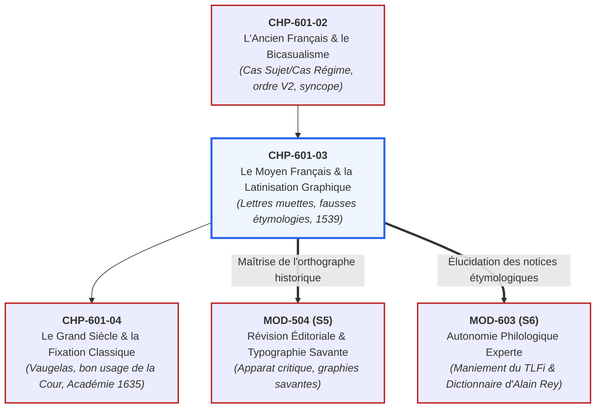
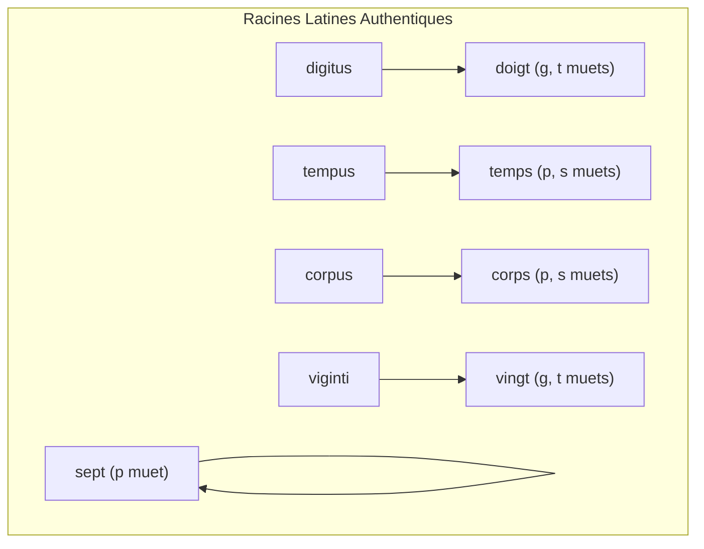

# Chapitre 3 : Le Moyen Français et la Renaissance : Mutations et Latinisation Graphique (XIVe - XVIe s.)

> **Identifiant** : `CHP-601-03`  
> **Module de rattachement** : [`MOD-601 — Diachronie et Histoire de la Langue Française : Des Origines aux Réformes`](file:///f:/Formation/world-class-french/03-curriculum/year-3/semester-6/mod-601-diachronie-histoire-langue-francaise.md)  
> **Volume horaire canonique** : 4 h 00 (Étude : 1 h 15 | Pratique : 1 h 30 | Correction : 0 h 45 | Évaluation : 0 h 30)  
> **Statut** : [STATUT : VALIDÉ]  
> **Compétences cibles** : [`FR-PHILOL-001`](file:///f:/Formation/world-class-french/02-competency-framework/competency-framework.md#fr-philol-001-autonomie-philologique-et-consultation-experte-des-sources) (L4/L5), [`FR-LEXIC-001`](file:///f:/Formation/world-class-french/02-competency-framework/competency-framework.md#fr-lexic-001-précision-sémantique-nuances-synonymiques-et-collocations) (L4), [`FR-ORTHO-001`](file:///f:/Formation/world-class-french/02-competency-framework/competency-framework.md#fr-ortho-001-maîtrise-de-lorthographe-lexicale-et-des-familles-de-mots) (L4/L5)  
> **Sources de référence** : `SRC-GRAM-02` (Riegel et al., *Grammaire méthodique du français*, chap. 2), `SRC-LEX-03` (Alain Rey, *Dictionnaire historique de la langue française*), `SRC-LEX-01` (*Trésor de la Langue Française informatisé*), `SRC-GRAM-01` (Grevisse & Goosse, *Le Bon Usage*, § 85-98), `SRC-TYPO-01` (*Lexique de l'Imprimerie nationale*), `SRC-NORM-03` (Ministère de l'Éducation nationale)

---

## 1. Titre et Place dans le Cursus

Ce troisième chapitre du module `MOD-601` aborde le grand tournant des **XIVe, XVe et XVIe siècles : l'époque du moyen français et de la Renaissance humaniste**. Après l'effondrement définitif du bicasualisme médiéval étudié dans le chapitre précédent, le français fait face à un double défi : réorganiser sa syntaxe autour de l'ordre strict Sujet-Verbe-Objet (SVO) et fixer son orthographe dans un contexte de diffusion imprimée. C'est le moment capital où les scribes, juristes et imprimeurs surchargent l'écriture de **consonnes muettes étymologiques réelles ou fictives**, tandis que le pouvoir royal scelle l'émancipation politique du français par l'**ordonnance de Villers-Cotterêts (1539)** et que la Pléiade publie son manifeste (*1549*).



---

## 2. Objectifs Mesurables

Au terme de ce chapitre, l'apprenant sera capable de :
1. **Analyser l'effondrement du bicasualisme et l'avènement de l'ordre SVO** : expliquer la disparition des désinences casuelles à l'oral et la réorganisation positionnelle obligatoire de la phrase (`SRC-GRAM-02`, chap. 2).
2. **Disséquer la latinisation graphique cléricale** : identifier les consonnes muettes étymologiques réintroduites par les clercs pour distinguer les homophones ou rappeler le latin classique (*doigt*, *temps*, *corps*, *vingt*, *sept*) (`SRC-GRAM-01`, § 88).
3. **Démontrer scientifiquement le mécanisme des fausses étymologies de la Renaissance** : prouver les erreurs savantes des humanistes sur *poids* (confondu avec *pondus* au lieu de *pensum*), *legs* (confondu avec *legare* au lieu de *laissier*) et *sçavoir* (confondu avec *scire* au lieu de *sapere*) (`SRC-LEX-03`).
4. **Situer la portée historique et juridique de l'Ordonnance de Villers-Cotterêts (1539)** : expliciter les articles 110 et 111 imposant le « langage maternel françoys » contre le latin d'Église et les parlers régionaux.
5. **Restituer la doctrine linguistique de la Pléiade** : expliciter le projet de Joachim Du Bellay dans *La Deffence, et Illustration de la Langue Francoyse* (1549) pour enrichir le lexique par dérivation, provignement et emprunts antiques.

---

## 3. Prérequis et Test de Préparation

### 3.1 Prérequis Théoriques
- Compréhension du système bicasuel de l'ancien français et de sa fragilité phonétique (`CHP-601-02`).
- Notions fondamentales d'homophonie et de morphologie dérivationnelle (`MOD-104`).
- Conscience des variations synchroniques et diachroniques (`MOD-404`).

### 3.2 Test Diagnostique d'Auto-Évaluation (5 items)

<details>
<summary><b>Consulter le test et son corrigé immédiat</b></summary>

1. *Pourquoi écrit-on « doigt » avec un « g » et un « t », alors qu'on ne prononce ni l'un ni l'autre ?*  
   **Réponse** : Parce que les scribes du moyen français ont réintroduit le *g* et le *t* du latin *digitus* pour distinguer ce mot de la forme verbale *doit* (du verbe *devoir*) et pour rappeler visuellement son étymon latin.
2. *Quel est l'étymon latin réel du mot « poids », et d'où vient sa lettre « d » ?*  
   **Réponse** : L'étymon réel est le bas-latin *pēnsum* (la pesée), qui avait donné régulièrement *pois* en ancien français. La lettre *d* est une fausse étymologie introduite à la Renaissance par confusion avec le latin *pondus, ponderis* (qui a donné le terme savant *pondéral*).
3. *En quelle année et par quel souverain a été signée l'ordonnance de Villers-Cotterêts ? Quel était son objet linguistique ?*  
   **Réponse** : En août 1539 par François Ier. Elle ordonne que tous les actes judiciaires et administratifs du royaume soient rédigés en « langage maternel françoys et non aultrement », excluant le latin juridique.
4. *D'où vient le mot « legs » et pourquoi sa graphie est-elle paradoxale ?*  
   **Réponse** : C'est un déverbal de l'ancien français *laissier* (ce qu'on laisse par testament). Les juristes de la Renaissance ont cru à tort qu'il venait du verbe latin *legāre* (léguer) et ont inséré un *g* fantaisiste.
5. *Quelle était la position de Joachim Du Bellay envers les emprunts linguistiques en 1549 ?*  
   **Réponse** : Il prônait l'enrichissement vigoureux du français en créant des néologismes, en empruntant directement aux racines grecques et latines, et en réactivant les termes techniques et artisanaux des métiers.

</details>

---

## 4. Situation de Départ ou Problème Concret

Considérons ces quatre anomalies graphiques du français moderne qui déconcertent les apprenants et les scripteurs :
1. Pourquoi écrit-on *temps* avec un *p* et un *s*, *corps* avec un *p* et un *s*, mais *dent* avec un *t* sans *s* ?
2. Pourquoi écrivait-on au XVIe siècle *sçavoir* avec un *ç*, alors que le verbe se conjugue *je sais* sans *c* ?
3. Pourquoi le mot *poids* prend-il un *d* qui n'apparaît dans aucun dérivé populaire (*peser*, *peson*, *pesée*), alors qu'il réapparaît soudain dans *pondéreux* ?
4. Pourquoi le français écrit s'est-il à ce point éloigné du français parlé à partir du XVIe siècle ?

Pour l'esprit non formé, ces graphies semblent le produit d'un complot pédant destiné à rendre l'orthographe inaccessible au peuple.  
Pour le philologue, elles sont **les témoins tangibles d'une crise sémiotique majeure** : au XIVe et XVe siècle, la prononciation s'est tellement simplifiée par l'amuïssement des consonnes finales que des dizaines de mots sont devenus strictement homophones à l'oreille :
- [pwa] correspondait à la fois à : *le pois* (le légume, latin *pisum*), *la poix* (la résine, latin *picem*), et *le pois* (la masse, latin *pensum*) ;
- [vɛ̃] correspondait à : *le vin* (latin *vinum*), *le vent* (latin *ventus*), *il vint* (verbe *venir*), et *vingt* (latin *viginti*).

Pour éviter la confusion visuelle sur le parchemin et dans les contrats notariés, les scribes ont fait appel à la mémoire latine : ils ont rétabli les squelettes consonantiques antiques pour **différencier graphiquement les homophones oraux**.

---

## 5. Explication Intuitive : Le Costume Latin sur Mesure Romane

Imaginons un édifice médiéval roman aux lignes sobres, dont les ornements sculptés en façade ont été érodés par la pluie et le vent jusqu'à devenir presque lisses (l'amuïssement phonétique).  
À l'époque de la Renaissance, des architectes humanistes redécouvrent les traités d'architecture de la Rome antique. Trouvant la façade médiévale trop dépouillée et confuse, ils décident de plaquer sur les murs romans de faux frontons, des colonnades et des pilastres de marbre sculptés à l'antique :
- Quand le pilastre correspond à l'armature réelle du mur intérieur, l'ornement est solide et logique (**latinisation authentique** : le *g* et le *t* de *doigt* rappellent la charpente de *digitus*) ;
- Mais quand les architectes se trompent de plan et plaquent un chapiteau corinthien sur un mur qui n'a jamais été romain, ils créent une chimère architecturale baroque (**fausse étymologie** : le *d* de *poids* ou le *g* de *legs*).

L'orthographe française de la Renaissance est précisément ce mélange fascinant d'architecture romane vivante et de décorations gréco-latines plaquées par l'érudition des clercs.

---

## 6. Définitions Précises et Terminologie

- **Moyen français** : Période de transition de l'histoire de la langue s'étendant du début du XIVe siècle à la fin du XVIe siècle (vers 1340 à 1590), marquée par la guerre de Cent Ans, l'invention de l'imprimerie et la Renaissance.
- **Latinisation graphique** : Réintroduction délibérée par les scribes, chanceliers et imprimeurs de lettres muettes non prononcées, imitées de la graphie latine classique.
- **Fausse étymologie (ou étymologie spécieuse)** : Attribution erronée d'un étymon latin ou grec à un mot d'origine différente, entraînant la modification fautive de sa graphie écrite.
- **Provignement** : Procédé de création lexicale théorisé par la Pléiade consistant à faire pousser de nouveaux mots à partir d'une racine existante par dérivation affixale (comme on multiplie une vigne en couchant un rameau en terre).
- **Consonne muette de liaison** : Consonne graphique finale devenue inaudible en position isolée ou devant consonne, mais susceptible d'être articulée devant une voyelle initiale suivante.
- **Doublet étymologique** : Deux mots français issus d'un même étymon latin, l'un par la voie populaire continue, l'autre par emprunt savant livresque.

---

## 7. Règles et Mécanismes Fondamentaux

### 7.1 L'Amuïssement des Consonnes Finales et la Crise de l'Homophonie

Entre le XIIIe et le XVe siècle, la phonétique du français subit une mutation spectaculaire : **l'amuïssement quasi général des consonnes finales** (`SRC-GRAM-02`, chap. 2) :
- Les consonnes finales $[s]$, $[t]$, $[p]$, $[k]$ cessent d'être prononcées en finale absolue ou devant mot à initiale consonantique ;
- Les voyelles nasales se stabilisent, réduisant les syllabes finales à des sons vocaliques purs ;
- Les diphtongues se réduisent à des monophtongues : *oi* passe de [we] à [wɛ] puis [wa] dans le peuple, tandis que *ai* s'ouvre en [ɛ].

Cette érosion phonétique engendre une prolifération d'homophones oraux que l'écrit doit impérativement désambiguïser.

---

### 7.2 L'Armature des Lettres Muettes Étymologiques Authentiques

Pour distinguer les homophones et souligner la noblesse latine de la langue, les scribes des chancelleries réintroduisent les consonnes de l'étymon latin (`SRC-GRAM-01`, § 88) :



| Mot moderne | Forme en Ancien Français (XIIe s.) | Lettre(s) réintroduite(s) | Étymon latin classique réel | Utilité fonctionnelle de désambiguïsation |
| :--- | :---: | :---: | :--- | :--- |
| **doigt** | *doit* | **g, t** | *digitus* | Distinguer du verbe *doit* (< *debere*) et de l'adjectif *droit* |
| **temps** | *tans* | **p, s** | *tempus* | Distinguer de l'adverbe *tant* (< *tantum*) |
| **corps** | *cors* | **p, s** | *corpus* | Distinguer de *cor* (au pied) et de *cors* (son du cor) |
| **vingt** | *vint* | **g, t** | *viginti* | Distinguer de la forme verbale *vint* (< *venir*) et de *vin* |
| **sept** | *set* | **p, t** | *septem* | Distinguer de l'adjectif démonstratif *cet* |
| **compter** | *conter* | **m, p** | *computāre* | Scinder le mot en deux : *compter* (calcul) vs *conter* (récit) |

---

### 7.3 Les Fausses Étymologies de la Renaissance : L'Erreur des Savants

Tous les clercs de la Renaissance n'étaient pas des philologues infaillibles. Guidés par des ressemblances superficielles, ils ont greffé des lettres totalement erronées sur des mots populaires (`SRC-LEX-03`) :

#### 1. Le Cas Clinique du Mot « Poids » :
- **Vérité diachronique** : Le mot est issu du bas-latin **pēnsum** (la portion pesée, participe passé du verbe *pendere* / *pensare*). En ancien français, il s'écrivait régulièrement **pois**.
- **L'erreur des clercs** : Au XVIe siècle, les humanistes l'ont rattaché à tort au latin classique **pondus, ponderis** (qui signifie également le poids en latin classique).
- **La greffe monstrueuse** : Ils lui ont inséré un **d** complètement anétymologique pour rappeler *pondus*. Le mot latin *pondus* a bien donné un mot en français, mais c'est le doublet savant tardif **pondéral** et **pondéreux** !

#### 2. Le Cas Clinique du Mot « Legs » :
- **Vérité diachronique** : *Legs* est le déverbal du verbe d'ancien français **laissier** (du latin *laxare*, lâcher, laisser). C'est simplement « ce que l'on laisse » à sa mort (ancien français *lais*).
- **L'erreur des juristes** : Les juristes de la Renaissance, habitués au latin de droit, ont cru que ce substantif dérivait du verbe latin **legāre** (léguer).
- **La greffe fautive** : Ils ont inséré un **g** imaginaire. Le verbe latin *legāre* a donné régulièrement le verbe savant *léguer* et le substantif *légataire*, mais n'a aucun lien historique avec *legs*.

#### 3. Le Cas Clinique du Verbe « Sçavoir » :
- **Vérité diachronique** : Issu du latin populaire **sapēre** (avoir du goût, être avisé), qui a donné *saveir* puis *savoir*.
- **L'erreur pédante** : Les lettrés du XVIe siècle l'ont rattaché au verbe latin classique **scīre** (savoir, d'où provient *science*).
- **La graphie baroque** : Ils ont imposé la graphie **sçavoir**, défendue avec acharnement jusqu'à son élimination définitive par l'Académie française en 1740.

---

### 7.4 L'Ordonnance de Villers-Cotterêts (Août 1539)

Signée par François Ier dans son château de Villers-Cotterêts, cette ordonnance royale de 192 articles constitue l'acte politique fondateur de la primauté de la langue nationale en France :
- **Article 110** : Exige que les arrêts de justice soient formulés si clairement *« qu'il n'y ait ne puisse avoir aulcune ambiguïté ou incertitude »*.
- **Article 111** : Ordonne que tous les actes judiciaires, contrats, testaments et registres d'état civil soient prononcés et enregistrés **« en langage maternel françoys et non aultrement »**.

#### Enjeux Politiques et Linguistiques :
1. **L'expulsion du latin clérical** : L'ordonnance brise le monopole des clercs de l'Église et des juges ecclésiastiques, permettant aux justiciables de comprendre les sentences portées contre eux.
2. **Le statut des parlers régionaux** : Si le texte visait d'abord le latin, la chancellerie royale a progressivement interprété le « langage maternel françoys » comme désignant exclusivement la langue du roi (le français de Paris et de l'Île-de-France), marginalisant ainsi l'occitan, le breton et les dialectes d'oïl.

---

### 7.5 Le Manifeste de la Pléiade : Du Bellay (1549)

En 1549, Joachim Du Bellay publie *La Deffence, et Illustration de la Langue Francoyse*, manifeste poétique du groupe de la Pléiade (autour de Pierre de Ronsard) :
- **Défense** : Le français n'est pas une langue « barbare » inférieure au grec ou au latin ; elle est simplement jeune et demande à être cultivée avec amour.
- **Illustration (enrichissement)** : Pour rivaliser avec les langues antiques, les poètes doivent enrichir le lexique :
  - Par le **provignement** : forger des verbes à partir de noms (*flamber*, *poignarder*) ;
  - Par l'**emprunt direct aux humanités** : transposer des mots grecs et latins (*patrie*, *ode*, *gymnastique*) ;
  - Par l'**intégration des lexiques techniques** : recueillir les mots des artisans, forgerons, marins et chasseurs.

---

## 8. Raisonnement Détaillé : Pourquoi l'Orthographe s'est-elle Fossilisée ?

L'invention de l'imprimerie (Gutenberg, vers 1450 ; premier atelier à Paris en 1470) a précipité la fixation de la langue écrite :
1. **L'exigence économique de l'imprimerie** : Les imprimeurs avaient besoin de caractères mobiles standardisés et d'un public large. Ils ne pouvaient tolérer que chaque copiste orthographie les mots selon son accent provincial.
2. **La résistance au phonétisme** : Face aux réformateurs comme Louis Meigret (qui proposait dès 1542 une orthographe purement phonétique), les corporations de juristes, de théologiens et d'imprimeurs (comme Robert Estienne) ont fait triompher la graphie étymologique.
3. **Le prestige social de la lettre muette** : Savoir écrire les consonnes qui ne s'entendent pas est devenu le marqueur de classe des lettrés face aux analphabètes. L'orthographe française s'est ainsi figée dans un compromis historique entre étymologie savante et distinctions visuelles.

---

## 9. Exemples Corrects Commentés

### Exemple 1 : Décorticage Philologique d'un Quatrain de Ronsard (1552)

> *« Mignonne, allons voir si la rose / Qui ce matin avoit desclose / Sa robe de pourpre au Soleil, / A point perdu ceste vesprée... »*

- **avoit desclose** : noter l'imparfait en *-oit* (prononcé [wɛ] puis [ɛ]), graphie officielle qui perdurera jusqu'en 1835. Le participe *desclose* conserve le *s* muet devant consonne annonçant le futur accent circonflexe (*déclose*).
- **ceste vesprée** : *ceste* est la graphie étymologique avec *s* muet du démonstratif féminin (*cette* moderne). *Vesprée* (le soir) provient du latin *vesper*.

### Exemple 2 : L'Élucidation du Mot « Chariot » face à « Charrette »

- Pourquoi *charrette* s'écrit-il avec deux **r** alors que *chariot* n'en prend qu'un seul ?
- **Explication diachronique** :
  1. *Charrette* dérive régulièrement de *char* ($< carrus$) avec le suffixe *-ette* et doublement de consonne régulier.
  2. *Chariot* a été introduit au XVIe siècle avec un seul *r* par imitation des mots italiens en *-etto / -otto* ou par négligence typographique des premiers éditeurs. L'Académie française a officialisé cette anomalie en 1694, refusant de la rectifier par respect de l'usage établi (`SRC-GRAM-01`, § 98).

---

## 10. Contre-Exemples et Clinique des Erreurs Fréquentes

L'étude du moyen français et de la latinisation graphique met en évidence six erreurs philologiques majeures :

### Erreur n° 1 : Croire que Toutes les Lettres Muettes Sont Étymologiques
- **Idée fausse** : S'imaginer que chaque consonne muette de l'orthographe moderne provient d'une lettre latine réelle.
- **Correction** : De nombreuses consonnes sont des **fausses étymologies de clercs**, à l'instar du *d* de *poids* (< *pensum*) ou du *g* de *legs* (< *laissier*) (`SRC-LEX-03`).

### Erreur n° 2 : Confondre l'Objet de Villers-Cotterêts avec l'Élimination des Patois
- **Idée fausse** : Prétendre que l'ordonnance de 1539 visait explicitement à interdire les langues régionales et les patois.
- **Correction** : Le texte visait en priorité à **exclure le latin d'Église** des tribunaux royaux. L'écrasement des dialectes locaux ne deviendra une politique délibérée que sous la Révolution française (rapport Grégoire de 1794).

### Erreur n° 3 : Croire que l'Orthographe Phonétique N'a Jamais Été Proposée
- **Idée fausse** : Penser que personne avant le XXe siècle n'avait songé à simplifier l'orthographe française.
- **Correction** : Dès le XVIe siècle, des grammairiens humanistes comme **Louis Meigret (1542)** et Jacques Peletier du Mans ont proposé des réformes radicales supprimant toutes les lettres muettes inutiles.

### Erreur n° 4 : Ignorer la Cause de l'Accent Circonflexe Moderne
- **Idée fausse** : Voir dans l'accent circonflexe une marque d'intonation poétique arbitraire.
- **Correction** : Dans l'immense majorité des cas, l'accent circonflexe est la **cicatrice graphique d'un « s » amuï** au XIIIe siècle (*teste* $\rightarrow$ *tête*, *fenestre* $\rightarrow$ *fenêtre*, *hospital* $\rightarrow$ *hôpital*), officialisé par l'Académie en 1740.

### Erreur n° 5 : Penser que la Pléiade Voulait Remplacer le Français par le Latin
- **Idée fausse** : Croire que les poètes humanistes méprisaient la langue vulgaire.
- **Correction** : C'est l'inverse absolu : Du Bellay s'élève vigoureusement contre les latiniseurs serviles et affirme la souveraineté du français comme langue poétique suprême (`SRC-GRAM-02`, chap. 2).

### Erreur n° 6 : Croire que « Compter » et « Conter » Ont des Racines Différentes
- **Idée fausse** : Considérer que le calcul mathématique (*compter*) et la narration narrative (*conter*) proviennent de deux verbes distincts.
- **Correction** : Il s'agit du même verbe latin **computāre** (calculer, énumérer), scindé artificiellement par les clercs de la Renaissance pour créer deux mots spécialisés (`SRC-LEX-03`).

#### Tableau Clinique des Mutations Graphiques de la Renaissance
| Cas clinique | Erreur courante ou préjugé | Réalité philologique démontrée | Référence source |
| :---: | :--- | :--- | :--- |
| **Cas 1** | *Le d de poids est étymologique* | Fausse étymologie : vient de *pensum* et non *pondus* | `SRC-LEX-03` |
| **Cas 2** | *Villers-Cotterêts visait les patois* | L'ordonnance visait d'abord l'exclusion du latin | `SRC-GRAM-02`, chap. 2 |
| **Cas 3** | *L'orthographe phonétique est moderne* | Meigret prônait la phonétique intégrale dès 1542 | `SRC-GRAM-01`, § 88 |
| **Cas 4** | *L'accent circonflexe est décoratif* | Cicatrice de l'amuïssement du *s* préconsonantique | `SRC-GRAM-01`, § 90 |
| **Cas 5** | *La Pléiade vénérait le latin seul* | Manifeste pour la souveraineté et l'enrichissement du français | `SRC-GRAM-02`, chap. 2 |
| **Cas 6** | *Conter et compter sont indépendants* | Doublet d'un seul étymon : *computare* | `SRC-LEX-03` |

---

## 11. Cas Particuliers et Limites

### 11.1 La Lettre « y » comme Simple Ornement Typographique
En moyen français, l'usage de la lettre **y** à la place de **i** (*loy*, *roy*, *bruyt*, *estre moy-mesme*) n'avait aucune valeur phonétique distincte : il servait aux copistes à éviter les confusions visuelles dans l'écriture manuscrite gothique où les jambages des *i*, *m*, *n*, *u* se confondaient facilement. L'imprimerie a progressivement normalisé cet emploi.

### 11.2 Les Fausses Graphies Éliminées par les Réformes Ultérieures
Certaines inventions cléricales baroques ont fini par être rejetées par l'Académie française après deux siècles d'usage :
- *advis* (avec *d* inutile) $\rightarrow$ rectifié en *avis* ;
- *debvoir* (avec *b* inutile) $\rightarrow$ rectifié en *devoir* ;
- *sçavoir* (avec *ç* fautif) $\rightarrow$ rectifié en *savoir* (1740).

---

## 12. Approfondissement Adapté au Niveau (L4/L5) : La Controverse Orthographique du XVIe Siècle

Le XVIe siècle a été le théâtre de la première grande guerre de l'orthographe française, opposant deux visions irréconciliables :

```text
LE GRAND DÉBAT ORTHOGRAPHIQUE DU XVIE SIÈCLE
├── LE CAMP PHONÉTIQUE (Louis Meigret, Jacques Peletier du Mans)
│   ├── Principe : Écrire exactement comme on prononce (« La voix commande à la plume »).
│   ├── Suppression de toutes les lettres muettes (escrire -> écrir).
│   └── Création de nouveaux signes pour noter les voyelles ouvertes et fermées.
└── LE CAMP ÉTYMOLOGIQUE & NOTARIAL (Robert Estienne, la Sorbonne, le Parlement)
    ├── Principe : Révéler les origines latines et distinguer visuellement les homophones.
    ├── Maintien des lettres étymologiques (doigt, temps, vingt, corps).
    └── Triomphe final : L'imprimerie et l'administration royale adoptent la graphie étymologique.
```

Cette victoire du camp étymologique a consacré le statut du français comme une **langue à écriture étymologique et morphologique**, où l'orthographe s'adresse à l'œil et à l'intelligence philologique plutôt qu'à la seule oreille.

---

## 13. Comparaisons Différentielles

| Dimension philologique | Ancien Français (XIIe s.) | Moyen Français & Renaissance (XVIe s.) | Français Moderne (XXIe s.) |
| :--- | :--- | :--- | :--- |
| **Statut de l'orthographe** | Relativement phonétique | Surchargée de lettres muettes étymologiques | Fixée et rationalisée par l'Académie |
| **Statut du latin** | Langue d'Église et de science | Évincé du droit (Villers-Cotterêts, 1539) | Langue morte d'érudition |
| **Consonnes finales** | Presque toutes prononcées | Amuïes à l'oral, multipliées à l'écrit | Muettes avec liaisons résiduelles |
| **Graphie du son [ɛ] à l'imparfait** | *-oit* (ex. *il disoit*) | *-oit* (prononcé [wɛ] ou [ɛ]) | *-ait* (officialisé en 1835) |
| **Accent circonflexe** | Inexistant | Inexistant (*s* graphique maintenu : *teste*) | Généralisé en 1740 pour remplacer *s* |

---

## 14. Exercices Progressifs

### Niveau 1 : Détection des Lettres Muettes Étymologiques
*Consigne : Dans la liste de mots modernes suivante, isoler la ou les consonnes muettes et préciser l'étymon latin qui a justifié leur introduction à la Renaissance :*
1. *corps* $\rightarrow$ consonnes muettes : **p, s** (latin *corpus*).
2. *vingt* $\rightarrow$ consonnes muettes : **g, t** (latin *viginti*).
3. *doigt* $\rightarrow$ consonnes muettes : **g, t** (latin *digitus*).
4. *sept* $\rightarrow$ consonne muette : **p** (latin *septem*).
5. *temps* $\rightarrow$ consonnes muettes : **p, s** (latin *tempus*).

### Niveau 2 : Traque et Réfutation des Fausses Étymologies
*Consigne : Expliquer précisément pourquoi les mots suivants ont reçu une lettre fautive à la Renaissance et rétablir leur filiation véritable :*
1. *Poids* : Le *d* a été ajouté par confusion avec *pondus*, alors que le mot dérive du bas-latin *pensum* (ancien français *pois*).
2. *Legs* : Le *g* a été ajouté par confusion avec le verbe latin de droit *legare*, alors qu'il s'agit d'un déverbal de l'ancien français *laissier* (< latin *laxare*).

### Niveau 3 : Analyse Philologique Calibrée (50 mots exacts)
*Consigne : Rédiger une notice philologique sur l'essor politique du français et la latinisation graphique à la Renaissance, calibrée très exactement à 50 mots selon les normes de décompte de l'Imprimerie nationale (`SRC-TYPO-01`).*

> « La Renaissance consacre l'essor politique du français par l'édit royal de Villers Cotterêts en 1539. Face à l'effondrement phonétique des consonnes finales, les clercs multiplient les lettres muettes étymologiques ou fautives comme pour le mot poids, fixant durablement la graphie complexe de notre idiome national et littéraire. »

#### Décompte Certifié Mot à Mot (50 mots exacts) :
| N° | Token | N° | Token | N° | Token | N° | Token | N° | Token |
| :---: | :--- | :---: | :--- | :---: | :--- | :---: | :--- | :---: | :--- |
| **1** | La | **11** | édit | **21** | effondrement | **31** | muettes | **41** | durablement |
| **2** | Renaissance | **12** | royal | **22** | phonétique | **32** | étymologiques | **42** | la |
| **3** | consacre | **13** | de | **23** | des | **33** | ou | **43** | graphie |
| **4** | l' | **14** | Villers | **24** | consonnes | **34** | fautives | **44** | complexe |
| **5** | essor | **15** | Cotterêts | **25** | finales, | **35** | comme | **45** | de |
| **6** | politique | **16** | en | **26** | les | **36** | pour | **46** | notre |
| **7** | du | **17** | 1539. | **27** | clercs | **37** | le | **47** | idiome |
| **8** | français | **18** | Face | **28** | multiplient | **38** | mot | **48** | national |
| **9** | par | **19** | à | **29** | les | **39** | poids, | **49** | et |
| **10** | l' | **20** | l' | **30** | lettres | **40** | fixant | **50** | littéraire. |

---

## 15. Activité de Correction Raisonnée

### Copie d'Étudiant Soumise à Censure Philologique :
> *« En 1539, François Ier a signé l'ordonnance de Villers-Cotterêts pour forcer les paysans bretons et provençaux à abandonner leurs patois. C'est à ce moment que l'on a inventé l'orthographe française, en copiant fidèlement le latin : chaque lettre muette de notre langue, comme le D de poids ou le G de legs, prouve que nos mots descendent directement des savants romains sans aucune modification. »*

### Rapport de Rectification Critique :
1. *Forcer à abandonner les patois* $\rightarrow$ **Contresens historique majeur** : Villers-Cotterêts visait l'éviction du latin d'Église des actes de justice et d'état civil, non l'éradication des patois régionaux (politique qui n'apparaîtra qu'en 1794 sous la Révolution).
2. *Chaque lettre muette copie fidèlement le latin* $\rightarrow$ **Erreur philologique capitale** : De nombreuses lettres muettes sont des **fausses étymologies de clercs**.
3. *Le D de poids vient des Romains* $\rightarrow$ **Erreur étymologique flagrante** : *Poids* dérive du bas-latin *pensum* ; le *d* a été introduit par erreur au XVIe siècle par confusion avec *pondus*.
4. *Le G de legs* $\rightarrow$ **Autre fausse étymologie** : *Legs* est un déverbal du français médiéval *laissier* (< latin *laxare*) et n'a aucun lien historique avec le verbe latin *legare*.

---

## 16. Mise en Pratique dans une Production Réelle

### Consigne de Rédaction Calibrée (60 mots exacts)
Rédiger une synthèse historique d'apparat sur la portée politique et littéraire du XVIe siècle dans l'histoire de la langue française, calibrée très exactement à **soixante (60) mots** selon les règles de décompte de l'Imprimerie nationale (`SRC-TYPO-01`).

### Texte Réalisé (60 mots exacts) :
> « L'ordonnance royale de Villers Cotterêts promulguée en 1539 par François premier consacre l'avènement juridique et politique du français. En imposant la langue maternelle dans les actes judiciaires, le pouvoir monarchique détrône le latin clérical. Parallèlement, la Pléiade revendique la souveraine dignité poétique de notre idiome, enrichi d'emprunts savants pour rivaliser avec les modèles antiques de Rome victorieuse. »

#### Décompte Certifié Mot à Mot (60 mots exacts) :
| N° | Token | N° | Token | N° | Token | N° | Token |
| :---: | :--- | :---: | :--- | :---: | :--- | :---: | :--- |
| **1** | L' | **16** | juridique | **31** | pouvoir | **46** | notre |
| **2** | ordonnance | **17** | et | **32** | monarchique | **47** | idiome, |
| **3** | royale | **18** | politique | **33** | détrône | **48** | enrichi |
| **4** | de | **19** | du | **34** | le | **49** | d' |
| **5** | Villers | **20** | français. | **35** | latin | **50** | emprunts |
| **6** | Cotterêts | **21** | En | **36** | clérical. | **51** | savants |
| **7** | promulguée | **22** | imposant | **37** | Parallèlement, | **52** | pour |
| **8** | en | **23** | la | **38** | la | **53** | rivaliser |
| **9** | 1539 | **24** | langue | **39** | Pléiade | **54** | avec |
| **10** | par | **25** | maternelle | **40** | revendique | **55** | les |
| **11** | François | **26** | dans | **41** | la | **56** | modèles |
| **12** | premier | **27** | les | **42** | souveraine | **57** | antiques |
| **13** | consacre | **28** | actes | **43** | dignité | **58** | de |
| **14** | l' | **29** | judiciaires, | **44** | poétique | **59** | Rome |
| **15** | avènement | **30** | le | **45** | de | **60** | victorieuse. |

---

## 17. Résumé Structuré

```text
LE MOYEN FRANÇAIS ET LA RENAISSANCE (XIVe - XVIe s.) [SRC-GRAM-02]
├── 1. LA MUTATION SYNTAXIQUE ET PHONÉTIQUE
│   ├── Effondrement du bicasualisme oral par amuïssement des consonnes finales.
│   └── Fixation rigide de l'ordre positionnel Sujet - Verbe - Complément (SVO).
├── 2. L'INVASION GRAPHIQUE DES LETTRES MUETTES
│   ├── Latinisation authentique : doigt (digitus), temps (tempus), corps (corpus).
│   └── Fausses étymologies de clercs : poids (< pensum confondu avec pondus),
│       legs (< laissier confondu avec legare), sçavoir (< sapere confondu avec scire).
├── 3. L'ÉMANCIPATION POLITIQUE ET LITTÉRAIRE
│   ├── 1539 (Villers-Cotterêts) : Le « langage maternel françoys » obligatoire dans le droit.
│   └── 1549 (La Pléiade, Du Bellay) : Enrichissement lexical, provignement et dignité poétique.
└── 4. LA FIXATION IMPRIMÉE
    ├── Rejet de l'orthographe purement phonétique de Louis Meigret (1542).
    └── Triomphe de l'orthographe étymologique d'apparat au service du pouvoir royal.
```

---

## 18. Questions de Rappel Actif (Active Recall)

<details>
<summary><b>1. Quelle est la cause phonétique majeure de la multiplication des lettres muettes au XVe siècle ?</b></summary>
L'amuïssement des consonnes finales orales, qui a créé une multitude d'homophones que l'écriture devait désambiguïser visuellement.
</details>

<details>
<summary><b>2. D'où vient la lettre « d » dans « poids » ?</b></summary>
D'une fausse étymologie de la Renaissance : les clercs ont cru que le mot venait de *pondus*, alors qu'il est issu du bas-latin *pensum*.
</details>

<details>
<summary><b>3. Quels sont les deux articles célèbres de l'ordonnance de Villers-Cotterêts concernant la langue ?</b></summary>
Les articles 110 et 111, qui imposent que tous les actes de justice et d'état civil soient rédigés en « langage maternel françoys et non aultrement ».
</details>

<details>
<summary><b>4. Pourquoi « legs » s'écrit-il avec un « g » ?</b></summary>
Parce que les juristes de la Renaissance ont cru à tort qu'il venait du latin *legare* (léguer), alors que c'est un déverbal d'ancien français du verbe *laissier*.
</details>

<details>
<summary><b>5. Qu'est-ce que le « provignement » préconisé par Du Bellay en 1549 ?</b></summary>
La création de nouveaux mots par dérivation à partir d'une racine française existante (ex. forger un verbe à partir d'un substantif).
</details>

<details>
<summary><b>6. Qui était Louis Meigret et quelle était sa proposition orthographique en 1542 ?</b></summary>
Un grammairien humaniste qui proposait d'éliminer toutes les lettres muettes étymologiques et d'adopter une orthographe rigoureusement phonétique calquée sur la prononciation.
</details>

---

## 19. Mini-Évaluation Sommative Notée (20 Points)

### Barème d'Audit Philologique :
- **Démonstration des fausses étymologies (poids, legs, sçavoir)** : 6 points (2 pts par cas clinique analysé avec étymon réel vs étymon imaginaire).
- **Analyse de la latinisation authentique et désambiguïsation homophonique** : 6 points (doigt, temps, vingt, corps).
- **Histoire politique et littéraire (Villers-Cotterêts 1539, Du Bellay 1549)** : 5 points (contextualisation juridique et projet poétique).
- **Apparat critique et rigueur de la terminologie** : 3 points.
- **Clause éliminatoire** : Affirmer que le *d* de *poids* est authentiquement étymologique ou dater Villers-Cotterêts d'un autre siècle entraîne une pénalité forfaitaire de -4 points. Seuil de certification : **14/20**.

---

## 20. Critères Observables de Maîtrise

L'apprenant valide ce chapitre s'il démontre :
- La capacité à distinguer immédiatement une consonne muette étymologique authentique d'une fausse étymologie de la Renaissance.
- L'explication historique rigoureuse des articles 110 et 111 de l'ordonnance de Villers-Cotterêts (1539).
- La maîtrise des concepts de provignement et d'enrichissement lexical forgés par la Pléiade en 1549.
- L'analyse des conséquences de l'amuïssement consonantique sur l'orthographe et la morphosyntaxe du français moderne.

---

## 21. Sources et Lectures Complémentaires

- **`SRC-GRAM-02`** : Martin RIEGEL, Jean-Christophe PELLAT et René RIOUL, *Grammaire méthodique du français*, Paris, PUF, coll. « Quadrige » (Chapitre 2 : *Éléments d'histoire de la langue française*, p. 35-58).
- **`SRC-LEX-03`** : Alain REY (dir.), *Dictionnaire historique de la langue française*, Paris, Le Robert (Notices historiques : *Poids*, *Legs*, *Savoir*, *Doigt*, *Corps*, *Temps*).
- **`SRC-LEX-01`** : ATILF / CNRS, *Trésor de la Langue Française informatisé (TLFi)*, Nancy.
- **`SRC-GRAM-01`** : Maurice GREVISSE et André GOOSSE, *Le Bon Usage*, Bruxelles, De Boeck Supérieur (§ 85-98 : *Histoire de l'orthographe* ; § 88 : *La latinisation graphique*).
- **`SRC-TYPO-01`** : IMPRIMERIE NATIONALE, *Lexique des règles typographiques en usage à l'Imprimerie nationale*, Paris.
- **`SRC-NORM-03`** : MINISTÈRE DE L'ÉDUCATION NATIONALE, *Terminologie grammaticale et typographique officielle*, Paris.

---

## Annexe : Classification Pédagogique

- **CORE-NOW** : Effondrement du bicasualisme, latinisation graphique authentique (*doigt, temps, corps, vingt*), fausses étymologies de clercs (*poids, legs, sçavoir*), ordonnance de Villers-Cotterêts (1539), manifeste de la Pléiade (1549).
- **INTRODUCTION-NOW** : Débats entre orthographe phonétique (Meigret) et orthographe étymologique (Estienne).
- **DEFER** : Fixation classique de la norme vaugelienne et création de l'Académie française $\to$ traités dans [`CHP-601-04`](file:///f:/Formation/world-class-french/03-curriculum/year-3/semester-6/mod-601/chp-601-04-grand-siecle-fixation-classique-norme-vaugelas.md).
- **MOVE** : Réformes orthographiques de 1835 et 1990 $\to$ traitées dans [`CHP-601-05`](file:///f:/Formation/world-class-french/03-curriculum/year-3/semester-6/mod-601/chp-601-05-lumieres-ecole-republicaine-reformes-orthographe.md).
- **OPTIONAL-ADVANCED** : Analyse des traités d'imprimerie d'Étienne Dolet (1540) sur la ponctuation et les premiers accents graphiques.
- **REMOVE** : Mythe romantique d'un français de la Renaissance purement anarchique et spontané sans soucis d'ordre.
