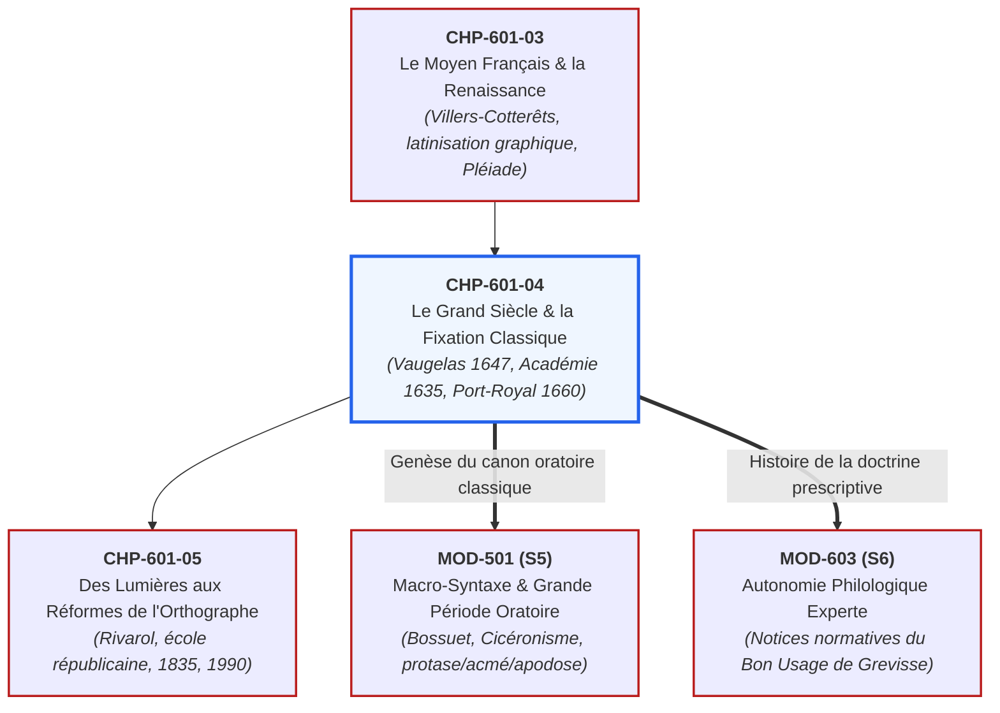
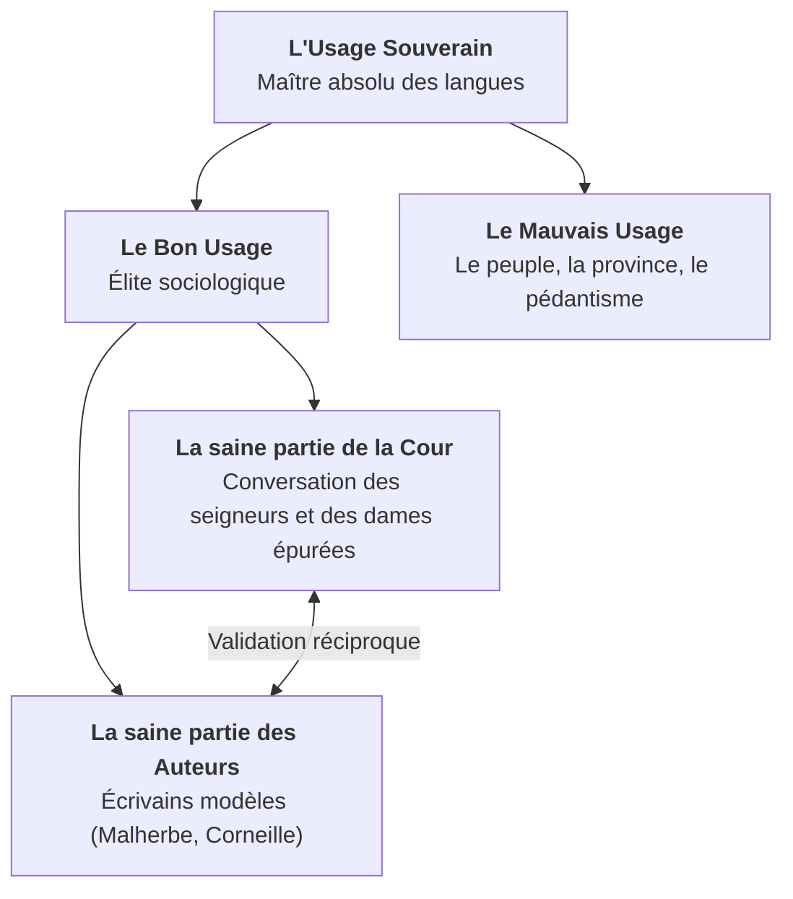

# Chapitre 4 : Le Grand Siècle et la Fixation Classique de la Norme (XVIIe s.)

> **Identifiant** : `CHP-601-04`  
> **Module de rattachement** : [`MOD-601 — Diachronie et Histoire de la Langue Française : Des Origines aux Réformes`](file:///f:/Formation/world-class-french/03-curriculum/year-3/semester-6/mod-601-diachronie-histoire-langue-francaise.md)  
> **Volume horaire canonique** : 3 h 30 (Étude : 1 h 00 | Pratique : 1 h 15 | Correction : 0 h 45 | Évaluation : 0 h 30)  
> **Statut** : [STATUT : VALIDÉ]  
> **Compétences cibles** : [`FR-PHILOL-001`](file:///f:/Formation/world-class-french/02-competency-framework/competency-framework.md#fr-philol-001-autonomie-philologique-et-consultation-experte-des-sources) (L4/L5), [`FR-LEXIC-001`](file:///f:/Formation/world-class-french/02-competency-framework/competency-framework.md#fr-lexic-001-précision-sémantique-nuances-synonymiques-et-collocations) (L4), [`FR-STYLE-001`](file:///f:/Formation/world-class-french/02-competency-framework/competency-framework.md#fr-style-001-haute-tenue-stylistique-rythme-et-clarté-de-la-prose) (L4/L5), [`FR-ORTHO-001`](file:///f:/Formation/world-class-french/02-competency-framework/competency-framework.md#fr-ortho-001-maîtrise-de-lorthographe-lexicale-et-des-familles-de-mots) (L4/L5)  
> **Sources de référence** : `SRC-GRAM-02` (Riegel et al., *Grammaire méthodique du français*, chap. 2), `SRC-GRAM-01` (Grevisse & Goosse, *Le Bon Usage*, § 10, § 85-98), `SRC-LEX-03` (Alain Rey, *Dictionnaire historique de la langue française*), `SRC-SOCIO-02` (Louis-Jean Calvet, *La sociolinguistique*), `SRC-TYPO-01` (*Lexique de l'Imprimerie nationale*), `SRC-NORM-03` (Ministère de l'Éducation nationale)

---

## 1. Titre et Place dans le Cursus

Ce quatrième chapitre du module `MOD-601` explore l'apogée institutionnelle et esthétique du français : **le Grand Siècle classique (XVIIe siècle)**. C'est l'époque de la fondation de l'Académie française par Richelieu (1635), de la parution des *Remarques sur la langue françoise* de Claude Favre de Vaugelas (1647) et de l'avènement du grand théâtre classique (Corneille, Molière, Racine). L'étude diachronique dévoile comment la langue monarchique a été délibérément épurée de ses termes bas, techniques et provinciaux pour forger le **« style noble »**, consacrant la théorie sociologique du **« bon usage »** de la Cour face aux ambitions rationalistes des solitaires de Port-Royal (1660).



---

## 2. Objectifs Mesurables

Au terme de ce chapitre, l'apprenant sera capable de :
1. **Définir avec rigueur la doctrine vaugelienne du « bon usage » (1647)** : citer et analyser la formule princeps de la préface des *Remarques*, en distinguant la « saine partie de la Cour » et le consentement des « bons auteurs » (`SRC-GRAM-01`, § 10).
2. **Analyser la sociologie linguistique du XVIIe siècle** : expliquer la mainmise de l'aristocratie curiale et des salons précieux (l'Hôtel de Rambouillet) sur la légitimité linguistique au détriment de la province, du peuple et des corporations d'artisans (`SRC-SOCIO-02`).
3. **Restituer la mission régalienne de l'Académie française (1635)** : expliciter le projet étatique de Richelieu (Dictionnaire, Grammaire, Rhétorique, Poétique) visant à conférer à la monarchie française le monopole du prestige linguistique européen.
4. **Caractériser les principes constitutifs du « style noble »** : analyser les mécanismes de l'épuration lexicale (proscription des archaïsmes, des termes concrets ou anatomiques) et le recours systématique à la périphrase métonymique chez Racine et Boileau (`SRC-GRAM-02`, chap. 2).
5. **Confronter l'empirisme de Vaugelas au rationalisme de Port-Royal (1660)** : contraster la description empirique des usages de la Cour avec la recherche d'une grammaire universelle et raisonnée fondée sur la logique cartésienne.

---

## 3. Prérequis et Test de Préparation

### 3.1 Prérequis Théoriques
- Connaissance des étapes de l'histoire du français jusqu'à la Renaissance (`CHP-601-01` à `CHP-601-03`).
- Maîtrise des registres de langue et des notions de sociolinguistique descriptive (`MOD-401`, `MOD-404`).
- Analyse stylistique et macro-syntaxique de la période classique (`MOD-501`).

### 3.2 Test Diagnostique d'Auto-Évaluation (5 items)

<details>
<summary><b>Consulter le test et son corrigé immédiat</b></summary>

1. *Qui est l'auteur des « Remarques sur la langue françoise » parues en 1647 et quel était son principe directeur ?*  
   **Réponse** : Claude Favre de Vaugelas. Son principe est que l'Usage est le roi et souverain des langues, défini empiriquement par la façon de parler de « la plus saine partie de la Cour ».
2. *En quelle année l'Académie française a-t-elle été fondée, par qui et quelle était sa mission première ?*  
   **Réponse** : En 1635 par le cardinal de Richelieu. Sa mission était de fixer la langue française, de lui donner des règles certaines et de publier un Dictionnaire, une Grammaire, une Rhétorique et une Poétique.
3. *Qu'appelait-on le « style noble » au Grand Siècle ?*  
   **Réponse** : Un registre littéraire très élevé et restreint, épuré de tout mot familier, bas, technique ou dialectal, réservé aux genres majeurs (tragédie, épopée, oraison funèbre).
4. *Quelle opposition célèbre divise Vaugelas et les grammairiens de Port-Royal (1660) ?*  
   **Réponse** : Vaugelas défend un empirisme sociologique (la langue est ce que la Cour décide, sans chercher de justification logique) ; Port-Royal défend un rationalisme cartésien (la grammaire doit refléter les lois universelles de la pensée logique humaine).
5. *Pourquoi l'accord du participe passé avec « avoir » a-t-il été définitivement stabilisé au XVIIe siècle ?*  
   **Réponse** : Sous l'impulsion des *Remarques* de Vaugelas et des poètes qui ont rigoureusement appliqué et figé la règle de Clément Marot (accord avec le COD antéposé, invariabilité si le COD est postposé).

</details>

---

## 4. Situation de Départ ou Problème Concret

Considérons ces trois paradoxes frappants de la langue classique française :
1. Dans la tragédie de Racine *Britannicus*, pourquoi le poète n'emploie-t-il jamais le mot *poison*, préférant écrire *« ce breuvage mortel »*, et refuse-t-il le mot *chambre*, préférant *« cet auguste séjour »* ?
2. Pourquoi Vaugelas déclare-t-il dans ses *Remarques* que l'expression *« c'est de là d'où je viens »* est une faute inexcusable, alors qu'elle paraît parfaitement compréhensible à tout scripteur ?
3. Pourquoi l'Académie française a-t-elle mis près de soixante ans (de 1635 à 1694) pour publier la toute première édition de son Dictionnaire ?

Pour le scripteur moderne, ces exigences peuvent paraître relever d'une préciosité ridicule ou d'une censure étouffante.  
Pour le philologue, elles matérialisent **l'acte de naissance de la norme moderne d'État** :
- Le resserrement lexical de la tragédie n'est pas de la mièvrerie : c'est la recherche de la **dignité universelle** d'un art qui veut s'adresser à l'âme humaine sans être distrait par les contingences matérielles de la vie quotidienne ;
- Les condamnations de Vaugelas ne sont pas arbitraires : elles codifient le sentiment linguistique d'une caste sociale dominante qui utilise la pureté lexicale comme **instrument de distinction politique et de pouvoir symbolique** ;
- La lenteur de l'Académie s'explique par la nature colossale de l'entreprise : il ne s'agissait pas d'enregistrer tous les mots existants (comme le faisaient les dictionnaires encyclopédiques de Richelet en 1680 ou de Furetière en 1690), mais de **choisir souverainement les mots admis à la cour du Roi-Soleil**, en rejetant tous les autres dans les ténèbres du non-usage.

---

## 5. Explication Intuitive : Le Jardinier de Versailles

Pour comprendre la révolution classique du XVIIe siècle, contemplons les jardins de Versailles dessinés par André Le Nôtre, et comparons-les à une forêt vierge ou à un verger de campagne médiéval :

- **Le verger de la Renaissance (Rabelais, Du Bellay, Montaigne)** :  
  La langue du XVIe siècle ressemble à un sous-bois foisonnant et luxuriant. On y trouve des fleurs rares, des ronces épineuses, des herbes médicinales, des fruits sauvages, des arbres greffés d'Italie ou de Grèce. L'écrivain cueille ce qui lui plaît, invente des mots, mélange le langage des marins et le grec des philosophes. C'est une profusion joyeuse mais touffue et parfois obscure.

- **Le parc de Versailles au Grand Siècle (Vaugelas, Boileau, Racine)** :  
  Vaugelas et l'Académie française interviennent comme les jardiniers du Roi. Armés de sécateurs impitoyables, ils taillent les haies au cordeau, arrachent les mauvaises herbes (les archaïsmes), abattent les arbres tordus (les provincialismes) et canalisent les fontaines en bassins géométriques réguliers.  
  Le vocabulaire s'en trouve quantitativement réduit, mais chaque mot restant brille d'un éclat souverain, d'une netteté parfaite et d'une résonance majestueuse au service de la gloire royale.

---

## 6. Définitions Précises et Terminologie

- **Le Bon Usage** : Concept fondateur théorisé par Vaugelas en 1647, désignant la pratique linguistique vivante des courtisans éclairés de la Cour et des écrivains les plus renommés du royaume. Ce n'est pas une norme abstraite ou logique, mais un **arbitrage sociologique d'élite**.
- **Style noble (ou haut style)** : Registre oratoire et littéraire supérieur, caractérisé par la gravité morale, l'harmonie sonore, l'absence de toute trivialité concrète et le recours aux figures de substitution nobles (périphrases, métonymies, litotes).
- **Épuration lexicale** : Politique délibérée menée par les grammairiens et l'Académie visant à proscrire du dictionnaire officiel les termes jugés « bas », « sales », « techniques », « pédantesques » ou « archaïques ».
- **La Préciosité** : Mouvement social, esthétique et littéraire né dans les salons aristocratiques parisiens du premier XVIIe siècle, visant à polir les mœurs, à purifier la langue de ses vulgarités et à raffiner l'expression des sentiments amoureux par des métaphores spirituelles.
- **Grammaire générale et raisonnée (Port-Royal, 1660)** : Traité de linguistique philosophique rédigé par Antoine Arnauld et Claude Lancelot, posant que toutes les langues humaines partagent une structure logique universelle reflétant les opérations de la pensée rationnelle.

---

## 7. Règles et Mécanismes Fondamentaux

### 7.1 La Doctrine Vaugelienne : La Préface des *Remarques* (1647)

Dans la préface de ses *Remarques sur la langue françoise*, Claude Favre de Vaugelas formule avec une netteté souveraine la loi fondamentale qui régit le français classique (`SRC-GRAM-01`, § 10) :

> *« Il n'y a qu'un Maistre des langues, qui en est le vray Souverain, c'est l'Usage [...]. Mais qui sera ce Maistre ? Ce n'est pas le peuple, qui n'est maistre que du mauvais usage. Le bon Usage est la façon de parler de la plus saine partie de la Cour, conformément à la façon d'escrire de la plus saine partie des Autheurs du temps. »*



#### Les Principes Cardinaux de Vaugelas :
1. **L'Usage prime la Raison** : Si l'usage de la Cour impose une tournure illogique ou bizarre, le grammairien doit s'incliner sans tenter de la corriger par des syllogismes. La langue est une convention vivante, non une science déductive.
2. **L'exclusion de la populace et de la province** : Les parlers provinciaux (normand, gascon, lyonnais) et les termes populaires parisiens sont déclarés corrompus et interdits dans l'expression soignée.
3. **Le rôle arbitral des femmes du monde** : Ne connaissant pas le latin d'école, les dames de la Cour jugent les mots selon leur seule douceur auditive et leur élégance naturelle, immunisant le français contre le pédantisme des docteurs de Sorbonne.

---

### 7.2 L'Académie Française et l'État Linguistique de Richelieu (1635)

Fondée par lettres patentes de Louis XIII sous l'impulsion directe du cardinal de Richelieu en 1635, l'Académie française représente la **nationalisation politique de la langue** (`SRC-SOCIO-02`) :
- **Article XXIV des statuts** : *« La principale fonction de l'Académie sera de travailler avec tout le soin et toute la diligence possibles à donner des règles certaines à notre langue et à la rendre pure, éloquente et capable de traiter les arts et les sciences. »*
- **Le Dictionnaire de 1694 (1re édition)** :  
  L'Académie choisit de classer les mots par **racines étymologiques** (tous les dérivés groupés sous le mot primitif) et refuse d'intégrer les termes des métiers et des sciences. C'est un dictionnaire d'arbitrage esthétique destiné aux courtisans, non une encyclopédie technique.

---

### 7.3 L'Épuration Lexicale et l'Esthétique du « Style Noble »

L'instauration du style noble au XVIIe siècle obéit à un filtrage impitoyable du vocabulaire (`SRC-GRAM-02`, chap. 2) :

| Catégorie proscrite du style noble | Mots bannis par les classiques | Équivalents nobles exigés | Exemple chez Racine ou Boileau |
| :--- | :--- | :--- | :--- |
| **Mots concrets / corporels** | *le ventre, le nez, la sueur, cracher* | *le sein, le visage, la vapeur, expirer* | *« Le visage baigné de larmes »* |
| **Objets du quotidien / domestiques** | *le lit, le couteau, la marmite, l'assiette* | *la couche, le fer, le trépas, les mets* | *« Arriver jusqu'à sa couche »* |
| **Termes techniques et d'artisanat** | *le rabot, le marteau, la colle, la roue* | Périphrases descriptives d'action | Rejet absolu dans la tragédie |
| **Archaïsmes du XVIe siècle** | *blandices, occire, moult, cuidance* | *caresses, tuer, beaucoup, présomption* | Condamnés comme gothiques |
| **Emprunts étrangers non assimilés** | Italianismes superflus de la Renaissance | Vocabulaire purement français | Élimination des maniérismes de cour |

---

### 7.4 La Querelle des Grammairiens : Vaugelas vs Port-Royal (1660)

En 1660, Antoine Arnauld et Claude Lancelot publient la *Grammaire générale et raisonnée* (dite de Port-Royal), créant une rupture épistémologique majeure :

| Axe de comparaison | L'Empirisme de Vaugelas (1647) | Le Rationalisme de Port-Royal (1660) |
| :--- | :--- | :--- |
| **Fondement de la règle** | L'autorité sociale de la Cour de France | La structure universelle de la pensée humaine |
| **Statut de l'analogie** | Soumise à l'usage (si l'usage refuse l'analogie, l'usage gagne) | Maîtresse d'ordre (la logique doit redresser l'usage imparfait) |
| **Public de référence** | Les courtisans et les gens du beau monde | Les philosophes et les esprits rationnels universels |
| **Définition de la proposition** | Une suite harmonieuse de mots agréables | L'affirmation d'un prédicat attribué à un sujet par la copule *être* |

Cette dialectique entre **le goût aristocratique de l'oreille** (Vaugelas) et **la rigueur déductive de l'esprit** (Port-Royal) forge l'armature de la pensée linguistique française pour les trois siècles à venir.

---

## 8. Raisonnement Détaillé : Pourquoi le Style Noble s'est-il Imposé ?

L'épuration lexicale du XVIIe siècle n'est pas un appauvrissement accidentel de la langue : elle répond à un projet politique et anthropologique conscient de la monarchie absolue :
1. **L'idéal de l'honnête homme** : L'honnête homme classique ne doit afficher aucune spécialisation professionnelle étroite. Parler le langage des forgerons ou des marchands trahirait une dépendance matérielle vulgaire. Sa langue doit être celle de la morale universelle, de la psychologie des passions et de la grandeur politique.
2. **Le rayonnement diplomatique européen** : En épurant le français de ses bizarreries locales et de ses trivialités, le Grand Siècle en fait **la langue diplomatique universelle des cours européennes**. De Madrid à Saint-Pétersbourg en passant par Berlin, les princes et ambassadeurs adoptent le français non parce qu'il est facile, mais parce qu'il incarne la distinction suprême du pouvoir.

---

## 9. Exemples Corrects Commentés

### Exemple 1 : L'Art de la Périphrase Noble chez Racine (*Phèdre*, 1677)

Considérons comment Jean Racine décrit la mort violente d'Hippolyte sans jamais prononcer un mot d'anatomie ou de boucherie :
> *« De sang et de fumée un nuage s'élève ; / Les coursiers effrayés, que nul frein ne soulage, / D'un monstre furieux achèvent le carnage : / Sa croupe se recourbe, et d'un repli hideux, / Il s'élance, et vomit à leurs pieds écumants / De sang et de poisons les flots étincelants. »*

- Racine évite *les chevaux* et emploie le terme noble *les coursiers* ;
- Il ne décrit pas les entrailles déchirées mais évoque *un nuage de sang et de fumée* ;
- L'horreur matérielle est transfigurée par la grandeur de la période poétique.

### Exemple 2 : L'Arbitrage de Vaugelas sur la Négation

- **Problème débattu** : Doit-on dire *« Je ne doute point qu'il ne vienne »* avec le *ne* explétif ?
- **Décision de Vaugelas** : Même si le deuxième *ne* paraît logiquement redondant ou contradictoire à l'esprit mathématique, le « bon usage » de la Cour exige impérativement ce *ne* élégant après les verbes de doute accompagnés d'une négation. L'oreille des courtisans triomphe de la logique formelle (`SRC-GRAM-01`, § 10).

---

## 10. Contre-Exemples et Clinique des Erreurs Fréquentes

L'analyse de la norme classique du Grand Siècle met en évidence six erreurs philologiques majeures :

### Erreur n° 1 : Confondre le « Bon Usage » avec la Parole du Plus Grand Nombre
- **Idée fausse** : S'imaginer que le bon usage chez Vaugelas correspond à la démocratie de la majorité des locuteurs.
- **Correction** : C'est le contresens absolu. Pour Vaugelas, le peuple n'est que le réceptacle du « mauvais usage ». Le bon usage est l'apanage exclusif d'une **minorité sociale aristocratique** : la Cour du Roi et les écrivains modèles (`SRC-GRAM-01`, § 10).

### Erreur n° 2 : Croire que l'Académie Française a Inventé la Grammaire
- **Idée fausse** : Penser que l'Académie de Richelieu a créé de toutes pièces les règles du français en 1635.
- **Correction** : L'Académie n'a fait que **consacrer et codifier les usages déjà en vigueur** dans les salons et à la Cour. Sa grammaire tant promise ne paraîtra d'ailleurs qu'au XXe siècle (1932).

### Erreur n° 3 : Voir dans la Préciosité un Simple Ridicule
- **Idée fausse** : Réduire le mouvement précieux aux caricatures de Molière dans *Les Précieuses ridicules*.
- **Correction** : La préciosité authentique (Madame de Rambouillet, Madeleine de Scudéry) a joué un rôle didactique capital : elle a débarrassé le français des grossièretés de caserne des guerres de Religion et a inventé un vocabulaire psychologique d'une finesse incomparable (`SRC-LEX-03`).

### Erreur n° 4 : Penser que Racine et Corneille Écrivaient dans la Même Langue
- **Idée fausse** : Croire que la langue classique du XVIIe siècle était uniforme du début à la fin du règne.
- **Correction** : Corneille écrit encore dans la liberté luxuriante du premier XVIIe siècle, avec des tours archaïques et vigoureux ; Racine, trente ans plus tard, applique avec une discipline de fer l'épuration lexicale vaugelienne (`SRC-GRAM-02`, chap. 2).

### Erreur n° 5 : Croire que Port-Royal Était Hostile au Français
- **Idée fausse** : S'imaginer que les jansénistes de Port-Royal voulaient revenir au latin exclusif.
- **Correction** : Les Petites Écoles de Port-Royal ont été les premières en Europe à **enseigner la lecture et l'écriture directement en français** aux enfants, reléguant le latin au second plan.

### Erreur n° 6 : Croire que le Style Noble Autorise les Termes Techniques Précis
- **Idée fausse** : Penser qu'un poète classique pouvait nommer les outils d'un métier dans un poème tragique.
- **Correction** : La règle d'airain de la bienséance et du style noble proscrit rigoureusement tout terme professionnel, artisanal ou commercial au profit de la périphrase universelle.

#### Tableau Clinique de la Doctrine Classique du Grand Siècle
| Cas clinique | Erreur courante ou préjugé | Réalité philologique démontrée | Référence source |
| :---: | :--- | :--- | :--- |
| **Cas 1** | *Le bon usage est la voix du peuple* | Usage aristocratique exclusif de la Cour du Roi | `SRC-GRAM-01`, § 10 |
| **Cas 2** | *L'Académie a créé les règles* | L'Académie n'a fait qu'entériner les pratiques curiales | `SRC-SOCIO-02` |
| **Cas 3** | *La préciosité n'était que ridicule* | Rôle fondateur dans le raffinement lexical et moral | `SRC-LEX-03` |
| **Cas 4** | *La langue classique est restée figée* | Évolution majeure entre Corneille (1636) et Racine (1677) | `SRC-GRAM-02`, chap. 2 |
| **Cas 5** | *Port-Royal méprisait la langue française* | Port-Royal a inauguré l'enseignement en langue maternelle | `SRC-GRAM-02` |
| **Cas 6** | *Les termes techniques sont bienvenus* | Proscription totale des vocables concrets et d'artisanat | `SRC-GRAM-02`, chap. 2 |

---

## 11. Cas Particuliers et Limites

### 11.1 La Comédie et la Satire : Espaces de Liberté Lexicale
Si la tragédie et l'oraison funèbre sont cadenassées par le style noble, la comédie de Molière et la satire de Boileau jouissent d'une franchise totale : Molière y fait entendre les parlers paysans (*Don Juan*), le jargon médical pédantesque (*Le Malade imaginaire*) et le bavardage affecté des salons, offrant un témoignage sociolinguistique inestimable sur les variations vivantes de l'époque.

### 11.2 Les Résistances Provinciales : Gilles Ménage et les Érudits
Des érudits comme Gilles Ménage (*Observations sur la langue françoise*, 1672) ont vigoureusement contesté l'autorité exclusive de la Cour, plaidant pour le respect de l'étymologie et la reconnaissance de la richesse des parlers régionaux face au centralisme autoritaire parisien.

---

## 12. Approfondissement Adapté au Niveau (L4/L5) : Le Concept de « Clarté Française »

C'est au XVIIe siècle que s'enracine le mythe idéologique de la **clarté consubstantielle de la langue française**, résumé par le célèbre hémistiche de Nicolas Boileau dans son *Art poétique* (1674) :
> *« Ce que l'on conçoit bien s'énonce clairement, / Et les mots pour le dire arrivent aisément. »*

Les grammairiens classiques postulent que l'ordre SVO (Sujet - Verbe - Complément) est « l'ordre naturel de la pensée humaine », prétendant que les Français pensent dans l'ordre logique direct, tandis que les Latins ou les Allemands inverseraient les idées. La linguistique moderne a évidemment démontré que l'ordre SVO n'est qu'une option typologique parmi d'autres, mais ce mythe classique deviendra le dogme politique universel du siècle suivant.

---

## 13. Comparaisons Différentielles

| Critère d'arbitrage | Doctrine de Vaugelas (1647) | Doctrine de Port-Royal (1660) |
| :--- | :--- | :--- |
| **Instance souveraine** | La Cour du Roi et les salons aristocratiques | La Raison logique universelle |
| **Méthode d'investigation** | Enquête sociologique et témoignage de l'oreille | Analyse philosophique déductive des propositions |
| **Attitude face aux bizarreries** | Soumission aveugle si la Cour les pratique | Critique rationnelle et proposition de régularisation |
| **Nature de la langue** | Instrument de prestige politique et de civilité | Instrument de représentation des opérations mentales |
| **Traitement des exceptions** | Recueil empirique de « Remarques » ponctuelles | Élaboration d'un système grammatical cohérent |

---

## 14. Exercices Progressifs

### Niveau 1 : Repérage et Qualification du « Style Noble »
*Consigne : Dans les paires de synonymes suivantes, identifier le terme admissible dans le style noble d'une tragédie classique et le terme proscrit comme vulgaire ou technique :*
1. *coursier / cheval* $\rightarrow$ **coursier** (style noble) / *cheval* (proscrit dans la haute poésie).
2. *trépas / mort* $\rightarrow$ **trépas** (style noble privilégié) / *mort* (terme neutre).
3. *glaive / épée* $\rightarrow$ **glaive** (style noble épique) / *épée* (terme ordinaire).
4. *flamme / amour* $\rightarrow$ **flamme** (métaphore précieuse noble) / *amour* (standard).
5. *courroux / colère* $\rightarrow$ **courroux** (style noble majestueux) / *colère* (trop familier).

### Niveau 2 : Rétablissement de Périphrases Nobles
*Consigne : Transformer les énoncés concrets suivants en périphrases conformes à la bienséance de la tragédie racinienne :*
1. *Il a été tué dans son lit pendant son sommeil.*  
   $\rightarrow$ **Le fer a tranché ses jours sur sa couche paisible.**
2. *Elle pleure et son visage est rouge de larmes.*  
   $\rightarrow$ **Elle exhale sa douleur et baigne de pleurs son auguste visage.**

### Niveau 3 : Analyse Philologique Calibrée (50 mots exacts)
*Consigne : Rédiger une notice philologique sur la doctrine du bon usage de Vaugelas et l'épuration classique du Grand Siècle, calibrée très exactement à 50 mots selon les normes de décompte de l'Imprimerie nationale (`SRC-TYPO-01`).*

> « Au grand siècle classique, Claude Favre de Vaugelas définit le bon usage comme la pratique linguistique de la Cour royale et des écrivains épurés. Cette doctrine sélective rejette les termes techniques, archaïques et provinciaux au profit du style noble, consacrant l'autorité monarchique sur notre idiome national et littéraire contemporain. »

#### Décompte Certifié Mot à Mot (50 mots exacts) :
| N° | Token | N° | Token | N° | Token | N° | Token | N° | Token |
| :---: | :--- | :---: | :--- | :---: | :--- | :---: | :--- | :---: | :--- |
| **1** | Au | **11** | bon | **21** | et | **31** | techniques, | **41** | l' |
| **2** | grand | **12** | usage | **22** | des | **32** | archaïques | **42** | autorité |
| **3** | siècle | **13** | comme | **23** | écrivains | **33** | et | **43** | monarchique |
| **4** | classique, | **14** | la | **24** | épurés. | **34** | provinciaux | **44** | sur |
| **5** | Claude | **15** | pratique | **25** | Cette | **35** | au | **45** | notre |
| **6** | Favre | **16** | linguistique | **26** | doctrine | **36** | profit | **46** | idiome |
| **7** | de | **17** | de | **27** | sélective | **37** | du | **47** | national |
| **8** | Vaugelas | **18** | la | **28** | rejette | **38** | style | **48** | et |
| **9** | définit | **19** | Cour | **29** | les | **39** | noble, | **49** | littéraire |
| **10** | le | **20** | royale | **30** | termes | **40** | consacrant | **50** | contemporain. |

---

## 15. Activité de Correction Raisonnée

### Copie d'Étudiant Soumise à Censure Philologique :
> *« En 1647, Vaugelas a rédigé une grammaire démocratique pour que le peuple de Paris apprenne à parler correctement. Il a demandé à l'Académie française d'autoriser tous les mots techniques des artisans et de simplifier l'orthographe. Grâce à Port-Royal, on a décidé que la Cour de Louis XIV devait obéir aux règles mathématiques des paysans. »*

### Rapport de Rectification Critique :
1. *Grammaire démocratique pour le peuple* $\rightarrow$ **Contresens historique absolu** : Vaugelas méprisait ouvertement la parole populaire (*« le peuple n'est maître que du mauvais usage »*) et a réservé la norme aux seuls courtisans de la Cour.
2. *Autoriser les mots des artisans* $\rightarrow$ **Erreur capitale** : Le Grand Siècle a impitoyablement banni tout vocable artisanal, technique ou manuel du style noble et du Dictionnaire de l'Académie de 1694.
3. *Port-Royal fait obéir la Cour aux paysans* $\rightarrow$ **Confusion totale** : La grammaire de Port-Royal cherchait les principes universels de la raison cartésienne chez les lettrés et philosophes, sans le moindre rapport avec le monde paysan.

---

## 16. Mise en Pratique dans une Production Réelle

### Consigne de Rédaction Calibrée (60 mots exacts)
Rédiger une synthèse d'apparat sur le rôle régalien de l'Académie française et la fixation classique de la langue au XVIIe siècle, calibrée très exactement à **soixante (60) mots** selon les règles de décompte de l'Imprimerie nationale (`SRC-TYPO-01`).

### Texte Réalisé (60 mots exacts) :
> « La fondation de l'Académie française en 1635 par le cardinal de Richelieu et la publication des Remarques de Vaugelas en 1647 scellent la souveraineté du bon usage monarchique. En bannissant le pédantisme des docteurs et les parlers populaires, le Grand Siècle forge un style noble caractérisé par la clarté, la décence des salons et l'harmonie classique des lettres. »

#### Décompte Certifié Mot à Mot (60 mots exacts) :
| N° | Token | N° | Token | N° | Token | N° | Token |
| :---: | :--- | :---: | :--- | :---: | :--- | :---: | :--- |
| **1** | La | **16** | publication | **31** | bannissant | **46** | noble |
| **2** | fondation | **17** | des | **32** | le | **47** | caractérisé |
| **3** | de | **18** | Remarques | **33** | pédantisme | **48** | par |
| **4** | l' | **19** | de | **34** | des | **49** | la |
| **5** | Académie | **20** | Vaugelas | **35** | docteurs | **50** | clarté, |
| **6** | française | **21** | en | **36** | et | **51** | la |
| **7** | en | **22** | 1647 | **37** | les | **52** | décence |
| **8** | 1635 | **23** | scellent | **38** | parlers | **53** | des |
| **9** | par | **24** | la | **39** | populaires, | **54** | salons |
| **10** | le | **25** | souveraineté | **40** | le | **55** | et |
| **11** | cardinal | **26** | du | **41** | Grand | **56** | l' |
| **12** | de | **27** | bon | **42** | Siècle | **57** | harmonie |
| **13** | Richelieu | **28** | usage | **43** | forge | **58** | classique |
| **14** | et | **29** | monarchique. | **44** | un | **59** | des |
| **15** | la | **30** | En | **45** | style | **60** | lettres. |

---

## 17. Résumé Structuré

```text
LE GRAND SIÈCLE ET LA FIXATION CLASSIQUE (XVIIe s.) [SRC-GRAM-02]
├── 1. LA DOCTRINE DE VAUGELAS (1647)
│   ├── Primauté absolue de l'Usage sur la Raison géométrique.
│   └── Le « Bon Usage » = la plus saine partie de la Cour + les bons auteurs.
├── 2. L'INSTITUTION RÉGALIENNE : L'ACADÉMIE FRANÇAISE (1635)
│   ├── Projet politique d'État impulsé par le cardinal de Richelieu.
│   └── Dictionnaire de 1694 : sélection épurée du vocabulaire aristocratique.
├── 3. L'ÉPURATION LEXICALE ET LE STYLE NOBLE
│   ├── Proscription des termes bas, techniques, archaïques et provinciaux.
│   └── Triomphe de la périphrase décente dans la tragédie (Racine).
└── 4. LA QUERELLE ÉPISTÉMOLOGIQUE
    ├── Empirisme aristocratique de l'oreille (Vaugelas).
    └── Rationalisme cartésien de la pensée universelle (Port-Royal, 1660).
```

---

## 18. Questions de Rappel Actif (Active Recall)

<details>
<summary><b>1. Quelle est la définition exacte du « bon usage » selon Vaugelas en 1647 ?</b></summary>
La façon de parler de la plus saine partie de la Cour, conformément à la façon d'écrire de la plus saine partie des auteurs du temps.
</details>

<details>
<summary><b>2. Pourquoi Vaugelas exclut-il le peuple de la définition de la norme ?</b></summary>
Parce que selon sa vision aristocratique, le peuple ne possède ni l'instruction ni la civilité nécessaires et n'est que le réceptacle du « mauvais usage ».
</details>

<details>
<summary><b>3. Quel rôle ont joué les femmes des salons au XVIIe siècle ?</b></summary>
Ne connaissant pas le latin d'école, elles ont débarrassé la langue du pédantisme universitaire et imposé le critère de l'agrément et de la douceur phonique.
</details>

<details>
<summary><b>4. Quelle était la particularité du plan du premier Dictionnaire de l'Académie (1694) ?</b></summary>
Les mots y étaient classés par racines étymologiques (familles de mots) plutôt que par ordre alphabétique strict.
</details>

<details>
<summary><b>5. Qu'est-ce que la Grammaire de Port-Royal (1660) ?</b></summary>
Un traité rédigé par Arnauld et Lancelot cherchant à fonder la grammaire sur les principes logiques universels de la pensée humaine.
</details>

<details>
<summary><b>6. Pourquoi Racine utilise-t-il moins de 2 000 mots dans ses tragédies ?</b></summary>
Par respect scrupuleux de l'épuration lexicale du style noble, qui bannit tout mot familier ou technique pour ne conserver que les vocables de portée morale universelle.
</details>

---

## 19. Mini-Évaluation Sommative Notée (20 Points)

### Barème d'Audit Philologique :
- **Explication de la doctrine vaugelienne du bon usage** : 6 points (analyse de la Cour, des auteurs et du rejet du peuple).
- **Histoire institutionnelle (Richelieu et l'Académie française)** : 5 points (statuts de 1635 et dictionnaire de 1694).
- **Analyse stylistique de l'épuration lexicale et du style noble** : 6 points (procédés de périphrase et bienséance).
- **Confrontation Vaugelas / Port-Royal** : 3 points.
- **Clause éliminatoire** : Définir le bon usage comme la langue populaire démocratique entraîne une pénalité forfaitaire de -4 points. Seuil de certification : **14/20**.

---

## 20. Critères Observables de Maîtrise

L'apprenant valide ce chapitre s'il démontre :
- La citation et l'analyse critique de la formule princeps de Vaugelas sur le bon usage.
- L'explication sociologique de l'élimination des termes techniques et provinciaux de la norme classique.
- La maîtrise des circonstances historiques de la création de l'Académie française en 1635.
- La capacité à transformer un énoncé familier en expression noble conforme à la bienséance du XVIIe siècle.

---

## 21. Sources et Lectures Complémentaires

- **`SRC-GRAM-02`** : Martin RIEGEL, Jean-Christophe PELLAT et René RIOUL, *Grammaire méthodique du français*, Paris, PUF, coll. « Quadrige » (Chapitre 2 : *Éléments d'histoire de la langue française*, p. 35-58).
- **`SRC-GRAM-01`** : Maurice GREVISSE et André GOOSSE, *Le Bon Usage*, Bruxelles, De Boeck Supérieur (§ 10 : *Le Bon Usage et Vaugelas* ; § 85-98 : *Histoire de l'orthographe*).
- **`SRC-LEX-03`** : Alain REY (dir.), *Dictionnaire historique de la langue française*, Paris, Le Robert (Notices historiques : *Usage*, *Académie*, *Classique*, *Précieux*).
- **`SRC-SOCIO-02`** : Louis-Jean CALVET, *La sociolinguistique*, Paris, PUF, coll. « Que sais-je ? » (Chapitre sur la politique linguistique monarchique et la norme sociale).
- **`SRC-TYPO-01`** : IMPRIMERIE NATIONALE, *Lexique des règles typographiques en usage à l'Imprimerie nationale*, Paris.
- **`SRC-NORM-03`** : MINISTÈRE DE L'ÉDUCATION NATIONALE, *Terminologie grammaticale et typographique officielle*, Paris.

---

## Annexe : Classification Pédagogique

- **CORE-NOW** : Doctrine de Vaugelas (1647), définition sociologique du bon usage, fondation de l'Académie française (1635), épuration lexicale et règles du style noble.
- **INTRODUCTION-NOW** : Grammaire générale et raisonnée de Port-Royal (1660) et idéal classique de la « clarté française ».
- **DEFER** : Diffusion démocratique sous la Révolution, rapport Grégoire et réformes de 1835 et 1990 $\to$ traités dans [`CHP-601-05`](file:///f:/Formation/world-class-french/03-curriculum/year-3/semester-6/mod-601/chp-601-05-lumieres-ecole-republicaine-reformes-orthographe.md).
- **MOVE** : Analyse de la grande période oratoire de Bossuet $\to$ traitée dans [`MOD-501`](file:///f:/Formation/world-class-french/03-curriculum/year-3/semester-5/mod-501-macro-syntaxe-periode-oratoire-cadences.md).
- **OPTIONAL-ADVANCED** : Étude comparée du Dictionnaire de Richelet (1680), du Dictionnaire de Furetière (1690) et du premier Dictionnaire de l'Académie (1694).
- **REMOVE** : Jugement anachronique qualifiant l'épuration classique de snobisme stérile sans comprendre sa fonction unificatrice européenne.
