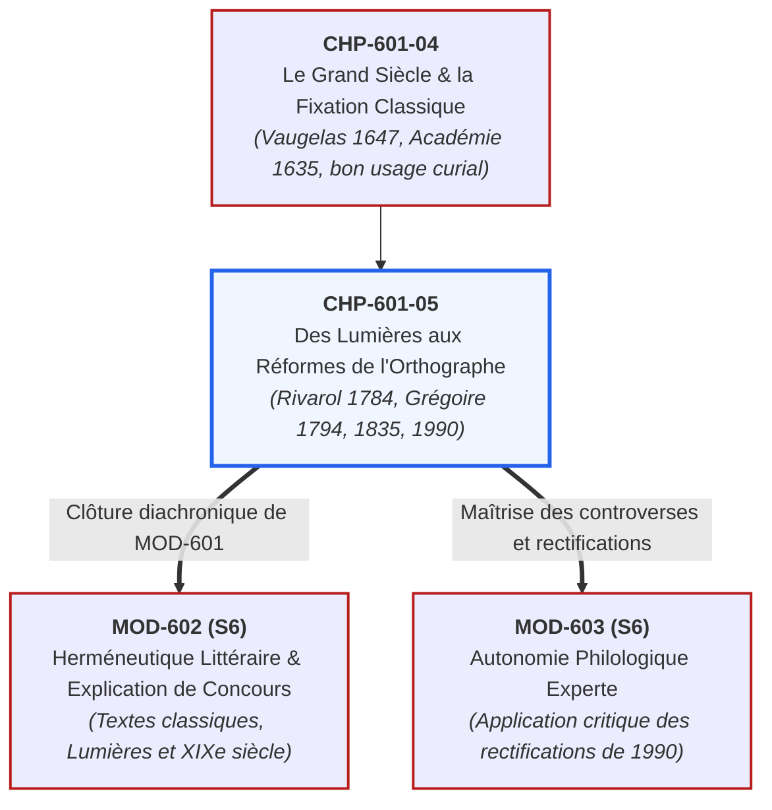
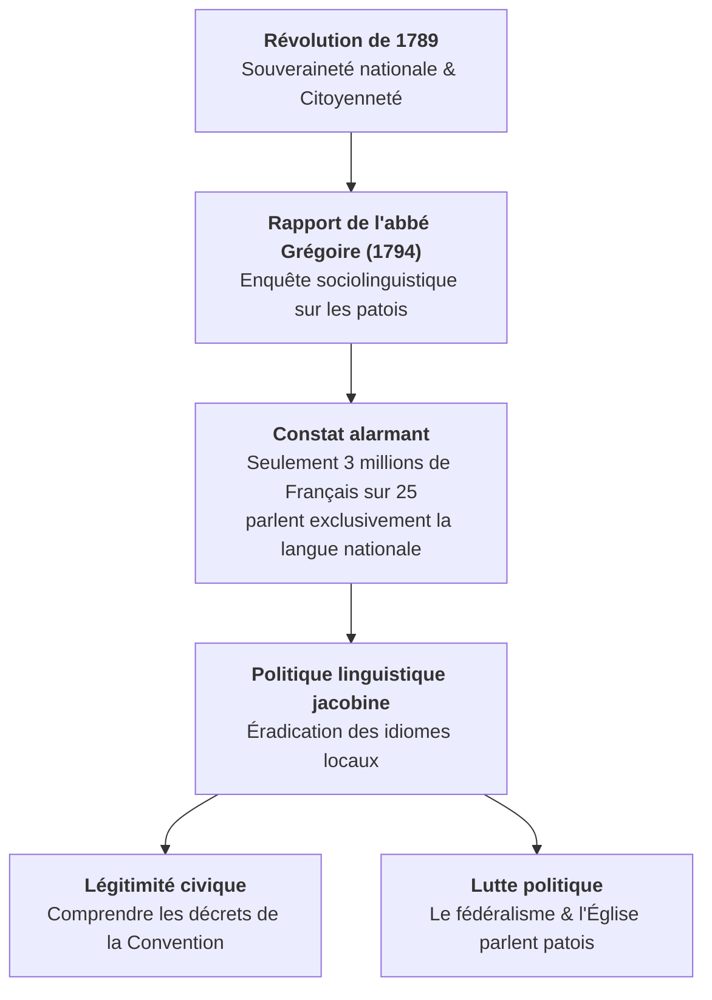
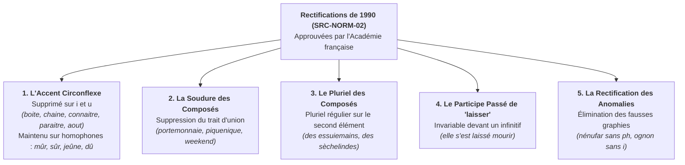

# Chapitre 5 : Des Lumières aux Réformes de l'Orthographe : École Républicaine, Évolution Normative et Rectifications de 1990 (XVIIIe - XXe s.)

> **Identifiant** : `CHP-601-05`  
> **Module de rattachement** : [`MOD-601 — Diachronie et Histoire de la Langue Française : Des Origines aux Réformes`](file:///f:/Formation/world-class-french/03-curriculum/year-3/semester-6/mod-601-diachronie-histoire-langue-francaise.md)  
> **Volume horaire canonique** : 3 h 00 (Étude : 0 h 45 | Pratique : 1 h 00 | Correction : 0 h 45 | Évaluation : 0 h 30)  
> **Statut** : [STATUT : VALIDÉ]  
> **Compétences cibles** : [`FR-PHILOL-001`](file:///f:/Formation/world-class-french/02-competency-framework/competency-framework.md#fr-philol-001-autonomie-philologique-et-consultation-experte-des-sources) (L4/L5), [`FR-ORTHO-001`](file:///f:/Formation/world-class-french/02-competency-framework/competency-framework.md#fr-ortho-001-maîtrise-de-lorthographe-lexicale-et-des-familles-de-mots) (L4/L5), [`FR-LEXIC-001`](file:///f:/Formation/world-class-french/02-competency-framework/competency-framework.md#fr-lexic-001-précision-sémantique-nuances-synonymiques-et-collocations) (L4), [`FR-SOCIOL-001`](file:///f:/Formation/world-class-french/02-competency-framework/competency-framework.md#fr-sociol-001-analyse-sociolinguistique-et-gestion-des-variations-francophones) (L4)  
> **Sources de référence** : `SRC-GRAM-02` (Riegel et al., *Grammaire méthodique du français*, chap. 2), `SRC-GRAM-01` (Grevisse & Goosse, *Le Bon Usage*, § 85-98), `SRC-NORM-02` (Conseil supérieur de la langue française, *Les rectifications de l'orthographe*, 1990), `SRC-LEX-03` (Alain Rey, *Dictionnaire historique de la langue française*), `SRC-SOCIO-02` (Louis-Jean Calvet, *La sociolinguistique*), `SRC-TYPO-01` (*Lexique de l'Imprimerie nationale*), `SRC-NORM-03` (Ministère de l'Éducation nationale)

---

## 1. Titre et Place dans le Cursus

Ce cinquième et dernier chapitre du module `MOD-601` couronne la grande traversée diachronique du français en reliant **le Siècle des Lumières, la Révolution française, l'épopée de l'école républicaine et les réformes orthographiques contemporaines (1835 et 1990)**. Après avoir étudié la genèse romane (`CHP-601-01`), le bicasualisme médiéval (`CHP-601-02`), la latinisation graphique de la Renaissance (`CHP-601-03`) et le bon usage aristocratique du Grand Siècle (`CHP-601-04`), l'apprenant découvre la démocratisation républicaine de la norme linguistique, l'éradication politique des patois (rapport Grégoire de 1794), la grande substitution graphique de 1835 (*oi* $\rightarrow$ *ai*) et les fondements scientifiques des rectifications orthographiques officielles de 1990.



---

## 2. Objectifs Mesurables

Au terme de ce chapitre, l'apprenant sera capable de :
1. **Analyser d'un point de vue critique le mythe de l'universalité du français au XVIIIe siècle** : déconstruire les arguments d'Antoine de Rivarol dans son *Discours sur l'universalité de la langue française* (1784) sur la prétendue « clarté naturelle » de l'ordre direct SVO (`SRC-GRAM-02`, chap. 2).
2. **Restituer la politique linguistique de la Révolution française** : analyser les enjeux idéologiques du *Rapport sur la nécessité et les moyens d'anéantir les patois et d'universaliser l'usage de la langue française* de l'abbé Henri Grégoire (1794) et les décrets de la Convention (`SRC-SOCIO-02`).
3. **Mesurer l'impact de l'école républicaine sur la standardisation de la langue** : expliciter le rôle de la loi Guizot (1833) et des lois Jules Ferry (1881-1882) dans l'alphabétisation de masse et le culte civique de l'orthographe académique.
4. **Disséquer la grande réforme académique de 1835** : retracer l'histoire du passage graphique de *oi* à *ai* dans les imparfaits, conditionnels et gentilés (*françois* $\rightarrow$ *français*, *j'avois* $\rightarrow$ *j'avais*), sous l'impulsion originelle de Voltaire (`SRC-GRAM-01`, § 88).
5. **Maîtriser et appliquer avec rigueur les rectifications orthographiques de 1990** : justifier scientifiquement les cinq grands volets de la recommandation officielle du Conseil supérieur de la langue française (`SRC-NORM-02`) : accent circonflexe sur *i* et *u*, soudure des composés, pluriel des mots composés, tréma et participes passés.

---

## 3. Prérequis et Test de Préparation

### 3.1 Prérequis Théoriques
- Connaissance de la politique linguistique d'État au XVIIe siècle (`CHP-601-04`).
- Conscience des variations sociolinguistiques et de la diglossie (`MOD-404`).
- Maîtrise des règles fondamentales de l'orthographe lexicale et flexionnelle (`MOD-103`).

### 3.2 Test Diagnostique d'Auto-Évaluation (5 items)

<details>
<summary><b>Consulter le test et son corrigé immédiat</b></summary>

1. *Quel est l'auteur de la célèbre maxime « Ce qui n'est pas clair n'est pas français » et en quelle année a-t-elle été formulée ?*  
   **Réponse** : Antoine de Rivarol, en 1784, dans son *Discours sur l'universalité de la langue française*, couronné par l'Académie royale de Berlin.
2. *Quel était l'objectif du rapport de l'abbé Grégoire présenté à la Convention en 1794 ?*  
   **Réponse** : Éradiquer les parlers régionaux et patois de France pour faire du français la langue unique de la République une et indivisible, afin que chaque citoyen puisse comprendre les lois et exercer ses droits civiques.
3. *Quelle modification orthographique capitale a été officialisée dans la 6e édition du Dictionnaire de l'Académie en 1835 ?*  
   **Réponse** : Le remplacement de la graphie ancienne *oi* par *ai* pour noter le son [ɛ] dans les désinences de l'imparfait (*j'avois* $\rightarrow$ *j'avais*), du conditionnel et les noms de nationalités (*françois* $\rightarrow$ *français*).
4. *Selon les rectifications de 1990, sur quelles voyelles l'accent circonflexe n'est-il plus obligatoire, et quelle est l'exception fondamentale ?*  
   **Réponse** : Sur les voyelles **i** et **u** (*naître* $\rightarrow$ *naitre*, *août* $\rightarrow$ *aout*). L'exception fondamentale concerne les cas d'homophonie distinctive stricte : *mûr* (adjectif) vs *mur*, *sûr* vs *sur*, *jeûne* vs *jeune*, et les formes du passé simple/subjonctif (*nous fûmes*, *qu'il vît*).
5. *Quelle est la graphie rectifiée en 1990 des mots traditionnels « nénuphar » et « oignon » ? Pourquoi ?*  
   **Réponse** : *Nénufar* (car le mot vient de l'arabe/persan *nīnūfar* et n'a jamais eu d'étymon grec justifiant le *ph*) et *ognon* (car le *i* ne servait historiquement qu'à mouiller le *g*, devenu caduc avec le digramme moderne *gn*).

</details>

---

## 4. Situation de Départ ou Problème Concret

Considérons ces trois controverses bien vivantes qui agitent régulièrement l'opinion publique et les scripteurs :
1. Pourquoi continue-t-on d'apprendre aux enfants que l'accent circonflexe sur *boîte*, *paraître* ou *île* est « sacré », alors que le Conseil supérieur de la langue française et l'Académie française ont approuvé dès 1990 les formes *boite*, *paraitre* et *ile* ?
2. Pourquoi lit-on dans les textes de Rousseau ou de Voltaire : *« Les François avoient coutume... »*, alors qu'aucun Français du XVIIIe siècle ne prononçait plus [fʁɑ̃swa] ni [avwɛ] ?
3. Pourquoi la France a-t-elle mené une guerre si féroce contre ses propres parlers régionaux (occitan, breton, basque, alsacien) à partir de 1789, alors que d'autres pays européens ont conservé leur pluralisme linguistique ?

Pour l'observateur superficiel, ces faits relèvent d'un acharnement tatillon ou de la folie bureaucratique.  
Pour le philologue, ils représentent **l'affrontement entre deux conceptions du monde** :
- La graphie *oi* pour [ɛ] était un fossile absurde maintenu par tradition monarchique, que Voltaire qualifiait de « barbarie ridicule » avant que l'Académie ne se décide enfin à la réformer en 1835 ;
- La guerre contre les patois en 1794 n'était pas un caprice linguistique : c'était une arme politique républicaine pour détruire les fidélités féodales et cléricales locales et forger une citoyenneté démocratique égale ;
- Les rectifications de 1990 (`SRC-NORM-02`) ne sont pas une « baisse de niveau », mais une **remise en ordre scientifique** parachevée par les plus grands linguistes (Maurice Gross, Bernard Quémada) pour éliminer les coquilles historiques et les fausses étymologies nées au XVIe siècle.

---

## 5. Explication Intuitive : Du Palais Royal à l'Horloge Civique

Pour appréhender cette évolution des XVIIIe et XIXe siècles, imaginons la transformation d'une somptueuse pendule d'or du château de Versailles :

- **La pendule du Roi (XVIIe siècle)** :  
  Elle est ornée de dorures baroques, d'anges sculptés et d'aiguilles contournées. Seuls les courtisans qui connaissent son mécanisme secret savent lire l'heure sur ce chef-d'œuvre. L'essentiel n'est pas que l'artisan de la ville puisse s'en servir, mais qu'elle démontre le luxe et la distinction du souverain.

- **L'horloge du beffroi républicain (XIXe - XXe siècle)** :  
  Après 1789 et les lois de Jules Ferry, la nation républicaine a besoin que **chaque citoyen** puisse lire l'heure sans hésitation pour arriver à l'heure à l'école, à l'usine ou voter à la mairie.  
  On démonte les ornements compliqués qui ne servent à rien, on simplifie le cadran, on redresse les aiguilles tordues (*oi* $\rightarrow$ *ai* en 1835). L'orthographe cesse d'être une parure aristocratique réservée aux privilégiés des salons pour devenir un **service public national démocratique**, dont la clarté et la régularité garantissent l'égalité civique de tous les enfants de la République.

---

## 6. Définitions Précises et Terminologie

- **Ordre direct** : Structure syntaxique canonique Sujet - Verbe - Objet (SVO), théorisée par Rivarol comme l'ordre rationnel naturel par opposition aux inversions poétiques ou aux cas latins.
- **Patois** : Dans la terminologie politique révolutionnaire de 1794, idiome local ou dialectal parlé par une communauté restreinte, perçu comme un obstacle à l'unité de la nation et à la diffusion des lois républicaines.
- **Réforme orthographique de 1835** : Modification officielle adoptée dans la 6e édition du Dictionnaire de l'Académie française, généralisant la graphie *ai* à la place de *oi* pour transcrire le son voyelle ouvert [ɛ].
- **Rectifications de 1990** : Ensemble de recommandations normatives élaborées par le Conseil supérieur de la langue française, approuvées à l'unanimité par l'Académie française et publiées au *Journal officiel de la République française* le 6 décembre 1990 (`SRC-NORM-02`).
- **Graphie recommandée** : Forme orthographique issue des rectifications de 1990, officiellement reconnue et admise dans tous les examens et concours sans que l'ancienne graphie ne puisse être pénalisée.
- **Soudure lexicale** : Élimination du trait d'union dans certains mots composés au profit d'un mot unique (*porte-monnaie* $\rightarrow$ *portemonnaie* ; *week-end* $\rightarrow$ *weekend*).

---

## 7. Règles et Mécanismes Fondamentaux

### 7.1 Le Siècle des Lumières et Rivarol : Le Mythe de l'Universalité (1784)

En 1784, l'Académie royale des sciences et belles-lettres de Berlin met au concours la question suivante : *« Qu'est-ce qui a fait de la langue française la langue universelle de l'Europe ? »*. Antoine de Rivarol remporte le prix avec son célèbre discours (`SRC-GRAM-02`, chap. 2) :
- **La thèse de la syntaxe naturelle** :  
  > *« Le français nomme d'abord le sujet du discours, puis le verbe qui est l'action, et enfin l'objet de cette action : voilà la logique naturelle à tous les hommes. Le français a une probité attachée à son génie. C'est en vain que les passions nous bouleversent et nous sollicitent d'employer l'ordre des sensations : la syntaxe française est incorruptible. C'est de là que résulte cette admirable clarté, fondement éternel de son universalité : Ce qui n'est pas clair n'est pas français. »*
- **La critique philologique contemporaine** :  
  La linguistique générale a démontré que l'ordre SVO n'a rien de « plus naturel » ou de « supérieur » à l'ordre SOV (dominant en latin, en japonais ou en turc) ou VSO (arabe). La clarté du français du XVIIIe siècle n'était pas une propriété biologique de la syntaxe, mais le résultat historique de la centralisation étatique et du prestige culturel de la France en Europe.

---

### 7.2 La Révolution Française et le Rapport Grégoire (1794)

Sous l'Ancien Régime, la monarchie tolérait l'usage quotidien des parlers régionaux pourvu que les impôts fussent payés et les décrets royaux proclamés en français. La Révolution bouleverse cette politique (`SRC-SOCIO-02`) :



#### Les Décisions Majeures de l'An II (1794) :
1. **Le décret de Barère (27 janvier 1794)** : *« Le fédéralisme et la superstition parlent bas-breton ; l'émigration et la haine de la République parlent allemand ; la contre-révolution parle l'italien, et le fanatisme parle le basque. Brisons ces instruments de dommage et d'erreur. »*
2. **Le rapport Grégoire (4 juin 1794)** : Propose la création d'écoles primaires républicaines sur tout le territoire pour enseigner la langue française et faire disparaître les parlers locaux.

---

### 7.3 L'École Républicaine et le Culte de l'Orthographe (XIXe s.)

La scolarisation universelle au XIXe siècle transforme l'orthographe en **norme morale et sociale** :
- **La Loi Guizot (1833)** : Oblige chaque commune de plus de 500 habitants à ouvrir une école primaire élémentaire de garçons. Le français s'impose comme seule langue d'enseignement.
- **Les Lois Jules Ferry (1881-1882)** : Instaurent l'école primaire gratuite, laïque et obligatoire pour tous les enfants de 6 à 13 ans.
- **La dictée républicaine comme instrument de sélection** :  
  L'orthographe devient la matière reine du Certificat d'études primaires. Maîtriser les accords complexes et les pièges graphiques hérités de la Renaissance devient le passeport d'ascension sociale de la méritocratie républicaine.

---

### 7.4 La Réforme Académique de 1835 : La Victoire de « ai » sur « oi »

Pendant plus de deux siècles, les écrivains et imprimeurs ont maintenu la graphie *oi* pour des sons qui ne se prononçaient plus [wa] mais [ɛ] depuis le XVIe siècle (`SRC-GRAM-01`, § 88) :
- Dès 1740, Voltaire réclame avec véhémence l'adoption de *ai* : *« Pourquoi escrire françois quand toute la terre prononce français ? C'est une pédanterie ridicule ! »*
- L'Académie française résiste pendant un siècle, avant de capituler dans sa **6e édition de 1835** :

$$\textit{françois} \rightarrow \textit{français} \quad ; \quad \textit{anglois} \rightarrow \textit{anglais} \quad ; \quad \textit{j'avois} \rightarrow \textit{j'avais} \quad ; \quad \textit{connoître} \rightarrow \textit{connaître}$$

La graphie *oi* n'est conservée que là où la prononciation [wa] est vivante : *le roi*, *la loi*, *trois*, *moi*.

---

### 7.5 Les Rectifications Orthographiques de 1990 (`SRC-NORM-02`)

Le 6 décembre 1990, le Conseil supérieur de la langue française publie ses recommandations, entérinées par l'Académie française, pour assainir l'orthographe sans bouleverser le système :



#### Synthèse des 5 Règles Majeures de 1990 :
1. **L'accent circonflexe sur « i » et « u »** :  
   Il n'est plus obligatoire sur les voyelles *i* et *u* (*naitre*, *chaine*, *ile*, *aout*, *cout*). Il reste obligatoire uniquement pour distinguer des homophones grammaticaux (*mûr / mur*, *sûr / sur*, *jeûne / jeune*, *dû / du*) et aux personnes du passé simple et subjonctif (*nous fûmes*, *qu'il vît*).
2. **La soudure des mots composés** :  
   Les mots composés d'éléments soudables perdent leur trait d'union : *portemonnaie*, *millepatte*, *piquenique*, *weekend*.
3. **Le pluriel des noms composés avec trait d'union** :  
   Les noms composés formés de *verbe + nom* prennent la marque du pluriel au second élément selon le sens pluriel : *un essuiemain / des essuiemains*, *un tirebouchon / des tirebouchons*.
4. **L'accord du participe passé de « laisser »** :  
   Le participe passé du verbe *laisser* suivi d'un infinitif devient **invariable**, calqué sur le comportement de *faire* : *« Les fautes qu'il a laissé commettre »*, *« Elle s'est laissé séduire »*.
5. **Régularisation des mots à étymologie fautive** :  
   Restauration de la graphie légitime : *nénufar* (étymon arabe/persan), *ognon* (suppression du *i* graphique caduc).

---

## 8. Raisonnement Détaillé : Pourquoi la Norme Évolue-t-elle Lentement ?

L'histoire des réformes linguistiques en France révèle une constante sociologique majeure :
1. **Le capital symbolique de l'orthographe (Bourdieu)** :  
   Dans la société française, l'orthographe est le marqueur de classe suprême. Ceux qui ont passé des années à maîtriser les anomalies du système résistent farouchement à toute simplification qui dévaloriserait leur investissement scolaire.
2. **La politique du double usage** :  
   L'Académie française et les ministères de l'Éducation des pays francophones (France, Belgique, Suisse, Québec) n'ont pas imposé les rectifications de 1990 de manière autoritaire ou exclusive : **les deux graphies (ancienne et rectifiée) sont également admises**, assurant une transition pacifique et naturelle au fil des générations d'éditeurs et d'enseignants.

---

## 9. Exemples Corrects Commentés

### Exemple 1 : L'Application des Rectifications de 1990 dans la Presse et l'Édition

| Phrase avec graphie traditionnelle (avant 1990) | Phrase avec graphie rectifiée (1990, `SRC-NORM-02`) | Justification scientifique de la règle |
| :--- | :--- | :--- |
| *Elle s'est **laissée** emporter par la colère.* | *Elle s'est **laissé** emporter par la colère.* | Invariabilité de *laissé* devant infinitif (alignement sur *fait*) |
| *L'**île** est apparue au milieu de la baie.* | *L'**ile** est apparue au milieu de la baie.* | Suppression de l'accent circonflexe non distinctif sur le *i* |
| *Il a posé son **porte-monnaie** sur la table.* | *Il a posé son **portemonnaie** sur la table.* | Soudure lexicale des éléments composés fréquents |
| *Il admire les **nénuphars** sur l'étang.* | *Il admire les **nénufars** sur l'étang.* | Restitution de la graphie originelle persane sans faux *ph* grec |

### Exemple 2 : L'Élucidation de la Graphie Voltaire (1835)

- Texte original de Montesquieu (1721, *Lettres persanes*) :  
  *« Les François ne parlent presque jamais de leurs femmes ; c'est qu'ils ont peur d'en parler devant des gens qui les connoissent mieux qu'eux. »*
- Texte modernisé selon l'Académie (1835) :  
  *« Les **Français** ne parlent presque jamais de leurs femmes ; c'est qu'ils ont peur d'en parler devant des gens qui les **connaissent** mieux qu'eux. »*
- **Analyse** : L'Académie en 1835 a aligné la graphie sur la prononciation réelle, supprimant une disparité vieille de plus de deux siècles entre l'écrit et la voix.

---

## 10. Contre-Exemples et Clinique des Erreurs Fréquentes

L'étude des réformes contemporaines met en évidence six erreurs historiques majeures :

### Erreur n° 1 : Prétendre que les Rectifications de 1990 Sont « Illégales » ou « Fausseuses »
- **Idée fausse** : S'imaginer que l'emploi des graphies de 1990 (*nénufar*, *ognon*, *ile*) est sanctionné dans les concours officiels.
- **Correction** : Le Ministère de l'Éducation nationale et l'Académie française ont formellement statué : **les graphies rectifiées de 1990 sont officiellement admises et ne peuvent en aucun cas être comptées comme des fautes** (`SRC-NORM-02`, `SRC-NORM-03`).

### Erreur n° 2 : Croire que l'Universalité du Français Était une Vérité Biologique
- **Idée fausse** : Répéter sans esprit critique la maxime de Rivarol en croyant que le français est la seule langue naturellement logique du monde.
- **Correction** : La théorie de l'ordre direct de Rivarol est une **construction idéologique du XVIIIe siècle**. Toutes les langues vivantes sont parfaitement logiques et adaptées aux besoins de leurs locuteurs (`SRC-SOCIO-02`).

### Erreur n° 3 : Croire que l'Accent Circonflexe a Disparu sur Tous les Mots en 1990
- **Forme fautive** : Écrire *\*Il a mange une pomme mur* ou *\*Je suis sur de mon fait*.
- **Correction** : *Il a mangé une pomme mûre* ; *Je suis sûr de mon fait*. L'accent circonflexe demeure **strictement obligatoire sur les homophones distinctifs** (*mûr, sûr, jeûne, dû*).

### Erreur n° 4 : Confondre la Suppression du Trait d'Union avec l'Anarchie Graphique
- **Idée fausse** : Penser qu'on peut souder n'importe quels mots au hasard depuis 1990.
- **Correction** : La soudure ne s'applique qu'aux listes précises de mots composés établies par le Conseil supérieur de la langue française (*portemonnaie*, *millepatte*, *chauvesouris* demeure avec trait d'union).

### Erreur n° 5 : Dater la Fin des Patois de l'Ordonnance de Villers-Cotterêts
- **Idée fausse** : Confondre l'éviction du latin en 1539 avec la politique d'éradication des patois menée sous la Révolution et la IIIe République.
- **Correction** : C'est le **rapport Grégoire (1794)** et les **lois Ferry (1881-1882)** qui ont méthodiquement combattu les parlers régionaux, près de 350 ans après Villers-Cotterêts.

### Erreur n° 6 : Croire que la Graphie « ai » à l'Imparfait Existe Depuis le Moyen Âge
- **Idée fausse** : Penser qu'on a toujours écrit *il avait* avec *ai*.
- **Correction** : Jusqu'à la 6e édition du Dictionnaire de l'Académie en **1835**, la seule graphie officielle était **il avoit**, même si elle se prononçait [ilavɛ] depuis des siècles (`SRC-GRAM-01`, § 88).

#### Tableau Clinique des Mutations Normatives Modernes
| Cas clinique | Erreur courante ou préjugé | Réalité philologique démontrée | Référence source |
| :---: | :--- | :--- | :--- |
| **Cas 1** | *Les rectifications de 1990 sont fautives* | Graphies officielles recommandées par l'Académie | `SRC-NORM-02` |
| **Cas 2** | *Le français est la seule langue claire* | Mythe idéologique du XVIIIe s. réfuté par la linguistique | `SRC-GRAM-02`, chap. 2 |
| **Cas 3** | *Le circonflexe est aboli partout* | Maintenu impérativement sur *mûr, sûr, jeûne, dû* | `SRC-NORM-02` |
| **Cas 4** | *La soudure est arbitraire* | Liste fermée codifiée par le Conseil de la langue | `SRC-NORM-02` |
| **Cas 5** | *1539 a détruit les patois* | L'éradication des patois date de 1794 et de Jules Ferry | `SRC-SOCIO-02` |
| **Cas 6** | *L'imparfait en -ait est médiéval* | Officialisé seulement en 1835 par l'Académie française | `SRC-GRAM-01`, § 88 |

---

## 11. Cas Particuliers et Limites

### 11.1 Le Statut International des Rectifications de 1990 dans l'Espace Francophone
Si la France a longtemps manifesté une résistance conservatrice dans les grands quotidiens d'information, la **Belgique** et le **Québec** ont intégré avec enthousiasme les rectifications de 1990 dans leurs manuels scolaires et leurs administrations dès la fin des années 1990. En France, le Ministère de l'Éducation nationale a rappelé dans les programmes officiels de 2008 et 2016 que les graphies de 1990 constituaient la norme de référence pour l'enseignement.

### 11.2 Le Destin des Mots à Graphie Double Tolérée
L'Académie française a maintenu dans sa 9e édition la double possibilité pour plusieurs centaines de termes :
- *boîte* ou *boite* ;
- *nénuphar* ou *nénufar* ;
- *événement* ou *évènement* (alignement de l'accent aigu sur la prononciation ouverte [ɛ]).

---

## 12. Approfondissement Adapté au Niveau (L4/L5) : La Dictée comme Technologie Politique de Sélection

Au XIXe siècle, la IIIe République transforme la maîtrise de l'orthographe en un filtre républicain d'une puissance redoutable (`SRC-SOCIO-02`) :
1. **L'orthographe comme morale laïque** : Dans l'idéologie des instituteurs de Jules Ferry (« les hussards noirs »), faire une faute d'accord n'est pas seulement une erreur technique : c'est un péché de négligence, un manque d'attention et un défaut de respect envers l'institution nationale.
2. **La dictée de concours** : De la célèbre dictée de Mérimée (1857) aux dictées d'excellence des concours administratifs contemporains, l'épreuve orthographique sert d'instrument de tri social anonyme, garantissant que seuls les scripteurs ayant intériorisé les mille scories de l'histoire linguistique accèdent aux postes de direction de l'État.

---

## 13. Comparaisons Différentielles

| Domaine de la norme | Graphie Classique (XVIIIe s.) | Réforme Académique de 1835 | Rectifications de 1990 (`SRC-NORM-02`) |
| :--- | :--- | :--- | :--- |
| **Désinences d'imparfait** | *-oit* (*j'avois, il disoit*) | *-ait* (*j'avais, il disait*) | Inchangées (*j'avais, il disait*) |
| **Noms de nationalités** | *François, Anglois* | *Français, Anglais* | Inchangées (*Français, Anglais*) |
| **Circonflexe sur « i » et « u »** | Généralisé (*naître, île, voûte*) | Strictement conservé | Facultatif sauf homophonie (*naitre, ile, voute*) |
| **Participe de « laisser »** | Accord avec le sujet ou le COD | Accord classique avec le COD | Invariable devant infinitif (*laissé mourir*) |
| **Mots composés fréquents** | Trait d'union (*porte-monnaie*) | Trait d'union (*porte-monnaie*) | Soudure recommandée (*portemonnaie*) |

---

## 14. Exercices Progressifs

### Niveau 1 : Application des Rectifications de 1990
*Consigne : Réécrire les phrases suivantes en appliquant systématiquement les rectifications de 1990 (`SRC-NORM-02`) :*
1. *Cette petite île possède une chaîne de collines verdoyantes.*  
   $\rightarrow$ **Cette petite ile possède une chaine de collines verdoyantes.**
2. *Elle s'est laissée convaincre par ses arguments.*  
   $\rightarrow$ **Elle s'est laissé convaincre par ses arguments.**
3. *Il a acheté un nouvel essuie-mains et un porte-monnaie.*  
   $\rightarrow$ **Il a acheté un nouvel essuiemain et un portemonnaie.**
4. *Cet étang est couvert de superbes nénuphars.*  
   $\rightarrow$ **Cet étang est couvert de superbes nénufars.**

### Niveau 2 : Rétro-Conversion Graphique du XVIIIe Siècle (1835)
*Consigne : Transcrire l'extrait suivant de Voltaire en graphie pré-1835 telle qu'elle figurait dans les éditions originales du XVIIIe siècle :*
- *« Les Français savaient que les lois n'étaient pas toujours respectées. »*  
  $\rightarrow$ **« Les François sçavoient que les loix n'étoient pas toujours respectées. »**

### Niveau 3 : Analyse Philologique Calibrée (50 mots exacts)
*Consigne : Rédiger une notice philologique sur la diffusion républicaine du français et les réformes de l'orthographe de 1835 et 1990, calibrée très exactement à 50 mots selon les normes de décompte de l'Imprimerie nationale (`SRC-TYPO-01`).*

> « De la Révolution française aux réformes modernes, la diffusion républicaine unifie la nation par l'école. La réforme académique de 1835 substitue ai à oi pour transcrire le son ouvert. Enfin, les rectifications de 1990 rationalisent avec rigueur les anomalies graphiques de notre langue sans effacer son riche héritage séculaire. »

#### Décompte Certifié Mot à Mot (50 mots exacts) :
| N° | Token | N° | Token | N° | Token | N° | Token | N° | Token |
| :---: | :--- | :---: | :--- | :---: | :--- | :---: | :--- | :---: | :--- |
| **1** | De | **11** | unifie | **21** | 1835 | **31** | Enfin, | **41** | graphiques |
| **2** | la | **12** | la | **22** | substitue | **32** | les | **42** | de |
| **3** | Révolution | **13** | nation | **23** | ai | **33** | rectifications | **43** | notre |
| **4** | française | **14** | par | **24** | à | **34** | de | **44** | langue |
| **5** | aux | **15** | l' | **25** | oi | **35** | 1990 | **45** | sans |
| **6** | réformes | **16** | école. | **26** | pour | **36** | rationalisent | **46** | effacer |
| **7** | modernes, | **17** | La | **27** | transcrire | **37** | avec | **47** | son |
| **8** | la | **18** | réforme | **28** | le | **38** | rigueur | **48** | riche |
| **9** | diffusion | **19** | académique | **29** | son | **39** | les | **49** | héritage |
| **10** | républicaine | **20** | de | **30** | ouvert. | **40** | anomalies | **50** | séculaire. |

---

## 15. Activité de Correction Raisonnée

### Copie d'Étudiant Soumise à Censure Philologique :
> *« En 1784, Rivarol a prouvé scientifiquement que le français était la seule langue intelligente sur Terre parce qu'on y met le verbe au milieu. Ensuite, en 1990, des ministres ignorants ont décidé de supprimer tous les accents pour faire plaisir aux mauvais élèves et ont inventé des mots ridicules comme "nénufar" avec un F qui n'a jamais existé dans l'histoire de la langue. »*

### Rapport de Rectification Critique :
1. *Rivarol a prouvé scientifiquement la supériorité du français* $\rightarrow$ **Erreur épistémologique majeure** : Le discours de Rivarol est un **plaidoyer idéologique chauvin** du XVIIIe siècle. Aucune langue n'est scientifiquement supérieure ou plus logique qu'une autre.
2. *Les rectifications de 1990 suppriment tous les accents* $\rightarrow$ **Idée reçue infondée** : L'accent circonflexe n'est allégé que sur *i* et *u*, et demeure **strictement obligatoire** sur tous les cas d'homophonie (*mûr, sûr, jeûne, dû*).
3. *« Nénufar » avec un F n'a jamais existé* $\rightarrow$ **Ignorance philologique totale** : Le mot est issu de l'arabe/persan *nīnūfar*. Il s'est toujours écrit avec un **f** jusqu'au début du XIXe siècle, moment où des lexicographes ont cru par erreur qu'il venait du grec et lui ont greffé un faux *ph* pédant. La réforme de 1990 n'a fait que rétablir la vérité historique du mot (`SRC-LEX-03`).

---

## 16. Mise en Pratique dans une Production Réelle

### Consigne de Rédaction Calibrée (60 mots exacts)
Rédiger une synthèse historique d'apparat sur la démocratisation républicaine de la langue française et l'aboutissement des réformes orthographiques, calibrée très exactement à **soixante (60) mots** selon les règles de décompte de l'Imprimerie nationale (`SRC-TYPO-01`).

### Texte Réalisé (60 mots exacts) :
> « Du rapport républicain de l'abbé Grégoire en 1794 aux lois scolaires de Jules Ferry, la langue française s'est imposée comme le ciment civique et démocratique de la République une et indivisible. Parallèlement, l'Académie a modernisé la graphie en 1835, préparant les rectifications de 1990 qui réconcilient harmonieusement la tradition historique avec la clarté de l'école républicaine. »

#### Décompte Certifié Mot à Mot (60 mots exacts) :
| N° | Token | N° | Token | N° | Token | N° | Token |
| :---: | :--- | :---: | :--- | :---: | :--- | :---: | :--- |
| **1** | Du | **16** | la | **31** | une | **46** | de |
| **2** | rapport | **17** | langue | **32** | et | **47** | 1990 |
| **3** | républicain | **18** | française | **33** | indivisible. | **48** | qui |
| **4** | de | **19** | s' | **34** | Parallèlement, | **49** | réconcilient |
| **5** | l' | **20** | est | **35** | l' | **50** | harmonieusement |
| **6** | abbé | **21** | imposée | **36** | Académie | **51** | la |
| **7** | Grégoire | **22** | comme | **37** | a | **52** | tradition |
| **8** | en | **23** | le | **38** | modernisé | **53** | historique |
| **9** | 1794 | **24** | ciment | **39** | la | **54** | avec |
| **10** | aux | **25** | civique | **40** | graphie | **55** | la |
| **11** | lois | **26** | et | **41** | en | **56** | clarté |
| **12** | scolaires | **27** | démocratique | **42** | 1835, | **57** | de |
| **13** | de | **28** | de | **43** | préparant | **58** | l' |
| **14** | Jules | **29** | la | **44** | les | **59** | école |
| **15** | Ferry, | **30** | République | **45** | rectifications | **60** | républicaine. |

---

## 17. Résumé Structuré

```text
DES LUMIÈRES AUX RÉFORMES DE L'ORTHOGRAPHE (XVIIIe - XXe s.) [SRC-GRAM-02]
├── 1. LE SIÈCLE DES LUMIÈRES (1784)
│   ├── Antoine de Rivarol : Mythe de l'universalité et « génie de la clarté ».
│   └── Revendication voltairienne de l'orthographe phonétique (oi -> ai).
├── 2. L'UNIFICATION RÉPUBLICAINE (1794)
│   ├── Rapport de l'abbé Grégoire : Anéantir les patois pour universaliser le français.
│   └── Le français comme ciment démocratique et politique de la République.
├── 3. L'ÉCOLE DU XIXe SIÈCLE ET LA RÉFORME DE 1835
│   ├── Réforme académique de 1835 : Adoption officielle de la graphie « ai » (français).
│   └── Lois Ferry (1881-1882) : La dictée républicaine et la sélection méritocratique.
└── 4. LES RECTIFICATIONS DE 1990 (SRC-NORM-02)
    ├── Circonflexe allégé sur i et u (sauf homophonie : mûr, sûr, jeûne, dû).
    ├── Soudure des composés fréquents (portemonnaie, piquenique).
    ├── Invariabilité de « laissé » devant infinitif (elle s'est laissé mourir).
    └── Rétablissement de graphies authentiques (nénufar, ognon).
```

---

## 18. Questions de Rappel Actif (Active Recall)

<details>
<summary><b>1. Quelle était la thèse centrale de Rivarol dans son discours de 1784 ?</b></summary>
Que la syntaxe française de l'ordre direct SVO reflète la logique naturelle de la pensée humaine, conférant au français une clarté intrinsèque supérieure justifiant son universalité.
</details>

<details>
<summary><b>2. Pourquoi la Convention a-t-elle déclaré la guerre aux patois en 1794 ?</b></summary>
Parce que les patois étaient perçus comme le refuge du féodalisme, de la superstition cléricale et de la contre-révolution, empêchant les citoyens de comprendre les lois républicaines.
</details>

<details>
<summary><b>3. En quelle année l'Académie a-t-elle remplacé « françois » par « français » ?</b></summary>
En 1835, lors de la publication de la 6e édition de son Dictionnaire officiel.
</details>

<details>
<summary><b>4. Pourquoi « mûr » et « sûr » conservent-ils l'accent circonflexe après 1990 ?</b></summary>
Pour éviter toute ambiguïté homophonique avec le substantif *mur* et la préposition *sur*.
</details>

<details>
<summary><b>5. Quelle est la règle d'accord de 1990 pour le participe passé du verbe « laisser » suivi d'un infinitif ?</b></summary>
Il est invariable en toute circonstance (*elle s'est laissé convaincre*), sur le modèle exact du verbe *faire*.
</details>

<details>
<summary><b>6. Pourquoi l'Académie autorise-t-elle les deux graphies (ancienne et 1990) ?</b></summary>
Pour éviter tout traumatisme culturel brutal, en laissant le temps aux générations d'usagers et aux éditeurs de s'approprier les nouvelles régularités.
</details>

---

## 19. Mini-Évaluation Sommative Notée (20 Points)

### Barème d'Audit Philologique :
- **Analyse critique du discours de Rivarol (1784)** : 5 points (démystification de l'ordre direct).
- **Histoire politique de la Révolution et de l'école (Grégoire, Ferry)** : 5 points (lutte contre les patois et démocratisation).
- **La réforme académique de 1835 (oi $\rightarrow$ ai)** : 4 points (histoire du combat de Voltaire).
- **Maîtrise des rectifications de 1990 (`SRC-NORM-02`)** : 6 points (circonflexe, participe de laisser, soudures, nénufar).
- **Clause éliminatoire** : Affirmer que les rectifications de 1990 sont interdites aux concours entraîne une pénalité forfaitaire de -4 points. Seuil de certification : **14/20**.

---

## 20. Critères Observables de Maîtrise

L'apprenant valide ce chapitre s'il démontre :
- La déconstruction philologique du préjugé de la « clarté naturelle » de la langue française.
- La maîtrise des enjeux politiques et démocratiques de l'unification linguistique sous la Révolution et la IIIe République.
- L'explication historique rigoureuse du remplacement de la graphie *oi* par *ai* en 1835.
- La mise en œuvre infaillible des cinq volets majeurs des rectifications de 1990 dans ses productions écrites personnelles.

---

## 21. Sources et Lectures Complémentaires

- **`SRC-GRAM-02`** : Martin RIEGEL, Jean-Christophe PELLAT et René RIOUL, *Grammaire méthodique du français*, Paris, PUF, coll. « Quadrige » (Chapitre 2 : *Éléments d'histoire de la langue française*, p. 35-58).
- **`SRC-GRAM-01`** : Maurice GREVISSE et André GOOSSE, *Le Bon Usage*, Bruxelles, De Boeck Supérieur (§ 85-98 : *Histoire de l'orthographe* ; § 90 : *Les rectifications de 1990*).
- **`SRC-NORM-02`** : CONSEIL SUPÉRIEUR DE LA LANGUE FRANÇAISE, *Les rectifications de l'orthographe*, Paris, Journal officiel de la République française, 6 décembre 1990.
- **`SRC-LEX-03`** : Alain REY (dir.), *Dictionnaire historique de la langue française*, Paris, Le Robert (Notices historiques : *Français*, *Révolution*, *Patois*, *Nénufar*, *Oignon*).
- **`SRC-SOCIO-02`** : Louis-Jean CALVET, *La sociolinguistique*, Paris, PUF, coll. « Que sais-je ? » (Chapitre sur la politique linguistique républicaine).
- **`SRC-TYPO-01`** : IMPRIMERIE NATIONALE, *Lexique des règles typographiques en usage à l'Imprimerie nationale*, Paris.
- **`SRC-NORM-03`** : MINISTÈRE DE L'ÉDUCATION NATIONALE, *Terminologie grammaticale et typographique officielle*, Paris.

---

## Annexe : Classification Pédagogique

- **CORE-NOW** : Mythe de Rivarol (1784), rapport Grégoire (1794), école républicaine de Jules Ferry (1881-1882), réforme académique de 1835 (*oi* $\rightarrow$ *ai*), rectifications orthographiques de 1990 (`SRC-NORM-02`).
- **INTRODUCTION-NOW** : Débats sociologiques contemporains autour de l'acceptabilité sociale des rectifications de 1990.
- **DEFER** : Herméneutique littéraire et explication savante de concours $\to$ traitées dans [`MOD-602`](file:///f:/Formation/world-class-french/03-curriculum/year-3/semester-6/mod-602-hermeneutique-litteraire-explication-concours.md).
- **MOVE** : Méthodologie d'arbitrage philologique dans le Grevisse et le TLFi $\to$ traitée dans [`MOD-603`](file:///f:/Formation/world-class-french/03-curriculum/year-3/semester-6/mod-603-autonomie-philologique-recherche-traites.md).
- **OPTIONAL-ADVANCED** : Étude comparée de la réforme allemande de l'orthographe (1996) et des réformes de l'espagnol par l'Académie royale espagnole (RAE).
- **REMOVE** : Polémiques stériles et désinformation affirmant que les rectifications de 1990 « défigurent » la langue.
