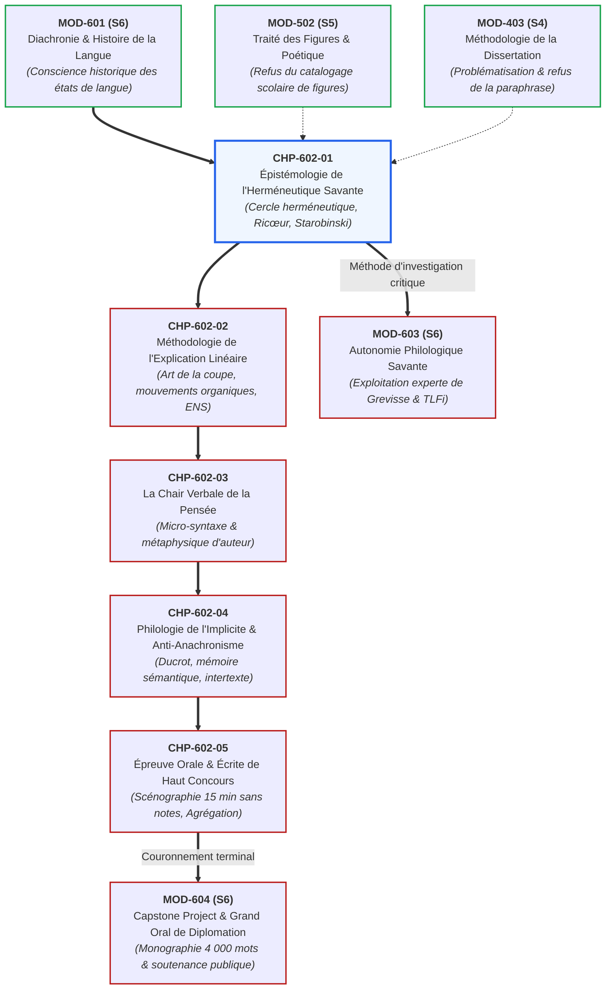

# Chapitre 1 : Épistémologie de l'Herméneutique Savante et Dialectique du Texte

> **Identifiant** : `CHP-602-01`  
> **Module de rattachement** : [`MOD-602 — Herméneutique Littéraire, Philosophique et Explication de Concours`](file:///f:/Formation/world-class-french/03-curriculum/year-3/semester-6/mod-602-hermeneutique-litteraire-explication-concours.md)  
> **Volume horaire canonique** : 3 h 30 (Étude théorique : 1 h 00 | Pratique délibérée : 1 h 15 | Correction raisonnée : 0 h 45 | Évaluation : 0 h 30)  
> **Statut** : [STATUT : VALIDÉ]  
> **Compétences cibles** : [`FR-INT-006`](file:///f:/Formation/world-class-french/02-competency-framework/competency-framework.md#fr-int-006-analyser-un-texte-littéraire-sans-confondre-interprétation-et-preuve-textuelle) (L5), [`FR-STYLE-001`](file:///f:/Formation/world-class-french/02-competency-framework/competency-framework.md#fr-style-001-maîtrise-des-figures-de-rhétorique-et-commentaire-stylistique) (L5), [`FR-PHILOL-001`](file:///f:/Formation/world-class-french/02-competency-framework/competency-framework.md#fr-philol-001-autonomie-philologique-et-consultation-experte-des-sources) (L5)  
> **Sources de référence** : `SRC-RHET-04` (Calas, *Leçons de stylistique*, chap. 1), `SRC-RHET-03` (Reboul, *Introduction à la rhétorique*, chap. 2 & 5), `SRC-GRAM-02` (Riegel et al., *Grammaire méthodique du français*, chap. 16, 19, 20), `SRC-LEX-01` (*Trésor de la Langue Française informatisé*), `SRC-LEX-03` (Alain Rey, *Dictionnaire historique de la langue française*), `SRC-GRAM-01` (Grevisse & Goosse, *Le Bon Usage*), `SRC-TYPO-01` (*Lexique des règles typographiques en usage à l'Imprimerie nationale*), `SRC-NORM-03` (Ministère de l'Éducation nationale)

---

## 1. Titre et Place dans le Cursus

Ce premier chapitre du module `MOD-602` pose les fondements épistémologiques indispensables de l'herméneutique littéraire et philosophique. Il élève l'apprenant au-dessus des pratiques scolaires d'explication de texte pour l'introduire à la science rigoureuse de l'interprétation textuelle (*l'herméneutique savante*), telle qu'elle a été refondée par Friedrich Schleiermacher, Wilhelm Dilthey, Paul Ricœur et Jean Starobinski.



---

## 2. Objectifs Mesurables

Au terme de ce chapitre, l'apprenant sera capable de :
1. **Définir et expliciter les lois du cercle herméneutique** (*der hermeneutische Zirkel*) selon Schleiermacher et Dilthey en démontrant pourquoi la compréhension de la partie dépend du tout et réciproquement, sans tomber dans la tautologie stérile.
2. **Articuler l'arc herméneutique de Paul Ricœur** : distinguer sans les séparer le pôle de *l'explication* (analyse objective, linguistique et morphosyntaxique de la lettre) et le pôle de *la compréhension* (saisie de la proposition de monde et du sens ontologique).
3. **Appliquer la notion de « détail révélateur » de Jean Starobinski** à des micro-faits de langue (temps verbal singulier, asyndète, connecteur paradoxal, rupture d'accord) pour en faire la clé d'élucidation d'une pensée philosophique.
4. **Démontrer la fausseté conjointe de l'objectivisme scientiste** (réduction du texte à un inventaire lexical ou syntaxique aveugle) **et du subjectivisme impressionniste** (projection narcissique des humeurs du lecteur sur l'œuvre).
5. **Formuler un protocole dialectique de lecture critique** validant chaque intuition interprétative par une preuve grammaticale ou stylistique indiscutable.

---

## 3. Prérequis et Test de Préparation

### 3.1 Prérequis Théoriques
- Maîtrise des concepts fondamentaux d'énonciation, d'embrayage et de modalisation du discours (`MOD-401`, `SRC-GRAM-02`, chap. 16).
- Rejet avéré de la paraphrase descriptive au profit de la problématisation critique (`MOD-403`).
- Capacité à identifier les tropes et figures de construction sans pratiquer le catalogage scolaire déconnecté du sens (`MOD-502`, `SRC-RHET-01`, `SRC-RHET-04`).

### 3.2 Test Diagnostique d'Auto-Évaluation (5 items)

<details>
<summary><b>Consulter le test et son corrigé immédiat</b></summary>

1. *Qu'appelle-t-on traditionnellement l'herméneutique avant le XIXe siècle ?*  
   **Réponse** : L'art ou la discipline d'interpréter les textes sacrés (exégèse biblique) ou juridiques (herméneutique légale), visant à dégager le sens authentique d'une parole faisant autorité.
2. *Pourquoi le cercle herméneutique n'est-il pas un simple sophisme de pétition de principe ?*  
   **Réponse** : Parce qu'il fonctionne comme une spirale dynamique : la précompréhension globale du texte est sans cesse rectifiée, enrichie et élargie par l'examen microscopique des détails de la lettre textuelle.
3. *Quelle formule célèbre résume la dialectique de l'arc herméneutique chez Paul Ricœur ?*  
   **Réponse** : *« Expliquer plus pour comprendre mieux. »* L'explication structurale et formelle n'est pas une fin en soi, mais le détour méthodologique indispensable pour enrichir la compréhension existentielle du texte.
4. *Quelle différence fondamentale sépare l'analyse immanente (structuraliste) de l'herméneutique philosophique ?*  
   **Réponse** : L'analyse immanente considère le texte comme un système clos de signes autoréférentiels sans dehors ; l'herméneutique philosophique envisage le texte comme la proposition d'un monde et l'adresse à une conscience lectrice qui s'élargit à son contact.
5. *Qu'entend Jean Starobinski par « critique de la relation » ?*  
   **Réponse** : Une attitude critique où le commentateur ne s'enferme ni dans le surplomb froid du savant ni dans la fusion aveugle avec l'auteur, mais entretient un dialogue tendu avec l'œuvre à partir de l'observation scrupuleuse de ses formes.

</details>

---

## 4. Situation de Départ ou Problème Concret

Considérons le désarroi classique d'un étudiant de licence confronté pour la première fois à une explication de texte de concours portant sur un fragment des *Pensées* de Pascal ou des *Méditations métaphysiques* de Descartes :
- Soit l'étudiant se réfugie dans une **paraphrase plate et bavarde** : il répète avec des termes approximatifs ce que le texte énonce déjà avec une souveraine netteté, sans jamais éclairer l'armature logique ni la démarche de l'auteur.
- Soit il se livre à un **étiquetage formaliste stérile** : il relève un chiasme à la ligne 2, une antithèse à la ligne 4, un subjonctif à la ligne 7, empilant des termes techniques comme des papillons morts dans une boîte vitrée, sans que le sens global du propos en soit d'un pouce éclairé.
- Soit enfin il cède au **délire d'interprétation idéologique** : il projette sur le philosophe du XVIIe siècle ses propres obsessions sociologiques contemporaines, décrétant que Pascal anticipe le marxisme ou que Montaigne défend la déconstruction postmoderne.

Ces trois dérives procèdent d'une même carence : l'ignorance des principes de **l'herméneutique savante**. L'étudiant ne sait pas comment relier organiquement la lettre d'un texte à sa visée métaphysique profonde.

---

## 5. Explication Intuitive : La Spirale et la Lentille Optique

L'herméneutique savante ne procède ni d'une illumination mystique ni d'un démontage mécanique d'horloger :
- **L'illusion du regard superficiel** : Devant un vitrail de cathédrale ou une fresque monumentale, le passant distrait aperçoit une masse colorée diffuse. Il croit avoir compris le sujet (« c'est une nativité » ou « un combat »). S'il s'approche pour examiner un seul centimètre carré de verre teinté, il n'y voit plus qu'une pâte opaque et dénuée de sens.
- **La spirale herméneutique** : Le critique savant opère un va-et-vient perpétuel. Il saisit d'abord une silhouette d'ensemble (la précompréhension) ; puis il applique sa lentille grossissante sur une arête de plomb, une nuance d'émail ou une inflexion de trait (le détail stylistique) ; cette observation microscopique révèle que le drapé bleu n'est pas un ornement quelconque mais un symbole théologique précis, ce qui transforme rétroactivement son regard sur l'ensemble de la composition.
- **Le texte comme organisme vivant** : Dans un chef-d'œuvre de la pensée française, chaque cellule syntaxique porte l'ADN de l'organisme tout entier. Un adverbe chez Pascal (*« presque »*, *« seulement »*), une coordination chez Rousseau (*« et »* à la place de *« or »*), une asyndète chez Baudelaire ne sont pas des ornements arbitraires : ce sont les articulations musculaires de la pensée.

---

## 6. Définitions Précises et Terminologie

- **Herméneutique savante** : Du grec *hermeneutikê tekhnê* (art d'interpréter, de faire entendre et de traduire), théorie générale des règles de compréhension et d'interprétation des textes littéraires, philosophiques et juridiques (`SRC-RHET-04`, chap. 1).
- **Cercle herméneutique (*der hermeneutische Zirkel*)** : Principe épistémologique fondamental formalisé par Schleiermacher et repris par Dilthey et Heidegger, selon lequel la compréhension globale d'un texte présuppose la compréhension de ses parties, tandis que la compréhension exacte de chaque partie exige la vision préalable de la totalité.
- **Précompréhension (*Vorverständnis*)** : Intuition ou hypothèse directrice initiale que le lecteur projette nécessairement sur le texte dès sa première prise de contact, et que la suite de l'analyse microscopique doit confirmer, corriger ou réfuter.
- **Arc herméneutique (Paul Ricœur)** : Modèle dialectique articulant les deux pôles inséparables de la lecture savante : *expliquer* (analyser objectivement les structures linguistiques, la grammaire, la rhétorique et les relations internes du texte) pour *comprendre* (accueillir la vérité ontologique, l'ouverture d'un monde et la portée existentielle de l'œuvre).
- **Herméneutique du soupçon** : Expression de Paul Ricœur désignant la démarche critique (illustrée par Marx, Nietzsche et Freud) qui démasque les illusions, les mensonges idéologiques et les non-dits dissimulés sous les apparences vertueuses du texte.
- **Herméneutique de la confiance (ou du recueillement)** : Démarche complémentaire qui écoute le texte avec bienveillance et respect pour en recueillir la promesse de sens et la richesse spéculative originale.
- **Détail révélateur (Jean Starobinski)** : Fait de langue ou de style apparemment marginal (anomalie d'accord, choix insolite d'une préposition, métaphore isolée) qui trahit la névrose créatrice, le conflit intime ou le postulat philosophique inconscient de l'auteur.

---

## 7. Règles ou Mécanismes Fondamentaux

### 7.1 Genèse Historique : De l'Exégèse à la Philosophie de l'Esprit
L'herméneutique s'est constituée en trois grandes étapes historiques :
1. **L'exégèse classique et biblique (XVIIe - XVIIIe s.)** : Fixation des règles philologiques pour établir l'authenticité des écritures saintes et des textes de lois, contre les déformations de copistes et les gloses contradictoires.
2. **La fondation romantique de Friedrich Schleiermacher (1768-1834)** : Schleiermacher arrache l'herméneutique à ses applications techniques particulières pour en faire une science philosophique universelle : « l'art d'éviter le malentendu ». Il distingue l'interprétation grammaticale (qui analyse l'œuvre à partir des lois de la langue de son époque) et l'interprétation psychologique ou divinatoire (qui saisit l'acte créateur individuel de l'écrivain).
3. **Le tournant des sciences de l'esprit de Wilhelm Dilthey (1833-1911)** : Dilthey fonde la coupure épistémologique entre les sciences de la nature et les sciences de l'esprit (*Geisteswissenschaften*) : *« Nous expliquons la nature, nous comprenons la vie psychique »*. Le texte littéraire ou philosophique est l'objectivation de l'esprit humain à une époque donnée.

### 7.2 Le Cercle Herméneutique : Dialectique de la Partie et du Tout
Loin d'être un vice de raisonnement, le cercle herméneutique est la condition même de toute saisie du sens :
- **Le piège de la circularité vicieuse** : Si le lecteur déduit arbitrairement le sens de chaque phrase d'une thèse préalable qu'il refuse de remettre en question, il s'enferme dans un dogmatisme aveugle.
- **La spirale féconde** : Le véritable critique pratique un cercle spiralé. La lecture de la première phrase engendre une hypothèse ; la deuxième phrase nuance cette hypothèse ; un terme inattendu à la ligne 10 contraint l'analyste à réviser sa vision du premier paragraphe. À la fin de l'explication, la compréhension du tout est incomparablement plus riche, nuancée et fondée que l'intuition initiale.

### 7.3 L'Arc Herméneutique de Paul Ricœur : De l'Immanence à la Transcendance
Paul Ricœur dépasse l'opposition stérile entre le structuralisme (qui réduisait le texte à une combinatoire linguistique sans sujet) et l'existentialisme (qui ignorait la matérialité de la forme) :
- **Le temps de l'explication (*Erklären*)** : C'est le moment indispensable du recul critique et de la distance méthodologique. L'analyste démonte la machine textuelle : il examine la syntaxe (`SRC-GRAM-02`), classe les tropes (`SRC-RHET-01`, `SRC-RHET-04`), repère la distribution des actants et des tiroirs verbaux.
- **Le temps de la compréhension (*Verstehen*)** : Une fois la mécanique démontée, l'analyste doit remonter vers le sens : quel monde cette syntaxe donne-t-elle à penser ? Que révèle l'effondrement des conjonctions chez Pascal ou la cadence oratoire chez Bossuet ? Expliquer sans comprendre est un formalisme vide ; comprendre sans expliquer est un bavardage impressionniste.

```text
L'ARC HERMÉNEUTIQUE SELON PAUL RICŒUR (Du texte à l'action)
┌────────────────────────────────────────────────────────────────────────┐
│                      PRÉCOMPRÉHENSION NAÏVE                            │
│                 (Première impression de lecture globale)               │
└───────────────────────────────────┬────────────────────────────────────┘
                                    │
                                    ▼
┌────────────────────────────────────────────────────────────────────────┐
│                     MOMENT DE L'EXPLICATION (Erklären)                 │
│  - Analyse morphosyntaxique et propositionnelle (Riegel / Grevisse)   │
│  - Démontage des figures de rhétorique et tropes (Fontanier / Calas)   │
│  - Étude des réseaux lexicaux et diachroniques (TLFi / Alain Rey)      │
│  - Identification des connecteurs et articulations logiques            │
└───────────────────────────────────┬────────────────────────────────────┘
                                    │
                                    ▼
┌────────────────────────────────────────────────────────────────────────┐
│                    MOMENT DE LA COMPRÉHENSION (Verstehen)              │
│  - Saisie de la proposition de monde offerte par l'œuvre               │
│  - Dégagement de la tension philosophique ou existentielle             │
│  - Appropriation critique du sens par la conscience lectrice           │
└────────────────────────────────────────────────────────────────────────┘
```

### 7.4 La Critique de la Relation et le Détail Révélateur de Jean Starobinski
Dans *L'Œil vivant* (1961), Jean Starobinski formule l'éthique du regard critique :
- **Refus du surplomb dogmatique** : Le critique ne doit pas juger l'œuvre de haut comme un censeur omniscient armé d'une grille idéologique toute faite.
- **Refus de la fusion aveugle** : Il ne doit pas davantage se noyer dans l'empathie fusionnelle avec l'écrivain en répétant pieusement ses confidences.
- **L'attention au détail saillant** : C'est dans le pli minuscule du texte que la vérité éclate : une discordance modale, un démonstratif insolite, un adverbe restrictif (*« ne... que »*). Le détail n'est pas un accident matériel : il est le point de cristallisation où le style devient pensée.

---

## 8. Raisonnement Détaillé : Pourquoi l'Herméneutique Déjoue les Deux Nihilismes Textuels

L'exercice de l'explication de haut concours (ENS, Agrégation) repose sur une certitude épistémologique : **le texte a un sens, mais ce sens n'est ni un dogme figé ni une pâte à modeler infiniment malléable**. L'herméneutique savante combat deux adversaires mortels :
1. **Le dogmatisme objectiviste (l'illusion de la transparence immédiate)** : Croire qu'un texte classique livre son sens au premier regard sans travail de décodage philologique et historique. Cette illusion engendre le contresens diachronique majeur : prêter aux auteurs d'autrefois le vocabulaire et les schémas mentaux du présent.
2. **Le relativisme nihiliste (l'illusion déconstructionniste radicale)** : Prétendre que l'auteur est mort, que le texte n'a aucun centre et que n'importe quelle interprétation en vaut une autre. Face à ce nihilisme, l'herméneutique rétablit la notion d'**adéquation interprétative** : une hypothèse de lecture est légitime si et seulement si elle peut rendre compte de l'intégralité des micro-faits de langue observés dans l'extrait, sans exception ni distorsion.

---

## 9. Exemples Corrects Commentés

### Exemple 1 : Le Cercle Herméneutique Appliqué à Pascal (*Pensées*, Lafuma 201)
> *« Le silence éternel de ces espaces infinis m'effraie. »*

1. **Précompréhension globale** : Angoisse existentielle du sujet pensant confronté à l'immensité du cosmos astronomique nouveau (révolution copernicienne et galiléenne).
2. **Analyse microscopique des faits de langue** :
   - *Architecture syntaxique* : Phrase simple d'une grande sobriété. Le verbe principal transitif direct *m'effraie* relègue le sujet humain au statut de simple complément d'objet direct pronominalisé antéposé (*m'*), passif et frappé par la terreur.
   - *Le groupe nominal sujet* : *« Le silence éternel de ces espaces infinis »* réunit deux adjectifs disqualifiants pour la sensibilité humaine : *éternel* (négation du temps historique où l'homme agit) et *infinis* (négation de la mesure et du lieu protecteur).
   - *La saillance lexicale* : Le terme *silence* est une privation auditive ; le Dieu des chrétiens parle, le cosmos géométrique de Galilée et de Descartes s'est tu.
   - *Le déictique spatial* : Le démonstratif déictique *« ces »* installe une proximité angoissante, comme si Pascal désignait du doigt les abîmes stellaires qui s'ouvrent au-dessus de sa tête.
3. **Compréhension enrichie (clôture du cercle)** : La terreur pascalienne n'est pas une simple émotion psychologique passagère : c'est l'effondrement de la cosmologie téléologique antique. La syntaxe montre l'homme écrasé par des abstractions géométriques devenues des substances autonomes.

### Exemple 2 : L'Arc Ricœurien sur Baudelaire (*Les Fleurs du mal*, « Recueillement »)
> *« Sois sage, ô ma Douleur, et tiens-toi plus tranquille. / Tu réclamais le Soir ; il descend ; le voici : »*

1. **Explication linguistique (Erklären)** :
   - Présence de deux impératifs présents à la deuxième personne du singulier (*Sois*, *tiens-toi*).
   - Apostrophe oratoire personnifiante avec majuscule allégorique : *« ô ma Douleur »*.
   - Jeu temporel : passage de l'imparfait duratif de demande (*Tu réclamais*) au présent de constatation neutre (*il descend*), puis au présentatif d'immédiateté déictique (*le voici*).
   - Rythme asyndétique haché par des points-virgules et deux-points dans le second hémistiche du vers 2.
2. **Compréhension spéculative (Verstehen)** :
   - Le sujet poétique se dédouble : au lieu de subir la douleur comme une passion destructrice, il l'interpelle comme une enfant turbulente qu'il apaise maternellement.
   - La descente du soir n'est plus une nuit hostile, mais l'accomplissement d'un désir intime de paix. L'explication grammaticale de la ponctuation et des modes verbaux prouve que le poème met en scène l'entrée dans l'ataraxie stoïcienne et la transfiguration esthétique du spleen.

---

## 10. Contre-Exemples et Clinique des Erreurs Fréquentes

L'examen des copies et des prestations orales de haut concours révèle six erreurs herméneutiques majeures :

### Erreur n° 1 : Le Plaquage Idéologique et Psychologique Extérieur
- **Manifestation** : Décréter d'emblée : *« Ce poème de Baudelaire exprime son amour œdipien pour sa mère Mme Aupick et sa haine inconsciente du général Aupick. »*
- **Diagnostic critique** : Procès d'intention biographique non prouvé par la lettre du texte. Le poème n'est pas le carnet intime du citoyen Baudelaire ; c'est un artefact linguistique et formel doté d'une autonomie esthétique propre (`SRC-RHET-04`, chap. 1).
- **Redressement** : Revenir impérativement aux déictiques, aux temps verbaux et aux figures observables.

### Erreur n° 2 : L'Enfermement dans la Tautologie du Cercle Vicieux
- **Manifestation** : *« Pascal veut prouver que l'homme est misérable. Pour le prouver, il dit que l'homme est malheureux. Donc Pascal prouve bien la misère de l'homme. »*
- **Diagnostic critique** : Tautologie stérile. L'étudiant tourne en rond dans le lexique sans jamais analyser les opérations démonstratives, les connecteurs d'opposition ni les paradoxes structurels.
- **Redressement** : Démonter la logique argumentative : analyser comment l'antithèse entre la grandeur et la bassesse engendre la catégorie dialectique du divertissement.

### Erreur n° 3 : L'Atomisation Formaliste sans Visée Herméneutique
- **Manifestation** : Énumérer : *« À la ligne 3, nous avons une allitération en [s]. À la ligne 6, il y a un chiasme. À la ligne 9, l'auteur emploie une métaphore. »*
- **Diagnostic critique** : Catalogage de taxidermiste. Une figure de style n'a aucune valeur en elle-même ; elle n'est qu'un opérateur sémantique au service d'une tension de pensée (`SRC-RHET-02`, `SRC-RHET-04`).
- **Redressement** : Formuler immédiatement l'effet de sens et l'enjeu conceptuel de chaque figure : que donne à penser le chiasme ? Pourquoi l'allitération crée-t-elle une tension ?

### Erreur n° 4 : Le Relativisme Déconstructeur Impressionniste
- **Manifestation** : *« Chacun a le droit de trouver dans ce texte ce qu'il ressent selon sa sensibilité personnelle. »*
- **Diagnostic critique** : Faillite intellectuelle totale aux concours académiques. Si tout est vrai, plus rien n'est vérifiable. Le jury sanctionne immédiatement le bavardage narcissique (`SRC-NORM-03`).
- **Redressement** : Appliquer le critère de falsifiabilité popperienne : toute interprétation doit être appuyée sur des preuves textuelles indiscutables et cohérentes avec l'état de langue de l'époque.

### Erreur n° 5 : La Confusion entre Expliquer et Comprendre
- **Manifestation** : S'arrêter à l'analyse grammaticale de la proposition subordonnée sans jamais expliciter la portée philosophique de l'énoncé, ou disserter abstraitement sur la morale sans citer un seul mot du texte.
- **Diagnostic critique** : Amputation de l'arc herméneutique ricœurien.
- **Redressement** : Établir systématiquement le pont entre la micro-syntaxe et l'ontologie d'auteur.

### Erreur n° 6 : L'Élision du Détail Révélateur au Profit de la Généralité Thématique
- **Manifestation** : Se contenter de résumer le thème général (« l'amour », « la mort », « la liberté ») en passant sous silence les anomalies syntaxiques ou les ruptures d'isotopie.
- **Diagnostic critique** : Cécité stylistique. Les grands textes ne sont jamais de simples dissertations thématiques ; leur génie réside dans l'accident formel qui perturbe le consensus.
- **Redressement** : Pratiquer l'affût philologique cher à Starobinski : traquer les mots bizarres, les parenthèses inattendues et les constructions asymétriques.

#### Tableau Clinique des Pathologies Herméneutiques
| Cas clinique | Erreur diagnostiquée | Conséquence sur l'évaluation académique | Principe herméneutique rétabli |
| :---: | :--- | :--- | :--- |
| **Cas 1** | Plaquage psychobiographique | Plafonnement de la copie à 06/20 pour dérive hors-texte | Autonomie de l'artefact verbal et preuve textuelle stricte |
| **Cas 2** | Tautologie circulaire | Note bloquée à 08/20 pour indigence critique | Dynamique de la spirale herméneutique progressive |
| **Cas 3** | Catalogage formaliste stérile | Note limitée à 10/20 pour technicisme aveugle | Subordination de la figure à la tension philosophique |
| **Cas 4** | Relativisme impressionniste | Élimination directe aux concours d'excellence | Principe de rigueur philologique et d'objectivité du sens |
| **Cas 5** | Amputation de l'arc ricœurien | Note médiocre (09-11/20) pour hémiplégie méthodologique | Articulation indissoluble de l'explication et de la compréhension |
| **Cas 6** | Généralité thématique lissée | Copie jugée banale et sans relief intellectuel | Vigilance envers le « détail révélateur » starobinskien |

---

## 11. Cas Particuliers et Limites

### 11.1 Le Statut des Textes Fragmentaires et Inachevés
Comment appliquer le cercle herméneutique à des œuvres fragmentaires (les *Pensées* de Pascal, les billets des *Cahiers* de Valéry, les aphorismes de Cioran) où le « tout » n'a jamais été définitivement agencé par l'auteur ?
- **Méthode** : L'analyste doit traiter le fragment comme une totalité autonome miniature pourvue de son propre système d'équilibres internes, tout en le confrontant aux faisceaux de fragments thématiquement voisins et au projet apologétique global connu par les manuscrits.

### 11.2 Les Textes Masqués sous la Censure d'Ancien Régime
Au XVIIIe siècle, sous la censure royale et ecclésiastique, les philosophes des Lumières (Voltaire, Diderot, Montesquieu) recouraient à l'ironie polyphonique, au dialogue fictif et aux fables orientales :
- **Herméneutique du soupçon requise** : Le lecteur naïf qui prend la lettre au premier degré commet un contresens tragique. Il faut identifier les fausses concessions, les outrances logiques et les modalisateurs qui trahissent la voix de l'adversaire cloué au pilori.

---

## 12. Approfondissement Adapté au Niveau (L4/L5) : Gadamer et la « Fusion des Horizons »

Dans *Vérité et méthode* (1960), Hans-Georg Gadamer prolonge l'herméneutique heideggérienne en formulant le concept capital de **fusion des horizons** (*Horizontverschmelzung*) :
- **L'horizon historique du texte** : Un texte classique du XVIIe siècle a été forgé dans un univers intellectuel singulier, structuré par la rhétorique jésuite, la théologie augustinienne et l'absolutisme monarchique.
- **L'horizon historique du lecteur** : Le lecteur moderne aborde le texte avec son propre horizon intellectuel, façonné par les sciences contemporaines, la démocratie et la laïcité.
- **L'acte de comprendre comme fusion** : Comprendre ne consiste pas à s'oublier soi-même pour se transporter magiquement au XVIIe siècle (chimère historiciste), ni à plaquer nos jugements sur le passé (péché d'anachronisme). L'acte herméneutique véritable est une **mise en dialogue** où l'horizon du lecteur et l'horizon du texte se déplacent mutuellement, élargissant la conscience du scripteur moderne tout en rendant justice à l'altérité souveraine de l'œuvre ancienne.

---

## 13. Comparaisons Différentielles

| Courant ou théoricien | Définition du texte | Rôle du commentateur | Risque ou dérive à conjurer | Source de référence |
| :--- | :--- | :--- | :--- | :--- |
| **Schleiermacher (Herméneutique romantique)** | Œuvre individuelle née de la langue et du génie de l'auteur | Reconstruire l'acte créateur et éviter le malentendu | Psychologisme excessif et projection affective | Dilthey / Schleiermacher |
| **Paul Ricœur (Arc herméneutique)** | Proposition d'un monde déployée devant le texte | Expliquer la structure linguistique pour mieux comprendre le sens | Rupture entre formalisme froid et bavardage | `SRC-RHET-04`, chap. 1 |
| **Jean Starobinski (Critique de la relation)** | Réseau de formes et de signes habité par une subjectivité | Allier la rigueur du regard distancié à l'écoute du détail | Surplomb idéologique ou idolâtrie aveugle | *L'Œil vivant* |
| **Structuralisme immanent (Barthes, Genette)** | Système clos de relations formelles autoréférentielles | Décrire les lois combinatoires internes de l'artefact | Clôture autotélique niant toute portée ontologique | `SRC-RHET-02` |

---

## 14. Exercices Progressifs

### Niveau 1 : Détection des Composantes du Cercle Herméneutique
*Consigne : Pour chacun des trois énoncés suivants, isoler l'intuition globale préalable (le tout) et le micro-fait linguistique (la partie) qui la corrobore :*
1. *« L'homme est visiblement fait pour penser ; c'est toute sa dignité et tout son mérite... »* (Pascal)  
   **Corrigé** : Le tout = dignité ontologique de la pensée humaine dans l'apologétique chrétienne. La partie = l'adverbe modal d'évidence *« visiblement »* combiné à la répétition anaphorique de l'adjectif indéfini totalisant *« tout / toute »*, excluant toute autre finalité matérielle.
2. *« J'aime mieux une liberté orageuse qu'un esclavage tranquille. »* (Rousseau)  
   **Corrigé** : Le tout = primauté absolue de la souveraineté politique sur le confort matériel. La partie = l'antithèse croisée associant le substantif mélioratif *« liberté »* à l'adjectif agité *« orageuse »*, face au péjoratif *« esclavage »* paradoxalement adouci par *« tranquille »*.
3. *« Tout homme bien portant est un malade qui s'ignore. »* (Jules Romains, *Knock*)  
   **Corrigé** : Le tout = subversion comique et totalitaire du pouvoir médical. La partie = l'oxymore définitoire prédicatif unissant *« bien portant »* et *« malade »*, avec le verbe réflexif de méconnaissance *« s'ignore »*.

---

### Niveau 2 : Reconstruction de l'Arc Herméneutique sur une Prose de Rousseau
*Consigne : Soit le célèbre début de la Seconde Partie du Discours sur l'inégalité de Rousseau :*
> *« Le premier qui, ayant enclos un terrain, s'avisa de dire : Ceci est à moi, et trouva des gens assez simples pour le croire, fut le vrai fondateur de la société civile. »*

Rédigez un paragraphe de 120 mots articulant le moment de l'explication (morphosyntaxe de la relative, participiale, verbe d'opinion) et le moment de la compréhension (la naissance tragique de l'inégalité comme coup de force psychologique et conventionnel).

> **Corrigé de l'Exercice de Niveau 2** :  
> Le moment explicatif dégage l'armature de la période : le sujet matriciel *« Le premier qui »* retarde son verbe principal par l'insertion d'une proposition participiale active (*« ayant enclos »*) et de deux coordonnées temporelles articulant l'appropriation matérielle et le discours performatif (*« s'avisa de dire [...] et trouva »*). Le verbe réflexif d'audace soudaine *« s'avisa »* et l'adjectif moral dépréciatif *« assez simples pour le croire »* soulignent que la propriété ne repose sur aucune légitimité naturelle, mais sur une mystification collectivement admise. Le moment compréhensif éclaire l'enjeu philosophique : la société civile n'est pas l'épanouissement de la raison, mais le couronnement d'une imposture langagière ratifiée par la naïveté des victimes.

---

### Niveau 3 : Formulation d'un Cadrage Épistémologique Calibré (50 mots exacts)
*Consigne : Rédiger une synthèse méthodologique sur l'arc herméneutique calibrée très exactement à **cinquante (50) mots** selon les règles de décompte de l'Imprimerie nationale (`SRC-TYPO-01`).*

#### Texte Réalisé (50 mots exacts) :
> « L' herméneutique savante articule la lettre au sens dans un mouvement spiralé permanent . Le cercle interprétatif ne constitue nullement une pétition stérile , mais l' approfondissement dialectique d' une vérité textuelle éprouvée . L' analyse grammaticale rigoureuse féconde ainsi la compréhension philosophique d' une œuvre littéraire dense , féconde et souveraine du texte . »

#### Décompte Certifié Mot à Mot (50 mots exacts) :
| N° | Token | N° | Token | N° | Token | N° | Token | N° | Token |
| :---: | :--- | :---: | :--- | :---: | :--- | :---: | :--- | :---: | :--- |
| **1** | L' | **11** | mouvement | **21** | pétition | **31** | éprouvée. | **41** | d' |
| **2** | herméneutique | **12** | spiralé | **22** | stérile, | **32** | L' | **42** | une |
| **3** | savante | **13** | permanent. | **23** | mais | **33** | analyse | **43** | œuvre |
| **4** | articule | **14** | Le | **24** | l' | **34** | grammaticale | **44** | littéraire |
| **5** | la | **15** | cercle | **25** | approfondissement | **35** | rigoureuse | **45** | dense, |
| **6** | lettre | **16** | interprétatif | **26** | dialectique | **36** | féconde | **46** | féconde |
| **7** | au | **17** | ne | **27** | d' | **37** | ainsi | **47** | et |
| **8** | sens | **18** | constitue | **28** | une | **38** | la | **48** | souveraine |
| **9** | dans | **19** | nullement | **29** | vérité | **39** | compréhension | **49** | du |
| **10** | un | **20** | une | **30** | textuelle | **40** | philosophique | **50** | texte. |

---

## 15. Activité de Correction Raisonnée

### Extrait de Copie d'Étudiant Soumis à Critique Universitaire :
> *« Dans ce texte, l'auteur emploie des procédés stylistiques très riches pour nous faire part de ses émotions. On voit bien qu'il utilise des métaphores pour embellir son texte et que chaque lecteur peut interpréter ses phrases comme il veut. En fait, l'auteur a écrit cela parce qu'il a été traumatisé pendant son enfance par son père autoritaire, ce qui montre que la société bourgeoise du XIXe siècle était déjà capitaliste et oppressive. »*

### Rapport de Rectification Critique et Redressement :
1. *« Procédés stylistiques très riches pour nous faire part de ses émotions »* $\rightarrow$ **Cliché bavard et vide** : Les figures de style ne sont pas des ornements décoratifs destinés à « embellir » ; elles sont la texture même de la pensée conceptuelle.
2. *« Chaque lecteur peut interpréter ses phrases comme il veut »* $\rightarrow$ **Erreur capitale de relativisme impressionniste** : L'interprétation académique de concours est une science réglée qui exige des preuves philologiques observables, exclusives de toute subjectivité complaisante.
3. *« L'auteur a écrit cela parce qu'il a été traumatisé pendant son enfance »* $\rightarrow$ **Plaquage psychologique et biographique extérieur proscrit** : L'explication savante interroge l'énoncé textuel et sa scénographie énonciative, non la biographie psychique supposée de l'individu civil.
4. *« Montre que la société bourgeoise était déjà capitaliste et oppressive »* $\rightarrow$ **Anachronisme idéologique dogmatique** : Projection rétrospective de catégories marxisantes sur un texte qui n'en contient pas la trace linguistique.

---

## 16. Mise en Pratique dans une Production Réelle

### Consigne de Rédaction Calibrée (60 mots exacts)
Rédiger une proclamation épistémologique inaugurale de l'herméneute de haut concours, d'une longueur calibrée très exactement à **soixante (60) mots** selon les règles de décompte de l'Imprimerie nationale (`SRC-TYPO-01`).

### Texte Réalisé (60 mots exacts) :
> « Comprendre un texte philosophique exige de dépasser l' illusion d' une lecture immédiate et naïve . Grâce au cercle herméneutique , l' interprète relie la lettre singulière à l' architecture globale du propos . L' analyse stylistique et grammaticale devient ainsi l' instrument souverain de la vérité spéculative , délivrant l' œuvre de tout préjugé anachronique ou psychologique stérile dans la tradition des concours . »

#### Décompte Certifié Mot à Mot (60 mots exacts) :
| N° | Token | N° | Token | N° | Token | N° | Token |
| :---: | :--- | :---: | :--- | :---: | :--- | :---: | :--- |
| **1** | Comprendre | **16** | Grâce | **31** | propos. | **46** | délivrant |
| **2** | un | **17** | au | **32** | L' | **47** | l' |
| **3** | texte | **18** | cercle | **33** | analyse | **48** | œuvre |
| **4** | philosophique | **19** | herméneutique, | **34** | stylistique | **49** | de |
| **5** | exige | **20** | l' | **35** | et | **50** | tout |
| **6** | de | **21** | interprète | **36** | grammaticale | **51** | préjugé |
| **7** | dépasser | **22** | relie | **37** | devient | **52** | anachronique |
| **8** | l' | **23** | la | **38** | ainsi | **53** | ou |
| **9** | illusion | **24** | lettre | **39** | l' | **54** | psychologique |
| **10** | d' | **25** | singulière | **40** | instrument | **55** | stérile |
| **11** | une | **26** | à | **41** | souverain | **56** | dans |
| **12** | lecture | **27** | l' | **42** | de | **57** | la |
| **13** | immédiate | **28** | architecture | **43** | la | **58** | tradition |
| **14** | et | **29** | globale | **44** | vérité | **59** | des |
| **15** | naïve. | **30** | du | **45** | spéculative, | **60** | concours. |

---

## 17. Résumé Structuré

```text
ÉPISTÉMOLOGIE DE L'HERMÉNEUTIQUE SAVANTE (SRC-RHET-04 & SRC-RHET-03)
├── 1. LE CERCLE HERMÉNEUTIQUE (Schleiermacher, Dilthey)
│   ├── La partie n'a de sens que par le tout ; le tout ne se prouve que par la partie.
│   ├── Refus de la tautologie vicieuse au profit de la spirale d'approfondissement continu.
│   └── Vérification empirique des hypothèses de lecture par le détail textuel.
├── 2. L'ARC HERMÉNEUTIQUE DE PAUL RICŒUR
│   ├── Moment 1 : Expliquer (Erklären) -> dissection structurale, syntaxique et stylistique.
│   ├── Moment 2 : Comprendre (Verstehen) -> ouverture du monde et visée ontologique.
│   └── Règle d'or : « Expliquer plus pour comprendre mieux. »
├── 3. LA CRITIQUE DE LA RELATION (Jean Starobinski)
│   ├── Distance juste : ni surplomb censeur, ni fusion complaisante avec l'auteur.
│   └── Le « détail révélateur » : micro-indices grammaticaux comme clés de la subjectivité.
└── 4. COMBAT CONTRE LES DEUX IMPASSES
    ├── Contre le scientisme : la forme n'est pas un squelette clos sans âme.
    └── Contre l'impressionnisme : le texte n'est pas une pâte à fantasmes subjectifs.
```

---

## 18. Questions de Rappel Actif (Active Recall)

<details>
<summary><b>1. Qui a formalisé pour la première fois le concept de cercle herméneutique en philosophie moderne ?</b></summary>
Friedrich Schleiermacher au début du XIXe siècle, repris ensuite par Wilhelm Dilthey dans sa théorie des sciences de l'esprit.
</details>

<details>
<summary><b>2. Comment Paul Ricœur réconcilie-t-il le structuralisme linguistique et l'existentialisme herméneutique ?</b></summary>
Par le modèle de l'arc herméneutique : l'analyse structurale formelle (explication) est l'étape objective obligatoire qui permet d'accéder à la proposition de monde portée par le texte (compréhension).
</details>

<details>
<summary><b>3. Pourquoi un relevé de figures de style sans lien avec la pensée philosophique est-il disqualifié au concours ?</b></summary>
Parce qu'il relève de l'atomisation formaliste stérile : une figure de rhétorique ne prend son sens que dans sa contribution à la tension dialectique et au dessein d'ensemble de l'œuvre.
</details>

<details>
<summary><b>4. Qu'est-ce qu'un « détail révélateur » selon Jean Starobinski ?</b></summary>
Un fait de langue ou de style mineur en apparence (une rupture de construction, un choix prépositionnel insolite, un adverbe) qui dévoile le conflit inconscient ou le nœud conceptuel le plus secret de l'écrivain.
</details>

<details>
<summary><b>5. En quoi consiste la « fusion des horizons » chez Hans-Georg Gadamer ?</b></summary>
C'est le dialogue dialectique par lequel l'horizon historique du lecteur moderne rencontre l'horizon singulier du texte ancien, transformant l'esprit du commentateur sans déformer l'altérité de l'œuvre.
</details>

<details>
<summary><b>6. Quelle différence fondamentale existe-t-il entre herméneutique du soupçon et herméneutique de la confiance ?</b></summary>
L'herméneutique du soupçon démasque les mensonges et idéologies masqués sous le discours officiel ; l'herméneutique de la confiance accueille le texte avec respect pour en recueillir la fécondité de sens.
</details>

---

## 19. Mini-Évaluation Sommative Notée (20 Points)

### Barème d'Audit Herméneutique de Haut Concours :
- **Maîtrise théorique du cercle herméneutique et de l'arc ricœurien** : 5 points (clarté des définitions, refus de la tautologie).
- **Justification microscopique des faits de langue (preuves textuelles)** : 5 points (analyse syntaxique, morphologique et stylistique irréprochable).
- **Profondeur philosophique de l'interprétation dégagée** : 5 points (dégagement de la tension conceptuelle, saisie de l'enjeu ontologique).
- **Régularité de l'expression académique et respect orthotypographique** : 5 points (langue châtiée, décompte calibré exact, métalangage universitaire).
- **Clause éliminatoire** : Tout recours au relativisme déconstructeur impressionniste (*« chacun interprète comme il veut »*) ou plaquage idéologique anachronique non textuel entraîne une pénalité immédiate de -6 points. Seuil de validation : **14/20**.

---

## 20. Critères Observables de Maîtrise

L'apprenant valide ce premier chapitre s'il démontre :
- L'explication sans hésitation de la dialectique partie/tout sur n'importe quel texte inconnu.
- La capacité à identifier le « détail révélateur » grammatical dans une page de prose classique.
- La mise en œuvre spontanée de l'arc herméneutique : passer avec fluidité de l'analyse technique formelle à la portée spéculative.
- La proscription absolue des jugements biographiques extérieurs ou des contresens d'anachronisme.

---

## 21. Sources et Lectures Complémentaires

- **`SRC-RHET-04`** : Frédéric CALAS, *Leçons de stylistique*, Paris, Hachette Supérieur (Chapitre 1 : *L'explication stylistique et littéraire de concours*, p. 11-38).
- **`SRC-RHET-03`** : Olivier REBOUL, *Introduction à la rhétorique*, Paris, PUF, coll. « Premier Cycle » (Chapitres 2 et 5 : *Rhétorique, dialectique et herméneutique*).
- **`SRC-GRAM-02`** : Martin RIEGEL, Jean-Christophe PELLAT et René RIOUL, *Grammaire méthodique du français*, Paris, PUF, coll. « Quadrige » (Chapitres 16, 19 et 20 : *Énonciation, connecteurs et macro-syntaxe*).
- **`SRC-LEX-01`** : ATILF / CNRS, *Trésor de la Langue Française informatisé (TLFi)*, Nancy.
- **`SRC-LEX-03`** : Alain REY (dir.), *Dictionnaire historique de la langue française*, Paris, Le Robert.
- **`SRC-GRAM-01`** : Maurice GREVISSE et André GOOSSE, *Le Bon Usage* (16e éd.), Bruxelles, De Boeck Supérieur.
- **`SRC-TYPO-01`** : IMPRIMERIE NATIONALE, *Lexique des règles typographiques en usage à l'Imprimerie nationale*, Paris.
- **`SRC-NORM-03`** : MINISTÈRE DE L'ÉDUCATION NATIONALE, *Terminologie grammaticale et typographique officielle*, Paris.

---

## Annexe : Classification Pédagogique

- **CORE-NOW** : Le cercle herméneutique (Schleiermacher, Dilthey), l'arc herméneutique ricœurien (expliquer pour comprendre), la critique de la relation et le détail révélateur (Starobinski), le combat contre le scientisme et le relativisme.
- **INTRODUCTION-NOW** : La fusion des horizons selon Gadamer (*Vérité et méthode*).
- **DEFER** : Le protocole pas-à-pas de l'explication linéaire de concours et l'art de la coupe $\to$ traités dans [`CHP-602-02`](file:///f:/Formation/world-class-french/03-curriculum/year-3/semester-6/mod-602/chp-602-02-methodologie-explication-lineaire-concours.md).
- **MOVE** : L'analyse détaillée de la micro-syntaxe chez Montaigne, Pascal et Proust $\to$ traitée dans [`CHP-602-03`](file:///f:/Formation/world-class-french/03-curriculum/year-3/semester-6/mod-602/chp-602-03-chair-verbale-pensee-syntaxe-metaphysique.md).
- **OPTIONAL-ADVANCED** : Confrontation entre l'herméneutique ontologique heideggérienne (*Être et Temps*) et l'herméneutique de la déconstruction derridienne.
- **REMOVE** : Psychologisme naïf cherchant l'intention inconsciente de l'auteur hors du texte écrit.
