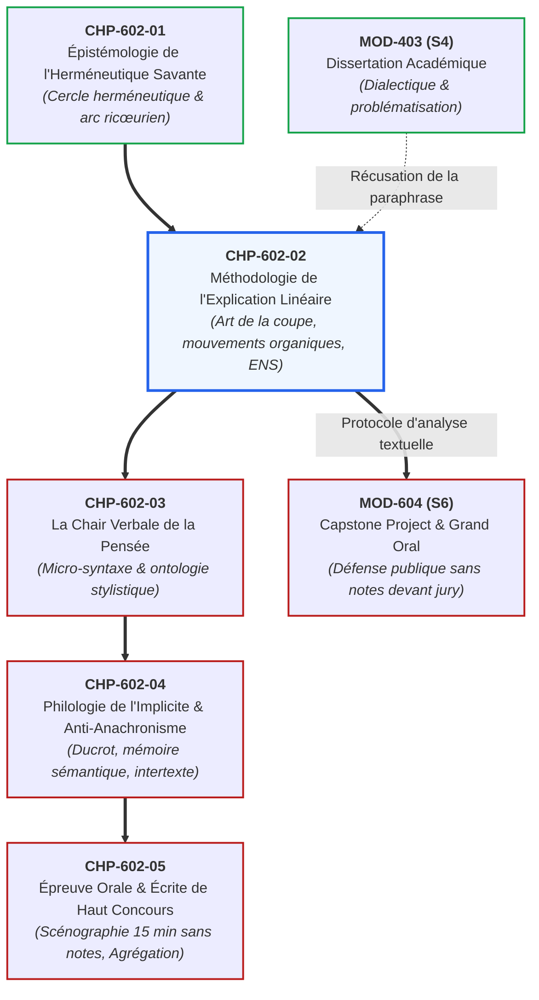

# Chapitre 2 : Méthodologie Universitaire de l'Explication Linéaire de Concours (ENS / Agrégation)

> **Identifiant** : `CHP-602-02`  
> **Module de rattachement** : [`MOD-602 — Herméneutique Littéraire, Philosophique et Explication de Concours`](file:///f:/Formation/world-class-french/03-curriculum/year-3/semester-6/mod-602-hermeneutique-litteraire-explication-concours.md)  
> **Volume horaire canonique** : 3 h 30 (Étude théorique : 1 h 00 | Pratique délibérée : 1 h 15 | Correction raisonnée : 0 h 45 | Évaluation : 0 h 30)  
> **Statut** : [STATUT : VALIDÉ]  
> **Compétences cibles** : [`FR-INT-006`](file:///f:/Formation/world-class-french/02-competency-framework/competency-framework.md#fr-int-006-analyser-un-texte-littéraire-sans-confondre-interprétation-et-preuve-textuelle) (L5), [`FR-STYLE-001`](file:///f:/Formation/world-class-french/02-competency-framework/competency-framework.md#fr-style-001-maîtrise-des-figures-de-rhétorique-et-commentaire-stylistique) (L5), [`FR-INT-005`](file:///f:/Formation/world-class-french/02-competency-framework/competency-framework.md#fr-int-005-démonstration-orale-structurée-et-art-de-léloquence-sans-notes) (L5)  
> **Sources de référence** : `SRC-RHET-04` (Calas, *Leçons de stylistique*, chap. 1 & 4), `SRC-RHET-03` (Reboul, *Introduction à la rhétorique*, chap. 3 & 5), `SRC-GRAM-02` (Riegel et al., *Grammaire méthodique du français*, chap. 16 & 20), `SRC-GRAM-01` (Grevisse & Goosse, *Le Bon Usage*), `SRC-LEX-01` (*Trésor de la Langue Française informatisé*), `SRC-LEX-03` (Alain Rey, *Dictionnaire historique de la langue française*), `SRC-TYPO-01` (*Lexique des règles typographiques en usage à l'Imprimerie nationale*), `SRC-NORM-03` (Ministère de l'Éducation nationale)

---

## 1. Titre et Place dans le Cursus

Ce deuxième chapitre du module `MOD-602` codifie la méthode reine de l'université et des grands concours français : **l'explication linéaire continue**. Après avoir assimilé les lois épistémologiques du cercle herméneutique (`CHP-602-01`), l'étudiant apprend ici à démonter et restituer pas à pas la dramaturgie d'un texte d'auteur, sans jamais succomber au découpage thématique artificiel ni au saucissonnage paraphrastique ligne à ligne.



---

## 2. Objectifs Mesurables

Au terme de ce chapitre, l'apprenant sera capable de :
1. **Démontrer la supériorité épistémologique de l'explication linéaire** sur le commentaire composé thématique pour les épreuves de haut niveau (ENS Ulm/Lyon, Agrégation de Lettres et de Philosophie).
2. **Maîtriser l'art de la coupe** : découper un texte de 20 à 30 lignes de prose dense en trois ou quatre mouvements organiques continus, exclusivement justifiés par des critères linguistiques indiscutables (mutations énonciatives, logiques, temporelles ou isotopiques).
3. **Formuler une problématique de concours non tautologique** : dégager le nœud aporétique, la contradiction féconde ou le combat intellectuel sous-jacent qui motive l'écriture du texte.
4. **Construire des transitions dialectiques sans couture** : relier les mouvements par une logique d'engendrement dynamique montrant comment le dénouement d'une étape pose la nécessité de la suivante.
5. **Appliquer le protocole en trois temps canoniques** : concevoir une introduction complète (situation, lecture, problématique, mouvements), un développement continu microscopic et une conclusion bilan/ouverture.

---

## 3. Prérequis et Test de Préparation

### 3.1 Prérequis Théoriques
- Compréhension du cercle herméneutique et de l'arc ricœurien (`CHP-602-01`).
- Analyse approfondie des systèmes de propositions complexes et des connecteurs logiques (`MOD-301`, `MOD-302`, `SRC-GRAM-02`, chap. 19-20).
- Capacité à formuler une problématique dialectique exempte de questions fermées (`MOD-403`).

### 3.2 Test Diagnostique d'Auto-Évaluation (5 items)

<details>
<summary><b>Consulter le test et son corrigé immédiat</b></summary>

1. *Pourquoi les jurys de l'Agrégation proscrivent-ils le commentaire composé thématique au profit de l'explication linéaire ?*  
   **Réponse** : Parce que le commentaire thématique déchiquette la chronologie du texte, réarrange artificiellement les citations pour conforter des axes préconçus et occulte la dramaturgie vivante de la pensée en acte.
2. *Qu'appelle-t-on le « saucissonnage » en explication de texte ?*  
   **Réponse** : Le piège consistant à commenter le texte phrase après phrase ou ligne après ligne de manière plate et juxtaposée, sans vision d'ensemble des mouvements organiques ni fil conducteur problématique.
3. *Citez trois critères linguistiques objectifs permettant de justifier une coupe entre deux mouvements.*  
   **Réponse** : 1. Une rupture énonciative (changement de personne ou d'embrayeur) ; 2. Une bascule logique ou argumentative (connecteur d'antithèse, restriction, concession) ; 3. Une mutation modale ou temporelle (passage de l'indicatif au subjonctif, du présent au passé simple).
4. *Quelle différence fondamentale sépare une annonce de plan scolaire d'une annonce de mouvements de concours ?*  
   **Réponse** : L'annonce scolaire utilise des balises mécaniques et numérotées (*« Dans une première partie nous verrons... puis dans une deuxième... »*) ; l'annonce de concours formule la dynamique intellectuelle du texte par des propositions subordonnées fluides et des participiales reliées au sens.
5. *Pourquoi ne doit-on jamais poser une problématique sous la forme : « En quoi ce texte est-il intéressant ? »*  
   **Réponse** : Parce que c'est une question vide et scolaire. La problématique doit formuler la tension conceptuelle spécifique, le paradoxe ou la contradiction interne que le texte s'efforce de résoudre.

</details>

---

## 4. Situation de Départ ou Problème Concret

Considérons le compte rendu d'un rapport de jury d'Agrégation de Lettres Modernes :
> *« Trop de candidats croient encore qu'expliquer linéairement un texte consiste à le lire avec un surligneur à la main, en s'arrêtant tous les trois mots pour faire une remarque de vocabulaire ou signaler une figure de rhétorique. Une telle démarche n'est pas une explication : c'est un hachis verbeux. À l'opposé, d'autres candidats sautent des paragraphes entiers pour ne retenir que les trois formules qui confortent leur idée générale. Dans les deux cas, le jury sanctionne l'incapacité à suivre la pensée de l'auteur dans son mouvement souverain. »*

Ce constat souligne l'impératif absolu d'une méthodologie rigoureuse. L'explication linéaire est un exercice d'équilibriste : elle doit être **scrupuleusement continue** (aucune phrase éludée) tout en étant **profondément problématisée** (chaque détail concourt à la résolution d'une grande question philosophique ou esthétique).

---

## 5. Explication Intuitive : La Partiture Musicale et le Fleuve

L'explication linéaire ressemble exactement à l'analyse d'une **symphonie musicale** ou à la descente d'un **fleuve tumultueux** :
- **L'erreur du géographe statique (commentaire thématique)** : Ce serait vider le fleuve de son eau, classer les poissons dans un bocal A, les galets dans un bocal B et les algues dans un bocal C. On obtient une nomenclature morte, mais on a détruit le fleuve.
- **L'erreur de la grenouille myope (saucissonnage)** : Ce serait s'arrêter sur chaque caillou immergé sans jamais lever la tête pour observer le courant, les rapides, les méandres et la direction vers laquelle l'eau s'écoule.
- **L'herméneute au fil de l'eau (explication linéaire de concours)** : L'analyste embarque sur le fleuve. Il décrit la cadence des flots : ici une cascade abrupte (une antithèse majeure), là un lac paisible où le courant s'élargit en nappe (une période oratoire contemplative), plus loin un goulet d'étranglement qui précipite la course (une cascade d'asyndètes). Chaque méandre n'est pas un accident isolé : il répond à la topographie d'ensemble du relief.

---

## 6. Définitions Précises et Terminologie

- **Explication linéaire de concours** : Exercice académique d'herméneutique savante consistant à analyser pas à pas, de manière continue et sans rupture, un fragment de texte en dévoilant l'engendrement réciproque de la forme linguistique et de la signification philosophique ou littéraire (`SRC-RHET-04`, chap. 1).
- **Mouvement organique** : Unité textuelle continue cohérente (généralement entre 5 et 10 lignes), délimitée par des critères linguistiques objectifs, correspondant à une étape distincte dans la progression de la pensée de l'auteur.
- **Art de la coupe** : Science philologique et stylistique consistant à déterminer les frontières exactes des mouvements d'un texte à partir de ruptures observables dans le tissu verbal.
- **Saucissonnage mécanique** : Écueil méthodologique consistant à découper le texte ligne par ligne ou proposition par proposition, sans articulation logique ni vision de la trajectoire d'ensemble.
- **Saut impressionniste** : Faute consistant à négliger des pans entiers du texte ou des phrases difficiles pour ne commenter que les passages commodes ou spectaculaires.
- **Problématique textuelle** : Formulation de la contradiction centrale, du paradoxe esthétique ou de la tension spéculative qui innerve le passage et dont l'explication linéaire suit la résolution progressive.
- **Transition dialectique** : Articulation rhétorique située à la charnière de deux mouvements, montrant que l'aboutissement du mouvement $N$ soulève une difficulté nouvelle qui rend inévitable le déploiement du mouvement $N+1$.

---

## 7. Règles ou Mécanismes Fondamentaux

### 7.1 Explication Linéaire vs Commentaire Composé : Les Raisons d'un Choix
Pourquoi les plus hautes institutions universitaires françaises privilégient-elles l'explication linéaire ?
1. **Fidélité à la genèse du sens** : La littérature et la philosophie sont des arts du temps. Une pensée ne se déploie pas dans l'espace sous forme de rubriques de catalogue ; elle est un cheminement (*hodos* en grec, racine de *méthode*).
2. **Épreuve de vérité philologique** : Dans un commentaire composé thématique, le candidat malhonnête peut masquer son incompréhension d'une phrase ardue en ne la citant pas. Dans l'explication linéaire, le texte entier défile sous les yeux du jury : l'esquive est rigoureusement impossible.
3. **Respect de l'idiolecte d'auteur** : L'analyse linéaire permet d'observer comment l'auteur rectifie ses propres concepts, comment il monte en tension ou comment il fait chuter le rythme d'une période.

### 7.2 L'Art de la Coupe : Les Quatre Critères Objectifs
Le découpage en mouvements ne doit jamais reposer sur le caprice du commentateur. Il s'appuie sur quatre types de ruptures linguistiques indiscutables (`SRC-GRAM-02`, chap. 16, 19, 20) :
1. **Ruptures énonciatives** : Mutation des embrayeurs de personne (*passage de « je » à « on » ou « nous »*), bascule du discours direct au récit distancié, irruption d'une voix polémique ou polyphonique.
2. **Ruptures logiques et argumentatives** : Emploi d'un connecteur d'antithèse fort (*Mais, Or, Cependant*), bascule d'une phase de concession (*Certes, Sans doute*) vers une phase de réfutation péremptoire.
3. **Ruptures modales et temporelles** : Changement d'époque de référence (*passage du passé simple historique au présent de vérité générale*), passage de l'indicatif assertif au subjonctif du doute ou à l'impératif de l'injonction.
4. **Ruptures thématiques et isotopiques** : Déplacement spatial ou temporel, glissement lexical d'un champ abstrait vers une métaphore concrète, substitution d'un registre à un autre.

```text
MATRICE D'ARBITRAGE DE L'ART DE LA COUPE TEXTUELLE
┌────────────────────────┬────────────────────────────────────────────────────────┐
│ CRITÈRE DE COUPE       │ INDICES FORMELS OBSERVABLES DANS LA LETTRE             │
├────────────────────────┼────────────────────────────────────────────────────────┤
│ 1. Énonciatif          │ Glissement pronominal (Je -> On), modalisation, voix   │
│ 2. Argumentatif/Logique│ Connecteurs forts (Mais, Or, Toutefois), clivages      │
│ 3. Temporel/Modal      │ Changement de tiroir verbal, mode injonctif ou optatif│
│ 4. Isotopique/Rythmique│ Rupture de champ sémantique, passage de période à haché│
└────────────────────────┴────────────────────────────────────────────────────────┘
```

### 7.3 Problématisation du Texte : Détecter la Faille et le Moteur Spéculatif
Un grand texte ne s'écrit jamais pour répéter des évidences. Il s'écrit pour affronter une difficulté :
- **La question directrice** : Pourquoi l'auteur a-t-il eu besoin d'écrire ces 25 lignes ? À quelle aporie se heurte-t-il ?
- **La formule de la problématique** : Elle doit confronter deux nécessités opposées. Exemple : *« Comment Pascal parvient-il, à travers un constat de mœurs apparemment anodin sur le jeu et la guerre, à dévoiler la terreur métaphysique de l'homme face au néant sans anéantir tout espoir de salut ? »*

### 7.4 Le Protocole d'Explication en Trois Temps Canoniques
1. **L'Introduction de concours (environ 15 % du volume total)** :
   - *Situation* : Localiser précisément l'extrait dans l'économie de l'œuvre et l'histoire des idées (auteur, date, contexte, œuvre).
   - *Lecture à haute voix* : Lecture magistrale, prosodique, faisant entendre la scansion et la ponctuation du texte.
   - *Problématique* : Formulation de la tension souterraine.
   - *Annonce des mouvements* : Découpage organique élégant, reliant chaque borne textuelle à son enjeu d'étape.
2. **Le Développement linéaire continu (environ 75 % du volume)** :
   - Parcours sans rupture du premier mot au dernier.
   - Chaque phrase fait l'objet d'un examen morphosyntaxique et stylistique raccordé à la problématique.
   - Insertion de **transitions bilatérales** à chaque frontière de mouvement : bilan partiel de l'étape franchie + amorce de la dynamique nouvelle.
3. **La Conclusion magistrale (environ 10 % du volume)** :
   - *Bilan ferme* : Synthèse de la trajectoire parcourue et réponse sans faux-fuyant à la problématique.
   - *Ouverture spéculative* : Élargissement sur la postérité de l'œuvre, sur la crise esthétique qu'elle inaugure ou sur sa résonance dans l'histoire de la philosophie.

---

## 8. Raisonnement Détaillé : L'Intégration de la Citation dans la Métalangue

L'une des marques distinctives de l'explication de haut niveau réside dans **l'élégance de l'intégration syntaxique des citations**.
- **La pratique scolaire vulgaire** : Citer des phrases entières entre guillemets, puis ajouter lourdement : *« Ici nous voyons que l'auteur dit que... »* ou *« Cette citation montre que... »*. Cette démarche hache la prose de l'analyste et alourdit le propos.
- **La pratique universitaire d'excellence** : Intégrer les fragments cités à l'intérieur même de la proposition grammaticale du commentateur. La phrase critique absorbe les mots de l'auteur comme des gemmes incrustées dans sa propre armature syntaxique (`SRC-RHET-04`, chap. 1).  
  *Exemple fautif* : *Pascal dit : « Le silence éternel de ces espaces infinis m'effraie ». Cela veut dire qu'il a peur.*  
  *Exemple magistral* : *En subordonnant l'effroi du sujet pensant au spectacle muet de « ces espaces infinis », Pascal matérialise dans l'armature de la phrase l'écrasement ontologique de la créature devant le cosmos décentré.*

---

## 9. Exemples Corrects Commentés

### Exemple 1 : Découpage Organique d'un Fragment de Montesquieu (*De l'esprit des lois*, Livre XV, chap. 5, « De l'esclavage des nègres »)
> *« Si j'avais à soutenir le droit que nous avons eu de rendre les nègres esclaves, voici ce que je dirais : / Les peuples d'Europe ayant exterminé ceux de l'Amérique, ils ont dû mettre en esclavage ceux de l'Afrique, pour s'en servir à défricher tant de terres. / Le sucre serait trop cher, si l'on ne faisait travailler la plante qui le produit par des esclaves... »*

1. **Coupe 1 (Ligne 1)** : *Pacte de fiction polyphonique et embrayage ironique*.  
   *Justification* : Protase hypothétique au subjonctif imparfait contrefactuel (*« Si j'avais à soutenir... »*), annonçant une prise de parole fictive sous masque (*« voici ce que je dirais »*).
2. **Coupe 2 (Lignes 2 à 4)** : *Le sophisme économique et géopolitique de la cascade causale*.  
   *Justification* : Bascule énonciative dans la voix du négrier fictif, proposition participiale au passé (*« ayant exterminé »*) et verbe de modalité déontique (*« ont dû »*).
3. **Coupe 3 (Lignes 5 sqq.)** : *Le cynisme mercantile et la réduction de l'humain à la marchandise*.  
   *Justification* : Entrée dans l'argumentation consumériste quotidienne (*« Le sucre serait trop cher »*), conditionnelle contrefactuelle.

### Exemple 2 : Modèle d'Annonce de Mouvements Fluide et Magistrale
*« Cette page magistrale se déploie en trois mouvements organiques rigoureusement concertés. Dans un premier temps (lignes 1 à 6), Montesquieu installe le dispositif théâtral d'une fausse concession par le jeu d'une protase contrefactuelle hautement modalisée. Dès lors, le second mouvement (lignes 7 à 16) peut donner libre cours aux sophismes de l'adversaire négrier, démasquant le cynisme économique sous le masque de la nécessité marchande. Enfin, le troisième mouvement (lignes 17 à 25) consomme la destruction morale de la doxa coloniale par le recours au blasphème théologique, obligeant le lecteur à récuser avec horreur la barbarie instituée. »*

---

## 10. Contre-Exemples et Clinique des Erreurs Fréquentes

L'observation des épreuves d'explication de texte aux concours de l'ENS et de l'Agrégation met en lumière six erreurs méthodologiques majeures :

### Erreur n° 1 : Le Découpage Mécanique Arithmétique (Le Partage en Tiers)
- **Manifestation** : *« Premier mouvement : lignes 1 à 8. Deuxième mouvement : lignes 9 à 16. Troisième mouvement : lignes 17 à 24. »*
- **Diagnostic critique** : Hérésie pure. Les textes des grands écrivains ne s'écrivent pas au métronome arithmétique. Une coupe textuelle doit impérativement coïncider avec une fracture syntaxique, logique ou énonciative (`SRC-GRAM-02`, chap. 20).
- **Redressement** : Identifier le connecteur ou le mot exact qui marque le basculement.

### Erreur n° 2 : La Paraphrase Descriptive Ligne à Ligne (L'Illusion Narratrice)
- **Manifestation** : Raconter l'intrigue ou répéter ce que l'auteur dit : *« Ligne 2, l'auteur nous dit que la mer est agitée. Ligne 3, il ajoute que le ciel devient noir. Ligne 4, il raconte la peur des matelots. »*
- **Diagnostic critique** : Taux de valeur ajoutée intellectuelle nul. L'examinateur sait lire le texte ; il attend qu'on lui démontre comment et pourquoi l'auteur a construit cette dramaturgie.
- **Redressement** : Substituer à chaque verbe narratif (*« il raconte, il dit »*) un verbe d'opération argumentative (*« il dramatise, il déconstruit, il subordonne, il oppose »*).

### Erreur n° 3 : L'Omission Délibérée des Passages Difficiles (Le Saut Impressionniste)
- **Manifestation** : Glisser furtivement sur trois phrases touffues comportant des subordonnées relatives imbriquées pour aller commenter une métaphore facile située plus bas.
- **Diagnostic critique** : Sanction immédiate du jury. L'explication de concours juge précisément le candidat sur sa capacité à éclairer les zones d'ombre et les passages obscurs.
- **Redressement** : Démonter systématiquement la charpente des phrases complexes (`SRC-GRAM-02`, chap. 19).

### Erreur n° 4 : La Fausse Problématique Tautologique
- **Manifestation** : Poser en introduction : *« Nous nous demanderons en quoi Rousseau critique l'inégalité dans ce texte où il parle de l'inégalité. »*
- **Diagnostic critique** : Indigence conceptuelle. Une problématique n'est pas la réitération du titre de l'extrait sous forme interrogative.
- **Redressement** : Formuler l'antinomie : comment l'homme né libre a-t-il pu forger volontairement ses propres fers ?

### Erreur n° 5 : La Rupture Incohérente entre les Mouvements (L'Absence de Transitions)
- **Manifestation** : Finir l'analyse d'un mouvement, tirer un trait et déclarer sèchement : *« Passons maintenant au deuxième mouvement qui va des lignes 10 à 18. »*
- **Diagnostic critique** : Carence de liant dialectique. Le passage d'un mouvement à l'autre doit découler organiquement de l'épuisement ou de la contradiction du précédent.
- **Redressement** : Rédiger une transition bilatérale en deux phrases articulées.

### Erreur n° 6 : L'Écrasement de la Spécificité Générique
- **Manifestation** : Commenter un poème de Baudelaire exactement comme un article philosophique de Voltaire, en ignorant la métrique, les rejets, les rimes et le rythme du vers.
- **Diagnostic critique** : Insensibilité à la matérialité du genre littéraire (`SRC-RHET-04`).
- **Redressement** : Mobiliser les outils stylistiques adaptés à la facture générique de l'œuvre.

#### Tableau Clinique des Vices Méthodologiques de Concours
| Cas clinique | Erreur méthodologique | Sanction académique prévisible | Règle universitaire réparatrice |
| :---: | :--- | :--- | :--- |
| **Cas 1** | Coupe purement géométrique | Pénalité forfaitaire de -3 points | Justification linguistique obligatoire de chaque coupe |
| **Cas 2** | Paraphrase descriptive | Plafonnement de la note à 06/20 | Analyse des opérations logiques et stylistiques |
| **Cas 3** | Saut impressionniste | Mise à l'épreuve impitoyable à l'oral | Parcours continu intégral de la première à la dernière ligne |
| **Cas 4** | Problématique tautologique | Dévaluation du Domaine 1 à 1/5 | Dégagement d'une tension paradoxale féconde |
| **Cas 5** | Absence de transition | Impression de devoir haché et décousu | Rédaction d'un pivot bilatéral (bilan + relance) |
| **Cas 6** | Mépris de la forme générique | Copie jugée superficielle et aveugle | Respect absolu de la matérialité poétique ou théâtrale |

---

## 11. Cas Particuliers et Limites

### 11.1 L'Explication du Texte Théâtral : Gestion de la Double Énonciation
Dans un dialogue théâtral (Corneille, Racine, Molière), la linéarité est double : elle suit la joute entre les personnages sur scène tout en mesurant l'impact secret de chaque réplique sur le spectateur dans la salle.
- **Règle** : L'analyste doit articuler constamment le niveau actantiel interne (la stratégie rhétorique du personnage) et le niveau dramaturgique global (l'ironie tragique ou comique orchestrée par le dramaturge).

### 11.2 L'Explication des Textes en Prose Poétique
Chez Aloysius Bertrand, Baudelaire ou Rimbaud, la linéarité n'obéit pas à la logique démonstrative d'un essai, mais à des réseaux d'échos sonores, de motifs récurrents et de dissonances.
- **Règle** : Concilier le suivi continu du poème en prose avec la mise en lumière de l'architecture strophique invisible qui en commande la polyphonie.

---

## 12. Approfondissement Adapté au Niveau (L4/L5) : La Dynamique Vectorielle de Michael Riffaterre

Dans sa *Sémiotique de la poésie* (1978), Michael Riffaterre formalise les deux étapes de la lecture textuelle linéaire :
1. **La lecture heuristique (premier parcours mimétique)** : Le lecteur parcourt le texte de gauche à droite, appréhendant les significations dénotatives de surface et se heurtant à des obscurités ou « agrammaticalités » apparentes (incongruités lexicales, ruptures de cohérence).
2. **La lecture rétroactive (parcours herméneutique)** : Ayant atteint le terme du passage, l'esprit opère une conversion structurale. Les agrammaticalités de premier niveau s'ordonnent en un système poétique supérieur dominé par une matrice conceptuelle unique. L'explication de concours magistrale restitue précisément ce double mouvement : elle montre comment l'inquiétude de la lecture heuristique se résout dans la jubilation de la compréhension rétroactive.

---

## 13. Comparaisons Différentielles

| Dimension de l'épreuve | Commentaire composé thématique | Explication linéaire de concours |
| :--- | :--- | :--- |
| **Ordre de traitement** | Recomposition par axes thématiques abstraits (I, II, III) | Respect rigoureux de la chronologie textuelle d'apparition |
| **Gestion des citations** | Citations disséminées et triées selon le plan | Parcours exhaustif sans omission d'aucune phrase |
| **Découpage interne** | 2 ou 3 grandes parties subdivisées en 2 ou 3 sous-parties | 3 ou 4 mouvements organiques reliés par transitions |
| **Rapport au temps** | Synchronique et spatialisé (mise à plat thématique) | Diachronique et vectoriel (dramaturgie de la lecture) |
| **Niveau d'exigence** | Baccalauréat et premiers cycles universitaires | ENS d'Ulm et de Lyon, Agrégation, CAPES de lettres |

---

## 14. Exercices Progressifs

### Niveau 1 : Discrimination des Coupes Pertinentes
*Consigne : Pour l'extrait suivant de Jean de La Bruyère (Les Caractères, « De la Cour », Gnathon), indiquer laquelle des deux propositions de coupe est rigoureusement fondée :*
> *« Gnathon ne vit que pour soi, et tous les hommes ensemble sont à son égard comme s'ils n'étaient point. Non content de remplir à une table la première place, il prend pour lui seul celle de deux autres... »*

- *Proposition A* : Couper entre *« soi »* et *« et tous les hommes »*.
- *Proposition B* : Couper entre *« n'étaient point »* et *« Non content de remplir »*.  
**Corrigé justifié** : La Proposition B est la seule recevable. La première phrase pose la maxime morale ontologique de l'égoïsme absolu. Le point scelle la maxime. La phrase suivante (*« Non content de remplir... »*) passe de la définition générale à la mise en scène burlesque et concrète des mœurs mondaines à table.

---

### Niveau 2 : Rédaction d'une Transition Bilatérale entre Deux Mouvements
*Consigne : Rédiger la transition bilatérale assurant le passage entre le Mouvement 1 (la sentence sur l'incapacité de demeurer en repos) et le Mouvement 2 (l'anatomie concrète de la guerre et des jeux) dans le fragment sur le divertissement de Pascal.*

> **Corrigé de l'Exercice de Niveau 2** :  
> Ayant ainsi établi dans une formule péremptoire que l'agitation des hommes ne découle que de leur refus panique du repos solitaire, Pascal ne saurait s'en tenir à une sentence abstraite. Il lui incombe désormais d'éprouver la validité de ce diagnostic à la lumière des conduites réelles du siècle, en démontant les illusions héroïques de la cour et de la guerre.

---

### Niveau 3 : Formulation du Découpage et Problématique Calibrés (50 mots exacts)
*Consigne : Rédiger un protocole de découpage et de problématisation d'explication linéaire de concours calibré très exactement à **cinquante (50) mots** selon les règles de décompte de l'Imprimerie nationale (`SRC-TYPO-01`).*

#### Texte Réalisé (50 mots exacts) :
> « L' explication linéaire de concours suit la dramaturgie organique du texte pas à pas . L' analyste refuse le saucissonnage mécanique pour découper des mouvements fondés sur des critères syntaxiques et énonciatifs indiscutables . Cette lecture microscopique continue démontre comment la forme engendre la progression dialectique de la pensée d' auteur souverain . »

#### Décompte Certifié Mot à Mot (50 mots exacts) :
| N° | Token | N° | Token | N° | Token | N° | Token | N° | Token |
| :---: | :--- | :---: | :--- | :---: | :--- | :---: | :--- | :---: | :--- |
| **1** | L' | **11** | texte | **21** | pour | **31** | énonciatifs | **41** | engendre |
| **2** | explication | **12** | pas | **22** | découper | **32** | indiscutables. | **42** | la |
| **3** | linéaire | **13** | à | **23** | des | **33** | Cette | **43** | progression |
| **4** | de | **14** | pas. | **24** | mouvements | **34** | lecture | **44** | dialectique |
| **5** | concours | **15** | L' | **25** | fondés | **35** | microscopique | **45** | de |
| **6** | suit | **16** | analyste | **26** | sur | **36** | continue | **46** | la |
| **7** | la | **17** | refuse | **27** | des | **37** | démontre | **47** | pensée |
| **8** | dramaturgie | **18** | le | **28** | critères | **38** | comment | **48** | d' |
| **9** | organique | **19** | saucissonnage | **29** | syntaxiques | **39** | la | **49** | auteur |
| **10** | du | **20** | mécanique | **30** | et | **40** | forme | **50** | souverain. |

---

## 15. Activité de Correction Raisonnée

### Extrait de Brouillon d'Explication Linéaire d'un Candidat Amateur :
> *« Nous allons maintenant étudier le texte du début à la fin. D'abord, à la ligne 1, l'auteur emploie le mot "quand", ce qui montre qu'il se pose des questions sur le temps. Ensuite, à la ligne 2, il parle de la cour et de la guerre, ce sont des thèmes classiques de l'époque. Puis je saute les lignes 3 à 5 qui sont trop compliquées avec des virgules, pour passer directement à la ligne 6 où il y a une phrase très connue sur la chambre. »*

### Rapport d'Audit et Rectification Méthodologique :
1. *« L'auteur emploie le mot "quand", ce qui montre qu'il se pose des questions sur le temps »* $\rightarrow$ **Micro-contresens d'étiquetage** : *Quand* introduit une subordonnée circonstancielle de temps fonctionnant comme protase d'une période oratoire, non une spéculation ontologique sur la nature du temps.
2. *« Ce sont des thèmes classiques de l'époque »* $\rightarrow$ **Généralité creuse** : Il faut analyser le rythme binaire coordonné (*« dans la cour, dans la guerre »*) et l'allitération conjointe (*« les périls et les peines »*).
3. *« Je saute les lignes 3 à 5 qui sont trop compliquées avec des virgules »* $\rightarrow$ **Faute éliminatoire absolue** : L'explication linéaire de concours interdit tout saut de texte. Les lignes 3 à 5 contiennent la cascade asyndétique d'adjonctions et l'apodose conclusive (*« j'ai découvert que... »*) qui donnent tout son sens à la sentence de la chambre.

---

## 16. Mise en Pratique dans une Production Réelle

### Consigne de Rédaction Calibrée (60 mots exacts)
Rédiger une charte méthodologique d'explication linéaire de haut concours, d'une longueur calibrée très exactement à **soixante (60) mots** selon les règles de décompte de l'Imprimerie nationale (`SRC-TYPO-01`).

### Texte Réalisé (60 mots exacts) :
> « Conduire une explication linéaire de haut niveau exige d' articuler la rigueur philologique à l' intelligence critique . Le candidat délimite trois mouvements organiques régis par des bascules énonciatives précises . Dès lors , chaque phrase analysée au microscope éclaire la problématique centrale du passage , évitant la paraphrase paresseuse pour faire triompher la force spéculative de l' œuvre littéraire devant le jury académique . »

#### Décompte Certifié Mot à Mot (60 mots exacts) :
| N° | Token | N° | Token | N° | Token | N° | Token |
| :---: | :--- | :---: | :--- | :---: | :--- | :---: | :--- |
| **1** | Conduire | **16** | intelligence | **31** | lors, | **46** | paresseuse |
| **2** | une | **17** | critique. | **32** | chaque | **47** | pour |
| **3** | explication | **18** | Le | **33** | phrase | **48** | faire |
| **4** | linéaire | **19** | candidat | **34** | analysée | **49** | triompher |
| **5** | de | **20** | délimite | **35** | au | **50** | la |
| **6** | haut | **21** | trois | **36** | microscope | **51** | force |
| **7** | niveau | **22** | mouvements | **37** | éclaire | **52** | spéculative |
| **8** | exige | **23** | organiques | **38** | la | **53** | de |
| **9** | d' | **24** | régis | **39** | problématique | **54** | l' |
| **10** | articuler | **25** | par | **40** | centrale | **55** | œuvre |
| **11** | la | **26** | des | **41** | du | **56** | littéraire |
| **12** | rigueur | **27** | bascules | **42** | passage, | **57** | devant |
| **13** | philologique | **28** | énonciatives | **43** | évitant | **58** | le |
| **14** | à | **29** | précises. | **44** | la | **59** | jury |
| **15** | l' | **30** | Dès | **45** | paraphrase | **60** | académique. |

---

## 17. Résumé Structuré

```text
MÉTHODOLOGIE DE L'EXPLICATION LINÉAIRE DE CONCOURS (SRC-RHET-04)
├── 1. POSTULAT ÉPISTÉMOLOGIQUE
│   ├── Respect absolu de la temporalité et de la dramaturgie de la lecture.
│   ├── Refus simultané du saucissonnage mécanique et du saut impressionniste.
│   └── Parcours continu sans omission du premier mot au dernier mot.
├── 2. L'ART DE LA COUPE ORGANIQUE (3 ou 4 mouvements)
│   ├── Critères énonciatifs : mutations de personnes, de postures, polyphonie.
│   ├── Critères logiques : connecteurs d'opposition, de concession, d'adjonction.
│   ├── Critères modaux/temporels : bascule des modes et tiroirs verbaux.
│   └── Critères isotopiques : métaphores filées, contrastes de registres.
├── 3. SCÉNOGRAPHIE DES TROIS TEMPS
│   ├── Introduction (15 %) : Situation, lecture prosodique, problématique, mouvements.
│   ├── Développement (75 %) : Analyse microscopique continue + transitions bilatérales.
│   └── Conclusion (10 %) : Bilan ferme de la tension + ouverture spéculative légitime.
└── 4. RÈGLE D'OR STYLISTIQUE
    └── Intégration syntaxique fluide des citations brèves dans la métalangue critique.
```

---

## 18. Questions de Rappel Actif (Active Recall)

<details>
<summary><b>1. Quels sont les deux écueils jumeaux qui menacent l'explication linéaire ?</b></summary>
Le saucissonnage mécanique (paraphrase plate juxtaposée phrase par phrase sans vision d'ensemble) et le saut impressionniste (omission arbitraire des phrases difficiles).
</details>

<details>
<summary><b>2. Pourquoi une coupe de mouvement ne peut-elle pas être purement quantitative ?</b></summary>
Parce qu'un texte est un organisme vivant : une coupe doit matérialiser une rupture linguistique réelle (changement d'énonciateur, de temps verbal, de connecteur ou de registre).
</details>

<details>
<summary><b>3. En quoi consiste une « transition bilatérale » entre deux mouvements ?</b></summary>
Elle réunit en un court paragraphe le bilan synthétique du mouvement qui s'achève et la question motrice ou la contradiction qui rend indispensable le mouvement suivant.
</details>

<details>
<summary><b>4. Pourquoi proscrit-on les formules du type : « L'auteur nous dit que... » ?</b></summary>
Parce qu'elles relèvent de la paraphrase narrative passive. L'explication universitaire exige des verbes d'analyse conceptuelle (*« l'auteur démontre, réfute, subordonne, installe, dramatise »*).
</details>

<details>
<summary><b>5. Quelle est la fonction canonique de la lecture à haute voix en introduction ?</b></summary>
Faire entendre au jury la maîtrise de la prosodie, la scansion des périodes, le respect de la ponctuation et l'intelligence globale du texte avant même le commentaire rédigé.
</details>

<details>
<summary><b>6. Qu'apporte la théorie de Riffaterre sur la double lecture linéaire ?</b></summary>
Elle montre que la lecture linéaire de surface (heuristique) découvre des tensions qui ne se résolvent que rétroactivement dans une vision d'ensemble structurée (herméneutique).
</details>

---

## 19. Mini-Évaluation Sommative Notée (20 Points)

### Barème d'Audit Méthodologique de Concours :
- **Pertinence et rigueur linguistique du découpage en mouvements** : 5 points (critères formels explicites, coupes justifiées sans arbitraire).
- **Profondeur de la problématique et saisie de la tension dramatique** : 5 points (problématique non banale, tension textuelle dégagée).
- **Continuité herméneutique sans omission et micro-analyses de langue** : 5 points (zéro phrase sautée, intégration syntaxique des citations).
- **Qualité des transitions bilatérales et tenue d'expression académique** : 5 points (style soutenu, refus de la paraphrase, calibrage exact).
- **Clause éliminatoire** : Tout saut de passage difficile ou découpage arithmétique mécanique entraîne une pénalité immédiate de -5 points. Seuil de validation : **14/20**.

---

## 20. Critères Observables de Maîtrise

L'apprenant valide ce deuxième chapitre s'il démontre :
- La capacité à découper en moins de 10 minutes n'importe quelle page de prose dense en 3 ou 4 mouvements rigoureusement motivés par la grammaire.
- La formulation immédiate d'une problématique dialectique mettant en tension deux impératifs contradictoires du texte.
- L'insertion fluide et grammaticalement parfaite de citations courtes au sein de ses propres phrases d'analyse.
- La conduite d'une explication continue sans jamais recourir à la paraphrase descriptive passive.

---

## 21. Sources et Lectures Complémentaires

- **`SRC-RHET-04`** : Frédéric CALAS, *Leçons de stylistique*, Paris, Hachette Supérieur (Chapitre 1 : *L'explication stylistique et littéraire de concours*, p. 11-38 ; Chapitre 4 : *L'analyse de la phrase littéraire*).
- **`SRC-RHET-03`** : Olivier REBOUL, *Introduction à la rhétorique*, Paris, PUF, coll. « Premier Cycle » (Chapitre 3 : *L'argumentation* ; Chapitre 5 : *Les figures et la preuve*).
- **`SRC-GRAM-02`** : Martin RIEGEL, Jean-Christophe PELLAT et René RIOUL, *Grammaire méthodique du français*, Paris, PUF, coll. « Quadrige » (Chapitres 16, 19 et 20 : *Énonciation, coordination, subordination et macro-syntaxe*).
- **`SRC-GRAM-01`** : Maurice GREVISSE et André GOOSSE, *Le Bon Usage* (16e éd.), Bruxelles, De Boeck Supérieur.
- **`SRC-LEX-01`** : ATILF / CNRS, *Trésor de la Langue Française informatisé (TLFi)*, Nancy.
- **`SRC-LEX-03`** : Alain REY (dir.), *Dictionnaire historique de la langue française*, Paris, Le Robert.
- **`SRC-TYPO-01`** : IMPRIMERIE NATIONALE, *Lexique des règles typographiques en usage à l'Imprimerie nationale*, Paris.
- **`SRC-NORM-03`** : MINISTÈRE DE L'ÉDUCATION NATIONALE, *Terminologie grammaticale et typographique officielle*, Paris.

---

## Annexe : Classification Pédagogique

- **CORE-NOW** : Épistémologie de l'explication linéaire vs commentaire composé, art de la coupe et critères linguistiques objectifs de délimitation, protocole canonique en trois temps (introduction, développement continu, conclusion), transitions bilatérales et intégration syntaxique des citations.
- **INTRODUCTION-NOW** : La sémiotique de la lecture linéaire de Michael Riffaterre (heuristique vs rétroactive).
- **DEFER** : L'examen microscopique de la syntaxe spéculative d'auteur chez Montaigne, Pascal, Baudelaire et Proust $\to$ traité dans [`CHP-602-03`](file:///f:/Formation/world-class-french/03-curriculum/year-3/semester-6/mod-602/chp-602-03-chair-verbale-pensee-syntaxe-metaphysique.md).
- **MOVE** : Le traitement de l'implicite, de la polyphonie et la neutralisation de l'anachronisme $\to$ traités dans [`CHP-602-04`](file:///f:/Formation/world-class-french/03-curriculum/year-3/semester-6/mod-602/chp-602-04-philologie-implicite-intertextualite-anachronisme.md).
- **OPTIONAL-ADVANCED** : Méthodologie comparée de l'explication linéaire pour l'agrégation de philosophie (analyse notionnelle pure) vs agrégation de lettres (analyse stylistico-herméneutique).
- **REMOVE** : Fiches de lecture préfabriquées résumant les intrigues sans analyse de la lettre textuelle.
