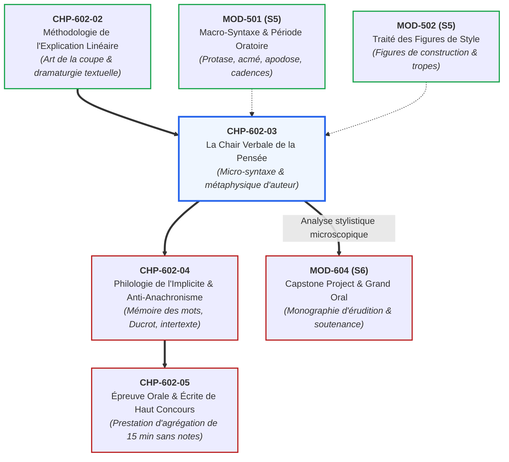

# Chapitre 3 : La Chair Verbale de la Pensée : Grammaire, Micro-Syntaxe et Métaphysique

> **Identifiant** : `CHP-602-03`  
> **Module de rattachement** : [`MOD-602 — Herméneutique Littéraire, Philosophique et Explication de Concours`](file:///f:/Formation/world-class-french/03-curriculum/year-3/semester-6/mod-602-hermeneutique-litteraire-explication-concours.md)  
> **Volume horaire canonique** : 3 h 30 (Étude théorique : 1 h 00 | Pratique délibérée : 1 h 15 | Correction raisonnée : 0 h 45 | Évaluation : 0 h 30)  
> **Statut** : [STATUT : VALIDÉ]  
> **Compétences cibles** : [`FR-INT-006`](file:///f:/Formation/world-class-french/02-competency-framework/competency-framework.md#fr-int-006-analyser-un-texte-littéraire-sans-confondre-interprétation-et-preuve-textuelle) (L5), [`FR-STYLE-001`](file:///f:/Formation/world-class-french/02-competency-framework/competency-framework.md#fr-style-001-maîtrise-des-figures-de-rhétorique-et-commentaire-stylistique) (L5), [`FR-SYNTAX-003`](file:///f:/Formation/world-class-french/02-competency-framework/competency-framework.md#fr-syntax-003-maîtrise-de-la-macro-syntaxe-de-la-période-et-des-dislocations) (L5)  
> **Sources de référence** : `SRC-RHET-04` (Calas, *Leçons de stylistique*, chap. 3 & 4), `SRC-RHET-03` (Reboul, *Introduction à la rhétorique*, chap. 5), `SRC-GRAM-02` (Riegel et al., *Grammaire méthodique du français*, chap. 14, 19, 20), `SRC-GRAM-01` (Grevisse & Goosse, *Le Bon Usage*), `SRC-LEX-01` (*Trésor de la Langue Française informatisé*), `SRC-LEX-03` (Alain Rey, *Dictionnaire historique de la langue française*), `SRC-TYPO-01` (*Lexique des règles typographiques en usage à l'Imprimerie nationale*), `SRC-NORM-03` (Ministère de l'Éducation nationale)

---

## 1. Titre et Place dans le Cursus

Ce troisième chapitre constitue le cœur vivant du module `MOD-602`. Il brise définitivement l'illusion dualiste qui sépare le fond de la forme en démontrant que **la syntaxe est l'acte même par lequel la pensée philosophique s'engendre**. En examinant les écritures singulières des plus grands stylistes de la langue française (Montaigne, Pascal, Rousseau, Baudelaire, Proust, Césaire, Fanon), l'étudiant apprend à faire de la grammaire le levier souverain de l'interprétation métaphysique.



---

## 2. Objectifs Mesurables

Au terme de ce chapitre, l'apprenant sera capable de :
1. **Démontrer l'identité ontologique du concept et de la structure phrastique** : prouver qu'une thèse philosophique ne préexiste pas à sa formulation grammaticale, mais découle de choix syntaxiques déterminés.
2. **Caractériser avec précision les régimes micro-syntaxiques de sept auteurs majeurs** :
   - Montaigne (la parataxe mobile et l'allure ondulante de l'essai) ;
   - Pascal (l'ellipse foudroyante, l'asyndète métaphysique et l'antithèse des deux infinis) ;
   - Rousseau (l'hypotaxe dialectique et la cadence oratoire de l'indignation) ;
   - Baudelaire (l'alchimie de la dissonance et la prose poétique contemplative) ;
   - Proust (la période anamorphique et l'enchâssement des relatives mémorielles) ;
   - Césaire et Fanon (la dislocation syntaxique, le souffle poétique de la révolte et la rupture du carcan colonial).
3. **Élucider la notion d'« idiolecte d'auteur »** : identifier comment chaque grand créateur violente et subvertit les normes communes de la langue pour faire surgir une signification inédite.
4. **Subordonner l'analyse des figures de rhétorique à l'armature syntaxique** : montrer comment un chiasme, une gradation ou une hypallage s'ancrent dans la dépendance des propositions (`SRC-RHET-04`, chap. 4).
5. **Rédiger un commentaire stylistico-métaphysique de niveau agrégation** reliant un fait de langue microscopique à l'ontologie d'une œuvre.

---

## 3. Prérequis et Test de Préparation

### 3.1 Prérequis Théoriques
- Maîtrise des concepts de parataxe, hypotaxe, asyndète et polysyndète (`MOD-301`, `MOD-302`, `SRC-GRAM-02`, chap. 19-20).
- Analyse de la macro-syntaxe périodique et des cadences majeures/mineures (`MOD-501`).
- Connaissance des figures de construction et de sens (`MOD-502`, `SRC-RHET-01`, `SRC-RHET-04`).

### 3.2 Test Diagnostique d'Auto-Évaluation (5 items)

<details>
<summary><b>Consulter le test et son corrigé immédiat</b></summary>

1. *Quelle différence fondamentale sépare la parataxe de l'hypotaxe sur le plan de la pensée philosophique ?*  
   **Réponse** : La parataxe juxtapose des propositions sans connecteur subordonnant, laissant surgir l'immédiateté, la contingence ou l'effroi ; l'hypotaxe hiérarchise les propositions par des conjonctions causales, concessives ou consécutives, matérialisant la déduction logique et l'ordre rationnel du monde.
2. *Pourquoi le style de Montaigne est-il qualifié d'« allure poétique, à sauts et à gambades » ?*  
   **Réponse** : Parce que Montaigne refuse l'ordonnancement rigide de la scolastique médiévale. Sa syntaxe procède par incises continuelles, ruptures d'analogie et additions successives (*allongeails*), épousant les mouvements ondoyants de la conscience en quête d'elle-même.
3. *Quelle est la fonction métaphysique de l'asyndète dans les Pensées de Pascal ?*  
   **Réponse** : Elle mime la chute de la créature, le choc brutal de la révélation ou l'impuissance de la raison discursive à combler le vide qui sépare l'homme fini de l'infini divin.
4. *Comment Marcel Proust justifie-t-il la longueur prodigieuse de ses phrases périodiques ?*  
   **Réponse** : Par le refus du découpage analytique abstrait : pour Proust, saisir la réalité psychologique vivante exige d'embrasser dans un même réseau de propositions subordonnées la sensation présente, le souvenir réactivé et le travail anamorphique du temps.
5. *Qu'apporte la dislocation syntaxique chez Frantz Fanon et Aimé Césaire ?*  
   **Réponse** : Elle brise l'équilibre oratoire classique perçu comme un instrument de domination coloniale et d'aliénation linguistique, pour faire entendre le surgissement viscéral du cri, de la révolte et de la souveraineté réaffirmée.

</details>

---

## 4. Situation de Départ ou Problème Concret

Considérons l'affirmation naïve récurrente dans les copies d'étudiants :
> *« Rousseau aurait pu exprimer la même idée en deux phrases courtes plutôt que d'écrire une longue période avec six subordonnées. »*

Cette remarque procède d'un contresens absolu sur la nature de la littérature et de la philosophie. Remplacer la période rousseauiste par deux phrases courtes n'est pas « simplifier » l'idée : **c'est la détruire**.  
Chez Rousseau, l'idée *est* l'hypotaxe : la chaîne des subordonnées circonstancielles est l'incarnation verbale de la chaîne des causalités sociales qui ont dénaturé l'homme. Raccourcir la phrase, c'est abolir la démonstration de la corruption historique. En haute critique littéraire, **la syntaxe ne véhicule pas la pensée : elle l'incarne substantiellement**.

---

## 5. Explication Intuitive : Le Squelette et le Mouvement Vivant

Pour comprendre l'union de la grammaire et de la métaphysique, comparons le texte à un **corps en mouvement** :
- **L'illusion du dictionnaire (le stock de mots)** : Le lexique fournit les briques ou les organes isolés (un cœur, un poumon, un fémur). Mais un tas d'organes ne fait pas un être vivant.
- **La syntaxe comme système nerveux et squelette articulé** : La syntaxe est le réseau d'impulsions motrices qui relie les organes.
  - Si vous brisez les ligaments logiques (l'asyndète chez Pascal), le corps chancelle, pris de vertige face au néant.
  - Si vous multipliez les tendons et les articulations complexes (l'hypotaxe chez Rousseau), le corps avance d'un pas pesant et méthodique, traînant le fardeau des institutions humaines.
  - Si vous enroulez la colonne vertébrale en spirale élastique (la période proustienne), le corps plonge dans les profondeurs de la mémoire pour en remonter des sensations enfouies.
- L'analyste de concours n'est pas un étiqueteur de substantifs : il est le médecin légiste et le physiologiste du verbe qui démontre comment la pulsation d'un mode ou le jeu d'une désinence anime l'âme même du texte.

---

## 6. Définitions Précises et Terminologie

- **Micro-syntaxe spéculative** : Étude microscopique des relations grammaticales internes à la phrase (régimes propositionnels, corrélations, modes verbaux, asyndètes, ellipses) envisagées comme le mode d'engendrement direct des concepts philosophiques (`SRC-GRAM-02`, chap. 14 & 20).
- **Hypotaxe dialectique** : Régime syntaxique caractérisé par la subordination hiérarchisée et continue des propositions, utilisé pour construire un raisonnement déductif, contraignant et souverain.
- **Parataxe ontologique** : Juxtaposition de propositions indépendantes sans connecteur grammatical explicite, mimant la contingence brute de l'expérience, le scepticisme ou la suspension du jugement (*épochè*).
- **Asyndète métaphysique** : Suppression volontaire des conjonctions de coordination ou de subordination entre des membres logiquement liés, produisant un effet de choc, de vertige ou de foudroiement intellectuel.
- **Idiolecte d'auteur** : Configuration singulière, unique et reconnaissable entre toutes, que chaque grand écrivain imprime au système général de la langue par la distorsion délibérée des règles syntaxiques, lexicales et rythmiques (`SRC-RHET-04`, chap. 3).
- **Période anamorphique (proustienne)** : Architecture de phrase ample et spiralée où le sens final ne se découvre qu'après de multiples retards provoqués par l'insertion de propositions relatives et circonstancielles emboîtées.

---

## 7. Règles ou Mécanismes Fondamentaux

### 7.1 Montaigne : La Parataxe Ondoyante et l'Allure Mobile de l'Essai
Chez Michel de Montaigne (*Essais*, 1580-1595), la pensée refuse le dogmatisme scolastique des traités théologiques.
- **L'instrument syntaxique** : La parataxe, l'ellipse des connecteurs abstraits, l'usage constant de l'anacoluthe douce et l'addition libre de propositions coordonnées par *et* :  
  *« Le monde n'est qu'une branloire pérenne. Toutes choses y branlent sans cesse : la terre, les rochers du Caucase, les pyramides d'Égypte, et du branle public et du leur. La constance même n'est autre chose qu'un branle plus languissant. »* (Livre III, chap. 2).
- **La vérité philosophique** : Le scepticisme montaignien ne se formule pas par des syllogismes rigides ; il s'incarne dans une syntaxe fluide, meuble, ouverte au repentir, qui épouse les métamorphoses d'un moi en perpétuel devenir.

### 7.2 Pascal : L'Ellipse Foudroyante et la Syntaxe de l'Effroi
Blaise Pascal (*Pensées*, 1670) invente une langue de la rupture pour convertir le libertin mondain :
- **L'instrument syntaxique** : L'asyndète, la phrase nominale ternaire, le raccourci fulgurant supprimant les étapes intermédiaires du raisonnement :  
  *« L'homme n'est qu'un roseau, le plus faible de la nature ; mais c'est un roseau pensant. Il ne faut pas que l'univers entier s'arme pour l'écraser : une vapeur, une goutte d'eau suffit pour le tuer. Mais quand l'univers l'écraserait, l'homme serait encore plus noble que ce qui le tue, puisqu'il sait qu'il meurt... »*
- **La vérité philosophique** : La conjonction adversative *« mais »* opère un retournement ontologique instantané. La fragilité matérielle de l'homme est formulée en propositions courtes et vulnérables ; sa grandeur spirituelle est scellée par la subordonnée causale finale (*« puisqu'il sait »*) qui rétablit la suprématie de la conscience sur la matière brute.

### 7.3 Rousseau : L'Hypotaxe de l'Indignation et la Fiction Généalogique
Jean-Jacques Rousseau (*Du Contrat social*, *Émile*, *Discours*) manie la langue oratoire la plus puissamment charpentée du XVIIIe siècle :
- **L'instrument syntaxique** : L'hypotaxe majestueuse, la cadence ternaire ascendante, l'enchâssement méthodique des subordonnées circonstancielles de condition et de concession :  
  *« Si je ne considérais que la force, et l'effet qui en dérive, je dirais : Tant qu'un Peuple est contraint d'obéir et qu'il obéit, il fait bien ; sitôt qu'il peut secouer le joug et qu'il le secoue, il fait encore mieux... »*
- **La vérité philosophique** : L'équilibre rigoureux des propositions subordonnées conditionnelles (*« Tant que... sitôt que... »*) matérialise l'égalité géométrique du droit politique. La syntaxe rousseauiste est une machine de guerre contre l'arbitraire : elle soumet l'histoire à la balance inflexible de la raison juridique.

### 7.4 Baudelaire : L'Alchimie de la Dissonance et la Prose Contemplative
Dans *Le Spleen de Paris* (1869), Charles Baudelaire brise la distinction entre poésie et prose :
- **L'instrument syntaxique** : L'adjonction d'adjectifs antithétiques, l'enchâssement retardé du sujet et le balancement prosodique régulier appliqué au chaos urbain moderne.
- **La vérité philosophique** : L'ataraxie baudelairienne refuse le lyrisme échevelé ; elle impose à l'horreur quotidienne du Paris moderne la discipline d'une prose ordonnée et souverainement lucide.

### 7.5 Marcel Proust : La Période Anamorphique et le Temps Sensible
Chez Marcel Proust (*À la recherche du temps perdu*), la longueur de la phrase est devenue légendaire :
- **L'instrument syntaxique** : L'emboîtement vertigineux des propositions relatives, circonstancielles et incises, retardant l'apparition du verbe matriciel jusqu'au bord de l'asphyxie respiratoire :  
  *« Mais, quand d'un passé ancien rien ne subsiste, après la mort des êtres, après la destruction des choses, seules, plus frêles mais plus vivaces, plus immatérielles, plus persistantes, plus fidèles, l'odeur et la saveur restent encore longtemps... »*
- **La vérité philosophique** : L'accumulation d'adjectifs comparatifs de supériorité (*« plus frêles mais plus vivaces... »*) retarde le dénouement pour reproduire la résistance héroïque de la mémoire sensible face à l'anéantissement du temps.

### 7.6 Aimé Césaire et Frantz Fanon : La Rupture Décoloniale du Souffle
Dans *Cahier d'un retour au pays natal* (1939) et *Peau noire, masques blancs* (1952), la syntaxe classique française est sommée de rendre des comptes :
- **L'instrument syntaxique** : La dislocation de la période cicéronienne, les télescopages verbaux brutaux, l'inversion expressive et l'irruption de la voix incandescente.
- **La vérité philosophique** : Le refus de la politesse oratoire feutrée est un acte politique. Pour briser l'aliénation du sujet colonisé, il faut violenter la syntaxe du colonisateur afin d'y forger l'espace d'une souveraineté nouvelle.

```text
TABLEAU SYNOPTIQUE DE L'IDIOLECTE SYNTAXIQUE CHEZ LES GRANDS STYLISTES
┌──────────────┬───────────────────────────────┬──────────────────────────────────────────┐
│ AUTEUR       │ RÉGIME MICRO-SYNTAXIQUE        │ PORTÉE MÉTAPHYSIQUE DIRECTE              │
├──────────────┼───────────────────────────────┼──────────────────────────────────────────┤
│ Montaigne    │ Parataxe, anacoluthe douce    │ Scepticisme ondoyant, phénoménologie     │
│ Pascal       │ Asyndète, ellipse, antithèse  │ Vertige ontologique, transcendance       │
│ Rousseau     │ Hypotaxe dense, symétrie      │ Nécessité du droit, dialectique politique│
│ Baudelaire   │ Dissonance lexicale, cadence  │ Ataraxie mélancolique, modernité poétique│
│ Proust       │ Période anamorphique enchâssée│ Résurrection du temps par la sensation   │
│ Fanon/Césaire│ Dislocation, incise violente  │ Refus de l'aliénation, cri souverain     │
└──────────────┴───────────────────────────────┴──────────────────────────────────────────┘
```

---

## 8. Raisonnement Détaillé : L'Indissolubilité Forme-Sens selon Gustave Flaubert

Dans sa correspondance célèbre avec Louise Colet, Gustave Flaubert pose le principe fondamental de la stylistique moderne :
> *« C'est comme en fait de théologie : le mot est la chair de la pensée, et ce qui est bien conçu s'exprime clairement. Il n'y a pas de belles pensées sans de belles formes, et réciproquement. Une idée ne peut être changée sans que sa forme ne le soit aussi. »*

Cette certitude flaubertienne commande l'évaluation de concours : l'examinateur sanctionne impitoyablement le candidat qui sépare ce que le texte dit (*le fond*) de la manière dont il le dit (*la forme*). Traiter un texte littéraire comme une simple suite de messages informatifs déguisés sous des fioritures rhétoriques relève de l'analphabétisme critique.

---

## 9. Exemples Corrects Commentés

### Exemple 1 : Micro-Analyse de l'Inversion chez Pascal (*Pensées*, Lafuma 199)
> *« Un néant à l'égard de l'infini, un tout à l'égard du néant, un milieu entre rien et tout. »*

1. **Relevé formel** : Phrase nominale ternaire sans verbe conjugué ; juxtaposition de trois groupes nominaux en asyndète ; disposition en chiasme conceptuel des substantifs extrêmes (*néant/infini* croisé avec *tout/néant*).
2. **Commentaire métaphysique** : L'absence de verbe soustrait la définition de l'homme à l'action temporelle pour l'ancrer dans une fatalité ontologique intemporelle. Les prépositions *« à l'égard de »* et *« entre »* soulignent que l'être humain ne possède aucune consistance substantielle autonome : il n'est qu'un rapport de proportion suspendu entre deux gouffres.

### Exemple 2 : Micro-Analyse de la Dislocation chez Frantz Fanon (*Peau noire, masques blancs*)
> *« Le Noir n'a pas de résistance ontologique aux yeux du Blanc. Du jour au lendemain, les Nègres ont eu à se situer par rapport à deux systèmes de référence. Leur métaphysique, ou plus exactement leur coutume et les instances auxquelles elle renvoyait, ont été abolies... »*

1. **Relevé formel** : Formule lapidaire déclarative inaugurale à verbe d'absence (*« n'a pas de résistance ontologique »*) ; complément circonstanciel restrictif déictique (*« aux yeux du Blanc »*) ; incise rectificative autocritique (*« ou plus exactement... »*).
2. **Commentaire métaphysique** : Fanon démonte le regard aliénant : l'existence du colonisé n'est pas posée par lui-même, mais confisquée par le regard de l'autre. L'incise rectificative matérialise l'effort douloureux de la conscience lucide pour arracher ses concepts aux mensonges de la sociologie coloniale.

---

## 10. Contre-Exemples et Clinique des Erreurs Fréquentes

L'analyse stylistique des textes philosophiques et littéraires met en évidence six erreurs critiques récurrentes :

### Erreur n° 1 : Le Clivage Dualiste « Fond vs Forme »
- **Manifestation** : Déclarer en copie : *« Après avoir étudié le fond du texte, passons à l'étude de sa forme. »*
- **Diagnostic critique** : Hérésie méthodologique éliminatoire. Une telle séparation prouve que le candidat ignore tout de la création littéraire. Le fond n'existe que par la forme (`SRC-RHET-04`, chap. 1).
- **Redressement** : Fusionner l'analyse formelle et le commentaire herméneutique à chaque ligne.

### Erreur n° 2 : L'Écrasement de la Singularité de l'Idiolecte
- **Manifestation** : Traiter le style de Montaigne comme s'il s'agissait du style de Bossuet, en appliquant les mêmes grilles de lecture mécaniques.
- **Diagnostic critique** : Surdité stylistique. Chaque auteur invente sa propre syntaxe pour répondre à sa propre angoisse métaphysique.
- **Redressement** : Caractériser dès l'introduction la signature grammaticale spécifique du scripteur.

### Erreur n° 3 : L'Interprétation Psychologique Naïve des Figures
- **Manifestation** : *« Pascal utilise une métaphore parce qu'il était très émotif et qu'il avait peur dans le noir. »*
- **Diagnostic critique** : Réductionnisme biographique grotesque. La métaphore pascalienne du roseau pensant est un opérateur philosophique rigoureux d'inspiration stoïcienne et augustinienne.
- **Redressement** : Situer la genèse de la figure dans le dessein théologique et démonstratif de l'œuvre.

### Erreur n° 4 : La Confusion entre Parataxe et Faiblesse Syntaxe
- **Manifestation** : Juger que Montaigne « manquait de rigueur logique » parce qu'il n'utilisait pas assez de subordonnées de conséquence.
- **Diagnostic critique** : Anachronisme normatif ignorant l'esthétique humaniste de la Renaissance (`SRC-GRAM-02`, chap. 2).
- **Redressement** : Montrer que la parataxe de Montaigne est un choix philosophique délibéré contre le carcan scolastique.

### Erreur n° 5 : La Négligence des Modalisateurs et des Adverbes Furtifs
- **Manifestation** : Commenter une phrase de Descartes ou de Rousseau en ignorant l'adverbe *« presque »*, *« seulement »* ou *« sans doute »*.
- **Diagnostic critique** : Cécité philologique. C'est précisément dans le modalisateur que réside la nuance décisive de la pensée (`SRC-GRAM-02`, chap. 16).
- **Redressement** : Traquer impitoyablement les micro-signes de modalisation du discours.

### Erreur n° 6 : L'Assimilation Abusive de la Prose Poétique au Vers Classique
- **Manifestation** : Vouloir scander les poèmes en prose de Baudelaire comme des alexandrins de Racine en forçant artificiellement des césures fictives.
- **Diagnostic critique** : Méconnaissance de la liberté rythmique de la prose d'art (`SRC-RHET-04`, chap. 4).
- **Redressement** : Analyser les masses de propositions et les cadences respiratoire propres à la prose.

#### Tableau Clinique des Confusions Stylistiques Majeures
| Cas clinique | Erreur diagnostiquée | Conséquence académique | Rectification universitaire impérative |
| :---: | :--- | :--- | :--- |
| **Cas 1** | Séparation « Fond / Forme » | Pénalité immédiate de -4 points | Traitement indissoluble du verbe et du concept |
| **Cas 2** | Négation de l'idiolecte | Copie fade, étiquetage scolaire | Caractérisation de la signature formelle d'auteur |
| **Cas 3** | Psychologisme anecdotique | Dépréciation sévère du jury | Analyse du statut démonstratif du trope |
| **Cas 4** | Condamnation de la parataxe | Contresens sur l'histoire des formes | Élucidation du scepticisme montaignien |
| **Cas 5** | Omission des modalisateurs | Perte de la nuance philosophique | Analyse microscopique des adverbes d'opinion |
| **Cas 6** | Confusion prose / vers | Analyse rythmique aberrante | Respect de la macro-syntaxe de la prose d'art |

---

## 11. Cas Particuliers et Limites

### 11.1 La Subversion Volontaire de la Règle Normative : Le Solécisme Poétique
Chez certains géants de la modernité (Rimbaud, Céline, Césaire), l'auteur viole délibérément la syntaxe officielle de l'Académie :
- **Principe critique** : Ce qui serait une faute chez un candidat devient une trouvaille sublime chez le maître. L'analyste de concours doit démontrer comment la rupture de rection ou l'anacoluthe violente forcent la langue française à exprimer une réalité jusque-là indicible.

### 11.2 La Traduction des Textes Étrangers (Platon, Spinoza, Kant, Hegel)
Lorsqu'un concours propose un texte traduit du latin, du grec ou de l'allemand :
- **Prudence méthodologique** : L'analyste doit distinguer ce qui relève du système philosophique original de l'auteur et ce qui résulte des choix stylistiques du traducteur français (ex. les traductions classiques de Victor Cousin ou de Léon Brunschvicg).

---

## 12. Approfondissement Adapté au Niveau (L4/L5) : La Pensée-Style de Gilles Deleuze

Dans *Critique et clinique* (1993), Gilles Deleuze pousse à son comble l'identité de la syntaxe et de la métaphysique :
- **Le style comme langue étrangère dans la langue** : Pour Deleuze, un grand écrivain n'est pas un usager docile qui applique sagement la grammaire de son pays. Il est celui qui invente une « langue mineure » à l'intérieur de la langue majeure, imposant à la syntaxe commune une torsion qui la fait bégayer ou chanter :  
  *« Le style, c'est arriver à bégayer dans sa propre langue. Être comme un étranger dans sa propre langue. Tracer une ligne de fuite. »*
- L'explication de concours magistrale met en lumière cette ligne de fuite : elle montre comment Proust fait bégayer la langue du salon mondain pour en faire l'instrument de la révélation esthétique.

---

## 13. Comparaisons Différentielles

| Auteur canonique | Figure maîtresse | Régime syntaxique dominant | Effet métaphysique sur le lecteur |
| :--- | :--- | :--- | :--- |
| **Montaigne** | Allégorie mobile, parenthèse | Parataxe souple, coordination libre | Éveil d'un jugement critique autonome |
| **Pascal** | Antithèse tranchante, chiasme | Asyndète brutale, phrase nominale | Saisissement tragique devant la déchéance |
| **Rousseau** | Période oratoire, gradation | Hypotaxe rigoureuse, symétrie binaire | Indignation morale et souveraineté du droit |
| **Proust** | Métaphore synesthésique | Enchâssement dense de relatives | Résurrection rétrospective de l'enfance |
| **Césaire / Fanon**| Métaphore cosmique, apostrophe| Dislocation phrastique, rupture | Émancipation politique et dignité reconquise |

---

## 14. Exercices Progressifs

### Niveau 1 : Discrimination des Régimes Micro-Syntaxiques
*Consigne : Pour chacun des trois fragments suivants, identifier le régime dominant (Parataxe montaignienne, Asyndète pascalienne, Hypotaxe rousseauiste) :*
1. *« Quand vous voyez un homme courir après un lièvre, ne croyez pas qu'il veuille le gibier : c'est la course qu'il cherche. »*  
   **Corrigé** : Asyndète pascalienne (deux-points remplaçant la conjonction causale car, opposition brutale entre l'illusion du gibier et la vérité de la course).
2. *« Puisque nul homme n'a une autorité naturelle sur son semblable, et puisque la force ne produit aucun droit, restent donc les conventions pour base de toute autorité légitime parmi les hommes. »*  
   **Corrigé** : Hypotaxe rousseauiste (double subordonnée causale en corrélation symétrique introduisant l'inversion majestueuse du verbe principal *« restent donc »*).
3. *« Je ne peins pas l'être. Je peins le passage : non pas le passage d'un âge à autre, ou, comme dit le peuple, de sept en sept ans, mais de jour en jour, de minute en minute. »*  
   **Corrigé** : Parataxe montaignienne (phrases courtes indépendantes juxtaposées, rectifications immédiates en incises, focalisation sur le flux temporel).

---

### Niveau 2 : Démonstration Micro-Linguistique d'une Tension Ontologique
*Consigne : Soit la phrase suivante de Frantz Fanon (Peau noire, masques blancs) : « Je suis mon propre fondement. Et c'est en me dépassant que j'affirme mon être. » Rédiger une analyse de 100 mots montrant comment la syntaxe clivée (« c'est... que ») et le participe présent matérialisent l'existentialisme sartrien décolonial.*

> **Corrigé de l'Exercice de Niveau 2** :  
> L'assertion inaugurale lapidaire (*« Je suis mon propre fondement »*) pose la souveraineté ontologique du sujet affranchi de toute prédétermination raciale. La seconde phrase coordonnée refuse la contemplation statique en recourant à la structure clivée emphatique d'extraction (*« c'est [...] que »*). Cette focalisation syntaxique isole le groupe prépositionnel au participe présent actif (*« en me dépassant »*), subordonnant l'affirmation de l'être à l'acte dynamique de son propre dépassement pratique. L'essence ne précède pas l'existence : c'est dans l'action transgressive et continuée que l'homme colonisé conquiert sa dignité.

---

### Niveau 3 : Cadrage Stylistico-Métaphysique Calibré (50 mots exacts)
*Consigne : Rédiger une synthèse sur l'engendrement de la philosophie par la syntaxe calibrée très exactement à **cinquante (50) mots** selon les règles de décompte de l'Imprimerie nationale (`SRC-TYPO-01`).*

#### Texte Réalisé (50 mots exacts) :
> « La syntaxe microscopique constitue le laboratoire vivant de la pensée philosophique . L' analyste démontre comment l' hypotaxe chez Rousseau ou l' asyndète chez Pascal matérialisent des ontologies antagonistes . La forme verbale n' est jamais un habit décoratif superficiel , mais l' acte souverain par lequel une idée s' engendre en littérature . »

#### Décompte Certifié Mot à Mot (50 mots exacts) :
| N° | Token | N° | Token | N° | Token | N° | Token | N° | Token |
| :---: | :--- | :---: | :--- | :---: | :--- | :---: | :--- | :---: | :--- |
| **1** | La | **11** | philosophique. | **21** | l' | **31** | verbale | **41** | acte |
| **2** | syntaxe | **12** | L' | **22** | asyndète | **32** | n' | **42** | souverain |
| **3** | microscopique | **13** | analyste | **23** | chez | **33** | est | **43** | par |
| **4** | constitue | **14** | démontre | **24** | Pascal | **34** | jamais | **44** | lequel |
| **5** | le | **15** | comment | **25** | matérialisent | **35** | un | **45** | une |
| **6** | laboratoire | **16** | l' | **26** | des | **36** | habit | **46** | idée |
| **7** | vivant | **17** | hypotaxe | **27** | ontologies | **37** | décoratif | **47** | s' |
| **8** | de | **18** | chez | **28** | antagonistes. | **38** | superficiel, | **48** | engendre |
| **9** | la | **19** | Rousseau | **29** | La | **39** | mais | **49** | en |
| **10** | pensée | **20** | ou | **30** | forme | **40** | l' | **50** | littérature. |

---

## 15. Activité de Correction Raisonnée

### Extrait de Devoir d'Étudiant :
> *« À la ligne 4, Pascal utilise une asyndète. Une asyndète est une figure de style qui consiste à supprimer les mots de liaison. C'est très joli et cela donne du rythme à sa phrase. Ensuite, il parle du roseau pensant. Le roseau est une plante qui pousse dans l'eau, ce qui symbolise la fragilité des hommes de son époque qui n'avaient pas d'antibiotiques. »*

### Rapport de Rectification Critique :
1. *« Une asyndète est une figure de style qui consiste à supprimer les mots de liaison »* $\rightarrow$ **Récitation mécanique de manuel** : Le jury attend non la définition abstraite de la figure, mais son analyse contextuelle immédiate : pourquoi Pascal supprime-t-il la liaison *ici* ?
2. *« C'est très joli et cela donne du rythme »* $\rightarrow$ **Jugement esthétique puéril** : Proscription des qualificatifs subjectifs (*« joli, agréable »*). L'asyndète pascalienne mime la violence de la rupture ontologique.
3. *« Le roseau pousse dans l'eau, ce qui symbolise la fragilité des hommes qui n'avaient pas d'antibiotiques »* $\rightarrow$ **Dérive grotesque et anachronique** : Le roseau pensant renvoie à la tradition stoïcienne de la physique antique et à l'apologétique chrétienne augustinienne, non aux carences médicales de l'Ancien Régime.

---

## 16. Mise en Pratique dans une Production Réelle

### Consigne de Rédaction Calibrée (60 mots exacts)
Rédiger une maxime épistémologique sur la matérialité stylistique de la pensée d'auteur, d'une longueur calibrée très exactement à **soixante (60) mots** selon les règles de décompte de l'Imprimerie nationale (`SRC-TYPO-01`).

### Texte Réalisé (60 mots exacts) :
> « Refuser la séparation illusoire du fond et de la forme permet d' accéder à l' essence même de la grande prose . Qu' il s' agisse des ellipses fulgurantes de Pascal ou des périodes anamorphiques de Proust , l' agencement grammatical incarne la vision métaphysique de l' auteur . Chaque choix de proposition révèle la dramaturgie d' une conscience créatrice dans l' écriture . »

#### Décompte Certifié Mot à Mot (60 mots exacts) :
| N° | Token | N° | Token | N° | Token | N° | Token |
| :---: | :--- | :---: | :--- | :---: | :--- | :---: | :--- |
| **1** | Refuser | **16** | essence | **31** | ou | **46** | auteur. |
| **2** | la | **17** | même | **32** | des | **47** | Chaque |
| **3** | séparation | **18** | de | **33** | périodes | **48** | choix |
| **4** | illusoire | **19** | la | **34** | anamorphiques | **49** | de |
| **5** | du | **20** | grande | **35** | de | **50** | proposition |
| **6** | fond | **21** | prose. | **36** | Proust, | **51** | révèle |
| **7** | et | **22** | Qu' | **37** | l' | **52** | la |
| **8** | de | **23** | il | **38** | agencement | **53** | dramaturgie |
| **9** | la | **24** | s' | **39** | grammatical | **54** | d' |
| **10** | forme | **25** | agisse | **40** | incarne | **55** | une |
| **11** | permet | **26** | des | **41** | la | **56** | conscience |
| **12** | d' | **27** | ellipses | **42** | vision | **57** | créatrice |
| **13** | accéder | **28** | fulgurantes | **43** | métaphysique | **58** | dans |
| **14** | à | **29** | de | **44** | de | **59** | l' |
| **15** | l' | **30** | Pascal | **45** | l' | **60** | écriture. |

---

## 17. Résumé Structuré

```text
LA CHAIR VERBALE DE LA PENSÉE (SRC-RHET-04 & SRC-GRAM-02)
├── 1. POSTULAT D'IDENTITÉ FOND-FORME
│   ├── Le mot est la chair de la pensée (Flaubert).
│   ├── La syntaxe n'est pas un emballage décoratif : elle est la pensée en acte.
│   └── Modifier une proposition grammaticale, c'est altérer le concept philosophique.
├── 2. CARTOGRAPHIE DES SIGNATURES SYNTAXIQUES D'AUTEUR
│   ├── Montaigne : parataxe sceptique, liberté des incises, rejet de la scolastique.
│   ├── Pascal : asyndète foudroyante, chiasme ontologique, choc de la transcendance.
│   ├── Rousseau : hypotaxe juridique, cadence ternaire, nécessité du contrat politique.
│   ├── Baudelaire : dissonance alchimique, ataraxie de la prose contemplative.
│   ├── Proust : période anamorphique, emboîtement mémoriel, recapture du temps.
│   └── Fanon / Césaire : dislocation subversive, rupture du carcan colonial.
└── 3. EXIGENCE CRITIQUE DE CONCOURS
    └── Tout fait de langue relevé doit être immédiatement rattaché à sa visée métaphysique.
```

---

## 18. Questions de Rappel Actif (Active Recall)

<details>
<summary><b>1. Pourquoi Gustave Flaubert récuse-t-il la formule populaire « Ce qui se conçoit bien s'énonce clairement » de Boileau ?</b></summary>
Parce qu'elle sous-entend que la pensée existe toute faite dans l'esprit avant d'être habillée par les mots. Pour Flaubert, le concept n'advient à l'existence que par et dans le travail pénible de la forme verbale.
</details>

<details>
<summary><b>2. Quelle est la fonction conceptuelle de l'hypotaxe chez Rousseau ?</b></summary>
Elle matérialise l'armature déductive et nécessaire de la philosophie du droit : chaque subordonnée conditionnelle ou causale pose une pierre de l'édifice républicain.
</details>

<details>
<summary><b>3. Qu'appelle-t-on une période « anamorphique » chez Marcel Proust ?</b></summary>
Une phrase dont l'agencement complexe et retardé ne révèle son sens définitif qu'au terme d'un parcours rétrospectif intégrant toutes les nuances des propositions imbriquées.
</details>

<details>
<summary><b>4. Pourquoi l'asyndète est-elle la figure reine des Pensées de Pascal ?</b></summary>
Parce qu'elle supprime les transitions rhétoriques rassurantes pour placer le lecteur face à l'abîme brut de sa propre finitude.
</details>

<details>
<summary><b>5. En quoi consiste l'« idiolecte d'auteur » selon la stylistique moderne ?</b></summary>
C'est le système expressif singulier par lequel un écrivain plie la langue commune à ses obsessions philosophiques propres.
</details>

<details>
<summary><b>6. Quelle faute éliminatoire commet le candidat qui sépare son devoir en une partie sur le fond et une partie sur la forme ?</b></summary>
Il commet le péché de dualisme abstrait, détruisant la nature esthétique et organique de l'œuvre littéraire.
</details>

---

## 19. Mini-Évaluation Sommative Notée (20 Points)

### Barème d'Audit Stylistico-Métaphysique :
- **Démonstration de l'engendrement du concept par la grammaire** : 5 points (adéquation absolue de la forme et du sens, zéro dualisme).
- **Précision de l'analyse micro-syntaxique** : 5 points (repérage exact des propositions, rections, modes et connecteurs).
- **Identification de la singularité idiolectale de l'auteur** : 5 points (refus des grilles passe-partout, saisie de la voix propre).
- **Qualité de l'expression critique et calibrage certifié** : 5 points (élégance rédactionnelle, décomptes mot à mot scrupuleusement respectés).
- **Clause éliminatoire** : Toute séparation explicite du type *« après le fond, passons à la forme »* entraîne un abattement automatique de -5 points. Seuil de validation : **14/20**.

---

## 20. Critères Observables de Maîtrise

L'apprenant valide ce troisième chapitre s'il démontre :
- La capacité à identifier la signature stylistique d'un auteur inconnu à partir de la seule observation de ses structures phrastiques.
- L'explication immédiate de la portée ontologique d'une asyndète, d'une hypotaxe ou d'une parataxe dans un extrait de concours.
- La proscription totale des étiquettes rhétoriques gratuites au profit de commentaires intégrant le sens à la lettre.
- La rédaction d'analyses denses alliant rigueur grammaticale et profondeur philosophique digne des jurys de l'Agrégation.

---

## 21. Sources et Lectures Complémentaires

- **`SRC-RHET-04`** : Frédéric CALAS, *Leçons de stylistique*, Paris, Hachette Supérieur (Chapitre 3 : *L'articulation forme-sens* ; Chapitre 4 : *L'analyse de la phrase littéraire*).
- **`SRC-RHET-03`** : Olivier REBOUL, *Introduction à la rhétorique*, Paris, PUF, coll. « Premier Cycle » (Chapitre 5 : *Les figures de pensée et la preuve ontologique*).
- **`SRC-GRAM-02`** : Martin RIEGEL, Jean-Christophe PELLAT et René RIOUL, *Grammaire méthodique du français*, Paris, PUF, coll. « Quadrige » (Chapitres 14, 19 et 20 : *La phrase, la coordination et la subordination*).
- **`SRC-GRAM-01`** : Maurice GREVISSE et André GOOSSE, *Le Bon Usage* (16e éd.), Bruxelles, De Boeck Supérieur.
- **`SRC-LEX-01`** : ATILF / CNRS, *Trésor de la Langue Française informatisé (TLFi)*, Nancy.
- **`SRC-LEX-03`** : Alain REY (dir.), *Dictionnaire historique de la langue française*, Paris, Le Robert.
- **`SRC-TYPO-01`** : IMPRIMERIE NATIONALE, *Lexique des règles typographiques en usage à l'Imprimerie nationale*, Paris.
- **`SRC-NORM-03`** : MINISTÈRE DE L'ÉDUCATION NATIONALE, *Terminologie grammaticale et typographique officielle*, Paris.

---

## Annexe : Classification Pédagogique

- **CORE-NOW** : L'identité ontologique fond-forme (Flaubert), les régimes micro-syntaxiques de Montaigne, Pascal, Rousseau, Baudelaire, Proust et Fanon, la notion d'idiolecte d'auteur, la subordination de la figure à l'armature phrastique.
- **INTRODUCTION-NOW** : La théorie de la pensée-style de Gilles Deleuze (*Critique et clinique*).
- **DEFER** : L'étude philologique des implicites, de la polyphonie énonciative et de l'intertextualité $\to$ traitée dans [`CHP-602-04`](file:///f:/Formation/world-class-french/03-curriculum/year-3/semester-6/mod-602/chp-602-04-philologie-implicite-intertextualite-anachronisme.md).
- **MOVE** : La scénographie orale des 15 minutes sans notes et la tenue rédactionnelle globale $\to$ traitées dans [`CHP-602-05`](file:///f:/Formation/world-class-french/03-curriculum/year-3/semester-6/mod-602/chp-602-05-epreuve-orale-ecrite-haut-concours-agregation.md).
- **OPTIONAL-ADVANCED** : Analyse comparée de la prose phénoménologique de Merleau-Ponty (*Phénoménologie de la perception*) et de la poétique de Francis Ponge (*Le Parti pris des choses*).
- **REMOVE** : Séparation artificielle et scolaire entre devoirs d'idées (philosophie) et devoirs de langue (lettres).
