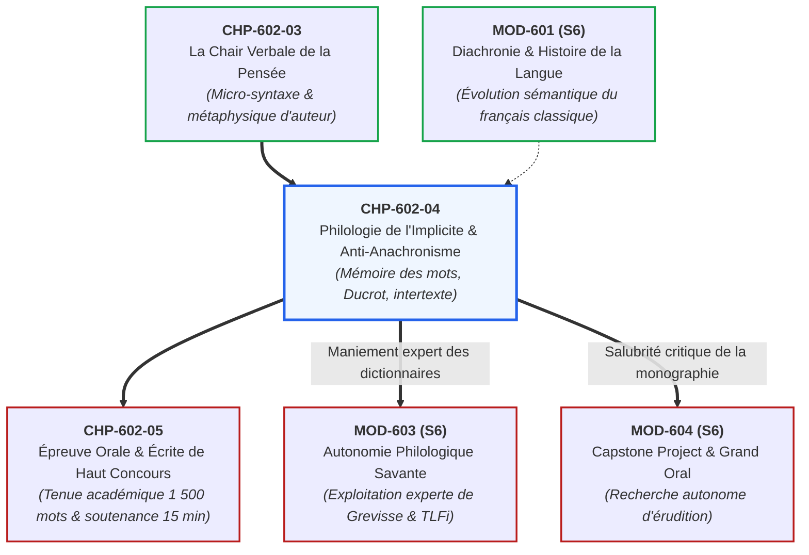

# Chapitre 4 : Philologie de l'Implicite, Intertextualité et Combat contre l'Anachronisme

> **Identifiant** : `CHP-602-04`  
> **Module de rattachement** : [`MOD-602 — Herméneutique Littéraire, Philosophique et Explication de Concours`](file:///f:/Formation/world-class-french/03-curriculum/year-3/semester-6/mod-602-hermeneutique-litteraire-explication-concours.md)  
> **Volume horaire canonique** : 3 h 30 (Étude théorique : 1 h 00 | Pratique délibérée : 1 h 15 | Correction raisonnée : 0 h 45 | Évaluation : 0 h 30)  
> **Statut** : [STATUT : VALIDÉ]  
> **Compétences cibles** : [`FR-PHILOL-001`](file:///f:/Formation/world-class-french/02-competency-framework/competency-framework.md#fr-philol-001-autonomie-philologique-et-consultation-experte-des-sources) (L5), [`FR-INT-006`](file:///f:/Formation/world-class-french/02-competency-framework/competency-framework.md#fr-int-006-analyser-un-texte-littéraire-sans-confondre-interprétation-et-preuve-textuelle) (L5), [`FR-LEXIC-001`](file:///f:/Formation/world-class-french/02-competency-framework/competency-framework.md#fr-lexic-001-précision-sémantique-nuances-synonymiques-et-collocations) (L5)  
> **Sources de référence** : `SRC-RHET-04` (Calas, *Leçons de stylistique*, chap. 1), `SRC-GRAM-02` (Riegel et al., *Grammaire méthodique du français*, chap. 16), `SRC-LEX-01` (*Trésor de la Langue Française informatisé*), `SRC-LEX-03` (Alain Rey, *Dictionnaire historique de la langue française*), `SRC-RHET-03` (Reboul, *Introduction à la rhétorique*, chap. 2 & 5), `SRC-GRAM-01` (Grevisse & Goosse, *Le Bon Usage*), `SRC-TYPO-01` (*Lexique des règles typographiques en usage à l'Imprimerie nationale*), `SRC-NORM-03` (Ministère de l'Éducation nationale)

---

## 1. Titre et Place dans le Cursus

Ce quatrième chapitre du module `MOD-602` érige le rempart philologique indispensable contre la plus pernicieuse des fautes académiques : **l'anachronisme interprétatif et le contresens historique**. Après avoir établi l'union indissoluble de la grammaire et de la métaphysique (`CHP-602-03`), l'étudiant apprend à restituer la mémoire sémantique des mots d'Ancien Régime (`SRC-LEX-01`, `SRC-LEX-03`), à traquer les résonances bibliques et antiques cachées, et à décoder la polyphonie énonciative des textes soumis à la censure (`SRC-GRAM-02`).



---

## 2. Objectifs Mesurables

Au terme de ce chapitre, l'apprenant sera capable de :
1. **Éradiquer tout anachronisme idéologique et conceptuel** : appliquer rigoureusement le *principe de charité herméneutique* en interdisant toute projection rétrospective des catégories politiques, sociologiques ou morales du XXIe siècle sur les textes des siècles passés.
2. **Restituer la mémoire sémantique des faux amis diachroniques majeurs** : discriminer instantanément le sens classique (XVIIe-XVIIIe s.) et le sens moderne de dix vocables capitaux (*honnête homme, divertissement, pitié, nature, liberté, sauvage, intérêt, amant, commerce, généreux*) en mobilisant le *TLFi* (`SRC-LEX-01`) et le dictionnaire d'Alain Rey (`SRC-LEX-03`).
3. **Cartographier la trame intertextuelle savante** : identifier les allusions directes et voilées aux corpus bibliques (Genèse, Évangiles, Psaumes, Ecclésiaste), patristiques (saint Augustin) et antiques (Cicéron, Sénèque, Plutarque, Virgile).
4. **Appliquer la théorie de la polyphonie énonciative d'Oswald Ducrot** : distinguer l'énonciateur, le locuteur et la voix de l'adversaire fictif cloué au pilori dans les textes ironiques des Lumières (`SRC-GRAM-02`, chap. 16).
5. **Démêler les présupposés des sous-entendus** : analyser le pacte de connivence tacite liant l'écrivain d'élite à son lectorat cultivé.

---

## 3. Prérequis et Test de Préparation

### 3.1 Prérequis Théoriques
- Histoire de la langue française classique et des réformes du vocabulaire au Grand Siècle (`MOD-601`, `CHP-601-04`).
- Théorie linguistique de l'énonciation et des voix narratives (`MOD-401`, `SRC-GRAM-02`, chap. 16).
- Méthodologie du cercle herméneutique et de l'explication continue (`CHP-602-01`, `CHP-602-02`).

### 3.2 Test Diagnostique d'Auto-Évaluation (5 items)

<details>
<summary><b>Consulter le test et son corrigé immédiat</b></summary>

1. *Que signifie l'expression « honnête homme » chez les moralistes du XVIIe siècle (La Rochefoucauld, La Bruyère, Méré) ?*  
   **Réponse** : Elle ne désigne nullement une personne scrupuleusement probe au sens pénal moderne, mais l'idéal aristocratique de l'homme de cour : courtois, cultivé sans pédanterie, agréable en société, modéré dans ses passions et maître de ses émotions.
2. *Qu'est-ce qu'un « faux ami diachronique » ? Donnez un exemple.*  
   **Réponse** : Un mot dont la forme graphique est restée identique en français moderne mais dont la valeur sémantique profonde s'est radicalement déplacée au fil des siècles. Exemple : *divertissement* chez Pascal (action tragique de se détourner de la pensée de la mort, et non loisir récréatif).
3. *Quelle est la définition linguistique du « présupposé » selon Oswald Ducrot ?*  
   **Réponse** : Une information implicite inscrite de manière indélébile dans la structure linguistique même de l'énoncé, qui résiste à la négation et à l'interrogation (ex. *« Pierre a cessé de fumer »* présuppose que Pierre fumait auparavant).
4. *Pourquoi l'anachronisme est-il qualifié de « péché impardonnable » par l'historien Lucien Febvre ?*  
   **Réponse** : Parce qu'il consiste à attribuer aux hommes du passé des idées, des outillages mentaux ou des sensibilités qui étaient historiquement impossibles à leur époque, détruisant la vérité même de l'histoire.
5. *Qu'est-ce que l'intertextualité savante dans la littérature classique ?*  
   **Réponse** : Le tissage délibéré d'échos, de réminiscences et d'emprunts aux autorités antiques (grecques et latines) et bibliques, que l'auteur intègre à sa prose pour conférer à son propos une caution de dignité universelle.

</details>

---

## 4. Situation de Départ ou Problème Concret

Considérons cette perle relevée dans une copie de concours commentant les *Pensées* de Pascal :
> *« En disant que l'homme cherche le divertissement, Pascal dénonce la société de consommation capitaliste et l'abrutissement des masses par l'industrie des loisirs et les écrans. »*

Cette phrase accumule une triple monstruosité philologique :
1. **L'anachronisme conceptuel** : La « société de consommation » et le « capitalisme » sont des concepts forgés aux XIXe et XXe siècles, rigoureusement impensables dans le cadre théologique et monarchique de 1660.
2. **Le contresens sémantique** : Le terme *divertissement* (*divertere*) désigne l'acte métaphysique de fuite hors de soi pour ne pas voir le gouffre de la mort, et non l'industrie des parcs d'attractions ou du spectacle.
3. **Le plaquage idéologique** : L'étudiant substitue ses indignations militantes contemporaines à l'apologétique chrétienne janséniste de Pascal.

La note attribuée par le jury à un tel devoir s'effondre immédiatement en dessous de **06/20**.

---

## 5. Explication Intuitive : Le Palimpseste et la Monnaie Antique

Comprendre un texte d'Ancien Régime ressemble au déchiffrement d'une **pièce de monnaie ancienne** ou d'un **palimpseste médiéval** :
- **L'illusion de la pièce contemporaine** : Un touriste distrait trouve une pièce enfouie dans le sol. Elle est ronde et en métal : il croit pouvoir acheter du pain avec dans une boulangerie moderne. Or, cette pièce n'a plus cours dans le circuit actuel : sa valeur dépend de son poids en argent et de l'effigie du roi qui l'a frappée.
- **La mémoire sémantique** : Les mots d'un texte classique sont des pièces frappées sous Louis XIV ou sous les Lumières. Le mot *« pitié »* chez Rousseau ne signifie pas un mépris condescendant, mais l'inclination naturelle et universelle qui nous fait souffrir de voir souffrir tout être sensible.
- **Le palimpseste sous-jacent** : Sous la ligne de Bossuet ou de Racine, il y a toujours un texte biblique ou virgilien gratté. L'œil exercé du philologue allume la lampe à ultraviolets pour faire réapparaître l'écriture antique sous l'encre classique.

---

## 6. Définitions Précises et Terminologie

- **Anachronisme herméneutique** : Erreur méthodologique capitale consistant à interpréter une œuvre du passé en lui appliquant rétrospectivement les grilles conceptuelles, les normes morales ou les catégories politiques d'une époque ultérieure (`SRC-RHET-04`, chap. 1).
- **Principe de charité herméneutique** : Règle déontologique selon laquelle l'interprète doit supposer, jusqu'à preuve du contraire, que l'auteur historique était un penseur rigoureux, cohérent et intelligent, dont les énoncés doivent être compris dans le cadre des possibilités intellectuelles de son temps.
- **Mémoire sémantique des lexèmes** : Ensemble des strates de significations historiques qu'un mot a accumulées ou perdues au cours de son évolution diachronique (`SRC-LEX-03`).
- **Faux ami diachronique** : Vocable dont le signifiant graphique n'a pas varié entre l'âge classique et l'époque contemporaine, mais dont le signifié a subi une mutation sémantique radicale, risquant d'induire le lecteur moderne en erreur (`SRC-LEX-01`).
- **Intertextualité savante (Gérard Genette)** : Présence effective d'un texte dans un autre sous forme de citation explicite, de réminiscence allusive ou d'écho parodique.
- **Polyphonie énonciative (Oswald Ducrot)** : Conception linguistique selon laquelle un même énoncé peut faire entendre simultanément plusieurs voix ou points de vue distincts (*énonciateurs*), dont le locuteur principal peut se distancier par l'ironie ou la réfutation (`SRC-GRAM-02`, chap. 16).
- **Présupposé vs Sous-entendu** : Le *présupposé* est une condition de vérité inscrite dans le code linguistique (*« Pierre sait que Paul est parti »* présuppose que Paul est parti) ; le *sous-entendu* est une suggestion pragmatique dépendante du contexte d'énonciation (*« Il fait froid ici »* sous-entend : *« fermez la fenêtre »*).

---

## 7. Règles ou Mécanismes Fondamentaux

### 7.1 Le Grand Répertoire des Dix Faux Amis Diachroniques Majeurs
Pour réussir une explication de haut concours portant sur les XVIIe et XVIIIe siècles, l'étudiant doit maîtriser l'évolution sémantique des vocables pivots (`SRC-LEX-01`, `SRC-LEX-03`) :

| Vocable classique | Sens erroné moderne (piège) | Sens exact d'Ancien Régime (XVIIe - XVIIIe s.) | Référence source |
| :--- | :--- | :--- | :--- |
| **Honnête homme** | Individu loyal et scrupuleusement intègre | Idéal aristocratique d'homme de cour poli, cultivé sans pédanterie, agréable et mesuré | `SRC-LEX-03`, Rey |
| **Divertissement** | Activité récréative, spectacle, jeu ludique | Action tragique de se détourner de l'angoisse de la mort (*divertere*) | `SRC-LEX-01`, TLFi |
| **Sauvage** | Barbre, féroce, violent, sanguinaire | Qui vit à l'état de nature, libre des artifices urbains (chez Rousseau : innocent) | `SRC-LEX-03`, Rey |
| **Pitié** | Condescendance méprisante envers un faible | Mouvement affectif universel d'identification à la douleur d'autrui | `SRC-LEX-03`, Rey |
| **Généreux** | Qui donne beaucoup d'argent ou de biens | De noble race (*generosus*) ; qui a de la grandeur d'âme et de la bravoure | `SRC-LEX-01`, TLFi |
| **Intérêt** | Rendement financier ou égoïsme matériel | Passion motrice générale, ce qui importe à l'homme (amour-propre ou gloire) | `SRC-LEX-03`, Rey |
| **Commerce** | Négoce marchand et transactions de capitaux | Fréquentation sociale, échange intime de conversation mondaine ou amoureuse | `SRC-LEX-01`, TLFi |
| **Amant** | Partenaire sexuel dans une relation libre | Homme noble qui aime passionnément et sert une dame avec dévotion courtoise | `SRC-LEX-03`, Rey |
| **Nature** | Paysage champêtre, écologie, verdure | Essence d'un être, ordre cosmique universel voulu par Dieu ou la raison | `SRC-LEX-01`, TLFi |
| **Raison** | Faculté mathématique calculatrice | Harmonie spirituelle, bon sens universel ordonné au souverain bien | `SRC-LEX-03`, Rey |

### 7.2 La Trame de l'Intertextualité Savante : Antiques et Écritures Saintes
Au Grand Siècle et aux Lumières, nul n'écrit sur une page blanche :
1. **Le substrat biblique omniprésent** :
   - Quand Bossuet prononce une oraison funèbre, chaque phrase fait écho à l'*Ecclésiaste* (*« Vanité des vanités, et tout est vanité »*), au *Livre de Job* (la pourriture du tombeau) ou à saint Paul (la résurrection).
   - Ignorer ces références transforme l'explication en bavardage profane aveugle.
2. **Le modèle antique classique** :
   - Racine écrit le vers français à travers la métrique de Virgile et le théâtre d'Euripide.
   - Pascal et Rousseau pensent en dialogue permanent avec les stoïciens (Épictète, Marc Aurèle, Sénèque) et les sceptiques (Sextus Empiricus, Montaigne).
3. **L'exigence de concours** : L'analyste doit identifier l'allusion intertextuelle, citer la source matricielle et montrer comment l'auteur français moderne réinvestit, déplace ou subvertit l'autorité antique.

### 7.3 Polyphonie Énonciative et Dialogisme sous Censure (Oswald Ducrot)
Au XVIIIe siècle, la censure royale veille. Pour propager leurs idées séditieuses, Montesquieu, Voltaire et Diderot pratiquent le dédoublement des voix énonciatives (`SRC-GRAM-02`, chap. 16) :
- **Le locuteur en titre ($L$)** : Celui qui assume matériellement l'énoncé.
- **L'énonciateur fictif ($E_1$)** : La voix du dogmatique, du fanatique ou du tyran, prise en charge au discours indirect libre ou sous le masque de l'ironie.
- **L'énonciateur critique ($E_2$)** : La voix rationnelle des Lumières, qui ridiculise $E_1$ en poussant son raisonnement jusqu'à l'absurde (ex. dans *Candide* ou *De l'esprit des lois*).
- **Le piège fatal** : Prendre $E_1$ pour la pensée personnelle de l'auteur. Le candidat qui écrit : *« Montesquieu pense que les Noirs n'ont pas d'âme »* est immédiatement éliminé du concours.

```text
LE DISPOSITIF POLYPHONIQUE SELON OSWALD DUCROT (Le Dire et le Dit)
┌────────────────────────────────────────────────────────────────────────┐
│                      LOCUTEUR MATÉRIEL DU TEXTE (L)                    │
│                      (Ex. Montesquieu / Voltaire)                      │
└───────────────────────────────────┬────────────────────────────────────┘
                                    │
                  ┌─────────────────┴─────────────────┐
                  ▼                                   ▼
┌──────────────────────────────────┐ ┌──────────────────────────────────┐
│        ÉNONCIATEUR 1 (E1)        │ │        ÉNONCIATEUR 2 (E2)        │
│   (Voix de la doxa aliénée)      │ │   (Voix de la raison critique)   │
│ - Argumentation outrancière      │ │ - Distance ironique, sarcasme    │
│ - Clichés et sophismes négriers  │ │ - Réfutation tacite par l'absurde│
└──────────────────────────────────┘ └──────────────────────────────────┘
```

---

## 8. Raisonnement Détaillé : Pourquoi l'Anachronisme Ruine l'Herméneutique

L'anachronisme n'est pas une simple erreur de date : c'est un **crime contre l'intelligence critique**.
- **La confiscation de l'altérité** : L'anachronisme nie que les hommes d'autrefois aient pu penser autrement que nous. En projetant nos valeurs actuelles (individualisme, droits de l'homme sécularisés, déconstruction) sur le XVIIe siècle, nous réduisons le passé à un miroir narcissique de notre présent.
- **La destruction de la genèse historique** : Si Montesquieu ou Pascal sont supposés avoir déjà dit ce que Marx ou Foucault diront deux siècles plus tard, l'histoire de la pensée devient un spectacle statique et stérile.
- **L'éthique de la philologie** : Le philologue savant s'impose le silence pour écouter la voix véritable du texte. Il accepte le dépaysement historique : c'est précisément parce que le XVIIe siècle pensait avec des catégories différentes des nôtres que sa fréquentation est libératrice et féconde pour notre propre esprit.

---

## 9. Exemples Corrects Commentés

### Exemple 1 : Élucidation Philologique du Vocable « Pitié » chez Jean-Jacques Rousseau (*Discours sur l'inégalité*, 1755)
> *« Il y a d'ailleurs un autre principe que Hobbes n'a point aperçu, et qui, ayant été donné à l'homme pour adoucir, en certaines circonstances, la férocité de son amour-propre, ou le désir de se conserver avant la naissance de cet amour, tempère l'ardeur qu'il a pour son bien-être par une répugnance innée à voir souffrir son semblable. »*

1. **Rétablissement du champ notionnel d'époque** :
   - En français moderne, la *pitié* prend souvent une nuance dégradante ou apitoyée.
   - Chez Rousseau, la pitié (*re-pugnantia*) est la première des vertus humaines, purement préréflexive et naturelle, antérieure à toute rationalité et commune à l'homme et aux animaux.
2. **Démontage de la mémoire sémantique** :
   - Remarquons l'antithèse rigoureuse entre *« amour-propre »* (passion sociale frelatée née du regard d'autrui dans la société corrompue) et *« désir de se conserver »* (*l'amour de soi*, sain et naturel).
   - La pitié n'est pas un calcul moral judéo-chrétien de charité : c'est un mouvement instinctif du corps qui sent la douleur d'autrui comme sa propre chair.

### Exemple 2 : Décodage Polyphonique chez Voltaire (*Candide*, Chapitre 19, « Le Nègre de Surinam »)
> *« C'est à ce prix que vous mangez du sucre en Europe. »*

1. **Analyse de la polyphonie et de l'interpellation** :
   - Le locuteur matériel est l'esclave mutilé amputé d'une jambe et d'une main.
   - Mais l'énonciateur ultime est Voltaire qui brise la fiction romanesque pour apostropher directement la bonne conscience du lecteur européen aristocratique et bourgeois (*« vous »*).
   - Le substantif économique *« prix »* subit une violente resémantisation : le prix n'est plus la somme déboursée au comptoir colonial, mais la chair humaine mutilée. Le mot fait éclater l'hypocrisie mercantile des Lumières européennes.

---

## 10. Contre-Exemples et Clinique des Erreurs Fréquentes

L'analyse des copies de haut concours révèle six erreurs philologiques et herméneutiques majeures :

### Erreur n° 1 : L'Anachronisme Moraliste et Rétrospectif
- **Manifestation** : Condamner Racine ou Corneille pour « misogynie » ou « paternalisme patriarcal » parce que leurs héroïnes obéissent aux rois de leur époque.
- **Diagnostic critique** : Faillite herméneutique totale. L'analyste se transforme en procureur moralisateur au lieu d'interroger la dramaturgie tragique classique et le code de l'honneur féodal (`SRC-RHET-04`, chap. 1).
- **Redressement** : Analyser le conflit tragique à partir des notions d'époque (la *gloire*, le *devoir*, le *sang*, le *fatum*).

### Erreur n° 2 : Le Contresens Diachronique sur les Faux Amis
- **Manifestation** : Croire que l'*amant* chez Mme de Lafayette ou Racine a nécessairement consommé une union charnelle adultère avec l'héroïne.
- **Diagnostic critique** : Méconnaissance de l'amour courtois et de la galanterie précieuse du XVIIe siècle où l'*amant* est celui qui professe un culte amoureux platonique (`SRC-LEX-03`).
- **Redressement** : Vérifier systématiquement les acceptions historiques dans le *TLFi* et le *Dictionnaire d'Alain Rey*.

### Erreur n° 3 : Le Premier Degré Naïf Face à l'Ironie Polyphonique
- **Manifestation** : Prendre les arguments de Montesquieu dans « De l'esclavage des nègres » au sens littéral et accuser l'auteur de racisme institutionnel.
- **Diagnostic critique** : Surdité rhétorique absolue. Ignorance de la technique des Lumières consistant à faire prononcer les pires horreurs à un adversaire fictif pour le condamner sans appel.
- **Redressement** : Débusquer les outrances logiques et les modalisateurs qui signent l'antiphrase voltairienne ou montesquienne (`SRC-GRAM-02`, chap. 16).

### Erreur n° 4 : La Cécité Intertextuelle Antique et Biblique
- **Manifestation** : Lire une scène d'Athalie de Racine sans s'apercevoir qu'elle paraphrase vers par vers le *Second Livre des Rois* de l'Ancien Testament.
- **Diagnostic critique** : Carence érudite qui affadit l'explication et passe à côté du registre sacré et prophétique du texte.
- **Redressement** : Identifier les motifs mythologiques, évangéliques et sénéquiens.

### Erreur n° 5 : La Confusion entre Présupposé Linguistique et Déduction Fautive
- **Manifestation** : Prétendre qu'une phrase « présuppose » une conclusion qui n'est qu'une déduction hasardeuse de l'étudiant.
- **Diagnostic critique** : Incompétence linguistique dans le maniement des concepts de Ducrot.
- **Redressement** : Appliquer le test de la négation : si l'information disparaît quand on met la phrase à la forme négative, ce n'est pas un présupposé.

### Erreur n° 6 : Le Plaquage de Notions Politiques Contemporaines
- **Manifestation** : Traiter le *Contrat social* de Rousseau comme une défense du libéralisme anglo-saxon ou un manifeste collectiviste soviétique.
- **Diagnostic critique** : Dogmatisme politique anachronique.
- **Redressement** : Replacer Rousseau dans la querelle du droit naturel moderne (Grotius, Pufendorf, Hobbes, Locke).

#### Tableau Clinique des Pièges Philologiques et Diachroniques
| Cas clinique | Erreur philologique | Conséquence académique | Méthode critique réparatrice |
| :---: | :--- | :--- | :--- |
| **Cas 1** | Anachronisme moralisateur | Note bloquée à 05/20 pour dérive hors-texte | Rétablissement du code de l'honneur et de la tragédie |
| **Cas 2** | Contresens sur faux ami | Pénalité immédiate de -3 points | Consultation rigoureuse du TLFi historique |
| **Cas 3** | Premier degré face à l'ironie | Élimination directe au concours | Détection de la polyphonie et de l'absurdité feinte |
| **Cas 4** | Cécité intertextuelle | Copie superficielle sans érudition | Élucidation des sources scripturaires et antiques |
| **Cas 5** | Confusion sur le présupposé | Rigueur linguistique sanctionnée | Application du test formel de la négation |
| **Cas 6** | Plaquage doctrinal moderne | Plafonnement du Domaine 3 à 1/5 | Ancrage dans la querelle philosophique du siècle |

---

## 11. Cas Particuliers et Limites

### 11.1 L'Intertextualité Subversive dans la Littérature Décoloniale
Chez Aimé Césaire (*Une tempête*) ou Maryse Condé, l'intertextualité n'est plus une vénération pieuse des classiques, mais un **détournement sacrilège** :
- **Principe** : Césaire réécrit *La Tempête* de Shakespeare en transformant Caliban en rebelle noir révolutionnaire et Ariel en collaborateur mulâtre. L'explication de concours doit montrer comment la citation classique est retournée comme une arme contre l'oppresseur.

### 11.2 La Notion d'« Horizon d'Attente » de Hans Robert Jauss
Comment évaluer un texte qui a scandalisé ses contemporains lors de sa parution (ex. *Madame Bovary* et *Les Fleurs du mal* en 1857) ?
- **Règle** : L'analyste doit mesurer l'écart esthétique entre l'œuvre nouvelle et l'horizon d'attente du public bourgeois de l'époque, pour comprendre pourquoi la forme a été perçue comme un attentat aux bonnes mœurs.

---

## 12. Approfondissement Adapté au Niveau (L4/L5) : La Théorie du Présupposé d'Oswald Ducrot

Dans *Dire et ne pas dire* (1972), Oswald Ducrot formalise la différence décisive entre le *posé* et le *présupposé* :
- **L'énoncé** : *« Pierre a cessé de boire du vin. »*
  - **Le posé** : Pierre ne boit plus de vin actuellement (affirmation directe).
  - **Le présupposé** : Pierre buvait du vin auparavant (cadre indiscutable imposé au dialogue).
- **Le test de la négation et de l'interrogation** :  
  *« Est-ce que Pierre a cessé de boire du vin ? »* ou *« Pierre n'a pas cessé de boire du vin. »*  
  Dans les deux cas, le fait que Pierre buvait du vin auparavant demeure intact et inattaquable.
- **L'enjeu politique et rhétorique** : Dans les grands textes de controverse (les *Provinciales* de Pascal, les traités de Voltaire), l'auteur glisse ses thèses les plus subversives dans les présupposés de la phrase, obligeant l'adversaire à accepter tacitement son cadre de pensée sans pouvoir le contester directement.

---

## 13. Comparaisons Différentielles

| Concept | Définition technique | Statut linguistique | Exemple d'illustration |
| :--- | :--- | :--- | :--- |
| **Posé** | Ce qui est explicitement affirmé dans la phrase | Soumis directement au test du vrai et du faux | *« L'homme est né libre. »* |
| **Présupposé** | Condition préalable inscrite dans le code de la langue | Reste vrai sous la négation ou l'interrogation | *« L'homme partout est dans les fers »* présuppose qu'il y a des fers. |
| **Sous-entendu** | Déduction pragmatique laissée à l'initiative du récepteur | Réfutable par le locuteur sans mensonge formel | *« Il y a des gens qui se croient maîtres... »* |
| **Allusion intertextuelle**| Écho voilé à un texte antérieur faisant autorité | Reconnaissance culturelle réservée à l'initié | *« Le silence de ces espaces... »* faisant écho au Décalogue. |

---

## 14. Exercices Progressifs

### Niveau 1 : Démontage de Contresens Diachroniques
*Consigne : Pour chacun des trois segments classiques suivants, indiquer la valeur historique exacte du terme souligné selon SRC-LEX-03 :*
1. *« Cléopâtre avait trop d'<u>esprit</u> pour ne pas connaître son pouvoir. »* (Saint-Évremond)  
   **Corrigé** : *Esprit* ne signifie pas ici intelligence pure, mais vivacité brillante, finesse psychologique, maîtrise de la repartie et éclat mondain du Grand Siècle.
2. *« Ce magistrat a fait un grand <u>commerce</u> de ses vertus. »* (Bossuet)  
   **Corrigé** : *Commerce* ne désigne pas une vente vénale mercantile, mais un échange suivi, une pratique continuelle et un rayonnement de ses mérites auprès de ses pairs.
3. *« C'est un homme <u>généreux</u> qui n'a jamais trahi sa parole. »* (Corneille)  
   **Corrigé** : *Généreux* ne renvoie pas à la prodigalité monétaire, mais à la noblesse du sang et à la grandeur morale héroïque (*generosus*).

---

### Niveau 2 : Détection de la Polyphonie et des Présupposés
*Consigne : Dans la célèbre phrase des Pensées : « L'homme sait qu'il est misérable : il est donc misérable, puisqu'il l'est ; mais il est bien grand, puisqu'il le sait. », identifier le posé, le présupposé et le jeu de la subordonnée causale « puisqu'il le sait ».*

> **Corrigé de l'Exercice de Niveau 2** :  
> Le posé affirme l'antithèse ontologique conjointe : la misère matérielle et la grandeur spirituelle de l'homme. Le présupposé de la subordonnée causale introduite par le connecteur d'évidence *« puisqu'il le sait »* pose comme une certitude incontestable que la conscience lucide de sa propre misère est la marque suprême de la grandeur d'une créature. L'animal souffre sans le savoir : l'homme souffre en le sachant. Cette prescience réflexive le hisse au-dessus de tout le cosmos matériel muet.

---

### Niveau 3 : Cadrage Philologique et Anti-Anachronique Calibré (50 mots exacts)
*Consigne : Rédiger un manifeste de vigilance philologique et anti-anachronique d'explication de concours calibré très exactement à **cinquante (50) mots** selon les règles de décompte de l'Imprimerie nationale (`SRC-TYPO-01`).*

#### Texte Réalisé (50 mots exacts) :
> « L' étymologie historique et la polyphonie énonciative protègent l' herméneute contre le piège de l' anachronisme . L' analyste rigoureux restitue la mémoire sémantique des vocables classiques pour déjouer les fausses transparences . Cette vigilance philologique éclaire la trame intertextuelle et démasque l' ironie sous les censures politiques d' autrefois en littérature . »

#### Décompte Certifié Mot à Mot (50 mots exacts) :
| N° | Token | N° | Token | N° | Token | N° | Token | N° | Token |
| :---: | :--- | :---: | :--- | :---: | :--- | :---: | :--- | :---: | :--- |
| **1** | L' | **11** | contre | **21** | la | **31** | transparences. | **41** | l' |
| **2** | étymologie | **12** | le | **22** | mémoire | **32** | Cette | **42** | ironie |
| **3** | historique | **13** | piège | **23** | sémantique | **33** | vigilance | **43** | sous |
| **4** | et | **14** | de | **24** | des | **34** | philologique | **44** | les |
| **5** | la | **15** | l' | **25** | vocables | **35** | éclaire | **45** | censures |
| **6** | polyphonie | **16** | anachronisme. | **26** | classiques | **36** | la | **46** | politiques |
| **7** | énonciative | **17** | L' | **27** | pour | **37** | trame | **47** | d' |
| **8** | protègent | **18** | analyste | **28** | déjouer | **38** | intertextuelle | **48** | autrefois |
| **9** | l' | **19** | rigoureux | **29** | les | **39** | et | **49** | en |
| **10** | herméneute | **20** | restitue | **30** | fausses | **40** | démasque | **50** | littérature. |

---

## 15. Activité de Correction Raisonnée

### Extrait de Copie Soumis à Censure Universitaire :
> *« Rousseau est le premier écologiste moderne. Dans ce texte sur les sauvages, il critique la déforestation industrielle causée par le capitalisme mondialisé. Il nous dit que l'homme sauvage était heureux parce qu'il mangeait bio et qu'il vivait en harmonie avec la planète sans polluer les rivières. »*

### Rapport de Rectification Critique :
1. *« Rousseau est le premier écologiste moderne »* $\rightarrow$ **Anachronisme rétrospectif intenable** : L'écologie est une discipline scientifique et politique née à la fin du XIXe siècle. Rousseau pose un problème d'anthropologie philosophique et de philosophie du droit, non une gestion environnementale des écosystèmes.
2. *« Il critique la déforestation industrielle causée par le capitalisme mondialisé »* $\rightarrow$ **Délire idéologique hors-texte** : Au XVIIIe siècle, l'industrie lourde n'existe pas encore sous sa forme capitaliste. Rousseau fustige la métallurgie et l'agriculture non pour leurs émissions polluantes, mais parce qu'elles introduisent la propriété privée et la division asservissante du travail (*« le fer et le blé qui ont civilisé les hommes et perdu le genre humain »*).
3. *« Il mangeait bio et vivait en harmonie sans polluer »* $\rightarrow$ **Vocabulaire familier et anachronique ridicule** : Sanction impitoyable du jury pour trivialisation niaise du débat philosophique d'Ancien Régime.

---

## 16. Mise en Pratique dans une Production Réelle

### Consigne de Rédaction Calibrée (60 mots exacts)
Rédiger une charte philologique de l'implicite et du combat anti-anachronique de haut concours, d'une longueur calibrée très exactement à **soixante (60) mots** selon les règles de décompte de l'Imprimerie nationale (`SRC-TYPO-01`).

### Texte Réalisé (60 mots exacts) :
> « Pratiquer la philologie de l' implicite exige de sonder les strates historiques enfouies sous la surface du texte . En identifiant les résonances bibliques ou antiques et en neutralisant tout anachronisme idéologique moderne , le critique restitue à l' œuvre sa souveraine complexité . L' analyse méthodique des présupposés dégage ainsi la vérité d' une pensée authentique pour les lecteurs de haut concours . »

#### Décompte Certifié Mot à Mot (60 mots exacts) :
| N° | Token | N° | Token | N° | Token | N° | Token |
| :---: | :--- | :---: | :--- | :---: | :--- | :---: | :--- |
| **1** | Pratiquer | **16** | surface | **31** | idéologique | **46** | présupposés |
| **2** | la | **17** | du | **32** | moderne, | **47** | dégage |
| **3** | philologie | **18** | texte. | **33** | le | **48** | ainsi |
| **4** | de | **19** | En | **34** | critique | **49** | la |
| **5** | l' | **20** | identifiant | **35** | restitue | **50** | vérité |
| **6** | implicite | **21** | les | **36** | à | **51** | d' |
| **7** | exige | **22** | résonances | **37** | l' | **52** | une |
| **8** | de | **23** | bibliques | **38** | œuvre | **53** | pensée |
| **9** | sonder | **24** | ou | **39** | sa | **54** | authentique |
| **10** | les | **25** | antiques | **40** | souveraine | **55** | pour |
| **11** | strates | **26** | et | **41** | complexité. | **56** | les |
| **12** | historiques | **27** | en | **42** | L' | **57** | lecteurs |
| **13** | enfouies | **28** | neutralisant | **43** | analyse | **58** | de |
| **14** | sous | **29** | tout | **44** | méthodique | **59** | haut |
| **15** | la | **30** | anachronisme | **45** | des | **60** | concours. |

---

## 17. Résumé Structuré

```text
PHILOLOGIE DE L'IMPLICITE ET COMBAT ANTI-ANACHRONIQUE (SRC-LEX-03 & SRC-GRAM-02)
├── 1. LA NEUTRALISATION DU CRIME D'ANACHRONISME
│   ├── Principe de charité herméneutique : comprendre l'auteur dans son siècle.
│   ├── Proscription absolue des projections morales ou sociologiques modernes.
│   └── Restitution scrupuleuse de l'outillage mental de l'époque d'écriture.
├── 2. LE TRAITEMENT DES DIX FAUX AMIS DIACHRONIQUES CLASSIQUES
│   ├── Honnête homme (homme de cour mesuré, non juste légal).
│   ├── Divertissement (fuite ontologique de la mort, non loisir récréatif).
│   ├── Sauvage (homme naturel innocent, non être féroce et sanguinaire).
│   ├── Pitié (mouvement naturel affectif universel, non mépris condescendant).
│   └── Généreux, Intérêt, Commerce, Amant, Nature, Raison.
├── 3. L'INTERTEXTUALITÉ SAVANTE
│   ├── Trame biblique : Ancien Testament, Évangiles, Pères de l'Église (Augustin).
│   ├── Trame antique : Stoïcisme (Sénèque), orateurs romains (Cicéron), poètes grecs.
│   └── Subversion de l'autorité antique dans la littérature moderne et décoloniale.
└── 4. POLYPHONIE ÉNONCIATIVE SOUS CENSURE (Oswald Ducrot)
    ├── Distinction capitale entre locuteur matériel et énonciateurs fictifs.
    ├── Démontage de l'ironie des Lumières : la voix du fanatique réfutée par l'absurde.
    └── Maniement des présupposés linguistiques comme armes de persuasion tacite.
```

---

## 18. Questions de Rappel Actif (Active Recall)

<details>
<summary><b>1. Qu'est-ce que le « principe de charité herméneutique » ?</b></summary>
C'est le postulat selon lequel l'auteur classique est un esprit rigoureux dont les écrits doivent être élucidés à partir des catégories intellectuelles et du vocabulaire de son temps, et non jugés selon nos critères modernes.
</details>

<details>
<summary><b>2. Pourquoi le terme « sauvage » chez Rousseau ne doit-il jamais être glosé comme « barbare » ?</b></summary>
Parce que chez Rousseau au XVIIIe siècle, l'homme sauvage désigne l'homme à l'état de nature, guidé par l'amour de soi et la pitié naturelle, indemne des corruptions morales de la société civile urbaine.
</details>

<details>
<summary><b>3. Comment teste-t-on la présence d'un présupposé dans un énoncé selon Oswald Ducrot ?</b></summary>
Par le test de la négation et de l'interrogation : le présupposé est l'information implicite qui demeure absolument vraie même si l'on nie la proposition ou si on la met sous forme interrogative.
</details>

<details>
<summary><b>4. Quel est le danger majeur de l'ironie polyphonique pour un candidat étourdi de concours ?</b></summary>
Prendre au premier degré la thèse outrancière concédée par l'auteur à son adversaire fictif pour mieux la détruire, et imputer ainsi à l'écrivain une opinion abominable qu'il s'employait à combattre.
</details>

<details>
<summary><b>5. Quels dictionnaires font autorité pour trancher le sens d'un mot au XVIIe siècle ?</b></summary>
Le Trésor de la Langue Française informatisé (TLFi) dans ses rubriques historiques, le Dictionnaire historique d'Alain Rey, ainsi que les dictionnaires d'époque (Furetière 1690, Académie française 1694, Littré).
</details>

<details>
<summary><b>6. Quelle différence sépare l'intertextualité classique de l'intertextualité chez Aimé Césaire ?</b></summary>
L'intertextualité classique cherche la caution de noblesse et l'imitation féconde des maîtres antiques ; chez Césaire, elle opère un détournement polémique subversif pour déconstruire les mythes de l'impérialisme occidental.
</details>

---

## 19. Mini-Évaluation Sommative Notée (20 Points)

### Barème d'Audit Philologique de Concours :
- **Neutralisation totale de l'anachronisme et principe de charité** : 5 points (respect scrupuleux de l'horizon historique d'Ancien Régime).
- **Rétablissement philologique exact des faux amis diachroniques** : 5 points (connaissance infaillible des acceptions du TLFi et d'Alain Rey).
- **Décodage de la polyphonie énonciative et de l'ironie sous censure** : 5 points (distinction locuteur/énonciateurs, analyse des présupposés).
- **Élucidation de la trame intertextuelle et qualité d'expression** : 5 points (citations bibliques/antiques reconnues, style d'apparat calibré).
- **Clause éliminatoire** : Tout contresens d'anachronisme moralisateur ou interprétation au premier degré d'une ironie raciste/antisémite entraîne une note finale $\le 05/20$. Seuil de certification : **14/20**.

---

## 20. Critères Observables de Maîtrise

L'apprenant valide ce quatrième chapitre s'il démontre :
- L'alerte réflexe instantanée devant tout mot d'Ancien Régime susceptible de constituer un faux ami sémantique.
- L'identification immédiate du double jeu énonciatif dans les pamphlets et satires du XVIIIe siècle.
- La reconnaissance des emprunts scripturaires bibliques et stoïciens dans les grands textes du XVIIe siècle.
- La rédaction d'explications de texte débarrassées de tout jugement moralisateur ou rétrospectif contemporain.

---

## 21. Sources et Lectures Complémentaires

- **`SRC-LEX-03`** : Alain REY (dir.), *Dictionnaire historique de la langue française*, Paris, Le Robert (Notices historiques : *Honnête*, *Divertissement*, *Sauvage*, *Pitié*, *Généreux*, *Nature*, *Esprit*).
- **`SRC-LEX-01`** : ATILF / CNRS, *Trésor de la Langue Française informatisé (TLFi)*, Nancy.
- **`SRC-RHET-04`** : Frédéric CALAS, *Leçons de stylistique*, Paris, Hachette Supérieur (Chapitre 1 : *La démarche philologique en stylistique de concours*).
- **`SRC-GRAM-02`** : Martin RIEGEL, Jean-Christophe PELLAT et René RIOUL, *Grammaire méthodique du français*, Paris, PUF, coll. « Quadrige » (Chapitre 16 : *Énonciation, polyphonie et pragmatique du discours*).
- **`SRC-RHET-03`** : Olivier REBOUL, *Introduction à la rhétorique*, Paris, PUF, coll. « Premier Cycle » (Chapitres 2 et 5 : *L'argumentation sous contrainte et les figures d'implicite*).
- **`SRC-GRAM-01`** : Maurice GREVISSE et André GOOSSE, *Le Bon Usage* (16e éd.), Bruxelles, De Boeck Supérieur.
- **`SRC-TYPO-01`** : IMPRIMERIE NATIONALE, *Lexique des règles typographiques en usage à l'Imprimerie nationale*, Paris.
- **`SRC-NORM-03`** : MINISTÈRE DE L'ÉDUCATION NATIONALE, *Terminologie grammaticale et typographique officielle*, Paris.

---

## Annexe : Classification Pédagogique

- **CORE-NOW** : Le combat contre l'anachronisme et le principe de charité herméneutique, le répertoire des dix faux amis diachroniques majeurs, l'intertextualité biblique et antique classique, la polyphonie énonciative (Ducrot) et le maniement des présupposés sous la censure.
- **INTRODUCTION-NOW** : L'horizon d'attente de Hans Robert Jauss et la réécriture subversive chez les auteurs décoloniaux.
- **DEFER** : L'épreuve orale et écrite finale d'agrégation, la scénographie des 15 minutes sans notes et la joute académique $\to$ traitées dans [`CHP-602-05`](file:///f:/Formation/world-class-french/03-curriculum/year-3/semester-6/mod-602/chp-602-05-epreuve-orale-ecrite-haut-concours-agregation.md).
- **MOVE** : Les requêtes expertes dans les dictionnaires historiques du CNRTL et l'arbitrage des variantes $\to$ traités dans [`MOD-603`](file:///f:/Formation/world-class-french/03-curriculum/year-3/semester-6/mod-603-autonomie-philologique-recherche-traites.md).
- **OPTIONAL-ADVANCED** : Théorie des archétypes intertextuels selon Mikhaïl Bakhtine (*Esthétique et théorie du roman* : dialogisme et plurilinguisme).
- **REMOVE** : Condamnations morales anachroniques des auteurs du passé selon les grilles militantes contemporaines.
