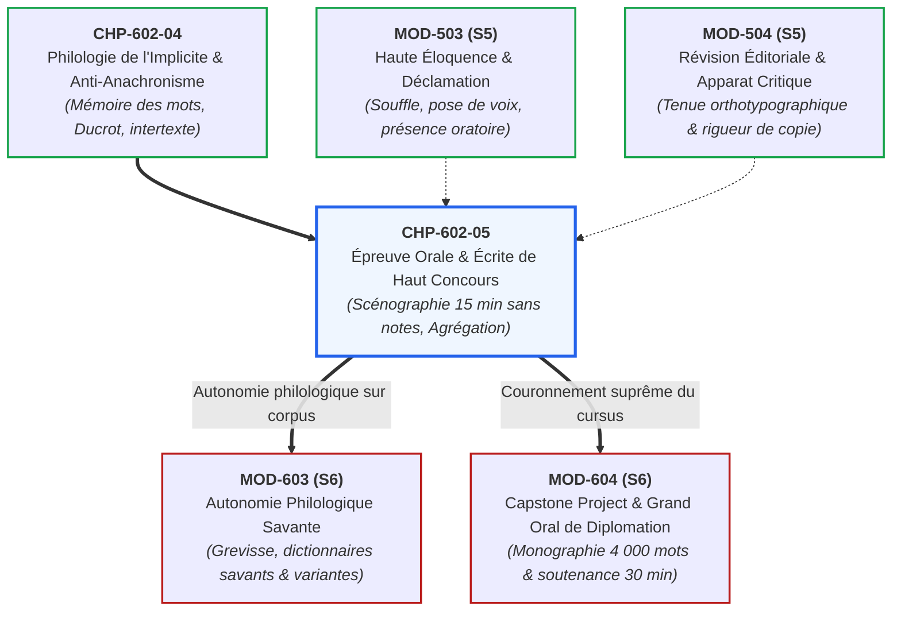

# Chapitre 5 : L'Épreuve Orale et Écrite de Haut Concours : Scénographie des 15 Minutes sans Notes, Tenue Rédactionnelle (1 500 mots) et Joute Académique

> **Identifiant** : `CHP-602-05`  
> **Module de rattachement** : [`MOD-602 — Herméneutique Littéraire, Philosophique et Explication de Concours`](file:///f:/Formation/world-class-french/03-curriculum/year-3/semester-6/mod-602-hermeneutique-litteraire-explication-concours.md)  
> **Volume horaire canonique** : 3 h 30 (Étude théorique : 1 h 00 | Pratique délibérée : 1 h 15 | Correction raisonnée : 0 h 45 | Évaluation : 0 h 30)  
> **Statut** : [STATUT : VALIDÉ]  
> **Compétences cibles** : [`FR-INT-005`](file:///f:/Formation/world-class-french/02-competency-framework/competency-framework.md#fr-int-005-démonstration-orale-structurée-et-art-de-léloquence-sans-notes) (L5), [`FR-INT-006`](file:///f:/Formation/world-class-french/02-competency-framework/competency-framework.md#fr-int-006-analyser-un-texte-littéraire-sans-confondre-interprétation-et-preuve-textuelle) (L5), [`FR-STYLE-001`](file:///f:/Formation/world-class-french/02-competency-framework/competency-framework.md#fr-style-001-maîtrise-des-figures-de-rhétorique-et-commentaire-stylistique) (L5)  
> **Sources de référence** : `SRC-RHET-04` (Calas, *Leçons de stylistique*, chap. 1), `SRC-RHET-03` (Reboul, *Introduction à la rhétorique*, chap. 3 & 4), `SRC-GRAM-02` (Riegel et al., *Grammaire méthodique du français*, chap. 20 & 21), `SRC-GRAM-01` (Grevisse & Goosse, *Le Bon Usage*), `SRC-LEX-01` (*Trésor de la Langue Française informatisé*), `SRC-LEX-03` (Alain Rey, *Dictionnaire historique de la langue française*), `SRC-TYPO-01` (*Lexique des règles typographiques en usage à l'Imprimerie nationale*), `SRC-NORM-03` (Ministère de l'Éducation nationale)

---

## 1. Titre et Place dans le Cursus

Ce cinquième chapitre clôture magistralement le module `MOD-602`. Il couronne l'ensemble des apprentissages herméneutiques en entraînant l'étudiant à l'exercice ultime de l'institution universitaire : **la prestation d'explication de texte de haut concours** (ENS d'Ulm et de Lyon, Agrégation de Lettres et de Philosophie). L'étudiant y conquiert la double souveraineté de l'écriture critique dense (dissertation explicative de 1 500 mots) et de la parole magistrale chronométrée (leçon orale de 15 minutes sans notes avec entretien contradictoire devant le jury).



---

## 2. Objectifs Mesurables

Au terme de ce chapitre, l'apprenant sera capable de :
1. **Délivrer une explication orale de concours de quinze (15) minutes sans notes écrites** sur un extrait de 25 à 30 lignes de prose classique ou philosophique, avec un respect rigoureux de l'horloge ($\pm 30$ secondes maximum) et une diction prosodique magistrale.
2. **Scénographier l'introduction orale en quatre temps calibrés** : situation d'autorité, lecture expressive à haute voix faisant entendre la ponctuation, formulation de la problématique et annonce fluide des mouvements en 2 minutes 30 exactes.
3. **Rédiger une explication écrite complète de 1 500 mots ($\pm 10\,\%$)** respectant l'architecture canonique tripartite, intégrant 100 % des citations courtes au sein de sa propre syntaxe et éliminant tout bavardage métadiscursif scolaire.
4. **Soutenir avec sérénité et autorité la joute académique de l'entretien avec le jury** : répondre aux objections philologiques, défendre un choix de coupe ou une interprétation stylistique sans arrogance ni capitulation servile.
5. **Appliquer les protocoles d'ancrage mnémotechnique conceptuel** permettant de mémoriser la trajectoire complète d'un texte sans dépendre d'un support écrit d'appui.

---

## 3. Prérequis et Test de Préparation

### 3.1 Prérequis Théoriques
- Maîtrise des principes du cercle herméneutique et de l'arc ricœurien (`CHP-602-01`).
- Méthodologie du découpage organique et des transitions bilatérales (`CHP-602-02`).
- Analyse de la micro-syntaxe spéculative et refus du dualisme fond/forme (`CHP-602-03`).
- Vigilance philologique anti-anachronique et détection des présupposés (`CHP-602-04`).

### 3.2 Test Diagnostique d'Auto-Évaluation (5 items)

<details>
<summary><b>Consulter le test et son corrigé immédiat</b></summary>

1. *Quel est le découpage temporel canonique des 15 minutes d'une explication orale d'Agrégation ?*  
   **Réponse** : Introduction et lecture : 2 min 30 | Développement linéaire continu des mouvements : 11 min | Conclusion et ouverture : 1 min 30.
2. *Pourquoi le fait de baisser les yeux pour lire ses notes est-il sévèrement sanctionné à l'oral d'agrégation ?*  
   **Réponse** : Parce que l'oral d'agrégation juge l'autorité intellectuelle, la maîtrise de la parole publique et la capacité d'improvisation réglée d'un futur professeur de chaire supérieure. Lire ses notes détruit le contact visuel avec le jury et trahit une dépendance indigne d'un maître.
3. *Quelle est la fonction d'une lecture expressive du texte en début d'épreuve orale ?*  
   **Réponse** : C'est le premier acte herméneutique de l'explication : par la scansion, le respect des liaisons, les silences et les inflexions tonales, le candidat prouve au jury qu'il a déjà compris l'architecture et les tensions du texte avant de commencer à parler.
4. *Comment doit-on réagir face à une objection érudite formulée par le président du jury pendant l'entretien ?*  
   **Réponse** : Avec courtoisie académique, écoute attentive et fermeté philologique : ne jamais contredire brutalement, ne jamais capituler par servilité ; examiner la remarque à partir de la lettre du texte et concéder la nuance si elle est fondée tout en réaffirmant la cohérence de son axe d'ensemble.
5. *Qu'appelle-t-on les « béquilles métadiscursives » à proscrire absolument à l'écrit comme à l'oral ?*  
   **Réponse** : Les formules parasites naïves qui commentent le fait de parler au lieu d'analyser le texte : *« Nous allons maintenant nous intéresser à... »*, *« Comme je le disais précédemment... »*, *« Il est intéressant de noter que... »*.

</details>

---

## 4. Situation de Départ ou Problème Concret

Considérons le compte rendu d'un rapport de jury d'Agrégation de Lettres :
> *« La plupart des échecs à l'épreuve d'explication de texte ne sont pas dus à un manque d'érudition, mais à une faillite scénographique et méthodologique complète. Certains candidats s'enlisent dans l'introduction et, voyant l'horloge tourner à la douzième minute, bâclent les deux tiers du texte au pas de course. D'autres gardent le nez collé à leurs feuilles de brouillon, lisant d'une voix monocorde un texte pré-rédigé sans regarder le jury. Enfin, lors de l'entretien, plusieurs s'effondrent à la première question de grammaire ou s'obstinent dans une dénégation agressive. L'Agrégation exige tout le contraire : un esprit libre, une voix assurée, un chronométrage infaillible et une sérénité savante. »*

Ce constat dresse le cahier des charges de l'excellence académique : l'étudiant doit transformer sa préparation intellectuelle en un **acte de haute scénographie rhétorique**.

---

## 5. Explication Intuitive : La Haute Voltige et le Jeu d'Échecs

L'explication de concours sans notes ressemble à la **haute voltige sans filet** combinée à une **partie d'échecs chronométrée** :
- **L'illusion du bavardage spontané** : Croire que parler sans notes consiste à improviser librement au fil de l'inspiration. C'est l'assurance d'un crash immédiat : répétitions, hésitations, perte du fil logique et dépassement de temps.
- **La partition invisible de l'esprit** : Le grand voltigeur ou le grand maître d'échecs n'a pas de feuille de papier sous les yeux parce que l'échiquier est intégralement gravé dans sa mémoire spatiale et conceptuelle.
- **La carte des points d'ancrage** : Devant le jury, le candidat n'a devant lui que le texte nu d'auteur (sans gribouillage). Chaque alinéa, chaque connecteur d'opposition (*« Mais »*, *« Or »*), chaque point-virgule devient une balise visuelle lumineuse qui déclenche instantanément le raisonnement préparé.
- **L'autorité de la parole souveraine** : Regarder le jury dans les yeux en déroulant une pensée complexe d'une syntaxe châtiée et harmonieuse procure un ascendant intellectuel irrésistible.

---

## 6. Définitions Précises et Terminologie

- **Scénographie de concours** : Ensemble des dispositifs oratoires, corporels, temporels et psychologiques par lesquels le candidat installe son autorité magistrale face à un jury académique (`SRC-RHET-03`, chap. 3 & 4).
- **Gestion de l'horloge (time-budgeting)** : Répartition millimétrée du temps de parole alloué (15 minutes à l'oral d'agrégation), prévoyant des repères d'alerte fixes pour éviter toute accélération panique ou interruption d'autorité par le jury.
- **Prestation sans notes** : Art de soutenir une démonstration savante de 15 minutes en ayant les mains libres et le regard constamment dirigé vers les membres du jury, sans lecture de feuillets de brouillon rédigés (`SRC-NORM-03`).
- **Ancrage mnémotechnique conceptuel** : Méthode de mémorisation reposant sur la topographie visuelle du texte et l'enchaînement dialectique des idées mères, substituant la mémoire des concepts à la mémorisation mot à mot stérile.
- **Tenue rédactionnelle (1 500 mots)** : Format écrit canonique de l'explication de texte d'agrégation, caractérisé par une prose dense, rythmée, exempte de scories scolaires et intégrant scrupuleusement les citations.
- **Joute contradictoire (l'entretien)** : Dialogue académique de 10 à 15 minutes suivant l'explication, où le jury éprouve la solidité philologique, la flexibilité herméneutique et l'équilibre caractériel du candidat.

---

## 7. Règles ou Mécanismes Fondamentaux

### 7.1 Le Chronométrage Millimétré des 15 Minutes d'Agrégation
Le temps imparti est absolu. Tout dépassement au-delà de 15 minutes entraîne une interruption brutale par le président du jury (*« Merci, Monsieur/Madame, votre temps est écoulé »*), privant le candidat de sa conclusion et amputant la note de **3 à 5 points**.
Le budget horaire canonique s'articule ainsi :
1. **Introduction et Lecture du texte (00:00 à 02:30)** :
   - Situation précise et enjeu dans l'œuvre : 45 secondes ;
   - Lecture magistrale à haute voix : 1 minute ;
   - Problématique et annonce fluide des mouvements : 45 secondes.
2. **Développement continu des mouvements (02:30 à 13:30 — exactement 11 min)** :
   - *Si 3 mouvements* : environ 3 min 40 par mouvement ;
   - *Si 4 mouvements* : environ 2 min 45 par mouvement ;
   - Chaque mouvement comprend l'analyse microscopique de la lettre et s'achève par une transition bilatérale de 15 secondes.
3. **Conclusion et Ouverture spéculative (13:30 à 15:00 — exactement 1 min 30)** :
   - Bilan ferme de la résolution de la problématique : 50 secondes ;
   - Ouverture sur l'histoire des idées ou l'esthétique littéraire : 40 secondes.

```text
DIAGRAMME CHRONOMÉTRIQUE DE LA LEÇON ORALE DE CONCOURS (15 MINUTES)
00:00                     02:30                                       13:30         15:00
┌─────────────────────────┬───────────────────────────────────────────┬─────────────┐
│  INTRODUCTION & LECTURE │      DÉVELOPPEMENT LINÉAIRE CONTINU       │ CONCLUSION  │
│  - Situation (45 s)     │      - Mouvement 1 (l. 1-8)   : 3 min 40  │ - Bilan     │
│  - Lecture voix (60 s)  │      - Mouvement 2 (l. 9-16)  : 3 min 40  │   ferme     │
│  - Problématique (45 s) │      - Mouvement 3 (l. 17-25) : 3 min 40  │ - Ouverture │
└─────────────────────────┴───────────────────────────────────────────┴─────────────┘
  Repère : 02:30 max        Repère mi-parcours : 08:00                  Clôture à 14:50
```

### 7.2 L'Art de Parler sans Notes : La Méthode des Repères Visuels
Pour s'affranchir totalement de ses notes écrites sans trou de mémoire :
1. **La proscription de la rédaction intégrale au brouillon** : Lors de la préparation (2 à 3 heures), le candidat ne doit rédiger in extenso que **l'introduction** et **la conclusion**.
2. **Le brouillon en arbre logique** : Pour le développement, n'inscrire sur la feuille que des mots-clés, les numéros de ligne et les connecteurs charnières.
3. **L'œil sur le texte, le regard sur le jury** : Pendant l'épreuve, le candidat regarde le jury dans les yeux pour expliquer l'idée, puis baisse les yeux deux secondes sur le texte d'auteur pour lire la citation exacte, puis relève immédiatement le regard pour déployer le commentaire stylistique.

### 7.3 Les Canons de la Tenue Rédactionnelle Écrite (1 500 mots)
À l'écrit, l'explication de concours doit donner l'impression d'une prose coulée d'un seul jet par un écrivain critique :
- **Intégration syntaxique totale** : Bannir les citations isolées au milieu de la page entre deux retours à la ligne. La citation doit être enchâssée dans la phrase de l'analyste (`SRC-RHET-04`, chap. 1).
- **Proscription du bavardage métadiscursif** : Éradiquer les formules de régie interne (*« Nous avons vu précédemment que... »*, *« Il convient d'ajouter que... »*, *« Notons que l'auteur... »*). Passer directement à l'affirmation conceptuelle étayée par la lettre.
- **Régularité du volume des mouvements** : Veiller à ce que les mouvements reçoivent un traitement proportionné à leur complexité, sans déséquilibre flagrant.

### 7.4 L'Entretien Contradictoire avec le Jury : La Joute Académique
L'entretien n'est pas un examen de rattrapage : c'est un dialogue de courtoisie et de rigueur entre pairs :
- **Règle 1 : L'écoute silencieuse et intégrale de la question** : Ne jamais interrompre un membre du jury, même si l'on a compris le piège dès les premiers mots. Prendre deux secondes de recul avant de répondre.
- **Règle 2 : L'appui exclusif sur la lettre du texte** : À toute objection, répondre en citant le texte : *« À la ligne 14, Monsieur le Professeur, l'emploi du subjonctif imparfait semble précisément justifier cette interprétation contrefactuelle... »*.
- **Règle 3 : L'art de la concession élégante** : Si l'examinateur pointe une erreur indiscutable de syntaxe ou de vocabulaire, ne jamais s'obstiner dans la mauvaise foi. Répondre avec aisance : *« Vous avez parfaitement raison de souligner cette valeur d'époque du terme ; cela enrichit précisément le mouvement en montrant que... »*.

---

## 8. Raisonnement Détaillé : La Posture d'Autorité et l'Ethos Oratoire

Pourquoi les plus hauts concours d'État accordent-ils un coefficient écrasant à l'épreuve orale ?
- **L'évaluation de l'ethos professoral** : Le jury ne recrute pas de simples compilateurs de fiches : il recrute des professeurs appelés à enseigner en classes préparatoires ou à l'université. L'épreuve orale teste la capacité à captiver un auditoire, à structurer le temps, à vulgariser la haute érudition sans la dégrader et à réagir avec sang-froid sous le feu de la critique (`SRC-RHET-03`, chap. 3).
- **Le refus de l'arrogance et de la servilité** : L'attitude idéale est un **juste milieu cicéronien** : une fermeté intellectuelle absolue adossée à une déférence protocolaire impeccable. L'arrogant est brisé pour son orgueil ; le servile est déprécié pour sa faiblesse de caractère.

---

## 9. Exemples Corrects Commentés

### Exemple 1 : Simulation de Début d'Introduction Orale Magistrale (Chronométrée à 2 min 15)
> *(Le candidat se tient droit, regarde le président du jury, attend le signal, puis commence d'une voix posée et assurée :)*  
> *« Monsieur le Président, Mesdames et Messieurs les membres du jury, en publiant en 1670 les Pensées, les amis de Port-Royal donnaient à lire l'apologie inachevée d'un géomètre converti dont chaque fragment vise à terrasser la superbe du libertin mondain. Le fragment 136, consacré au divertissement, constitue le pivot anthropologique de cette démonstration. Avant de faire entendre le texte, permettez-moi de vous en donner lecture. »*  
> *(Lecture prosodique parfaite du texte pendant 60 secondes).*  
> *« L'enjeu métaphysique de ce passage réside dans le dévoilement d'une terrible mystification : comment l'agitation sociale de la cour et de la guerre, qui se pare des attraits de la gloire, n'est-elle qu'une fuite panique devant l'angoisse du néant intérieur ? Nous suivrons ce resserrement impitoyable à travers trois mouvements continus : d'abord, des lignes 1 à 6, la formulation de la sentence morale diagnostique ; ensuite, des lignes 7 à 16, l'anatomie concrète des conduites mondaines ; enfin, des lignes 17 à 25, le saut métaphysique révélant le malheur naturel de notre condition. »*  
> *(Temps exact écoulé : 2 minutes 18 secondes. Transition immédiate vers le premier mouvement).*

### Exemple 2 : Exemple de Réponse Magistrale en Entretien
- **Question du jury** : *« Vous avez affirmé dans votre explication que le mot "divertissement" chez Pascal signifiait simplement la distraction ludique. N'est-ce pas un contresens diachronique majeur ? »*
- **Réponse du candidat** : *« Je vous remercie de me permettre de dissiper cette ambiguïté, Monsieur le Professeur. Si mon propos a pu laisser entendre une acception moderne et profane du loisir, c'était une imperfection de formulation de ma part. J'entendais précisément montrer que le vocable conserve chez Pascal toute sa force étymologique latine de diverticulum et de divertere : l'action violente de se détourner de l'abîme intérieur. C'est bien parce que le divertissement est une fuite ontologique devant la mort, et non une simple récréation, qu'il prend ce statut tragique dans l'apologétique pascalienne. »*  
- **Résultat** : L'examinateur acquiesce, l'objection est transformée en triomphe rhétorique.

---

## 10. Contre-Exemples et Clinique des Erreurs Fréquentes

L'analyse des prestations orales et écrites d'agrégation met en évidence six erreurs scénographiques et académiques majeures :

### Erreur n° 1 : Le Naufrage du Chronomètre (L'Asphyxie Terminale)
- **Manifestation** : Consacrer 11 minutes à l'introduction et au premier mouvement, puis expédier les mouvements 2 et 3 en deux minutes dans un bafouillage inaudible.
- **Diagnostic critique** : Imprévoyance absolue et incapacité à gérer le temps imparti. Le jury retire immédiatement 4 points sur la note globale.
- **Redressement** : Placer sa montre sur la table, avoir des balises temporelles inflexibles (Mvt 1 terminé à 06:15, Mvt 2 à 10:00, etc.).

### Erreur n° 2 : La Dépendance Visuelle aux Notes Écrites
- **Manifestation** : Lire ses feuilles la tête baissée, sans jamais croiser le regard des examinateurs, en suivant les lignes avec le doigt.
- **Diagnostic critique** : Prestation éliminatoire. Le candidat se comporte en écolier timoré et non en professeur de haut rang (`SRC-NORM-03`).
- **Redressement** : Supprimer toute phrase rédigée au brouillon ; n'utiliser que des déclencheurs mnémotechniques abrégés.

### Erreur n° 3 : L'Agressivité Polémique Face au Jury
- **Manifestation** : Contester vivement une remarque du jury en coupant la parole ou en affichant un mépris blessé : *« Mais non, vous n'avez pas écouté ce que j'ai dit ! »*
- **Diagnostic critique** : Suicide académique immédiat. La note est plafonnée sous **05/20** pour incompatibilité déontologique avec les fonctions d'enseignant d'État.
- **Redressement** : Maîtriser l'urbanité et la courtoisie académique républicaine.

### Erreur n° 4 : La Capitulation Servile Immédiate
- **Manifestation** : Dès que le jury pose une question, renier immédiatement tout ce qu'on a dit : *« Ah oui, c'est vrai, je me suis complètement trompé, j'ai dit n'importe quoi... »*
- **Diagnostic critique** : Faiblesse de caractère sanctionnée. Le jury teste la capacité du candidat à défendre scientifiquement une position solide.
- **Redressement** : Distinguer la rectification d'un fait précis de l'effondrement de sa thèse d'ensemble.

### Erreur n° 5 : La Prolifération des Scories Métadiscursives
- **Manifestation** : Émailler son discours oral de tics verbaux polluants : *« du coup »*, *« en fait »*, *« voilà »*, *« je sais pas si vous voyez ce que je veux dire »*.
- **Diagnostic critique** : Relâchement diaphasique indigne d'un haut concours (`MOD-401`, `MOD-503`).
- **Redressement** : Remplacer les tics par des silences respiratoires maîtrisés.

### Erreur n° 6 : La Citation Déconnectée de la Syntaxe Rédactionnelle
- **Manifestation** : À l'écrit, coller une citation brute entre guillemets sans l'insérer dans un sujet, un verbe ou un complément de la métalangue.
- **Diagnostic critique** : Rupture de la fluidité stylistique universitaire (`SRC-RHET-04`).
- **Redressement** : Intégrer les mots de l'auteur dans sa propre phrase d'analyse.

#### Tableau Clinique des Fautes Scénographiques et Oratoires
| Cas clinique | Erreur scénographique | Conséquence sur l'évaluation | Protocole de redressement |
| :---: | :--- | :--- | :--- |
| **Cas 1** | Dépassement des 15 minutes | Interruption autoritaire (-4 pts) | Balisage temporel strict à la montre |
| **Cas 2** | Lecture servile des notes | Note plafonnée à 08/20 | Élocution libre les yeux fixés sur le jury |
| **Cas 3** | Agressivité en entretien | Note éliminatoire (< 05/20) | Urbanité, écoute et courtoisie républicaine |
| **Cas 4** | Capitulation servile | Dépréciation de l'autorité intellectuelle | Défense argumentée par la lettre du texte |
| **Cas 5** | Scories métadiscursives orales| Pénalité d'élocution et de tenue | Remplacement des tics par des pauses silencieuses |
| **Cas 6** | Citation brute non intégrée | Prose hachée et scolaire à l'écrit | Enchâssement syntaxique harmonieux des citations |

---

## 11. Cas Particuliers et Limites

### 11.1 L'Interruption Imprévue ou l'Incident Matériel
Que faire si un membre du jury quitte la salle ou fait tomber un dossier pendant votre intervention ?
- **Règle d'or** : Ne jamais s'interrompre ni manifester d'agacement. Poursuivre son exposé avec un calme olympien. La maîtrise de soi face aux perturbations extérieures fait partie intégrante de l'évaluation du candidat.

### 11.2 Le Trou de Mémoire à l'Oral sans Notes
Si un trou noir survient en plein milieu d'un mouvement :
- **Protocole d'urgence** : Ne jamais paniquer ni bafouiller. Baisser calmement les yeux sur le texte imprimé, lire à haute voix la phrase suivante de l'auteur pour reprendre appui sur la matière verbale, et relancer immédiatement le commentaire. Le jury n'y verra qu'un silence expressif prémédité.

---

## 12. Approfondissement Adapté au Niveau (L4/L5) : L'Actio Cicéronienne Réinvestie dans les Concours Républicains

Dans le *De Oratore* (Livre III), Cicéron accorde la palme suprême à l'**actio** (l'art de prononcer le discours, l'éloquence du corps et de la voix) :
> *« L'actio a un pouvoir souverain dans l'éloquence : sans elle, le meilleur orateur ne peut avoir aucun rang ; avec elle, un esprit médiocre l'emporte sur les plus savants. Démosthène, à qui l'on demandait quelle était la première qualité de l'orateur, répondit : l'action ; quelle était la seconde : l'action ; quelle était la troisième : l'action. »*

Les concours républicains d'élite (ENS, Agrégation) ont hérité directement de cet idéal humaniste : le savoir n'est rien s'il n'est incarné dans une voix souveraine capable d'instruire, de plaire et d'émouvoir (*docere, delectare, movere*).

---

## 13. Comparaisons Différentielles

| Critère d'évaluation | Épreuve écrite de concours (1 500 mots) | Épreuve orale de concours (15 minutes) |
| :--- | :--- | :--- |
| **Canal d'expression** | Graphique (visuel, typographique, calligraphique) | Phonique (auditif, prosodique, kinésique, corporel) |
| **Gestion du temps** | Rythme libre sur 6 heures de composition | Chronométrage millimétré à la seconde près |
| **Support de travail** | Copie rédigée intégralement sans brouillon apparent | Parole nue sans notes, texte d'auteur en main |
| **Rapport à l'objection**| Unilatéral (l'examinateur lit seul la copie) | Dialogique et contradictoire (entretien immédiat) |
| **Écueil mortel** | Prolixité bavarde et graphie illisible | Dépassement d'horloge et lecture des feuilles |

---

## 14. Exercices Progressifs

### Niveau 1 : Chronométrage Flash d'une Introduction Orale
*Consigne : Débiter oralement l'introduction du texte de Pascal (situation, problématique, 3 mouvements) en enclenchant un chronomètre. Viser exactement 2 minutes 30 ($\pm 10$ secondes).*  
**Critère de validation** : Arrêt de la lecture à 2 min 25 s, posture droite, regard levé, aucune hésitation syntaxique.

---

### Niveau 2 : Intégration Syntaxique de Trois Citations Ardues
*Consigne : Intégrer les trois fragments suivants de Montesquieu dans une seule période critique fluide sans rupture de construction :*
1. *« ayant exterminé ceux de l'Amérique »*
2. *« mettre en esclavage ceux de l'Afrique »*
3. *« défricher tant de terres »*

> **Corrigé de l'Exercice de Niveau 2** :  
> Par l'enchaînement d'une proposition participiale passée et d'un verbe de modalité déontique contraignante, Montesquieu feint d'établir une causalité historique inéluctable : les Européens, après avoir consommé le génocide en *« extermin[ant] ceux de l'Amérique »*, n'auraient eu d'autre issue que de *« mettre en esclavage ceux de l'Afrique »* afin d'asservir la main-d'œuvre nécessaire au *« défrich[ement] de tant de terres »*.

---

### Niveau 3 : Formulation d'une Charte de Soutenance Calibrée (50 mots exacts)
*Consigne : Rédiger un serment de discipline scénographique et oratoire de haut concours calibré très exactement à **cinquante (50) mots** selon les règles de décompte de l'Imprimerie nationale (`SRC-TYPO-01`).*

#### Texte Réalisé (50 mots exacts) :
> « La réussite de l' explication d' agrégation repose sur une maîtrise scénographique et oratoire absolue . Le candidat orchestre sa parole sans notes durant quinze minutes rigoureuses , alliant la clarté d' une diction prosodique à la solidité d' une argumentation philologique souveraine pour convaincre les membres du jury académique en concours . »

#### Décompte Certifié Mot à Mot (50 mots exacts) :
| N° | Token | N° | Token | N° | Token | N° | Token | N° | Token |
| :---: | :--- | :---: | :--- | :---: | :--- | :---: | :--- | :---: | :--- |
| **1** | La | **11** | maîtrise | **21** | sans | **31** | une | **41** | souveraine |
| **2** | réussite | **12** | scénographique | **22** | notes | **32** | diction | **42** | pour |
| **3** | de | **13** | et | **23** | durant | **33** | prosodique | **43** | convaincre |
| **4** | l' | **14** | oratoire | **24** | quinze | **34** | à | **44** | les |
| **5** | explication | **15** | absolue. | **25** | minutes | **35** | la | **45** | membres |
| **6** | d' | **16** | Le | **26** | rigoureuses, | **36** | solidité | **46** | du |
| **7** | agrégation | **17** | candidat | **27** | alliant | **37** | d' | **47** | jury |
| **8** | repose | **18** | orchestre | **28** | la | **38** | une | **48** | académique |
| **9** | sur | **19** | sa | **29** | clarté | **39** | argumentation | **49** | en |
| **10** | une | **20** | parole | **30** | d' | **40** | philologique | **50** | concours. |

---

## 15. Activité de Correction Raisonnée

### Transcription d'un Début de Prestation Orale d'un Candidat Défaillant :
> *(Le candidat entre, s'assoit en soufflant bruyamment, étale six feuilles de brouillon sur la table, regarde sa montre, puis commence la tête baissée :)  
> « Alors, bonjour. Je vais vous présenter aujourd'hui un texte de Pascal qui est extrait des Pensées. C'est un texte très connu sur le divertissement. Donc en fait, Pascal nous dit que l'homme est très malheureux. Du coup, je vais d'abord vous lire le texte, enfin si j'ai le temps, et après on verra les trois mouvements de son plan. »*

### Rapport d'Audit Critique et Sanction Académique :
1. *Souffle bruyant et étalage de six feuilles* $\rightarrow$ **Faillite d'ethos inaugurale** : Le candidat installe une atmosphère d'anxiété et de désordre.
2. *« Alors, bonjour »* $\rightarrow$ **Formule familière proscrite** : L'apostrophe protocolaire solennelle est de rigueur : *« Monsieur le Président, Mesdames et Messieurs les membres du jury... »*.
3. *« Je vais vous présenter aujourd'hui un texte... »* $\rightarrow$ **Béquille métadiscursive naïve** : Supprimer ce bavardage et entrer directement dans la situation de l'œuvre.
4. *« Donc en fait... Du coup... »* $\rightarrow$ **Tics de langage éliminatoires** : Ruine de la tenue stylistique attendue à l'agrégation.
5. *« Enfin si j'ai le temps »* $\rightarrow$ **Aveu d'impuissance scénographique grotesque** : La lecture est un passage obligé incontournable.

---

## 16. Mise en Pratique dans une Production Réelle

### Consigne de Rédaction Calibrée (60 mots exacts)
Rédiger une proclamation finale sur la souveraineté oratoire et académique de l'explication de haut concours, d'une longueur calibrée très exactement à **soixante (60) mots** selon les règles de décompte de l'Imprimerie nationale (`SRC-TYPO-01`).

### Texte Réalisé (60 mots exacts) :
> « Soutenir une explication de haut concours impose d' allier l' autorité intellectuelle à la sérénité oratoire . Qu' il s' agisse de l' écrit de mille cinq cents mots ou de la leçon de quinze minutes sans notes , le candidat habite le texte avec souveraineté . La précision grammaticale et l' élégance stylistique fondent la légitimité de sa parole académique d' élite . »

#### Décompte Certifié Mot à Mot (60 mots exacts) :
| N° | Token | N° | Token | N° | Token | N° | Token |
| :---: | :--- | :---: | :--- | :---: | :--- | :---: | :--- |
| **1** | Soutenir | **16** | oratoire. | **31** | la | **46** | précision |
| **2** | une | **17** | Qu' | **32** | leçon | **47** | grammaticale |
| **3** | explication | **18** | il | **33** | de | **48** | et |
| **4** | de | **19** | s' | **34** | quinze | **49** | l' |
| **5** | haut | **20** | agisse | **35** | minutes | **50** | élégance |
| **6** | concours | **21** | de | **36** | sans | **51** | stylistique |
| **7** | impose | **22** | l' | **37** | notes, | **52** | fondent |
| **8** | d' | **23** | écrit | **38** | le | **53** | la |
| **9** | allier | **24** | de | **39** | candidat | **54** | légitimité |
| **10** | l' | **25** | mille | **40** | habite | **55** | de |
| **11** | autorité | **26** | cinq | **41** | le | **56** | sa |
| **12** | intellectuelle | **27** | cents | **42** | texte | **57** | parole |
| **13** | à | **28** | mots | **43** | avec | **58** | académique |
| **14** | la | **29** | ou | **44** | souveraineté. | **59** | d' |
| **15** | sérénité | **30** | de | **45** | La | **60** | élite. |

---

## 17. Résumé Structuré

```text
SCÉNOGRAPHIE ET DISCIPLINE DE L'ÉPREUVE DE HAUT CONCOURS (SRC-RHET-04 & SRC-NORM-03)
├── 1. LA GESTION MILLIMÉTRÉE DES 15 MINUTES ORALES
│   ├── 00:00 - 02:30 : Situation (45 s), lecture expressive (60 s), problématique (45 s).
│   ├── 02:30 - 13:30 : Développement continu (11 min) -> analyse microscopique + transitions.
│   └── 13:30 - 15:00 : Conclusion bilan ferme (50 s) + ouverture spéculative (40 s).
├── 2. L'ART SOUVERAIN DE PARLER SANS NOTES
│   ├── Brouillon restreint à un squelette conceptuel et repères de lignes.
│   ├── Regard direct vers le jury ; coup d'œil furtif sur le texte d'auteur.
│   └── Maîtrise des silences respiratoires pour remplacer les tics de langage.
├── 3. LA TENUE DU DEVOIR ÉCRIT (1 500 mots)
│   ├── Introduction dense de 250 mots ; développement continu de 1 100 mots.
│   ├── Intégration syntaxique totale de 100 % des citations courtes.
│   └── Éradication absolue de tout bavardage métadiscursif scolaire.
└── 4. LA JOUTE ACADÉMIQUE DE L'ENTRETIEN
    ├── Écoute silencieuse, calme olympien, refus de l'arrogance et de la servilité.
    └── Défense appuyée exclusivement sur la lettre du texte et concession élégante.
```

---

## 18. Questions de Rappel Actif (Active Recall)

<details>
<summary><b>1. À quel moment précis de l'épreuve orale de 15 minutes le candidat doit-il avoir terminé son introduction ?</b></summary>
À 2 minutes 30 secondes au plus tard, sous peine de manquer de temps pour le développement des mouvements.
</details>

<details>
<summary><b>2. Comment éliminer la dépendance aux feuilles de brouillon lors de la préparation orale ?</b></summary>
En s'interdisant de rédiger des phrases complètes pour le développement, et en ne consignant que des mots-clés, des numéros de lignes et des flèches logiques.
</details>

<details>
<summary><b>3. Quelle est la sanction d'un dépassement de temps au-delà de 15 minutes à l'oral d'agrégation ?</b></summary>
L'interruption autoritaire immédiate par le président du jury, privant le candidat de sa conclusion et entraînant un abattement de 3 à 5 points.
</details>

<details>
<summary><b>4. Pourquoi l'intégration syntaxique des citations est-elle capitale dans le devoir de 1 500 mots ?</b></summary>
Parce qu'elle prouve la maturité stylistique du scripteur, évitant l'effet de patchwork haché et assurant la continuité souveraine de l'analyse métalangagière.
</details>

<details>
<summary><b>5. Quelle posture psychologique adopter si le jury conteste vivement une interprétation ?</b></summary>
Une écoute respectueuse, une analyse calme de l'objection à partir de la lettre du texte, et une défense argumentée sans entêtement dogmatique ni soumission apeurée.
</details>

<details>
<summary><b>6. Qu'entendait Cicéron par « l'actio » dans son traité de l'orateur ?</b></summary>
La prononciation physique et corporelle du discours : la voix, le regard, la scansion, le geste et le souffle qui donnent vie à la pensée écrite.
</details>

---

## 19. Mini-Évaluation Sommative Notée (20 Points)

### Barème d'Audit de Haut Concours (ENS / Agrégation) :
- **Gestion souveraine du temps et respect du chronométrage** : 5 points (calibrage rigoureux des 15 min à l'oral ou des 1 500 mots à l'écrit).
- **Autorité oratoire sans notes et tenue de l'ethos académique** : 5 points (regard direct, absence de béquilles métadiscursives, élocution fluide).
- **Profondeur de la démonstration linéaire et intégration des citations** : 5 points (zéro phrase sautée, enchâssement syntaxique parfait).
- **Solidité doctrinale et sérénité lors de l'entretien contradictoire** : 5 points (argumentation appuyée sur la lettre, urbanité républicaine).
- **Clause éliminatoire** : Tout dépassement de temps interrompu par le jury, lecture servile des notes ou éclat d'humeur agressif entraîne une note globale $\le 07/20$. Seuil de certification : **14/20**.

---

## 20. Critères Observables de Maîtrise

L'apprenant valide ce cinquième chapitre et achève le module `MOD-602` s'il démontre :
- La délivrance en conditions réelles d'une explication orale de 15 minutes sans notes avec une précision d'horloge à $\pm 20$ secondes.
- La soutenance d'un entretien de 10 minutes avec un jury exigeant en apportant des preuves textuelles immédiates à chaque question.
- La rédaction d'une explication écrite de 1 500 mots respectant l'ensemble des règles stylistiques et orthotypographiques de l'Imprimerie nationale (`SRC-TYPO-01`).
- L'acquisition définitive d'une autorité intellectuelle et d'un ethos professoral de niveau agrégation.

---

## 21. Sources et Lectures Complémentaires

- **`SRC-RHET-04`** : Frédéric CALAS, *Leçons de stylistique*, Paris, Hachette Supérieur (Chapitre 1 : *L'explication stylistique et littéraire de concours* ; Chapitre 4 : *L'oral d'agrégation*).
- **`SRC-RHET-03`** : Olivier REBOUL, *Introduction à la rhétorique*, Paris, PUF, coll. « Premier Cycle » (Chapitre 3 : *L'épreuve oratoire* ; Chapitre 4 : *L'actio cicéronienne*).
- **`SRC-GRAM-02`** : Martin RIEGEL, Jean-Christophe PELLAT et René RIOUL, *Grammaire méthodique du français*, Paris, PUF, coll. « Quadrige » (Chapitres 20 et 21 : *Macro-syntaxe et organisation du discours*).
- **`SRC-GRAM-01`** : Maurice GREVISSE et André GOOSSE, *Le Bon Usage* (16e éd.), Bruxelles, De Boeck Supérieur.
- **`SRC-LEX-01`** : ATILF / CNRS, *Trésor de la Langue Française informatisé (TLFi)*, Nancy.
- **`SRC-LEX-03`** : Alain REY (dir.), *Dictionnaire historique de la langue française*, Paris, Le Robert.
- **`SRC-TYPO-01`** : IMPRIMERIE NATIONALE, *Lexique des règles typographiques en usage à l'Imprimerie nationale*, Paris.
- **`SRC-NORM-03`** : MINISTÈRE DE L'ÉDUCATION NATIONALE, *Rapports de jury des concours de l'Agrégation de Lettres et de Grammaire*, Paris.

---

## Annexe : Classification Pédagogique

- **CORE-NOW** : Chronométrage millimétré des 15 minutes d'agrégation, art de parler sans notes et repères mnémotechniques visuels, tenue rédactionnelle de 1 500 mots sans béquilles métadiscursives, protocole de la joute contradictoire avec le jury.
- **INTRODUCTION-NOW** : L'*actio* cicéronienne et l'ethos oratoire républicain.
- **DEFER** : L'autonomie philologique experte dans les variantes et traités normatifs $\to$ traitée dans [`MOD-603`](file:///f:/Formation/world-class-french/03-curriculum/year-3/semester-6/mod-603-autonomie-philologique-recherche-traites.md).
- **MOVE** : La préparation de la soutenance publique de 30 minutes de la Monographie de diplomation $\to$ traitée dans [`MOD-604`](file:///f:/Formation/world-class-french/03-curriculum/year-3/semester-6/mod-604-capstone-project-grand-oral.md).
- **OPTIONAL-ADVANCED** : Analyse comparée de la rhétorique du barreau (plaidoirie d'assises) et de la leçon de chaire supérieure d'agrégation.
- **REMOVE** : Astuces superficielles de prise de parole en public déconnectées de la rigueur de la preuve textuelle.
