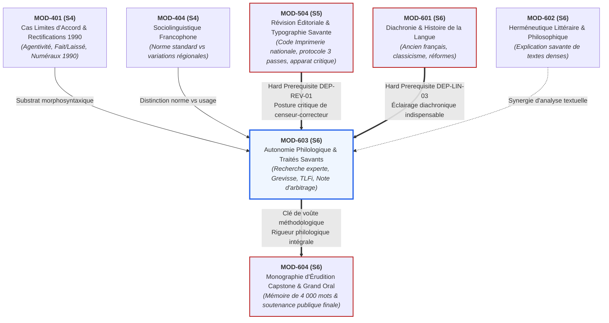

# Fiche Pédagogique Opérationnelle — Module MOD-603

> **Identifiant** : `MOD-603`  
> **Titre** : *Autonomie Philologique : Méthode de Recherche Experte dans les Traités Savants*  
> **Semestre** : Année 3 — Semestre 6 (S6)  
> **Domaines mobilisés** : DOM-02 (Orthographe), DOM-03 (Grammaire et morphosyntaxe), DOM-05 (Lexique et sémantique), DOM-12 (Correction, révision et contrôle qualité éditorial), DOM-13 (Intégration et haute expertise)  
> **Volume horaire estimé** : 18 heures (Étude de la méthode philologique : 4 h 30 | Pratique délibérée : 7 h 30 | Correction raisonnée : 3 h 30 | Révision active : 2 h 30)  
> **Statut** : [STATUT : PROPOSÉ — EN ATTENTE DE VALIDATION]  
> **Alignement** : [`academic-structure.md` (S6)](file:///f:/Formation/world-class-french/01-architecture/academic-structure.md#7-fiche-détaillée--semestre-6-s6), [`dependency-graph.md` (DEP-REV-01, DEP-LIN-03)](file:///f:/Formation/world-class-french/01-architecture/dependency-graph.md#27-axe-linguistique--philologie-du-fonctionnement-synchronique-à-la-diachronie), [`competency-framework.md` (FR-PHILOL-001, FR-INT-003)](file:///f:/Formation/world-class-french/02-competency-framework/competency-framework.md#fr-philol-001-autonomie-philologique-et-consultation-experte-des-sources), [`mastery-levels.md` (Palier L5)](file:///f:/Formation/world-class-french/02-competency-framework/mastery-levels.md#l5--expertise-transférable-haute-maîtrise-et-posture-philologique), [`syllabus.md` (S6)](file:///f:/Formation/world-class-french/03-curriculum/year-3/semester-6/syllabus.md#module-mod-603--autonomie-philologique--méthode-de-recherche-experte-dans-les-traités-savants), [`source-registry.md`](file:///f:/Formation/world-class-french/07-resources/source-registry.md)

---

## 1. Présentation et Intérêt du Module

Le module `MOD-603` consacre la plénitude de l'autonomie intellectuelle de l'apprenant au sein du cursus **World-Class French**. Après avoir intériorisé les règles de base en Année 1, exploré la syntaxe complexe et la logique argumentative en Année 2, puis atteint l'excellence stylistique et la vigilance du censeur éditorial en Semestre 5 (`MOD-504`), l'apprenant s'élève ici au rang de **chercheur, arbitre et philologue souverain de la langue française**.

Face à une hésitation syntaxique épineuse, à un litige orthographique controversé ou à une commande éditoriale de haute responsabilité, le lettré d'élite ne s'en remet ni à son intuition fluctuante, ni aux débats approximatifs des forums numériques, ni au verdict péremptoire et réducteur de manuels scolaires élémentaires. Il sait que la langue française est un monument vivant, stratifié par l'histoire, traversé par des tensions entre prescription académique, régularité systémique et liberté créatrice des grands écrivains.

Ce module arme l'apprenant d'une méthodologie rigoureuse de recherche scientifique fondée sur les instruments de référence monumentaux :
1. **L'épistémologie critique des instruments de référence** : Savoir distinguer la grammaire normative scolaire d'apprentissage (qui simplifie et tranche dogmatiquement pour guider l'élève débutant) du traité descriptif scientifique monumental (qui recueille, analyse, date et nuance les faits de langue observables sur corpus) [Réf. SRC-GRAM-01, Préface ; SRC-GRAM-02, Avant-propos].
2. **Le maniement virtuose du *Bon Usage* de Maurice Grevisse et André Goosse (1 600 pages)** : Comprendre l'architecture interne des paragraphes, décrypter la typographie différenciée (corps de texte doctrinal vs petits caractères historiques et variantes), interpréter avec pénétration les « Remarques » critiques de Goosse face aux condamnations puristes, et maîtriser les trois index (index des matières, index des auteurs, index lexical) pour localiser n'importe quel point de doctrine en moins de trois minutes [Réf. SRC-GRAM-01].
3. **L'exploitation experte des corpus numériques et dictionnaires savants** : Interroger le *Trésor de la Langue Française informatisé* (*TLFi*) dans ses sections étymologiques, diachroniques, morphologiques et syntagmatiques ; croiser ces données avec la base *Frantext*, le *Dictionnaire historique de la langue française* d'Alain Rey et les neuf éditions du *Dictionnaire de l'Académie française* [Réf. SRC-LEX-01 ; SRC-LEX-02 ; SRC-LEX-03].
4. **La rédaction de la Note d'arbitrage philologique** : Maîtriser le genre souverain de la consultation linguistique écrite. Structurée à l'instar d'un mémoire contentieux de haute juridiction, la note d'arbitrage qualifie la question de droit, confronte les textes officiels, dissèque la doctrine des grammairiens, audite le corpus des attestations littéraires, et formule un arbitrage motivé assorti d'une recommandation opérationnelle différenciée selon le registre et la destination de l'écrit.

---

## 2. Place dans le Cursus

- **Position séquentielle** : Semaines 8, 9 et 10 du Semestre 6 (S6). Il succède immédiatement à l'étude de l'histoire diachronique de la langue (`MOD-601`) et à l'herméneutique philosophique (`MOD-602`), et précède la soutenance terminale du Capstone Project (`MOD-604`).
- **Rôle architectural** : Clé de voûte de l'axe *Philologie & Consultation experte* (`DEP-REV-01`, `DEP-LIN-03` dans le [`dependency-graph.md`](file:///f:/Formation/world-class-french/01-architecture/dependency-graph.md)). Il dote l'apprenant de l'indépendance critique absolue, éliminant toute dépendance à l'égard d'un tuteur ou d'un correcteur automatique.
- **Relations fonctionnelles amont / aval** :
  - *En amont* :
    - `MOD-401` (Cas limites d'accord et rectifications de 1990) : fournit le substrat des points de controverse morphosyntaxique ;
    - `MOD-404` (Sociolinguistique) : ancre la distinction entre norme prescriptive internationale, usage littéraire et variations géographiques ;
    - `MOD-504` (Révision éditoriale et typographie savante) : pose l'exigence déontologique du censeur de texte et la structure de l'apparat critique ;
    - `MOD-601` (Diachronie et histoire de la langue) : apporte la compréhension diachronique sans laquelle les citations de Grevisse du XVIe ou XVIIe siècle demeurent incompréhensibles ou fallacieuses.
  - *En aval* :
    - Nourrit directement la confection de la *Monographie d'Érudition* (`MOD-604`, Capstone Project de 4 000 mots), en particulier pour les filières *Philologique* et *Littéraire* ;
    - Fournit les armes intellectuelles nécessaires pour briller lors du *Grand Oral de Diplomation* face aux objections du jury universitaire.

---

## 3. Prérequis et Diagnostic

### 3.1 Prérequis Stricts
1. **Compétence de révision éditoriale et apparat critique** (`MOD-504`, `FR-INT-003`, palier L4 validé) : Maîtrise de la typologie des vices de langue (solécisme, barbarisme, impropriété, pléonasme) et du protocole de justification textuelle.
2. **Connaissances diachroniques fondamentales** (`MOD-601`, palier L4) : Compréhension des étapes de l'histoire de la langue française (ancien français, moyen français, fixation classique du Grand Siècle, réformes modernes).
3. **Analyse syntaxique et catégorielle intégrale** (`MOD-201`, `MOD-301`, `MOD-501`, palier L4) : Découpage immédiat de toute proposition, identification des actants, rections verbales et régimes prépositionnels.
4. **Immunité contre l'hypercorrection** (`MOD-504`) : Faculté de suspendre son jugement normatif devant une forme inhabituelle pour vérifier son attestation avant de la condamner.

### 3.2 Protocole Diagnostique d'Entrée (Semaine 8, 45 minutes)
Avant d'aborder les ateliers d'arbitrage philologique, l'apprenant effectue un diagnostic sur table en trois volets :
- **Volet A — Diagnostic documentaire comparatif (10 items, 15 min)** : Face à dix questions linguistiques ciblées, identifier immédiatement la source idoine de premier recours (*Le Bon Usage*, *TLFi*, *Dictionnaire historique d'Alain Rey*, *Grammaire méthodique* ou *Code typographique*).
- **Volet B — Analyse critique d'un extrait de Grevisse (10 items, 15 min)** : Lecture d'un article complexe du *Bon Usage* comportant une règle générale, deux citations contradictoires du XVIIe siècle et une « Remarque » d'André Goosse. L'apprenant doit identifier quel statut normatif Goosse accorde à chaque fait de langue.
- **Volet C — Diagnostic d'interrogation lexicographique (10 items, 15 min)** : Décodage des abréviations et de la structure d'un article du *TLFi* (discrimination des rubriques ÉTYM., HIST., SYNTAGM., et repérage de la première date d'attestation).
- **Seuil d'alerte** : Tout score inférieur à **24/30** ($80\,\%$) impose une séance de remédiation méthodologique de deux heures consacrée au repérage indexical et à l'abréviation philologique.

---

## 4. Objectifs Pédagogiques Mesurables

Au terme des 18 heures d'enseignement, de séminaires et d'ateliers du module `MOD-603`, l'apprenant doit être capable de :

1. **Classifier épistémologiquement les sources de référence linguistique** : expliciter avec lucidité la divergence de visée entre un manuel scolaire normatif, un dictionnaire institutionnel de censure académique, un dictionnaire descriptif sur corpus (*TLFi*) et un traité descriptif monumental (*Le Bon Usage*) [Réf. SRC-GRAM-01 ; SRC-GRAM-02 ; SRC-LEX-01].
2. **Naviguer avec une vélocité experte dans *Le Bon Usage* de Grevisse/Goosse** : localiser en moins de trois minutes, par le croisement de l'index analytique des matières et de la table méthodique, le paragraphe (§) précis traitant d'une difficulté morphosyntaxique rare, et analyser la hiérarchie entre doctrine générale, petits caractères et « Remarques » critiques de Goosse.
3. **Interroger méthodiquement les corpus savants et bases textuelles numériques** : extraire du *TLFi* l'évolution sémantique et les restrictions syntagmatiques d'une lexie, vérifier sur *Frantext* la représentativité historique et littéraire d'une tournure, et retracer sa trajectoire dans le *Dictionnaire historique d'Alain Rey* [Réf. SRC-LEX-01 ; SRC-LEX-03].
4. **Rédiger une Note d'arbitrage philologique complète** conforme au canon en six parties (Question de droit, Textes officiels, Doctrine des traités, Corpus d'attestations littéraires, Arbitrage motivé, Recommandation opérationnelle différenciée).
5. **Déjouer les trois fautes philologiques majeures** :
   - ériger une citation littéraire d'autorité en blanc-seing pour l'usage administratif ou académique standard ;
   - confondre la description neutre d'une fréquence d'usage avec une validation prescriptive ;
   - tronquer une citation ou isoler un fait de langue de son contexte diachronique ou énonciatif.

---

## 5. Compétences Visées et Niveaux de Maîtrise Attendus

| Identifiant | Intitulé officiel de la compétence | Palier d'entrée | Palier cible MOD-603 | Preuve observable spécifique |
| :--- | :--- | :---: | :---: | :--- |
| [`FR-PHILOL-001`](file:///f:/Formation/world-class-french/02-competency-framework/competency-framework.md#fr-philol-001-autonomie-philologique-et-consultation-experte-des-sources) | **Autonomie philologique et consultation experte des sources** | L3 | **L5 (Expertise transférable)** | Résolution autonome et intégrale de 3 controverses grammaticales historiques complexes par la rédaction de Notes d'arbitrage philologique de 800 mots citant avec exactitude les paragraphes de Grevisse et les articles du TLFi. |
| [`FR-INT-003`](file:///f:/Formation/world-class-french/02-competency-framework/competency-framework.md#fr-int-003-réviser-et-corriger-un-texte-tiers-en-justifiant-les-interventions) | **Arbitrage jurisprudentiel et conseil métalinguistique** | L4 | **L5 (Expertise transférable)** | Capacité à formuler des préconisations opérationnelles claires, adaptées aux impératifs d'une haute juridiction, d'un jury de concours ou d'un éditeur. |
| [`FR-LEXIC-001`](file:///f:/Formation/world-class-french/02-competency-framework/competency-framework.md#fr-lexic-001-précision-sémantique-nuances-synonymiques-et-collocations) | **Sémantique historique et syntagmatique avancée** | L4 | **L5 (Expertise transférable)** | Reconstitution de la chaîne d'évolution sémantique d'un mot et analyse des collocations admises à travers les siècles. |

### Descripteurs Observables du Palier L5 pour `FR-PHILOL-001` :
L'expert certifié au palier **L5 (Expertise transférable)** :
1. Ne pose jamais de verdict binaire simpliste (*« c'est une faute »* vs *« c'est correct »*) sans en avoir préalablement circonscrit le cadre diachronique, le registre et le genre discursif.
2. Déploie une vitesse de localisation documentaire remarquable : il utilise l'index des matières du *Bon Usage* comme un instrument de précision, sans tâtonnement.
3. Distingue parfaitement la posture de Maurice Grevisse (grammairien observateur défendant l'usage des bons auteurs contre le purisme étroit) de celle de l'Académie française (organe régulateur d'État attaché à la tradition) et de celle des linguistes contemporains (analyse formelle de corpus).
4. Rédige des notes de synthèse d'une tenue littéraire et académique exemplaire, exemptes de tout verbiage, étayées par un apparat critique irréfutable.
5. Est capable d'expliquer à des profanes ou à des collègues les raisons historiques d'une anomalie apparente de la langue tout en leur indiquant la conduite pratique à tenir.

---

## 6. Plan Détaillé des Chapitres

```text
ARCHITECTURE PÉDAGOGIQUE DU MODULE MOD-603 (18 HEURES)
├── CHAPITRE 1 : ÉPISTÉMOLOGIE DES INSTRUMENTS DE RÉFÉRENCE ET TYPOLOGIE DES SOURCES (3 h)
│   ├── 1.1 La dialectique prescriptive vs descriptive : histoire et enjeux de pouvoir
│   ├── 1.2 Typologie critique des ouvrages :
│   │   ├── Grammaires scolaires et d'apprentissage : visée normative et réduction didactique
│   │   ├── Dictionnaires institutionnels : l'Académie française et la mission de fixation étatique
│   │   ├── Dictionnaires descriptifs généraux : Le Robert, Littré, TLFi
│   │   └── Traités descriptifs monumentaux : Le Bon Usage, Grammaire méthodique, Grande Grammaire
│   └── 1.3 L'évolution du concept de « bon usage » : de la Cour du Roi (Vaugelas) aux corpus littéraires modernes
├── CHAPITRE 2 : L'ARCHITECTURE ET LE MANIEMENT DU BON USAGE (GREVISSE & GOOSSE) (4 h)
│   ├── 2.1 Genèse et philosophie de l'œuvre : de Maurice Grevisse (1936) aux refontes d'André Goosse
│   ├── 2.2 La topographie du texte :
│   │   ├── Numérotation par paragraphes (§) et pérennité des renvois
│   │   ├── Corps de texte en gros caractères : la règle et l'usage dominant
│   │   ├── Alinéas en retrait et petits caractères : variantes, diachronie et dialectologie
│   │   └── Le statut des citations littéraires d'autorité : attestation vs prescription
│   ├── 2.3 L'analyse des « Remarques » critiques (R1, R2...) : le dialogue savant avec les puristes
│   └── 2.4 Méthodologie d'interrogation des trois index :
│       ├── L'index analytique des matières (recherche par concept grammatical)
│       ├── L'index des auteurs cités (recherche par écrivain ou siècle)
│       └── L'index lexical des mots traités
├── CHAPITRE 3 : LES CORPUS NUMÉRIQUES ET DICTIONNAIRES HISTORIQUES MONUMENTAUX (3 h 30)
│   ├── 3.1 Le Trésor de la Langue Française informatisé (TLFi) :
│   │   ├── Architecture d'un article monumental : arborescence sémantique et morphologique
│   │   ├── La section « ÉTYMOLOGIE & HISTOIRE » : terminus a quo, filiations et attestations
│   │   └── La section « SYNTAGMATIQUE » : rections, compléments et restrictions de collocation
│   ├── 3.2 La base Frantext : principes de l'interrogation de corpus textuel littéraire
│   ├── 3.3 Le Dictionnaire historique de la langue française (Alain Rey) : généalogie des concepts
│   └── 3.4 Les dictionnaires de l'Académie française (1re à 9e éd.) : repérer l'évolution de la doctrine
├── CHAPITRE 4 : MÉTHODOLOGIE DE LA NOTE D'ARBITRAGE PHILOLOGIQUE (4 h)
│   ├── 4.1 Définition et finalité de la note de consultation linguistique
│   ├── 4.2 Le protocole formel en 6 sections canoniques :
│   │   ├── 1. Question de droit linguistique (qualification du litige)
│   │   ├── 2. État des textes réglementaires et institutionnels
│   │   ├── 3. Doctrine des grands traités savants
│   │   ├── 4. Corpus d'attestations littéraires et données numériques
│   │   ├── 5. Arbitrage motivé (balance des arguments historiques, systémiques et fréquenciels)
│   │   └── 6. Recommandation opérationnelle différenciée par registre
│   └── 4.3 Déontologie de l'arbitre : neutralité, honnêteté intellectuelle et clarté de conclusion
└── CHAPITRE 5 : PATHOLOGIES DU RAISONNEMENT PHILOLOGIQUE ET AUDIT CRITIQUE (3 h 30)
    ├── 5.1 L'erreur du fétichisme de la citation littéraire (ériger l'exception en règle)
    ├── 5.2 L'illusion puriste de l'étymologisme figé et du conservatisme régressif
    ├── 5.3 Le piège de la citation tronquée ou décontextualisée
    ├── 5.4 La confusion entre dictionnaire descriptif et guide prescriptif
    └── 5.5 Simulation d'arbitrage contradictoire en temps réel
```

---

## 7. Concepts Fondamentaux et Notions Avancées

### 7.1 Concepts Fondamentaux

#### 1. Épistémologie des Instruments de Référence Linguistique
Le philologue expert ne traite jamais les ouvrages de langue comme des entités équivalentes. Il opère une stricte différenciation épistémologique :

```text
TYPOLOGIE ÉPISTÉMOLOGIQUE DES INSTRUMENTS DE LANGUE
├── 1. INSTRUMENTS NORMATIFS-PRESCRIPTIFS RÉDUCTEURS (Grammaires scolaires, manuels de révision)
│   ├── Visée : Éliminer l'hésitation, imposer une règle unique et binaire (fautif / correct).
│   └── Limite : Ignorent l'histoire, étouffent la variation et versent fréquemment dans l'arbitraire puriste.
├── 2. INSTRUMENTS INSTITUTIONNELS RÉGULATEURS (Dictionnaire de l'Académie, rubriques « Dire, ne pas dire »)
│   ├── Visée : Fixer la norme officielle d'État, préserver la tradition et la clarté formelle.
│   └── Limite : Très lents à intégrer l'usage vivant, souvent en décalage avec la pratique des écrivains contemporains.
├── 3. DICTIONNAIRES HISTORIQUES ET DESCRIPTIFS SUR CORPUS (TLFi, Dictionnaire d'Alain Rey)
│   ├── Visée : Recueillir scientifiquement l'ensemble des attestations écrites, dater les apparitions et décrire les sens réels.
│   └── Statut : Ne prescrivent rien ; ils constatent l'usage et ses évolutions.
└── 4. TRAITÉS DESCRIPTIFS MONUMENTAUX (Le Bon Usage de Grevisse/Goosse, Grammaire méthodique de Riegel)
    ├── Visée : Théoriser le fonctionnement effectif de la langue à partir d'immenses corpus d'écrivains et d'usagers réels.
    └── Richesse : Confrontent la règle prescriptive, l'usage des auteurs de renom, l'histoire et les avis des puristes.
```

#### 2. L'Architecture Topographique du *Bon Usage* (Grevisse / Goosse)
*Le Bon Usage* (16e éd., De Boeck, 2016, André Goosse) ne se lit pas comme un roman ; il s'arpente selon un code topographique rigoureux :
- **La numérotation continue par paragraphes (§)** : Le paragraphe est l'unité universelle de citation. Les renvois de table ne mentionnent jamais les pages, mais les numéros de paragraphes (ex. § 1111 pour *après que*), garantissant la stabilité des références à travers les différentes éditions.
- **Le corps de texte en gros caractères** : Il énonce la doctrine générale, la règle couramment acceptée et la régularité morphosyntaxique dominante.
- **Les alinéas en retrait et petits caractères** : Ils recensent les variantes historiques, les emplois régionaux, les nuances subtiles, les cas marginaux et l'abondant corpus d'exemples littéraires.
- **Les citations d'auteurs** : Chaque exemple littéraire est rigoureusement identifié par le nom de l'auteur, le titre de l'œuvre et sa date de parution. La présence d'une citation prouve que la forme a été employée par un auteur reconnu ; **elle ne signifie pas que Grevisse la recommande pour l'usage ordinaire**.
- **Les « Remarques » (numérotées R1, R2, R3...)** : Ce sont les interventions critiques où Maurice Grevisse et André Goosse dialoguent avec la tradition grammaticale, réfutent les oukases puristes infondés, signalent les flottements de l'Académie française ou explicitent la tendance d'évolution de la langue contemporaine.

#### 3. L'Arborescence Scientifique du *TLFi* (Trésor de la Langue Française informatisé)
Conçu par le CNRS et l'ATILF, le *TLFi* est le plus vaste dictionnaire de la langue des XIXe et XXe siècles (100 000 mots, 270 000 définitions, 430 000 exemples). L'expert y recherche quatre sections fondamentales :
- **Section ÉTYMOLOGIE & HISTOIRE** : Indique l'étymon latin, grec ou étranger, le siècle ou la date exacte de première attestation écrite (*terminus a quo*), l'évolution morphologique et les dates des glissements sémantiques successifs.
- **Section MORPHOLOGIE** : Détaille les irrégularités flexionnelles, la prononciation phonétique en API, les hésitations de genre et les graphies anciennes ou rectifiées.
- **Section SÉMANTIQUE** : Hiérarchie structurée selon les lettres majuscules (A., B., C.), chiffres romains (I., II.) et arabes (1., 2.), distinguant le sens propre, les sens figurés, les extensions métonymiques et les usages techniques.
- **Section SYNTAGMATIQUE** : Recense les constructions syntaxiques (transitivité directe/indirecte, rection prépositionnelle), les verbes introducteurs, les compléments attendus et les collocations obligatoires ou figées.

---

### 7.2 Notions Avancées

#### 1. La Mécanique de la Note d'Arbitrage Philologique
La Note d'arbitrage est l'acte juridique de la linguistique appliquée. Elle obéit à une rigueur formelle stricte modélisée ci-dessous :

$$\text{Note d'Arbitrage} = \left\langle \text{Question de Droit}, \text{Sources Réglementaires}, \text{Doctrine Savante}, \text{Corpus d'Attestations}, \text{Arbitrage Motivé}, \text{Recommandation Opérationnelle} \right\rangle$$

```text
STRUCTURE EN 6 RUBRIQUES CANONIQUES D'UNE NOTE D'ARBITRAGE PHILOLOGIQUE
├── 1. QUESTION DE DROIT LINGUISTIQUE
│   └── Formulation précise, technique et dépassionnée du litige ou de l'hésitation syntaxique.
├── 2. ÉTAT DES TEXTES RÉGLEMENTAIRES & INSTITUTIONNELS
│   └── Textes législatifs (arrêtés ministériels de 1901 et 1976), Rectifications de 1990, Dictionnaire de l'Académie.
├── 3. DOCTRINE DES GRANDS TRAITÉS SAVANTS
│   └── Confrontation détaillée des positions : Le Bon Usage (Grevisse/Goosse), Grammaire méthodique (Riegel).
├── 4. CORPUS D'ATTESTATIONS LITTÉRAIRES & DONNÉES DE FRÉQUENCE
│   └── Données historiques du TLFi, requêtes Frantext, citations des auteurs classiques et contemporains de référence.
├── 5. ARBITRAGE MOTIVÉ
│   └── Démonstration linguistique articulant l'histoire de la forme, la logique du système et l'analyse actancielle.
└── 6. RECOMMANDATION OPÉRATIONNELLE PAR REGISTRE
    └── Prescriptions concrètes pour : 1. Actes officiels et écrits académiques ; 2. Presse et édition ; 3. Création littéraire.
```

#### 2. La Distinction entre Licence d'Auteur, Tolérance et Règle d'Usage
Une erreur majeure du débutant consiste à considérer que toute phrase imprimée chez un grand auteur constitue une règle de grammaire. L'expert discrimine rigoureusement :
- **La règle du système** : Tournure conforme à la logique morphosyntaxique générale et à la norme admise par l'ensemble de la communauté linguistique cultivée.
- **La tolérance officielle** : Décision administrative (ex. Arrêtés de 1901 ou 1976 sur les examens d'État, Rectifications de 1990) prévoyant de ne pas sanctionner une graphie ou un accord lors des épreuves officielles, sans pour autant en faire la norme exclusive d'élégance.
- **La licence ou liberté poétique/auctoriale** : Choix conscient ou négligence assumée d'un grand styliste (Chateaubriand, Hugo, Proust, Gide) qui force la syntaxe pour produire un effet expressif singulier ou suit un archaïsme personnel. Grevisse l'enregistre en linguiste scrupuleux ; le philologue ne l'autorise dans une copie académique que sous réserve d'intention stylistique explicite.

---

## 8. Erreurs et Confusions Fréquentes

### 1. Prendre une Citation Littéraire Enregistrée par Grevisse pour une Règle Générale
- **L'erreur** : Découvrir dans *Le Bon Usage* que Victor Hugo ou André Gide ont écrit une phrase sans accorder un participe passé ou en employant un subjonctif insolite, et en conclure que *« Grevisse autorise cette tournure partout »*.
- **Le redressement critique** : Grevisse est un observateur et un historien du français littéraire. Son rôle est de documenter ce que les écrivains ont effectivement écrit. Lorsqu'il cite un exemple minoritaire, il l'accompagne le plus souvent d'un alinéa en retrait ou d'une « Remarque » précisant que l'usage dominant s'y oppose ou qu'il s'agit d'une singularité individuelle.

### 2. Confondre Dictionnaire Prescriptif et Dictionnaire Descriptif
- **L'erreur** : Consulter le *TLFi* ou *Le Grand Robert*, y trouver une tournure populaire ou un néologisme familier attesté dans la presse, et arguer de sa présence pour l'imposer dans un décret officiel ou une dissertation de concours.
- **Le redressement critique** : Un dictionnaire descriptif a pour mandat d'enregistrer les mots qui existent dans la société, y compris les barbarismes courants et les vulgarités. Seules les mentions de registre (*Vx*, *Pop.*, *Fam.*, *Littér.*, *Région.*) et le croisement avec l'Académie française (`SRC-LEX-02`) ou le *Bon Usage* permettent d'établir la légitimité d'emploi dans le registre soutenu.

### 3. La Pratique de la Citation Tronquée Hors Contexte
- **L'erreur** : Extraire une demi-phrase d'une « Remarque » de Goosse pour soutenir une thèse puriste ou laxiste, en omettant la conclusion du paragraphe où l'auteur nuance ou contredit la proposition initiale.
- **Le redressement critique** : Toute citation du *Bon Usage* doit être lue dans l'intégralité du paragraphe (§). L'arbitre doit obligatoirement vérifier la note de bas de page ou le paragraphe connexe renvoyé par le symbole « $\rightarrow$ ».

### 4. L'Argument d'Archaïsme Régressif (Le Piège de l'Étymologisme)
- **L'erreur** : Prétendre qu'un mot ou une construction moderne est « faux » sous le prétexte qu'au XVIIe siècle ou en latin classique, il avait un autre sens ou une autre rection.
- **Le redressement critique** : La langue évolue légitimement. L'étymologie éclaire l'histoire, elle ne dicte pas la norme présente. Condamner un emploi vivant et universellement reçu sous prétexte que Vaugelas ou Bossuet en usaient autrement relève du purisme anachronique réfuté par Grevisse.

---

## 9. Exemples Simples, Intermédiaires et Complexes

### 9.1 Modèle Intermédiaire : Fiche de Décryptage d'un Paragraphe de Grevisse

Voici la grille de lecture critique appliquée au **§ 954** du *Bon Usage* (*Participe passé des verbes impersonnels*) :

```text
FICHE DE DÉCRYPTAGE CRITIQUE : LE BON USAGE, § 954
├── 1. LOCALISATION & TITRE : § 954 — « Participes des verbes impersonnels ou pris impersonnellement »
├── 2. DOCTRINE GÉNÉRALE (Gros caractères) :
│   └── « Le participe passé des verbes impersonnels ou des verbes employés impersonnellement est invariable. »
│       Exemple canonique : Les pluies qu'il y a eu. Les sommes qu'il a fallu.
├── 3. ALINÉAS EN RETRAIT & VARIANTES HISTORIQUES (Petits caractères) :
│   └── Goosse rappelle qu'au XVIIe siècle, certains auteurs accordaient parfois avec le nom logique antéposé
│       (ex. chez Corneille : « Les chaleurs qu'il a faites »). Cette pratique est aujourd'hui totalement caduque.
├── 4. REMARQUES CRITIQUES (R1, R2) :
│   └── R1 : Examen du cas des verbes à double construction (ex. faire chaud). Analyse du statut du pronom « il »
│       comme sujet grammatical neutre et unique donneur d'accord.
└── 5. VERDICT OPÉRATIONNEL : Invariabilité absolue obligatoire dans tous les registres contemporains.
```

---

### 9.2 Modèle Complexe : Note d'Arbitrage Philologique Complète (850 mots)

Voici le modèle intégral d'une **Note d'arbitrage philologique** rédigée selon le formalisme officiel, résolvant l'une des controverses syntaxiques les plus vives de la grammaire française :

***

### NOTE D'ARBITRAGE PHILOLOGIQUE N° 2026-PHIL-01
**DESTINATAIRE** : Comité éditorial et Direction des publications universitaires  
**OBJET** : Arbitrage normatif sur le mode régi par la locution conjonctive *après que* (indicatif vs subjonctif)  
**RÉDACTEUR** : Expert philologue certifié (Niveau L5)  
**DATE** : Semaine 9, Semestre 6  

---

#### 1. QUESTION DE DROIT LINGUISTIQUE
Le comité éditorial est saisi d'un litige récurrent opposant les relecteurs-correcteurs et les auteurs de la revue : convient-il d'imposer systématiquement l'indicatif après la locution conjonctive temporelle *après que* (*« après qu'il est parti »*, *« après que la loi a été votée »*), ou peut-on admettre le subjonctif (*« après qu'il soit parti »*, *« après que la loi ait été votée »*), massivement attesté dans la presse contemporaine, l'expression orale cultivée et certains manuscrits littéraires ?

---

#### 2. ÉTAT DES TEXTES RÉGLEMENTAIRES ET INSTITUTIONNELS
- **Académie française** : L'institution maintient une condamnation formelle et sans appel du subjonctif après *après que*. Dans la 9e édition de son *Dictionnaire* et dans ses mises en garde régulières, la Compagnie rappelle que *après que* marquant un fait accompli, réel et historique, l'emploi du subjonctif — mode du virtuel, de l'envisagé et de l'incertain — constitue un solécisme inadmissible [Réf. `SRC-LEX-02`, s.v. *après* ; Rubrique « Dire, ne pas dire », séance du 6 mai 1965].
- **Textes réglementaires de l'Éducation nationale** :
  - *Arrêté ministériel du 26 février 1901* (tolérances grammaticales pour les examens et concours) : « Après que. — On tolérera le subjonctif aussi bien que l'indicatif. »
  - *Arrêté du 28 décembre 1976* : Maintien de la tolérance à l'examen (interdiction de pénaliser les candidats), sans que cette dispense administrative n'emporte modification du canon grammatical officiel.

---

#### 3. DOCTRINE DES GRANDS TRAITÉS SAVANTS
- ***Le Bon Usage* de Grevisse et Goosse (16e éd., 2016, § 1111)** :  
  André Goosse consacre au § 1111 une étude monumentale de cette question. Il expose la règle traditionnelle : *après que* régit l'indicatif ou le conditionnel. Toutefois, dans les alinéas historiques et les « Remarques » (§ 1111 b), Goosse documente avec une minutie exemplaire la poussée continue du subjonctif depuis le milieu du XIXe siècle. Il démontre que cette substitution découle d'une puissante analogie symétrique avec la locution antonymique *avant que* (qui régit impérativement le subjonctif).  
  Goosse souligne que le subjonctif est relevé chez les écrivains les plus considérables et les plus attentifs à leur langue : Chateaubriand (*Mémoires d'outre-tombe*), Victor Hugo, Flaubert, Maupassant, Proust (*À la recherche du temps perdu*), Gide, Mauriac, Montherlant, Julien Gracq. Goosse conclut : *« Les puristes condamnent avec acharnement le subjonctif [...]. Il n'en reste pas moins que le subjonctif après après que est devenu extrêmement fréquent chez les meilleurs auteurs contemporains. »* [Réf. `SRC-GRAM-01`, § 1111].
- ***Grammaire méthodique du français* (Riegel, Pellat, Rioul, 2021, chap. XVII)** :  
  Les auteurs analysent le phénomène sous l'angle de la sémantique modale. En théorie, l'antériorité temporelle présuppose la réalité du fait, ce qui justifie l'indicatif. Mais les linguistes relèvent que la distinction sémantique s'est effacée au profit d'un automatisme morphologique : la subordination temporelle globale tend à adopter le subjonctif dès lors qu'elle forme le cadre circonstanciel de l'énoncé [Réf. `SRC-GRAM-02`].

---

#### 4. CORPUS D'ATTESTATIONS LITTÉRAIRES ET DONNÉES DU TLFi
L'interrogation du *Trésor de la Langue Française informatisé* [Réf. `SRC-LEX-01`, s.v. *après*, section II.B.1.b] confirme que le subjonctif apparaît sporadiquement dès le XVIIe siècle (La Fontaine, Mme de Sévigné), se raréfie au XVIIIe siècle sous la férule des grammairiens philosophes, puis explose littérairement au XXe siècle.  
La base *Frantext* atteste plus de 450 occurrences du subjonctif après *après que* dans la littérature éditée entre 1850 et 2000, notamment :
- Marcel Proust, *Sodome et Gomorrhe* : *« Après que nous eussions pris congé... »*
- François Mauriac, *Le Nœud de vipères* : *« Après que tu fusses sortie de la chambre... »*
- Julien Gracq, *Le Rivage des Syrtes* : *« Après que le jour se fût éteint... »*

---

#### 5. ARBITRAGE MOTIVÉ
L'analyse philologique révèle une fracture sociolinguistique nette entre :
1. **La logique cognitive et systémique** : Le subjonctif s'est imposé dans l'usage spontané par contamination analogique (*avant que* $\rightarrow$ *après que*). Il n'exprime aucun doute chez le scripteur, mais marque la subordination pure.
2. **Le jugement social et institutionnel** : Malgré les attestations littéraires prestigieuses et les arrêtés de tolérance centenaires, l'emploi du subjonctif après *après que* demeure, dans l'imaginaire des jurys de concours, des comités d'édition scientifique et des élites académiques, le stigmate absolu du « relâchement » et du solécisme inculte. Employer le subjonctif dans un écrit formel expose immédiatement l'auteur à une disqualification intellectuelle injuste mais réelle.

---

#### 6. RECOMMANDATIONS OPÉRATIONNELLES PAR REGISTRE
1. **Pour les publications scientifiques, thèses, mémoires universitaires et textes juridiques** :  
   **Maintien impératif et exclusif de l'indicatif**. Rétablir l'indicatif lors de la préparation de copie (*« après qu'il a été procédé »*, *« après que le tribunal a rendu son jugement »*). Si la concordance des temps au passé impose une forme lourde à l'indicatif (*après qu'il eut achevé*), préférer la nominalisation élégante (*« après l'achèvement de »*) ou la tournure infinitive (*« après avoir achevé »*).
2. **Pour les écrits de création littéraire et d'expression subjective** :  
   **Respect de la souveraineté auctoriale**. Si un écrivain choisit délibérément le subjonctif imparfait ou passé pour des raisons d'harmonie prosodique ou d'attraction temporelle, le correcteur s'abstiendra de toute hypercorrection en marge, en vertu de l'autorité reconnue par Grevisse (§ 1111) et des précédents proustiens.

***

---

## 10. Activités d'Observation et de Découverte

### Activité 1 : Le Défi Chronométré de l'Index des Matières
- **Objectif** : Éradiquer le feuilletage désordonné et acquérir le réflexe de navigation par concepts dans *Le Bon Usage*.
- **Dispositif** : L'apprenant dispose du volume papier ou numérique du *Bon Usage* (16e éd.). Dix problèmes de syntaxe rares lui sont soumis successivement (ex. accord de l'adjectif *mi*, accord du participe précédé de *en*, mode après *de sorte que*, répétition de la préposition *de*).
- **Consigne** : Pour chaque item, identifier le paragraphe exact (§) en moins de 180 secondes en consignant le mot-clé d'entrée utilisé dans l'index des matières.

### Activité 2 : Autopsie d'un Article Monumental du TLFi
- **Objectif** : Décrypter l'appareil critique et l'histoire diachronique d'une lexie litigieuse.
- **Support** : L'article monumental du substantif et déterminant *TOUT* dans le *TLFi*.
- **Tâche d'analyse** :
  1. Extraire la date exacte de première apparition de l'adverbe *tout* accordé au féminin par euphonie devant consonne (*toute bonne*).
  2. Localiser la section syntagmatique décrivant l'hésitation contemporaine devant consonne ou *h* aspiré (*tout honteuse* vs *toute honteuse*).
  3. Identifier les trois citations littéraires majeures justifiant l'invariabilité moderne devant voyelle (*tout entière*).

### Activité 3 : Confrontation Frantext vs Recommandations de l'Académie
- **Objectif** : Mesurer l'écart statistique entre la norme académique prescriptive et la pratique réelle des grands auteurs du XXe siècle.
- **Support** : Requête sur la base Frantext portant sur la locution *au temps pour moi* vs *autant pour moi*.
- **Tâche d'analyse** : Relever le nombre d'occurrences de chaque graphie chez les écrivains répertoriés, comparer avec la mise en garde de l'Académie française, et formuler un diagnostic sociolinguistique en deux paragraphes.

---

## 11. Exercices Progressifs (3 Niveaux)

### Niveau 1 : Maniement des Index et Décodage Doctrinal (Exercices Guidés)
*Consigne : Pour chaque cas, indiquer le paragraphe pertinent du Bon Usage, résumer la doctrine officielle et préciser la position de Grevisse/Goosse.*
1. **L'accord de l'adjectif *feu* dans : *feu la reine* vs *la feue reine*.**  
   $\rightarrow$ *Résolution* : § 583. Placé immédiatement devant le nom sans déterminant intercalé, *feu* est invariable (traitement d'adverbe ou mot proclitique). Placé après le déterminant (*la feue reine*), il s'accorde en genre et en nombre (*feue*).
2. **L'accord du verbe avec le pronom indéfini *plus d'un*.**  
   $\rightarrow$ *Résolution* : § 442. Le verbe se met régulièrement au singulier (*Plus d'un homme a péri*). Le pluriel n'est légitime que lorsque le verbe est réciproque (*Plus d'un s'accusaient l'un l'autre*) ou répété (*Plus d'un fripon et plus d'un traître se sont unis*).
3. **Le régime de la locution *avoir l'air* suivie d'un adjectif : accord avec le sujet ou avec *air* ?**  
   $\rightarrow$ *Résolution* : § 567. Deux analyses coexistent. Si *avoir l'air* signifie « paraître, sembler », l'accord avec le sujet animé est le plus naturel et le plus recommandé (*Elle a l'air fatiguée*). Si l'on insiste sur l'aspect physique extérieur ou la mine, l'accord avec le masculin *air* est licite (*Elle a l'air méchant / un air méchant*).

---

### Niveau 2 : Confrontation Contradictoire TLFi vs Académie (Exercices d'Analyse)
*Consigne : Confronter les données des deux sources et trancher le litige grammatical présenté ci-dessous.*
1. **Le tour verbal *se rappeler de* : incorrection absolue ou usage littéraire toléré ?**  
   $\rightarrow$ *Confrontation* : L'Académie française [SRC-LEX-02] condamne absolument le tour, le verbe étant transitif direct (*se rappeler quelque chose*). Le *TLFi* [SRC-LEX-01] et Grevisse (§ 287) confirment que la construction avec *de* est un solécisme en langue soignée, mais documentent son apparition constante dès le XVIIIe siècle par attraction de *se souvenir de*, y compris chez Chateaubriand et Gide.  
   $\rightarrow$ *Arbitrage* : À proscrire absolument dans la rédaction formelle et universitaire ; à relever avec bienveillance dans les correspondances privées ou monologues intérieurs d'auteurs.
2. **L'accord de *demi* dans : *trois heures et demi* vs *trois heures et demie*.**  
   $\rightarrow$ *Confrontation* : Grevisse (§ 582) et le *TLFi* s.v. *demi* : antéposé avec trait d'union, *demi-* est invariable (*une demi-heure*). Postposé relié par *et*, il s'accorde en genre avec le substantif qualifié, mais reste au singulier (*trois heures et demie*).

---

### Niveau 3 : Résolution de Cas Limites d'Édition Savante (Exercices Complexes)
*Consigne : Rédiger un micro-arbitrage philologique de 150 mots pour résoudre le cas soumis par une maison d'édition juridique.*
- **Cas soumis** : Dans un traité de droit constitutionnel, un auteur écrit : *« Les mesures qu'il a été résolu de prendre ont suscité de vives contestations. »* Le relecteur corrige : *\*« Les mesures qu'il a été résolues de prendre »*.
- **Corrigé de l'arbitrage attendu** :  
  L'amendement du relecteur constitue une hypercorrection manifeste. Conformément au § 962 du *Bon Usage* et à la *Grammaire méthodique* (chap. XIX), lorsque le participe passé d'un verbe passif ou impersonnel régit un infinitif, et que le pronom neutre *il* est sujet apparent, le participe est strictement invariable. Le pronom relatif *que* (ayant pour antécédent *les mesures*) n'est pas le sujet du passif, mais l'objet direct de l'infinitif subséquent (*prendre des mesures*). Rétablir la leçon de l'auteur : *« Les mesures qu'il a été résolu de prendre »*.

---

## 12. Ateliers de Correction et de Révision

### Atelier A : Laboratoire d'Audit Documentaire sous Chronomètre (Hebdomadaire — 1 h 30)
- **Objectif** : Développer les réflexes d'investigation rapide et d'extraction de données dans les corpus papier et numériques.
- **Déroulement** : Les étudiants reçoivent cinq litiges linguistiques anonymisés tirés de manuscrits refusés ou d'arrêts judiciaires contestés. En 60 minutes montre en main, avec accès libre au *Bon Usage*, au *TLFi* et au dictionnaire d'Alain Rey, chaque étudiant doit dresser pour chaque litige une fiche technique comportant :
  1. Le paragraphe précis du *Bon Usage* ;
  2. L'attestation historique du *TLFi* la plus ancienne ;
  3. L'avis officiel de l'Académie ;
  4. La décision d'acceptation ou de rejet avec note explicative en deux phrases.
- **Validation** : Débriefing collectif immédiat. Tout mauvais aiguillage documentaire entraîne la reprise de l'exercice.

### Atelier B : Séminaire Contradictoire de Consultation Philologique (Hebdomadaire — 2 h 00)
- **Objectif** : Entraîner l'étudiant à la soutenance orale et contradictoire d'une Note d'arbitrage.
- **Déroulement** : Simulation d'une commission de révision linguistique.
  - Rôle A (*L'Auteur ou l'Éditeur contestataire*) : défend une graphie ou une syntaxe rare relevée chez un auteur illustre.
  - Rôle B (*L'Arbitre philologue*) : présente sa Note d'arbitrage, cite les sources savantes, distingue la règle du système de la licence d'auteur, et impose une recommandation opérationnelle.
- **Critère de réussite** : Clarté dialectique, refus des arguments d'autorité non étayés et courtoisie académique irréprochable.

---

## 13. Production Intégratrice

La production intégratrice du module `MOD-603` constitue l'épreuve de référence consacrant l'accession de l'apprenant au palier **L5 (Expertise transférable)** de la compétence [`FR-PHILOL-001`](file:///f:/Formation/world-class-french/02-competency-framework/competency-framework.md#fr-philol-001-autonomie-philologique-et-consultation-experte-des-sources).

### Consigne Officielle de l'Épreuve Sommative :
L'apprenant doit rédiger **trois (3) Notes d'arbitrage philologique intégrales** (environ 500 à 700 mots chacune) sur les trois controverses normatives litigieuses ci-dessous. Chaque note doit impérativement respecter la structure canonique en six parties, comporter des références explicites aux paragraphes précis du *Bon Usage* (`SRC-GRAM-01`) et aux articles correspondants du *TLFi* (`SRC-LEX-01`), et formuler des recommandations opérationnelles adaptées.

---

### Dossier 1 : L'Accord de l'Adverbe / Adjectif *TOUT* devant un Adjectif Féminin
- **Le litige** : Faut-il écrire *« des femmes tout émues »* ou *« des femmes toutes émues »* ? *« une démarche tout autre »* ou *« toute autre »* ? *« des personnes tout à fait toutes honteuses »* ?
- **Composantes obligatoires de la note** :
  1. *Question de droit* : Statut morphosyntaxique ambigu de *tout* (adverbe modificateur de degré vs adjectif indéfini).
  2. *Textes réglementaires* : Historique de la règle d'euphonie (Arrêtés de 1901 et 1976).
  3. *Doctrine savante* : Analyse du **§ 648** du *Bon Usage* (Grevisse / Goosse) : la règle traditionnelle de l'accord euphonique devant consonne ou *h* aspiré (*toute honteuse*, *toutes joyeuses*) et de l'invariabilité devant voyelle (*tout émue*, *tout étonnées*) ; examen des exceptions et des flottements modernes devant voyelle (*toute entière*).
  4. *Données du TLFi* : Article *TOUT* (section adverbe), attestations de l'ancien français et du classicisme.
  5. *Arbitrage motivé* : Justification phonétique de l'accord féminin historique (évitement du hiatus et contagion de l'adjectif) confrontée à la logique adverbiale contemporaine.
  6. *Recommandation opérationnelle* : Protocoles d'accord stricts pour l'édition de prestige et gestion de la nuance sémantique (*tout autre* = totalement différente vs *toute autre* = n'importe quelle autre).

---

### Dossier 2 : L'Accord du Participe Passé des Verbes Accidentellement Pronominaux Intransitifs par Nature
- **Le litige** : Doit-on accorder le participe passé des verbes *se plaire, se complaire, se déplaire, se succéder, se convenir, se ressembler, se nuire, s'enjoindre* ? Des scripteurs invoquent la présence de l'auxiliaire *être* pour justifier l'accord avec le sujet (*« ils se sont succédés »*, *« elles se sont plues »*), tandis que des auteurs classiques présentent des attestations divergentes.
- **Composantes obligatoires de la note** :
  1. *Question de droit* : Analyse actancielle du pronom réfléchi (COD vs COI) chez les verbes intransitifs dans l'usage non pronominal (*plaire à*, *succéder à*, *nuire à*).
  2. *Textes officiels* : Règles de l'Académie et tolérances des rectifications de 1990.
  3. *Doctrine savante* : Analyse des **§ 948 et § 950** du *Bon Usage* (Grevisse / Goosse) : démonstration de l'invariabilité absolue en raison de l'impossibilité catégorielle d'un COD sur ces verbes ; examen des hésitations historiques sur *se plaire* (qui a pu être transitif en moyen français).
  4. *Données du TLFi* : Articles *PLAIRE*, *SUCCÉDER*, *NUIRE* (rubriques morphologie et diachronie).
  5. *Arbitrage motivé* : Démontage du sophisme de surface (*« auxiliaire être donc accord »*) par l'application rigoureuse de la règle de Clément Marot transposée aux pronominaux.
  6. *Recommandation opérationnelle* : Censure absolue de l'accord sur les verbes intransitifs dans toute copie professionnelle ; fiche mémo des 8 verbes réputés pièges.

---

### Dossier 3 : L'Accord des Adjectifs de Couleur Composés et Substantifs Employés comme Adjectifs
- **Le litige** : Comment accorder les syntagmes de couleur dans les énoncés suivants : *« des robes bleu clair / bleues claires »*, *« des yeux noisette / noisettes »*, *« des vestes pourpre / pourpres »*, *« des drapeaux bleu et blanc / bleus et blancs »* ?
- **Composantes obligatoires de la note** :
  1. *Question de droit* : Statut de l'adjectif composé de couleur (modification interne) et du substantif en apposition métaphorique sans suffixe adjectival.
  2. *Textes réglementaires* : Exceptions canoniques admises par l'Académie et les rectifications de 1990 (*rose, mauve, pourpre, écarlate, fauve, incarnat*).
  3. *Doctrine savante* : Analyse des **§ 558, § 559 et § 560** du *Bon Usage* : invariabilité des composés (*bleu clair*, *vert bouteille*) ; invariabilité des noms employés comme adjectifs (*marron*, *noisette*, *orange*) ; règle sémantique fine des adjectifs coordonnés par *et* (§ 560 : sens distributif vs sens global).
  4. *Données du TLFi* : Articles *BLEU*, *POURPRE*, *MARRON* (rubrique syntagmatique et emploi adjectival).
  5. *Arbitrage motivé* : Distinction entre substantifs totalement assimilés au système adjectival et substantifs conservant leur charge nominale autonome.
  6. *Recommandation opérationnelle* : Grille d'arbitrage typographique pour catalogues d'art, éditions de mode et textes administratifs.

---

## 14. Évaluation et Barème

L'évaluation sommative du module `MOD-603` est notée sur **20 points**. Conformément aux standards de rigueur du Semestre terminal, elle intègre une **note éliminatoire absolue fixée à 14/20** :

### Grille d'Attribution et Barème Officiel de Correction :

$$\text{Note Finale} = 20 - \sum \text{Pénalités d'Audit et de Philologie}$$

| Critère d'évaluation | Poids barémique | Indicateurs de performance et preuves observables |
| :--- | :---: | :--- |
| **1. Exactitude documentaire et citation des sources** | **5 points** | Précision absolue des numéros de paragraphes du *Bon Usage* (§) et des articles du *TLFi*. Toute invention ou citation fausse entraîne l'annulation immédiate des points du critère. |
| **2. Rigueur de l'analyse linguistique et actancielle** | **5 points** | Démonstration fondée sur les concepts scientifiques (syntaxe, diachronie, actance, modalité) sans recours à des impressions subjectives ou des explications naïves. |
| **3. Équilibre et profondeur de l'arbitrage** | **5 points** | Prise en compte dialectique de l'histoire, des textes officiels et de l'usage des écrivains ; réfutation courtoise des sophismes puristes ou laxistes. |
| **4. Qualité de la note et tenue de langue** | **5 points** | Structure canonique en 6 rubriques scrupuleusement respectée ; style académique d'élite ; zéro faute d'orthographe ou de ponctuation typographique. |

### Pénalités Spécifiques et Sanction Éliminatoire :
- **Référence inventée ou inexistante** : Note **0/20** immédiate au devoir (exclusion pour manquement déontologique aux règles de recherche).
- **Confusion entre constat descriptif et règle prescriptive** : **-2,0 pts** par occurrence.
- **Citation littéraire érigée en règle sans nuance critique** : **-2,0 pts**.
- **Omission d'une des six sections obligatoires de la note** : **-1,5 pt** par section manquante.
- **Absence de recommandation opérationnelle différenciée** : **-1,5 pt**.
- **Faute de langue ou d'accord commise par le philologue** : **-2,0 pts** par faute.

### Matrice des Seuils de Validation :
- **Note $\ge 18/20$ (Validation avec Mention Très Honorable)** : Expertise philologique souveraine ; l'apprenant est certifié au palier **L5 (Expertise transférable)** pour la compétence `FR-PHILOL-001`.
- **Note entre $14,0$ et $17,5/20$ (Validation standard)** : Compétence opératoire solide ; admis à présenter le Capstone Project.
- **Note $< 14,0/20$ (Échec Éliminatoire)** : L'apprenant est ajourné et réorienté vers le **Sas de Remédiation Philologique de S6** (durée : 2 semaines). Interdiction formelle de soutenir le mémoire Capstone (`MOD-604`) tant que le seuil de 14/20 n'est pas atteint.

---

## 15. Critères de Maîtrise (Palier L5)

Le module `MOD-603` est réputé maîtrisé au palier **L5 (Expertise transférable)** lorsque l'apprenant apporte la preuve vérifiable des cinq comportements professionnels suivants :

1. **Autonomie documentaire absolue** : Capacité à localiser n'importe quelle règle rare ou controverse dans les 1 600 pages du *Bon Usage* en moins de trois minutes grâce à l'index des matières, sans guidance extérieure.
2. **Discernement épistémologique infaillible** : Faculté d'expliciter le statut normatif exact de chaque affirmation linguistique (règle officielle, usage dominant, variante littéraire, archaïsme, tolérance d'examen, condamnation puriste).
3. **Maîtrise des corpus numériques savants** : Aptitude à extraire, lire et interpréter les rubriques étymologiques et syntagmatiques du *TLFi* et à vérifier la distribution d'une tournure sur la base *Frantext*.
4. **Rédaction jurisprudentielle de haute volée** : Maîtrise architecturale de la Note d'arbitrage philologique en six volets, alliant clarté démonstrative, densité conceptuelle et rigueur juridique.
5. **Posture déontologique d'arbitre impartial** : Neutralité axiologique, absence de morgue puriste, respect de la souveraineté de l'écrivain et capacité à formuler des conseils pratiques directement exploitables par des magistrats, des éditeurs ou des universitaires.

---

## 16. Révisions Espacées Recommandées

Pour garantir la pérennité de l'agilité documentaire et la solidité de la réflexivité philologique au-delà du cursus, le protocole spiralé d'entretien suivant est prescrit :

```text
CALENDRIER DES RÉVISIONS ESPACÉES (MAINTIEN DU PALIER L5)
├── J+7 après validation : Test flash de navigation dans l'index des matières de Grevisse (3 cas en 10 minutes)
├── J+21 : Rédaction d'une micro-note d'arbitrage sur un cas émergent de la presse contemporaine
├── J+45 (Semaine 12 de S6) : Réinvestissement intégral lors de la finalisation du mémoire Capstone (MOD-604)
├── M+6 post-cursus : Audit philologique personnel d'un article de recherche ou d'un rapport officiel
└── M+12 post-cursus : Réactivation des réflexes lors de consultations professionnelles ou éditoriales
```

---

## 17. Sources de Référence Vérifiées

Toutes les analyses, doctrines grammaticales, données étymologiques et recommandations de ce module sont adossées sans exception aux sources fondamentales et incontestées du registre officiel du cursus :

1. **Grevisse, Maurice & Goosse, André (2016)**. *Le Bon Usage : Grammaire de la langue française* (16e éd. refondue par André Goosse). Bruxelles : De Boeck Supérieur. 1 600 p.  
   $\rightarrow$ L'autorité suprême de référence descriptive et normative intégrale : architecture par paragraphes continus (§), analyse des controverses d'accords (§ 558-560 pour les couleurs, § 582-584 pour *demi* et *ci-inclus*, § 648 pour *tout*, § 948-954 pour les pronominaux et impersonnels, § 961-965 pour participes + infinitif, § 1111 pour le mode après *après que*) [Réf. `SRC-GRAM-01`].
2. **Riegel, Martin, Pellat, Jean-Christophe & Rioul, René (2016/2021)**. *Grammaire méthodique du français*. Paris : Presses Universitaires de France (PUF), coll. « Quadrige Manuels ». 1 152 p.  
   $\rightarrow$ Ouvrage de référence pour la syntaxe formelle universitaire, la subordination circonstancielle temporelle (chap. XVII), la théorie de l'énonciation et l'analyse actancielle [Réf. `SRC-GRAM-02`].
3. **ATILF / CNRS (2026)**. *Trésor de la Langue Française informatisé (TLFi)*. Nancy : Analyse et Traitement Informatique de la Langue Française (atilf.atilf.fr).  
   $\rightarrow$ Dictionnaire scientifique de référence sur corpus pour les sections étymologiques, diachroniques, morphologiques et syntagmatiques de chaque lemme examiné [Réf. `SRC-LEX-01`].
4. **Académie française (1992-2024)**. *Dictionnaire de l'Académie française* (9e éd.). Paris : Imprimerie nationale / Académie française.  
   $\rightarrow$ Référence institutionnelle officielle pour la doctrine d'État, les définitions académiques et les condamnations de la rubrique « Dire, ne pas dire » [Réf. `SRC-LEX-02`].
5. **Rey, Alain (dir.) (2016)**. *Dictionnaire historique de la langue française* (nouvelle éd. enrichie). Paris : Dictionnaires Le Robert. 3 volumes, 4 400 p.  
   $\rightarrow$ Source cardinale pour la reconstitution de la biographie des mots, les mutations conceptuelles et la chronologie des glissements sémantiques [Réf. `SRC-LEX-03`].
6. **Conseil supérieur de la langue française (1990)**. *Les rectifications de l'orthographe (Journal officiel de la République française)*. Documents administratifs n° 100, 6 décembre 1990. Paris.  
   $\rightarrow$ Cadre normatif d'État sur les simplifications d'accords et la graphie des mots composés [Réf. `SRC-NORM-02`].
7. **Imprimerie nationale (2002/2014)**. *Lexique des règles typographiques en usage à l'Imprimerie nationale*. Paris : Imprimerie nationale.  
   $\rightarrow$ Norme d'excellence pour la présentation matérielle et typographique des notes de consultation et monographies savantes [Réf. `SRC-TYPO-01`].

---

## 18. Liens avec les Modules Précédents et Suivants


