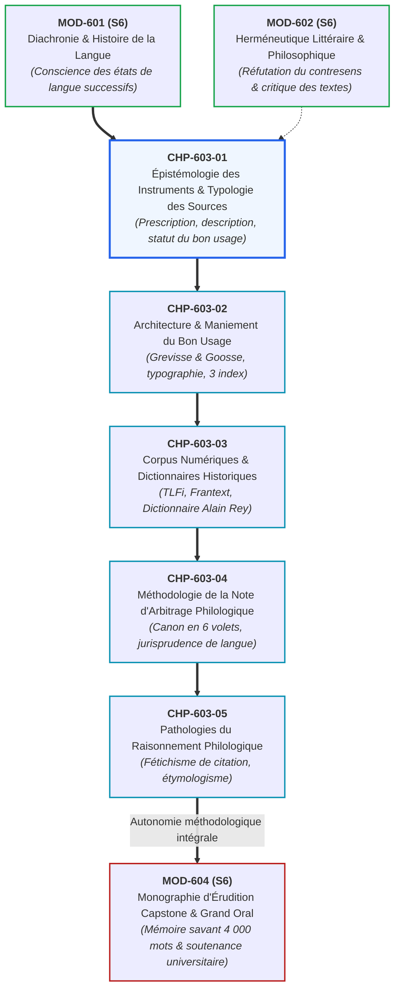
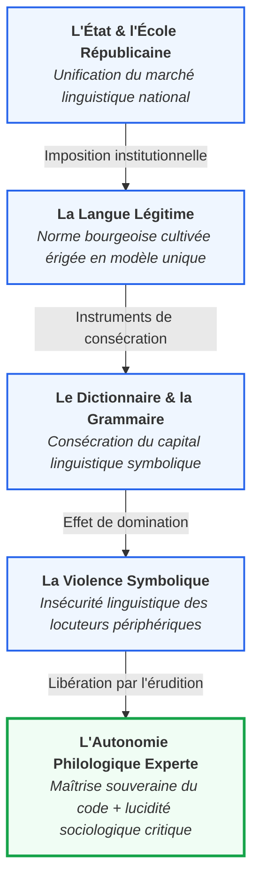
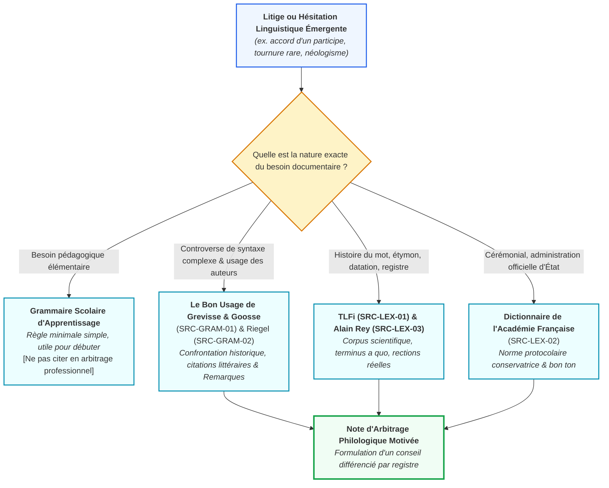

# Chapitre 1 : Épistémologie des Instruments de Référence et Typologie Critique des Sources : Prescription, Description et Évolution du Bon Usage

> **Identifiant** : `CHP-603-01`  
> **Module de rattachement** : [`MOD-603 — Autonomie Philologique : Méthode de Recherche Experte dans les Traités Savants`](file:///f:/Formation/world-class-french/03-curriculum/year-3/semester-6/mod-603-autonomie-philologique-recherche-traites.md)  
> **Volume horaire canonique** : 3 h 30 (Étude théorique : 1 h 00 | Pratique délibérée : 1 h 15 | Correction raisonnée : 0 h 45 | Évaluation : 0 h 30)  
> **Statut** : [STATUT : VALIDÉ]  
> **Compétences cibles** : [`FR-PHILOL-001`](file:///f:/Formation/world-class-french/02-competency-framework/competency-framework.md#fr-philol-001-autonomie-philologique-et-consultation-experte-des-sources) (L5), [`FR-INT-003`](file:///f:/Formation/world-class-french/02-competency-framework/competency-framework.md#fr-int-003-réviser-et-corriger-un-texte-tiers-en-justifiant-les-interventions) (L5), [`FR-LEXIC-001`](file:///f:/Formation/world-class-french/02-competency-framework/competency-framework.md#fr-lexic-001-précision-sémantique-nuances-synonymiques-et-collocations) (L5)  
> **Sources de référence** : `SRC-GRAM-01` (Grevisse & Goosse, *Le Bon Usage*, Préface et §), `SRC-GRAM-02` (Riegel et al., *Grammaire méthodique du français*, Avant-propos), `SRC-GRAM-03` (Le Pesant & Valette, *La Grande Grammaire du Français*), `SRC-LEX-01` (*Trésor de la Langue Française informatisé*), `SRC-LEX-02` (Académie française, *Dictionnaire de l'Académie française*, 9e éd., rubrique « Dire, ne pas dire »), `SRC-LEX-03` (Alain Rey, *Dictionnaire historique de la langue française*), `SRC-LEX-04` (Paul Robert & Alain Rey, *Le Grand Robert de la langue française*), `SRC-LEX-05` (Émile Littré, *Dictionnaire de la langue française*), `SRC-NORM-02` (Conseil supérieur de la langue française, *Les rectifications de l'orthographe*, 1990), `SRC-NORM-03` (Ministère de l'Éducation nationale, *Terminologie grammaticale*), `SRC-TYPO-01` (*Lexique des règles typographiques en usage à l'Imprimerie nationale*)

---

## 1. Titre et Place dans le Cursus

Ce premier chapitre du module `MOD-603` fonde l'autonomie critique et la posture de recherche experte du lettré francophone. Après avoir exploré l'évolution diachronique des structures de la langue (`MOD-601`) et développé les compétences de lecture herméneutique savante (`MOD-602`), l'étudiant apprend ici à rompre avec l'illusion naïve d'une autorité grammaticale monolithique. Il acquiert la grille de lecture épistémologique indispensable pour qualifier la nature, la visée et la valeur probatoire de chaque instrument linguistique de référence avant de l'exploiter dans les chapitres suivants du module et dans son mémoire terminal (`MOD-604`).



---

## 2. Objectifs Mesurables

Au terme de ce chapitre, l'apprenant sera capable de :
1. **Classifier avec rigueur épistémologique les instruments linguistiques** : expliciter les divergences de finalités, de méthodes et d'autorité entre les grammaires scolaires prescriptives, les dictionnaires institutionnels régulateurs (`SRC-LEX-02`), les dictionnaires descriptifs sur corpus (`SRC-LEX-01`, `SRC-LEX-04`) et les traités monumentaux d'érudition (`SRC-GRAM-01`, `SRC-GRAM-02`, `SRC-GRAM-03`).
2. **Qualifier précisément le statut normatif d'un fait de langue** : discriminer dans un litige textuel la règle obligatoire de système, la recommandation de style, la tolérance administrative d'examen, la liberté auctoriale et la censure puriste dépourvue de fondement scientifique.
3. **Restituer la généalogie historique du concept de « bon usage »** : retracer son glissement sociologique depuis la doctrine mondaine de Vaugelas au XVIIe siècle jusqu'aux modélisations contemporaines fondées sur la fréquence textuelle des grands corpus écrits et parlés.
4. **Situer la portée juridique et éditoriale des Rectifications orthographiques de 1990** (`SRC-NORM-02`) : expliquer le principe officiel de double norme légitime, l'absence de toute obligation régressive et l'adhésion conjointe des instances académiques et ministérielles francophones.
5. **Déconstruire les sophismes du purisme dogmatique** : réfuter point par point, à l'aide d'arguments d'histoire de la langue et de syntaxe descriptive, les censures naïves portées contre les usages réguliers des grands écrivains.

---

## 3. Prérequis et Test de Préparation

### 3.1 Prérequis Théoriques
- **Conscience de la diachronie linguistique** (`MOD-601`, palier L4) : compréhension des ruptures et continuités entre le français classique du XVIIe siècle, l'unification républicaine du XIXe siècle et l'état de langue contemporain.
- **Typologie des variations sociolinguistiques** (`MOD-404`, palier L4) : distinction fonctionnelle entre variation diachronique (temps), diatopique (espace géographique), diastratique (milieu social) et diaphasique (registre et situation d'énonciation).
- **Déontologie de la révision textuelle** (`MOD-504`, `FR-INT-003`, palier L4) : capacité à suspendre son jugement d'humeur devant une forme inhabituelle pour vérifier son attestation savante avant toute intervention.

### 3.2 Test Diagnostique d'Auto-Évaluation (5 items)

<details>
<summary><b>Consulter le test et son corrigé immédiat</b></summary>

1. *Quelle est la finalité première d'une grammaire scolaire d'apprentissage par rapport à un traité descriptif monumental ?*  
   **Réponse** : La grammaire scolaire vise une réduction didactique pragmatique pour stabiliser les réflexes d'un apprenant par des règles binaires (fautif / correct), tandis que le traité monumental décrit le fonctionnement réel et historique de la langue dans toute sa complexité observable sur corpus.

2. *Une citation d'un écrivain illustre (ex. Marcel Proust ou Charles de Gaulle) trouvée dans un dictionnaire suffit-elle à prouver qu'une tournure est recommandée dans une note administrative formelle ?*  
   **Réponse** : Non. Le relevé d'une attestation littéraire prouve l'existence historique ou stylistique de la forme chez un créateur, mais ne confère pas de blanc-seing dans l'usage administratif formel, qui obéit à une norme institutionnelle et déontologique plus conservatrice.

3. *Sur quel groupe social Claude Favre de Vaugelas fondait-il le « bon usage » dans ses Remarques de 1647 ?*  
   **Réponse** : Sur « la plus saine partie de la Cour, conformément à la façon d'écrire de la plus saine partie des autheurs du temps », soit une élite aristocratique restreinte, mondaine et parisienne.

4. *Les Rectifications de l'orthographe de 1990 rendent-elles les graphies traditionnelles fautives ?*  
   **Réponse** : Nullement. Le document officiel approuvé par l'Académie française et publié au Journal officiel stipule qu'aucune des deux graphies ne peut être tenue pour fautive et que l'usage ancien demeure pleinement recevable.

5. *Quelle différence fondamentale sépare une « tolérance d'examen » ministérielle d'une « règle de système » ?*  
   **Réponse** : La règle de système découle de la cohérence interne de la syntaxe admise par les scripteurs cultivés ; la tolérance d'examen est une consigne administrative interdisant aux correcteurs de pénaliser certaines hésitations graphiques ou accords réputés épineux lors d'épreuves d'État.

</details>

---

## 4. Situation de Départ ou Problème Concret

Considérons la situation d'un secrétaire général de rédaction, d'un conseiller de haute juridiction ou d'un candidat aux épreuves écrites de l'Agrégation. Examinant un manuscrit ou un rapport juridique de haute volée, il tombe sur les phrases suivantes rédigées par des stylistes accomplis :

> « Les conclusions qu'il a **fait** déposer au greffe paraissent recevables. »  
> « Cette haute magistrate a l'air **sévère**, mais elle a toujours l'air **bienveillante** envers les justiciables. »  
> « La commission s'est réunie **après que** le rapporteur **eut** déposé son mémoire. »

Un relecteur imprégné de dogmatisme scolaire primaire intervient aussitôt d'une main rageuse :
- Il censure *fait déposer* sous prétexte que le pronom *qu'* renvoie au féminin pluriel *conclusions* et qu'« il faut accorder le participe avec son COD précédent » ;
- Il biffe *bienveillante* en décrétant péremptoirement qu'après la locution *avoir l'air*, l'adjectif ne s'accorderait « jamais » avec le sujet si l'on évoque la physionomie ;
- Il condamne le subjonctif plus-que-parfait *eut déposé* en invoquant la formule consacrée des manuels d'école primaire : « *après que* veut toujours l'indicatif ».

En agissant de la sorte, ce censeur commet trois fautes méthodologiques graves :
1. Il ignore la règle de système consacrée depuis le XVIIe siècle relative à l'invariabilité de *fait* suivi d'un infinitif (`SRC-GRAM-01`, § 962) ;
2. Il ignore que la concurrence entre accord avec le sujet et accord avec le substantif *air* fait l'objet d'une double légitimité attestée depuis deux siècles chez les plus illustres auteurs (`SRC-GRAM-01`, § 448 ; `SRC-LEX-02`) ;
3. Il confond la règle mécanique scolaire avec l'usage effectif des grands prosateurs qui, par analogie avec *avant que* ou sous l'effet de la valeur aspecto-temporelle de l'antériorité accomplie, ont abondamment employé le subjonctif après *après que*, fait d'usage minutieusement documenté par Goosse (`SRC-GRAM-01`, § 1111).

Le philologue expert ne s'en remet jamais à des souvenirs de collège ni à des oukases de salon : il sait où chercher, comment lire un apparat critique, et comment pondérer la valeur probatoire des instruments savants.

---

## 5. Explication Intuitive : Le Code de la Route et la Jurisprudence de la Cour Suprême

Pour appréhender la hiérarchie épistémologique des ouvrages de langue, considérons l'analogie du système judiciaire :

- **Le Code de la route élémentaire (La grammaire scolaire d'apprentissage)** :  
  Pour apprendre à de jeunes conducteurs à circuler sans péril immédiat, on leur enseigne des règles simples, tranchées et absolues : feu rouge = arrêt absolu, feu vert = passage. On ne leur explique pas que, dans certains cas d'urgence légale ou d'intersections complexes régies par un agent de police, le franchissement du feu rouge est autorisé ou commandé. Cette binarité simplificatrice est indispensable à l'apprentissage primaire, mais désastreuse si on la prend pour le sommet de la science juridique.

- **La circulaire administrative de police (Le dictionnaire institutionnel de l'Académie)** :  
  L'Académie française (`SRC-LEX-02`) agit à l'instar d'une préfecture de police linguistique. Elle émet des avis conservateurs, rappelle les convenances officielles et cherche à maintenir l'ordre public de la langue d'apparat. Ses condamnations dans les rubriques « Dire, ne pas dire » sont des consignes de prudence institutionnelle, non des vérités linguistiques absolues.

- **Le Recueil intégral des arrêts et la doctrine de la Cour de cassation (Le traité monumental de Grevisse & Goosse)** :  
  *Le Bon Usage* (`SRC-GRAM-01`) n'est pas un code élémentaire : c'est la jurisprudence vivante de la langue française. Il recense deux siècles de pratique textuelle des grands auteurs, consigne les arrêts contradictoires, écoute les réquisitoires des puristes, met en balance la tradition monarchique et l'évolution contemporaine, et explicite la marge d'interprétation souveraine reconnue à l'écrivain et au magistrat de l'écrit.

---

## 6. Définitions Précises et Terminologie

- **Épistémologie linguistique** : Étude critique des principes, des hypothèses, des méthodes et de la valeur probatoire des savoirs linguistiques. Elle interroge la manière dont les règles de langue sont construites, légitimées et transmises par les instruments d'autorité (`SRC-GRAM-02`, Avant-propos).
- **Approche prescriptive (ou normative)** : Démarche intellectuelle et éditoriale visant à légiférer sur la langue, à dicter le devoir-être linguistique, à sélectionner une variété de langue érigée en modèle exclusif et à proscrire les formes jugées fautives ou vulgaires.
- **Approche descriptive sur corpus** : Démarche scientifique consistant à observer, inventorier, analyser et modéliser les faits de langue réels tels qu'ils se manifestent dans des corpus écrits et oraux attestés, sans porter de jugement moral ou esthétique préalable.
- **Régulateur institutionnel** : Organisme public ou académique investi par l'État ou la tradition d'une mission de codification et de veille normative (ex. l'Académie française en France, le Conseil supérieur de la langue française, l'Office québécois de la langue française).
- **Bon usage selon Vaugelas (1647)** : Définition historique énoncée dans la préface des *Remarques sur la langue françoise*, posant que le bon usage est la façon de parler de « la plus saine partie de la Cour », régulée par « la façon d'écrire de la plus saine partie des autheurs du temps ».
- **Bon usage moderne (descriptif cultivé)** : Conception contemporaine défendue par Maurice Grevisse et André Goosse (`SRC-GRAM-01`, Préface), définissant la norme supérieure comme la synthèse vivante des régularités morphosyntaxiques et des innovations expressives observées chez l'ensemble des écrivains et scripteurs cultivés de l'aire francophone.
- **Norme endogène cultivée** : Variété de français standard appropriée et stabilisée au sein d'une communauté francophone particulière (ex. français cultivé du Québec, de Belgique, de Suisse, du Sénégal ou du Bénin), légitimée par ses propres institutions et ses grands auteurs (`SRC-SOCIO-01`).
- **Tolérance d'examen (ou administrative)** : Dérogation formelle édictée par une autorité ministérielle (ex. arrêtés français de 1901 et 1976), enjoignant aux correcteurs d'épreuves officielles de ne pas sanctionner certaines variantes graphiques ou hésitations d'accord historiquement fondées.
- **Licence d'auteur (ou liberté stylistique)** : Écart délibéré ou singularité morphosyntaxique assumée par un grand écrivain dans un dessein esthétique, expressif ou rythmique, qui enrichit le corpus littéraire sans nécessairement valoir règle générale pour l'usage ordinaire.
- **Anomalie systémique (ou illogisme lexicalisé)** : Fait de langue dont la forme s'oppose à la logique morphologique générale, mais qui a été consacré par l'usage au point de devenir intangible (ex. l'accent circonflexe sur *boîte*, l'invariabilité de *témoin* dans *prendre à témoin*, ou le pluriel de *bonhomme* en *bonshommes*).
- **Arbitrage motivé** : Conclusion argumentée par laquelle un expert de la langue pèse les arguments historiques, logiques, textuels et institutionnels pour formuler une préconisation éditoriale adaptée à une situation d'énonciation précise.

---

## 7. Règles ou Mécanismes Fondamentaux

### 7.1 La Dialectique Prescriptive vs Descriptive : Histoire, Institutions et Enjeux de Pouvoir
La codification de la langue française ne résulte pas d'une génération spontanée, mais d'une tension continue entre la volonté politique d'unification centralisée et la réalité dynamique de l'usage vivant :

1. **La fixation monarchique du Grand Siècle (XVIIe siècle)** :  
   Fondée en 1635 par Richelieu, l'Académie française reçoit la mission explicite de « donner des règles certaines à nostre langue et la rendre pure, éloquente et capable de traiter les arts et les sciences ». Le pouvoir royal confie la langue à un cercle restreint pour en faire l'instrument diplomatique et administratif de la monarchie absolue. L'autorité repose sur la Cour et les salons précieux.
2. **L'école républicaine et la démocratisation prescriptive (XIXe siècle)** :  
   Avec les lois Ferry (1881-1882), l'État républicain érige l'orthographe unifiée et la grammaire normative en instruments d'intégration civique et de sélection sociale. La grammaire scolaire de Noël et Chapsal, puis les manuels Larousse, figent une doctrine rigide, binarisant les faits de langue en « correct » vs « fautif ».
3. **Le tournant scientifique des corpus numériques contemporains (XXe - XXIe siècles)** :  
   La constitution du laboratoire ATILF / CNRS et le déploiement de bases comme *Frantext* (plus de 5 000 œuvres littéraires numérisées du XIIe au XXIe siècle) et du *TLFi* (`SRC-LEX-01`) ont démontré que les plus grands auteurs classiques et modernes se sont constamment affranchis des simplifications prescriptives de l'école. L'opposition entre prescription et description s'est ainsi déplacée : la description scientifique sur corpus est devenue le régulateur éclairé de la prescription pédagogique (`SRC-GRAM-02`, Avant-propos).

### 7.2 Typologie Critique Quadripartite des Instruments de Référence

Le tableau ci-dessous formalise la taxonomie des ouvrages indispensables au chercheur :

| Catégorie d'instrument | Ouvrages exemplaires | Visée épistémologique | Méthodologie sous-jacente | Valeur probatoire |
| :--- | :--- | :--- | :--- | :--- |
| **1. Grammaires scolaires et d'apprentissage** | *Bescherelle*, manuels de collège/lycée, guides de révision élémentaires | Prescriptive et didactique | Réduction binaire (*fautif* vs *correct*), gommage de la variation et de l'histoire | Nulle en contentieux savant ; purement indicative d'un consensus minimal |
| **2. Dictionnaires institutionnels régulateurs** | *Dictionnaire de l'Académie française* (9e éd., `SRC-LEX-02`), rubriques « Dire, ne pas dire » | Normative d'État, conservatoire | Sélection souveraine par cooptation des Immortels, filtre conservateur délibéré | Fait foi pour l'usage protocolaire officiel et les cérémonies d'État |
| **3. Dictionnaires descriptifs généraux sur corpus** | *TLFi* (`SRC-LEX-01`), *Le Grand Robert* (`SRC-LEX-04`), *Le Littré* (`SRC-LEX-05`), *Dictionnaire Alain Rey* (`SRC-LEX-03`) | Descriptive, historique et différentielle | Dépouillement exhaustif de corpus écrits et journalistiques, datation étymologique | Fait foi pour attester l'existence réelle d'un mot, d'un sens ou d'un registre |
| **4. Traités descriptifs monumentaux** | *Le Bon Usage* (`SRC-GRAM-01`), *Grammaire méthodique* (`SRC-GRAM-02`), *Grande Grammaire du Français* (`SRC-GRAM-03`) | Descriptive, historique, théorique et critique | Confrontation systématique de la règle scolaire, de la doctrine des grammairiens et du corpus des auteurs | **Autorité suprême** en arbitrage philologique et universitaire de haut niveau |

### 7.3 L'Évolution du Concept de « Bon Usage »

Le concept de « bon usage » a traversé trois métamorphoses historiques :

1. **La phase élitiste et mondaine (Claude Favre de Vaugelas, 1647)** :  
   Le bon usage n'est pas le reflet de la raison universelle, mais la convention d'un groupe social dominant : les courtisans et les poètes favorisés du roi. Ce qui est dit à la Cour est bon ; ce qui est dit par le peuple ou les savants provinciaux est décrété corrompu.
2. **La phase classique et bourgeoise (XVIIIe et XIXe siècles)** :  
   Avec Voltaire, d'Alembert et la Révolution, le modèle de la Cour s'effondre au profit de l'écrit littéraire imprimé. Le « bon usage » devient celui des « grands auteurs classiques » du Grand Siècle (Corneille, Racine, Molière, La Fontaine, Bossuet), transformés en modèles absolus d'imitation scolaire par la bourgeoisie montante.
3. **La phase statistique et textuelle contemporaine (Maurice Grevisse et André Goosse, XXe-XXIe s.)** :  
   Grevisse (`SRC-GRAM-01`, Préface) révolutionne la doctrine : le bon usage ne réside pas dans les décrets des grammairiens de cabinet, mais dans la constatation honnête de ce qu'ont écrit les maîtres de la langue. Goosse y adjoint le critère de fréquence statistique : lorsqu'une construction est partagée par dix écrivains majeurs de générations et de styles différents, elle cesse d'être une négligence pour devenir un fait de langue digne d'entrer dans la norme cultivée.

### 7.4 Le Statut Juridique et Pédagogique des Rectifications de 1990

Les *Rectifications de l'orthographe* publiées au Journal officiel de la République française le 6 décembre 1990 (`SRC-NORM-02`) constituent un repère épistémologique capital trop souvent dénaturé par des polémiques passionnelles :

- **Origine institutionnelle irréfutable** : Élaborées par le Conseil supérieur de la langue française sous la présidence de Maurice Druon (Secrétaire perpétuel de l'Académie française), elles ont reçu l'approbation formelle de l'Académie française à l'unanimité le 3 mai 1990, ainsi que celle des conseils officiels de Belgique et du Québec.
- **Principe de la double norme légitime** : Le texte officiel proclame solennellement qu'aucune contrainte rétroactive n'est imposée : *« Les deux graphies sont admises, aucune ne peut être tenue pour fautive »*.
- **Périmètre ciblé** : Soudure des mots composés (*portemonnaie*, *weekend*), régularisation des pluriels de mots composés (*des essuie-mains*), harmonisation des accents (*évènement*, *céleri*), suppression de l'accent circonflexe sur le *i* et le *u* lorsqu'il ne joue aucun rôle distinctif d'homophonie (*boite*, *connaitre*, mais maintien sur *dû, mûr, jeûne, vîmes*), et accord du participe passé de *laisser* suivi d'un infinitif sur le modèle de *faire* (*elle s'est laissé mourir*).
- **Conséquence pour le philologue** : Tout relecteur ou correcteur qui sanctionne une graphie rectifiée de 1990 commet un abus d'autorité contraire aux textes officiels d'État ; symétriquement, sanctionner la graphie traditionnelle relève d'un dogmatisme tout aussi condamnable.

---

## 8. Raisonnement Détaillé : La Double Fidélité du Philologue

Pourquoi le véritable savant de la langue ne méprise-t-il ni la règle prescriptive ni la souveraineté de l'usage ?

1. **La nécessité vitale de la norme prescriptive** :  
   Si la langue était abandonnée à la spontanéité exclusive des usagers sans aucun centre de gravité normatif, elle éclaterait rapidement en topolectes et sociolectes inintelligibles. La norme écrite standard est le contrat social qui permet à un juriste béninois, un médecin vaudois, un professeur sénégalais et un diplomate québécois de rédiger des traités communs compris de tous avec une clarté univoque. Le philologue respecte profondément cette fonction unificatrice et sécurisante.

2. **La lucidité historique face à la vie organique de la langue** :  
   Dans le même temps, le philologue sait que la langue n'est pas un monument de marbre achevé au XVIIe siècle, mais un fleuve continu. Si les grammairiens puristes avaient réussi à geler la langue à chaque époque, le français n'aurait jamais vu le jour : nous en serions encore à condamner les « barbarismes » gallo-romains corrompant le latin de Cicéron. Les grands écrivains ne violent pas la langue par caprice : ils explorent les potentialités de son système pour donner forme à des pensées inédites.

3. **La synthèse philologique souveraine** :  
   Le savant refuse donc à la fois :
   - *Le purisme régressif* qui érige chaque règle scolaire en absolu métaphysique et traite les grands créateurs comme des écoliers indisciplinés ;
   - *Le relativisme laxiste* qui prétend que « tout se vaut » dès lors qu'un mot a été prononcé sur un réseau social ou dans la rue.  
   L'expert évalue chaque fait de langue à l'aune de son registre, de son genre discursif, de sa cohérence systémique et de sa légitimité textuelle attestée (`SRC-GRAM-01`, Préface).

---

## 9. Exemples Corrects Commentés : Décorticage Contrasté d'une Hésitation Grammaticale

Pour mesurer la divergence de traitement entre les instruments, disséquons la célèbre question de l'accord de l'adjectif attribut après la locution **avoir l'air** dans quatre types d'ouvrages :

> Phrase test : « Cette magistrate a l'air **sévère** » vs « Cette magistrate a l'air **sévère / sévère** ».

```text
CONFRONTATION DES QUATRE SOURCES SUR L'ACCORD AVEC « AVOIR L'AIR »
├── 1. MANUEL DE COLLÈGE (Grammaire prescriptive élémentaire) :
│   └── Énonce une règle binaire : « Si le sujet est une personne, l'adjectif s'accorde avec le sujet.
│       Si le sujet est une chose, l'adjectif reste invariable et s'accorde avec le nom air. »
│       Verdict : Décrète que « Cette femme a l'air doux » est une faute grossière.
│
├── 2. DICTIONNAIRE DE L'ACADÉMIE FRANÇAISE (SRC-LEX-02, rubrique « Dire, ne pas dire ») :
│   └── Rappelle la distinction sémantique :
│       - Si « avoir l'air » signifie « sembler, paraître », l'accord se fait avec le sujet animé (« elle a l'air douce »).
│       - Si « air » conserve son sens premier de physionomie, mine ou contenance, l'accord se fait avec « air »
│         au masculin (« elle a l'air sévère, elle a l'air martial »).
│       Verdict : Tolère les deux formes selon l'intention de focalisation, avec préférence pour l'accord avec le sujet.
│
├── 3. GRAMMAIRE MÉTHODIQUE DU FRANÇAIS (SRC-GRAM-02, Riegel et al., chap. VII) :
│   └── Analyse syntaxique formelle et diachronique :
│       - « Avoir l'air » est une locution verbale en cours de grammaticalisation comme verbe copule semi-auxiliaire.
│       - Deux structures concurrentes coexistent dans le système :
│         a) Structure analytique : [avoir] + [l'air (N-COD)] + [adjectif épithète lié à air] -> masculin singulier.
│         b) Structure semi-auxiliaire : [avoir l'air (V-copule)] + [adjectif attribut du sujet] -> accord avec le sujet.
│       Verdict : Constate la grammaticalisation croissante de la locution, rendant les deux solutions syntaxiquement légitimes.
│
└── 4. LE BON USAGE DE GREVISSE ET GOOSSE (SRC-GRAM-01, § 448) :
    └── Traité monumental exhaustif :
        - Analyse 12 citations littéraires du XVIIe au XXe siècle démontrant que les deux accords ont été pratiqués
          par les plus grands maîtres de la prose française :
          * Fénelon : « Elle avait l'air un peu timide » ;
          * Voltaire : « Des personnes qui ont l'air si sévère » ;
          * George Sand : « Elle avait l'air mourante » ;
          * Marcel Proust : « Ces jeunes filles avaient l'air contentes ».
        - Goosse réfute les arguties des puristes qui prétendent imposer une règle mécanique et conclut :
          « L'accord se fait à volonté soit avec le sujet, soit avec le mot air, sans que l'on puisse qualifier
          l'un ou l'autre de vicieux. Dans l'usage moderne des écrivains, l'accord avec le sujet est largement dominant. »
```

---

## 10. Contre-Exemples et Erreurs Fréquentes

Examinons en détail six erreurs épistémologiques récurrentes commises par les étudiants et les professionnels de l'écrit :

### Erreur n° 1 : L'amalgame acritique entre grammaire scolaire et traité monumental
- **Le piège** : Opposer à un confrère ou à un auteur un paragraphe du *Bescherelle* ou d'un manuel de troisième pour censurer une phrase de Montesquieu, de Chateaubriand ou d'un rapport de l'Académie des sciences morales.
- **Réfutation scientifique** : Le manuel scolaire simplifie la réalité linguistique pour des besoins d'initiation élémentaire. Seul un traité descriptif monumental appuyé sur un corpus savant (`SRC-GRAM-01`, `SRC-GRAM-02`) possède l'autorité scientifique requise pour juger de la correction d'une phrase élaborée.

### Erreur n° 2 : La confusion entre censure académique et usage des grands auteurs
- **Le piège** : Considérer qu'une tournure est « bannie de la langue française » simplement parce qu'un académicien l'a critiquée dans une chronique hebdomadaire de la rubrique « Dire, ne pas dire » (`SRC-LEX-02`).
- **Réfutation scientifique** : L'Académie française donne des recommandations institutionnelles de bon ton. L'usage réel des grands écrivains enregistre fréquemment des tours que l'Académie déconseille mais qui n'en demeurent pas moins des chefs-d'œuvre de syntaxe expressive (ex. l'emploi du subjonctif après *après que*, attesté chez Julien Gracq, Aragon ou Camus).

### Erreur n° 3 : L'illusion du dictionnaire absolu rejetant tout mot non répertorié
- **Le piège** : Décréter qu'un mot « n'existe pas » sous le prétexte qu'il ne figure ni dans le *Petit Larousse* ni dans le *Petit Robert* de l'année en cours.
- **Réfutation scientifique** : Aucun dictionnaire sur papier ne peut contenir l'intégralité du lexique français vivant. La langue génère en permanence des dérivés légitimes selon les règles morphologiques régulières du français (préfixation, suffixation, composition savante). Le dictionnaire descriptif constate les lemmes lexicalisés, il n'épuise pas la créativité morphologique du système (`SRC-LEX-03`).

### Erreur n° 4 : L'ignorance du décalage diachronique d'une norme ancienne
- **Le piège** : Condamner un emploi contemporain au motif qu'au XVIIe siècle ou en latin classique, le terme possédait un autre sens ou se construisait avec une autre préposition.
- **Réfutation scientifique** : C'est le sophisme puriste de l'étymologisme figé. Les mots changent de régime prépositionnel et de spectre sémantique à travers les siècles. Condamner *initier* au sens d'entamer une démarche ou *opportunité* au sens d'occasion favorable en brandissant le latin relève de l'anachronisme méthodologique (`SRC-LEX-01`, `SRC-LEX-03`).

### Erreur n° 5 : Le refus dogmatique des rectifications orthographiques de 1990
- **Le piège** : Biffer d'une marque rouge infamante la graphie *ognon*, *nénufar*, *connaitre* ou *il s'est laissé mourir*, en dénonçant une « déchéance nationale ».
- **Réfutation scientifique** : Les rectifications de 1990 (`SRC-NORM-02`) émanent des instances légitimes de l'État et de l'Académie française. Les deux graphies (traditionnelle et rectifiée) sont également officielles. L'expert maîtrise les deux systèmes et refuse d'ériger sa nostalgie affective en règle de droit linguistique.

### Erreur n° 6 : L'oubli de la contextualisation par registre et genre de texte
- **Le piège** : Évaluer de manière indifférenciée une loi organique, un poème en vers libres, un éditorial de presse et un traité de philosophie avec une seule et même toise normative.
- **Réfutation scientifique** : La validité d'une forme linguistique dépend indissociablement de sa situation d'énonciation. Ce qui constitue une liberté heureuse en poésie contemporaine peut constituer une faute professionnelle inadmissible dans les attendus d'un arrêt de Conseil constitutionnel.

```text
Tableau Clinique des Fautes Épistémologiques
┌──────────────┬──────────────────────────────────────────┬───────────────────────────────────────────────┬────────────────────────────────────────────────────────┐
│ Cas clinique │ Erreur diagnostiquée                     │ Risque professionnel                          │ Principe épistémologique rétabli                       │
├──────────────┼──────────────────────────────────────────┼───────────────────────────────────────────────┼────────────────────────────────────────────────────────┤
│ Cas 1        │ Amalgame manuel scolaire / grand traité  │ Censure ridicule de phrases de grands maîtres │ Consulter Le Bon Usage avant toute affirmation péremptoire │
│ Cas 2        │ Confusion avis académique / usage d'écrivain │ Hypercorrection dogmatique sans profondeur    │ Distinguer la recommandation institutionnelle du corpus │
│ Cas 3        │ Culte du dictionnaire exhaustif fermé    │ Stérilisation de la créativité lexicale saine │ Valider la régularité morphologique dérivationnelle    │
│ Cas 4        │ Étymologisme rétrograde et anachronique  │ Condamnation illégitime d'usages stabilisés   │ Reconnaître l'évolution sémantique synchronique        │
│ Cas 5        │ Rejet puriste des Rectifications de 1990 │ Manquement aux textes officiels d'État        │ Appliquer la double norme légitime selon SRC-NORM-02   │
│ Cas 6        │ Oubli du registre et du genre textuel    │ Discordance stylistique et maladresse d'audit │ Adapter l'exigence au pacte de lecture discursif       │
└──────────────┴──────────────────────────────────────────┴───────────────────────────────────────────────┴────────────────────────────────────────────────────────┘
```

---

## 11. Cas Particuliers et Limites

### 11.1 Le Statut des Recommandations de l'Académie Française Hors de France
L'Académie française (`SRC-LEX-02`) est une institution publique française rattachée à l'Institut de France. Ses préconisations n'ont aucune valeur de loi supranationale :
- En **Belgique**, le Conseil de la langue française et de la politique linguistique émet des recommandations indépendantes, souvent pionnières (ex. la féminisation précoce des noms de métiers dès 1993) ;
- Au **Québec**, l'Office québécois de la langue française (OQLF) détient un pouvoir légal de régulation et de terminologie beaucoup plus strict que celui de l'Académie française ;
- En **Afrique subsaharienne** (Bénin, Sénégal, Côte d'Ivoire, etc.), la langue est régie par les ministères de l'Éducation nationale et l'AUF, qui s'appuient sur le consensus des traités internationaux tout en intégrant les réalités endogènes cultivées (`SRC-SOCIO-01`).

### 11.2 La Représentation des Francophonies dans les Traités Parisiens
Pendant trois siècles, les traités grammaticaux parisiens ont souffert d'un centralisme géographique aigu, reléguant tout ce qui ne venait pas d'Île-de-France au rang de « provincialismes » ou de « belgicismes » marginaux.
- *Le Bon Usage* (`SRC-GRAM-01`), conçu en Belgique par Maurice Grevisse puis repris par André Goosse, a brisé ce monopole parisien en accordant une place éminente aux citations d'écrivains belges (Maeterlinck, Simenon, Verhaeren) et suisses (Rousseau, Ramuz) ;
- La *Grande Grammaire du Français* (`SRC-GRAM-03`) et le *Dictionnaire historique d'Alain Rey* (`SRC-LEX-03`) intègrent désormais pleinement les usages du français en Afrique et en Amérique du Nord dans leur description raisonnée.

---

## 12. Approfondissement Adapté au Niveau : La Sociologie du Marché Linguistique (Pierre Bourdieu)

Pour le lettré accédant au palier L5, l'épistémologie de la norme doit être éclairée par les analyses de la sociologie de la domination symbolique, formalisées par Pierre Bourdieu dans *Ce que parler veut dire : L'économie des échanges linguistiques* (1982) :



1. **La production de la langue légitime** :  
   Bourdieu démontre que la « pureté de la langue » n'est pas une réalité naturelle, mais une construction historique produite par l'appareil d'État et le système scolaire. L'unification du marché linguistique a pour effet de dévaluer automatiquement tous les parlers populaires, régionaux ou périphériques.
2. **Le dictionnaire comme trésor du capital symbolique** :  
   Le dictionnaire officiel n'est pas un simple inventaire neutre : c'est l'étalon monétaire du marché linguistique. Ceux qui maîtrisent spontanément ses codes (les héritiers culturels) y trouvent une justification de leur supériorité sociale ; ceux qui le découvrent tardivement ressentent une profonde *insécurité linguistique*.
3. **La posture souveraine du philologue d'élite** :  
   L'expert formé à `MOD-603` ne subit pas cette violence symbolique : il la décode. Il sait que la norme standard est une convention sociale indispensable aux échanges académiques, juridiques et internationaux, mais il refuse de lui attribuer une perfection transcendante et regarde avec respect et intérêt les variations dialectales et régionales du français vivant.

---

## 13. Comparaisons Différentielles

### 13.1 Traité Descriptif Savant vs Grammaire Prescriptive Scolaire

| Dimension d'analyse | Traité descriptif savant (*Le Bon Usage*, `SRC-GRAM-01`) | Grammaire prescriptive scolaire (*Bescherelle*, manuels) |
| :--- | :--- | :--- |
| **Objectif premier** | Décrire, dater, expliquer et nuancer la réalité textuelle | Fixer des automatismes et éliminer l'hésitation graphique |
| **Traitement de l'erreur** | Analyse historique des origines d'un écart ou d'une variante | Sanction binaire immédiate (*fautif* vs *correct*) |
| **Appui empirique** | Immense corpus d'auteurs de renom et dépouillements textuels | Phrases fabriquées pour illustrer artificiellement la règle |
| **Gestion des exceptions** | Explication par l'évolution phonétique et la syntaxe ancienne | Liste arbitraire d'anomalies à apprendre par cœur |
| **Public cible** | Chercheurs, enseignants, magistrats, écrivains, réviseurs | Élèves du primaire, collégiens, scripteurs débutants |

### 13.2 Dictionnaire de l'Académie Française vs Trésor de la Langue Française informatisé

| Caractéristique | *Dictionnaire de l'Académie* (9e éd., `SRC-LEX-02`) | *Trésor de la Langue Française informatisé* (`SRC-LEX-01`) |
| :--- | :--- | :--- |
| **Autorité tutélaire** | L'Institut de France / Académie française | Le CNRS et l'ATILF (laboratoire universitaire d'État) |
| **Corpus d'élaboration** | Choix souverain des Immortels par délibération | 100 millions de mots de textes littéraires et scientifiques |
| **Traitement du registre** | Exclut l'argot non lexicalisé, filtre le vocabulaire technique | Recense tous les registres (populaire, technique, littéraire) |
| **Appareil étymologique** | Bref et indicatif | Exhaustif, avec première attestation datée (*terminus a quo*) |
| **Rôle en contentieux** | Fait autorité pour les documents d'apparat d'État | Fait autorité pour la linguistique historique et l'édition savante |

### 13.3 Bon Usage selon Vaugelas (1647) vs Bon Usage Contemporain (Grevisse & Goosse)

| Critère | Doctrine de Claude Favre de Vaugelas (1647) | Doctrine moderne de Grevisse & Goosse (2016) |
| :--- | :--- | :--- |
| **Groupe de référence** | L'entourage immédiat du Roi (la Cour de Versailles) | L'ensemble des écrivains et scripteurs cultivés francophones |
| **Rôle de l'écrivain** | Soumis au parler mondain des gens de la Cour | Modèle premier d'observation des virtualités de la langue |
| **Géographie** | Strictement parisienne et versaillaise | Francophonie internationale (France, Belgique, Québec, Afrique) |
| **Méthode d'arbitrage** | Le sentiment spontané et l'oreille des courtisans | L'analyse textuelle sur corpus et la fréquence statistique |

---

## 14. Exercices Progressifs (3 Niveaux)

### Niveau 1 : Discrimination et Qualification Épistémologique (Guidé)
*Consigne : Pour chacune des 10 affirmations suivantes, identifiez son statut épistémologique exact parmi : **[A] Règle de système** ; **[B] Recommandation institutionnelle d'apparat** ; **[C] Réduction scolaire binaire** ; **[D] Censure puriste infondée** ; **[E] Tolérance d'examen officielle** ; **[F] Double norme légitime (1990)**.*

1. « On ne doit jamais commencer une phrase française par la conjonction *Mais* ou *Et*. »
2. « Le participe passé employé avec *avoir* s'accorde en genre et en nombre avec le COD s'il en est précédé. »
3. « L'emploi de *bravitude* est formellement interdit par les lois fondamentales de la République. »
4. « Lors des épreuves du baccalauréat, aucune pénalité ne sera appliquée pour l'absence d'accord du participe passé dans *les deux heures qu'il a dormi*. »
5. « On peut écrire indifféremment *nénuphar* avec un *ph* ou *nénufar* avec un *f*. »
6. « Il est recommandé dans les discours officiels d'éviter l'anglicisme *impacter* et de préférer *avoir une incidence sur*. »
7. « Tout adjectif de couleur dérivé d'un nom de fruit ou de pierre précieuse est rigoureusement invariable, sans aucune exception concevable. »
8. « Le verbe *solutionner* doit être proscrit absolument car il n'existait pas chez Bossuet. »
9. « Les adjectifs numéraux composés sont reliés par des traits d'union à tous les rangs (*deux-cents*, *trois-mille-quatre-cents*) dans l'orthographe rectifiée. »
10. « Dans une proposition subordonnée introduite par *bien que*, le verbe se met obligatoirement au subjonctif. »

<details>
<summary><b>Consulter le corrigé du Niveau 1</b></summary>

1. **[C] Réduction scolaire binaire** : Les plus illustres prosateurs français (Hugo, Chateaubriand, Proust, Gracq) ont abondamment ouvert des paragraphes par *Mais* ou *Et* pour créer une rupture rythmique.
2. **[A] Règle de système** : Règle historique de morphosyntaxe standard admise par l'ensemble des traités savants (`SRC-GRAM-01`, § 948).
3. **[D] Censure puriste infondée** : La loi républicaine ne légifère pas sur le lexique privé ; la dérivation suffixale en *-itude* est parfaitement régulière en morphologie française.
4. **[E] Tolérance d'examen officielle** : Dérogation ministérielle interdisant la pénalisation sur les verbes intransitifs de mesure.
5. **[F] Double norme légitime (1990)** : Conformément au Journal officiel du 6 décembre 1990 (`SRC-NORM-02`), le *f* rétablit l'étymon perso-arabe d'origine.
6. **[B] Recommandation institutionnelle d'apparat** : Avis de bon goût et de tenue stylistique émis par l'Académie française (`SRC-LEX-02`).
7. **[C] Réduction scolaire binaire** : Les adjectifs *châtain, écarlate, fauve, pourpre, incarnat, mauve, rose* s'accordent régulièrement bien qu'issus de noms.
8. **[D] Censure puriste infondée** : Sophisme anachronique réfuté par Grevisse (`SRC-GRAM-01`, § 280) ; *solutionner* est un verbe d'usage courant et indispensable.
9. **[F] Double norme légitime (1990)** : Règle officielle de rationalisation des traits d'union (`SRC-NORM-02`).
10. **[A] Règle de système** : Rection modale obligatoire en français contemporain soutenu et académique (`SRC-GRAM-02`, chap. XVII).

</details>

---

### Niveau 2 : Confrontation Critique Documentaire (Semi-autonome)
*Consigne : On lit fréquemment sur les forums ou dans les copies de lycée l'affirmation suivante : « L'emploi du subjonctif après la locution *après que* est une faute impardonnable ». Rédigez un paragraphe d'analyse critique confrontant la doctrine prescriptive scolaire, la notice de l'Académie française (`SRC-LEX-02`) et le corpus de faits consigné par Grevisse et Goosse (`SRC-GRAM-01`, § 1111).*

<details>
<summary><b>Consulter le corrigé du Niveau 2</b></summary>

**Corrigé raisonné d'expertise philologique :**  
D'un point de vue logique et morphologique strict, la conjonction *après que* marque une antériorité temporelle achevée (le fait principal succède à une action déjà accomplie dans le réel) ; l'indicatif est donc le mode logique de référence, ainsi que le rappellent les grammaires scolaires et la notice de l'Académie française (`SRC-LEX-02`). Cependant, ériger l'emploi du subjonctif en faute impardonnable relève de l'aveuglement normatif. Comme le démontre André Goosse dans *Le Bon Usage* (`SRC-GRAM-01`, § 1111), le subjonctif après *après que* s'est développé dès le XVIe siècle sous l'influence analogique irrésistible de la locution antithétique *avant que* (qui exige le subjonctif) et de l'ensemble des conjonctions temporelles ou concessives en *que*. Grevisse recense ainsi des centaines d'occurrences au subjonctif chez des stylistes incontestés tels que Montesquieu, Rousseau, Chateaubriand, Balzac, Flaubert, Maupassant, Proust, Gide, Colette, Malraux et de Gaulle. Le philologue conclura que si l'indicatif demeure la norme absolue recommandée pour les actes administratifs et juridiques formels afin d'éviter tout reproche de purisme scolaire, le subjonctif relève d'une tendance historique lourde et ne saurait être assimilé à une barbarie ignorante lorsqu'il se rencontre sous la plume d'un auteur de renom.

</details>

---

### Niveau 3 : Synthèse Épistémologique Haute Précision (Autonome)
*Consigne : Rédigez un texte de synthèse épistémologique dense sur la dialectique entre norme prescriptive et usage textuel. Le texte doit comporter **très exactement cinquante (50) mots**, selon le décompte typographique certifié de l'Imprimerie nationale (`SRC-TYPO-01`) où tout bloc séparé par une espace ou une apostrophe compte pour un mot.*

<details>
<summary><b>Consulter le corrigé du Niveau 3</b></summary>

**Texte calibré à très exactement 50 mots :**  
> « Le philologue ne confond jamais la règle d'école et la vie d'une langue historique. Il consulte les traités descriptifs pour observer l'usage réel des grands écrivains. La norme prescriptive organise la communication sociale, mais seul le corpus textuel valide la légitimité des formes dans chaque registre discursif. »

**Tableau de vérification arithmétique token par token (50 mots selon SRC-TYPO-01) :**

| N° | Token | N° | Token | N° | Token | N° | Token | N° | Token |
| :---: | :--- | :---: | :--- | :---: | :--- | :---: | :--- | :---: | :--- |
| **1** | Le | **11** | et | **21** | traités | **31** | La | **41** | corpus |
| **2** | philologue | **12** | la | **22** | descriptifs | **32** | norme | **42** | textuel |
| **3** | ne | **13** | vie | **23** | pour | **33** | prescriptive | **43** | valide |
| **4** | confond | **14** | d' | **24** | observer | **34** | organise | **44** | la |
| **5** | jamais | **15** | une | **25** | l' | **35** | la | **45** | légitimité |
| **6** | la | **16** | langue | **26** | usage | **36** | communication | **46** | des |
| **7** | règle | **17** | historique | **27** | réel | **37** | sociale | **47** | formes |
| **8** | d' | **18** | Il | **28** | des | **38** | mais | **48** | dans |
| **9** | école | **19** | consulte | **29** | grands | **39** | seul | **49** | chaque |
| **10**| et | **20** | les | **30** | écrivains | **40** | le | **50** | registre |

*(Note : « d' » et « école », « d' » et « une », « l' » et « usage » forment chacun deux mots distincts conformément au standard typographique de référence).*

</details>

---

## 15. Activité de Correction Raisonnée

### Contexte de la Mission
Vous êtes nommé secrétaire général de la rédaction d'une grande revue universitaire de sciences humaines. Un polémiste médiatique de salon vous soumet une tribune incendiaire intitulée *« Requiem pour la grammaire française massacrée »*. Le texte est truffé de huit (8) confusions épistémologiques et sophismes d'autorité puristes.

### Texte Soumis à l'Audit Critique :
> « Notre langue s'effondre sous nos yeux. Ouvrez les journaux : on y lit que telle commission s'est réunie *après qu'elle eût délibéré*, alors que le Dictionnaire de l'Académie condamne ce subjonctif comme une hérésie barbare ! Pis encore, nos prétendus stylistes écrivent *des essuiemains* ou *desognons* sous le prétexte fallacieux des rectifications de 1990, comme si des décrets administratifs pouvaient modifier la langue de Bossuet sans l'accord des vrais amoureux des lettres. Grevisse lui-même, dans son *Bon Usage*, n'a-t-il pas répété que le participe passé de faire suivi d'un infinitif doit s'accorder avec son complément d'objet dès lors que le sujet a agi ? Et que dire de ce verbe immonde *solutionner*, absent du Grand Littré et que tout dictionnaire digne de ce nom devrait rejeter au pilon ? La règle de grammaire est une vérité éternelle, divine, absolue. Quiconque s'écarte de la règle apprise à l'école primaire commet un péché contre l'esprit républicain. Il n'y a pas d'usage qui tienne : il n'y a que la loi des dictionnaires ! »

### Apparat Critique et Réfutation Méthodique des Huit Fautes Épistémologiques :

1. **Faute 1 : Assimilation de la recommandation académique à une vérité scientifique universelle** :  
   *Réfutation* : L'auteur érige la notice du Dictionnaire de l'Académie (`SRC-LEX-02`) en décret absolu. Or, l'Académie émet des conseils de bon usage institutionnel. Le subjonctif après *après que* est une construction attestée chez plus de cinquante écrivains majeurs recensés par André Goosse (`SRC-GRAM-01`, § 1111).
2. **Faute 2 : Négation illégitime de la validité d'État des Rectifications de 1990** :  
   *Réfutation* : L'auteur qualifie de « prétexte fallacieux » les Rectifications de 1990 (`SRC-NORM-02`). Or, ce texte a été approuvé par l'Académie française elle-même à l'unanimité le 3 mai 1990 et publié au Journal officiel. La graphie *essuiemain* (ou *essuie-main* au pluriel régularisé *essuie-mains*) et *ognon* est juridiquement et pédagogiquement légitime.
3. **Faute 3 : Attribution apocryphe et contresens magistral sur la doctrine de Grevisse** :  
   *Réfutation* : L'auteur ose affirmer que Grevisse prescrirait l'accord de *fait* suivi d'un infinitif ! C'est l'exact contraire : Maurice Grevisse et André Goosse démontrent au § 962 du *Bon Usage* (`SRC-GRAM-01`) que *fait* suivi d'un infinitif forme une unité verbale indissociable et demeure **rigoureusement invariable** (*les lettres qu'il a fait envoyer*, et jamais *\*faites envoyer*).
4. **Faute 4 : Sophisme de l'étymologisme figé et culte anachronique du Littré** :  
   *Réfutation* : Rejeter le verbe *solutionner* sous prétexte qu'il est absent du Littré (achevé en 1877) relève du non-sens diachronique (`MOD-601`). La langue évolue pour désigner de nouvelles réalités. *Solutionner* est attesté dans tous les dictionnaires contemporains (`SRC-LEX-01`, `SRC-LEX-04`) et remplit une fonction sémantique précise distincte de *résoudre*.
5. **Faute 5 : Métaphysique dogmatique (« vérité éternelle, divine, absolue »)** :  
   *Réfutation* : La grammaire n'est pas une théologie révélée, mais un système sociohistorique de conventions humaines soumis à la variation et à l'évolution (`SRC-GRAM-02`, Avant-propos).
6. **Faute 6 : Érection de la grammaire scolaire d'école primaire en toise universelle** :  
   *Réfutation* : Les manuels élémentaires binarisent les règles pour un public d'enfants débutants. Les prétendre supérieures aux traités descriptifs monumentaux et à la littérature relève de l'anti-intellectualisme naïf.
7. **Faute 7 : Confusion axiologique entre la loi étatique et la description lexicographique** :  
   *Réfutation* : L'auteur proclame : *« il n'y a que la loi des dictionnaires »*. Un dictionnaire de langue (comme le Robert ou le TLFi) n'est pas un code pénal ; il ne fait pas la loi, il enregistre les faits de langue observés sur corpus (`SRC-LEX-01`).
8. **Faute 8 : Censure du concept même d'usage linguistique** :  
   *Réfutation* : Prétendre qu'« il n'y a pas d'usage qui tienne » constitue le suicide de toute pensée linguistique. Comme l'affirmait déjà Vaugelas en 1647 et Grevisse en 1936, **l'usage est le maître souverain de la langue** ; les dictionnaires et grammaires n'en sont que les greffiers scrupuleux et respectueux.

---

## 16. Mise en Pratique dans une Production Réelle

### La Charte Épistémologique de l'Expert Philologue
En tant qu'arbitre de langue, censeur éditorial ou candidat de haut niveau, vous devez consigner vos engagements déontologiques dans une charte méthodologique. Ce texte de référence doit comporter **très exactement soixante (60) mots**, selon le décompte rigoureux de l'Imprimerie nationale (`SRC-TYPO-01`).

```text
« L'expert philologue suspend son jugement dogmatique avant d'examiner les corpus
savants. Il refuse de confondre la règle d'école avec l'usage vivant des écrivains.
Face au doute, il consulte les traités descriptifs et confronte l'histoire des formes.
Son arbitrage est mesuré, impartial, fondé sur les faits observables et attentif aux
registres de discours dans chaque énonciation. »
```

### Tableau de Décompte Token par Token Certifié (60 Mots selon SRC-TYPO-01) :

| N° | Token | Catégorie grammaticale | N° | Token | Catégorie grammaticale | N° | Token | Catégorie grammaticale |
| :---: | :--- | :--- | :---: | :--- | :--- | :---: | :--- | :--- |
| **1** | L' | Déterminant élidé | **21** | école | Substantif | **41** | formes | Substantif |
| **2** | expert | Substantif | **22** | avec | Préposition | **42** | Son | Déterminant possessif |
| **3** | philologue | Substantif en apposition | **23** | l' | Déterminant élidé | **43** | arbitrage | Substantif |
| **4** | suspend | Verbe | **24** | usage | Substantif | **44** | est | Verbe |
| **5** | son | Déterminant possessif | **25** | vivant | Adjectif qualificatif | **45** | mesuré | Adjectif qualificatif |
| **6** | jugement | Substantif | **26** | des | Article partitif/défini | **46** | impartial | Adjectif qualificatif |
| **7** | dogmatique | Adjectif qualificatif | **27** | écrivains | Substantif | **47** | fondé | Adjectif qualificatif |
| **8** | avant | Préposition temporelle | **28** | Face | Substantif (locution) | **48** | sur | Préposition |
| **9** | d' | Préposition élidée | **29** | au | Article contracté | **49** | les | Déterminant défini |
| **10** | examiner | Verbe à l'infinitif | **30** | doute | Substantif | **50** | faits | Substantif |
| **11** | les | Déterminant défini | **31** | il | Pronom personnel sujet | **51** | observables | Adjectif qualificatif |
| **12** | corpus | Substantif | **32** | consulte | Verbe | **52** | et | Conjonction de coordination |
| **13** | savants | Adjectif qualificatif | **33** | les | Déterminant défini | **53** | attentif | Adjectif qualificatif |
| **14** | Il | Pronom personnel sujet | **34** | traités | Substantif | **54** | aux | Article contracté |
| **15** | refuse | Verbe | **35** | descriptifs | Adjectif qualificatif | **55** | registres | Substantif |
| **16** | de | Préposition | **36** | et | Conjonction de coordination | **56** | de | Préposition |
| **17** | confondre | Verbe à l'infinitif | **37** | confronte | Verbe | **57** | discours | Substantif |
| **18** | la | Déterminant défini | **38** | l' | Déterminant élidé | **58** | dans | Préposition |
| **19** | règle | Substantif | **39** | histoire | Substantif | **59** | chaque | Déterminant indéfini |
| **20** | d' | Préposition élidée | **40** | des | Article contracté | **60** | énonciation | Substantif |

---

## 17. Résumé Structuré : L'Arbre des Sources et la Matrice Décisionnelle

### Logigramme de Qualification des Sources en Situation Litigieuse



### Matrice des 4 Critères Cardinaux d'Arbitrage Philologique :
1. **Le critère diachronique** : À quelle époque la forme est-elle apparue ? S'agit-il d'un archaïsme désuet, d'une évolution stabilisée ou d'une innovation en cours de diffusion ?
2. **Le critère systémique (ou morphosyntaxique)** : La forme respecte-t-elle la logique interne et les analogies structurales de la langue française ?
3. **Le critère textuel (ou auctorial)** : La tournure est-elle attestée chez plusieurs écrivains réputés sans intention parodique ou relâchée ?
4. **Le critère diaphasique (ou situationnel)** : Le tour convient-il au registre et au genre discursif attendus (diplomatie, cour de justice, presse, fiction romanesque) ?

---

## 18. Questions de Rappel Actif (Active Recall)

<details>
<summary><b>1. Pourquoi une grammaire scolaire élémentaire ne peut-elle jamais faire foi dans un litige philologique ou juridique d'envergure ?</b></summary>
Parce qu'une grammaire scolaire pratique une réduction didactique volontaire destinée à poser des réflexes initiaux chez l'enfant ou le débutant ; elle élimine les nuances diachroniques, méconnaît la variation stylistique et présente comme des interdits absolus de simples préférences pédagogiques ou des règles approximatives.
</details>

<details>
<summary><b>2. Quelle est la mission historique et juridique assignée à l'Académie française par ses lettres patentes de 1635 ?</b></summary>
Sa mission d'État est de donner des règles certaines à la langue française, de la nettoyer des impuretés et de composer un dictionnaire, une grammaire, une rhétorique et une poétique destinés à en faire un instrument universel de communication politique et administrative au service de la nation.
</details>

<details>
<summary><b>3. En quoi consiste la révolution méthodologique apportée par Maurice Grevisse dans Le Bon Usage dès 1936 ?</b></summary>
Grevisse refuse l'arbitraire du purisme de cabinet ; il fonde la grammaire sur l'observation scrupuleuse et exhaustive de la langue telle qu'elle est réellement écrite par les grands auteurs vivants et classiques, opposant l'attestation textuelle irréfutable aux décrets dogmatiques des censeurs d'école.
</details>

<details>
<summary><b>4. Quel est le statut légal exact des Rectifications orthographiques de 1990 au regard des concours et de l'administration ?</b></summary>
Elles constituent des recommandations officielles d'État approuvées par l'Académie française et publiées au Journal officiel. Les graphies nouvelles et les graphies traditionnelles jouissent d'une égale légitimité ; aucune ne peut être sanctionnée lors d'un examen, d'un concours ou d'une procédure administrative.
</details>

<details>
<summary><b>5. Quelle distinction Pierre Bourdieu opère-t-il entre la réalité de la langue et l'imposition de la « langue légitime » ?</b></summary>
Bourdieu montre que la « langue légitime » est la variété de langue propre à la classe dominante, codifiée par les dictionnaires et imposée par l'école comme universelle, produisant une violence symbolique et un sentiment d'illégitimité chez ceux qui ne maîtrisent pas nativement ses codes académiques.
</details>

<details>
<summary><b>6. Quelle nuance fondamentale convient-il d'observer entre une attestation littéraire consignée par Goosse et une règle prescriptive ?</b></summary>
Une attestation littéraire prouve seulement qu'un écrivain a employé la tournure dans une œuvre donnée, éventuellement comme licence, archaïsme ou recherche expressive singulière. Elle ne signifie nullement que Grevisse la recommande pour la prose ordinaire, administrative ou universitaire, sauf si la doctrine en corps de texte l'avalise expressément.
</details>

---

## 19. Mini-Évaluation Sommative Notée (20 Points)

### Contexte de l'Épreuve (Durée : 30 minutes)
Vous êtes interrogé lors de l'épreuve orale et écrite d'admissibilité au titre d'Expert philologue du cursus World-Class French. Vous devez répondre par écrit à une consultation posée par une maison d'édition prestigieuse hésitant sur l'opportunité de censurer une tournure dans un essai littéraire : *« Après qu'elle soit intervenue, la présidente a eu l'air satisfaite. »*

### Barème d'Audit et Pénalités Officielles :
- **1. Qualification épistémologique des sources mobilisées** : **5 points**  
  Capacité à distinguer nettement la doctrine scolaire, le conseil académique et l'analyse descriptive de Grevisse et Riegel.
- **2. Justesse de l'analyse linguistique sur les deux points litigieux** : **5 points**  
  Analyse exacte du subjonctif après *après que* (§ 1111) et de la double possibilité d'accord avec *avoir l'air* (§ 448).
- **3. Forme de la consultation et tenue du discours** : **5 points**  
  Clarté de la démonstration, rigueur de la terminologie, respect du style académique et refus de toute morgue puriste.
- **4. Recommandation opérationnelle différenciée selon le genre** : **5 points**  
  Conseil précis distinguant la liberté de l'auteur dans l'essai littéraire des exigences formelles d'une publication administrative.

### Sanctions Pénales et Seuil Éliminatoire :
- **Confusion entre constat descriptif sur corpus et règle prescriptive obligatoire** : **-4 points** immédiats.
- **Affirmation gratuite péremptoire non étayée par un traité de référence** : **-2 points** par occurrence.
- **Erreur de langue ou faute d'orthotypographie commise par le candidat** : **-2 points** par faute.
- **Seuil éliminatoire** : Toute note strictement inférieure à **14/20** entraîne l'ajournement immédiat du candidat au module et impose un cycle de remédiation méthodologique de deux semaines.

---

## 20. Critères Observables de Maîtrise

L'apprenant valide ce premier chapitre et démontre le palier **L5 (Expertise transférable)** pour les compétences `FR-PHILOL-001`, `FR-INT-003` et `FR-LEXIC-001` lorsqu'il apporte les preuves observables suivantes :

1. **Autonomie documentaire critique** : Il ne qualifie jamais une construction linguistique de « faute » sans identifier préalablement l'ouvrage de référence idoine (`SRC-GRAM-01`, `SRC-GRAM-02`, `SRC-LEX-01`) et sans circonscrire le cadre diachronique et diaphasique du texte.
2. **Discernement épistémologique instantané** : Face à une notice de dictionnaire ou un extrait de grammaire, il explicite immédiatement si l'énoncé relève d'une loi de système, d'une convention institutionnelle, d'un constat empirique statistique ou d'un conseil d'élégance stylistique.
3. **Déconstruction courtoise et irréfutable du purisme naïf** : Il réfute les jugements péremptoires des censeurs d'école en mobilisant avec sérénité des faits d'histoire de la langue et des corpus littéraires attestés.
4. **Précision formelle dans la restitution des normes** : Il applique et commente les Rectifications de 1990 (`SRC-NORM-02`) avec une impartialité juridique totale, sans complaisance laxiste ni rejet anachronique.
5. **Calibrage scriptural de haute exactitude** : Il est capable de composer des chartes et des synthèses calibrées au mot près selon le standard typographique de l'Imprimerie nationale (`SRC-TYPO-01`).

---

## 21. Sources et Lectures Complémentaires

- **`SRC-GRAM-01`** : Maurice GREVISSE et André GOOSSE, *Le Bon Usage : Grammaire de la langue française*, 16e éd. refondue par André Goosse, Bruxelles, De Boeck Supérieur, 2016 (Préface : *La langue, la grammaire et le bon usage*, p. 5-18 ; § 448 sur *avoir l'air* ; § 962 sur *faire* + infinitif ; § 1111 sur *après que*).
- **`SRC-GRAM-02`** : Martin RIEGEL, Jean-Christophe PELLAT et René RIOUL, *Grammaire méthodique du français*, Paris, Presses Universitaires de France (PUF), coll. « Quadrige Manuels », 2016/2021 (Avant-propos : *L'esprit de cette grammaire : décrire pour comprendre*, p. 9-16 ; Chapitre XVII : *Les propositions subordonnées circonstancielles*).
- **`SRC-GRAM-03`** : Denis LE PESANT et Mathieu VALETTE (dir.), *La Grande Grammaire du Français*, Paris, Actes Sud, 2021 (Introduction méthodologique : *Corpus, variation et français contemporain*).
- **`SRC-LEX-01`** : ATILF / CNRS, *Trésor de la Langue Française informatisé (TLFi)*, Nancy, laboratoire Analyse et Traitement Informatique de la Langue Française (atilf.atilf.fr).
- **`SRC-LEX-02`** : ACADÉMIE FRANÇAISE, *Dictionnaire de l'Académie française*, 9e édition, Paris, Imprimerie nationale / Académie française (rubrique « Questions de langue » et « Dire, ne pas dire »).
- **`SRC-LEX-03`** : Alain REY (dir.), *Dictionnaire historique de la langue française*, nouvelle éd. enrichie, Paris, Dictionnaires Le Robert, 2016.
- **`SRC-LEX-04`** : Paul ROBERT et Alain REY (dir.), *Le Grand Robert de la langue française*, Paris, Dictionnaires Le Robert.
- **`SRC-LEX-05`** : Émile LITTRÉ, *Dictionnaire de la langue française (Le Littré)*, édition classique, Paris, Hachette, 1863-1877.
- **`SRC-NORM-02`** : CONSEIL SUPÉRIEUR DE LA LANGUE FRANÇAISE, *Les rectifications de l'orthographe*, Journal officiel de la République française, Documents administratifs n° 100, 6 décembre 1990, Paris.
- **`SRC-NORM-03`** : MINISTÈRE DE L'ÉDUCATION NATIONALE, *Terminologie grammaticale*, Paris, 2020.
- **`SRC-TYPO-01`** : IMPRIMERIE NATIONALE, *Lexique des règles typographiques en usage à l'Imprimerie nationale*, Paris, Imprimerie nationale, rééd. 2002/2014.

---

## Annexe : Classification Pédagogique

- **CORE-NOW** : Distinction quadripartite des instruments linguistiques (scolaires, institutionnels, descriptifs, traités monumentaux) ; dialectique prescription / description ; concept de bon usage selon Vaugelas et selon Grevisse/Goosse ; statut officiel de double norme légitime des Rectifications de 1990 (`SRC-NORM-02`) ; clinique des six erreurs épistémologiques récurrentes ; sociologie du marché linguistique selon Pierre Bourdieu.
- **INTRODUCTION-NOW** : La méthode d'interrogation croisée entre traité monumental et corpus numérique de recherche.
- **DEFER** :
  - L'arpentage topographique complet du *Bon Usage* de Grevisse & Goosse (§, gros caractères, petits caractères, trois index) $\to$ reporté intégralement à [`CHP-603-02`](file:///f:/Formation/world-class-french/03-curriculum/year-3/semester-6/mod-603/chp-603-02-architecture-maniement-bon-usage-grevisse.md).
  - L'extraction avancée des données lexicales, étymologiques et syntagmatiques dans le *TLFi* et la base *Frantext* $\to$ reporté à [`CHP-603-03`](file:///f:/Formation/world-class-french/03-curriculum/year-3/semester-6/mod-603/chp-603-03-corpus-numeriques-dictionnaires-historiques.md).
  - Le protocole formel en six rubriques canoniques de la *Note d'arbitrage philologique* $\to$ reporté à [`CHP-603-04`](file:///f:/Formation/world-class-french/03-curriculum/year-3/semester-6/mod-603/chp-603-04-methodologie-note-arbitrage-philologique.md).
  - La simulation d'arbitrage contradictoire en temps réel et l'audit des pathologies philologiques $\to$ reporté à [`CHP-603-05`](file:///f:/Formation/world-class-french/03-curriculum/year-3/semester-6/mod-603/chp-603-05-pathologies-raisonnement-philologique-audit.md).
- **MOVE** : L'analyse diachronique approfondie du latin au moyen français $\to$ maintenue dans [`MOD-601`](file:///f:/Formation/world-class-french/03-curriculum/year-3/semester-6/mod-601-diachronie-histoire-langue-francaise.md).
- **OPTIONAL-ADVANCED** : Confrontation formelle entre la grammaire générative chomskienne et l'empirisme des corpus numériques de grande échelle.
- **REMOVE** : Jugements de valeur puristes subjectifs dénués d'apparat critique, anecdotes mondaines sans portée épistémologique, et condamnations aveugles des rectifications orthographiques d'État.
