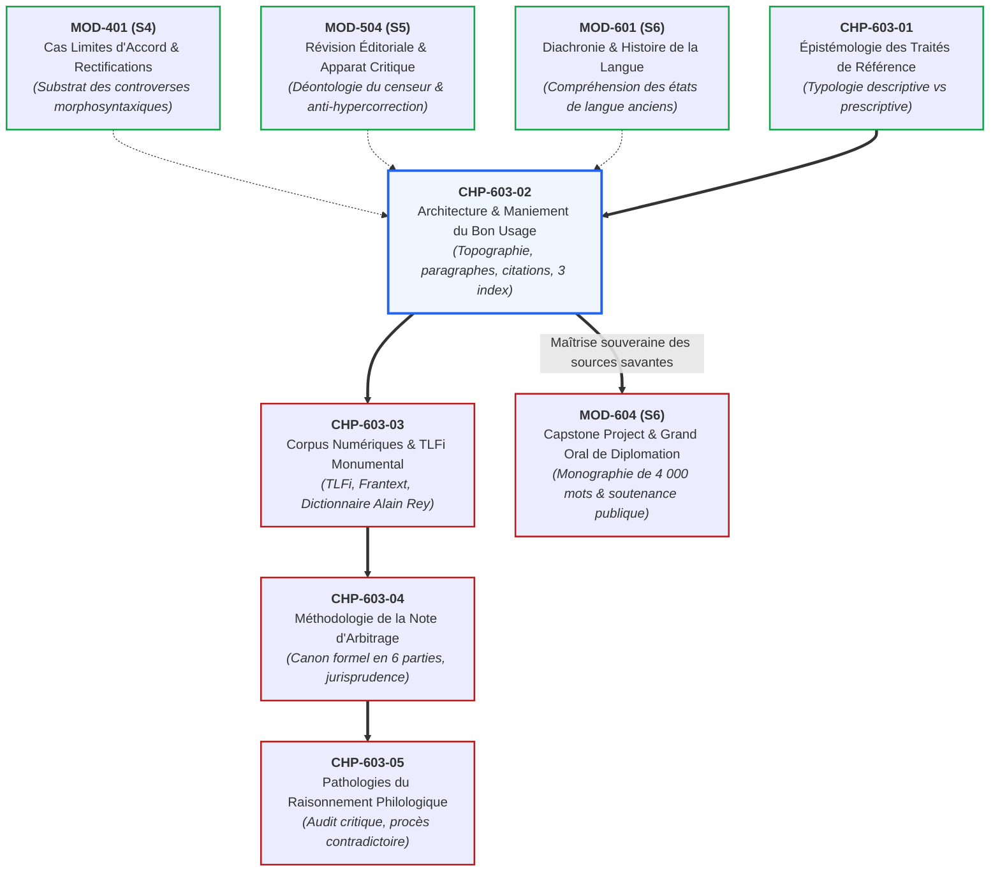
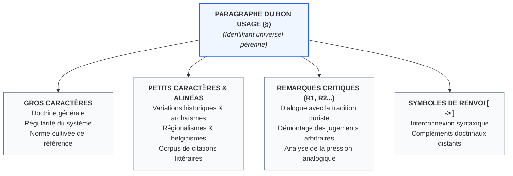
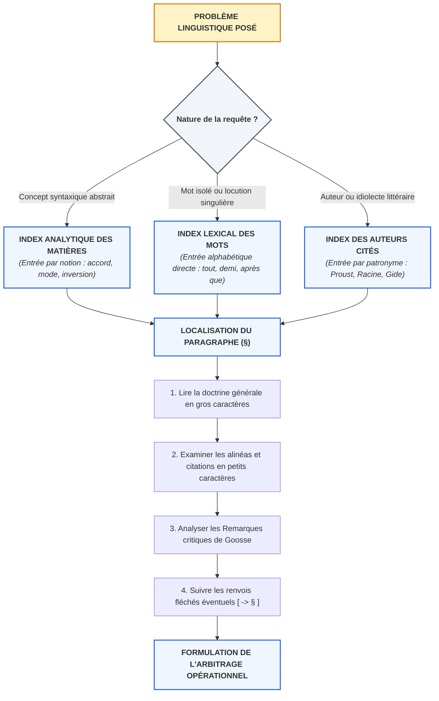

# Chapitre 2 : L'Architecture et le Maniement du Bon Usage (Grevisse & Goosse) : Topographie Textuelle, Paragraphes, Citations et Méthodologie des Trois Index

> **Identifiant** : `CHP-603-02`  
> **Module de rattachement** : [`MOD-603 — Autonomie Philologique : Méthode de Recherche Experte dans les Traités Savants`](file:///f:/Formation/world-class-french/03-curriculum/year-3/semester-6/mod-603-autonomie-philologique-recherche-traites.md)  
> **Volume horaire canonique** : 4 h 00 (Étude de l'ouvrage : 1 h 00 | Ateliers de repérage rapide : 1 h 30 | Déconstruction des Remarques : 0 h 45 | Évaluation : 0 h 45)  
> **Statut** : [STATUT : VALIDÉ]  
> **Compétences cibles** : [`FR-PHILOL-001`](file:///f:/Formation/world-class-french/02-competency-framework/competency-framework.md#fr-philol-001-autonomie-philologique-et-consultation-experte-des-sources) (L5), [`FR-INT-003`](file:///f:/Formation/world-class-french/02-competency-framework/competency-framework.md#fr-int-003-réviser-et-corriger-un-texte-tiers-en-justifiant-les-interventions) (L5)  
> **Sources de référence** : `SRC-GRAM-01` (Maurice Grevisse & André Goosse, *Le Bon Usage*, De Boeck Supérieur, 16e éd., 2016), `SRC-GRAM-02` (Martin Riegel, Jean-Christophe Pellat & René Rioul, *Grammaire méthodique du français*, PUF), `SRC-LEX-01` (ATILF / CNRS, *Trésor de la Langue Française informatisé*), `SRC-NORM-03` (Ministère de l'Éducation nationale, *Terminologie grammaticale*), `SRC-TYPO-01` (Imprimerie nationale, *Lexique des règles typographiques en usage à l'Imprimerie nationale*)

---

## 1. Titre et Place dans le Cursus

Ce deuxième chapitre du module `MOD-603` constitue l'apprentissage technique central de l'autonomie philologique. Après avoir analysé l'épistémologie des instruments de référence linguistique dans le premier chapitre (`CHP-603-01`), l'apprenant entre ici dans l'intimité matérielle, topographique et conceptuelle du plus grand traité descriptif et normatif de la langue française : *Le Bon Usage* de Maurice Grevisse et André Goosse (`SRC-GRAM-01`).

Ce cours transmet la discipline intellectuelle indispensable pour s'orienter sans hésitation dans un volume in-quarto de 1 600 pages, décrypter la stratification typographique du texte (gros caractères doctrinaux, alinéas en retrait, petits caractères historiques et dialectologiques), interpréter la fonction critique des « Remarques », assigner leur juste valeur probatoire aux citations littéraires d'autorité, et mobiliser méthodiquement les trois index (index analytique des matières, index des auteurs cités, index lexical des mots traités) pour localiser n'importe quel point de doctrine en moins de trois minutes.



---

## 2. Objectifs Mesurables

Au terme des 4 heures d'étude, d'ateliers de repérage et de déconstruction critique du chapitre, l'apprenant aura atteint le palier **L5 (Expertise transférable)** des compétences [`FR-PHILOL-001`](file:///f:/Formation/world-class-french/02-competency-framework/competency-framework.md#fr-philol-001-autonomie-philologique-et-consultation-experte-des-sources) et [`FR-INT-003`](file:///f:/Formation/world-class-french/02-competency-framework/competency-framework.md#fr-int-003-réviser-et-corriger-un-texte-tiers-en-justifiant-les-interventions) :

1. **Localiser un point de doctrine en moins de 180 secondes** : Identifier sans tâtonnement, par le croisement algorithmique de l'index des matières, de l'index lexical et de la table méthodique, le paragraphe (§) exact traitant d'une difficulté morphosyntaxique rare ou d'un cas limite d'accord dans *Le Bon Usage* (`SRC-GRAM-01`).
2. **Décoder la hiérarchie topographique de l'article** : Discriminer formellement l'énoncé doctrinal général en gros caractères, l'inventaire historique et dialectologique en petits caractères, et les prises de position critiques des « Remarques » numérotées d'André Goosse.
3. **Qualifier philologiquement le statut des citations littéraires** : Établir la distinction scientifique entre une citation d'auteur (simple attestation d'existence d'un fait de langue ou licence stylistique) et une règle prescriptive recommandée pour la prose administrative, juridique ou académique standard.
4. **Déconstruire les Remarques critiques de Goosse** : Analyser la manière dont André Goosse réfute les condamnations arbitraires des puristes classiques (Vaugelas, Ménage, Bouhours) ou contemporains (chroniqueurs de langage, avis informels de l'Académie) à l'aide de l'histoire linguistique et des régularités du système.
5. **Rédiger un arbitrage textuel étayé sur le texte de Grevisse** : Résoudre un litige éditorial en formulant une justification technique qui cite le numéro de paragraphe précis, analyse ses alinéas et applique les symboles de renvoi interne ($\rightarrow$).

---

## 3. Prérequis et Test de Préparation

### 3.1 Prérequis Cognitifs
- Maîtrise des catégories morphosyntaxiques et de l'analyse fonctionnelle intégrale (`MOD-201`, `MOD-501`).
- Distinction épistémologique claire entre grammaire normative d'apprentissage, dictionnaire institutionnel de censure et traité descriptif monumental sur corpus (`CHP-603-01`, `SRC-GRAM-01`, `SRC-GRAM-02`).
- Conscience diachronique élémentaire des états successifs du français (ancien français, moyen français, fixation classique du XVIIe siècle, français contemporain) (`MOD-601`).
- Rejet avéré de l'hypercorrection et vigilance déontologique du réviseur de texte (`MOD-504`, [`FR-INT-003`](file:///f:/Formation/world-class-french/02-competency-framework/competency-framework.md#fr-int-003-réviser-et-corriger-un-texte-tiers-en-justifiant-les-interventions)).

### 3.2 Test Diagnostique d'Auto-Évaluation (5 items)

<details>
<summary><b>Consulter le test préparatoire et son corrigé immédiat</b></summary>

1. *Pourquoi est-il méthodologiquement absurde de chercher une difficulté dans Le Bon Usage en se référant à un numéro de page ?*  
   **Réponse** : Parce que *Le Bon Usage* est structuré par paragraphes (§) continus et pérennes. La pagination varie considérablement entre les éditions (d'une 12e édition à une 16e édition, les maquettes et formats diffèrent), tandis que la numérotation des paragraphes demeure universelle et permet de retrouver exactement la doctrine quelle que soit l'impression.

2. *Si vous relevez dans Le Bon Usage une phrase de Victor Hugo ou de Marcel Proust comportant une omission d'accord du participe passé, pouvez-vous en déduire que cette tournure est autorisée dans une dissertation de concours ou un texte administratif ?*  
   **Réponse** : Absolument pas. Grevisse et Goosse enregistrent les faits de langue réels relevés chez les grands écrivains à titre d'attestations descriptives ou de licences d'auteur. Une citation en petits caractères ne constitue jamais un blanc-seing prescriptif pour la rédaction standard, sauf si le corps doctrinal en gros caractères l'érige expressément en règle acceptée.

3. *Quelle différence fondamentale sépare l'Index analytique des matières de l'Index lexical dans Le Bon Usage ?*  
   **Réponse** : L'Index analytique des matières répertorie les concepts grammaticaux abstraits (*accords*, *participes*, *subjonctif*, *inversion*, *adjectifs de couleur*), tandis que l'Index lexical répertorie les vocables isolés et locutions singulières traités alphabétiquement (*tout*, *après que*, *demi*, *avoir l'air*).

4. *À quoi servent les sections intitulées « Remarques » (R1, R2, R3...) placées au bas de certains paragraphes ?*  
   **Réponse** : Ce sont les espaces de discussion critique où Grevisse et Goosse dialoguent avec la tradition puriste, démontent les jugements arbitraires des censeurs d'époque, examinent les hésitations de l'Académie française et analysent la tendance évolutive du système linguistique.

5. *Que signifie le symbole fléché [$\rightarrow$] rencontré dans le corps d'un paragraphe ou d'une note ?*  
   **Réponse** : Il signale un renvoi interne impératif vers un autre paragraphe (§) du traité qui complète, restreint ou éclaire la notion traitée sous un autre angle grammatical.

</details>

---

## 4. Situation de Départ ou Problème Concret

Considérons la situation d'un secrétaire de rédaction, d'un réviseur juridique ou d'un agrégatif confronté à un dilemme syntaxique épineux : *« Faut-il écrire : des femmes tout émues ou toutes émues ? »* ou encore *« Les mesures qu'il a été résolu de prendre ou résolues de prendre ? »*.

Désireux de vérifier la doctrine auprès de la plus haute autorité savante, il se procure *Le Bon Usage* de Grevisse et Goosse. En ouvrant le volume de 1 600 pages, il éprouve ce que les bibliographes nomment « le vertige de la masse compacte » :
- **L'égarement matériel** : Ne connaissant pas le système des paragraphes (§), il ouvre la table des matières sommaire, tente de feuilleter au hasard des pages 800 à 900, et perd 20 minutes sans repérer le passage pertinent.
- **Le piège de la citation décontextualisée** : Ayant finalement trouvé la page par un mot-clé approximatif, son regard tombe en bas de page sur une citation de Chateaubriand ou de Colette imprimée en petits caractères. Il s'écrie : *« Voilà la règle, Chateaubriand l'a écrit ainsi ! »*, ignorant totalement que cette citation figure précisément dans un alinéa recensant les archaïsmes proscrits ou les licences poétiques que le texte en gros caractères, deux centimètres plus haut, condamne formellement pour l'usage moderne.
- **La confusion des voix doctrinales** : Il confond les jugements personnels de chroniqueurs puristes du XIXe siècle cités pour être réfutés avec la pensée propre de Grevisse ou de Goosse.

Ce désarroi prouve qu'un grand instrument philologique n'est pas un dictionnaire scolaire : son maniement exige un apprentissage méthodique de sa **topographie textuelle**.

---

## 5. Explication Intuitive : La Cathédrale Gothique et les Coordonnées GPS

Pour manier avec aisance *Le Bon Usage*, il convient d'abandonner l'idée qu'on lit un livre de grammaire ordinaire. Deux analogies spatiales éclairent son fonctionnement :

### 1. L'Analogie de la Cathédrale Gothique
*Le Bon Usage* est un monument architectural élevé sur un plan rigoureusement hiérarchisé :
- **La nef centrale (Gros caractères)** : Elle repose sur de grands piliers doctrinaux en pierre de taille. C'est le lieu de la règle générale, de la régularité morphosyntaxique dominante et de la norme cultivée partagée par la communauté francophone.
- **Les bas-côtés et les chapelles latérales (Alinéas en retrait et petits caractères)** : Ils abritent les trésors de l'histoire, les reliques des états de langue anciens, les curiosités dialectales (belgicismes, francophonies régionales) et l'immense forêt des citations d'écrivains. On y admire l'infinie variété de la création littéraire, sans confondre la chapelle particulière avec l'autel majeur de la nef.
- **La crypte critique (Les Remarques R1, R2...)** : Sous les piliers, les fondations critiques où les maîtres d'œuvre (Grevisse et Goosse) taillent la pierre, réfutent les bâtisseurs maladroits (les puristes dogmatiques) et consolident la voûte par les lois de la linguistique scientifique.

### 2. L'Analogie des Coordonnées GPS
Le numéro de paragraphe (§) est la **latitude et la longitude universelles** du fait de langue :
- Une page d'imprimerie dépend de la taille du papier, de la police de caractères et de l'année d'impression. C'est une coordonnée relative et périssable.
- Le paragraphe (§), en revanche, est un point géodésique immuable. Écrire : *« Voir Le Bon Usage, § 1111 »* permet à un chercheur à Dakar, à Bruxelles, à Cotonou ou à Paris, muni de la 12e, 14e ou 16e édition, d'atterrir sur la même arête syntaxique en quelques secondes. Les trois index (Matières, Auteurs, Lexique) sont les récepteurs satellites qui calculent instantanément ces coordonnées.

---

## 6. Définitions Précises et Terminologie

Pour opérer une recherche experte, le philologue doit maîtriser le lexique technique propre à la consultation des traités monumentaux (`SRC-GRAM-01`, `SRC-TYPO-01`) :

- ***Le Bon Usage* (`SRC-GRAM-01`)** : Traité monumental de grammaire française fondé en 1936 par Maurice Grevisse, refondu à partir de 1986 par André Goosse, publié par les éditions De Boeck Supérieur. Il associe une description rigoureuse des usages réels observés sur corpus et une codification raisonnée de la norme cultivée.
- **Maurice Grevisse (1895-1980)** : Grammairien belge, professeur de lettres classiques, créateur de l'ouvrage, guidé par le souci d'affranchir la grammaire de l'arbitraire scolaire en la confrontant à la pratique réelle des grands écrivains classiques et contemporains.
- **André Goosse (1926-2019)** : Linguiste et philologue belge, gendre de Maurice Grevisse, professeur à l'Université catholique de Louvain, secrétaire du Conseil international de la langue française. Il a assuré la refonte scientifique complète de l'ouvrage (de la 12e à la 16e édition), en introduisant les apports de la linguistique moderne.
- **Numérotation par paragraphes (§)** : Système de segmentation continue du texte en unités doctrinales stables numérotées de 1 à plus de 1 200, conservé d'édition en édition pour garantir la pérennité des citations et des renvois bibliographiques.
- **Gros caractères doctrinaux** : Corps typographique principal énonçant la doctrine générale, la règle standard en vigueur et les régularités du système grammatical.
- **Alinéas en retrait et petits caractères** : Sections typographiques secondaires subordonnées à un paragraphe, inventoriant les nuances sémantiques, les variations diachroniques (archaïsmes), les emplois dialectaux ou régionaux, et l'apparat d'exemples littéraires.
- **Citations littéraires d'autorité** : Extraits textuels d'œuvres littéraires identifiés avec exactitude (auteur, titre, date, volume ou chapitre) démontrant qu'un phénomène morphosyntaxique a été effectivement employé par un écrivain de renom.
- **Remarques critiques (R1, R2, R3...)** : Subdivisions critiques numérotées au sein d'un paragraphe où les auteurs engagent le débat avec les théoriciens du langage, réfutent les jugements puristes infondés ou signalent les flottements des institutions normatives.
- **Renvois internes ($\rightarrow$)** : Signes typographiques orientant le lecteur vers d'autres paragraphes (§) du traité pour éclairer des interactions syntaxiques complémentaires.
- **Index analytique des matières** : Répertoire thématique classé par notions et catégories grammaticales (*accords*, *négation*, *passif*, *proposition subordonnée*).
- **Index des auteurs cités** : Répertoire onomastique des écrivains inventoriés dans le traité, renvoyant aux paragraphes où leurs emplois singuliers sont analysés.
- **Index lexical des mots traités** : Répertoire alphabétique des vocables singuliers, prépositions, adverbes, conjonctions et locutions faisant l'objet d'une analyse spécifique.

---

## 7. Règles ou Mécanismes Fondamentaux

### 7.1 Genèse et Philosophie du *Bon Usage*

#### 1. L'Acte Fondateur de Maurice Grevisse (1936)
En 1936, enseignant le français et le latin à l'Athénée royal d'Ixelles puis à La Roche-en-Ardenne, Maurice Grevisse constate le fossé profond qui sépare les manuels scolaires de la réalité de la grande littérature. Les grammaires scolaires du début du XXe siècle multipliaient les interdits dogmatiques hérités des pédants du XIXe siècle, qualifiant de « fautes » des tournures couramment et admirablement employées par Racine, La Fontaine, Voltaire, Chateaubriand ou Victor Hugo.

Refusant ce divorce entre la règle et la vie littéraire, Grevisse entreprend de recenser patiemment, sur fiches manuscrites, la pratique effective des maîtres de la langue française. Refusé par plusieurs éditeurs parisiens qui jugeaient impensable qu'un instituteur provincial belge vînt faire la leçon aux grammairiens de France, l'ouvrage paraît en 1936 chez un modeste imprimeur de Gembloux, Duculot [Réf. `SRC-GRAM-01`, Préface historique]. En 1947, André Gide lui consacre un éloge retentissant dans *Le Figaro Littéraire*, sacrant *Le Bon Usage* comme le meilleur traité de langue française existant. L'Académie française décerne à l'ouvrage sa médaille d'or, consacrant le triomphe de la méthode descriptive raisonnée sur le dogmatisme scolaire.

#### 2. La Refonte Scientifique d'André Goosse (12e à 16e éditions)
À la mort de Maurice Grevisse en 1980, son gendre André Goosse reprend le flambeau. Dès la 12e édition (1986), Goosse opère une refonte magistrale :
- Il réorganise l'armature théorique en intégrant les acquis de la **linguistique structurale, fonctionnelle et générative** (`SRC-GRAM-02`).
- Il affine la terminologie grammaticale en écartant les concepts désuets ou flous.
- Il transforme l'ouvrage en un monument d'érudition polyphonique où chaque fait de langue contesté fait l'objet d'un examen impartial, débarrassé de tout moralisme linguistique.

```text
CHRONOLOGIE ÉDITORIALE DU BON USAGE (SRC-GRAM-01)
├── 1936 : 1re édition (Maurice Grevisse, Duculot, Gembloux) — 704 pages.
├── 1947 : Éloge public d'André Gide dans Le Figaro ; reconnaissance internationale.
├── 1980 : Disparition de Maurice Grevisse ; succession assurée par André Goosse.
├── 1986 : 12e édition — Refonte magistrale d'André Goosse : modernisation linguistique intégrale.
├── 2007 : 14e édition — Nouveau format in-quarto, réorganisation majeure des chapitres de syntaxe.
└── 2016 : 16e édition (Goosse, De Boeck Supérieur) — 1 760 pages, enrichissement des corpus numériques.
```

---

### 7.2 La Topographie Visuelle et Hiérarchique du Texte

Chaque page du *Bon Usage* présente une stratification visuelle très rigoureuse que le lecteur doit savoir décrypter instantanément :

```text
TOPOGRAPHIE D'UN ARTICLE DU BON USAGE (SRC-GRAM-01)
┌────────────────────────────────────────────────────────────────────────┐
│ § 648. TOUT adverbe modifiant un adjectif ou un participe             │  <- Numéro de § pérenne
├────────────────────────────────────────────────────────────────────────┤
│ GROS CARACTÈRES : DOCTRINE GÉNÉRALE                                    │
│ Énoncé de la règle commune de référence : l'invariabilité de principe   │
│ de l'adverbe, tempérée par l'accord traditionnel d'euphonie            │
│ devant une consonne ou un h aspiré au féminin.                         │
├────────────────────────────────────────────────────────────────────────┤
│ PETITS CARACTÈRES & ALINÉAS EN RETRAIT : HISTOIRE & CORPUS             │
│ - Exemples classiques : Racine, La Fontaine, Mme de Sévigné.           │
│ - Hésitations diachroniques : attestations devant h muet et voyelle.   │
│ - Citations d'écrivains modernes : Proust, Gide, Colette.             │
├────────────────────────────────────────────────────────────────────────┤
│ REMARQUES CRITIQUES (R1, R2...) : DÉBAT SAVANT                         │
│ - Discussion des arrêts ministériels de tolérance (1901, 1976).       │
│ - Réfutation des préjugés des puristes contre l'accord euphonique.     │
│ - Analyse de la pression analogique moderne dans l'usage cultivé.      │
├────────────────────────────────────────────────────────────────────────┤
│ SYMBOLES DE RENVOI : [ -> § 558, § 952 ]                              │  <- Corrélations syntaxiques
└────────────────────────────────────────────────────────────────────────┘
```

#### 1. Le Statut Réel des Citations d'Auteurs
L'une des fautes philologiques les plus graves consiste à traiter toute citation de Grevisse comme une autorisation prescriptive. Grevisse et Goosse citent les grands écrivains pour **trois motifs distincts** :
1. **L'illustration de la règle canonique** : Montrer comment un grand styliste applique la norme générale avec éclat.
2. **L'attestation d'une variation historique** : Prouver qu'au XVIIe ou XVIIIe siècle, une tournure aujourd'hui condamnée était d'un usage courant chez Molière ou Voltaire.
3. **L'enregistrement d'une audace ou d'une licence individuelle** : Montrer comment un écrivain singulier (Saint-Simon, Balzac, Proust, Céline) force la syntaxe pour obtenir un effet expressif original.

> [!IMPORTANT]
> Une citation d'auteur en petits caractères prouve qu'un fait de langue **existe dans la littérature** ; elle ne prouve jamais qu'il est **recommandé dans la prose administrative, académique ou professionnelle contemporaine**.

---

### 7.3 L'Analyse des « Remarques » Critiques (R1, R2, R3...)

Les Remarques constituent le laboratoire critique du *Bon Usage*. André Goosse y déploie sa méthode dialectique en trois étapes :
1. **Exposé de l'interdit puriste** : Citation des grammairiens censeurs (Vaugelas, Bouhours, Voltaire, Littré, Hanse) ou des rubriques « Dire, ne pas dire » de l'Académie française qui condamnent une tournure comme « barbare » ou « fautive ».
2. **Confrontation avec la réalité des textes** : Démonstration, preuves textuelles à l'appui, que la forme condamnée a été employée sans interruption par les plus illustres auteurs depuis plusieurs siècles.
3. **Explication linguistique interne** : Révélation du mécanisme phonétique, analogique ou sémantique réel qui explique l'émergence de la forme, dissipant l'accusation d'ignorance ou de négligence portée contre les scripteurs.

---

### 7.4 La Méthode en 3 Minutes d'Interrogation des Trois Index

Pour localiser un renseignement sans feuilleter aveuglément les 1 600 pages du traité, l'expert applique un protocole d'aiguillage précis vers l'un des **trois index** situés en fin de volume :

```text
MÉTHODOLOGIE D'AIGUILLAGE VERS LES TROIS INDEX (SRC-GRAM-01)
├── 1. INTERROGATION PAR CONCEPT SYNTAXIQUE ABSTRAIT -> INDEX ANALYTIQUE DES MATIÈRES
│   ├── Exemples de requêtes : accord des adjectifs de couleur, subjonctif après verbe d'opinion,
│   │   inversion du sujet nominal, concordance des temps, participe passé pronominal.
│   └── Méthode : Chercher le substantif notionnel cardinal (ex. « Couleur », « Participe », « Sujet »).
├── 2. INTERROGATION PAR VOCABLE PARTICULIER LITIGIEUX -> INDEX LEXICAL DES MOTS
│   ├── Exemples de requêtes : accord de « demi », mode après « après que », rection de « se rappeler »,
│   │   statut de « voire même », accord de « quelque... que ».
│   └── Méthode : Entrée directe par l'orthographe exacte du mot ou de la locution.
└── 3. INTERROGATION PAR ÉCRIVAIN OU CORPUS LITTÉRAIRE -> INDEX DES AUTEURS CITÉS
    ├── Exemples de requêtes : syntaxe singulière chez Marcel Proust, subjonctifs chez Chateaubriand,
    │   archaïsmes chez Julien Gracq, innovations de Léopold Sédar Senghor.
    └── Méthode : Entrée par le nom de famille de l'auteur (ex. « Proust », « Gide », « Hugo »).
```

---

## 8. Raisonnement Détaillé : La Dialectique de la Règle et de l'Écart Créateur

Pourquoi l'architecture du *Bon Usage* est-elle supérieure à celle de tout autre manuel normatif ?

Si une grammaire n'est que **purement prescriptive** (comme les catéchismes scolaires traditionnels), elle commet trois erreurs épistémologiques néfastes :
- Elle fige artificiellement un état de langue arbitraire (souvent la prose compassée de la bourgeoisie du XIXe siècle) ;
- Elle criminalise l'évolution vivante de l'idiome en qualifiant tout changement de « décadence » ;
- Elle est incapable d'expliquer pourquoi les plus grands génies littéraires violent constamment ses préceptes étriqués.

À l'inverse, si un ouvrage n'est que **purement descriptif et statistique** (comme certains corpus bruts informatisés), il sombre dans le nihilisme normatif : en constatant que des millions de locuteurs commettent un solécisme sur les réseaux sociaux, il refuse de guider l'usager et détruit le repère d'une norme soignée partagée, indispensable à l'université et aux institutions démocratiques.

L'architecture à deux étages de Maurice Grevisse et André Goosse résout magistralement cette contradiction :
- **L'étage supérieur (Gros caractères)** garantit la sécurité de la communication et préserve le canon normatif cultivé commun.
- **L'étage inférieur (Petits caractères et Remarques)** documente la liberté créatrice des grands écrivains, enrichit l'expressivité stylistique et empêche la sclérose de la pensée.

---

## 9. Exemples Corrects Commentés

### Décorticage Anatomique n° 1 : Le § 648 (*L'accord de l'adverbe TOUT*)

Examinons la structure interne du **§ 648** du *Bon Usage* (`SRC-GRAM-01`) :

1. **Numéro et Titre doctrinal** :  
   `§ 648. Tout adverbe modifiant un adjectif ou un participe.`
2. **Doctrine générale en gros caractères** :  
   La règle générale stipule que *tout*, étant adverbe de degré équivalant à « tout à fait » ou « entièrement », est par nature invariable :  
   *« Ils sont tout joyeux. »* / *« Des femmes tout émues. »* / *« Elles sont tout étonnées. »*  
   Cependant, par survivance d'une ancienne habitude phonétique et euphonique de l'ancien français, *tout* s'accorde obligatoirement en genre et en nombre devant un adjectif féminin commençant par une **consonne** ou un **h aspiré** :  
   *« Une femme toute honteuse. »* / *« Des femmes toutes prêtes. »*
3. **Alinéas historiques en petits caractères** :  
   Goosse rappelle que l'accord devant voyelle ou *h* muet était fréquent jusqu'au XVIIe siècle (*« Elle était toute émue »*, relevé chez Racine et Mme de La Fayette). Il cite Proust (*« des mains toutes brûlantes »*) et Gide pour montrer la survivance de ces hésitations dans la prose du XXe siècle.
4. **Remarques critiques de Goosse (R1 à R3)** :  
   - **R1** : Examen de la locution *tout autre*. Goosse dissèque la nuance sémantique capitale : si *tout* modifie *autre*, il est adverbe invariable signifiant « entièrement différente » (*« une démarche tout autre »*) ; si *tout* détermine le substantif, il est déterminant indéfini variable signifiant « n'importe quelle autre » (*« toute autre démarche eût échoué »*).
   - **R2** : Analyse de la tolérance ministérielle de 1901 et 1976 permettant de laisser *tout* invariable dans tous les cas lors des examens. Goosse précise aussitôt que cette tolérance administrative ne modifie pas le bon usage littéraire et typographique, qui maintient l'accord devant consonne.

---

### Décorticage Anatomique n° 2 : Le § 1111 (*Le mode après la locution APRÈS QUE*)

Examinons la structure interne du **§ 1111** (`SRC-GRAM-01`, `SRC-GRAM-02`) :

1. **Numéro et Titre doctrinal** :  
   `§ 1111. Propositions subordonnées introduites par après que.`
2. **Doctrine générale en gros caractères** :  
   La proposition temporelle marquant une antériorité accomplie dans la réalité objective, le verbe subordonné se met régulièrement à l'**indicatif** ou, le cas échéant, au **conditionnel** :  
   *« Après qu'il a dîné, il est sorti. »* / *« Après qu'il eut achevé sa tâche, il se reposa. »*
3. **Alinéas de corpus en petits caractères** :  
   Goosse dresse un inventaire saisissant des occurrences du subjonctif relevées chez les plus éminents maîtres de la prose moderne : Chateaubriand (*Mémoires d'outre-tombe*), Victor Hugo, Flaubert, Maupassant, Marcel Proust (*Sodome et Gomorrhe*), André Gide, François Mauriac, Montherlant, Julien Gracq.
4. **Remarques critiques d'André Goosse** :  
   Goosse démontre avec rigueur que le subjonctif ne résulte pas d'une ignorance de la règle, mais d'une **puissante attraction analogique** exercée par la locution antonymique *avant que* (qui exige impérativement le subjonctif). Il conclut avec force :  
   *« Les puristes condamnent avec acharnement le subjonctif après après que [...]. Il n'en reste pas moins que le subjonctif est devenu extrêmement fréquent chez les meilleurs auteurs. »*  
   Néanmoins, en tant qu'arbitre responsable, Goosse met en garde l'usager : en raison de la stigmatisation sociale féroce exercée par les jurys d'examen et les comités éditoriaux, le rédacteur soigné s'en tiendra rigoureusement à l'indicatif dans la prose académique et administrative.

---

## 10. Contre-Exemples et Erreurs Fréquentes

Voici l'examen clinique de six erreurs récurrentes de consultation et d'interprétation commises dans le maniement du traité de Grevisse et Goosse :

### Erreur n° 1 : La recherche par pagination matérielle au lieu du paragraphe pérenne
- **Manifestation pathologique** : Citer *Le Bon Usage* en écrivant : *« D'après Grevisse, page 412... »*, ou chercher dans la 16e édition une référence notée à partir de la 12e édition en se fiant aux pages.
- **Réfutation scientifique** : Les maquettes changent d'une édition à l'autre. Le § 1111 se trouve à des pages totalement différentes selon les formats, mais le numéro de paragraphe demeure universel.
- **Redressement méthodique** : Toujours noter et citer le symbole § suivi du numéro de paragraphe et, le cas échéant, de la lettre d'alinéa ou du numéro de Remarque (ex. : `SRC-GRAM-01`, § 1111, R2).

### Erreur n° 2 : La confusion entre doctrine en gros caractères et variations en petits caractères
- **Manifestation pathologique** : Lire un alinéa en petits caractères mentionnant une tournure archaïque ou régionale, et proclamer que *« Grevisse recommande cette forme »*.
- **Réfutation scientifique** : Les petits caractères recensent la diversité des usages réels, y compris les écarts, les hapax et les formes caduques. Seul le corps en gros caractères formule la norme de référence.
- **Redressement méthodique** : Vérifier impérativement si la ligne lue relève de l'énoncé doctrinal principal ou de l'inventaire historique subsidiaire.

### Erreur n° 3 : L'érection d'une citation littéraire singulière en règle prescriptive générale
- **Manifestation pathologique** : Découvrir qu'André Gide a écrit : *« après qu'il soit venu »* ou que Voltaire a laissé un participe invariable, et affirmer dans un mémoire universitaire que l'accord est désormais facultatif.
- **Réfutation scientifique** : Le génie d'un écrivain s'accorde des libertés stylistiques ou subit des automatismes inconscients que le philologue étudie sans les ériger en lois pour l'écrit standard.
- **Redressement méthodique** : Distinguer rigoureusement l'attestation auctoriale (licence de création) de la règle commune d'enseignement.

### Erreur n° 4 : La négligence systématique des Remarques critiques d'André Goosse
- **Manifestation pathologique** : S'arrêter à la lecture de la doctrine générale sans lire les Remarques (R1, R2...) placées au bas de l'article, passant ainsi à côté de l'arbitrage le plus nuancé.
- **Réfutation scientifique** : C'est dans les Remarques que se trouvent les exceptions lexicalisées, les rectifications de 1990 (`SRC-NORM-02`) et l'examen critique des oukases de l'Académie française (`SRC-LEX-02`).
- **Redressement méthodique** : Toujours parcourir l'intégralité des Remarques associées à un paragraphe avant de clore une recherche philologique.

### Erreur n° 5 : L'ignorance des symboles de renvoi interne et de corrélation textuelle
- **Manifestation pathologique** : Isoler un paragraphe de son réseau notionnel et ignorer les flèches [$\rightarrow$] renvoyant à d'autres sections complémentaires.
- **Réfutation scientifique** : La syntaxe française est un système interdépendant. L'accord du participe passé (§ 948) est indissociable de l'analyse des pronoms réfléchis (§ 668) et des verbes pronominaux (§ 802).
- **Redressement méthodique** : Suivre systématiquement les renvois fléchés pour vérifier si une clause restrictive ne s'applique pas au cas analysé.

### Erreur n° 6 : Le recours exclusif à l'index lexical sans croisement thématique analytique
- **Manifestation pathologique** : Chercher une règle d'accord complexe en tapant un mot isolé dans l'index alphabétique, sans consulter l'Index analytique des matières.
- **Réfutation scientifique** : Un problème d'accord sur un adjectif composé (ex. *vert olive*) ne se résout pas efficacement en cherchant *olive* à l'index lexical ; il exige la consultation de l'entrée *Adjectif de couleur* à l'Index des matières (§ 558).
- **Redressement méthodique** : Si la recherche par mot échoue ou reste équivoque, basculer instantanément sur le concept grammatical dans l'Index analytique des matières.

```text
Tableau Clinique des Fautes de Consultation (Synthèse)
| Cas | Dénomination de la Pathologie | Mécanisme Fautif | Conséquence Éditoriale | Protocole de Redressement |
| :---: | :--- | :--- | :--- | :--- |
| Cas 1 | Recherche par pagination | Se repérer au numéro de page du livre. | Perte de temps, références caduques entre éditions. | Utiliser exclusivement le numéro de paragraphe (§). |
| Cas 2 | Confusion de calibrage | Prendre un petit caractère pour la règle générale. | Légalisation indue de tournures marginales ou archaïques. | Distinguer la doctrine majeure (gros) des variantes (petits). |
| Cas 3 | Fétichisme d'auteur | Ériger une citation littéraire en norme scolaire. | Contresens normatif dans des textes administratifs. | Considérer la citation comme une preuve d'usage, non un ordre. |
| Cas 4 | Omission des Remarques | S'arrêter à l'énoncé doctrinal sans lire R1, R2... | Ignorance des subtilités d'arbitrage et des rectifications. | Parcourir systématiquement les Remarques critiques de Goosse. |
| Cas 5 | Rupture de renvoi | Négliger les flèches internes [-> §]. | Analyse tronquée d'un phénomène syntaxique en réseau. | Consulter les paragraphes corrélés indiqués par la flèche. |
| Cas 6 | Cécité notionnelle | Se limiter à l'index lexical sans voir les matières. | Échec d'identification des règles de syntaxe globale. | Croiser systématiquement index lexical et index des matières. |
```

---

## 11. Cas Particuliers et Limites

### 1. Divergences entre l'Édition Grevisse Historique et l'Édition Goosse Moderne
Le lecteur travaillant sur des éditions anciennes (de la 1re à la 11e édition, antérieures à 1980) doit savoir que Maurice Grevisse utilisait une nomenclature grammaticale traditionnelle parfois tributaire du XIXe siècle. André Goosse a modernisé en profondeur les définitions (distinction rigoureuse entre phrase, proposition et énoncé ; intégration de l'analyse en constituants immédiats et de la notion de déterminant). Pour tout arbitrage académique ou professionnel contemporain, **seule la version refondue par André Goosse (12e à 16e édition, `SRC-GRAM-01`) fait foi**.

### 2. Le Traitement des Belgicismes et des Variétés Francophones
Bien que conçu et édité en Belgique par deux savants belges, *Le Bon Usage* a pour objet la langue française commune dans toute son extension internationale :
- **Identification explicite des régionalismes** : Les belgicismes phonétiques, lexicaux ou syntaxiques (*septante*, *nonante*, *bourgmestre*, *savoir* au sens de « pouvoir physique ») sont rigoureusement étiquetés avec la mention *(Belgique)* ou *(Région.)*.
- **Absence de tout impérialisme provincial** : Grevisse et Goosse ne cherchent jamais à faire passer un tour régional belge pour la norme générale.
- **Ouverture aux francophonies du monde** : Les éditions récentes intègrent avec équité les usages du Québec, de Suisse romande et de l'Afrique francophone subsaharienne (`SRC-SOCIO-01`), en distinguant toujours la norme endogène légitime des écarts d'interférence.

---

## 12. Approfondissement Adapté au Niveau

### L'Histoire Éditoriale du *Bon Usage* et la Controverse avec l'Académie Française

L'un des chapitres les plus fascinants de la philologie moderne réside dans le statut paradoxal du *Bon Usage* vis-à-vis des institutions parisiennes :
- **Le magistère venu de la périphérie** : Dès le XVIIe siècle avec Vaugelas (qui était savoyard), la réflexion la plus pénétrante sur la pureté et l'élégance de la langue a souvent été portée par des observateurs extérieurs à la Cour ou au cénacle parisien. En fondant son traité depuis sa province ardennaise, Maurice Grevisse a incarné ce regard lucide, libre de toute courtisanerie académique.
- **La tension institutionnelle feutrée** : Si l'Académie française a décerné sa prestigieuse médaille d'or à Grevisse en 1939 et 1946, elle a souvent vu d'un œil inquiet la montée en puissance d'un ouvrage qui, fort d'un apparat critique de milliers d'exemples irréfutables, contredisait ouvertement les arrêts péremptoires de la commission du Dictionnaire (`SRC-LEX-02`). Là où l'Académie proclamait : *« On ne doit pas dire... »*, Goosse répliquait avec une politesse souveraine : *« Il n'en reste pas moins que Racine l'a écrit trois fois, Chateaubriand dix fois et Proust constamment. »*
- **La victoire de la méthode scientifique** : Aujourd'hui, les correcteurs du journal *Le Monde*, du Conseil d'État et des grandes maisons d'édition universitaires ne tranchent plus un litige d'après les avis d'un chroniqueur mondain, mais d'après le paragraphe pertinent du *Bon Usage*.

---

## 13. Comparaisons Différentielles

### Tableau 1 : Gros Caractères Doctrinaux vs Petits Caractères Documentaires
| Critère d'Analyse | Gros Caractères Doctrinaux | Petits Caractères & Alinéas en Retrait |
| :--- | :--- | :--- |
| **Fonction sémiotique** | Énonciation de la norme commune et du système régulier. | Recensement de la variation, de l'histoire et des libertés littéraires. |
| **Portée normative** | Prescriptive pour l'écrit standard, académique et officiel. | Purement descriptive et attestative (sauf mention explicite). |
| **Public cible** | Tout rédacteur, étudiant, fonctionnaire ou réviseur. | Philologue, linguiste, styliste, spécialiste des concours. |
| **Typographie** | Corps standard romain, graisse normale ou demi-grasse. | Corps réduit, alinéas en retrait, citations en italique. |
| **Erreur à éviter** | Croire que la règle en gros caractères est sans exception. | Prendre une citation en petits caractères pour la règle générale. |

### Tableau 2 : Remarques Critiques de Goosse vs Directives de l'Académie Française
| Critère d'Analyse | Remarques Critiques de Goosse (`SRC-GRAM-01`) | Directives de l'Académie Française (`SRC-LEX-02`) |
| :--- | :--- | :--- |
| **Fondement de l'autorité** | Démonstration scientifique sur corpus textuel étendu. | Décision institutionnelle collégiale et magistère d'État. |
| **Posture envers l'usage** | Observe, analyse les causes linguistiques et nuance. | Prescrit, censure et condamne souvent sans appel. |
| **Prise en compte de l'histoire** | Diachronie complète depuis le latin et l'ancien français. | Privilégie la tradition classique du Grand Siècle. |
| **Flexibilité méthodologique** | Admet l'écart stylistique et la dynamique analogique. | Maintient la fixité des règles pour préserver la clarté. |
| **Usage opératoire** | Consultation savante pour comprendre et arbitrer finement. | Référence de censure rapide pour écrits officiels stricts. |

### Tableau 3 : Index Analytique des Matières vs Index Lexical des Mots
| Critère d'Analyse | Index Analytique des Matières | Index Lexical des Mots |
| :--- | :--- | :--- |
| **Point d'entrée** | Notion, concept grammatical abstrait (*accord*, *sujet*). | Vocable concret, morphème ou locution isolée (*tout*, *demi*). |
| **Quand l'utiliser ?** | Problème de syntaxe globale ou règle fonctionnelle inconnue. | Doute orthographique ou syntaxique sur un mot précis. |
| **Complexité de requête** | Exige de formaliser le concept sous-jacent. | Ne demande que l'orthographe exacte de l'unité lexicale. |
| **Risque d'échec** | Chercher au mauvais terme conceptuel (ex. *phrase* au lieu d'*accord*). | Omettre une locution indexée sous son premier élément. |

---

## 14. Exercices Progressifs (3 Niveaux)

### Niveau 1 : Routage vers les Paragraphes Pertinents (10 Difficultés Syntaxiques)
*Consigne : Pour chacune des 10 difficultés suivantes, indiquer le mot-clé d'accès, l'index à mobiliser et le paragraphe (§) exact du Bon Usage (16e éd., `SRC-GRAM-01`).*

1. **L'accord de l'adjectif *feu* dans : *feu la présidente* vs *la feue présidente*.**  
   $\rightarrow$ *Résolution* : Index lexical, s.v. *feu*. **§ 583**. Placé immédiatement avant le déterminant, *feu* reste invariable ; placé entre le déterminant et le nom, il s'accorde.
2. **L'accord de *demi* dans : *une demi-heure* vs *deux heures et demie*.**  
   $\rightarrow$ *Résolution* : Index lexical, s.v. *demi*. **§ 582**. Invariable avec trait d'union en antéposition ; variable en genre au singulier en postposition coordonnée par *et*.
3. **L'accord des formules *ci-inclus* et *ci-joint* en tête de phrase.**  
   $\rightarrow$ *Résolution* : Index lexical, s.v. *ci-joint*. **§ 584**. Invariable en tête de phrase ou devant un nom sans déterminant ; variable si le nom est précédé d'un déterminant dans le corps de la phrase.
4. **L'accord du participe passé précédé du pronom adverbial neutre *en*.**  
   $\rightarrow$ *Résolution* : Index des matières, s.v. *Participe passé* (avec *en*). **§ 952**. Règle d'invariabilité générale (*Des fautes, il en a fait*), avec examen des exceptions classiques en petits caractères.
5. **L'accord de l'adjectif dans la locution *avoir l'air*.**  
   $\rightarrow$ *Résolution* : Index lexical, s.v. *air (avoir l')*. **§ 567**. Accord possible avec le sujet animé (sens de « sembler ») ou avec le mot masculin *air* (aspect extérieur).
6. **L'accord des adjectifs de couleur composés (*vert foncé*, *bleu marine*).**  
   $\rightarrow$ *Résolution* : Index des matières, s.v. *Couleur (adjectifs de)*. **§ 558**. Invariabilité absolue des adjectifs composés de couleur.
7. **Le mode après la locution conjonctive *bien que*.**  
   $\rightarrow$ *Résolution* : Index lexical, s.v. *bien que*. **§ 1128**. Emploi obligatoire du subjonctif dans la prose soignée.
8. **L'accord du verbe après le pronom indéfini *plus d'un*.**  
   $\rightarrow$ *Résolution* : Index lexical, s.v. *plus d'un*. **§ 442**. Accord régulier au singulier, sauf cas de réciprocité ou d'addition explicite.
9. **L'accord du participe passé des verbes impersonnels (*les pluies qu'il y a eu*).**  
   $\rightarrow$ *Résolution* : Index des matières, s.v. *Impersonnel (verbe)*. **§ 954**. Invariabilité absolue du participe passé impersonnel.
10. **L'accord du participe passé suivi d'un infinitif (*les décisions qu'il a résolu de prendre*).**  
    $\rightarrow$ *Résolution* : Index des matières, s.v. *Participe passé suivi d'un infinitif*. **§ 962**. Invariabilité lorsque le pronom antéposé est l'objet de l'infinitif subséquent et non du participe.

---

### Niveau 2 : Décodage Critique de 5 Articles Complexes (Confrontation Doctrine vs Citations)
*Consigne : Pour chaque cas, analyser l'article correspondant, identifier la tension entre doctrine générale et corpus, et formuler l'arbitrage recommandé.*

1. **Le participe passé de *se plaire* dans : *« Elles se sont plu / plues à ce jeu »* (§ 950).**  
   $\rightarrow$ *Analyse* : En gros caractères, doctrine intangible : *plaire* est un verbe intransitif régissant un COI (*plaire à quelqu'un*). Le pronom réfléchi *se* est COI, le verbe n'admet aucun COD : le participe est donc strictement invariable (*elles se sont plu*). En petits caractères, Goosse signale que le moyen français a parfois connu un emploi transitif direct, ce qui explique quelques accords archaïques isolés chez les auteurs anciens. Arbitrage formel : maintien absolu de l'invariabilité dans tous les registres contemporains.
2. **Le mode après *après que* (§ 1111).**  
   $\rightarrow$ *Analyse* : La doctrine en gros caractères prescrit l'indicatif. Le corpus en petits caractères aligne une pléiade d'auteurs illustres employant le subjonctif. Goosse explique le phénomène par attraction d'*avant que*, mais recommande de ne pas défier les foudres puristes des jurys de concours. Arbitrage : imposer l'indicatif en contexte académique, tolérer chez l'écrivain.
3. **L'accord de *tout* adverbe devant voyelle : *« Elle est tout émue »* vs *« toute émue »* (§ 648).**  
   $\rightarrow$ *Analyse* : La doctrine générale impose l'invariabilité devant voyelle (*tout émue*). En petits caractères, Goosse documente la poussée de l'accord (*toute émue*) relevée dès le classicisme et très fréquente aujourd'hui par alignement sur les formes à consonne (*toute joyeuse*). Arbitrage : *tout émue* reste la forme la plus châtiée et formellement irréprochable ; *toute émue* est une variante admise par tolérance.
4. **La suppression de *pas* après les verbes *cesser, oser, pouvoir, savoir* (§ 1017).**  
   $\rightarrow$ *Analyse* : Gros caractères : dans la langue soignée, *ne* peut s'employer seul sans *pas* avec ces quatre verbes, particulièrement devant un infinitif (*« Je ne puis vous répondre »*). Petits caractères : Goosse note que dans l'usage ordinaire et parlé, l'omission de *pas* a presque totalement disparu et prend une coloration archaïque ou poétique très marquée. Arbitrage : ressource stylistique d'élégance à réserver aux écrits de haute tenue littéraire.
5. **L'accord de l'adjectif qualifiant plusieurs noms singuliers unis par *ou* (§ 437).**  
   $\rightarrow$ *Analyse* : Si *ou* implique une exclusion absolue et alternative, l'adjectif s'accorde avec le dernier nom (*« On demande un homme ou une femme âgée »*). Si *ou* a une valeur d'équivalence ou d'association, l'accord se fait au pluriel (*« Une violence ou une ruse coupables »*). Goosse dissèque les subtilités d'interprétation contextuelle.

---

### Niveau 3 : Fiche de Décryptage Topographique (Texte Calibré à 50 Mots Exacts)
*Consigne : Rédiger une synthèse méthodologique sur la topographie du Bon Usage calibrée très exactement à **cinquante (50) mots** selon les règles de décompte de l'Imprimerie nationale (`SRC-TYPO-01`).*

#### Texte Réalisé (50 mots exacts) :
> « L' investigation savante dans Le Bon Usage requiert d' identifier le numéro de paragraphe avant toute lecture . Les gros caractères énoncent la norme doctrinale , tandis que les petits caractères et les Remarques de Goosse documentent la variation historique et réfutent le purisme étroit pour l' examen universitaire de haut niveau . »

#### Décompte Certifié Mot à Mot (50 mots exacts selon `SRC-TYPO-01`) :
| N° | Token | N° | Token | N° | Token | N° | Token | N° | Token |
| :---: | :--- | :---: | :--- | :---: | :--- | :---: | :--- | :---: | :--- |
| **1** | L' | **11** | le | **21** | énoncent | **31** | les | **41** | le |
| **2** | investigation | **12** | numéro | **22** | la | **32** | Remarques | **42** | purisme |
| **3** | savante | **13** | de | **23** | norme | **33** | de | **43** | étroit |
| **4** | dans | **14** | paragraphe | **24** | doctrinale, | **34** | Goosse | **44** | pour |
| **5** | Le | **15** | avant | **25** | tandis | **35** | documentent | **45** | l' |
| **6** | Bon | **16** | toute | **26** | que | **36** | la | **46** | examen |
| **7** | Usage | **17** | lecture. | **27** | les | **37** | variation | **47** | universitaire |
| **8** | requiert | **18** | Les | **28** | petits | **38** | historique | **48** | de |
| **9** | d' | **19** | gros | **29** | caractères | **39** | et | **49** | haut |
| **10** | identifier | **20** | caractères | **30** | et | **40** | réfutent | **50** | niveau. |

---

## 15. Activité de Correction Raisonnée

### Extrait de Consultation d'un Apprenti Philologue Soumis à Audit :
> *« J'ai été sollicité pour réviser un rapport officiel. Pour vérifier si l'on pouvait employer le subjonctif après "après que", j'ai ouvert Le Bon Usage à la page 1111 (1). Comme Grevisse est un recueil de règles scolaires obligatoires (2), j'ai regardé la citation de Marcel Proust en petits caractères au bas du texte : cela prouve juridiquement que le subjonctif est devenu la règle générale obligatoire pour tous les ministères (3). Du reste, les gros caractères en haut ne sont qu'un résumé simpliste destiné aux écoliers débutants (4). J'ai négligé les Remarques d'André Goosse car ce continuateur n'a fait que contredire Maurice Grevisse sans valeur ajoutée (5). D'ailleurs, comme le mot "après que" figure dans l'Index lexical, cela garantit que son emploi au subjonctif est officiellement approuvé par les institutions (6). J'ai également ignoré la flèche vers le § 1128 car ces flèches sont de simples ornements d'imprimerie sans intérêt (7). Enfin, j'ai vu que Grevisse consacre un alinéa au mot belge "septante", ce qui prouve que son but était d'imposer le dialecte wallon à toute la francophonie internationale (8). »*

### Rapport de Rectification Critique des 8 Contresens :
1. **Contresens 1 (Pagination matérielle vs Paragraphe)** : *1111* n'est pas un numéro de page, mais un **numéro de paragraphe (§)**. Confondre les deux égare le chercheur d'une édition à l'autre.
2. **Contresens 2 (Nature de l'ouvrage)** : *Le Bon Usage* n'est pas un code scolaire d'interdits impératifs, mais un **traité scientifique descriptif et raisonné** qui analyse les usages effectifs sur corpus.
3. **Contresens 3 (Statut de la citation littéraire)** : Relever une occurrence chez Marcel Proust atteste qu'un écrivain a usé de cette tournure ; cela ne constitue **jamais une règle obligatoire** pour la prose administrative, où l'indicatif demeure de rigueur.
4. **Contresens 4 (Hiérarchie typographique)** : Le corps en gros caractères énonce la **doctrine générale de référence**, tandis que les petits caractères recensent les variations secondaires et les écarts historiques.
5. **Contresens 5 (Rôle d'André Goosse)** : Les Remarques d'André Goosse ne contredisent pas Grevisse : elles modernisent scientifiquement l'ouvrage, démontent les jugements puristes et constituent le sommet méthodologique du traité.
6. **Contresens 6 (Fonction de l'index lexical)** : L'Index lexical est un outil de **routage alphabétique neutre** ; le fait qu'une locution y figure ne préjuge en rien de sa correction, l'index renvoyant aussi bien à des solécismes analysés qu'à des formes régulières.
7. **Contresens 7 (Symboles de renvoi)** : Le symbole [$\rightarrow$] signale un **renvoi interne conceptuel fondamental** reliant la locution à ses corrélats syntaxiques (ici les subordonnées de concession ou de temps).
8. **Contresens 8 (Traitement des francophonies)** : Grevisse et Goosse signalent scrupuleusement les belgicismes comme des faits régionaux géographiquement circonscrits ; ils n'ont jamais cherché à imposer des régionalismes à la norme internationale universelle.

---

## 16. Mise en Pratique dans une Production Réelle

### Consigne de Rédaction Calibrée (60 mots exacts)
Rédiger le protocole canonique d'investigation documentaire dans *Le Bon Usage* pour un réviseur de texte de haute juridiction, calibré très exactement à **soixante (60) mots** selon les règles de décompte de l'Imprimerie nationale (`SRC-TYPO-01`).

#### Protocole Réalisé (60 mots exacts) :
> « Pour résoudre une hésitation linguistique , le philologue consulte l' index des matières ou l' index lexical du Bon Usage . Il note le numéro de paragraphe , lit d' abord la doctrine générale en gros caractères , puis examine les attestations littéraires en petits caractères et les Remarques de Goosse afin d' établir un arbitrage fondé et irréfutable pour l' édition de prestige . »

#### Décompte Certifié Mot à Mot (60 mots exacts selon `SRC-TYPO-01`) :
| N° | Token | N° | Token | N° | Token | N° | Token |
| :---: | :--- | :---: | :--- | :---: | :--- | :---: | :--- |
| **1** | Pour | **16** | lexical | **31** | générale | **46** | de |
| **2** | résoudre | **17** | du | **32** | en | **47** | Goosse |
| **3** | une | **18** | Bon | **33** | gros | **48** | afin |
| **4** | hésitation | **19** | Usage. | **34** | caractères, | **49** | d' |
| **5** | linguistique, | **20** | Il | **35** | puis | **50** | établir |
| **6** | le | **21** | note | **36** | examine | **51** | un |
| **7** | philologue | **22** | le | **37** | les | **52** | arbitrage |
| **8** | consulte | **23** | numéro | **38** | attestations | **53** | fondé |
| **9** | l' | **24** | de | **39** | littéraires | **54** | et |
| **10** | index | **25** | paragraphe, | **40** | en | **55** | irréfutable |
| **11** | des | **26** | lit | **41** | petits | **56** | pour |
| **12** | matières | **27** | d' | **42** | caractères | **57** | l' |
| **13** | ou | **28** | abord | **43** | et | **58** | édition |
| **14** | l' | **29** | la | **44** | les | **59** | de |
| **15** | index | **30** | doctrine | **45** | Remarques | **60** | prestige. |

---

## 17. Résumé Structuré

### Le Plan de la Cathédrale Grevisse (Arborescence d'un Paragraphe)



### Logigramme de Consultation des Trois Index



---

## 18. Questions de Rappel Actif (Active Recall)

<details>
<summary><b>1. Pourquoi les renvois et index du Bon Usage ne mentionnent-ils jamais de numéros de pages ?</b></summary>
Parce que la pagination varie nécessairement d'une édition à l'autre en fonction de la mise en page, du format et des refontes, tandis que le numéro de paragraphe (§) est une coordonnée pérenne qui demeure stable et universelle.
</details>

<details>
<summary><b>2. Quelle est la valeur normative exacte d'une citation d'auteur imprimée en petits caractères dans Le Bon Usage ?</b></summary>
Elle possède une valeur descriptive d'attestation textuelle (preuve que la forme a été forgée ou employée par un écrivain), mais ne constitue nullement une autorisation prescriptive pour l'usage formel, administratif ou académique standard.
</details>

<details>
<summary><b>3. Dans quelle section d'un article trouve-t-on la réfutation détaillée d'une condamnation portée par l'Académie française ou un grammairien puriste ?</b></summary>
Dans les « Remarques » critiques numérotées (R1, R2, R3...), où André Goosse engage le débat contradictoire avec la tradition grammaticale à l'aide de l'histoire et de la linguistique.
</details>

<details>
<summary><b>4. Quel index doit-on obligatoirement consulter si l'on cherche la règle d'accord d'un syntagme comme « des yeux bleu-vert » ?</b></summary>
L'Index analytique des matières, à l'entrée notionnelle *Couleur (adjectifs de)*, qui renvoie directement au § 558.
</details>

<details>
<summary><b>5. Quelle innovation majeure André Goosse a-t-il apportée lors de la refonte du traité à partir de la 12e édition (1986) ?</b></summary>
L'intégration systématique des concepts et méthodes de la linguistique moderne (syntaxe structurale, distributionnelle et fonctionnelle), ainsi qu'une épuration des jugements de valeur moralisants au profit d'une description scientifique rigoureuse.
</details>

<details>
<summary><b>6. Que doit faire un réviseur lorsqu'il rencontre dans un paragraphe le symbole [$\rightarrow$] suivi d'un numéro ?</b></summary>
Il doit obligatoirement se reporter au paragraphe désigné afin de vérifier les interactions syntaxiques, restrictions ou compléments de doctrine indissociables de la règle étudiée.
</details>

---

## 19. Mini-Évaluation Sommative Notée (20 Points)

### Cadre de l'Épreuve de Contrôle de Philologie Appliquée (Durée : 45 minutes)
L'étudiant dispose du texte du *Bon Usage* (`SRC-GRAM-01`). Un litige éditorial lui est soumis : *« Dans un essai juridique, l'auteur a écrit : "Les assemblées qu'il y a eues ont statué". Le correcteur a supprimé l'accord pour écrire "qu'il y a eu". L'auteur proteste en invoquant une citation de Bossuet trouvée dans Grevisse. »*

### Barème Officiel de Correction :
- **Identification exacte de la localisation topographique (§)** : **4 points**  
  (Attribution de la note uniquement si le paragraphe exact § 954 est mentionné).
- **Discrimination typographique rigoureuse (gros vs petits caractères)** : **4 points**  
  (Démontrer que la doctrine en gros caractères impose l'invariabilité absolue des participes de verbes impersonnels).
- **Analyse critique du statut de la citation de Bossuet** : **4 points**  
  (Expliciter que la citation relève de l'inventaire historique d'une époque classique où l'accord avec le sujet logique était parfois toléré, usage aujourd'hui totalement aboli).
- **Recours aux Remarques critiques et renvois internes** : **4 points**  
  (Expliquer le statut du pronom neutre *il* comme unique donneur d'accord syntaxique).
- **Qualité de l'arbitrage rédactionnel et recommandation opérationnelle** : **4 points**  
  (Formulation d'un verdict sans appel rétablissant la correction du réviseur avec courtoisie et rigueur philologique).
- **Pénalité éliminatoire** : Toute citation d'un exemple d'auteur prise pour une règle générale sans mention de son statut typographique en petits caractères entraîne un retrait forfaitaire immédiat de **-4 points**. Seuil de validation du chapitre : **14/20**.

---

## 20. Critères Observables de Maîtrise

L'apprenant valide son autonomie sur *Le Bon Usage* (palier **L5 Expertise**) s'il manifeste les comportements suivants :
1. **Vélocité de repérage** : Trouve le paragraphe (§) pertinent de n'importe quel litige grammatical rare en moins de 3 minutes chrono.
2. **Justesse herméneutique** : Ne confond jamais une attestation littéraire subsidiaire avec la règle doctrinale en gros caractères.
3. **Maîtrise de l'appareil critique** : Mobilise les Remarques de Goosse pour justifier pourquoi une tournure bannie par les puristes est ou non légitime selon le genre discursif.
4. **Précision citationnelle** : Ne cite jamais un traité savant par sa page, mais rigoureusement par son paragraphe et son alinéa (`SRC-GRAM-01`, § x, al. y).
5. **Posture d'arbitre impartial** : Refuse le dogmatisme aveugle comme le laxisme inculte, en appliquant la dialectique de la norme cultivée et de la variation historique.

---

## 21. Sources et Lectures Complémentaires

- **`SRC-GRAM-01`** : Maurice GREVISSE et André GOOSSE, *Le Bon Usage : grammaire française*, 16e éd. refondue, Bruxelles, De Boeck Supérieur, 2016 (consulter en priorité : *Préface historique*, § 1 à 25 [Notions préliminaires], § 437 [Accord avec plusieurs sujets], § 558-560 [Adjectifs de couleur], § 582-584 [Demi, feu, ci-inclus], § 648 [Tout adverbe], § 948-962 [Accord du participe passé], § 1111 [Après que], et les *Trois Index finaux*).
- **`SRC-GRAM-02`** : Martin RIEGEL, Jean-Christophe PELLAT et René RIOUL, *Grammaire méthodique du français*, Paris, PUF, coll. « Quadrige », 2016/2021 (Chapitres 1 [Grammaire et description linguistique] et 17 [Le système modal et la subordination temporelle]).
- **`SRC-LEX-01`** : ATILF / CNRS, *Trésor de la Langue Française informatisé (TLFi)*, Nancy, en ligne (articles *TOUT*, *APRÈS*, *DEMI*, rubriques d'évolution morphologique et diachronique).
- **`SRC-NORM-03`** : MINISTÈRE DE L'ÉDUCATION NATIONALE, *Terminologie grammaticale*, Paris, 2020 (confrontation de la nomenclature scolaire officielle avec celle du *Bon Usage*).
- **`SRC-TYPO-01`** : IMPRIMERIE NATIONALE, *Lexique des règles typographiques en usage à l'Imprimerie nationale*, Paris (protocoles de décompte de mots, d'italiques pour les citations littéraires et d'abréviations philologiques).

---

## Annexe : Classification Pédagogique

- **CORE-NOW** : Topographie du *Bon Usage* (gros caractères, petits caractères, alinéas en retrait, Remarques R1, R2...), pérennité des paragraphes (§), méthodologie des trois index (Matières, Auteurs, Lexique), statut descriptif des citations d'auteurs vs règle générale.
- **INTRODUCTION-NOW** : L'histoire éditoriale de l'œuvre (Grevisse 1936, éloge de Gide 1947, refonte Goosse 1986).
- **DEFER** : L'exploitation des corpus informatisés de dictionnaires savants (*TLFi*, *Frantext*, Rey) $\rightarrow$ reportée à [`CHP-603-03`](file:///f:/Formation/world-class-french/03-curriculum/year-3/semester-6/mod-603-autonomie-philologique-recherche-traites.md#6-plan-détaillé-des-chapitres).
- **MOVE** : Le protocole formel en six rubriques d'une Note d'arbitrage philologique complète $\rightarrow$ traité de manière exhaustive dans [`CHP-603-04`](file:///f:/Formation/world-class-french/03-curriculum/year-3/semester-6/mod-603-autonomie-philologique-recherche-traites.md#6-plan-détaillé-des-chapitres).
- **OPTIONAL-ADVANCED** : Confrontation formelle entre l'analyse morphosyntaxique de Goosse et celle de *La Grande Grammaire du Français* (`SRC-GRAM-03`).
- **REMOVE** : La mémorisation brute et stérile de listes d'exceptions sans compréhension des mécanismes historiques et analogiques du système.
