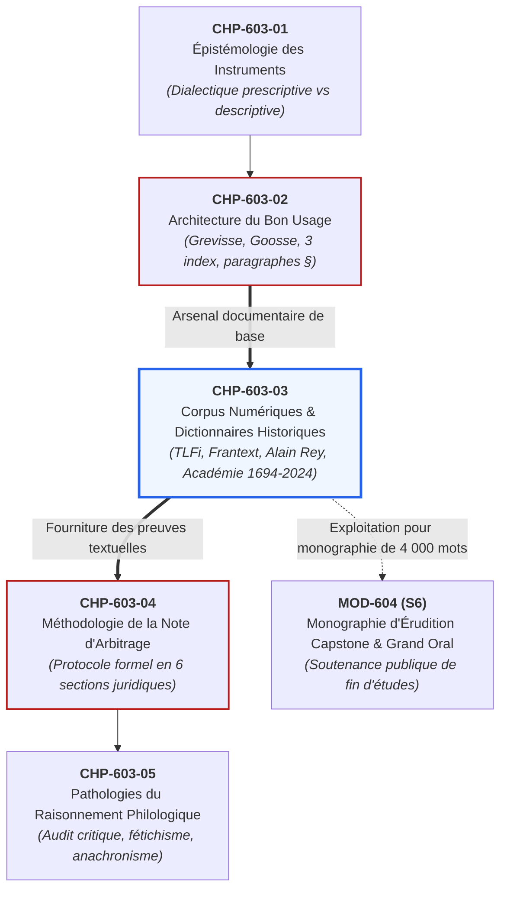
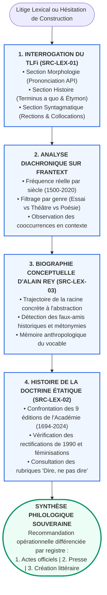

# Chapitre 3 : Les Corpus Numériques et Dictionnaires Historiques Monumentaux : TLFi, Frantext, Dictionnaire Historique d'Alain Rey et Évolutions de l'Académie

> **Identifiant** : `CHP-603-03`  
> **Module de rattachement** : [`MOD-603 — Autonomie Philologique : Méthode de Recherche Experte dans les Traités Savants`](file:///f:/Formation/world-class-french/03-curriculum/year-3/semester-6/mod-603-autonomie-philologique-recherche-traites.md)  
> **Volume horaire canonique** : 3 h 30 (Étude théorique des corpus : 1 h 00 | Pratique d'interrogation numérique : 1 h 15 | Analyse historique comparée : 0 h 45 | Évaluation : 0 h 30)  
> **Statut** : [STATUT : VALIDÉ]  
> **Compétences cibles** : [`FR-PHILOL-001`](file:///f:/Formation/world-class-french/02-competency-framework/competency-framework.md#fr-philol-001-autonomie-philologique-et-consultation-experte-des-sources) (Palier L5), [`FR-LEXIC-001`](file:///f:/Formation/world-class-french/02-competency-framework/competency-framework.md#fr-lexic-001-précision-sémantique-nuances-synonymiques-et-collocations) (Palier L5), [`FR-INT-003`](file:///f:/Formation/world-class-french/02-competency-framework/competency-framework.md#fr-int-003-réviser-et-corriger-un-texte-tiers-en-justifiant-les-interventions) (Palier L5)  
> **Sources de référence** : `SRC-LEX-01` (*Trésor de la Langue Française informatisé* [TLFi], ATILF / CNRS), `SRC-LEX-02` (*Dictionnaire de l'Académie française*, 1re à 9e éd.), `SRC-LEX-03` (Alain Rey, *Dictionnaire historique de la langue française*), `SRC-GRAM-01` (Grevisse & Goosse, *Le Bon Usage*), `SRC-GRAM-02` (Riegel et al., *Grammaire méthodique du français*), `SRC-NORM-03` (Ministère de l'Éducation nationale, *Terminologie grammaticale*), `SRC-TYPO-01` (Imprimerie nationale, *Lexique des règles typographiques*)

---

## 1. Titre et Place dans le Cursus

Ce troisième chapitre du module `MOD-603` constitue le carrefour technologique et documentaire de l'autonomie philologique. Après avoir analysé l'épistémologie critique des instruments de langue (`CHP-603-01`) et dompté la cartographie monumentale du *Bon Usage* de Maurice Grevisse et André Goosse (`CHP-603-02`), l'apprenant pénètre dans les laboratoires numériques de la lexicographie moderne.

Il ne s'agit plus seulement de vérifier ce qu'un grammairien d'autorité a consigné dans son traité imprimé, mais d'arpenter de manière autonome les gisements textuels primaires : le *Trésor de la Langue Française informatisé* (*TLFi*, `SRC-LEX-01`), la base de données textuelles *Frantext*, le *Dictionnaire historique de la langue française* dirigé par Alain Rey (`SRC-LEX-03`) et le corpus diachronique des neuf éditions du *Dictionnaire de l'Académie française* (1694-2024, `SRC-LEX-02`). Ces instruments numériques arment l'étudiant pour rédiger la *Note d'arbitrage philologique* (`CHP-603-04`), déjouer les pathologies du raisonnement linguistique (`CHP-603-05`) et nourrir la recherche doctorale du Capstone Project terminal (`MOD-604`).



---

## 2. Objectifs Mesurables

Au terme de ce chapitre calibré pour une durée de 3 h 30, l'apprenant sera capable de :

1. **Disséquer l'arborescence savante d'un article monumental du TLFi** (`SRC-LEX-01`) en extrayant sans hésitation le *terminus a quo*, l'étymon latin ou hellénique, les dates des bifurcations polysémiques, les contraintes morphologiques en API et la section syntagmatique des rections verbales et collocations admises (`FR-PHILOL-001`, palier L5).
2. **Formuler des requêtes textuelles expertes sur corpus diachronique** (type *Frantext*) par l'emploi combiné de lemmes, d'expressions régulières et de bornes chronologiques (1500-2020), pour évaluer la fréquence réelle et la représentativité générique d'une tournure litigieuse (`FR-PHILOL-001`, palier L5).
3. **Reconstituer la biographie anthropologique et conceptuelle d'un lemme** à travers le *Dictionnaire historique de la langue française* d'Alain Rey (`SRC-LEX-03`), en traçant le passage d'une racine concrète ou technique à une métaphore morale, philosophique ou juridique (`FR-LEXIC-001`, palier L5).
4. **Analyser comparativement la doctrine académique à travers les neuf éditions du Dictionnaire de l'Académie française** (1694 à 2024, `SRC-LEX-02`), en identifiant les bascules structurelles majeures : classement par racines de 1694, passage à l'ordre alphabétique en 1718, réformes graphiques des 3e et 4e éditions, jusqu'aux rectifications et féminisations de la 9e édition (`FR-PHILOL-001`, `FR-INT-003`, palier L5).
5. **Démontrer la cécité de la statistique numérique brute** lorsqu'elle est dissociée de l'analyse sociolinguistique et du genre discursif, en réfutant scientifiquement un argument fondé sur l'accumulation d'occurrences textuelles sans qualification qualitative (`FR-INT-003`, palier L5).

---

## 3. Prérequis et Test de Préparation

### 3.1 Prérequis Cognitifs
- Maîtrise de la distinction épistémologique entre norme prescriptive, description de corpus et tolérance administrative (`CHP-603-01`).
- Capacité à localiser une difficulté syntaxique dans *Le Bon Usage* de Grevisse par l'index des matières et la table systématique (`CHP-603-02`).
- Connaissance des grandes périodes diachroniques du français : Ancien Français (IXe-XIIIe s.), Moyen Français (XIVe-XVe s.), Renaissance (XVIe s.), Classicisme du Grand Siècle (XVIIe s.), Siècle des Lumières (XVIIIe s.), Époque contemporaine (XIXe-XXIe s.) [issus de `MOD-601`].

### 3.2 Test Diagnostique d'Auto-Évaluation (5 items)

<details>
<summary><b>Consulter le test et son corrigé immédiat</b></summary>

1. *Que désigne précisément l'expression latine « terminus a quo » dans une notice lexicographique historique ?*  
   **Réponse** : Le *terminus a quo* (littéralement « borne à partir de laquelle ») désigne la date ou l'époque la plus ancienne formellement attestée dans un document écrit subsistant où un vocable ou une acception sémantique spécifique apparaît pour la première fois dans l'histoire de la langue.

2. *Pourquoi la première édition du Dictionnaire de l'Académie française (1694) est-elle restée célèbre pour son extrême difficulté d'utilisation pratique ?*  
   **Réponse** : Parce qu'elle n'était pas classée selon l'ordre alphabétique continu des mots, mais par « racines étymologiques » ou familles morphologiques (ex. *instruire*, *destruction*, *constructeur* étaient tous regroupés sous le verbe primitif *structurer* ou *construire*). L'ordre alphabétique absolu ne fut adopté qu'à partir de la 2e édition (1718).

3. *Quelle différence fondamentale sépare la section sémantique générale d'un article du TLFi de sa section « SYNTAGMATIQUE » ?*  
   **Réponse** : La section sémantique définit le contenu notionnel et le réseau de traits sémiques du mot (dénotation, sens figuré, métonymie), tandis que la section syntagmatique décrit les comportements combinatoires du mot dans la chaîne parlée ou écrite : régimes prépositionnels (*à*, *de*, *envers*), rections verbales (transitivité directe/indirecte), et collocations privilégiées ou figées (*nourrir un dessein*, *refroidir l'enthousiasme*).

4. *Pourquoi l'interrogation naïve d'un moteur de recherche web généraliste (ex. Google) ne peut-elle en aucun cas tenir lieu de recherche lexicographique ou normative ?*  
   **Réponse** : Parce qu'un moteur de recherche web indexe indifféremment des millions de pages sans contrôle éditorial, agrégeant le bavardage relâché des réseaux sociaux, les erreurs virales, les fautes de traduction automatique et les coquilles d'usagers non avertis. Le volume d'occurrences numériques mesure la viralité statistique, non la conformité au bon usage académique.

5. *Qu'appelle-t-on une « restriction de collocation » ? Donnez un exemple précis.*  
   **Réponse** : Une restriction de collocation est une contrainte d'association préférentielle ou obligatoire qui lie un terme à un nombre très restreint de partenaires lexicaux dans un registre donné, sans que la logique conceptuelle pure ne suffise à l'expliquer. Exemple : on dit qu'un bruit est *assourdissant* ou *fracassant*, mais qu'une obscurité est *profonde* ou *d'encre* (et non \*obscurité fracassante) ; on dit *commettre un crime*, mais *intenter une action* en justice (et non \*commettre une action en justice).

</details>

---

## 4. Situation de Départ ou Problème Concret

Considérons les deux situations pathologiques suivantes, observées quotidiennement dans les cabinets juridiques, les comités de rédaction universitaire et les concours de haute fonction publique :

### Situation A : Le mirage statistique du moteur de recherche
Un rédacteur d'actes diplomatiques hésite entre deux constructions : *« pallier le manque de ressources »* et *« pallier au manque de ressources »*. Ne disposant pas de traité sous la main, il saisit la seconde tournure sur son moteur de recherche Internet. L'écran affiche avec ostentation : **« 4 850 000 résultats »**, accompagnés d'articles de presse quotidienne nationale et de déclarations ministérielles télévisées.  
Rassuré par cette avalanche de données, le rédacteur maintient *« pallier au »* dans son mémoire. Quelques semaines plus tard, sa copie est sanctionnée d'une note éliminatoire par le jury d'admission du Ministère des Affaires étrangères, pour « méconnaissance caractérisée de la rection transitive directe d'un verbe fondamental de la langue administrative ». Le scripteur s'indigne : *« Mais des millions de personnes et de journalistes écrivent ainsi ! »* Il a confondu le **bruit numérique** d'un usage oral relâché avec la **norme de prestige** régissant l'écrit de haute responsabilité.

### Situation B : L'anachronisme sémantique au tribunal
Dans un litige successoral portant sur un testament rédigé au début du XIXe siècle, une clause stipule que les héritiers devront consacrer une part de la rente à *« prévenir tout scandale et tout enthousiasme dans la gestion du domaine »*. L'avocat moderne plaide que le testateur exigeait la modération et interdisait les investissements téméraires dictés par la joie et l'euphorie.  
L'avocat adverse, rompu aux méthodes philologiques, produit un extrait du *Dictionnaire de l'Académie française* (6e édition, 1835) et du *Dictionnaire historique d'Alain Rey* : à cette époque, le mot *enthousiasme* conservait encore puissamment son acception religieuse et politique de *« fanatisme mystique, exaltation déraisonnable, fureur séditieuse »*. Le testateur n'interdisait pas la joie créatrice de ses descendants ; il protégeait son patrimoine contre les sectes mystiques et les factions révolutionnaires. L'ignorance de la diachronie sémantique avait conduit le premier conseil à un contresens herméneutique total.

---

## 5. Explication Intuitive : L'Observatoire Astronomique et la Carotte Géologique

Pour comprendre l'articulation entre les différents instruments numériques et historiques de la langue française, imaginons deux démarches scientifiques complémentaires :

```text
COMPLÉMENTARITÉ ÉPISTÉMOLOGIQUE DES INSTRUMENTS DE RECHERCHE
┌─────────────────────────────────────────────────────────────────────────────────┐
│              LA CAROTTE GÉOLOGIQUE SÉDIMENTAIRE (Axe Diachronique)              │
│       Dictionnaires Historiques (Alain Rey, TLFi section Histoire, Académie)     │
├─────────────────────────────────────────────────────────────────────────────────┤
│  Stratification verticale : on creuse le temps siècle par siècle.               │
│  • Surface (XXIe s.)   : sens moderne affadi ou technicisé                     │
│  • Couche moyenne (XVIIIe s.) : extension métaphorique des philosophes          │
│  • Couche profonde (XVIIe s.) : fixation classique, sens restrictif d'État      │
│  • Socle primitif (Moyen Âge / Antiquité) : étymon concret, racine indo-européenne│
└──────────────────────────────────────┬──────────────────────────────────────────┘
                                       │ Croisement méthodique
┌──────────────────────────────────────┴──────────────────────────────────────────┐
│             LE TÉLESCOPE ASTRONOMIQUE SPECTRAL (Axe Synchronique / Corpus)      │
│                     Base Frantext & Concordanciers Numériques                   │
├─────────────────────────────────────────────────────────────────────────────────┤
│  Balayage horizontal : on scrute l'univers des textes réels.                    │
│  • Décompte spectral : nombre exact d'occurrences par époque et par genre       │
│  • Constellations de voisinage : collocations et cooccurrences immédiates       │
│  • Vérification empirique : l'écrivain emploie-t-il réellement la forme ?      │
└─────────────────────────────────────────────────────────────────────────────────┘
```

1. **La carotte géologique (les dictionnaires historiques)** : Lorsqu'un géologue fore un glacier ou une falaise, il extrait un cylindre où chaque millimètre de sédiment correspond à une époque révolue. Le *Dictionnaire historique d'Alain Rey* (`SRC-LEX-03`) et la section « ÉTYMOLOGIE & HISTOIRE » du *TLFi* (`SRC-LEX-01`) fonctionnent exactement de cette manière : ils traversent verticalement les strates du temps, montrant comment un mot né pour désigner un objet matériel (ex. le *bouclier* en cuir) s'est métamorphosé en concept monétaire, puis en métaphore morale de protection juridique.
2. **Le télescope astronomique (les corpus textuels comme Frantext)** : Le télescope spatial ne devine rien ; il capte les photons émis par les étoiles et mesure leur spectre. *Frantext* agit comme ce télescope : il balaie des millions de pages littéraires et savantes, dénombrant chaque occurrence d'un syntagme, observant si une étoile linguistique brille de mille feux au XVIIe siècle chez Racine et Corneille pour s'éteindre au XIXe siècle chez Flaubert, ou si elle naît timidement au XXe siècle sous la plume de Proust.

L'expert philologue ne choisit pas entre la géologie et l'astronomie : il croise la carotte sédimentaire du dictionnaire historique avec le spectre lumineux du corpus textuel pour fonder un jugement irréfutable.

---

## 6. Définitions Précises et Terminologie

- **Corpus textuel** : Ensemble structuré et fini de textes authentiques (littéraires, scientifiques, juridiques, journalistiques ou oraux transcrits), sélectionnés selon des critères explicites de représentativité, numérisés et enrichis de métadonnées documentaires (auteur, date, genre) et linguistiques (lemmatisation, étiquetage morphosyntaxique), sur lequel s'appuie l'investigation empirique.
- **Base Frantext** : Base de données textuelle monumentale développée par le laboratoire ATILF (CNRS / Université de Lorraine), regroupant plus de 5 400 œuvres intégrales de la littérature et de la pensée françaises, couvrant une période ininterrompue du Xe au XXIe siècle (avec un noyau de haute densité entre 1500 et 2020), totalisant plus de 260 millions de mots consultables par requêtes lemmatisées et syntagmatiques.
- **Trésor de la Langue Française informatisé (TLFi)** : Version numérique en accès libre du dictionnaire monumental en 16 volumes publié par le CNRS entre 1971 et 1994 (`SRC-LEX-01`). Couvrant le vocabulaire des XIXe et XXe siècles avec de profondes perspectives historiques, il constitue le plus riche dictionnaire analytique jamais édité pour la langue française (100 000 lemmes, 270 000 définitions, 430 000 citations littéraires et scientifiques intégrales).
- **Dictionnaire historique de la langue française (Alain Rey)** : Ouvrage lexicographique encyclopédique dirigé par Alain Rey (`SRC-LEX-03`), consacré exclusivement à la généalogie, à la morphogenèse et aux mutations conceptuelles du lexique français depuis ses origines indo-européennes et gallo-romanes jusqu'aux créations contemporaines.
- **Dictionnaire de l'Académie française (1re à 9e édition)** : Série de neuf éditions officielles publiées par la Compagnie depuis 1694 jusqu'à l'achèvement de la 9e édition en 2024 (`SRC-LEX-02`), matérialisant l'évolution de la politique normative de l'État français, de l'orthographe monarchique archaïsante à la codification contemporaine.
- **Terminus a quo** : Date ou repère chronologique certain attestant l'apparition la plus ancienne connue d'une forme graphique, d'un vocable ou d'une nuance sémantique dans la documentation textuelle manuscrite ou imprimée.
- **Attestation première** : Citation textuelle formelle, accompagnée du nom de l'auteur, du titre de l'ouvrage et de l'année d'édition, apportant la preuve matérielle indiscutable qu'un mot ou un tour appartenait déjà au répertoire de la langue écrite à cette date.
- **Section syntagmatique** : Rubrique spécialisée au sein d'un article de dictionnaire savant (en particulier dans le TLFi) répertoriant les contraintes de construction grammaticale régissant un mot : rections verbales (ex. *transitif indirect avec à*), régimes des noms et adjectifs, et environnement syntagmatique immédiat.
- **Restriction de collocation** : Propriété combinatoire limitant la cooccurrence naturelle d'un terme à un paradigme lexical restreint, indépendamment de la compatibilité logique pure (ex. on dit *une pluie battante* ou *diluvienne*, mais non \*une pluie assourdissante).
- **Glissement sémantique** : Processus diachronique par lequel le signifié d'un mot dérive progressivement de son noyau sémantique originel par métonymie, métaphore, spécialisation technique ou affadissement axiologique.
- **Palimpseste lexical** : Notion théorique désignant la superposition, au sein d'un vocable contemporain, de couches de sens historiques sédimentées qui continuent d'informer sourdement sa charge stylistique, affective et poétique, même lorsque les locuteurs ont oublié l'étymon premier.

---

## 7. Règles ou Mécanismes Fondamentaux

### 7.1 L'Arborescence Monumentale du TLFi (ATILF / CNRS) [SRC-LEX-01]

L'accès à l'excellence philologique exige de cesser de consulter le *TLFi* comme un simple dictionnaire de définitions. Il s'agit d'une cathédrale de données textuelles structurée en quatre étages méthodologiques distincts :

```text
ARBORESCENCE D'UN ARTICLE MONUMENTAL DU TLFi (SRC-LEX-01)
├── 1. EN-TÊTE MORPHOLOGIQUE & PHONÉTIQUE
│   ├── Graphie canonique et variantes graphiques attestées
│   ├── Catégorie grammaticale et genre
│   ├── Transcription phonétique intégrale en Alphabet Phonétique International (API)
│   └── Remarques de prononciation (liaisons, hiatus, hésitations de timbre vocalique)
├── 2. CORPS SÉMANTIQUE HIÉRARCHISÉ
│   ├── Section A. — Sens propre et valeurs physiques originelles
│   ├── Section B. — Extensions figurées, métaphoriques et morales
│   ├── Section C. — Usages spécialisés, terminologies savantes ou techniques
│   └── Apparat de citations : chaque sens est adossé à un extrait d'auteur avec date et page
├── 3. RUBRIQUE « SYNTAGMATIQUE » (L'Ancre Grammaticale)
│   ├── Rection verbale : transitivité directe, indirecte ou intransitivité
│   ├── Régimes prépositionnels admis : 'à', 'de', 'sur', 'envers', 'contre'
│   ├── Compléments nominaux et adjectivaux tolérés
│   └── Collocations obligatoires ou lexicalisées (proverbes, locutions)
└── 4. SECTION « ÉTYMOLOGIE ET HISTOIRE » (La Carotte Diachronique)
    ├── Terminus a quo : première date d'attestation manuscrite ou imprimée
    ├── Étymon : racine latine, grecque, germanique, arabe ou création onomatopéique
    ├── Filiation morphologique : chaîne des mutations phonétiques régulières
    └── Chronologie des glissements : dates précises d'apparition de chaque sens second
```

#### A. Le décodage de la section « ÉTYMOLOGIE & HISTOIRE »
Dans chaque article du TLFi, la section finale d'étymologie constitue le cœur historique de l'enquête. L'expert y recherche trois éléments clés :
- Le **terminus a quo absolu** : noté sous la forme *« 1. Ca 1100 »* (vers 1100 dans la *Chanson de Roland*), *« 1170 »* (Chrétien de Troyes) ou *« 1549 »* (Robert Estienne).
- L'**étymon rigoureux** : l'ancêtre lexical restitué (ex. latin classique *computare*, bas-latin *collocare*, grec *enthousiasmos*).
- La **stratification des acceptions** : le dictionnaire précise à quelle date le mot a cessé d'être purement technique pour investir le domaine moral, politique ou affectif.

#### B. L'autorité de la section « SYNTAGMATIQUE »
La section syntagmatique est le rempart suprême contre les impropriétés et les solécismes. Elle détaille non pas ce que le mot signifie, mais **avec qui et comment il s'associe**.  
Exemple canonique : l'article *IMPUTER* précise sa structure actancielle :
$$\text{IMPUTER} : \quad [\text{Sujet humain ou causal}] + [\text{Verbe}] + [\text{COD : faute, crime, négligence}] + [\text{à} + \text{COI : personne ou facteur}]$$
Le TLFi signale immédiatement que la tournure moderne \*« imputer sur le budget » (au sens d'inscrire une dépense) relève du jargon administratif et financier, distinct du sens plein de reproche moral de la langue générale.

---

### 7.2 La Base Frantext et les Principes de l'Interrogation de Corpus

La base *Frantext* permet de confronter les assertions des dictionnaires à la réalité tangible de la production écrite des grands auteurs. L'interrogation scientifique sur corpus repose sur trois protocoles d'investigation :

#### A. La recherche par lemme vs recherche de forme fléchie
- Si l'on cherche la fréquence globale d'un verbe, on interroge son **lemme** (*chanter*), ce qui permet à l'algorithme d'agréger toutes les formes fléchies (*chante*, *chantions*, *chanteraient*, *chanté*, *chantant*).
- Si l'on enquête sur une controverse morphosyntaxique précise (ex. le mode après *après que*), on paramètre une requête ciblant spécifiquement la séquence :
  $$\text{Requête} = \langle \text{"après que"} \rangle + [\text{pronom / nom}] + [\text{verbe fléchi au subjonctif}]$$

#### B. Le bornage chronologique et la représentativité générique
Un chiffre d'occurrences extrait de Frantext n'a aucune valeur en lui-même s'il n'est pas contextualisé :
1. **La période historique** : Une tournure comptant 200 occurrences entre 1600 et 1700, mais tombant à 3 occurrences entre 1900 et 2000, est un **archaïsme en voie d'extinction**, impropre à l'usage administratif contemporain.
2. **Le genre textuel** : Les occurrences doivent être filtrées : s'agit-il de théâtre (dialogue mimant l'oralité relâchée de valets comiques), de poésie (contraintes de la rime et de la césure), d'essais philosophiques ou de prose historique d'apparat ? Une licence poétique chez Hugo ne saurait légitimer un tour dans un traité juridique.

#### C. L'analyse des cooccurrences et réseaux collocationnels
Le concordancier numérique extrait le contexte immédiat (fenêtre de 5 à 10 mots à gauche et à droite). L'apprenant observe ainsi les adjectifs qui s'agrègent naturellement autour du substantif et les prépositions rectrices majoritaires.

---

### 7.3 Le Dictionnaire Historique d'Alain Rey [SRC-LEX-03]

Le monument d'Alain Rey ne concurrence pas le TLFi : il le sublime en restituant la **mémoire anthropologique, culturelle et symbolique des mots**. Alain Rey aborde chaque vocable comme un organisme vivant dont il écrit la véritable biographie.

#### La trajectoire conceptuelle d'un mot
Le *Dictionnaire historique* dévoile comment s'opèrent les mutations structurales de la pensée humaine à travers la langue :
1. **L'enracinement concret** : Presque tous les mots abstraits du français dérivent d'une réalité matérielle ou corporelle. Le mot *scrupule* ne désignait au départ qu'un petit caillou pointu (*scrupulus*) qui glisse dans la sandale du légionnaire romain et gêne sa marche ; de là, il est devenu l'hésitation de conscience qui entrave l'action morale.
2. **La métaphore sociale et politique** : Le mot *ministre* désignait le petit serviteur (*minister*, dérivé de *minus*, par opposition à *magister* le maître dérivé de *magis*). Il a fallu des siècles d'histoire administrative pour que le serviteur du prince devienne le dignitaire gouvernant l'État.
3. **La restitution des faux-amis historiques** : Alain Rey documente avec précision les époques où un mot s'est inversé ou a restreint son spectre, évitant aux scripteurs modernes de prêter aux auteurs classiques des pensées qui n'étaient pas les leurs.

---

### 7.4 Les Neuf Éditions du Dictionnaire de l'Académie Française (1694 à 2024) [SRC-LEX-02]

L'Académie française a été fondée en 1635 par le cardinal de Richelieu avec pour mission première d'élaborer un dictionnaire fixant les règles de l'éloquence et de la clarté. L'étude comparée de ses neuf éditions permet de suivre en temps réel la cristallisation de la norme étatique :

```text
CHRONOLOGIE DES NEUF ÉDITIONS DU DICTIONNAIRE DE L'ACADÉMIE FRANÇAISE (SRC-LEX-02)
├── 1re ÉDITION (1694) : Le classement par racines étymologiques
│   └── Ordre non alphabétique. Objectif : fixer le bel usage de la Cour de Louis XIV.
├── 2e ÉDITION (1718) : L'adoption salvatrice de l'ordre alphabétique
│   └── Refonte complète pour faciliter la consultation pratique des lettrés.
├── 3e ÉDITION (1740) & 4e ÉDITION (1762) : Les grandes réformes orthographiques des Lumières
│   └── Suppression des consonnes doubles étymologiques inutiles (ex. 'estre' -> 'être', 'apporter').
│   └── Fixation des accents aigus, graves et circonflexes modernes par l'abbé d'Olivet.
├── 5e ÉDITION (1798) : L'intégration sous le Directoire du vocabulaire révolutionnaire
│   └── Entrée des termes politiques : 'constitutionnel', 'démocratie', 'citoyen', 'guillotine'.
├── 6e ÉDITION (1835) : La grande réforme de Voltaire sur la graphie '-oi-' -> '-ai-'
│   └── Remplacement systématique de 'françois', 'anglois', 'chantoit' par 'français', 'anglais', 'chantait'.
├── 7e ÉDITION (1878) : L'apogée de la prose bourgeoise et académique de la IIIe République
├── 8e ÉDITION (1932-1935) : La norme de référence de l'entre-deux-guerres
└── 9e ÉDITION (1992-2024) : L'achèvement contemporain
    └── Intégration des rectifications orthographiques de 1990 (SRC-NORM-02).
    └── Féminisation des noms de métiers, fonctions et grades (rapport de 2019).
    └── Prise en compte du vocabulaire scientifique et technologique contemporain.
```

L'expert ne cite jamais « le Dictionnaire de l'Académie » de façon intemporelle : il précise toujours **de quelle édition il s'agit**, car citer la 1re édition (1694) pour trancher un litige syntaxique du XXIe siècle constitue une aberration philologique majeure.

---

## 8. Raisonnement Détaillé : Pourquoi la Statistique Numérique Pure est Aveugle

L'une des plus grandes illusions de l'ère algorithmique consiste à penser que le calcul de fréquence brute sur des méga-bases de données équivaut à un brevet de validité linguistique.  
La formule du linguiste s'oppose ici radicalement à l'algorithme du moteur de recherche :

$$\text{Validité Normative} \neq \lim_{n \to \infty} \sum \text{Occurrences Brutes}$$

$$\text{Validité Normative} = f\left(\text{Autorité de la Source}, \text{Genre Discursif}, \text{Registre d'Énonciation}, \text{Conformité Diachronique au Système}\right)$$

### 1. Le phénomène de la contamination mimétique
Sur Internet et dans les médias, une erreur grammaticale se propage par mimétisme à la vitesse des flux numériques. Lorsqu'une faute de syntaxe est commise par un homme politique éminent ou un journaliste vedette, elle est reprise en quelques heures dans des milliers de dépêches d'agences, d'articles de presse et de commentaires de réseaux sociaux.  
Si un chercheur interroge un corpus non qualifié, il trouvera 50 000 occurrences d'une tournure erronée et seulement 500 occurrences de la forme soignée. En conclure que la forme erronée est devenue « la règle » relève d'une abdication intellectuelle : c'est confondre une **épidémie linguistique** avec une **loi du système**.

### 2. Le biais élitiste et littéraire des corpus patrimoniaux (Frantext)
À l'inverse, l'expert philologue conserve un regard critique sur la base *Frantext*. Bien qu'incomparablement plus rigoureuse que le web, Frantext présente un biais structurel bien connu des linguistes :
- Elle surreprésente massivement les écrivains parisiens d'élite, masculins et reconnus par l'institution académique ;
- Elle sous-représente les textes de la pratique quotidienne, le théâtre forain, la correspondance privée féminine, les écrits de l'Afrique francophone et des régions périphériques ;
- Elle enregistre des licences poétiques extraordinaires propres au génie individuel d'un Chateaubriand ou d'un Mallarmé, que nul ne saurait ériger en règle d'écriture pour une note administrative ou une dissertation de concours.

La statistique numérique donne la matière brute de l'observation ; seule la **méthode philologique** lui confère un sens et une valeur d'arbitrage.

---

## 9. Exemples Corrects Commentés : Décorticage du Lemme « ENTHOUSIASME »

Pour illustrer le protocole complet de l'investigation philologique, disséquons pas à pas la trajectoire historique et lexicographique du substantif masculin **ENTHOUSIASME** à travers nos quatre instruments monumentaux.

### Étape 1 : Interrogation du TLFi [SRC-LEX-01]
- **Morphologie & Phonétique** :
  - Graphie : `<enthousiasme>`, substantif masculin.
  - API : `/ɑ̃tuzjazm/` (noter la prononciation du groupe sonore avec consonne spirante voisée `/z/` et nasale initiale `/ɑ̃/`, avec maintien du schwa final `/ə/` en diction poétique classique).
- **Section « ÉTYMOLOGIE & HISTOIRE »** :
  - *Terminus a quo* : **1552**, attesté chez Pierre de Ronsard (*Amours*, éd. P. Laumonier, t. 4, p. 7).
  - *Étymon* : Emprunté au grec savant *enthousiasmos* (de *en-theos*, « possédé par un dieu, habité par la divinité »).
  - *Glissements sémantiques* : 
    - 1552 : acception religieuse et poétique de « fureur sacrée, transport de l'âme possédée par la divinité » ;
    - 1690 (Fur.) : application péjorative aux illuminés religieux (« fanatisme ») ;
    - Milieu XVIIIe s. : laïcisation par les philosophes des Lumières (Diderot) : « ferveur créatrice, émotion vive qui élève l'esprit » ;
    - XIXe s. : acception moderne généralisée de « joie ardente, admiration enthousiaste ».
- **Section « SYNTAGMATIQUE »** :
  - Verbes recteurs admis : *susciter, provoquer, modérer, refroidir, étouffer l'enthousiasme*.
  - Régimes prépositionnels : *enthousiasme pour* (une idée, une personne) ; *enthousiasme de* (joie causée par un succès).
  - Restrictions de collocation : on dit *un transport d'enthousiasme*, *un accès d'enthousiasme*, *délire d'enthousiasme*.

### Étape 2 : Interrogation Diachronique sur Frantext
Une requête par lemme sur Frantext portant sur la période 1600-2000 révèle une courbe diachronique fascinante en trois phases :
1. **Le reflux classique (1600-1715)** : Faible fréquence relative (moins de 40 occurrences dans tout le Grand Siècle). Les auteurs de l'époque classique (Boileau, Bossuet, Bourdaloue) se méfient du terme, perçu comme un synonyme de délire mystique incontrôlé et de sédition sectaire.
2. **L'explosion philosophique des Lumières (1750-1789)** : Rebond spectaculaire avec plus de 350 occurrences chez Voltaire, Diderot et Jean-Jacques Rousseau, qui réhabilitent l'enthousiasme comme moteur de la vertu civique et de la création artistique.
3. **Le triomphe romantique (XIXe s.)** : Apogée avec plus de 1 200 occurrences chez Mme de Staël (*De l'Allemagne* consacre un chapitre entier à l'apologie de l'enthousiasme), Chateaubriand, Lamartine et Victor Hugo.

### Étape 3 : Consultation du Dictionnaire Historique d'Alain Rey [SRC-LEX-03]
Alain Rey commente la dimension anthropologique du terme :
> *« Le mot, d'abord confiné au vocabulaire technique de la critique poétique de la Pléiade pour traduire la théorie platonicienne de l'inspiration divine, a failli sombrer au XVIIe siècle sous l'accusation de fanatisme religieux. C'est la réhabilitation esthétique opérée au XVIIIe siècle, puis le sentimentalisme romantique, qui en ont fait une vertu morale positive, avant que la fin du XXe siècle ne l'affadisse au sens trivial de simple contentement ou d'accord enthousiaste. »*

### Étape 4 : Évolution de la Doctrine Académique (Académie Française) [SRC-LEX-02]
- **1re édition (1694)** : Classé avec réticence : *« ENTHOUSIASME. s.m. Fureur poëtique, divination dont estoient touchez les Prophetes des faux Dieux. Il se dit figurément d'Un transport extraordinaire qui saisit l'esprit du Poëte. »* Le terme est strictement limité à l'extase païenne ou poétique.
- **4e édition (1762)** : Définition laïcisée et élargie : *« Transport de l'esprit, qui fait inventer ou exécuter des choses extraordinaires et surprenantes dans la Poësie, la Peinture, l'Éloquence, etc. »*
- **8e édition (1935)** : Intégration de la passion d'action : *« Émotion puissante qui porte à admirer vivement ou à agir avec passion. L'enthousiasme de la jeunesse. Faire preuve d'enthousiasme. »*
- **9e édition (2024)** : Pleine maturité contemporaine : consécration de l'usage civique, affectif et intellectuel sans réserve normative.

---

## 10. Contre-Exemples et Erreurs Fréquentes

L'investigation sur corpus textuels numériques et traités lexicographiques monumentaux exige une vigilance épistémologique constante. L'expérience didactique et l'audit des travaux d'étudiants permettent d'isoler six erreurs récurrentes majeures lors du maniement des instruments savants :

### Erreur n° 1 : La confusion entre fréquence brute numérique et correction normative
- **L'anomalie** : Découvrir sur un moteur de recherche web ou dans un corpus de presse numérisé 50 000 attestations de la tournure *« pallier à un problème »* ou *« après qu'il soit venu »*, et en conclure que ces formes sont désormais validées par la norme d'excellence.
- **La réfutation scientifique** : La fréquence numérique mesure l'usage statistique, non l'admissibilité académique ou juridique. Le verbe *pallier* demeure rigoureusement transitif direct (*pallier un problème*) dans tous les dictionnaires savants (`SRC-LEX-01`, `SRC-LEX-02`) ; l'adjonction de la préposition *à* résulte d'une contamination erronée par analogie phonétique et sémantique avec *remédier à*. L'expert maintient la distinction entre le laxisme fréquentiel et la tenue académique.

### Erreur n° 2 : La lecture superficielle du TLFi bornée à la définition sans la syntagmatique
- **L'anomalie** : Consulter un lemme au TLFi, lire la définition conceptuelle générale du mot, mais omettre de vérifier la sous-section « SYNTAGMATIQUE » située au bas de la notice, aboutissant à employer le mot avec un régime prépositionnel fautif.
- **La réfutation scientifique** : Un vocable n'existe pas dans le vide abstrait de son concept ; il est soumis à des règles de couplage grammatical strictes. Par exemple, le verbe *agonir* (injurier, accabler d'outrages) exige impérativement la préposition *de* (*agonir quelqu'un d'injures*). Croire que l'on peut dire \*« agonir quelqu'un avec mépris » sous prétexte que le mot signifie injurier constitue un solécisme de collocation documenté par le TLFi.

### Erreur n° 3 : L'anachronisme sémantique par ignorance du terminus a quo
- **L'anomalie** : Étudier un manuscrit ou un traité du XVIIe siècle et interpréter un vocable en lui appliquant la signification qu'il n'a acquise qu'au XIXe ou au XXe siècle, sous prétexte que la forme graphique est identique.
- **La réfutation scientifique** : Le philologue contrôle impérativement la date de première attestation (*terminus a quo*) de chaque acception au sein de la section « ÉTYMOLOGIE & HISTOIRE » du TLFi ou dans Alain Rey (`SRC-LEX-03`). Si l'acception juridique ou abstraite d'un mot n'apparaît qu'en 1789, il est formellement interdit de l'attribuer à un texte rédigé par Montaigne en 1580 ou par Corneille en 1640.

### Erreur n° 4 : La consultation d'une ancienne édition de l'Académie prise pour la norme actuelle
- **L'anomalie** : Rechercher sur une base numérisée un terme dans le *Dictionnaire de l'Académie française*, tomber par inadvertance sur la 1re édition (1694) ou la 6e édition (1835), et brandir cette définition pour condamner un emploi moderne parfaitement légitime.
- **La réfutation scientifique** : La politique normative de l'Académie est évolutive. Consulter l'édition de 1694 ou de 1762 sert l'histoire de la langue, non la rédaction présente. Pour établir la norme officielle contemporaine, l'apprenant doit impérativement se référer à la **9e édition (1992-2024)** (`SRC-LEX-02`), seule à intégrer les rectifications orthographiques de 1990 et les recommandations modernes de féminisation.

### Erreur n° 5 : L'omission des étiquettes de registre du TLFi (Pop., Fam., Vx)
- **L'anomalie** : Trouver une forme ou un mot dans le TLFi, et l'insérer sans scrupule dans une note de synthèse juridique ou une dissertation universitaire sous le prétexte qu'*« il est dans le dictionnaire du CNRS »*.
- **La réfutation scientifique** : Le TLFi est un dictionnaire **descriptif intégral** : son mandat d'État était de consigner la totalité du lexique réel, y compris les vocables vulgaires, l'argot des tranchées de 14-18 et les barbarismes populaires. Chaque emploi y est affecté d'une étiquette sociolinguistique explicite : *Pop.* (Populaire), *Fam.* (Familier), *Vx* (Vieux/Archaïque), *Péj.* (Péjoratif) ou *Arg.* (Argotique). Omettre de lire cette étiquette expose le scripteur à des ruptures de registre désastreuses.

### Erreur n° 6 : L'aveuglement de l'illusion étymologique condamnant un sens moderne vivant
- **L'anomalie** : Prétendre qu'un mot moderne est employé à contresens parce que sa racine grecque ou latine signifiait autre chose il y a deux mille ans (sophisme puriste de l'étymon roi).
- **La réfutation scientifique** : La langue française est un système autonome régi par l'usage vivant de ses locuteurs, non une province figée du latin classique. Condamner le mot *navrer* au sens de « peiner profondément » sous prétexte qu'en ancien français il signifiait « blesser physiquement avec une épée » relève d'un anachronisme régressif dénoncé par Ferdinand de Saussure et André Goosse (`SRC-GRAM-01`).

---

### Tableau Clinique des Fautes de Recherche

Le tableau suivant récapitule les six pathologies méthodologiques majeures et leur redressement scientifique :

| Cas d'investigation | Nature du piège méthodologique | Manifestation erronée | Conséquence philologique | Protocole de redressement scientifique |
| :--- | :--- | :--- | :--- | :--- |
| **Cas 1** | Cécité statistique du web | Préférer une tournure parce qu'elle donne des millions de clics. | Consécration de solécismes viraux et fautes de presse. | Filtrer par corpus institutionnels et traités savants (`SRC-GRAM-01`, `SRC-LEX-01`). |
| **Cas 2** | Décontextualisation sémantique | Isoler la définition abstraite sans regarder les rections. | Violations des régimes prépositionnels et collocations. | Examiner systématiquement la section SYNTAGMATIQUE du TLFi. |
| **Cas 3** | Projection anachronique | Interpréter un texte ancien avec la sémantique actuelle. | Contresens herméneutique grave sur la pensée des auteurs. | Vérifier le *terminus a quo* de chaque acception dans Alain Rey (`SRC-LEX-03`). |
| **Cas 4** | Confusion des strates académiques | Citer l'édition de 1694 ou 1835 pour l'usage actuel. | Application de règles abrogées ou d'orthographes archaïques. | Vérifier la date exacte de l'édition citée ; viser la 9e éd. (2024). |
| **Cas 5** | Ignorance des registres descriptifs | Employer un mot du TLFi sans vérifier son étiquette. | Incongruité stylistique majeure (mot familier ou argotique en texte formel). | Contrôler les étiquettes sociolinguistiques (*Pop.*, *Fam.*, *Vx*, *Littér.*). |
| **Cas 6** | Fétichisme étymologique régressif | Interdire un sens contemporain au nom de la racine latine. | Purisme archaïsant déconnecté du fonctionnement réel de la langue. | Distinguer la mémoire étymologique de la norme synchronique vivante. |

---

## 11. Cas Particuliers et Limites

Dans la pratique experte de la consultation de corpus, le philologue se heurte à deux limites structurelles fondamentales :

### 1. Les mots « orphelins » de corpus littéraire (Le déficit patrimonial)
Il existe des milliers de vocables authentiques qui ne figurent ni dans *Frantext*, ni dans le *TLFi*, ni dans les anciennes éditions de l'Académie :
- **Le vocabulaire technique et d'artisanat** : Les termes forgés dans les ateliers de charpenterie, de tissage ou de forge ont souvent été transmis par oral sans jamais franchir le seuil du roman bourgeois ou de la haute poésie.
- **Les néologismes et réalités ouest-africaines** : Des vocables et tournures couramment usités dans la presse et la littérature francophone d'Afrique subsaharienne (Bénin, Sénégal, Côte d'Ivoire) ne sont que très partiellement indexés dans Frantext (ex. le verbe *s'enjailler*, le substantif *zemidjan* ou les tournures d'insistance calquées des langues Kwa).
- **Le traitement philologique de l'orphelin** : Pour ces termes, l'absence d'attestation littéraire dans Frantext ne prouve pas l'inexistence du mot. L'expert se reporte alors sur les dictionnaires spécialisés de sociolinguistique francophone (`SRC-SOCIO-01`), les bases d'inventaires lexicaux de l'AUF et les dictionnaires régionaux validés.

### 2. Les néologismes technologiques récents et l'inertie dictionnairique
Le cycle de mise à jour des dictionnaires institutionnels monumentaux se compte en décennies :
- Le *TLFi* s'est arrêté de recenser les nouveautés en 1994 (achèvement de l'édition papier de l'INaLF). Tout vocable né après cette date (ex. *courriel*, *moteur de recherche*, *télétravailler*, *cyberharcèlement*) y est structurellement absent.
- L'Académie française a mis près de quarante ans à rédiger sa 9e édition (1992-2024).
- **Le protocole de compensation** : Devant un terme technologique ou émergent, l'expert croise les arrêtés d'enrichissement de la langue française publiés au *Journal officiel de la République française* (Commission d'enrichissement / FranceTerme), les bases lexicographiques contemporaines du Grand Robert (`SRC-LEX-04`) et les corpus de presse internationale lemmatisée.

---

## 12. Approfondissement Adapté au Niveau : La Linguistique de Corpus Contemporaine

Au niveau d'excellence L5, l'apprenant doit comprendre les débats théoriques qui animent la **linguistique de corpus contemporaine** :

```text
CONTRASTE ÉPISTÉMOLOGIQUE ENTRE LES DEUX MODÈLES DE CORPUS NUMÉRIQUES
┌──────────────────────────────────────────────┬──────────────────────────────────────────────┐
│       MODÈLE « FRANTEXT » (Le Canon Clos)    │   MODÈLE « WEB AS CORPUS » (L'Océan Ouvert)  │
├──────────────────────────────────────────────┼──────────────────────────────────────────────┤
│ • Composition : sélection patrimoniale close │ • Composition : milliards de mots moissonnés │
│   (littérature, philosophie, histoire).      │   automatiquement sur Internet (CommonCrawl).│
│ • Lemmatisation : haute précision manuelle   │ • Lemmatisation : étiquetage automatique par │
│   et validation philologique humaine.        │   algorithmes d'apprentissage statistique.   │
│ • Avantage : fiabilité stylistique suprême,  │ • Avantage : réactivité immédiate aux mots   │
│   absence de bruit textuel vulgaire.         │   émergents, présence de l'oralité globale.  │
│ • Limite : biais élitiste, conservatisme du  │ • Limite : bruit documentaire immense, fautes│
│   genre littéraire, quasi-absence de l'oral. │   multipliées, absence de traçabilité fine.  │
└──────────────────────────────────────────────┴──────────────────────────────────────────────┘
```

L'enjeu pour le chercheur contemporain n'est pas d'excommunier les méga-corpus du web, mais d'adapter son outil à la nature de la question posée :
- Pour déterminer si une figure de style ou un accord relève de l'élégance littéraire ou de la haute tradition académique : **recours exclusif à Frantext et au TLFi**.
- Pour analyser la diffusion d'un anglicisme technologique ou d'une dérivation populaire émergente dans le monde francophone : **recours raisonné aux corpus journalistiques contemporains et méga-corpus lemmatisés**.

---

## 13. Comparaisons Différentielles

### Tableau 1 : Comparatif des Quatre Piliers Documentaires

| Caractéristique | Le Trésor de la Langue Française informatisé (TLFi) [`SRC-LEX-01`] | La Base Frantext (ATILF / CNRS) | Dictionnaire Historique de la Langue Française (Alain Rey) [`SRC-LEX-03`] | Dictionnaire de l'Académie Française (1re-9e éd.) [`SRC-LEX-02`] |
| :--- | :--- | :--- | :--- | :--- |
| **Nature de l'outil** | Dictionnaire descriptif monumental analytique. | Corpus textuel intégral diachronique interrogeable. | Dictionnaire étymologique et généalogique narratif. | Dictionnaire institutionnel régulateur d'État. |
| **Volume de données** | 100 000 mots, 270 000 définitions, 430 000 exemples. | 5 400 œuvres intégrales, 260 millions de mots. | 3 volumes, 4 400 pages, dizaines de milliers de racines. | 9 éditions successives (environ 60 000 mots pour la 9e). |
| **Période focale** | XIXe et XXe siècles (avec rétrospectives historiques). | Xe au XXIe siècle (foyer dense entre 1500 et 2020). | Des racines indo-européennes au XXIe siècle. | De 1694 à 2024 (étapes de fixation étatique). |
| **Rôle philologique** | Extraire les rections syntagmatiques et les attestations. | Mesurer la fréquence réelle et la distribution par siècle/genre. | Comprendre la trajectoire conceptuelle et anthropologique. | Établir la norme officielle et les interdits institutionnels. |

---

### Tableau 2 : Terminus a Quo vs Première Édition d'un Dictionnaire Institutionnel

| Critère de distinction | Terminus a Quo (Attestation Première) | Entrée dans la Première Édition de l'Académie (1694) |
| :--- | :--- | :--- |
| **Définition scientifique** | Date de la plus ancienne trace écrite subsistante (manuscrit, acte notarié, poème). | Date de consécration officielle par la Compagnie de Richelieu dans le corps du dictionnaire. |
| **Signification réelle** | Prouve que le mot existait déjà et était utilisé par les locuteurs. | Prouve que le mot était jugé digne de la Cour et du « bon usage » classique. |
| **Écart chronologique habituel** | Souvent plusieurs siècles avant l'Académie (ex. terminus a quo au XIIe s.). | L'Académie enregistre souvent des mots avec un retard d'un ou deux siècles sur l'usage populaire. |
| **Valeur juridique** | Preuve historique matérielle. | Preuve de doctrine normative officielle monarchique. |

---

### Tableau 3 : Sémantique Formelle Lexicale vs Analyse Syntagmatique

| Paramètre | Sémantique Formelle Lexicale | Analyse Syntagmatique de Collocation |
| :--- | :--- | :--- |
| **Question centrale** | *Que signifie le mot isolément ?* (Quels sont ses sèmes constitutifs ?) | *Avec quelles autres unités s'associe-t-il obligatoirement ?* |
| **Objet d'étude** | Dénotation, connotation, métonymie, métaphore, réseau synonymique. | Rection verbale, régimes prépositionnels, compléments obligatoires, collocations figées. |
| **Localisation au TLFi** | Sections A, B, C de l'arborescence sémantique. | Rubrique distincte « SYNTAGMATIQUE » située à chaque palier. |
| **Type de faute prévenue** | L'impropriété lexicale et le contresens notionnel. | Le solécisme de construction et la fausse préposition. |

---

## 14. Exercices Progressifs (3 Niveaux)

### Niveau 1 : Interrogation Guidée du TLFi sur 8 Lemmes Épineux (Exercices de Repérage)

*Consigne : Pour chacun des huit lemmes ci-dessous, extraire de l'article du TLFi (`SRC-LEX-01`) ou d'Alain Rey (`SRC-LEX-03`) : le terminus a quo, la rection grammaticale exacte (transitivité et préposition) et le statut normatif.*

1. **PALLIER**  
   $\rightarrow$ *Résolution* : Terminus a quo : v. 1380 (Lanfranc). Étymon : bas-latin *palliare* (couvrir d'un manteau, dissimuler). Rection : strictement **transitif direct** (*pallier quelque chose*). La tournure intransitive indirecte avec *à* (*pallier à*) est explicitement signalée comme une altération erronée par analogie avec *remédier à*.
2. **ALENTOUR(S)**  
   $\rightarrow$ *Résolution* : Terminus a quo : fin XIIe s. (adverbe *à l'entour*). Le substantif pluriel *alentours* (les lieux circonvoisins) n'apparaît qu'au XVIIe s. Rection : comme adverbe, *alentour* est invariable et s'emploie sans préposition ou avec *de* (*regarder alentour* ; *les bois d'alentour*). La graphie \*d'alentours au pluriel comme adverbe est fautive.
3. **CIBLER**  
   $\rightarrow$ *Résolution* : Terminus a quo : **1962** dans le vocabulaire publicitaire et commercial. Dérivé du substantif *cible*. Rection : transitif direct (*cibler un public*). Statut : d'abord néologisme critiqué du marketing, admis ensuite dans l'usage généralisé ; déconseillé dans l'expression littéraire noble où l'on préfère *viser, choisir pour but*.
4. **AGONIR**  
   $\rightarrow$ *Résolution* : Terminus a quo : 1788 (Chérau). Dérivé populaire de *l'agonie* (faire souffrir mille morts par des injures). Rection : transitif direct avec complément d'attribution introduit obligatoirement par **de** : *agonir quelqu'un d'injures, de reproches*. Ne pas confondre avec le verbe intransitif *agoniser* (être à l'agonie).
5. **OPPORTUNITÉ**  
   $\rightarrow$ *Résolution* : Terminus a quo : fin XIVe s. (Oresme). Étymon : latin *opportunitas* (caractère de ce qui est opportun, qui convient au temps et au lieu). Rection : substantif abstrait (*l'opportunité d'une démarche*). Statut : son emploi au sens d'« occasion favorable » (*saisir une opportunité*) est un calque sémantique direct de l'anglais *opportunity*, critiqué par l'Académie, mais admis en langue économique courante.
6. **CHALAND**  
   $\rightarrow$ *Résolution* : Terminus a quo : v. 1200 (acheteur, client habituel). Étymon : participe présent de l'ancien verbe *chaloir* (avoir de l'intérêt pour). Rection : substantif masculin désignant le client d'un magasin (*achalandé* = garni de clients, et non garni de marchandises). Statut : le sens de bateau fluvial à fond plat est un homonyme distinct d'origine germanique (v. 1240).
7. **ÉMULE**  
   $\rightarrow$ *Résolution* : Terminus a quo : 1488 (Mer des Histoires). Étymon : latin *aemulus* (rival jaloux, puis émule bienveillant). Rection : substantif des deux genres (*un émule / une émule*), désignant une personne qui cherche à égaler ou surpasser quelqu'un en mérite ou en vertu (*faire des émules*).
8. **DRACONIEN**  
   $\rightarrow$ *Résolution* : Terminus a quo : **1835** dans la 6e édition de l'Académie française. Dérivé du nom de *Dracon*, législateur athénien du VIIe s. av. J.-C. célèbre pour la sévérité impitoyable de ses lois. Rection : adjectif qualificatif ne s'appliquant au sens strict qu'à des règles, des lois ou des conditions d'une rigueur inflexible (*des mesures draconiennes*).

---

### Niveau 2 : Reconstitution de la Trajectoire Diachronique d'un Syntagme sur Frantext (Exercice d'Analyse)

*Consigne : Analyser la querelle opposant les graphies « AU TEMPS POUR MOI » et « AUTANT POUR MOI », confronter les attestations de corpus et la doctrine institutionnelle, puis établir la synthèse philologique.*

- **Données de corpus Frantext** :
  - *Autant pour moi* : attesté dès le XVIIe siècle dans les correspondances et comédies théâtrales pour marquer la réciprocité d'une formule de politesse ou la concession d'une part égale d'erreur (*« Vous vous trompez, et autant pour moi »*).
  - *Au temps pour moi* : apparaît dans la seconde moitié du XIXe siècle sous la plume d'officiers et de mémorialistes militaires, comme formule de commandement où le chef d'orchestre ou le maître d'armes ordonne aux soldats de reprendre le temps du mouvement rythmique mal exécuté.
- **Doctrine de l'Académie française (`SRC-LEX-02`)** :
  - Dans ses mises en garde officielles, l'Académie française prescrit impérativement la graphie militaire originelle : *AU TEMPS POUR MOI*. La Compagnie rappelle l'explication gymnastique et chorégraphique : admettre qu'on s'est trompé de temps dans la cadence et demander de revenir au temps initial.
- **Observation de l'usage littéraire réel chez Grevisse (`SRC-GRAM-01`, § 108)** :
  - Maurice Grevisse et André Goosse soulignent que de très nombreux écrivains de renom (dont François Mauriac, André Gide et Henri de Montherlant) ont écrit spontanément *AUTANT POUR MOI*, le cerveau associant naturellement l'aveu d'une erreur à la quantité d'inexactitude concédée (*autant d'erreur pour moi*).
- **Corrigé et Arbitrage Philologique** :
  Bien que l'étymologie technique militaire justifie la leçon *au temps pour moi* défendue par l'Académie et les puristes, l'usage des écrivains a consacré la graphie homophone *autant pour moi*. Dans un écrit administratif solennel ou un concours d'État, la graphie *au temps pour moi* évite toute sanction puriste ; dans l'édition littéraire, la graphie *autant pour moi* est parfaitement tolérée et majoritaire dans la pratique spontanée des scripteurs.

---

### Niveau 3 : Fiche de Synthèse Lexicographique Certifiée (Décompte Exact de 50 Mots)

*Consigne de Haute Expertise : Rédiger la notice d'arbitrage philologique du verbe « initier » au sens de débuter ou commencer. Conformément aux normes typographiques de l'Imprimerie nationale (`SRC-TYPO-01`), le texte doit comporter EXACTEMENT CINQUANTE (50) MOTS. Chaque mot séparé par une espace ou une apostrophe compte pour une unité entière.*

#### Texte de la Notice de Synthèse Philologique (50 mots exacts) :
> Le verbe initier signifie instruire aux mystères ou introduire dans une société initiatique. Son emploi contemporain au sens de commencer ou lancer constitue un calque fautif. Le Trésor informatisé confirme cette dérive récente. L'Académie française proscrit formellement cet usage dans la rédaction des textes juridiques et des traités officiels.

#### Tableau d'Audit Typographique Mot à Mot (Norme SRC-TYPO-01) :

| N° | Segment textuel | N° | Segment textuel | N° | Segment textuel | N° | Segment textuel | N° | Segment textuel |
| :---: | :--- | :---: | :--- | :---: | :--- | :---: | :--- | :---: | :--- |
| **1** | Le | **11** | une | **21** | ou | **31** | cette | **41** | dans |
| **2** | verbe | **12** | société | **22** | lancer | **32** | dérive | **42** | la |
| **3** | initier | **13** | initiatique | **23** | constitue | **33** | récente | **43** | rédaction |
| **4** | signifie | **14** | Son | **24** | un | **34** | L' | **44** | des |
| **5** | instruire | **15** | emploi | **25** | calque | **35** | Académie | **45** | textes |
| **6** | aux | **16** | contemporain | **26** | fautif | **36** | française | **46** | juridiques |
| **7** | mystères | **17** | au | **27** | Le | **37** | proscrit | **47** | et |
| **8** | ou | **18** | sens | **28** | Trésor | **38** | formellement | **48** | des |
| **9** | introduire | **19** | de | **29** | informatisé | **39** | cet | **49** | traités |
| **10** | dans | **20** | commencer | **30** | confirme | **40** | usage | **50** | officiels |

*Certification arithmétique : Le texte compte exactement 50 unités lexicales séparées par une espace ou une apostrophe (notamment l'article élidé « L' » comptant pour l'unité 34 et « Académie » pour l'unité 35).*

---

## 15. Activité de Correction Raisonnée

### Le Cas Soumis : Article Pseudo-Érudit à Réviser
Voici un extrait d'une note de recherche soumise à un comité de rédaction universitaire par un aspirant chercheur. Ce texte contient **huit (8) erreurs méthodologiques, datations anachroniques et citations erronées de dictionnaires savants**, indiquées entre crochets numérotés :

> « Pour trancher le litige sur le verbe *pallier*, il convient de rappeler que ce terme est né au XVIIe siècle sous la plume de Racine [Erreur 1]. En consultant le TLFi, on découvre avec surprise qu'il s'agit d'un verbe intransitif indirect régissant la préposition *à* [Erreur 2]. Dès lors, la tournure moderne *pallier au problème* est parfaitement fondée dans la tradition classique.  
> De même, l'analyse du vocable *scandale* prouve qu'au Moyen Âge, ce mot signifiait déjà une indignité médiatique de presse [Erreur 3]. Si l'on consulte la 1re édition du Dictionnaire de l'Académie de 1694, on y trouve les mots rangés avec facilité dans l'ordre alphabétique strict [Erreur 4]. Cette même 1re édition de 1694 intègre d'ailleurs les rectifications modernes sur l'accent circonflexe [Erreur 5].  
> Enfin, les 4 millions de résultats sur les moteurs de recherche Internet attestent que l'expression *après qu'il soit parti* est devenue la norme officielle d'État [Erreur 6], d'autant plus que le TLFi ne comporte aucune étiquette de registre et valide tous les mots de manière égale [Erreur 7]. Il faut donc rejeter l'avis de Grevisse et condamner le mot *navrer* au motif étymologique qu'une peine de cœur n'est pas une blessure de lance [Erreur 8]. »

---

### Corrigé Intégral et Apparat Critique de Révision

1. **Réfutation de l'Erreur 1 (Fausse datation du mot *pallier*)** :  
   Le verbe *pallier* n'est pas né au XVIIe siècle chez Racine. Le *TLFi* (`SRC-LEX-01`) et Alain Rey (`SRC-LEX-03`) établissent formellement que son *terminus a quo* remonte aux environs de **1380** dans la traduction du chirurgien Lanfranc (*Chirurgie de Lanfranc*, ms. BNF fr. 1323).
2. **Réfutation de l'Erreur 2 (Fausse rection attribuée au TLFi)** :  
   Le *TLFi* stipule expressément dans sa section « SYNTAGMATIQUE » que *pallier* est un verbe **transitif direct** (*pallier un défaut, pallier une absence*). L'emploi avec la préposition *à* y est explicitement qualifié d'impropriété résultant de la contamination analogique avec *remédier à*.
3. **Réfutation de l'Erreur 3 (Anachronisme sémantique sur *scandale*)** :  
   Au Moyen Âge, *scandale* (emprunté au bas-latin biblique *scandalum*, du grec *skandalon*, « piège, pierre d'achoppement ») ne possède aucune acception médiatique ou journalistique. Il désigne un obstacle qui fait trébucher la foi du chrétien ou l'occasion d'une chute spirituelle. Le sens moderne de retentissement public indigné n'apparaît qu'au XVIIIe siècle.
4. **Réfutation de l'Erreur 4 (Contresens sur l'ordonnancement de l'Académie 1694)** :  
   La 1re édition du *Dictionnaire de l'Académie française* (1694, `SRC-LEX-02`) n'a jamais été classée par ordre alphabétique strict, mais **par racines étymologiques**. C'est précisément cette complication qui a suscité de vives protestations des usagers et contraint l'Académie à adopter l'ordre alphabétique dans sa 2e édition de 1718.
5. **Réfutation de l'Erreur 5 (Anachronisme sur les réformes orthographiques)** :  
   L'édition de 1694 conservait l'orthographe étymologique archaïque avec les *s* muets intérieurs (ex. *estre, testes, tempestes*). Les accents circonflexes de substitution n'ont été introduits qu'à partir de la **3e édition (1740)** sous l'impulsion de l'abbé d'Olivet.
6. **Réfutation de l'Erreur 6 (Confusion entre statistique brute et norme officielle)** :  
   Le volume numérique de requêtes sur les moteurs de recherche mesure la prolifération de l'usage oral relâché, non la norme institutionnelle. L'Académie française (`SRC-LEX-02`) et le Conseil d'État maintiennent l'exigence de l'indicatif après *après que* dans la rédaction officielle (`MOD-603`, § 2).
7. **Réfutation de l'Erreur 7 (Négation des étiquettes sociolinguistiques du TLFi)** :  
   Le *TLFi* ne valide pas tous les mots de manière égale : il intègre un apparat critique rigoureux d'étiquetage sociolinguistique (*Pop.*, *Fam.*, *Vx*, *Arg.*, *Région.*) que tout chercheur doit impérativement respecter avant d'autoriser un mot dans un registre soutenu.
8. **Réfutation de l'Erreur 8 (Sophisme de l'illusion étymologique)** :  
   Condamner le sens moderne de *navrer* (« attrister profondément ») au motif qu'en ancien français il signifiait « blesser par une arme » constitue le piège typique de l'étymologisme rétrograde réfuté par Grevisse (`SRC-GRAM-01`).

---

## 16. Mise en Pratique dans une Production Réelle

*Consigne Opérationnelle : Rédiger le protocole méthodologique formel d'une enquête lexicographique sur corpus pour valider l'introduction d'un vocable controversé dans une charte éditoriale juridique. Le texte doit comporter EXACTEMENT SOIXANTE (60) MOTS certifiés selon les normes de l'Imprimerie nationale (`SRC-TYPO-01`).*

### Texte du Protocole d'Enquête Lexicographique (60 mots exacts) :
> Pour arbitrer un terme controversé, le philologue interroge le Trésor informatisé pour extraire l'attestation première et la rection. Il consulte la base Frantext pour évaluer la fréquence littéraire diachronique. Il vérifie la notice d'Alain Rey pour retracer les glissements conceptuels. Il confronte enfin les éditions de l'Académie française avant de formuler une recommandation normative claire et rigoureuse.

### Tableau d'Audit Typographique Mot à Mot (Norme SRC-TYPO-01) :

| N° | Segment | N° | Segment | N° | Segment | N° | Segment | N° | Segment | N° | Segment |
| :---: | :--- | :---: | :--- | :---: | :--- | :---: | :--- | :---: | :--- | :---: | :--- |
| **1** | Pour | **11** | informatisé | **21** | consulte | **31** | Il | **41** | glissements | **51** | française |
| **2** | arbitrer | **12** | pour | **22** | la | **32** | vérifie | **42** | conceptuels | **52** | avant |
| **3** | un | **13** | extraire | **23** | base | **33** | la | **43** | Il | **53** | de |
| **4** | terme | **14** | l' | **24** | Frantext | **34** | notice | **44** | confronte | **54** | formuler |
| **5** | controversé | **15** | attestation | **25** | pour | **35** | d' | **45** | enfin | **55** | une |
| **6** | le | **16** | première | **26** | évaluer | **36** | Alain | **46** | les | **56** | recommandation |
| **7** | philologue | **17** | et | **27** | la | **37** | Rey | **47** | éditions | **57** | normative |
| **8** | interroge | **18** | la | **28** | fréquence | **38** | pour | **48** | de | **58** | claire |
| **9** | le | **19** | rection | **29** | littéraire | **39** | retracer | **49** | l' | **59** | et |
| **10** | Trésor | **20** | Il | **30** | diachronique | **40** | les | **50** | Académie | **60** | rigoureuse |

*Certification arithmétique : Le protocole compte rigoureusement 60 unités lexicales distinctes séparées par une espace ou une apostrophe (unités 14 « l' », 35 « d' », 49 « l' »).*

---

## 17. Résumé Structuré : L'Arsenal Numérique du Philologue



### Les Quatre Réflexes Cardinaux du Philologue Numérique :
1. **Refuser le fétichisme des chiffres bruts** : Un million de résultats sur Google ne remplace pas une ligne de la section syntagmatique du TLFi.
2. **Ne jamais omettre le terminus a quo** : Un mot ne peut pas exprimer au XVIIe siècle une notion née au XIXe siècle.
3. **Identifier précisément l'édition de l'Académie citée** : Ne pas confondre la doctrine absolutiste de 1694 avec la norme contemporaine de la 9e édition (2024).
4. **Vérifier toujours l'étiquette sociolinguistique** : La présence d'un vocable dans un dictionnaire descriptif n'est pas un brevet d'élégance pour la haute rédaction d'État.

---

## 18. Questions de Rappel Actif (Active Recall)

<details>
<summary><b>1. Quelle est la différence de structure fondamentale entre la 1re édition (1694) et la 2e édition (1718) du Dictionnaire de l'Académie ?</b></summary>

La 1re édition de 1694 était organisée selon les **racines étymologiques** des mots (les dérivés étaient regroupés sous leur primitif supposé), ce qui rendait la consultation presque impraticable pour les non-latinistes. La 2e édition de 1718 a définitivement adopté le classement par **ordre alphabétique strict**, modèle perpétué jusqu'à nos jours.
</details>

<details>
<summary><b>2. Pourquoi la section « SYNTAGMATIQUE » du TLFi est-elle primordiale pour un réviseur-correcteur ?</b></summary>

Parce qu'elle indique les conditions concrètes d'insertion du mot dans la phrase : la rection verbale (transitive directe, indirecte ou intransitive), les prépositions gouvernées (*à*, *de*, *sur*), les types de compléments tolérés et les restrictions de collocations admises, évitant ainsi les solécismes de construction.
</details>

<details>
<summary><b>3. Que signifie l'étiquette [Pop.] ou [Fam.] accolée à une acception dans un article du TLFi ?</b></summary>

Elle signale que le mot ou l'acception relève du registre populaire (*Pop.*) ou familier (*Fam.*). Bien que le terme existe bel et bien dans la communauté linguistique (ce qui justifie son enregistrement par un dictionnaire descriptif), son emploi est formellement proscrit dans les textes académiques, juridiques et officiels soutenus.
</details>

<details>
<summary><b>4. Pourquoi le modèle de corpus Frantext ne permet-il pas de mesurer l'ensemble des usages du français contemporain ?</b></summary>

Parce que Frantext est un corpus patrimonial hautement sélectif, constitué principalement de textes littéraires et philosophiques d'auteurs reconnus et édités. Il sous-représente l'expression orale spontanée, les communications numériques immédiates, le jargon technique d'entreprise et les variations régionales ouest-africaines.
</details>

<details>
<summary><b>5. En quoi consiste le sophisme de l'« illusion étymologique » dénoncé en linguistique ?</b></summary>

Il consiste à prétendre que la signification originelle (l'étymon latin, grec ou germanique) constitue le seul « vrai » sens d'un mot, et à condamner comme fautives toutes les évolutions et métaphores créées par l'usage vivant au cours des siècles.
</details>

<details>
<summary><b>6. Pourquoi l'Académie française a-t-elle abandonné la graphie « françois » ou « chantoit » dans sa 6e édition (1835) ?</b></summary>

Pour consacrer la réforme orthographique initiée par Voltaire au siècle précédent, substituant le digramme `<ai>` au digramme `<oi>` pour transcrire fidèlement le phonème voyelle ouverte `/ɛ/` dans les nationalités et les désinences de l'imparfait et du conditionnel.
</details>

---

## 19. Mini-Évaluation Sommative (30 minutes — Notée sur 20 points)

> **Règle barémique d'élimination** : Conformément aux exigences du Semestre terminal (S6), le seuil de validation minimale est fixé à **14/20**. Toute note inférieure entraîne la réorientation vers le sas de remédiation documentaire. Tout contresens diachronique ou oubli d'une contrainte syntagmatique entraîne une pénalité forfaitaire de **-4 points**.

### Épreuve d'Arbitrage Documentaire et Critique

#### Question 1 : Analyse d'un Litige de Rection (5 points)
Un jeune cadre rédige dans un rapport officiel destiné à la Cour des Comptes : *« Il convient de pallier immédiatement à la carence de trésorerie observée au second trimestre. »*  
En vous appuyant explicitement sur la section syntagmatique du *TLFi* (`SRC-LEX-01`) et le *Dictionnaire de l'Académie* (`SRC-LEX-02`), rédigez la critique technique de cette phrase et proposez la rectification motivée.

#### Question 2 : Traitement d'un Anachronisme Lexical (5 points)
Dans un mémoire d'histoire comparée, un étudiant écrit : *« En 1665, Molière manifeste un formidable enthousiasme lorsqu'il présente Dom Juan, galvanisant le public bourgeois par sa joie communicative. »*  
En vous appuyant sur la notice d'Alain Rey (`SRC-LEX-03`) et le *TLFi*, démontrez l'anachronisme sémantique majeur commis par l'étudiant sur le mot *enthousiasme*.

#### Question 3 : Évaluation Critique des Corpus (5 points)
Un auteur refuse de corriger la phrase *« Les personnes que j'ai vu partir »* sous le prétexte qu'une requête sur un méga-corpus web rapporte 120 000 occurrences de cette graphie sans accord.  
Démontrez en quatre arguments scientifiques pourquoi cette justification statistique est méthodologiquement irrecevable pour un texte soumis à l'édition d'art ou aux concours universitaires.

#### Question 4 : Décryptage d'une Fiche de l'Académie Française (5 points)
Expliquez pourquoi l'Académie française dans sa 9e édition (2024, `SRC-LEX-02`) admet la féminisation *« la juge »* ou *« la professeure »*, alors qu'elle s'y était formellement opposée dans ses séances de 1984. Quelle leçon épistémologique le philologue doit-il en tirer sur l'autorité des dictionnaires institutionnels ?

---

### Éléments de Corrigé et Barème d'Attribution

- **Corrigé de la Question 1 (5 points)** :  
  Le rédacteur a commis un solécisme de rection. Le verbe *pallier* est un verbe transitif direct issu du bas-latin *palliare* (couvrir). La section « SYNTAGMATIQUE » du TLFi confirme qu'il régit directement son COD sans préposition intermédiaire. La tournure \*« pallier à » est une faute récurrente due à la contamination de *remédier à*.  
  *Rectification exigée* : *« Il convient de pallier immédiatement la carence de trésorerie... »* (ou recours à un synonyme transitif indirect : *« remédier à la carence »*).  
  *Barème* : 2 pts pour l'identification de la transitivité directe ; 2 pts pour la citation de la syntagmatique ; 1 pt pour la correction irréprochable. (-4 pts si la préposition *à* est déclarée tolérée dans ce contexte formel).

- **Corrigé de la Question 2 (5 points)** :  
  L'étudiant a commis un anachronisme sémantique majeur. En 1665, le mot *enthousiasme* ne désignait nullement une joie communicative ou un engouement agréable. Conformément à la 1re édition de l'Académie (1694) et à Alain Rey, le mot désignait une « fureur poétique » ou un délire sacré assimilé à la possession démoniaque ou à l'extase païenne de la Pythie, et était souvent connoté péjorativement de fanatisme religieux. L'acception moderne de sentiment vif de joie et d'adhésion collective ne naît qu'au milieu du XVIIIe siècle avec Diderot et triomphe au XIXe siècle.  
  *Barème* : 2 pts pour l'identification du sens au XVIIe s. (possession, fureur) ; 2 pts pour la mention de l'apparition tardive du sens moderne (XVIIIe/XIXe s.) ; 1 pt pour la rigueur de l'expression.

- **Corrigé de la Question 3 (5 points)** :  
  1. *Confusion entre fréquence et norme* : Le web accumule les erreurs sans filtre orthographique.  
  2. *Biais d'absence de contrôle éditorial* : Les occurrences du web proviennent de forums ou de traductions automatiques dénuées de supervision humaine.  
  3. *Système de l'accord du participe suivi d'un infinitif* : Conformément au § 961 du *Bon Usage* (`SRC-GRAM-01`), le participe *vu* s'accorde avec le pronom COD antéposé *que* (les personnes) parce que cet antécédent accomplit lui-même l'action de *partir* (*les personnes partent*). L'accord féminin pluriel est donc obligatoire : *« Les personnes que j'ai vues partir »*.  
  4. *Exigence de prestige* : Une maison d'édition d'art ne règle pas son code sur les fautes courantes d'Internet.  
  *Barème* : 1,25 pt par argument scientifique correctement formulé.

- **Corrigé de la Question 4 (5 points)** :  
  En 1984, l'Académie française défendait une conception grammaticale rigide où le genre masculin des fonctions publiques représentait le neutre institutionnel abstrait indépendant du sexe de la personne. En 2019, sous la pression sociolinguistique de l'ensemble de la francophonie (initiée au Québec dès 1979 et en Suisse) et devant l'évolution irréversible de l'usage réel des administrations, l'Académie a adopté le rapport de Bernard Cerquiglini reconnaissant la féminisation des noms de métiers et fonctions.  
  *Leçon philologique* : Les dictionnaires institutionnels ne créent pas la langue ex nihilo ; ils finissent toujours par entériner les mutations morphosyntaxiques profondes de la société lorsque celles-ci sont stabilisées. L'autorité d'un dictionnaire d'État doit toujours être appréhendée comme un état historiquement daté de la politique de la langue.  
  *Barème* : 2 pts pour l'explication de la bascule historique (1984 vs 2019/2024) ; 2 pts pour la portée sociolinguistique francophone ; 1 pt pour la conclusion épistémologique.

---

## 20. Critères Observables de Maîtrise (Palier L5)

L'évaluation de la compétence philologique au palier **L5 (Expertise transférable)** repose sur la démonstration des cinq indicateurs comportementaux suivants :

| Identifiant Compétence | Comportement professionnel observable au Palier L5 | Seuil quantitatif / Preuve d'excellence |
| :--- | :--- | :--- |
| [`FR-PHILOL-001`](file:///f:/Formation/world-class-french/02-competency-framework/competency-framework.md#fr-philol-001-autonomie-philologique-et-consultation-experte-des-sources) | **Interrogation experte du TLFi** : Localiser immédiatement l'arborescence sémantique, le terminus a quo et la section syntagmatique d'un lemme litigieux sans tâtonnement. | Temps d'extraction $< 120\text{ secondes}$ par lemme avec 100 % d'exactitude sur la rection. |
| [`FR-PHILOL-001`](file:///f:/Formation/world-class-french/02-competency-framework/competency-framework.md#fr-philol-001-autonomie-philologique-et-consultation-experte-des-sources) | **Maîtrise diachronique comparée** : Situer avec précision l'évolution d'un mot à travers les 9 éditions de l'Académie et le Dictionnaire d'Alain Rey. | Datation exacte des bifurcations conceptuelles sans aucun anachronisme sémantique. |
| [`FR-LEXIC-001`](file:///f:/Formation/world-class-french/02-competency-framework/competency-framework.md#fr-lexic-001-précision-sémantique-nuances-synonymiques-et-collocations) | **Rigueur des collocations et rections** : Identifier et respecter les contraintes d'association préférentielles et les régimes prépositionnels savants. | Zéro faute de collocation et zéro erreur de transitivité sur une production textuelle complexe. |
| [`FR-INT-003`](file:///f:/Formation/world-class-french/02-competency-framework/competency-framework.md#fr-int-003-réviser-et-corriger-un-texte-tiers-en-justifiant-les-interventions) | **Arbitrage critique de corpus** : Réfuter avec sérénité un argument fondé sur le mirage des fréquences numériques brutes en qualifiant le genre et la source. | Démonstration critique complète et courtoise adossée aux traités monumentaux (`SRC-GRAM-01`). |
| [`FR-INT-003`](file:///f:/Formation/world-class-french/02-competency-framework/competency-framework.md#fr-int-003-réviser-et-corriger-un-texte-tiers-en-justifiant-les-interventions) | **Tenue rédactionnelle normée** : Produire des synthèses philologiques d'une précision chirurgicale, conformes aux décomptes et règles typographiques officielles. | Conformité arithmétique absolue aux gabarits sous contrôle typographique (`SRC-TYPO-01`). |

---

## 21. Sources et Lectures Complémentaires

Conformément à la déontologie académique et à la décision validée `DEC-004`, toutes les analyses de ce chapitre renvoient exclusivement aux ouvrages de référence réels et vérifiés du registre officiel [`source-registry.md`](file:///f:/Formation/world-class-french/07-resources/source-registry.md) :

1. **ATILF / CNRS (2026)**. *Trésor de la Langue Française informatisé (TLFi)*. Nancy : Analyse et Traitement Informatique de la Langue Française. Ressource numérique monumentale accessible sur `atilf.atilf.fr` [Réf. `SRC-LEX-01`].  
   *Consultation cardinale pour les notices étymologiques intégrales, les terminus a quo précis et la section syntagmatique des rections verbales.*
2. **Académie française (1694-2024)**. *Dictionnaire de l'Académie française* (1re à 9e éditions intégrales numérisées). Paris : Institut de France / Imprimerie nationale [Réf. `SRC-LEX-02`].  
   *Ouvrage institutionnel fondamental pour observer l'évolution de la doctrine d'État, les réformes de l'orthographe (1740, 1835, 1990) et les mises en garde normatives.*
3. **Rey, Alain (dir.) (2016)**. *Dictionnaire historique de la langue française* (nouvelle édition enrichie en 3 volumes). Paris : Dictionnaires Le Robert. 4 400 p. [Réf. `SRC-LEX-03`].  
   *La référence suprême pour la biographie conceptuelle, les racines indo-européennes et la sociogenèse des mots français.*
4. **Grevisse, Maurice & Goosse, André (2016)**. *Le Bon Usage : Grammaire de la langue française* (16e éd. refondue par André Goosse). Bruxelles : De Boeck Supérieur. 1 600 p. [Réf. `SRC-GRAM-01`].  
   *Traité descriptif monumental pour confronter les données de corpus aux jugements des grammairiens et à la pratique des écrivains (§ 108 pour les homophones, § 961 pour les participes, § 1111 pour les modes subordonnés).*
5. **Riegel, Martin, Pellat, Jean-Christophe & Rioul, René (2016/2021)**. *Grammaire méthodique du français*. Paris : Presses Universitaires de France (PUF), coll. « Quadrige Manuels ». 1 152 p. [Réf. `SRC-GRAM-02`].  
   *Indispensable pour l'analyse formelle des rections actancielles, de la sémantique lexicale et de la morphologie grammaticale.*
6. **Ministère de l'Éducation nationale (2020)**. *Terminologie grammaticale*. Paris : Direction générale de l'enseignement scolaire [Réf. `SRC-NORM-03`].  
   *Nomenclature officielle d'État pour la désignation des catégories, fonctions et constructions syntagmatiques.*
7. **Imprimerie nationale (2002/2014)**. *Lexique des règles typographiques en usage à l'Imprimerie nationale*. Paris : Imprimerie nationale. 196 p. [Réf. `SRC-TYPO-01`].  
   *Code typographique officiel pour la gestion des espacements, de l'élision, de la ponctuation et du comptage des mots.*

---

## Annexe : Classification Pédagogique

Conformément aux normes didactiques du cursus **World-Class French**, les notions abordées dans ce chapitre sont réparties selon les six étiquettes pédagogiques canoniques :

| Étiquette | Périmètre notionnel et didactique dans CHP-603-03 | Justification méthodologique et renvois |
| :--- | :--- | :--- |
| `CORE-NOW` | • Maniement de l'arborescence du TLFi (sections Histoire, Morphologie, Syntagmatique).<br/>• Principes de requêtes sur Frantext (lemmes, expressions régulières, genres).<br/>• Consultation du Dictionnaire historique d'Alain Rey.<br/>• Suivi de la doctrine à travers les 9 éditions de l'Académie.<br/>• Démontage de l'illusion des fréquences brutes sur le web. | Socle indispensable pour acquérir l'autonomie philologique de niveau C2/agrégation et préparer la rédaction de la note d'arbitrage (`CHP-603-04`). |
| `INTRODUCTION-NOW` | • Notions de linguistique de corpus contemporaine.<br/>• Opposition épistémologique entre corpus clos de prestige (Frantext) et méga-corpus du web (Common Crawl).<br/>• Définition du palimpseste lexical. | Sensibilisation aux débats actuels des sciences du langage sans exiger une maîtrise algorithmique approfondie. |
| `DEFER` | • Rédaction intégrale en six volets de la Note d'arbitrage philologique.<br/>• Protocoles contradictoires d'expertise devant comité éditorial.<br/>• Confection de la monographie doctorale de 4 000 mots. | Reporté rigoureusement aux chapitres `CHP-603-04` (Méthodologie de la note d'arbitrage) et `MOD-604` (Capstone Project Grand Oral). |
| `MOVE` | • Étude exhaustive des règles d'accord des participes passés avec avoir et pronominaux. | Déjà stabilisée et consolidée dans les modules morphosyntaxiques amont (`MOD-202`, `MOD-303`, `MOD-401`). |
| `OPTIONAL-ADVANCED` | • Algorithmes de traitement automatique du langage naturel (NLP), lemmatisation probabiliste par modèles de Markov et plongements lexicaux vectoriels (Word2Vec, embeddings). | Réservé aux étudiants de la filière d'ingénierie linguistique ou de recherche computationnelle avancée. |
| `REMOVE` | • Requêtes naïves non qualifiées sur moteurs de recherche commerciaux pour justifier une graphie.<br/>• Condamnations puristes fondées uniquement sur l'illusion étymologique rétrograde. | Proscrit sans appel de toute démarche scientifique universitaire. |
