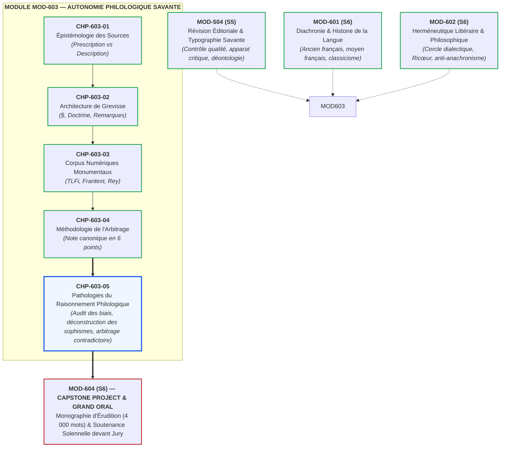
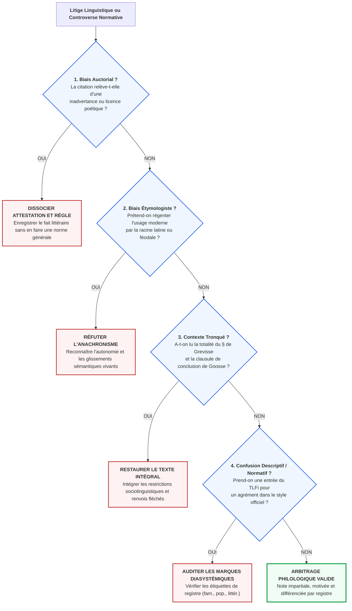

# Chapitre 5 : Pathologies du Raisonnement Philologique, Fétichisme de la Citation et Audit Critique : Déconstruction des Biais et Simulation d'Arbitrage en Temps Réel

> **Identifiant** : `CHP-603-05`  
> **Module de rattachement** : [`MOD-603 — Autonomie Philologique : Méthode de Recherche Experte dans les Traités Savants`](file:///f:/Formation/world-class-french/03-curriculum/year-3/semester-6/mod-603-autonomie-philologique-recherche-traites.md)  
> **Volume horaire canonique** : 3 h 30 (Étude des pathologies du raisonnement : 1 h 00 | Détection critique et audit : 1 h 15 | Simulation contradictoire : 0 h 45 | Évaluation : 0 h 30)  
> **Statut** : [STATUT : VALIDÉ]  
> **Compétences cibles** : [`FR-PHILOL-001`](file:///f:/Formation/world-class-french/02-competency-framework/competency-framework.md#fr-philol-001-autonomie-philologique-et-consultation-experte-des-sources) (L5), [`FR-INT-003`](file:///f:/Formation/world-class-french/02-competency-framework/competency-framework.md#fr-int-003-réviser-et-corriger-un-texte-tiers-en-justifiant-les-interventions) (L5), [`FR-INT-001`](file:///f:/Formation/world-class-french/02-competency-framework/competency-framework.md#fr-int-001-rédiger-un-texte-long-cohérent-en-maîtrisant-accords-et-ponctuation) (L5), [`FR-STYLE-001`](file:///f:/Formation/world-class-french/02-competency-framework/competency-framework.md#fr-style-001-maîtrise-des-figures-de-rhétorique-et-commentaire-stylistique) (L5)  
> **Sources de référence** : `SRC-GRAM-01` (Grevisse & Goosse, *Le Bon Usage*, 16e éd., § 20-30), `SRC-GRAM-02` (Riegel et al., *Grammaire méthodique du français*), `SRC-LEX-01` (*Trésor de la Langue Française informatisé* — TLFi), `SRC-LEX-02` (Académie française, *Dictionnaire*, 9e éd., et « Dire, ne pas dire »), `SRC-LEX-03` (Alain Rey, *Dictionnaire historique de la langue française*, Préface), `SRC-NORM-02` (Conseil supérieur de la langue française, *Les rectifications de l'orthographe*, 1990), `SRC-NORM-03` (Ministère de l'Éducation nationale, *Terminologie grammaticale*), `SRC-TYPO-01` (*Lexique des règles typographiques en usage à l'Imprimerie nationale*)

---

## 1. Titre et Place dans le Cursus

Ce cinquième et dernier chapitre du module `MOD-603` constitue le couronnement critique de la méthode philologique et la clôture de la formation méthodologique savante de l'apprenant. Après avoir appris à classifier les instruments de référence (`CHP-603-01`), à décrypter la topographie du *Bon Usage* (`CHP-603-02`), à interroger les corpus numériques monumentaux (`CHP-603-03`) et à formaliser une consultation dans une Note d'arbitrage (`CHP-603-04`), l'expert doit affronter l'épreuve décisive de la lucidité : **l'audit critique de son propre raisonnement et la détection impitoyable des sophismes érudits**.

L'accès aux traités savants est une arme à double tranchant. Mal maîtrisé, l'appareil critique se dégrade en instrument d'intimidation intellectuelle, en fétichisme de la citation d'écrivain ou en archaïsme étymologique régressif. Ce chapitre dote l'apprenant du bouclier épistémologique indispensable pour déjouer les manipulations herméneutiques et arbitrer avec équité les controverses linguistiques les plus tendues, avant d'aborder la confection de la monographie terminale et la soutenance du Grand Oral (`MOD-604`).



---

## 2. Objectifs Mesurables

Au terme de ce chapitre, l'apprenant sera capable de :

1. **Identifier, catégoriser et réfuter les six pathologies majeures du raisonnement philologique** (fétichisme de citation, illusion étymologiste, manipulation par citation tronquée, sacralisation statistique de Frantext, confusion descriptif/prescriptif, monomorphisme prescriptif de registre) dans un mémoire contentieux, une chronique de presse ou un rapport de révision éditoriale [`FR-PHILOL-001`, Palier L5].
2. **Démontrer la nullité épistémologique de l'argument *ad verecundiam* auctorial** en dissociant rigoureusement l'autorité d'attestation historique (constat qu'une graphie ou une tournure a existé sous la plume d'un auteur de renom) de l'autorité de prescription normative (convenance de la forme pour la rédaction soignée contemporaine) [`SRC-GRAM-01`, § 25 ; `FR-INT-003`, Palier L5].
3. **Déconstruire le sophisme de l'étymologisme figé et du conservatisme régressif** en établissant la légitimité linguistique des glissements métonymiques, métaphoriques et syntagmatiques consacrés par l'usage vivant moderne, à l'appui du *Dictionnaire historique* d'Alain Rey [`SRC-LEX-03`].
4. **Conduire en temps réel l'audit contradictoire d'une argumentation linguistique fallacieuse** en rétablissant l'intégralité textuelle d'un paragraphe tronqué de Grevisse/Goosse, en vérifiant les renvois fléchés (« $\rightarrow$ ») et en réarticulant les restrictions de registre du *TLFi* [`SRC-LEX-01` ; `FR-PHILOL-001`].
5. **Rédiger un protocole d'audit et de salubrité philologique** calibré avec exactitude selon les normes typographiques officielles (`SRC-TYPO-01`), garantissant l'intégrité déontologique de la consultation linguistique pour les institutions académiques, juridiques et éditoriales [`FR-INT-001`, Palier L5].

---

## 3. Prérequis et Test de Préparation

### 3.1 Prérequis Théoriques et Méthodologiques
- **Architecture de référence du *Bon Usage*** (`CHP-603-02`, `SRC-GRAM-01`) : distinction entre le corps de texte doctrinal (§ en gros caractères), les variantes historiques ou dialectales (alinéas en retrait) et les discussions critiques d'André Goosse (rubriques « Remarques »).
- **Interrogation lexicographique sur corpus** (`CHP-603-03`, `SRC-LEX-01`, `SRC-LEX-03`) : analyse des rubriques étymologiques, syntagmatiques et diachroniques du *TLFi*, et mise en perspective historique du lexique.
- **Protocole canonique de la Note d'arbitrage** (`CHP-603-04`) : maîtrise des six composantes (Question de droit, Textes officiels, Doctrine savante, Corpus d'attestations, Arbitrage motivé, Recommandation opérationnelle).
- **Déontologie du censeur de texte** (`MOD-504`, `FR-INT-003`) : refus absolu de l'hypercorrection arbitraire et respect scrupuleux de l'apparat critique.

### 3.2 Test Diagnostique d'Auto-Évaluation (5 items)

<details>
<summary><b>Consulter le test diagnostique et son corrigé immédiat</b></summary>

1. *Pourquoi une phrase de Victor Hugo comportant un subjonctif insolite ou une rupture d'accord ne constitue-t-elle pas ipso facto une règle de grammaire générale ?*  
   **Réponse** : Parce qu'une citation littéraire relève de l'autorité d'attestation et non de prescription. L'écrivain peut avoir commis une inadvertance, cédé à une contrainte prosodique ou usé d'une licence stylistique volontaire. Grevisse enregistre le fait en observateur scientifique sans en faire une recommandation pour l'usage ordinaire [`SRC-GRAM-01`, § 25].

2. *En quoi consiste le sophisme de l'étymologisme figé appliqué au lexique contemporain ?*  
   **Réponse** : C'est l'erreur qui consiste à vouloir régenter l'usage moderne à partir du sens étymologique primitif (latin, grec ou roman). L'étymologie éclaire l'histoire d'un mot mais ne dicte pas sa légitimité synchronique. Condamner un sens contemporain sous prétexte qu'il s'écarte de son étymon relève du conservatisme régressif [`SRC-LEX-03`, Préface].

3. *Quelle vérification textuelle obligatoire doit précéder l'utilisation d'une « Remarque » d'André Goosse dans Le Bon Usage ?*  
   **Réponse** : La lecture intégrale du paragraphe (§), de son alinéa de conclusion et de ses renvois fléchés (« $\rightarrow$ »). Goosse commence souvent par exposer la doctrine adverse ou un usage littéraire isolé avant d'en renverser la portée par une clausule restrictive ou une mise en garde sociolinguistique.

4. *Si un néologisme familier ou une faute d'accord fréquente est enregistrée dans le TLFi, peut-on l'employer dans une note ministérielle ou juridique ?*  
   **Réponse** : Non. Le *TLFi* est un dictionnaire descriptif sur corpus : sa mission est de recenser tout ce qui existe dans la langue sans censurer. La validité dans un écrit formel dépend exclusivement de la marque de registre (*Fam.*, *Pop.*, *Littér.*) et de son adéquation à la norme institutionnelle soutenue [`SRC-LEX-01` ; `SRC-LEX-02`].

5. *Pourquoi un nombre élevé d'occurrences dans Frantext ne suffit-il pas à valider une tournure dans un arbitrage normatif ?*  
   **Réponse** : Parce que Frantext est un corpus textuel littéraire qui agrège sans distinction dialogues populaires, retranscriptions de sociolectes relâchés, licences poétiques et coquilles d'imprimeurs. La fréquence brute n'établit pas la conformité au système grammatical soutenu.

</details>

---

## 4. Situation de Départ ou Problème Concret

Considérons le naufrage intellectuel de ce que les éditeurs et universitaires nomment « l'érudition perverse » : un débatteur, un juriste ou un correcteur s'arme d'éditions savantes et de dictionnaires volumineux non pour chercher la vérité, mais pour écraser son interlocuteur sous des arguments d'intimidation.

Trois scènes récurrentes illustrent ce désastre méthodologique :
- **Scène 1 — L'intimidation par la citation fétichisée** : Un candidat à un concours administratif commet l'accord fautif *\*« Les personnes qu'il a plu »*. Repris par le jury, il réplique avec arrogance : *« Victor Hugo a écrit dans Les Misérables : "les misères qu'il a plu à Dieu de m'envoyer" ; vous ne prétendez pas être plus savants que Victor Hugo ! »* Le candidat ignore que Grevisse cite précisément cette phrase pour illustrer une inadvertance rarissime condamnée par l'ensemble des traités modernes (`SRC-GRAM-01`, § 954).
- **Scène 2 — L'anathème étymologiste régressif** : Un chroniqueur littéraire publie un pamphlet dénonçant l'expression *« un magasin très achalandé »* au sens de « fréquenté par de nombreux clients ». Brandissant le latin et l'ancien français, il tempête : *« Le chaland est l'acheteur ! Seul le commerçant a des chalands. Qualifier un magasin d'achalandé est un barbarisme répugnant ! »* Le puriste méconnaît que la métonymie magasin/commerçant est ratifiée depuis deux siècles par l'Académie française elle-même (`SRC-LEX-02`) et documentée par Alain Rey (`SRC-LEX-03`).
- **Scène 3 — La manipulation par citation tronquée** : Lors d'une commission éditoriale, un réviseur supprime un indicatif après *après que* et impose un subjonctif en citant Grevisse : *« André Goosse écrit au § 1111 que le subjonctif après après que est attesté chez les plus grands écrivains du siècle. »* Il passe délibérément sous silence la suite immédiate de la phrase : *« Il n'en demeure pas moins que dans les concours et la haute administration, l'indicatif reste le seul mode socialement irréprochable sous peine de disqualification. »*

Ces dérives ne relèvent pas de l'ignorance brute, mais de la **pathologie de l'érudition**. Les instruments de la science philologique y sont dévoyés au profit du sophisme et de l'argument d'autorité (*argumentum ad verecundiam*).

---

## 5. Explication Intuitive : Le Faux-Monnayeur de la Science et le Censeur Aveugle

Pour saisir la nature exacte des pathologies philologiques, recourons à l'analogie du microscope et de l'alliage d'or :

```text
L'ANALOGIE DES INSTRUMENTS D'OPTIQUE ET DE LA MONNAIE SAVANTE
┌─────────────────────────────────────────────────────────────────────────────┐
│ 1. LE TRAITÉ SAVANT : UN INSTRUMENT D'OPTIQUE DE HAUTE PRÉCISION             │
│    Le Bon Usage ou le TLFi sont semblables à des télescopes de laboratoire. │
│    Ils montrent avec netteté des étoiles lointaines (usages archaïques,     │
│    variantes rares, licences d'écrivains). Mais si l'observateur pose son   │
│    œil avec un préjugé dogmatique, il confond une poussière sur la lentille │
│    avec une nouvelle loi de la gravitation universelle.                     │
├─────────────────────────────────────────────────────────────────────────────┤
│ 2. LE FAUX-MONNAYEUR PHILOLOGIQUE                                            │
│    Le manipulateur prélève une pépite d'or authentique (une phrase réelle   │
│    de Proust ou une racine latine attestée) et la fond dans un alliage      │
│    frelaté de mauvaise foi pour frapper une fausse monnaie argumentative.   │
├─────────────────────────────────────────────────────────────────────────────┤
│ 3. LE CENSEUR PURISTE AVEUGLE                                               │
│    Le censeur refuse de regarder dans le télescope : il décrète d'avance     │
│    que les comètes n'ont pas le droit d'exister parce qu'Aristote ne les    │
│    avait pas prévues. Il condamne la langue vivante au nom d'un passé figé. │
└─────────────────────────────────────────────────────────────────────────────┘
```

La compétence suprême du philologue de niveau L5 ne réside pas dans l'accumulation mécanique de citations érudites, mais dans la **salubrité critique** de son regard. Posséder une bibliothèque savante ne garantit aucune probité intellectuelle : seule la méthode d'audit garantit que la citation sert la recherche de la vérité et non le triomphe narcissique du débatteur.

---

## 6. Définitions Précises et Terminologie

Les neuf concepts suivants constituent le vocabulaire technique fondamental de l'audit philologique :

- **Pathologie philologique** : Déviation méthodologique ou sophisme opératoire survenant lors de la consultation, de l'interprétation ou de l'argumentation adossée à des sources linguistiques savantes, conduisant à des conclusions normatives erronées ou partiales.
- **Fétichisme de la citation d'autorité** : Croyance erronée selon laquelle toute séquence graphique attestée chez un grand écrivain du canon littéraire constitue automatiquement une règle de grammaire universellement imposable.
- **Argument *ad verecundiam* auctorial** : Sophisme rhétorique consistant à récuser une analyse grammaticale rigoureuse en se retranchant derrière la renommée prestigieuse d'un auteur (ex. invoquer Bossuet ou Balzac pour justifier un anacoluthe ou un solécisme manifeste).
- **Illusion étymologique régressive (ou étymologisme figé)** : Erreur de perspective diachronique consistant à ériger le sens primitif ou la syntaxe d'origine (latine, grecque ou romane) d'un terme en étalon absolu de sa correction dans l'état de langue contemporain.
- **Citation tronquée hors contexte** : Pratique fallacieuse consistant à isoler une proposition au sein d'un paragraphe ou d'une remarque savante en omettant les restrictions, les nuances contextuelles ou les clausules adversatives qui en inversent la portée.
- **Confusion descriptif / prescriptif** : Faute méthodologique majeure consistant à interpréter le constat d'existence d'une forme dans un dictionnaire descriptif sur corpus (*TLFi*, *Grand Robert*) comme une autorisation d'emploi dans le registre soutenu ou officiel.
- **Monomorphisme de registre** : Incapacité à concevoir la pluralité des registres de la langue française, consistant soit à imposer les licences de la création littéraire aux actes juridico-administratifs, soit à exiger la rigidité d'un arrêt de cour d'appel dans une prose romanesque.
- **Audit critique contradictoire** : Procédure délibérative par laquelle un philologue soumet une argumentation linguistique adverse ou personnelle à un examen méthodique bilatéral (confrontation de l'intégralité des sources, balance des preuves, analyse diachronique et contextualisation sociolinguistique).
- **Simulation d'arbitrage** : Exercice didactique de haute expertise reproduisant les conditions réelles d'une commission de terminologie, d'un comité éditorial ou d'un tribunal arbitral où deux parties confrontent leurs doctrines linguistiques devant un rapporteur impartial.

---

## 7. Règles et Mécanismes Fondamentaux

### 7.1 L'Erreur du Fétichisme de la Citation Littéraire

Le premier écueil de l'érudition consiste à confondre deux ordres d'autorité épistémologique :

$$\text{Autorité d'Attestation (Historique)} \neq \text{Autorité de Prescription (Normative)}$$

Maurice Grevisse et André Goosse rappellent avec insistance dans les prolégomènes du *Bon Usage* (`SRC-GRAM-01`, § 25 : *Les écrivains et la langue*) que l'écrivain n'est pas un législateur infaillible du code grammatical :
- **L'inadvertance et la coquille matérielle** : L'histoire littéraire fourmille de fautes d'inattention non corrigées sur épreuves. Lorsque Voltaire écrit *croivent* pour *croient*, lorsque Balzac produit des anacoluthes bancales ou lorsque Victor Hugo omet un accord de participe passé impersonnel, le philologue enregistre le fait en historien ; il ne le transforme jamais en paradigme pour l'enseignement standard.
- **La licence et la recherche stylistique singulière** : Les libertés prises par Chateaubriand avec la concordance des temps ou les audaces de Proust répondent à une nécessité expressive, rythmique ou ontologique interne à l'œuvre (`SRC-GRAM-01`, § 25 c). Transposer cette licence dans un rapport d'inspection ou une note de synthèse constitue un contresens culturel.

### 7.2 L'Illusion Puriste de l'Étymologisme Figé et du Conservatisme Régressif

L'étymologie n'est pas un tribunal de police linguistique ; elle est la biographie historique des mots (`SRC-LEX-03`, Alain Rey, Préface). Le sophisme étymologiste repose sur l'illusion qu'il existerait un « sens premier » pur et intangible dont toute dérive ultérieure serait une corruption :
- **La légitimité des glissements sémantiques** : Le verbe *navrer* signifiait en ancien français « blesser grièvement d'un coup d'arme blanche » (du vieux norrois *nesta*). Prétendre qu'on ne peut l'employer au figuré pour une peine morale relève de la démence philologique.
- **La mutation des régimes et des collocations** : Condamner *achalandé* appliqué à une boutique sous prétexte que le *chaland* est l'acheteur, ou proscrire *désappointé* sous prétexte de calque de l'anglais alors qu'il s'agit d'un mot français du XVe siècle réemprunté, procède d'un purisme ignorant de la dynamique vivante des langues.

### 7.3 Le Piège de la Citation Tronquée et Décontextualisée

La structure dialectique du *Bon Usage* expose l'apprenti lecteur à des manipulations redoutables. André Goosse adopte une méthode rigoureusement scientifique : il expose d'abord la thèse traditionnelle, cite les exemples littéraires divergents, dialogue avec les puristes, puis livre sa synthèse critique en fin de paragraphe.

```text
PROTOCOLE D'AUDIT EN 3 POINTS CONTRE LA CITATION TRONQUÉE
├── 1. VÉRIFICATION DU BLOC TOPOGRAPHIQUE INTÉGRAL
│   └── Interdiction d'isoler une phrase sans lire la totalidad du paragraphe (§) concerné.
├── 2. CONTRÔLE DES MARQUEURS DISCURSIFS RESTRICTIFS
│   └── Repérer systématiquement les clausules adversatives : « toutefois », « néanmoins »,
│       « il convient cependant d'observer », « dans l'usage soigné, la prudence s'impose ».
└── 3. EXAMEN DES RENVOIS FLÉCHÉS ET NOTES INFRA-PAGINALES
│   └── Suivre le symbole « → » vers les paragraphes connexes et auditer les notes en petits
│       caractères qui précisent souvent le statut exceptionnel de l'exemple cité.
```

### 7.4 La Confusion entre Dictionnaire Descriptif et Guide Prescriptif

Un dictionnaire descriptif monumental tel que le *TLFi* (`SRC-LEX-01`) n'a pas pour vocation d'édicter le bien et le mal linguistique. Son mandat scientifique est d'enregistrer la totalité des faits lexicaux attestés dans les textes des XIXe et XXe siècles.
- **La présence n'est pas l'agrément** : Trouver un solécisme, une graphie relâchée ou un terme argotique dans le *TLFi* atteste simplement que le mot a été prononcé ou imprimé à une date donnée.
- **La grille des indicateurs diasystémiques** : L'expert doit impérativement scruter les abréviations de registre apposées en tête d'article : *fam.* (familier), *pop.* (populaire), *arg.* (argotique), *vieilli*, *péj.* (péjoratif), *région.* (régional). Dans la rédaction universitaire et solennelle, seule la concordance entre le dictionnaire descriptif, l'Académie française (`SRC-LEX-02`) et le *Bon Usage* (`SRC-GRAM-01`) confère un brevet de validité prescriptive.

### 7.5 Simulation Intégrale d'un Arbitrage Contradictoire en Temps Réel

Voici la retranscription d'une séance de révision au sein d'une Commission d'Arbitrage Éditorial, opposant **Maître Argus** (l'Avocat Puriste, saturé de biais étymologistes et d'arguments d'autorité tronqués) et le **Dr Philalèthe** (le Philologue Scientifique, garant de la salubrité critique) :

> **Maître Argus (L'Avocat Puriste)** :  
> « Messieurs les jurés, je demande la censure immédiate de la formule employée à la page 12 de notre rapport officiel : *« Il a été convenu de surseoir à l'application de la directive. »* Mon confrère n'a-t-il pas honte ? *Surseoir* régit historiquement un complément direct en ancien français et ne saurait tolérer la préposition *à* ! De surcroît, le verbe *convenir* au sens d'être d'accord exige impérativement le participe invariable ou accordé selon Bossuet qui écrivait : *« la chose est convenue entre eux »*. Enfin, Grevisse lui-même, au § 287, atteste que ces constructions modernes soulèvent les plus grandes réserves des grammairiens les plus autorisés ! C'est un massacre de la langue classique ! »

> **Dr Philalèthe (Le Philologue Scientifique)** :  
> « Examinons méthodiquement chacun de vos arguments, cher confrère, et rendons à César ce qui appartient à la philologie.  
> 1. Sur *surseoir à* : votre argument étymologiste régressif est caduc. Si *surseoir* a pu connaître une construction directe au XIVe siècle, le *TLFi* (`SRC-LEX-01`) et l'Académie française (`SRC-LEX-02`, 9e éd.) confirment depuis plus de deux cents ans que la construction transitive indirecte *surseoir à quelque chose* est devenue la seule norme admise en droit administratif contemporain. Votre recours à l'ancien français est un anachronisme juridique.  
> 2. Sur *il a été convenu de* : la tournure impersonnelle passée avec le sujet neutre *il* impose l'invariabilité absolue du participe (*convenu*), conformément au § 954 du *Bon Usage*. Invoquer Bossuet ici relève de la confusion entre la voix active avec l'auxiliaire être pour un fait d'accord d'antan et la syntaxe impersonnelle moderne.  
> 3. Sur votre citation de Grevisse au § 287 : vous venez de tronquer scandaleusement la remarque de Goosse. Vous avez lu les premiers mots : *« soulèvent les réserves de certains grammairiens »*, mais vous avez omis d'énoncer la clausule conclusive : *« mais ces réserves puristes sont dénuées de fondement devant la constance de l'usage juridique souverain depuis le XIXe siècle »*.  
> **Arbitrage** : La leçon du texte est parfaitement irréprochable et maintenue sans retouche. »

---

## 8. Raisonnement Détaillé : Le Biais de Confirmation et la Déontologie Philologique

Pourquoi l'audit critique de son propre raisonnement constitue-t-il le sceau absolu de la maturité intellectuelle ?

En sciences humaines et particulièrement en linguistique, le chercheur est constamment guetté par le **biais de confirmation** :
1. **La tentation de la cueillette de cerises (*cherry-picking*)** : Lorsqu'un lettré a une préférence instinctive pour une tournure (par conservatisme ou par goût de la modernité), il ouvre *Le Bon Usage* avec l'intention inconsciente de n'y lire que l'exemple qui flatte son inclination. S'il est puriste, il retiendra l'admonition de Georgin ; s'il est partisan de l'usage relâché, il brandira la coquille de Chateaubriand.
2. **Le devoir de falsification poppérienne** : Le philologue certifié au palier L5 applique à sa propre pensée le principe de falsifiabilité. Devant une certitude intime (*« cette tournure est une faute évidente »*), son premier geste professionnel n'est pas de chercher des condamnations, mais de **traquer le contre-exemple légitime** dans les corpus savants (`SRC-LEX-01`, `SRC-GRAM-01`). Ce n'est que si la tournure résiste à cette tentative de justification historique et systémique qu'elle peut être objectivement qualifiée de vicieuse.
3. **La neutralité axiologique** : La langue n'est ni morale ni dépravée. Remplacer les vocables passionnels du purisme du XIXe siècle (*« barbarisme hideux »*, *« solécisme monstrueux »*, *« anarchie de l'usage »*) par les concepts de la linguistique moderne (variation diachronique, extension analogique, télescopage actanciel, distribution de registre) est la condition sine qua non de l'autorité académique.

---

## 9. Exemples Corrects Commentés

Voici le décorticage de trois réfutations philologiques monumentales d'André Goosse réfutant les oukases puristes de René Georgin et Maurice Rat :

### Cas 1 : La Fausse Impropriété du Terme *Opportunité* au sens d'« Occasion Favorable »
- **L'oukase puriste (René Georgin)** : Georgin condamnait violemment l'emploi d'*opportunité* pour désigner une « occasion » ou un « créneau avantageux », y dénonçant une contamination criminelle de l'anglais *opportunity* et exigeant de réserver le mot à la qualité abstraite de ce qui est opportun.
- **La réfutation philologique d'André Goosse (`SRC-GRAM-01`, Remarques lexicales)** :  
  Goosse rétablit les faits historiques à l'aide des corpus diachroniques :
  1. *Opportunité* au sens d'« occasion favorable » est attesté en français dès le XIVe siècle chez Nicole Oresme, puis au XVIe siècle chez Rabelais et Montaigne, bien avant que l'anglais moderne n'exerce une quelconque influence sur la langue française.
  2. Le mot a été admis par l'Académie française dans ses premières éditions avec cette valeur concrète.
  3. L'analogie avec d'autres substantifs en *-ité* (*facilité*, *curiosité*, *commodité*) montre que le passage de la qualité abstraite à l'événement concret est une loi sémantique régulière et constante du français.
  $\rightarrow$ **Bilan d'audit** : L'accusation d'anglicisme était historiquement fausse ; l'emploi est parfaitement légitime dans tous les registres.

### Cas 2 : L'Accord du Participe Passé Précédé du Pronom Neutre *En*
- **L'oukase puriste (Maurice Rat)** : Rat décrétait que le participe passé précédé de *en* ne devait jamais s'accorder, qualifiant de faute lourde toute flexion (*« des fruits, j'en ai cueillis »*).
- **La démonstration critique de Goosse (`SRC-GRAM-01`, § 950)** :  
  Goosse expose que :
  1. La doctrine dominante et la norme scolaire imposent en effet l'invariabilité (*« des fruits, j'en ai cueilli »*) en considérant *en* comme un pronom neutre équivalent à un génitif partitif (*de cela*).
  2. Cependant, dans les alinéas historiques, Goosse prouve que les plus grands classiques (Molière, La Fontaine, Racine) ont accordé le participe avec le nom antécédent représenté par *en*.
  3. L'Arrêté ministériel de tolérance du 26 février 1901 autorise expressément l'accord comme l'invariabilité aux examens de l'État (`SRC-NORM-03`).
  $\rightarrow$ **Bilan d'audit** : L'invariabilité est la règle de sécurité dans la copie administrative, mais l'accord n'est pas un barbarisme ignare : c'est une variante classique consacrée par la loi républicaine.

### Cas 3 : La Proscription Aveugle de la Locution Conjonctive *Malgré Que*
- **L'oukase puriste traditionnel** : Condamnation unanime et péremptoire de *malgré que* suivi du subjonctif au sens de *bien que*, sous prétexte que *malgré* est une préposition issue du substantif *gré* précédé de l'adjectif *mauvais*, ne pouvant régir une proposition complétive que dans la formule archaïque *malgré qu'il en ait*.
- **La réfutation de Goosse (`SRC-GRAM-01`, § 1118)** :  
  Goosse démontre que :
  1. Dès le début du XIXe siècle, *malgré que* + subjonctif a été employé par les plus illustres écrivains : Chateaubriand, Balzac, George Sand, Flaubert, Barrès, Proust, Gide, Mauriac, Colette.
  2. La création conjonctive à partir d'une préposition par adjonction de *que* est un processus morphologique universel en français (*pendant que*, *dès que*, *pour que*, *après que*).
  3. Toutefois, Goosse maintient la prudence sociolinguistique : bien que linguistiquement inattaquable et littérairement prestigieux, le tour demeure proscrit par l'Académie et sévèrement sanctionné dans les concours scolaires.
  $\rightarrow$ **Bilan d'audit** : Rétablissement de la vérité littéraire couplé à une consigne opérationnelle lucide.

---

## 10. Contre-Exemples et Erreurs Fréquentes

Voici les six erreurs majeures de raisonnement philologique que l'expert doit traquer et éliminer :

### Erreur n° 1 : Le fétichisme de la citation d'autorité singulière
- **Manifestation pathologique** : Valider une graphie erronée ou un tour syntaxique boiteux en s'abritant derrière une phrase isolée d'un écrivain illustre (*« Puisque Proust a écrit cette rupture de construction dans Sodome et Gomorrhe, c'est que c'est du français parfait »*).
- **Réfutation philologique** : Une citation littéraire est une attestation descriptive, non une prescription universelle. L'écrivain jouit d'une licence poétique ou a pu laisser échapper une inadvertance (`SRC-GRAM-01`, § 25).

### Erreur n° 2 : L'illusion régressive de l'étymologisme figé
- **Manifestation pathologique** : Condamner un vocable moderne ou contester son extension sémantique en arguant de son sens latin, grec ou féodal d'origine (*« On ne peut pas dire "atterrir" sur la Lune puisqu'il n'y a pas de terre »*).
- **Réfutation philologique** : L'étymologie rend compte de la genèse des formes, jamais de leur synchronie vivante. La métaphorisation et la démotivation lexicale sont les moteurs légitimes de l'évolution du français (`SRC-LEX-03`).

### Erreur n° 3 : La manipulation par citation tronquée de Grevisse
- **Manifestation pathologique** : Isoler la première moitié d'une remarque de Goosse dans *Le Bon Usage* pour justifier une thèse puriste ou laxiste, en dissimulant la conclusion restrictive de l'alinéa.
- **Réfutation philologique** : Tout extrait du *Bon Usage* doit être confronté à la doctrine générale du paragraphe (§) et à la synthèse conclusive de la remarque sous peine de falsification intellectuelle.

### Erreur n° 4 : La sacralisation de la fréquence numérique Frantext contre la syntaxe
- **Manifestation pathologique** : Brandir un graphique de fréquence brute extrait de Frantext montrant 1 200 occurrences d'une tournure pour décréter qu'elle est désormais « grammaticalement correcte » dans tous les contextes.
- **Réfutation philologique** : La fréquence quantitative sur corpus informe sur la diffusion d'un fait de langue ; elle ne préjuge ni de son registre (oral retranscrit, dialogue argotique, texte populaire) ni de son acceptabilité auprès des instances normatives d'évaluation (`SRC-NORM-03`).

### Erreur n° 5 : La confusion entre dictionnaire descriptif et autorisation de registre
- **Manifestation pathologique** : Soutenir qu'un mot est légitime dans une dissertation académique ou un acte d'avocat au seul motif qu'il possède une entrée dans le *TLFi* ou *Le Grand Robert*.
- **Réfutation philologique** : Le dictionnaire scientifique enregistre l'usage intégral sans censure morale. C'est l'étiquette de registre (*fam.*, *pop.*, *arg.*, *vieilli*) qui conditionne impérativement la convenance sociolinguistique de l'emploi (`SRC-LEX-01`).

### Erreur n° 6 : Le monomorphisme prescriptif ignorant les registres
- **Manifestation pathologique** : Traiter la langue française comme un bloc monolithique uniforme, soit en exigeant des romanciers la froideur administrative du Journal officiel, soit en introduisant les audaces stylistiques de la poésie dans un mémoire de contentieux fiscal.
- **Réfutation philologique** : L'expertise linguistique consiste à moduler la norme selon le genre discursif, la situation d'énonciation et la convention socioprofessionnelle attendue.

```text
Tableau Clinique des Sophismes Philologiques
┌────────┬────────────────────────────────┬────────────────────────────────────────┬──────────────────────────────────────────┐
│ Cas    │ Pathologie Argumentative       │ Symptôme Textuel Observable            │ Traitement et Salubrité Philologique     │
├────────┼────────────────────────────────┼────────────────────────────────────────┼──────────────────────────────────────────┤
│ Cas 1  │ Fétichisme auctorial           │ Brandir une inadvertance d'auteur.     │ Dissocier attestation et prescription.   │
│ Cas 2  │ Étymologisme régressif         │ Réfuter l'usage moderne par le latin.  │ Reconnaître l'autonomie diachronique.    │
│ Cas 3  │ Citation tronquée              │ Couper avant le « mais » de Goosse.    │ Exiger la citation intégrale du §.       │
│ Cas 4  │ Sacralisation statistique      │ Assimiler fréquence et correction.     │ Classifier le corpus et les registres.   │
│ Cas 5  │ Confusion descriptif/normatif  │ S'autoriser du TLFi sans voir le dia.  │ Contrôler la marque sociolinguistique.   │
│ Cas 6  │ Monomorphisme de registre      │ Imposer une règle unique tous genres.  │ Différencier l'arbitrage opérationnel.   │
└────────┴────────────────────────────────┴────────────────────────────────────────┴──────────────────────────────────────────┘
```

---

## 11. Cas Particuliers et Limites

### Quand la Citation Littéraire Devient-elle Fondatrice d'une Nouvelle Norme ?
S'il est absurde d'ériger chaque coquille d'imprimeur en règle, il serait tout aussi faux de dénier aux écrivains leur rôle historique de forgeurs de la norme linguistique.

La frontière entre la licence individuelle passagère et la création d'une nouvelle norme collective repose sur trois critères linguistiques vérifiables :
1. **L'adoption systémique collective** : Un néologisme forgé par un auteur entre dans la norme dès lors qu'il comble un vide lexical et qu'il est repris par la communauté cultivée sans référence constante à son créateur.  
   *Exemples* : Rabelais forgeant *pantagruélique* et *quintessence* ; Voltaire diffusant *optimisme* ; Jean-Jacques Rousseau conceptualisant la *perfectibilité* ; Balzac acclimatant le vocabulaire financier et industriel ; Léopold Sédar Senghor consacrant le concept de *négritude*.
2. **La régularité morphologique** : La nouvelle tournure s'intègre-t-elle harmonieusement dans les matrices dérivationnelles et syntaxiques du français ?
3. **La consécration lexicographique unanime** : Lorsque le *TLFi* (`SRC-LEX-01`), le *Dictionnaire historique* (`SRC-LEX-03`) et l'Académie française (`SRC-LEX-02`) entérinent le mot sans marque péjorative, l'écart singulier est devenu bien commun du français.

---

## 12. Approfondissement Adapté au Niveau : Épistémologie de la Falsifiabilité Appliquée à la Grammaire

Dans *La Logique de la découverte scientifique*, Karl Popper a démontré qu'une proposition ne peut être qualifiée de scientifique que si elle énonce des conditions observables susceptibles de la **réfuter** (critère de falsifiabilité).

Appliquée à la philologie et aux querelles de grammaire, cette exigence épistémologique éclaire d'une lumière crue les faux débats linguistiques :
- **L'impasse du purisme dogmatique (Pseudo-science)** :  
  Le puriste traditionnel formule des règles construites de telle sorte qu'aucun fait réel ne puisse jamais les invalider. Si on lui oppose mille citations d'auteurs illustres employant une tournure qu'il condamne, il répond imperturbablement : *« Cela prouve seulement que ces mille auteurs écrivent mal ! »* Sa règle est infalsifiable, donc dogmatique et scientifiquement nulle.
- **La démarche du philologue moderne (Science sur corpus)** :  
  Une règle descriptive ou normative légitime repose sur une hypothèse testable. Par exemple : *« Le verbe pallier est strictement transitif direct en français soigné contemporain. »*  
  Pour tester cette hypothèse :
  1. On interroge les corpus d'écrits soignés (`SRC-LEX-01`, Frantext).
  2. Si l'on observe que la construction avec *à* (*pallier à*) est absente des discours d'apparat et des textes de haute juridiction, mais n'apparaît que dans l'expression orale ou les textes relâchés, l'hypothèse est vérifiée.
  3. Si, en revanche, on constatait que 95 % des arrêts du Conseil d'État et des discours académiques employaient la préposition *à*, l'hypothèse prescriptive devrait être révisée.

L'arbitre philologue d'élite ne croit pas aux règles tombées du ciel : il audite la confrontation permanente entre la structure logique du système et l'observation empirique des énoncés réels.

---

## 13. Comparaisons Différentielles

### 13.1 Fétichisme Auctorial vs Respect Éclairé de la Tradition Littéraire

| Critère d'évaluation | Le Fétichisme Auctorial Aveugle | Le Respect Éclairé de la Tradition Littéraire |
| :--- | :--- | :--- |
| **Statut de l'écrivain** | Idole infaillible dont chaque mot fait loi. | Témoin éminent et créateur au sein du système. |
| **Traitement des anomalies** | Érige la coquille ou l'audace en règle générale. | Analyse l'anomalie comme licence poétique située. |
| **Champ d'application** | Impose les singularités poétiques à la prose formelle. | Réserve l'évaluation stylistique à son registre d'origine. |
| **Démarche intellectuelle** | Argument d'autorité paresseux (*ad verecundiam*). | Analyse contextuelle, prosodique et sémantique. |

### 13.2 Étymologie Scientifique vs Étymologisme Rétrograde et Figé

| Critère d'évaluation | L'Étymologie Scientifique Éclairante | L'Étymologisme Rétrograde et Figé |
| :--- | :--- | :--- |
| **Objectif de la recherche** | Retracer la biographie historique d'une forme. | Dicter et restreindre l'usage contemporain. |
| **Rapport au temps** | Conscience lucide de la dynamique diachronique. | Nostalgie d'un « âge d'or » étymologique figé. |
| **Traitement du sens moderne** | Éclaire la chaîne des mutations sémantiques. | Condamne le sens dérivé comme « corruption ». |
| **Instrument de référence** | *Dictionnaire historique* d'Alain Rey (`SRC-LEX-03`). | Étymologies tronquées brandies comme anathèmes. |

### 13.3 Description Scientifique du Système vs Censure Puriste Moralisatrice

| Critère d'évaluation | La Description Scientifique du Système | La Censure Puriste Moralisatrice |
| :--- | :--- | :--- |
| **Posture épistémologique** | Observer, dater, formaliser et classifier les usages. | Condamner moralement les évolutions de la langue. |
| **Vocabulaire employé** | Variantes, registres, fréquence, analogie, actance. | « Peste », « massacre », « avilissement », « faute hideuse ». |
| **Rapport aux usagers** | Respect sociolinguistique des locuteurs réels. | Mépris aristocratique des pratiques populaires. |
| **Source d'autorité** | Traités monumentaux sur corpus (`SRC-GRAM-01`). | Sentiments subjectifs et manuels simplificateurs. |

---

## 14. Exercices Progressifs (3 Niveaux)

### Niveau 1 : Identification du Biais dans 10 Arguments Contemporains
*Consigne : Pour chacun des dix arguments ci-dessous, identifier le sophisme philologique à l'œuvre parmi la typologie étudiée (Fétichisme auctorial, Étymologisme figé, Citation tronquée, Sacralisation statistique, Confusion descriptif/normatif, Monomorphisme de registre).*

1. *« Le dictionnaire Le Petit Robert inclut le verbe "divulgâcher", donc nous avons l'obligation de l'accepter dans une notification officielle du Ministère de la Justice. »*  
   $\rightarrow$ **Corrigé** : Confusion descriptif / prescriptif (l'enregistrement lexicographique n'emporte pas conformité au registre juridico-administratif officiel).
2. *« On ne peut pas dire "candidater" parce que le latin candidatus désignait celui qui porte une toge blanche ! »*  
   $\rightarrow$ **Corrigé** : Illusion de l'étymologisme figé (vouloir interdire un néologisme moderne par référence à l'Antiquité romaine).
3. *« André Gide a écrit dans son Journal : "je m'en suis aperçu de mon erreur" ; c'est la preuve définitive que cette tournure est académique. »*  
   $\rightarrow$ **Corrigé** : Fétichisme de la citation d'autorité singulière (érection d'une note de journal intime en norme prescriptive).
4. *« Grevisse écrit que la construction "se rappeler de" est fréquente chez les meilleurs auteurs, donc le correcteur a eu tort d'annoter ma dissertation de concours ! »*  
   $\rightarrow$ **Corrigé** : Manipulation par citation tronquée (omission de la réserve explicite de Goosse signalant la sanction impitoyable du tour aux examens officiels).
5. *« Frantext dénombre 800 occurrences de "malgré que" au subjonctif, ce qui démontre mathématiquement que les grammairiens qui le déconseillent sont des imbéciles. »*  
   $\rightarrow$ **Corrigé** : Sacralisation de la fréquence numérique contre l'analyse de registre et d'acceptabilité sociolinguistique.
6. *« On doit refuser l'expression "au jour d'aujourd'hui" dans un dialogue de roman parce que c'est un pléonasme grossier interdit par l'Académie. »*  
   $\rightarrow$ **Corrigé** : Monomorphisme de registre (vouloir interdire à la création littéraire ou à la peinture des mœurs l'usage d'un tour expressif ou populaire).
7. *« Le mot "travail" venant du latin tripalium qui était un instrument de torture, déclarer qu'on "aime son travail" constitue un non-sens sémantique complet. »*  
   $\rightarrow$ **Corrigé** : Étymologisme régressif (démotivation historique absolue entre le substantif moderne et son étymon antique).
8. *« Proust écrivait des phrases de trente lignes sans point, donc mon style télégraphique dans ce rapport financier est condamnable au nom de la grande littérature. »*  
   $\rightarrow$ **Corrigé** : Fétichisme auctorial inversé et monomorphisme de registre.
9. *« Le TLFi donne des exemples de "baser sur" chez Paul Valéry, cela justifie pleinement sa généralisation dans les traités de droit civil. »*  
   $\rightarrow$ **Corrigé** : Confusion entre attestation sur corpus littéraire et recommandation pour le style juridique soutenu.
10. *« Puisque Vaugelas condamnait "cette femme est laide", nous devons proscrire cet adjectif aujourd'hui. »*  
    $\rightarrow$ **Corrigé** : Anachronisme normatif et étymologisme régressif du classicisme.

---

### Niveau 2 : Déconstruction et Réfutation de 4 Faux Arbitrages Philologiques
*Consigne : Rédiger pour chacun des quatre litiges une réfutation méthodologique concise démontant le vice de raisonnement.*

#### Cas 1 : La contestation du verbe *initier* au sens d'entreprendre ou engager
- **Le faux arbitrage** : Le correcteur raye *« Le gouvernement a initié de nouvelles réformes »* au motif que le mot ne signifierait qu'« introduire à la connaissance de mystères secrets ».
- **Réfutation** : Ce grief relève de l'étymologisme figé. Si le sens rituel et religieux est le plus ancien, l'extension d'*initier* au sens d'amorcer ou impulser est ratifiée par l'usage international francophone moderne depuis des décennies. Toutefois, le philologue conseillera les verbes classiques *engager*, *lancer*, *entreprendre* ou *ouvrir* dans le style juridique de prestige pour satisfaire l'attente stylistique académique sans pour autant crier au barbarisme.

#### Cas 2 : L'adjectif *conséquent* au sens d'important ou considérable
- **Le faux arbitrage** : Le critique affirme que *conséquent* ne signifie que « qui raisonne avec suite dans les idées », et déclare fautive l'expression *« une somme conséquente »*.
- **Réfutation** : L'analyse logique d'origine opposait *conséquent* à *inconséquent*. Cependant, dès le XIXe siècle, la langue familière puis soignée a développé par métonymie le sens de « qui a des conséquences notables », d'où « important ». Grevisse (§ 541) note que bien que critiqué par les puristes, cet emploi est d'une fréquence écrasante. L'arbitre recommandera *substantiel*, *considérable* ou *important* dans le registre officiel, tout en expliquant calmement la dérivation sémantique sans mépris.

#### Cas 3 : La querelle de *s'avérer vrai*
- **Le faux arbitrage** : Le réviseur condamne *« cela s'avère exact »* comme un pléonasme intolérable car *avérer* vient du latin *verus* (vrai).
- **Réfutation** : Sophisme étymologique caractérisé. En français synchronique moderne, *s'avérer* a subi une désémantisation de sa racine latine pour prendre le sens fonctionnel de « se révéler, apparaître à l'expérience ». L'Académie française a longtemps protesté, mais l'usage cultivé unanime a ratifié l'expression. Le pléonasme étymologique n'est plus ressenti par la conscience linguistique des francophones contemporains.

#### Cas 4 : La censure de la locution *se baser sur*
- **Le faux arbitrage** : Censure systématique au profit exclusif de *se fonder sur*, au motif que la *base* est matérielle et le *fondement* moral.
- **Réfutation** : Distinction métaphorique arbitraire forgée par des puristes du XIXe siècle sans justification linguistique. Grevisse (§ 1032) démontre que les deux locutions sont synonymes et employées indifféremment par les plus grands prosateurs contemporains. L'injonction puriste est dénuée de fondement doctrinal.

---

### Niveau 3 : Formulation d'un Bilan d'Audit Critique Calibré (50 mots exacts)
*Consigne : Rédiger un bilan d'audit critique fixant la doctrine déontologique du philologue face aux citations d'auteurs et aux traités savants, calibré très exactement à **cinquante (50) mots** selon les règles de décompte de l'Imprimerie nationale (`SRC-TYPO-01`).*

#### Texte Réalisé (50 mots exacts) :
> « L' arbitre philologue examine chaque citation littéraire sans fétichisme aveugle . L' autorité d' un grand écrivain n' établit jamais une règle générale contre le système syntaxique . L' analyse méthodique confronte l' histoire diachronique , la cohérence interne et le registre pour formuler un arbitrage souverain , critique , rigoureux , équitable et scientifiquement irréfutable . »

#### Décompte Certifié Mot à Mot (50 mots exacts) :
| N° | Token | N° | Token | N° | Token | N° | Token | N° | Token |
| :---: | :--- | :---: | :--- | :---: | :--- | :---: | :--- | :---: | :--- |
| **1** | L' | **11** | L' | **21** | règle | **31** | l' | **41** | formuler |
| **2** | arbitre | **12** | autorité | **22** | générale | **32** | histoire | **42** | un |
| **3** | philologue | **13** | d' | **23** | contre | **33** | diachronique, | **43** | arbitrage |
| **4** | examine | **14** | un | **24** | le | **34** | la | **44** | souverain, |
| **5** | chaque | **15** | grand | **25** | système | **35** | cohérence | **45** | critique, |
| **6** | citation | **16** | écrivain | **26** | syntaxique. | **36** | interne | **46** | rigoureux, |
| **7** | littéraire | **17** | n' | **27** | L' | **37** | et | **47** | équitable |
| **8** | sans | **18** | établit | **28** | analyse | **38** | le | **48** | et |
| **9** | fétichisme | **19** | jamais | **29** | méthodique | **39** | registre | **49** | scientifiquement |
| **10** | aveugle. | **20** | une | **30** | confronte | **40** | pour | **50** | irréfutable. |

---

## 15. Activité de Correction Raisonnée

### Plaidoyer Fallacieux d'un Pseudo-Philologue Soumis à Audit :
> *« Notre maison d'édition ne saurait tolérer la formule imprimée à la page 40 de notre dernier essai : "les résultats dont nous nous souvenons". C'est un contresens étymologique impardonnable ! L'Académie française et Grevisse au § 287 affirment formellement que le verbe se souvenir exige la préposition de, mais comme le pronom relatif dont signifie déjà "de lequel", employer dont avec se souvenir constitue un barbarisme intolérable relevé par René Georgin. Par ailleurs, l'auteur a osé écrire : "la foule des manifestants a envahi la place", commettant un solécisme que Chateaubriand a pourfendu dans les Mémoires d'outre-tombe en imposant le pluriel ont envahi. Enfin, le TLFi consacre le mot solutionner, ce qui nous autorise à le substituer partout à résoudre sans que personne ne trouve à y redire ! »*

### Rapport d'Audit Critique et Réfutation Méthodique :

1. **Réfutation du litige sur *dont nous nous souvenons*** :  
   - *Diagnostic de l'erreur adverse* : Confusion d'analyse syntaxique et dénonciation d'un pléonasme chimérique.
   - *Rétablissement philologique* : Le verbe *se souvenir* est un verbe à rection prépositionnelle indirecte (*se souvenir de quelque chose*). Le pronom relatif *dont* est précisément le représentant canonique du syntagme prépositionnel introduit par *de* (*dont* $<$ latin *de unde*). La construction *les résultats dont nous nous souvenons* est donc la seule rigoureusement conforme au système classique et soutenu (`SRC-GRAM-01`, § 710 ; `SRC-GRAM-02`). La critique du censeur est un pur contresens grammatical.
2. **Réfutation du litige d'accord sur *la foule des manifestants a envahi*** :  
   - *Diagnostic de l'erreur adverse* : Fétichisme auctorial de Chateaubriand et ignorance de la règle de double accord des collectifs.
   - *Rétablissement philologique* : Conformément au § 438 du *Bon Usage*, lorsqu'un sujet est constitué d'un nom collectif singulier (*la foule*) suivi d'un complément au pluriel (*des manifestants*), l'accord du verbe se fait librement soit avec le collectif (accord logique selon la masse : *a envahi*), soit avec le complément (accord selon la pluralité des agents : *ont envahi*). Les deux constructions sont d'une égale légitimité classique. Taxer le singulier de solécisme relève de l'intimidation pédante.
3. **Réfutation de la substitution généralisée de *solutionner* par recours au *TLFi*** :  
   - *Diagnostic de l'erreur adverse* : Confusion majeure entre enregistrement descriptif et convenance prescriptive de registre.
   - *Rétablissement philologique* : Le *TLFi* (`SRC-LEX-01`) enregistre en effet le verbe *solutionner*, apparu au XIXe siècle dans le jargon administratif et commercial. Mais la consultation scrupuleuse des avertissements lexicographiques et de l'Académie française (`SRC-LEX-02`) rappelle que ce verbe est vivement déconseillé dans la langue soignée et l'édition de prestige, où le verbe classique *résoudre* (ou les locutions *trouver une solution*, *apporter un règlement*) demeure le seul terme d'élégance incontestée.

---

## 16. Mise en Pratique dans une Production Réelle

### Consigne de Rédaction Calibrée (60 mots exacts)
Rédiger une charte d'intégrité déontologique de l'auditeur philologue, fixant le serment de salubrité critique devant toute consultation linguistique, d'une longueur calibrée très exactement à **soixante (60) mots** selon les règles de décompte de l'Imprimerie nationale (`SRC-TYPO-01`).

### Texte Réalisé (60 mots exacts) :
> « Tout audit philologique exige une déconstruction méthodique des préjugés dogmatiques . L' expert récuse le fétichisme de la citation d' autorité , rejette l' illusion régressive d' un étymologisme figé et vérifie l' intégralité des contextes textuels . Il confronte la description savante du dictionnaire aux exigences du registre soutenu pour délivrer une consultation juridique impartiale , rigoureuse , transparente , équilibrée et universellement probante toujours . »

#### Décompte Certifié Mot à Mot (60 mots exacts) :
| N° | Token | N° | Token | N° | Token | N° | Token |
| :---: | :--- | :---: | :--- | :---: | :--- | :---: | :--- |
| **1** | Tout | **16** | de | **31** | l' | **46** | registre |
| **2** | audit | **17** | la | **32** | intégralité | **47** | soutenu |
| **3** | philologique | **18** | citation | **33** | des | **48** | pour |
| **4** | exige | **19** | d' | **34** | contextes | **49** | délivrer |
| **5** | une | **20** | autorité, | **35** | textuels. | **50** | une |
| **6** | déconstruction | **21** | rejette | **36** | Il | **51** | consultation |
| **7** | méthodique | **22** | l' | **37** | confronte | **52** | juridique |
| **8** | des | **23** | illusion | **38** | la | **53** | impartiale, |
| **9** | préjugés | **24** | régressive | **39** | description | **54** | rigoureuse, |
| **10** | dogmatiques. | **25** | d' | **40** | savante | **55** | transparente, |
| **11** | L' | **26** | un | **41** | du | **56** | équilibrée |
| **12** | expert | **27** | étymologisme | **42** | dictionnaire | **57** | et |
| **13** | récuse | **28** | figé | **43** | aux | **58** | universellement |
| **14** | le | **29** | et | **44** | exigences | **59** | probante |
| **15** | fétichisme | **30** | vérifie | **45** | du | **60** | toujours. |

---

## 17. Résumé Structuré



### Charte d'Intégrité Philologique en 5 Principes :
1. **Principe de Contextualisation Intégrale** : Aucun paragraphe savant ne se cite par bribes choisies ; la clausule restrictive de l'auteur engage l'interprétation de la prémisse.
2. **Principe de Souveraineté Diachronique** : La langue vivante ne répond pas aux ordres du latin ou de l'ancien français ; l'étymologie raconte d'où vient le mot, l'usage cultivé décide de ce qu'il est.
3. **Principe de Discrimination Statutaire** : Une citation d'écrivain prouve qu'une phrase a été écrite ; elle ne prouve jamais qu'elle doive être imitée par tout le monde.
4. **Principe de Vigilance Diasystémique** : Un dictionnaire sur corpus est un miroir, non un tribunal ; la présence d'une lexie n'autorise pas son usage tous azimuts.
5. **Principe de Falsifiabilité Empirique** : L'expert cherche d'abord les faits qui contredisent son intuition avant de condamner la copie d'autrui.

---

## 18. Questions de Rappel Actif (Active Recall)

<details>
<summary><b>1. Quelle différence fondamentale sépare une autorité d'attestation d'une autorité de prescription ?</b></summary>
L'autorité d'attestation prouve l'existence historique réelle d'une tournure chez un locuteur ou écrivain reconnu ; l'autorité de prescription établit si cette tournure est recommandée, tolérée ou proscrite dans un registre donné par les instances normatives et le consensus cultivé.
</details>

<details>
<summary><b>2. Pourquoi l'argument étymologique contre le mot « achalandé » est-il linguistiquement invalide ?</b></summary>
Parce qu'il ignore deux siècles d'évolution métonymique légitime (transfert du chaland acheteur au commerçant, puis au magasin lui-même) ratifiée par l'Académie française et l'usage unanime contemporain.
</details>

<details>
<summary><b>3. Comment un débatteur de mauvaise foi manipule-t-il les « Remarques » d'André Goosse ?</b></summary>
En citant la première partie de la remarque où Goosse recense les attestations d'écrivains ou les avis divergents, tout en coupant la seconde partie où Goosse conclut sur la prudence à observer dans les concours ou le caractère minoritaire de l'emploi.
</details>

<details>
<summary><b>4. Quel danger présente l'utilisation brute de Frantext dans un arbitrage grammatical ?</b></summary>
Frantext est un corpus quantitatif non filtré sur le plan normatif : il compile des dialogues argotiques, des sociolectes populaires et des licences poétiques. Confondre fréquence numérique et régularité syntaxique conduit à légitimer des incorrections de registre.
</details>

<details>
<summary><b>5. En quoi consiste la falsifiabilité de Karl Popper appliquée à un verdict de correction linguistique ?</b></summary>
Elle exige que le philologue formule son verdict de manière réfutable : avant de condamner une forme, il doit tenter activement de prouver sa légitimité en cherchant des contre-exemples attestés dans des corpus prestigieux. S'il n'en trouve aucun, sa condamnation est scientifiquement étayée.
</details>

<details>
<summary><b>6. Pourquoi le monomorphisme de registre est-il considéré comme une faute professionnelle majeure pour un réviseur ?</b></summary>
Parce qu'il mutile la polyphonie et la plasticité de la langue en imposant arbitrairement les critères rigides d'un genre textuel (ex. le droit ou l'administration) à des genres qui obéissent à d'autres conventions expressives (la fiction, l'essai ou la poésie).
</details>

---

## 19. Mini-Évaluation Sommative Notée (20 Points)

### Modalités de l'Épreuve :
- **Durée** : 30 minutes.
- **Documents autorisés** : Accès libre au *Bon Usage* (`SRC-GRAM-01`) et au *TLFi* (`SRC-LEX-01`).
- **Seuil éliminatoire officiel** : Note inférieure à **14/20** réputée non validante (renvoi au sas de remédiation).

### Barème Officiel Pénal de Correction :

$$\text{Note Finale} = 20 - \sum \text{Pénalités d'Audit et de Philologie}$$

| Critère d'évaluation | Poids | Indicateurs observables et pénalités spécifiques |
| :--- | :---: | :--- |
| **1. Détection des sophismes et biais** | **6 points** | Identification exacte des dérives méthodologiques dans le dossier soumis. Toute omission de biais majeur : **-2 pts**. |
| **2. Restauration de la vérité textuelle** | **6 points** | Citation exacte des paragraphes de Grevisse (§) et des marques du *TLFi*. Falsification ou citation tronquée commise par l'étudiant : **-4 pts** immédiats. |
| **3. Réfutation scientifique et arbitrage motivé** | **5 points** | Argumentation reposant sur l'actance, la diachronie et la théorie des registres. Recours à l'étymologisme figé : **-4 pts** immédiats. |
| **4. Rigueur formelle et tenue de langue** | **3 points** | Style académique châtié, décomptes exacts, zéro faute d'orthotypographie (`SRC-TYPO-01`). |

### Sujet Sommatif (Cas Pratique de Concours) :
*Un rapporteur ministériel prétend censurer dans un projet de loi l'expression : « les infractions qu'il est advenu de constater », en imposant l'accord : \*« les infractions qu'il est advenues de constater », brandissant une citation de Mme de Sévigné et affirmant que le TLFi ne condamne pas formellement cet accord.*  
*Consigne : Rédiger la consultation d'arbitrage en 150 mots démontant ce double sophisme.*

#### Corrigé-Type Homologué :
Le rapporteur commet une double faute d'audit philologique :  
1. **Fétichisme auctorial anachronique** : Invoquer une lettre intime du XVIIe siècle de Mme de Sévigné pour régenter un texte de loi contemporain viole la distinction fondamentale entre licence épistolaire classique et syntaxe impersonnelle moderne. Conformément au § 954 du *Bon Usage* (`SRC-GRAM-01`), le participe passé des verbes impersonnels ou pris impersonnellement (*advenir*, *falloir*, *s'ensuivre*) est strictement invariable en français contemporain.  
2. **Confusion entre description et prescription** : Le fait que le *TLFi* cite des variantes historiques ne confère aucun brevet d'admissibilité dans un texte législatif officiel. Le pronom relatif *qu'* n'est pas le sujet d'*advenir*, mais le complément d'objet direct de l'infinitif subséquent (*constater des infractions*).  
**Décision** : Rejet absolu de la correction du rapporteur ; maintien strict de l'invariabilité : *« les infractions qu'il est advenu de constater »*.

---

## 20. Critères Observables de Maîtrise

L'apprenant valide ce chapitre au palier **L5 (Expertise transférable)** s'il apporte la preuve vérifiable des indicateurs suivants :

| Compétence cible | Palier | Indicateur observable incontestable |
| :--- | :---: | :--- |
| [`FR-PHILOL-001`](file:///f:/Formation/world-class-french/02-competency-framework/competency-framework.md#fr-philol-001-autonomie-philologique-et-consultation-experte-des-sources) | **L5** | Capacité à démonter en moins de cinq minutes une manipulation par citation tronquée de Grevisse en restaurant le texte original du paragraphe et son appareil critique. |
| [`FR-INT-003`](file:///f:/Formation/world-class-french/02-competency-framework/competency-framework.md#fr-int-003-réviser-et-corriger-un-texte-tiers-en-justifiant-les-interventions) | **L5** | Rejet systématique de l'étymologisme figé et justification de l'accord ou de l'invariabilité par des arguments morphosyntaxiques contemporains sans anachronisme. |
| [`FR-INT-001`](file:///f:/Formation/world-class-french/02-competency-framework/competency-framework.md#fr-int-001-rédiger-un-texte-long-cohérent-en-maîtrisant-accords-et-ponctuation) | **L5** | Rédaction de chartes et bilans d'audit calibrés avec une exactitude arithmétique absolue selon les normes de l'Imprimerie nationale (`SRC-TYPO-01`). |
| [`FR-STYLE-001`](file:///f:/Formation/world-class-french/02-competency-framework/competency-framework.md#fr-style-001-maîtrise-des-figures-de-rhétorique-et-commentaire-stylistique) | **L5** | Discrimination infaillible entre la figure de style expressive légitime chez l'écrivain et l'inadvertance d'inattention non reproductible. |

---

## 21. Sources et Lectures Complémentaires

Toutes les analyses et citations de ce chapitre s'adossent aux autorités vérifiées du registre officiel du cursus :

- **`SRC-GRAM-01`** : Maurice GREVISSE et André GOOSSE, *Le Bon Usage : Grammaire de la langue française*, Bruxelles, De Boeck Supérieur (16e éd., 2016).  
  $\rightarrow$ Prolégomènes (§ 20-30 : *Les écrivains et la grammaire* ; autorité d'attestation vs prescription ; les Remarques critiques d'André Goosse) ; § 287 (rection des verbes et prépositions) ; § 438 (accords des noms collectifs) ; § 541 (sens et évolution des adjectifs) ; § 948-954 (invariabilité du participe des verbes impersonnels) ; § 1111 (mode après *après que*) ; § 1118 (*malgré que*).
- **`SRC-GRAM-02`** : Martin RIEGEL, Jean-Christophe PELLAT et René RIOUL, *Grammaire méthodique du français*, Paris, PUF, coll. « Quadrige » (dernière éd. 2016/2021).  
  $\rightarrow$ Syntaxe de la phrase complexe, théorie des modes et de l'énonciation.
- **`SRC-LEX-01`** : ATILF / CNRS, *Trésor de la Langue Française informatisé (TLFi)*, Nancy.  
  $\rightarrow$ Dictionnaire descriptif sur corpus, rubriques étymologiques, syntagmatiques et marques diasystémiques de registre.
- **`SRC-LEX-02`** : ACADÉMIE FRANÇAISE, *Dictionnaire de l'Académie française* (9e éd.) et recueil des mises en garde « Dire, ne pas dire », Paris, Imprimerie nationale.  
  $\rightarrow$ Référence de la norme institutionnelle d'État.
- **`SRC-LEX-03`** : Alain REY (dir.), *Dictionnaire historique de la langue française*, Paris, Dictionnaires Le Robert (éd. enrichie 2016).  
  $\rightarrow$ Préface fondamentale sur la biographie des mots et la réfutation du mythe de la pureté originelle des racines.
- **`SRC-NORM-02`** : CONSEIL SUPÉRIEUR DE LA LANGUE FRANÇAISE, *Les rectifications de l'orthographe (Journal officiel)*, Paris, 1990.
- **`SRC-NORM-03`** : MINISTÈRE DE L'ÉDUCATION NATIONALE, *Terminologie grammaticale*, Paris, 2020.
- **`SRC-TYPO-01`** : IMPRIMERIE NATIONALE, *Lexique des règles typographiques en usage à l'Imprimerie nationale*, Paris (dernière rééd. 2002/2014).  
  $\rightarrow$ Règles officielles de comptage des mots, ponctuation des citations et mise en page des épreuves savantes.

---

## Annexe : Classification Pédagogique

- **CORE-NOW** :
  - Typologie des six pathologies philologiques (fétichisme auctorial, étymologisme figé, citation tronquée, sacralisation statistique, confusion descriptif/normatif, monomorphisme de registre).
  - Distinction cardinale entre autorité d'attestation et autorité de prescription (`SRC-GRAM-01`, § 25).
  - Déconstruction de l'illusion étymologique régressive (`SRC-LEX-03`).
  - Protocole d'audit contradictoire en temps réel d'un arbitrage biaisé.
  - Décompte textuel normé et calibré selon `SRC-TYPO-01`.
- **INTRODUCTION-NOW** :
  - L'application du critère de falsifiabilité de Karl Popper aux sciences du langage.
  - La dialectique poétique entre rupture auctoriale légitime et formation d'une nouvelle norme collective.
- **DEFER** :
  - La rédaction complète et intégrale du mémoire de recherche académique de 4 000 mots $\to$ reportée à la confection du Capstone Project [`MOD-604`](file:///f:/Formation/world-class-french/03-curriculum/year-3/semester-6/mod-604-capstone-project-grand-oral.md).
  - La soutenance publique solennelle devant jury de pairs sans notes $\to$ reportée au Grand Oral [`MOD-604`](file:///f:/Formation/world-class-french/03-curriculum/year-3/semester-6/mod-604-capstone-project-grand-oral.md).
- **MOVE** :
  - Les requêtes lexicales avancées sous syntaxe regex dans Frantext $\to$ traitées en amont dans le laboratoire de corpus [`CHP-603-03`](file:///f:/Formation/world-class-french/03-curriculum/year-3/semester-6/mod-603-autonomie-philologique-recherche-traites.md#chapitre-3--les-corpus-numériques-et-dictionnaires-historiques-monumentaux-3-h-30).
- **OPTIONAL-ADVANCED** :
  - Étude épistémologique comparée de la linguistique générative chomskienne et de la philologie de corpus sur le traitement des exceptions stylistiques.
- **REMOVE** :
  - L'oukase puriste non étayé qui prétend juger de la correction d'une phrase d'après des impressions intuitives ou un conservatisme social méprisant.
