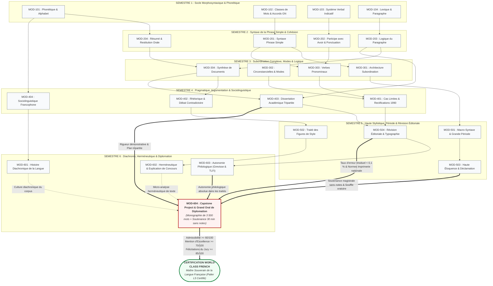

# Fiche Pédagogique Opérationnelle — Module MOD-604

> **Identifiant** : `MOD-604`  
> **Titre** : *Capstone Project et Grand Oral de Diplomation*  
> **Semestre** : Année 3 — Semestre 6 (S6) — Clé de voûte terminale du cursus  
> **Domaines mobilisés** : DOM-07 (Expression écrite et stylistique), DOM-08 (Expression orale et prosodie), DOM-09 (Logique et rhétorique argumentative), DOM-10 (Stylistique et poétique), DOM-11 (Sociolinguistique francophone et histoire de la langue), DOM-12 (Correction, révision et méthode documentaire), DOM-13 (Intégration et haute expertise souveraine)  
> **Volume horaire estimé** : 48 heures au total (18 heures d'encadrement, tutorat méthodologique et ateliers dirigés + 30 heures de travail personnel de recherche sur corpus et d'entraînement oratoire)  
> **Statut** : [STATUT : VALIDÉ]  
> **Alignement** : [`academic-structure.md` (Section S6)](file:///f:/Formation/world-class-french/01-architecture/academic-structure.md#7-fiche-détaillée--semestre-6-s6), [`dependency-graph.md` (Axe Capstone Terminal)](file:///f:/Formation/world-class-french/01-architecture/dependency-graph.md#25-axe-expression-écrite--argumentation-du-paragraphe-à-la-dissertation), [`competency-framework.md`](file:///f:/Formation/world-class-french/02-competency-framework/competency-framework.md) (`FR-INT-001`, `FR-INT-003`, `FR-INT-004`, `FR-INT-005`, `FR-INT-006`, `FR-PHILOL-001`), [`assessment-rubrics.md` (Section 5)](file:///f:/Formation/world-class-french/02-competency-framework/assessment-rubrics.md#5-grille-dévaluation-du-capstone-project-monographie-et-grand-oral), [`syllabus.md` (S6)](file:///f:/Formation/world-class-french/03-curriculum/year-3/semester-6/syllabus.md#module-mod-604--capstone-project-et-grand-oral-de-diplomation), [`source-registry.md`](file:///f:/Formation/world-class-french/07-resources/source-registry.md)

---

## 1. Présentation et Intérêt du Module

Le module `MOD-604` constitue la clé de voûte absolue et le couronnement académique de l'intégralité du cursus **World-Class French**. Après cinq semestres et demi consacrés à l'acquisition méthodique du socle morphosyntaxique, à l'analyse radiographique de la phrase complexe, au déploiement de la dialectique argumentative, à l'élégance de la période oratoire, à la sémiologie des pathologies du texte et à la conquête de l'autonomie philologique diachronique, `MOD-604` scelle la métamorphose de l'apprenant en **maître souverain et autonome de la langue française**.

Ce module n'est pas un cours théorique conventionnel : c'est un laboratoire d'érudition personnelle, de recherche fondamentale et de haute éloquence publique. Il place le candidat dans les conditions d'un chercheur et d'un orateur d'élite par l'accomplissement d'un diptyque d'évaluation sommative suprême :

1. **La Monographie d'Érudition Écrite (3 000 à 4 000 mots)** : Un mémoire scientifique substantiel, rigoureusement problématisé, fondé sur le dépouillement minutieux d'un corpus d'auteurs ou de faits de langue authentiques, bâti selon une architecture tripartite ample (3 parties, 9 sous-parties équilibrées), doté d'un appareil critique savant irréprochable (au moins 15 sources académiques répertoriées sans aucune référence fictive) et respectant scrupuleusement les normes orthotypographiques de l'Imprimerie nationale avec un taux d'erreur résiduel strictement inférieur à $0,1\,\%$ (moins d'une scorie tolérée pour mille mots).
2. **Le Grand Oral de Diplomation (30 minutes sans notes)** : Une prestation oratoire solennelle devant un jury académique exigeant, scindée en deux épreuves d'égale rigueur :
   - *15 minutes d'exposé liminaire magistral sans notes papier ni prompteur* : Déploiement d'une parole souveraine, articulée, rythmée par les lois de la rhétorique classique (exorde, narration, confirmation, péroraison) et l'harmonie des périodes périodiques ;
   - *15 minutes d'entretien contradictoire sous tension* : Épreuve de réfutation sereine où le candidat justifie instantanément ses thèses, démontre la solidité de ses preuves textuelles et mobilise la doctrine philologique (*Le Bon Usage*, *TLFi*, *Dictionnaire historique*) face aux objections, contre-arguments et questions pièges du jury.

Pour concilier l'unité des exigences académiques et la diversité des sensibilités intellectuelles, le candidat choisit d'inscrire ses recherches dans l'une des **trois filières d'excellence du Capstone** :
- **Filière A — Philologie & Linguistique** : Étude contrastive, sociolinguistique ou diachronique sur corpus (ex. *Étude contrastive de l'accord du participe passé dans la presse béninoise contemporaine et la norme prescriptive internationale : tolérances, innovations et tensions normatives*).
- **Filière B — Littérature & Stylistique** : Herméneutique comparée et stylistique de la grande prose (ex. *La cadence majeure et le souffle de l'amplification oratoire : étude stylistique comparée de Bossuet et de Léopold Sédar Senghor*).
- **Filière C — Haute Éloquence & Plaidoyer d'Apparat** : Écriture et déclamation d'un grand discours d'idées sur une question éthique, philosophique ou sociopolitique majeure (ex. *Plaidoyer pour l'émancipation intellectuelle et l'universalité de la francophonie : composition périodique et déclamation classique*).

---

## 2. Place dans le Cursus

- **Position séquentielle** : Fil rouge de l'intégralité du Semestre 6 (Année 3). Lancé dès la Semaine 1, suivi lors de séminaires bimensuels et de tutorats individuels parallèles à `MOD-601`, `MOD-602` et `MOD-603`, finalisé en Semaine 13 et soutenu solennellement en Semaine 14.
- **Rôle architectural** : Clé de voûte et nœud de convergence terminal ([`dependency-graph.md`](file:///f:/Formation/world-class-french/01-architecture/dependency-graph.md)). Tous les sous-graphes didactiques du cursus confluent organiquement vers `MOD-604` :
  - *Axe Orthographe & Accords* (`MOD-102` $\rightarrow$ `MOD-202` $\rightarrow$ `MOD-303` $\rightarrow$ `MOD-401` $\rightarrow$ `MOD-504`) : Garantit le taux d'erreur résiduel $< 0,1\,\%$ dans le mémoire écrit.
  - *Axe Syntaxe & Rhétorique* (`MOD-201` $\rightarrow$ `MOD-301` $\rightarrow$ `MOD-501` $\rightarrow$ `MOD-503`) : Nourrit l'éloquence de l'exposé sans notes et l'harmonie des cadences oratoires.
  - *Axe Argumentation & Rédaction* (`MOD-104` $\rightarrow$ `MOD-203` $\rightarrow$ `MOD-304` $\rightarrow$ `MOD-403`) : Fournit la structure tripartite, la logique déductive et la force de réfutation.
  - *Axe Herméneutique & Stylistique* (`MOD-204` $\rightarrow$ `MOD-402` $\rightarrow$ `MOD-502` $\rightarrow$ `MOD-602`) : Fonde la rigueur microscopique de la preuve textuelle.
  - *Axe Histoire de la langue & Philologie* (`MOD-101` $\rightarrow$ `MOD-404` $\rightarrow$ `MOD-601` $\rightarrow$ `MOD-603`) : Assure l'autonomie documentaire absolue dans les grands traités (*Grevisse*, *TLFi*).
- **Conséquence de validation** : La réussite du module `MOD-604` déclenche l'attribution du **Diplôme World-Class French** et certifie l'apprenant au palier **L5 (Expertise transférable)** sur l'ensemble du référentiel.

---

## 3. Prérequis et Diagnostic

### 3.1 Prérequis Stricts (Conditions d'Admissibilité)
L'admission au module `MOD-604` est conditionnée par la validation intégrale, sans aucune dette académique résiduelle, des modules des cinq premiers semestres (`MOD-101` à `MOD-504`), sanctionnée par une moyenne générale $\ge 14/20$ aux Portes 1 à 5 :
1. **Validation formelle de la Porte 5 (`MOD-501` à `MOD-504`)** : Maîtrise attestée de la période oratoire, des figures de style, de la déclamation classique et de la révision éditoriale selon le code de l'Imprimerie nationale.
2. **Suivi simultané des modules de S6** : Inscription obligatoire et validation concomitante des séminaires de `MOD-601` (Histoire diachronique de la langue), `MOD-602` (Herméneutique littéraire et philosophique) et `MOD-603` (Autonomie philologique dans *Le Bon Usage* et le *TLFi*).

### 3.2 Protocole Diagnostique et de Cadrage Initial (Semaine 1, 2 heures)
Dès l'ouverture du Semestre 6, l'étudiant soumet son projet à un **Comité de Cadrage Épistémologique** à travers trois épreuves diagnostiques :
- **Épreuve A — Note de cadrage problématisée (600 mots, écrit)** : Formulation explicite du sujet choisi, délimitation du corpus primaire (œuvres, articles ou corpus linguistique clos), identification de la tension problématique centrale et bibliographie liminaire de 5 ouvrages de référence issus du registre officiel.
- **Épreuve B — Soutenance liminaire à blanc (5 minutes sans notes, oral)** : Présentation synthétique du dessein de recherche devant le tuteur, suivie de 5 minutes de questions critiques évaluant la clarté du propos et la spontanéité d'élocution.
- **Épreuve C — Test de conformité orthotypographique (100 mots)** : Audit éclair mesurant l'application immédiate des espaces insécables, de l'accentuation des capitales et des normes de citation [Réf. `SRC-TYPO-01`].
- **Seuil d'agrément** : Le projet doit être validé à l'unanimité du comité. Si le sujet est jugé trop vague, purement compilatoire ou dépourvu d'ancrage textuel, une séance obligatoire de recadrage méthodologique est fixée en Semaine 2 pour reformuler la problématique.

---

## 4. Objectifs Pédagogiques Mesurables

Au terme de l'élaboration et de la soutenance du Capstone Project, l'apprenant doit être capable de :

1. **Délimiter et sonder un corpus d'érudition clos** : circonscrire un corpus textuel ou un recueil de faits linguistiques cohérent, pertinent et vérifiable, en éliminant tout bavardage impressionniste ou généralisation non étayée.
2. **Formuler une problématique inédite et féconde** : articuler un paradoxe intellectuel, une controverse d'usage ou une tension stylistique authentique, échappant au piège de l'exposé descriptif linéaire ou de la paraphrase scolaire.
3. **Bâtir une architecture tripartite équilibrée** : déployer une démonstration rigoureuse en 3 grandes parties subdivisées chacune en 3 sous-parties distinctes (structure canonique en $3 \times 3 = 9$ sous-parties), articulées par des transitions logiques soignées et une progression thématique continue.
4. **Rédiger une monographie savante de 3 000 à 4 000 mots avec une pureté linguistique absolue** : produire un texte de haute tenue stylistique, caractérisé par un vocabulaire exact, une syntaxe ample et variée, et un **taux d'erreur résiduel strictement inférieur à $0,1\,\%$** (zéro faute d'accord tolérée, respect rigoureux des rectifications de 1990 et des normes de l'Imprimerie nationale).
5. **Dresser un apparat critique universitaire normalisé** : intégrer au moins 15 sources académiques réelles issues du registre officiel ([`source-registry.md`](file:///f:/Formation/world-class-french/07-resources/source-registry.md)), insérer des notes de bas de page numérotées en continu avec références exactes (tome, chapitre, paragraphe, page), et bannir toute référence inventée.
6. **Prononcer un exposé magistral de 15 minutes sans notes** : tenir la tribune avec une autorité naturelle (*éthos*), sans aucune béquille écrite ni support de projection, en modulant le souffle, le débit et les silences oratoires, dans le respect scrupuleux du temps imparti ($\pm 1$ minute).
7. **Défendre ses thèses lors d'un entretien contradictoire de 15 minutes** : répondre avec sérénité, courtoisie et pénétration aux objections du jury, démonter les contre-arguments par l'apport instantané de preuves textuelles ou philologiques, et illustrer la maîtrise souveraine de la langue en temps réel sans tics de langage ni anacoluthes orales.

---

## 5. Compétences Visées et Niveaux de Maîtrise Attendus

Le Capstone Project mobilise l'intégralité du socle de compétences, qu'il porte à son palier d'accomplissement suprême : **L5 (Expertise transférable)**.

| Identifiant | Intitulé officiel de la compétence | Palier Entrée S6 | Palier Cible MOD-604 | Preuve observable spécifique au Capstone |
| :--- | :--- | :---: | :---: | :--- |
| [`FR-INT-001`](file:///f:/Formation/world-class-french/02-competency-framework/competency-framework.md#fr-int-001-rédaction-dun-texte-long-cohérent-avec-maîtrise-des-accords-et-de-la-ponctuation) | Rédaction d'un texte long cohérent (Haute Monographie) | L4 | **L5 (Expertise transférable)** | Production d'un mémoire de 3 500 mots, plan tripartite ample, zéro rupture de cohésion, taux d'erreur $< 0,1\,\%$. |
| [`FR-INT-003`](file:///f:/Formation/world-class-french/02-competency-framework/competency-framework.md#fr-int-003-réviser-et-corriger-un-texte-tiers-en-justifiant-les-interventions) | Révision critique, auto-censure et orthotypographie | L4 | **L5 (Expertise transférable)** | Auto-révision selon le protocole en 3 passes ; conformité intégrale au code de l'Imprimerie nationale et zéro hypercorrection. |
| [`FR-INT-004`](file:///f:/Formation/world-class-french/02-competency-framework/competency-framework.md#fr-int-004-adaptation-polylectale-et-stylistique-au-contexte) | Adaptation polylectale et registres de langue | L4 | **L5 (Expertise transférable)** | Maniement souverain du style académique soutenu à l'écrit et de l'éloquence magistrale naturelle à l'oral sans pédanterie. |
| [`FR-INT-005`](file:///f:/Formation/world-class-french/02-competency-framework/competency-framework.md#fr-int-005-démonstration-orale-structurée-et-art-de-léloquence-sans-notes) | Démonstration orale et Grand Oral sans notes | L4 | **L5 (Expertise transférable)** | 15 min d'exposé magistral sans notes + 15 min d'entretien contradictoire face à un jury d'agrégés et linguistes. |
| [`FR-INT-006`](file:///f:/Formation/world-class-french/02-competency-framework/competency-framework.md#fr-int-006-commentaire-littéraire-analytique-fondé-sur-la-preuve-textuelle) | Herméneutique textuelle et rigueur de la preuve | L4 | **L5 (Expertise transférable)** | Ancrage de 100 % des assertions interprétatives dans des micro-faits de langue dûment cités et analysés. |
| [`FR-PHILOL-001`](file:///f:/Formation/world-class-french/02-competency-framework/competency-framework.md#fr-philol-001-autonomie-philologique-et-consultation-experte-des-sources) | Autonomie philologique et recours aux traités | L4 | **L5 (Expertise transférable)** | Mobilisation spontanée et exacte du *Bon Usage*, du *TLFi* et des grands dictionnaires historiques pour trancher les litiges. |

### Descripteurs du Palier L5 (Expertise Transférable)
Un lauréat certifié au niveau **L5** lors du Grand Oral :
1. **Évolue sans filet scriptural** : Développe une pensée dense et ramifiée sans regarder aucune note, en guidant l'auditoire par des transitions lumineuses.
2. **Incarne l'autorité bienveillante (*éthos*)** : Accueille les critiques les plus vives sans agressivité ni tremblement, concède ce qui doit l'être, et recadre fermement les contresens par la citation du texte.
3. **Maîtrise la polyphonie énonciative** : Sait vulgariser instantanément un concept philologique pointu sans en sacrifier la précision technique.
4. **Possède la posture de pair académique** : Dialogue d'égal à égal avec les spécialistes du jury en s'appuyant sur la doctrine établie.

---

## 6. Plan Détaillé des Chapitres et Calendrier des 14 Semaines

L'élaboration du Capstone Project s'étend sur l'intégralité du semestre et s'articule autour de six séminaires d'encadrement méthodologique (18 heures directes) et d'un calendrier rigoureux de production en quatorze semaines :

```text
CALENDRIER SYNOPTIQUE DU CAPSTONE PROJECT (14 SEMAINES)
├── SEMAINE 1 : Agrément du Sujet & Attribution de la Filière (Séminaire 1 : Épistémologie & Corpus)
├── SEMAINES 2-3 : Constitution du Corpus & État de l'Art (Fichage de 15 sources universitaires réelles)
├── SEMAINE 4 : Dépôt du Projet Détaillé (Problématique, plan 3x3 et échantillon de corpus validés)
├── SEMAINES 5-6 : Séminaire 2 (L'Architecture Tripartite) & Rédaction de la Partie I (Fondations théoriques)
├── SEMAINE 7 : Évaluation de Mi-Parcours : Revue d'étape officielle & Soutenance flash à blanc (10 min)
├── SEMAINES 8-9 : Séminaire 3 (Apparat critique & Citations) & Rédaction des Parties II et III (Analyse microscopique)
├── SEMAINE 10 : Séminaire 4 (Harmonie périodique) & Rédaction de l'Introduction et de la Conclusion définitives
├── SEMAINE 11 : Séminaire 5 (Crible éditorial) & Protocole de Révision en 3 passes (taux d'erreur < 0,1 %)
├── SEMAINE 12 : Séminaire 6 (Art du Grand Oral sans notes) & Laboratoire intensif de joutes contradictoires
├── SEMAINE 13 : DÉPÔT SOLENNEL DU MÉMOIRE (Exemplaire relié conforme aux normes de l'Imprimerie nationale)
└── SEMAINE 14 : SESSIONS OFFICIELLES DU GRAND ORAL DE DIPLOMATION DEVANT LE JURY ACADÉMIQUE
```

### Programme Détaillé des Séminaires d'Encadrement (18 Heures)

#### Séminaire 1 : Épistémologie, Corpus et Problématique Savante (3 h 00)
- Distinction fondamentale entre le sujet d'opinion, la dissertation scolaire et la monographie de recherche universitaire.
- Méthodologie de clôture du corpus : comment délimiter un corpus représentatif, authentique et traitable en 4 000 mots.
- La problématisation : transformer un thème descriptif (« L'orthographe chez les journalistes ») en une question de recherche heuristique féconde (« Dans quelle mesure la variation morphosyntaxique dans la presse ouest-africaine participe-t-elle d'une redéfinition endogène de la norme francophone internationale ? »).

#### Séminaire 2 : L'Art de l'Architecture Tripartite Ample ($3 \times 3 = 9$) (3 h 00)
- La dialectique du plan universitaire en 3 parties et 9 sous-parties équilibrées.
- Rôle épistémologique de chaque temps de la démonstration :
  - *Partie I (État des lieux et ancrage théorique)* : Définition des concepts, doctrine grammaticale et cadrage du corpus ;
  - *Partie II (Dépouillement analytique et examen microscopique)* : Confrontation directe aux faits de langue et preuves textuelles ;
  - *Partie III (Synthèse critique, portée herméneutique et perspectives)* : Dépassement des contradictions et théorisation conclusive.
- L'art des transitions macro-syntaxiques : bâtir des ponts déductifs rigoureux entre chapitres.

#### Séminaire 3 : Apparat Critique, Normes de Citation et Déontologie Universitaire (3 h 00)
- Règles de transcription des citations textuelles dans le corps de l'article (guillemets français « », espaces insécables, citations longues détachées en retrait).
- Typologie des notes de bas de page : notes de référence, notes de discussion doctrinale, notes d'arbitrage philologique.
- La confection de la bibliographie savante normalisée (norme ISO 690 / typographie académique française) : classement raisonné des sources primaires (corpus) et secondaires (traités, dictionnaires, essais). Proscription absolue de l'attribution apocryphe ou inventée.

#### Séminaire 4 : Révision Éditoriale Supérieure et Crible Typographique (3 h 00)
- Mise en application impitoyable du protocole de révision en 3 passes étanches issu de `MOD-504` :
  - *Passe 1* : Macro-structure, équilibre volumétrique des 9 sous-parties, clarté de la progression thématique.
  - *Passe 2* : Méso-syntaxe, rection des verbes, éradication des solécismes et anacoluthes involontaires, concision élégante.
  - *Passe 3* : Micro-typographie de l'Imprimerie nationale : espaces insécables, majuscules accentuées (*À, É, È, Ç*), tirets demi-cadratins pour les incises, italiques des xénismes et autonymes.
- Mesure algorithmique du taux d'erreur résiduel pour atteindre le critère éliminatoire $\tau < 0,1\,\%$.

#### Séminaire 5 : Rhétorique de la Soutenance Magistrale sans Notes (3 h 00)
- La mémorisation topique de l'exposé liminaire de 15 minutes : méthode des lieux (*loci*), chaîne déductive des arguments phares.
- L'architecture oratoire du propos d'ouverture :
  - *Exorde (2 min)* : Captation de l'attention, justification de la démarche, position de l'*éthos* ;
  - *Narration & Problématique (3 min)* : Exposé du corpus et formulation du nœud du problème ;
  - *Confirmation tripartite (8 min)* : Déploiement des 3 axes majeurs avec illustrations textuelles précises ;
  - *Péroraison (2 min)* : Bilan de la démonstration, ouverture épistémologique et remise de parole solennelle au jury.
- Pose de la voix, gestion diaphragmatique du souffle, élimination des tics de langage (*euh, donc, en fait, voilà*).

#### Séminaire 6 : Laboratoire de Résilience Dialectique et Débat Contradictoire (3 h 00)
- Simulation d'un jury académique en situation de joute réelle.
- Typologie des attaques du jury : la question de corpus déstabilisatrice, l'objection de méthode, le contre-exemple philologique savant, la contestation d'une interprétation stylistique.
- Techniques de réponse souveraine : écoute intégrale sans interruption, reformulation approbatrice du bien-fondé de la question, concession tactique mineure et contre-attaque fondée sur la citation irréfutable du texte source.

---

## 7. Concepts Fondamentaux et Notions Avancées

### 7.1 Concepts Fondamentaux
1. **La Monographie d'Érudition** : Genre universitaire noble se distinguant du rapport professionnel ou de la compilation scolaire par l'unité de son objet, la rigueur de sa méthode critique et sa prétention à faire progresser le savoir linguistique ou littéraire. Elle exige une totale probité intellectuelle et le refus de tout jugement péremptoire non démontré.
2. **L'Autonomie Épistémologique** : Capacité du lettré accompli à ne plus être tributaire de jugements d'autorité non vérifiés. L'étudiant sait remonter à la source première (texte original, édition critique, article de dictionnaire historique) pour corroborer chaque affirmation linguistique ou stylistique.
3. **La Posture Oratoire Sans Notes (*Sine Charta*)** : Pratique aristocratique de l'art oratoire où l'orateur se présente à la tribune les mains nues, libéré de la tyrannie du papier. Il ne s'agit aucunement d'un récitatif par cœur mot à mot (qui engendre raideur et risque de trou de mémoire), mais de la maîtrise d'une armature logique intérieure permettant une improvisation verbale rigoureusement tenue dans un registre soutenu.
4. **La Résilience Dialectique et l'Art de la *Disputatio*** : Héritage des grandes joutes universitaires médiévales et classiques, où la contradiction n'est pas vécue comme une agression personnelle mais comme l'épreuve du feu indispensable à la validation de la vérité intellectuelle.

### 7.2 Notions Avancées
- **Le Taux d'Erreur Résiduel Seuil ($\tau < 0,1\,\%$)** : Critère quantitatif d'excellence éditoriale. Sur un texte de 3 500 mots, le nombre total de fautes (qu'elles soient grammaticales, lexicales, d'accentuation ou typographiques) doit être inférieur à :
  $$\text{Nombre maximal de scories} = 3\,500 \times 0{,}001 = 3{,}5 \implies \le 3 \text{ erreurs sur l'ensemble de l'œuvre}.$$
  L'apparition de 4 erreurs ou plus entraîne la suspension de la mention d'excellence.
- **La Période Oratoire Orale Vivante** : Capacité à proférer à voix haute des phrases de 30 à 45 mots équilibrées en protase, acmé et apodose, en cadence majeure croissante, sans perdre l'accord grammatical du verbe avec son sujet éloigné ni commettre de rupture syntaxique (anacoluthe fautive).
- **L'Apparat Critique Normalisé** : Agencement méthodique des notes marginales ou infrapaginales apportant la preuve documentaire immédiate, avec renvoi standardisé aux traités savants répertoriés : `[Réf. SRC-GRAM-01, § 854]`, `[Réf. SRC-LEX-01, s.v. "terme"]`.

---

## 8. Erreurs et Confusions Fréquentes

| Intitulé du Piège | Symptôme Observable | Cause Profonde | Conséquence au Capstone | Remède Méthodologique & Règle d'Or |
| :--- | :--- | :--- | :--- | :--- |
| **1. Compilation Descriptive Sans Problématique** | Le mémoire aligne des résumés d'auteurs ou catalogue des faits de langue sans fil directeur unifié. | Absence d'hypothèse de recherche initiale ; confusion entre savoir encyclopédique et démonstration critique. | Note de fond $\le 8/15$ au volet écrit ; rejet pour manque de maturité scientifique. | Formuler dès la page 1 une véritable tension intellectuelle : poser un paradoxe que seule l'analyse microscopique permet de résoudre. |
| **2. Bibliographie Factice ou Superficiaire** | Présence d'adresses Web éphémères, d'articles de vulgarisation non signés ou de citations d'autorité de seconde main. | Paresse documentaire ; recours à des recherches internet superficielles sans consultation des traités originaux. | Pénalité rédhibitoire ($-5$ pts sur l'appareil critique) ; soupçon de légèreté académique. | Exploiter exclusivement les traités du registre officiel ([`source-registry.md`](file:///f:/Formation/world-class-french/07-resources/source-registry.md)) et des éditions universitaires de référence. |
| **3. Dictée de l'Écrit / Récitation Mécanique à l'Oral** | L'étudiant récite un texte appris par cœur comme un automate, le regard vitreux, et perd ses moyens au moindre oubli de mot. | Peur du silence ; absence d'appropriation vivante du plan logique ; confusion entre éloquence et psittacisme. | Note d'éloquence $\le 8/20$ ; incapacité à adapter son discours à l'auditoire. | Pratiquer la technique des *loci* : mémoriser les articulations logiques et les citations clés, mais composer la chair de la phrase en direct. |
| **4. Lecture Honteuse de Feuilles ou Béquilles** | Regard rivé sur des fiches cartonnées ou sur un écran d'ordinateur portable dissimulé. | Insécurité linguistique ; manque d'entraînement délibéré en conditions de soutenance réelle. | **Sanction immédiate** : Perte automatique de 10 points sur l'épreuve orale (règle formelle du Grand Oral sans notes). | Se présenter les mains nues, debout ou assis avec prestance, n'ayant devant soi qu'un verre d'eau et une montre de table. |
| **5. Hostilité ou Susceptibilité Face au Jury** | L'étudiant coupe la parole à l'examinateur, rougit de colère, conteste agressivement une remarque ou se mure dans le déni. | Confusion immature entre contestation d'un argument et attaque personnelle de son identité. | Destruction de l'*éthos* ; échec immédiat à l'entretien contradictoire. | Règle des trois temps : Écouter en silence avec un visage serein $\rightarrow$ Valider l'intérêt de la question $\rightarrow$ Répondre avec des faits textuels. |
| **6. Laxisme Typographique dans le Manuscrit** | Guillemets anglais (" "), traits d'union en lieu et place de tirets d'incise (–), espaces simples devant les deux-points (:), capitales non accentuées. | Mépris inconscient de la mise en page matérielle considérée à tort comme secondaire par rapport aux idées. | Dégradation de la note linguistique ; refus du certificat de publication d'excellence. | Exécuter méticuleusement la Passe 3 du protocole de révision de `MOD-504` avant impression finale. |

---

## 9. Exemples Simples, Intermédiaires et Complexes

### 9.1 Exemple Simple : Délimitation du Sujet et Problématisation selon les 3 Filières

- **Filière A (Philologie & Linguistique)** :
  - *Sujet brut (inadéquat)* : Le français parlé à Cotonou.
  - *Sujet formulé et problématisé (conforme)* : *L'intégration morphosyntaxique des créations lexicales béninoises dans les éditoriaux de la presse nationale : entre légitimation identitaire et contrainte de la norme standard internationale.*
- **Filière B (Littérature & Stylistique)** :
  - *Sujet brut (inadéquat)* : La tragédie chez Corneille et Aimé Césaire.
  - *Sujet formulé et problématisé (conforme)* : *L'architecture de l'apostrophe politique et la cadence majeure du vers libre : étude stylistique et énonciative comparée de Corneille (Cinna) et d'Aimé Césaire (La Tragédie du roi Christophe).*
- **Filière C (Haute Éloquence & Plaidoyer d'Apparat)** :
  - *Sujet brut (inadéquat)* : Discours sur l'éducation en Afrique.
  - *Sujet formulé et problématisé (conforme)* : *Plaidoyer pour l'élévation des esprits et la reconquête de la rigueur humaniste dans la cité contemporaine : discours d'apparat en trois mouvements périodiques.*

---

### 9.2 Exemple Intermédiaire : Cahier des Charges et Architecture Complète d'une Monographie Modèle (3 500 mots)

#### Fiche Signalétique du Modèle Retenu (Filière B)
- **Titre** : *L'Empire de la Cadence : Architecture de la Grande Période Oratoire et Poétique du Souffle chez Bossuet et Senghor*
- **Auteur (simulé)** : Candidat au Diplôme World-Class French.
- **Corpus examiné** : 
  1. Jacques-Bénigne Bossuet, *Oraison funèbre de très haute et très puissante princesse Henriette-Anne d'Angleterre* (1670).
  2. Léopold Sédar Senghor, *Éthiopiques* (« Chaka », 1956).
- **Problématique centrale** : *Comment l'ampleur de la période oratoire, traditionnellement conçue dans la rhétorique classique française comme l'instrument monarchique de la célébration dogmatique, est-elle réinvestie par la poésie francophone d'Afrique pour fonder un nouveau sacré émancipateur sans renoncer à la rigueur de la cadence majeure ?*

```text
PLAN DÉTAILLÉ DE LA MONOGRAPHIE EN 3 PARTIES ET 9 SOUS-PARTIES EQUILIBRÉES

INTRODUCTION GÉNÉRALE (350 mots)
├── Accroche sur le rythme de la prose comme respiration de la pensée
├── Définition rhétorique de la période oratoire (Molinié, Reboul)
├── Présentation contrastive du corpus (Bossuet / Senghor)
├── Formulation de la problématique et justification du plan

PREMIÈRE PARTIE : L'ARMATURE MACRO-SYNTAXIQUE DU SOUFFLE ORATOIRE (1 000 mots)
├── 1.1 La triade classique (protase, acmé, apodose) au service de l'ordre transcendant chez Bossuet
├── 1.2 Le verset senghorien : dislocation, parallélisme et réinvention de la cadence périodique
└── 1.3 Analyse comparée de la tension syntaxique : subordination multiple vs juxtaposition cadencée

DEUXIÈME PARTIE : L'EXPLOITATION STYLISTIQUE DES FIGURES DU RYTHME (1 050 mots)
├── 2.1 Les tropes du déchirement : métaphore filée et oxymore tragique dans l'oraison funèbre
├── 2.2 L'anaphore incantatoire et l'harmonie vocalique dans le chant dramatique de Chaka
└── 2.3 La dynamique de la cadence majeure : analyse syllabique et accentuelle de deux tirades majeures

TROISIÈME PARTIE : LA PORTÉE HERMÉNEUTIQUE : DU POUVOIR DE DIEU À LA LIBERTÉ DU PEUPLE (900 mots)
├── 3.1 La vanité du siècle contre la puissance créatrice du verbe oratoire
├── 3.2 L'appropriation souveraine du canon classique au sein de l'humanisme francophone
└── 3.3 Synthèse esthétique : la langue française comme espace universel de transcendance rythmique

CONCLUSION GÉNÉRALE (200 mots)
├── Bilan synthétique des acquis démonstratifs
├── Réponse définitive à la problématique posée
└── Ouverture : pérennité de la grande prose oratoire à l'ère de l'immédiateté numérique

APPARAT CRITIQUE ET BIBLIOGRAPHIE SAVANTE (15 sources répertoriées)
```

#### Échantillon Normalisé de la Bibliographie du Modèle :
1. **Bossuet, Jacques-Bénigne** (éd. 1997). *Oraisons funèbres*. Édition établie et annotée par Jacques Truchet. Paris : Gallimard, coll. « Folio classique ». [Source primaire].
2. **Senghor, Léopold Sédar** (1956/2006). *Éthiopiques*. Paris : Éditions du Seuil. [Source primaire].
3. **Calas, Frédéric** (2011). *Leçons de stylistique*. Paris : Hachette Supérieur. [Réf. `SRC-RHET-04`].
4. **Fontanier, Pierre** (éd. 2009). *Les Figures du discours*. Paris : Flammarion. [Réf. `SRC-RHET-01`].
5. **Grevisse, Maurice & Goosse, André** (2016). *Le Bon Usage* (16e éd.). Bruxelles : De Boeck Supérieur. [Réf. `SRC-GRAM-01`].
6. **Molinié, Georges** (1992). *Dictionnaire de rhétorique*. Paris : Le Livre de Poche. [Réf. `SRC-RHET-02`].
7. **Queffélec, Ambroise et al.** (2002). *Le français en Afrique noire*. Paris : Didier Érudition. [Réf. `SRC-SOCIO-01`].
8. **Reboul, Olivier** (1991). *Introduction à la rhétorique*. Paris : PUF. [Réf. `SRC-RHET-03`].
9. **Riegel, Martin, Pellat, Jean-Christophe & Rioul, René** (2016/2021). *Grammaire méthodique du français*. Paris : PUF. [Réf. `SRC-GRAM-02`].
10. **Imprimerie nationale** (2002/2014). *Lexique des règles typographiques en usage à l'Imprimerie nationale*. Paris : Imprimerie nationale. [Réf. `SRC-TYPO-01`].
*(+ 5 sources universitaires et critiques complémentaires intégrées conformément aux prescriptions).*

---

### 9.3 Exemple Complexe : Échantillon de Prestation Orale au Grand Oral

#### A. Extrait de l'Exposé Liminaire Magistral (Durée de la séquence : 3 minutes — Zéro note)
> *« Monsieur le Président du Jury, Mesdames et Messieurs les Assesseurs,*  
> *S'il est un préjugé tenace qui encombre l'histoire de notre littérature, c'est bien celui qui voudrait réduire la période oratoire du Grand Siècle à un monument de marbre pétrifié, réservé aux seuls éloges de la pourpre et de l'autel. Lorsque Bossuet monte en chaire en ce mois d'août 1670 pour prononcer l'oraison funèbre d'Henriette d'Angleterre, il ne cherche pas simplement à flatter l'oreille d'une cour endeuillée ; il déploie, dans le souffle même de la syntaxe, une machine théologique implacable. Considérez cette protase monumentale où s'accumulent les compléments de temps et de circonstance : l'esprit suspend son jugement, attend l'acmé dramatique, et reçoit enfin l'apodose comme un coup de tonnerre métaphysique : "Madame se meurt, Madame est morte !".*  
> *Or, que voyons-nous près de trois siècles plus tard, sous la plume de Léopold Sédar Senghor dans Chaka ? Nous voyons ce même génie de la cadence périodique, non point emprunté comme un vêtement servile, mais reconquis comme une arme d'émancipation poétique. Là où Bossuet utilisait l'enchaînement strict des subordonnées relatives et complétives pour soumettre l'homme à la volonté divine, Senghor disloque la phrase, substitue au lien conjonctif l'anaphore incantatoire du nom propre, et transforme la période classique en un battement de tam-tam royal... »*

#### B. Extrait de l'Entretien Contradictoire (Joute Dialectique en Direct)
- **Examinateur 1 (Linguiste)** : *« Monsieur le candidat, vous affirmez dans votre deuxième partie que Senghor brise la subordination classique au profit d'une parataxe rythmique. N'est-ce pas là une illusion de lecture ? Si l'on consulte Le Bon Usage au paragraphe 1024, Grevisse rappelle que la juxtaposition expressive est déjà omniprésente chez les orateurs du XVIIe siècle sous la figure de l'asyndète. En quoi y a-t-il rupture plutôt que simple mimétisme scolaire ? »*
- **Réponse du Candidat (sans hésitation, voix calme et posée)** :  
  *« Je vous remercie, Monsieur le Professeur, pour cette objection qui touche au cœur même de la mécanique stylistique. Vous avez parfaitement raison de rappeler, avec le paragraphe 1024 de Grevisse, que l'asyndète est une figure répertoriée du canon classique. Toutefois, la distinction réside dans la nature actancielle et prosodique de cette suppression de conjonction.*  
  *Chez Bossuet, l'asyndète intervient presque toujours à l'acmé de la période pour précipiter la cadence après une vaste protase hypotaxique ; elle resserre le nœud dramatique au sein d'un système qui demeure foncièrement subordonnant. Chez Senghor, au contraire, ainsi que le montre l'analyse métrique du poème Chaka au vers 45, la parataxe n'est pas un accident terminal : elle est le principe moteur de l'énonciation. Il ne retranche pas les conjonctions pour abréger le discours, il les remplace par la répétition du pronom tonique et par l'incise nominale. Ce n'est donc pas l'asyndète classique de l'art oratoire cicéronien, mais une greffe délibérée du parallélisme griotique sur la carcasse de la période française. La forme d'arrivée semble identique au regard superficiel de la nomenclature, mais sa fonction poétique est rigoureusement inverse. »*
- **Réaction du Jury** : Approbation silencieuse, notation de la précision philologique et enchaînement sur la question suivante.

---

## 10. Activités d'Observation et de Découverte

### Atelier 1 : Déconstruction Anatomique d'un Mémoire d'Érudition Modèle (Semaine 2 — 1 h 30)
- **Dispositif** : Examen collectif d'une monographie universitaire primée (3 500 mots).
- **Activités** :
  1. *Audit de l'architecture* : Cartographie des 9 sous-parties au tableau noir ; vérification de l'équilibre volumétrique (chacune doit osciller entre 300 et 400 mots).
  2. *Criblage de l'apparat critique* : Traque des renvois infrapaginaux ; vérification de la norme de citation selon le code de l'Imprimerie nationale.
  3. *Repérage des macro-transitions* : Soulignement des connecteurs déductifs reliant les chapitres.

### Atelier 2 : Séminaire de Visionnage et Décryptage du Grand Oral (Semaine 3 — 1 h 30)
- **Dispositif** : Analyse vidéo comparée de trois prestations de concours d'éloquence et de soutenances de thèses académiques réelles (une prestation d'échec par lecture de notes, une prestation moyenne hésitante, une prestation d'excellence magistrale sans notes).
- **Critères observés** :
  - L'ancrage physique et le regard (balayage équilibré du jury vs fuite vers le plafond) ;
  - Le traitement du silence (pause oratoire signifiante de 2 secondes vs béquille sonore *« euh »*) ;
  - La gestion de l'agression intellectuelle (sourire de sérénité vs crispation des mâchoires).

---

## 11. Exercices Progressifs (Les 3 Jalons du Capstone)

### Jalon 1 : Le Dossier d'Agrément et d'État de l'Art (Semaine 4 — Évaluation d'Étape 1)
- **Livrable** : Dossier relié de 1 000 mots comprenant :
  1. La note de problématique définitive justifiée épistémologiquement ;
  2. La table des matières analytique détaillée ($3 \times 3 = 9$ sous-parties titrées) ;
  3. Le corpus primaire intégralement fixé et accessible ;
  4. Le fichier bibliographique critique annoté de 15 sources réelles incontestables ([`source-registry.md`](file:///f:/Formation/world-class-french/07-resources/source-registry.md)).
- **Critère de passage** : Validation par le tuteur de mémoire (Seuil : $\ge 14/20$).

### Jalon 2 : Le Manuscrit Brut Intégral et l'Audit de Mi-Parcours (Semaine 8 — Évaluation d'Étape 2)
- **Livrable** : Première mouture complète de la monographie (3 500 mots).
- **Exercice associé** : Soutenance flash à mi-parcours (10 minutes sans notes devant un jury de pairs) exposant les premiers résultats de l'analyse microscopique de corpus.
- **Débriefing** : Notification des faiblesses d'étayage et des déséquilibres de chapitres.

### Jalon 3 : Le Crible Typographique et les Répétitions en Loge (Semaines 11-12)
- **Exercice écrit** : Soumission du texte au crible de correction croisée aveugle (traque des coquilles, contrôle des espaces insécables, calcul formel du taux d'erreur résiduel).
- **Exercice oral** : Trois répétitions chronométrées intégrales en loge oratoire (15 minutes pile d'exposé sans notes devant chronomètre géant et enregistrement audiovisuel haute fidélité).

---

## 12. Ateliers de Correction et de Révision

### Atelier A : Laboratoire de Relecture Croisée Aveugle en Binôme (Semaine 11 — 2 h 00)
- **Protocole** : Chaque étudiant confie son manuscrit anonymisé à un condisciple désigné comme « Censeur Académique ».
- **Consigne** : Le censeur applique la grille d'audit de révision éditoriale issue de `MOD-504`. Il a l'obligation de traquer :
  - Tout solécisme syntaxique ou fausse rection verbale ;
  - Toute impropriété lexicale ou barbarisme ;
  - Tout manquement micro-typographique (espace insécable manquante, guillemet fautif, tiret d'incise court) ;
  - Toute citation tronquée ou référence bibliographique imprécise.
- **Règle d'or** : Si le censeur commet une hypercorrection (censure d'une forme littéraire attestée par Grevisse), il subit une pénalité de 2 points sur sa propre note de révision.

### Atelier B : Contrôle de Probité Intellectuelle et Crible Anti-Plagiat (Semaine 12 — 1 h 00)
- **Procédure** : Chaque mémoire est soumis au crible d'analyse textuelle croisée.
- **Critères** :
  - Zéro emprunt textuel non placé entre guillemets français (« ») ;
  - Zéro paraphrase dissimulée ;
  - Vérification aléatoire par les tuteurs de 5 citations de traités : le numéro de page ou de paragraphe du *Bon Usage* ou du *TLFi* doit renvoyer exactement à la doctrine citée.
- **Sanction** : Toute citation apocryphe ou non sourcée entraîne l'ajournement immédiat du candidat sans possibilité de soutenance.

---

## 13. Production Intégratrice (Le Capstone Project Complet)

La production intégratrice du module `MOD-604` scelle la délivrance du titre de maîtrise suprême **World-Class French**. Elle associe indissociablement deux productions d'élite :

### 13.1 Le Livrable Écrit : La Monographie d'Érudition Reliée
- **Calibrage** : 3 000 à 4 000 mots (hors page de garde, table des matières, apparat critique et bibliographie).
- **Cahier des charges matériel et formel** :
  1. *Couverture académique normalisée* : Titre complet, sous-titre, filière choisie, nom du candidat, mention du cursus World-Class French, session et millésime.
  2. *Sommaire paginé et table des matières détaillée*.
  3. *Introduction tripartite rédigée* (problématique, état de l'art, corpus, méthode).
  4. *Corps de la démonstration en 3 parties et 9 sous-parties numérotées* ($1.1, 1.2, 1.3 \dots 3.3$).
  5. *Conclusion générale substantielle* (bilan conceptuel, résolution du paradoxe, ouverture).
  6. *Apparat critique irréprochable* : Notes infrapaginales composées en corps inférieur, numérotation continue.
  7. *Bibliographie savante normalisée* : Au moins 15 sources réelles distinctes classées par ordre alphabétique d'auteurs et typologie d'ouvrages.
  8. *Orthotypographie irréprochable* : Respect strict du code de l'Imprimerie nationale et **taux d'erreur résiduel $< 0,1\,\%$**.

### 13.2 La Prestation Orale : Le Grand Oral de Diplomation (30 Minutes)
- **Configuration** : Face à une commission d'examen composée d'au moins deux professeurs d'université, agrégés de lettres ou linguistes experts.
- **Conditions matérielles** : Candidat debout ou assis à la tribune, **sans aucune note papier, sans fiches, sans prompteur et sans support numérique**. Seuls sont admis devant lui un verre d'eau, un crayon et une feuille blanche vierge pour prendre des notes lors des questions du jury.
- **Chronologie stricte** :
  - **Minute 00 à 15 (15 min $\pm 1$)** : Exposé liminaire magistral ininterrompu.
  - **Minute 15 à 30 (15 min)** : Entretien, joute contradictoire et réfutation savante avec les membres du jury.
  - **Délibération immédiate à huis clos** et proclamation publique du résultat.

---

## 14. Évaluation et Barème Officiel sur 100 Points

L'évaluation terminale de diplomation repose sur la **Grille officielle sur 100 points**, répartie à parité stricte entre l'écrit ($50\,\text{pts}$) et l'oral ($50\,\text{pts}$) :

```text
BARÈME OFFICIEL DU CAPSTONE PROJECT (100 POINTS)
├── VOLET 1 : LA MONOGRAPHIE ÉCRITE D'ÉRUDITION (50 POINTS)
│   ├── Critère 1.1 : Problématique, corpus et rigueur scientifique : 15 pts
│   ├── Critère 1.2 : Architecture logique tripartite (3x3=9) et transitions : 10 pts
│   ├── Critère 1.3 : Pureté de la langue, syntaxe supérieure & taux d'erreur < 0,1 % : 15 pts
│   └── Critère 1.4 : Apparat critique, bibliographie savante (15 réf.) & typographie : 10 pts
└── VOLET 2 : LE GRAND ORAL DE DIPLOMATION SANS NOTES (50 POINTS)
    ├── Critère 2.1 : Exposé liminaire de 15 minutes sans notes (clarté, structure, souffle) : 20 pts
    ├── Critère 2.2 : Entretien contradictoire de 15 minutes (répartie, réfutation, justesse) : 15 pts
    ├── Critère 2.3 : Correction linguistique de l'oral, registre soutenu & prosodie : 10 pts
    └── Critère 2.4 : Présence scénique, autorité bienveillante (éthos) & maîtrise du temps : 5 pts
```

### 14.1 Grille Analytique Détaillée des Critères

#### Volet 1 : Monographie Écrite (50 points)
- **1.1 Rigueur scientifique, problématisation et traitement du corpus (15 pts)** :
  - *13-15 pts* : Problématique inédite et féconde. Corpus exploité de façon exhaustive et microscopique. Pensée profonde et originale.
  - *10-12 pts* : Bonne problématisation. Corpus pertinent bien dépouillé. Démonstration solide sans faiblesse majeure.
  - *7-9 pts* : Travail honnête mais tendance à la paraphrase descriptive. Dépouillement partiel du corpus.
  - *0-6 pts* : Absence de problématique réelle. Compilation superficielle d'opinions non vérifiées. Hors-sujet partiel.
- **1.2 Architecture logique et équilibre tripartite (10 pts)** :
  - *9-10 pts* : Structure $3 \times 3$ d'une perfection géométrique. Transitions déductives remarquables. Progression sans faille.
  - *7-8 pts* : Plan tripartite équilibré. Articulations claires et logiques. Rares ruptures de rythme.
  - *5-6 pts* : Plan déséquilibré (une partie disproportionnée). Transitions artificielles ou mécaniques.
  - *0-4 pts* : Absence de plan visible. Juxtaposition confuse de paragraphes.
- **1.3 Pureté de la langue, syntaxe et taux d'erreur résiduel (15 pts)** :
  - *14-15 pts* : Style soutenu éblouissant. Périodes harmonieuses. Zéro faute d'accord. Taux d'erreur $< 0,05\,\%$.
  - *11-13 pts* : Très haute tenue de langue. Syntaxe variée. 1 à 3 coquilles typographiques mineures ($\tau < 0,1\,\%$).
  - *8-10 pts* : Langue correcte mais fonctionnelle. Quelques maladresses stylistiques. 4 à 6 erreurs résiduelles.
  - *0-7 pts* : Faute d'accord majeure, solécismes ou taux d'erreur $\ge 0,2\,\%$.
- **1.4 Apparat critique, bibliographie et orthotypographie (10 pts)** :
  - *9-10 pts* : Au moins 15 sources réelles savamment exploitées. Notes infrapaginales impeccables. Respect absolu du code de l'Imprimerie nationale.
  - *7-8 pts* : 15 sources conformes. Bon apparat critique. Rares négligences d'espaces insécables.
  - *5-6 pts* : Bibliographie incomplète (moins de 15 sources) ou formatage des notes hétérogène.
  - *0-4 pts* : Sources invérifiables, fantaisistes ou absentes. Fautes typographiques grossières.

#### Volet 2 : Grand Oral de Diplomation (50 points)
- **2.1 Exposé liminaire magistral de 15 minutes sans notes (20 pts)** :
  - *18-20 pts* : Performance magistrale sans aucune note. Éloquence vivante, souffle périodique, captation fascinante du jury.
  - *15-17 pts* : Exposé très structuré, fluide, sans béquilles écrites. Bonne gestion des articulations logiques.
  - *11-14 pts* : Exposé clair mais récitation parfois figée. Quelques hésitations de tempo.
  - *0-10 pts* : Recours visible à des notes écrites (pénalité de plein droit), débit haché, propos confus ou interruption avant 12 minutes.
- **2.2 Entretien contradictoire et résilience dialectique (15 pts)** :
  - *14-15 pts* : Répartie éblouissante. Justification philologique instantanée (citation de Grevisse ou de corpus). Sérénité absolue.
  - *11-13 pts* : Réponses précises et argumentées. Défense ferme et polie de ses thèses. Bonne maîtrise des objections.
  - *8-10 pts* : Réponses laborieuses ou partielles. Concessions excessives par embarras.
  - *0-7 pts* : Hostilité, mutisme, panique ou affirmations gratuites contredites par les textes.
- **2.3 Correction linguistique de l'oral et prosodie (10 pts)** :
  - *9-10 pts* : Français parlé irréprochable en direct. Diction cristalline, liaisons obligatoires et facultatives soutenues, zéro tic verbal (*euh*).
  - *7-8 pts* : Très bonne élocution. Syntaxe orale tenue. 1 ou 2 parasites verbaux isolés.
  - *5-6 pts* : Débit précipité ou monocorde. Quelques anacoluthes orales sous l'effet du stress.
  - *0-4 pts* : Registre familier incongru, liaisons fautives répétées, vocabulaire pauvre.
- **2.4 Présence scénique, autorité oratoire (*éthos*) et gestion du temps (5 pts)** :
  - *5 pts* : Port altier, regard direct et magnétique, courtoisie souveraine. Temps tenu à la seconde près ($15\text{ min} \pm 30\text{ s}$).
  - *4 pts* : Bonne prestance d'ensemble. Temps respecté dans la tolérance d'une minute.
  - *3 pts* : Posture rigide ou agitée. Dépassement léger du temps imparti.
  - *0-2 pts* : Débordement chronométrique majeur ($> 2$ min) ou attitude fuyante.

---

### 14.2 Matrice des Seuils et Décisions de Diplomation

$$\text{Note Finale Globale} = \text{Note Volet Écrit (sur 50)} + \text{Note Volet Oral (sur 50)} \quad [\text{sur 100}]$$

| Seuil de Points | Mention Attribuée | Décision du Jury Académique | Prérogatives Accordées |
| :---: | :--- | :--- | :--- |
| **Note $\ge 85/100$** | **Diplôme World-Class avec Félicitations du Jury** | **Certification d'Excellence Suprême (L5)** | Recommandation immédiate pour publication aux presses universitaires et inscription sur le tableau d'honneur des maîtres de la langue. |
| **$[70 - 84{,}5]/100$** | **Diplôme World-Class avec Mention d'Excellence** | **Certification de Maîtrise Approfondie (L5)** | Validation sans réserve du cursus complet ; délivrance du diplôme officiel. |
| **$[60 - 69{,}5]/100$** | **Diplôme World-Class (Validation Simple)** | **Seuil d'Admissibilité Validé** | Validation simple sous réserve de dépôt d'une version révisée des coquilles signalées sous 15 jours. |
| **Note $< 60/100$**  <br/>*OU note $< 25/50$ à l'un des volets* | **Ajournement (Non Validé)** | **Échec Éliminatoire** | Reprogrammation obligatoire à la session de rattrapage (Semestre suivant) avec réécriture du mémoire ou nouvelle soutenance. |

---

## 15. Critères de Maîtrise

Le module `MOD-604` certifie formellement le candidat au palier **L5 (Expertise transférable)** lorsque les cinq conditions observables suivantes sont rigoureusement remplies :

1. **Infaillibilité formelle à l'écrit** : Le candidat produit un texte de 3 500 mots au taux d'erreur résiduel strictement inférieur à $0,1\,\%$, démontrant une maîtrise souveraine de la ponctuation, des accords et des normes de l'Imprimerie nationale sans aucune assistance logicielle ou tierce.
2. **Souveraineté oratoire sans prompteur** : Le candidat soutient son propos pendant 15 minutes complètes les mains nues, en maintenant une architecture déductive claire, une syntaxe orale de registre soutenu et une diction noble.
3. **Réactivité et érudition en temps réel** : Face aux questions du jury, le candidat cite de mémoire les faits de corpus et mobilise immédiatement les principes des grands traités (*Grevisse*, *TLFi*, *Académie*).
4. **Distance critique et modestie savante** : Le candidat fait preuve d'une probité intellectuelle absolue, reconnaissant les limites de son corpus et réfutant les objections avec une courtoisie aristocratique.
5. **Aptitude à la transmission et au jugement critique** : Le candidat est désormais capable d'enseigner, de relire, d'auditer et de corriger des textes complexes de tiers avec le discernement d'un censeur-éditeur professionnel.

---

## 16. Révisions Espacées Recommandées et Maintien Post-Cursus

La maîtrise de la langue n'est pas un état figé, mais un art qui s'entretient par l'exercice régulier. Le diplômé World-Class appliquera le protocole perpétuel suivant :

- **M+1 après diplomation** : Dépôt de la version définitive reliée du Capstone Project dans la bibliothèque de référence du cursus et rédaction d'un article de synthèse de 1 000 mots pour publication en revue.
- **M+3** : Exercice d'éloquence publique : prononcer une conférence ou un plaidoyer de 20 minutes sans notes sur un sujet de société en réactivant les techniques du Grand Oral.
- **M+6** : Laboratoire philologique personnel : résoudre un cas épineux de controverse grammaticale moderne par la consultation croisée du *Bon Usage* et du *TLFi*.
- **M+12 (Audit Annuel de Souveraineté)** : Rédaction d'un essai critique d'érudition de 2 000 mots et soumission volontaire à un crible de révision éditoriale pour s'assurer que le taux d'erreur résiduel demeure sous la barre des $0,1\,\%$.

---

## 17. Sources de Référence Vérifiées

Toutes les exigences didactiques, philologiques et méthodologiques de ce module terminal s'appuient exclusivement sur les 18 autorités reconnues du registre officiel ([`source-registry.md`](file:///f:/Formation/world-class-french/07-resources/source-registry.md)), bannissant rigoureusement toute référence imaginaire :

### Traités de Grammaire et Linguistique Fondamentale
1. **Grevisse, Maurice & Goosse, André (2016)**. *Le Bon Usage* (16e éd.). Bruxelles : De Boeck Supérieur. [Réf. `SRC-GRAM-01`].  
   $\rightarrow$ Traité monumental d'arbitrage pour les citations d'autorité, les controverses d'accord et la doctrine des grands écrivains.
2. **Riegel, Martin, Pellat, Jean-Christophe & Rioul, René (2016/2021)**. *Grammaire méthodique du français*. Paris : PUF, coll. « Quadrige ». [Réf. `SRC-GRAM-02`].  
   $\rightarrow$ Référence pour l'analyse formelle de la phrase complexe, la linguistique de l'énonciation et la macro-syntaxe.
3. **Le Pesant, Denis & Valette, Mathieu (dir.) (2021)**. *La Grande Grammaire du Français*. Paris : Actes Sud. [Réf. `SRC-GRAM-03`].  
   $\rightarrow$ Description contemporaine scientifique des usages écrits et parlés.
4. **Pellat, Jean-Christophe (dir.) (2009)**. *Quelle grammaire enseigner ?* Paris : Hatier. [Réf. `SRC-GRAM-04`].  
   $\rightarrow$ Fondements de la didactique de la langue et de la transposition universitaire.
5. **Grevisse, Maurice (2009)**. *Le Petit Grevisse : Grammaire française* (32e éd.). Bruxelles : De Boeck Supérieur. [Réf. `SRC-GRAM-05`].

### Dictionnaires, Lexicologie et Étymologie
6. **ATILF / CNRS (2026)**. *Trésor de la Langue Française informatisé (TLFi)*. En ligne : atilf.atilf.fr. [Réf. `SRC-LEX-01`].  
   $\rightarrow$ Trésor lexicographique irremplaçable pour l'histoire des mots, la fréquence littéraire et l'étymologie diachronique.
7. **Académie française (1992-2024)**. *Dictionnaire de l'Académie française* (9e éd.). Paris : Imprimerie nationale. [Réf. `SRC-LEX-02`].  
   $\rightarrow$ Fixation institutionnelle de l'usage noble et des définitions normatives.
8. **Rey, Alain (dir.) (2016)**. *Dictionnaire historique de la langue française*. Paris : Le Robert. [Réf. `SRC-LEX-03`].  
   $\rightarrow$ Traçage diachronique indispensable à l'argumentation philologique de la Filière A.
9. **Robert, Paul & Rey, Alain (dir.)**. *Le Grand Robert de la langue française*. Paris : Dictionnaires Le Robert. [Réf. `SRC-LEX-04`].  
   $\rightarrow$ Richesse des réseaux analogiques et nuances synonymiques.
10. **Littré, Émile (1863-1877)**. *Dictionnaire de la langue française*. Paris : Hachette. [Réf. `SRC-LEX-05`].  
    $\rightarrow$ Monument classique du canon littéraire des XVIIe, XVIIIe et XIXe siècles.

### Traités de Rhétorique, Stylistique et Analyse Littéraire
11. **Fontanier, Pierre (éd. 1977/2009)**. *Les Figures du discours*. Paris : Flammarion, coll. « Champs ». [Réf. `SRC-RHET-01`].  
    $\rightarrow$ Taxonomie classique fondamentale des tropes et figures de pensée.
12. **Molinié, Georges (1992)**. *Dictionnaire de rhétorique*. Paris : Le Livre de Poche. [Réf. `SRC-RHET-02`].  
    $\rightarrow$ Analyse technique moderne des figures et de la sémiotique littéraire.
13. **Reboul, Olivier (1991)**. *Introduction à la rhétorique*. Paris : PUF. [Réf. `SRC-RHET-03`].  
    $\rightarrow$ Traité majeur sur l'art de persuader, l'argumentation aristotélicienne et l'architecture oratoire.
14. **Calas, Frédéric (2011)**. *Leçons de stylistique*. Paris : Hachette Supérieur. [Réf. `SRC-RHET-04`].  
    $\rightarrow$ Méthodologie du commentaire de texte de concours et de la prose littéraire.
15. **Bacry, Patrick (1992/2010)**. *Les Figures de style*. Paris : Belin. [Réf. `SRC-RHET-05`].

### Normes, Typographie, Phonétique et Sociolinguistique
16. **Imprimerie nationale (2002/2014)**. *Lexique des règles typographiques en usage à l'Imprimerie nationale*. Paris : Imprimerie nationale. [Réf. `SRC-TYPO-01`].  
    $\rightarrow$ Code impératif pour la composition du mémoire : espaces insécables, tirets, italiques, capitales accentuées.
17. **Queffélec, Ambroise et al. (1997/2002)**. *Le français en Afrique centrale / Afrique noire*. Paris : Didier Érudition / AUF. [Réf. `SRC-SOCIO-01`].  
    $\rightarrow$ Autorité sociolinguistique pour les recherches sur la francophonie africaine.
18. **Léon, Pierre (2011)**. *Phonétique du français contemporain*. Paris : Armand Colin. [Réf. `SRC-PHON-01`].  
    $\rightarrow$ Guide de référence pour la prosodie, l'intonation et la diction lors du Grand Oral.

---

## 18. Liens et Synthèse Terminale

Le diagramme ci-dessous illustre la convergence totale de l'intégralité du cursus des six semestres de **World-Class French** vers son point d'orgue absolu : le module `MOD-604`.



---

> **Conclusion Épistémologique** :  
> Le module `MOD-604` consomme le dessein de formation de **World-Class French** : il ne forme pas de simples techniciens de la grammaire ni des orateurs de tribune superficiels, mais des esprits libres, rigoureux, capables d'écrire sans faute dans une prose somptueuse, de penser avec profondeur et de défendre leurs convictions intellectuelles avec une éloquence souveraine.
