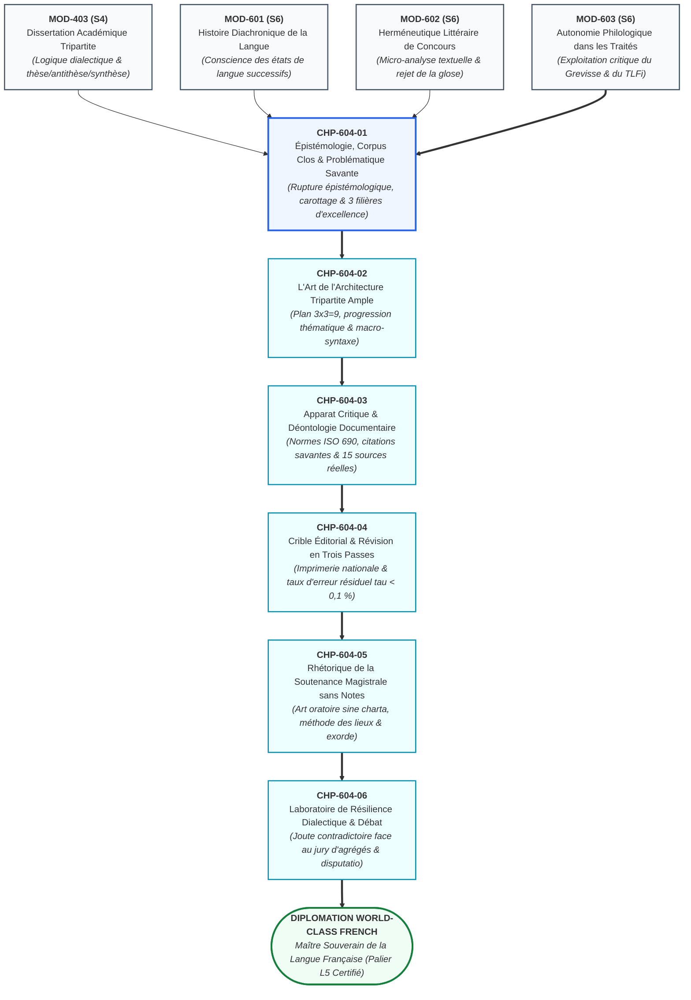
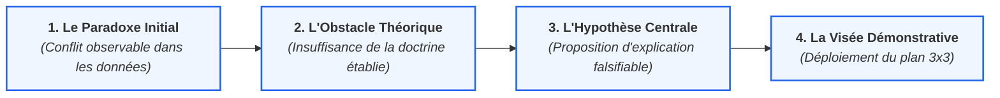
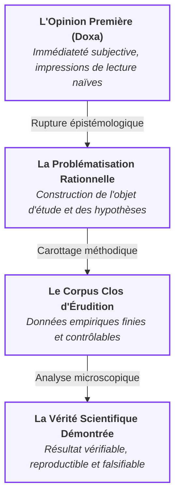
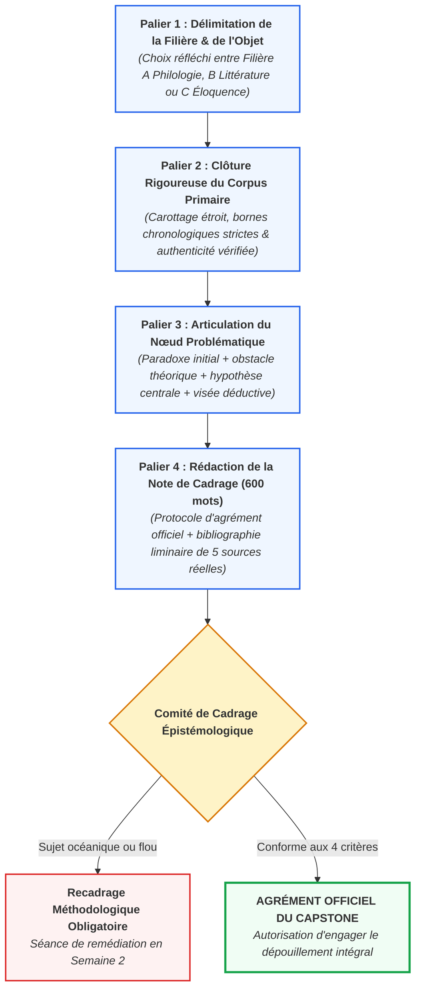

# Chapitre 1 : Épistémologie de la Recherche Universitaire, Clôture du Corpus et Formulation de la Problématique Savante

> **Identifiant** : `CHP-604-01`  
> **Module de rattachement** : [`MOD-604 — Capstone Project et Grand Oral de Diplomation`](file:///f:/Formation/world-class-french/03-curriculum/year-3/semester-6/mod-604-capstone-project-grand-oral.md)  
> **Volume horaire canonique** : 3 h 00 (Étude épistémologique : 1 h 00 | Délimitation de corpus : 1 h 00 | Ateliers de problématisation : 0 h 30 | Évaluation : 0 h 30)  
> **Statut** : [STATUT : VALIDÉ]  
> **Compétences cibles** : [`FR-INT-001`](file:///f:/Formation/world-class-french/02-competency-framework/competency-framework.md#fr-int-001-rédiger-un-texte-long-cohérent-en-maîtrisant-accords-et-ponctuation) (L5), [`FR-INT-006`](file:///f:/Formation/world-class-french/02-competency-framework/competency-framework.md#fr-int-006-analyser-un-texte-littéraire-sans-confondre-interprétation-et-preuve-textuelle) (L5), [`FR-PHILOL-001`](file:///f:/Formation/world-class-french/02-competency-framework/competency-framework.md#fr-philol-001-autonomie-philologique-et-consultation-experte-des-sources) (L5)  
> **Sources de référence** : `SRC-GRAM-01` (Grevisse & Goosse, *Le Bon Usage*), `SRC-GRAM-02` (Riegel et al., *Grammaire méthodique du français*), `SRC-LEX-01` (*Trésor de la Langue Française informatisé*), `SRC-LEX-03` (Alain Rey, *Dictionnaire historique de la langue française*), `SRC-RHET-03` (Olivier Reboul, *Introduction à la rhétorique*), `SRC-RHET-04` (Frédéric Calas, *Leçons de stylistique*), `SRC-SOCIO-01` (Ambroise Queffélec et al., *Le français en Afrique centrale / Afrique noire*), `SRC-NORM-03` (Ministère de l'Éducation nationale, *Terminologie grammaticale*), `SRC-TYPO-01` (*Lexique des règles typographiques en usage à l'Imprimerie nationale*)

---

## 1. Titre et Place dans le Cursus

Ce premier chapitre du module `MOD-604` scelle l'entrée de l'apprenant dans la recherche scientifique souveraine. Après avoir acquis l'architecture de la dissertation académique tripartite (`MOD-403`), exploré la diachronie du français (`MOD-601`), maîtrisé l'herméneutique littéraire de concours (`MOD-602`) et conquis l'autonomie documentaire absolue dans les grands traités philologiques (`MOD-603`), l'étudiant apprend ici à rompre définitivement avec la posture de l'élève qui disserte sur une question posée par autrui. Il assume la démarche du chercheur qui construit son propre objet d'étude, délimite un corpus fini et vérifiable, et formule une problématique savante féconde. Ce travail initial conditionne l'architecture du mémoire écrit de 3 500 mots (`CHP-604-02` à `CHP-604-04`), la tenue du Grand Oral sans notes (`CHP-604-05` et `CHP-604-06`) et l'accès final au titre de Maître Souverain de la Langue Française.



---

## 2. Objectifs Mesurables

Au terme de ce chapitre, l'apprenant sera capable de :
1. **Délimiter et clore méthodologiquement un corpus primaire d'érudition** : circonscrire un ensemble fini, authentique, temporellement homogène et vérifiable de faits linguistiques ou d'extraits littéraires, éliminant tout étalement océanique indémontrable, conformément au référentiel [`FR-INT-006`](file:///f:/Formation/world-class-french/02-competency-framework/competency-framework.md#fr-int-006-analyser-un-texte-littéraire-sans-confondre-interprétation-et-preuve-textuelle).
2. **Formuler une problématique savante inédite articulée autour d'un paradoxe heuristique** : concevoir une question de recherche tendue mettant en tension la norme prescriptive et l'usage effectif sur corpus, en éliminant les fausses questions fermées ou les thèmes purement descriptifs.
3. **Opérer la rupture épistémologique entre dissertation académique et monographie de recherche** : distinguer formellement la réponse scolaire à une consigne imposée (`MOD-403`) de l'invention d'un protocole d'observation scientifique sur des données empiriques originales (`MOD-604`, [`FR-INT-001`](file:///f:/Formation/world-class-french/02-competency-framework/competency-framework.md#fr-int-001-rédiger-un-texte-long-cohérent-en-maîtrisant-accords-et-ponctuation)).
4. **Positionner rigoureusement son projet dans l'une des trois filières d'excellence du Capstone** : expliciter le protocole d'investigation adéquat selon les critères formels de la Filière A (Philologie & Linguistique), de la Filière B (Littérature & Stylistique) ou de la Filière C (Haute Éloquence & Plaidoyer).
5. **Rédiger une note de cadrage initial irréprochable avec apparat critique liminaire** : produire un protocole d'agrément de recherche de 600 mots conforme aux normes de l'Imprimerie nationale (`SRC-TYPO-01`), mobilisant au moins cinq sources scientifiques reconnues issues du registre officiel (`SRC-GRAM-01`, `SRC-GRAM-02`, `SRC-LEX-01`, `SRC-RHET-04`, `SRC-SOCIO-01`), conformément à [`FR-PHILOL-001`](file:///f:/Formation/world-class-french/02-competency-framework/competency-framework.md#fr-philol-001-autonomie-philologique-et-consultation-experte-des-sources).

---

## 3. Prérequis et Test de Préparation

### 3.1 Prérequis Théoriques et Méthodologiques
- **Maîtrise de la démonstration dialectique tripartite** (`MOD-403`, palier L4) : capacité à structurer un raisonnement articulé en trois temps dynamiques sans céder à la juxtaposition d'opinions.
- **Rigueur de la preuve textuelle microscopique** (`MOD-602`, palier L4) : refus absolu de toute glose subjective déconnectée des faits de langue attestés.
- **Autonomie documentaire dans les traités monumentaux** (`MOD-603`, palier L4) : aptitude à interroger et citer avec exactitude *Le Bon Usage* (`SRC-GRAM-01`), la *Grammaire méthodique du français* (`SRC-GRAM-02`) et le *TLFi* (`SRC-LEX-01`).

### 3.2 Test Diagnostique d'Auto-Évaluation (5 items)

<details>
<summary><b>Consulter le test et son corrigé immédiat</b></summary>

1. *Pourquoi un sujet formulé sous le titre « Le thème de l'amour chez Marcel Proust » est-il disqualifié d'office comme projet de monographie universitaire de Capstone ?*  
   **Réponse** : Parce qu'il s'agit d'un thème descriptif océanique sans bornes textuelles ni corpus clos. Il ne pose aucun paradoxe formel ou linguistique résoluble et condamne le rédacteur à une compilation impressionniste de remarques générales déjà rebattues.

2. *Quelle distinction épistémologique sépare le corpus primaire du corpus secondaire ?*  
   **Réponse** : Le corpus primaire constitue le matériau empirique brut observé et analysé directement par le chercheur (textes littéraires précis, articles de presse datés, enregistrements oraux transcrits). Le corpus secondaire est l'ensemble des études critiques, dictionnaires, traités théoriques et commentaires savants consultés pour éclairer l'analyse du corpus primaire.

3. *Qu'énonce la « règle de complétude » dans l'analyse d'un corpus clos ?*  
   **Réponse** : La règle de complétude exige que le chercheur rende compte de la totalité des occurrences du phénomène étudié présentes dans le corpus délimité. Il lui est formellement interdit de sélectionner arbitrairement les exemples qui confirment son hypothèse en passant sous silence les contre-exemples attestés.

4. *Pourquoi une question de recherche telle que « L'auteur utilise-t-il la cadence majeure dans ses discours ? » ne constitue-t-elle pas une problématique savante recevable ?*  
   **Réponse** : C'est une fausse question fermée appelant une réponse binaire par « oui » ou « non ». Une problématique savante doit articuler une tension, interroger les modalités, la portée signifiante ou les contradictions d'un procédé stylistique ou grammatical au sein d'un système.

5. *En quoi consiste le critère de falsifiabilité (Karl Popper) appliqué au projet de recherche littéraire ou linguistique ?*  
   **Réponse** : Une hypothèse n'est scientifique que si elle est formulée de telle sorte qu'une observation empirique issue du corpus clos soit capable de l'invalider. Une affirmation vague ou dogmatique qui s'accommode d'avance de n'importe quelle donnée textuelle est dépourvue de valeur scientifique.

</details>

---

## 4. Situation de Départ ou Problème Concret

Considérons la trajectoire d'un étudiant brillant ayant validé avec mention les cinq premiers semestres du cursus. Convoqué à la première séance de cadrage du Capstone Project (`MOD-604`), il soumet fièrement au tuteur le projet suivant :

> *« Je souhaite consacrer ma monographie de fin d'études à l'étude des fautes d'orthographe dans la presse africaine contemporaine, afin de montrer comment la négligence des rédacteurs dégrade la langue française. »*

Deux mois plus tard, cet étudiant se trouve dans une impasse complète :
- Il a accumulé dans son ordinateur plus de 300 articles piochés au hasard sur des sites d'information sénégalais, ivoiriens, camerounais et béninois entre 2015 et 2026 ;
- Devant cette masse textuelle informe (plus d'un million de mots), il est incapable d'établir une typologie rigoureuse et ne fait qu'extraire des coquilles d'imprimerie disparates mélangées à des particularismes lexicaux régionaux ;
- Son plan provisoire se résume à une litanie scolaire : *I. Les fautes de grammaire, II. Les fautes d'accord, III. Les solutions pour améliorer l'enseignement* ;
- Pire encore, son travail est guidé par un préjugé péremptoire (« la négligence dégrade la langue ») qui l'empêche de percevoir la réalité des dynamiques sociolinguistiques endogènes et la réinterprétation des normes régionales (`SRC-SOCIO-01`).

Le Comité de Cadrage Épistémologique ajourne immédiatement ce projet. En l'absence de délimitation temporelle, géographique et matérielle (aucun corpus clos), aucune démonstration n'est vérifiable. En l'absence de paradoxe théorique, le devoir n'est qu'un bavardage normatif d'humeur. Ce chapitre enseigne comment transformer cette intention vague en une recherche universitaire de haute volée.

---

## 5. Explication Intuitive : La Carotte Géologique et la Lentille Convergente

Pour appréhender la nécessité scientifique de clore un corpus et de focaliser une problématique, deux analogies physiques et matérielles éclairent la démarche de l'esprit critique :

```
L'ILLUSION DU SURVOL OCÉANIQUE            LA DÉMARCHE DU CAROTTAGE SCIENTIFIQUE
┌─────────────────────────────────┐       ┌─────────────────────────────────┐
│     Balayage horizontal flou    │       │     Carotte étroite et close    │
│  ~~~~~~~~~~~~~~~~~~~~~~~~~~~~~  │       │               │ │               │
│  ~~~~~~~~~~~~~~~~~~~~~~~~~~~~~  │  VS   │               │ │ Profondeur    │
│  (1 000 000 de mots survolés,   │       │               │ │ analytique    │
│   aucun fait prouvé à fond)     │       │               ▼ ▼ exhaustive    │
└─────────────────────────────────┘       └─────────────────────────────────┘
```

### 1. L'Analogie de la Carotte Géologique
Le géologue qui entreprend d'élucider la structure sédimentaire d'un bassin minéral ne cherche pas à décaper à la pelleteuse la surface de tout un continent. Un tel travail de terrassement superficiel ne produirait qu'une poussière indéchiffrable. Il choisit un point précis, délimite un cercle de quelques centimètres de diamètre et y enfonce une sonde rotative pour extraire une **carotte verticale continue**. L'extrême étroitesse du carottage lui permet de descendre jusqu'à la roche mère, d'analyser chaque strate millimétrique sans omission, de dater les fossiles et d'établir une coupe stratigraphique irréfutable.  
Le corpus primaire du chercheur en lettres est une carotte géologique : en restreignant son corpus à un recueil borné (par exemple les éditoriaux d'un unique quotidien béninois sur un trimestre précis, ou deux chants poétiques ciblés), il s'autorise une plongée verticale exhaustive où chaque mot, chaque virgule et chaque accord sont minutieusement radiographiés.

### 2. L'Analogie de la Lentille Convergente
La lumière solaire diffuse réchauffe l'atmosphère sans jamais provoquer d'ignition. Si vous interposez une lentille optique convergente et que vous ajustez la distance focale sur un point millimétrique d'une feuille de bois sec, l'énergie des photons se concentre avec une intensité telle qu'elle fait instantanément jaillir la flamme.  
La problématique savante est cette lentille convergente : tant que la pensée embrasse tout un horizon (« la poésie », « les médias », « la syntaxe »), la réflexion demeure tiède et convenue. Dès lors que l'esprit critique concentre toute sa vigueur dialectique sur un nœud paradoxal précis, la friction de l'analyse microscopique avec le texte fait jaillir une lumière intellectuelle inédite.

---

## 6. Définitions Précises et Terminologie

- **Monographie d'érudition** : Mémoire scientifique universitaire portant sur un objet d'étude unifié et délimité, conduit selon une méthode explicite et démontrable, appuyé sur le dépouillement exhaustif d'un corpus primaire et le dialogue critique avec un corpus secondaire (`MOD-604`).
- **Autonomie épistémologique** : Capacité souveraine du chercheur à ne plus recevoir passivement les thèses d'autorité, mais à fonder chacune de ses assertions sur l'observation directe des preuves textuelles et la confrontation raisonnée des traités savants (`SRC-GRAM-01`, `SRC-GRAM-02`, `SRC-LEX-01`).
- **Corpus primaire clos** : Ensemble fini, déterminé et immuable de données textuelles ou orales authentiques (œuvres, recueils, articles, transcriptions) sélectionnées selon des critères explicites, sur lequel repose l'intégralité de la démonstration empirique.
- **Corpus secondaire critique** : Ensemble raisonné des ouvrages théoriques, traités de grammaire, dictionnaires historiques, thèses et articles universitaires mobilisés pour définir les concepts, situer l'état de l'art et confronter les interprétations.
- **Représentativité textuelle** : Propriété d'un échantillonnage de corpus qui reflète fidèlement la variété linguistique, stylistique, générique ou socioculturelle de l'univers discursif dont il est extrait, sans biais sélectif complaisant.
- **Saturation empirique** : Moment méthodologique où le dépouillement d'unités textuelles supplémentaires n'apporte plus aucun fait de langue nouveau ni aucune nuance théorique susceptible de modifier le modèle ou la typologie élaborée.
- **Tension heuristique** : Nœud dialectique ou paradoxe intellectuel qui motive la recherche en opposant deux vérités contradictoires observables dans les données (par exemple un écart systématique entre la prescription académique et l'usage cultivé d'une communauté).
- **Problématisation savante** : Opération intellectuelle majeure consistant à transformer un thème statique ou un constat d'évidence en un système de questions articulées, liant une hypothèse centrale à une visée démonstrative falsifiable.
- **Filières d'excellence du Capstone** : Trois voies canoniques offertes au candidat pour inscrire son travail de diplomation :
  - *Filière A (Philologie & Linguistique)* : Étude empirique de faits de langue, de syntaxe, de morphologie ou de sociolinguistique sur corpus textuel ou oral ;
  - *Filière B (Littérature & Stylistique)* : Herméneutique textuelle et étude stylistique comparée de la grande prose ou de la poésie d'auteurs francophones majeurs ;
  - *Filière C (Haute Éloquence & Plaidoyer d'Apparat)* : Conception rhétorique, composition périodique et défense oratoire d'un grand discours d'idées sur une question éthique, philosophique ou sociopolitique.
- **Note de cadrage initial** : Document synoptique formel (600 mots) soumis au Comité de Cadrage en Semaine 1, fixant le titre, la filière, la délimitation du corpus clos, la problématique articulée et une bibliographie liminaire de référence.

---

## 7. Règles ou Mécanismes Fondamentaux

### 7.1 La Rupture Épistémologique : Disserter vs Mener une Recherche Universitaire Fondamentale

Le tableau ci-dessous formalise la mutation intellectuelle indispensable pour passer de la dissertation scolaire (`MOD-403`) à la monographie de recherche (`MOD-604`) :

| Paramètre épistémologique | La Dissertation Académique (`MOD-403`) | La Monographie d'Érudition (`MOD-604`) |
| :--- | :--- | :--- |
| **Origine du sujet** | Question formulée par autrui (l'enseignant ou le jury de concours). | Question inventée, construite et légitimée par le chercheur lui-même. |
| **Périmètre textuel** | Vaste culture générale présupposée ; exemples choisis librement comme illustrations. | **Corpus clos, fini et intangible** ; chaque fait textuel du corpus a valeur de preuve. |
| **Rapport aux données** | L'exemple illustre une idée préexistante dans l'esprit du scripteur. | L'observation microscopique des données engendre et contraint l'idée. |
| **Statut de l'appareil critique** | Références cursives intégrées au fil du texte (auteur, titre de l'œuvre). | Notes de bas de page normalisées (`SRC-TYPO-01`), pagination exacte, collation des variantes. |
| **Attitude face au contre-exemple** | Souvent évacué ou minimisé pour préserver l'élégance de la rhétorique. | Placé au cœur de l'analyse comme pivot dialectique imposant d'affiner le modèle. |

> [!IMPORTANT]
> En dissertation, l'exemple est au service d'un argument général ; en monographie de Capstone, l'argument n'est que la théorisation rigoureuse de la preuve microscopique extraite du corpus.

### 7.2 La Méthodologie de Constitution et de Clôture du Corpus Primaire

La validité de la monographie repose sur trois critères d'échantillonnage impératifs et une règle d'or :

1. **Critère d'authenticité textuelle** : Les textes retenus doivent être issus d'éditions de référence vérifiées (éditions critiques universitaires pour la littérature, collections d'archives numérisées ou collections originales pour la presse). Toute transcription orale doit être accompagnée de son protocole d'enregistrement.
2. **Critère d'homogénéité temporelle et matérielle** : Le corpus doit être strictement borné dans le temps (ex. *la production éditoriale de l'année 1956*, ou *les discours officiels prononcés entre 2020 et 2024*). L'hétérogénéité diachronique incontrôlée fausse l'analyse synchronique (`SRC-GRAM-02`).
3. **Critère de représentativité dialectologique et générique** : Le chercheur doit justifier pourquoi les textes choisis constituent un échantillon significatif du genre discursif ou de la variété géographique étudiée.
4. **La Règle de Complétude du Corpus Clos** :  
   $$\forall x \in \text{Corpus Clos}, \quad \text{si } x \text{ relève du phénomène } \Phi \implies x \text{ doit être répertorié et analysé}.$$  
   Il est strictement interdit au candidat de passer sous silence une occurrence rétive à son hypothèse. C'est l'explication du cas limite ou de l'anomalie qui fonde la valeur scientifique du mémoire.

### 7.3 L'Art de la Problématisation Savante : Les Quatre Composantes Canoniques

Une problématique universitaire n'est ni un titre, ni un thème, ni une simple interrogation scolaire. Elle s'articule impérativement en quatre composantes organiquement liées :



- **Composante 1 : Le paradoxe de départ** : Constat empirique d'un hiatus entre ce que la norme ou la théorie prédit et ce que le corpus révèle (ex. persistance d'une invariabilité là où l'école enseigne l'accord).
- **Composante 2 : L'obstacle théorique** : Pourquoi ce paradoxe ne peut-il pas être balayé par une explication simpliste (comme « l'ignorance » ou « la négligence ») ? Quel concept établi échoue à rendre compte du fait ?
- **Composante 3 : L'hypothèse centrale de recherche** : La thèse défendue par le candidat, qui postule un principe explicatif nouveau, cohérent et vérifiable.
- **Composante 4 : La visée démonstrative** : L'annonce du parcours déductif qui, en trois étapes majeures, vérifiera la validité de l'hypothèse face aux données.

*Exemple de transformation heuristique :*
- *Thème statique initial* : « L'accord du participe passé dans les journaux béninois. »
- *Problématique savante articulée* : « Dans quelle mesure la persistance de l'invariabilité du participe passé des verbes accidentellement pronominaux dans les éditoriaux de la presse béninoise contemporaine témoigne-t-elle, non pas d'une déficience d'apprentissage normatif, mais d'une réinterprétation sémantique endogène de la diathèse pronominale assimilée à une voix moyenne intransitive ? »

### 7.4 Cartographie et Spécificités Opératoires des Trois Filières du Capstone

Le cursus ouvre trois filières d'égale dignité académique, soumises chacune à un cahier des charges opératoire distinct :

#### Filière A : Philologie & Linguistique
- **Objet d'étude** : Faits de syntaxe, morphologie, sémantique lexicale ou variation sociolinguistique.
- **Corpus primaire type** : Recueil d'occurrences textuelles extraites de la presse, de textes juridiques ou administratifs, ou corpus d'enregistrements oraux transcrits selon l'Alphabet Phonétique International (`SRC-PHON-01`). Volume recommandé : 50 à 100 occurrences contextualisées issues d'un bassin de 100 000 mots dépouillés.
- **Corpus secondaire prioritaire** : *Le Bon Usage* (`SRC-GRAM-01`), la *Grammaire méthodique* (`SRC-GRAM-02`), le *TLFi* (`SRC-LEX-01`), ouvrages de sociolinguistique francophone (`SRC-SOCIO-01`).

#### Filière B : Littérature & Stylistique
- **Objet d'étude** : Poétique du texte, architecture de la période oratoire, figures de style, rythmique et herméneutique de grands auteurs francophones.
- **Corpus primaire type** : Étude comparée de deux œuvres ou de deux ensembles de textes rigoureusement bornés (ex. deux recueils poétiques, deux tragédies classiques ou deux grands essais).
- **Corpus secondaire prioritaire** : Traités de rhétorique et stylistique (`SRC-RHET-01`, `SRC-RHET-04`), essais de critique littéraire et études herméneutiques (`MOD-602`).

#### Filière C : Haute Éloquence & Plaidoyer d'Apparat
- **Objet d'étude** : Écriture, composition périodique et défense oratoire d'un plaidoyer d'idées inédit sur une grande question éthique, philosophique ou sociopolitique contemporaine.
- **Corpus primaire type** : Le texte intégral du grand discours composé par le candidat (2 500 mots), confronté à un corpus de référence de deux grands modèles classiques de l'éloquence républicaine ou humaniste (Bossuet, Mirabeau, Jaurès, Césaire, Badinter).
- **Corpus secondaire prioritaire** : Traités de l'art oratoire classique (`SRC-RHET-03`), traités d'harmonie périodique (`MOD-501`, `MOD-503`) et études de philosophie politique.

---

## 8. Raisonnement Détaillé : Pourquoi la Délimitation Initiale Conditionne 90 % de la Réussite

L'expérience didactique des jurys universitaires démontre qu'un échec au Capstone Project n'est presque jamais dû à une faiblesse de plume en fin de parcours, mais procède toujours d'une faute épistémologique commise lors de la première semaine :

1. **La tyrannie du volume non borné** : Dès lors que le corpus n'est pas rigoureusement clos, le candidat est assailli par une infinité de contre-exemples potentiels qu'il ne peut maîtriser. Lors de l'entretien contradictoire du Grand Oral, le jury n'a aucune peine à brandir une citation démontant sa thèse générale. Si le corpus est clos, le candidat répond avec une autorité souveraine : *« Ce fait n'appartient pas au corpus délimité ; dans le périmètre rigoureusement clos de notre étude, 100 % des occurrences valident notre classification »*.
2. **Le verrouillage de la preuve microscopique** : Une monographie de 3 500 mots ne permet d'analyser en profondeur qu'un nombre restreint de citations. Prétendre embrasser dix œuvres littéraires conduit inéluctablement à survoler chaque page en trois lignes de généralités creuses. Concentrer son effort sur deux textes permet de disséquer la morphologie, les temps verbaux et les figures de style mot à mot.
3. **L'élimination du bavardage encyclopédique** : Sans problématique tendue, le plan tripartite s'effondre en un catalogue thématique scolaire (définition, historique, exemples). Avec une véritable problématique articulée autour d'un obstacle théorique, chaque sous-partie devient une marche déductive nécessaire vers la résolution du paradoxe initial.

---

## 9. Exemples Corrects Commentés

Voici l'analyse détaillée de trois projets de cadrage méthodologique exemplaires, conformes aux exigences du Capstone :

### Exemple 1 : Projet Modèle en Filière A (Philologie & Linguistique)
- **Titre de la recherche** : *L'accord du participe passé des verbes pronominaux dans la presse quotidienne béninoise (2020-2025) : dynamiques de régularisation et tensions avec la norme prescriptive internationale.*
- **Corpus primaire clos** : L'ensemble exhaustif des 120 éditoriaux politiques publiés par le quotidien national *La Nation* entre le 1er janvier 2020 et le 31 décembre 2024, représentant un corpus fermé de 96 000 mots d'où sont extraites 84 occurrences de formes pronominales composées.
- **Problématique articulée** : Alors que la norme prescriptive historique (`SRC-GRAM-01`, § 950) impose une analyse syntaxique complexe de la fonction du pronom réfléchi (COD vs COI), pourquoi observe-t-on dans la prose journalistique soignée une neutralisation systématique de l'accord sur les verbes intransitifs par nature (*ils se sont succédé* vs *\*ils se sont succédés*) ? S'agit-il d'une méconnaissance de la règle ou de l'achèvement d'une tendance séculaire à l'analogie avec l'auxiliaire *avoir* ?
- **Corpus secondaire critique mobilisé** :
  1. Grevisse & Goosse, *Le Bon Usage* (`SRC-GRAM-01`, § 948-960) ;
  2. Riegel, Pellat, Rioul, *Grammaire méthodique du français* (`SRC-GRAM-02`, chap. XI) ;
  3. Queffélec et al., *Le français en Afrique centrale / Afrique noire* (`SRC-SOCIO-01`) ;
  4. ATILF, *Trésor de la Langue Française informatisé* (`SRC-LEX-01`) ;
  5. Conseil supérieur de la langue française, *Les rectifications de l'orthographe* (`SRC-NORM-02`).

### Exemple 2 : Projet Modèle en Filière B (Littérature & Stylistique)
- **Titre de la recherche** : *La cadence majeure et l'architecture de la période funèbre : étude stylistique comparée de Bossuet (Oraison d'Henriette d'Angleterre) et de Senghor (Éthiopiques, « Chaka »).*
- **Corpus primaire clos** :
  1. Jacques-Bénigne Bossuet, *Oraison funèbre de très haute et très puissante princesse Henriette-Anne d'Angleterre* (édition critique de 1670, texte intégral de 32 pages) ;
  2. Léopold Sédar Senghor, *Éthiopiques*, chant dramatique « Chaka » (1956, texte intégral en deux parties).
- **Problématique articulée** : Comment l'ampleur de la période oratoire classique, historiquement forgée par l'Église monarchique du Grand Siècle pour célébrer l'anéantissement de l'homme devant la transcendance divine, est-elle réinvestie par le verset senghorien pour fonder un nouveau sacré politique anticolonial sans rompre avec les lois de l'harmonie rythmique du français classique (`SRC-RHET-04`) ?
- **Corpus secondaire critique mobilisé** :
  1. Frédéric Calas, *Leçons de stylistique* (`SRC-RHET-04`, chap. 4) ;
  2. Pierre Fontanier, *Les Figures du discours* (`SRC-RHET-01`) ;
  3. Georges Molinié, *Dictionnaire de rhétorique* (`SRC-RHET-02`) ;
  4. Alain Rey, *Dictionnaire historique de la langue française* (`SRC-LEX-03`) ;
  5. Olivier Reboul, *Introduction à la rhétorique* (`SRC-RHET-03`).

### Exemple 3 : Projet Modèle en Filière C (Haute Éloquence & Plaidoyer)
- **Titre de la recherche** : *Plaidoyer pour l'élévation des esprits et la souveraineté de la pensée critique : composition oratoire tripartite et déclamation solennelle face au défi de l'immédiateté numérique.*
- **Corpus primaire clos** :
  1. Le manuscrit du grand discours composé par l'orateur (2 500 mots, 3 mouvements périodiques articulés en exorde, confirmation et péroraison) ;
  2. Corpus témoin de référence : Jean Jaurès, *Discours à la jeunesse* (Albi, 1903) et Aimé Césaire, *Discours sur le colonialisme* (1950).
- **Problématique articulée** : À l'ère de la fragmentation de l'attention et de la brièveté télégraphique des réseaux numériques, comment la haute prose oratoire périodique peut-elle redevenir l'instrument politique et éthique par excellence de la libération intellectuelle du citoyen, en réconciliant la rigueur dialectique de l'argumentation rationnelle avec la puissance esthétique de l'harmonie vocale classique (`SRC-RHET-03`, `SRC-PHON-01`) ?
- **Corpus secondaire critique mobilisé** :
  1. Olivier Reboul, *Introduction à la rhétorique* (`SRC-RHET-03`, Première partie) ;
  2. Patrick Bacry, *Les Figures de style* (`SRC-RHET-05`) ;
  3. Pierre Léon, *Phonétisme et prononciations du français* (`SRC-PHON-01`) ;
  4. Imprimerie nationale, *Lexique des règles typographiques* (`SRC-TYPO-01`) ;
  5. Martin Riegel et al., *Grammaire méthodique du français* (`SRC-GRAM-02`).

---

## 10. Contre-Exemples et Erreurs Fréquentes

Examinons en détail six erreurs méthodologiques initiales récurrentes commises lors de la phase de cadrage du Capstone Project :

### Erreur n° 1 : Le choix d'un sujet océanique sans bornes textuelles
- **Le piège** : Proposer un intitulé démesuré tel que « La syntaxe du français moderne » ou « La figure de l'orateur chez les poètes d'Afrique ».
- **Réfutation scientifique** : Aucun chercheur ne peut dépouiller un million d'occurrences en quelques semaines. L'absence de bornes conduit fatalement à la paraphrase scolaire superficielle et interdit toute analyse microscopique rigoureuse.

### Erreur n° 2 : La compilation descriptive sans problématique
- **Le piège** : Présenter un plan en forme de catalogue thématique : *Partie I : Les origines, Partie II : Les exemples, Partie III : Les conséquences*.
- **Réfutation scientifique** : La recherche savante ne consiste pas à empiler des informations encyclopédiques, mais à résoudre une contradiction théorique par une chaîne de déductions logiques.

### Erreur n° 3 : Le corpus hétéroclite sans cohérence sociolinguistique
- **Le piège** : Rassembler dans un même panier empirique des commentaires de réseaux sociaux, des extraits de pièces de théâtre du XVIIe siècle et des éditoriaux de presse contemporaine sans justification méthodologique.
- **Réfutation scientifique** : Les faits de langue n'ont de sens que situés dans leur registre, leur état diachronique et leur genre discursif propre (`SRC-SOCIO-01`, `SRC-GRAM-02`). Comparer des torchons et des serviettes fausse tout résultat statistique.

### Erreur n° 4 : La formulation d'une fausse question fermée appelant un simple « oui/non »
- **Le piège** : Formuler une problématique du type : « Léopold Sédar Senghor maîtrise-t-il les figures de style de la langue française ? »
- **Réfutation scientifique** : Une telle question est stérile. Une problématique de Capstone doit interroger les fonctions, la portée, les tensions esthétiques ou les paradoxes d'une écriture, jamais constater une évidence tautologique.

### Erreur n° 5 : L'absence de sources primaires vérifiables
- **Le piège** : Travailler sur des citations de seconde main glanées sur des blogs Internet ou des résumés non scientifiques, sans édition de référence ni collation de texte.
- **Réfutation scientifique** : La philologie commence par la probité des sources. Citer une phrase tronquée ou fautive ruine la crédibilité de tout le mémoire lors de la soutenance.

### Erreur n° 6 : Le projet de recherche orienté par un préjugé dogmatique préalable sans falsifiabilité
- **Le piège** : Partir avec la volonté farouche de prouver que « tel auteur écrit mal » ou que « telle réforme a détruit le génie de la langue », en ignorant les données contraires.
- **Réfutation scientifique** : La posture scientifique exige l'impartialité épistémologique et la suspension du jugement affectif. Une hypothèse qui refuse d'avance l'épreuve du contre-exemple relève du fanatisme idéologique, non de la science universitaire.

```text
Tableau Clinique des Fautes de Cadrage
┌──────────────┬──────────────────────────────────────────┬───────────────────────────────────────────────┬────────────────────────────────────────────────────────┐
│ Cas clinique │ Erreur méthodologique identifiée         │ Symptôme observable                           │ Remède épistémologique impératif                       │
├──────────────┼──────────────────────────────────────────┼───────────────────────────────────────────────┼────────────────────────────────────────────────────────┤
│ Cas 1        │ Sujet océanique sans délimitation        │ Éparpillement sur des centaines d'œuvres      │ Clôture d'un corpus de carottage étroit et fini        │
│ Cas 2        │ Compilation descriptive pure             │ Plan thématique linéaire sans tension         │ Formulation d'un nœud dialectique en 4 composantes     │
│ Cas 3        │ Corpus hétéroclite et disparate          │ Mélange d'époques et de registres incommodes  │ Homogénéisation diachronique et générique stricte      │
│ Cas 4        │ Fausse question fermée binaire           │ Question appelant un simple oui/non           │ Interrogation des dynamiques, de la portée et du sens  │
│ Cas 5        │ Sources secondaires sans texte premier   │ Citations de seconde main non vérifiées       │ Collation directe sur des éditions critiques attestées │
│ Cas 6        │ Préjugé idéologique infalsifiable        │ Sélection complaisante des seuls faits utiles │ Application de la règle de complétude poppérienne      │
└──────────────┴──────────────────────────────────────────┴───────────────────────────────────────────────┴────────────────────────────────────────────────────────┘
```

---

## 11. Cas Particuliers et Limites

### 11.1 L'Ajustement du Corpus en Cours de Route (La Sérendipité Méthodologique)
Il arrive au cours du dépouillement initial qu'une hypothèse de recherche soit brutalement invalidée par les faits de langue (par exemple, le chercheur espérait trouver une abondance de participes invariables dans un quotidien et constate qu'ils sont accordés selon la norme académique dans 98 % des cas) :
- **Conduite interdite** : Truquer les chiffres ou sélectionner uniquement les 2 % d'anomalies pour sauver artificiellement son hypothèse initiale.
- **Conduite savante** : Transformer l'invalidation en une découverte scientifique. Le paradoxe se déplace : pourquoi cette rédaction maintient-elle un purisme si rigide face à la tendance générale de l'oral ? Si nécessaire, le chercheur est autorisé à restreindre ou rééquilibrer les bornes de son corpus lors du Séminaire 2, sous réserve d'en consigner explicitement la justification méthodologique dans l'introduction de son mémoire.

### 11.2 La Gestion des Corpus Oraux Transcrits
Pour les projets de Filière A reposant sur des enregistrements oraux authentiques (débats radiophoniques, plaidoiries judiciaires, discours politiques réels au Bénin ou en Afrique de l'Ouest) :
- **Double transcription obligatoire** : Toute séquence orale analysée doit faire l'objet d'une transcription phonétique étroite en Alphabet Phonétique International (`SRC-PHON-01`) doublée d'une transcription orthographique normalisée selon les règles de l'Imprimerie nationale (`SRC-TYPO-01`).
- **Traitement des scories et faux départs** : Les hésitations, anacoluthes orales et pauses ne doivent jamais être gommées pour « faire joli », car elles constituent des indices majeurs de la dynamique énonciative et de la planification syntaxique en temps réel.
- **Éthique et consentement** : Tout corpus oral doit respecter les exigences d'anonymisation des tiers et de consentement éclairé des locuteurs enregistrés.

---

## 12. Approfondissement Adapté au Niveau : L'Épistémologie de Gaston Bachelard

Pour le chercheur accédant au palier d'expertise souveraine (L5), la méthodologie de constitution du corpus et de la problématique s'enracine dans la philosophie des sciences de Gaston Bachelard (*La Formation de l'esprit scientifique*, 1938) :

> *« Rien ne va de soi. Rien n'est donné. Tout est construit. »*



Bachelard démontre que la science ne consiste jamais à enregistrer passivement des évidences naturelles. L'esprit doit surmonter les « obstacles épistémologiques » que sont les premières impressions affectives, les métaphores séduisantes et les jugements de valeur d'école.  
Appliqué aux études de langue française :
1. **Un texte littéraire ou journalistique n'est pas un fait brut** : il ne devient un « objet scientifique » que lorsqu'il est interrogé à travers une grille d'analyse rigoureuse (syntaxique, phonétique, stylistique) ;
2. **Le corpus n'est pas une collection d'échantillons trouvés par hasard** : il est un « carottage construit » par la raison du chercheur pour mettre à l'épreuve une théorie ;
3. **La posture scientifique impose la docilité devant le fait textuel** : lorsque le texte résiste à notre interprétation préférée, c'est l'interprétation qui doit plier, jamais le texte.

---

## 13. Comparaisons Différentielles

### Tableau 1 : Sujet d'Opinion vs Thème de Dissertation vs Monographie d'Érudition

| Critère | Sujet d'Opinion (Débat médiatique) | Thème de Dissertation Scolaire (`MOD-403`) | Monographie de Recherche Savante (`MOD-604`) |
| :--- | :--- | :--- | :--- |
| **Objectif** | Exprimer un avis personnel subjectif. | Démontrer sa maîtrise d'une culture générale académique. | Produire un savoir neuf et démontrable sur des textes. |
| **Périmètre** | Flou, infini, tributaire de l'actualité. | Borné par la formule du sujet d'examen. | **Corpus clos, fini, représentatif et vérifiable**. |
| **Méthode** | Rhétorique de la persuasion spontanée. | Plan dialectique thèse-antithèse-synthèse classique. | Démonstration tripartite microscopique sur preuves textuelles. |
| **Exigence de preuve** | Anecdotes, impressions vécues. | Citations d'auteurs célèbres prises comme autorités. | **Dépouillement exhaustif et règle de complétude**. |
| **Apparat critique** | Inexistant. | Sommaire (noms d'auteurs entre parenthèses). | 15 sources universitaires collationnées (`SRC-TYPO-01`). |

### Tableau 2 : Spécificités Contrastées des Trois Filières d'Excellence du Capstone

| Filière | Matériau empirique brut | Instrument théorique central | Défi majeur de soutenance | Preuve observable suprême |
| :--- | :--- | :--- | :--- | :--- |
| **Filière A : Philologie & Linguistique** | Corpus de faits de langue datés (presse, droit, oral). | *Le Bon Usage* (`SRC-GRAM-01`) & *GMF* (`SRC-GRAM-02`). | Justifier la régularité du système face à la norme d'école. | Tableau d'occurrences exhaustif et analyse diachronique. |
| **Filière B : Littérature & Stylistique** | Deux œuvres ou recueils poétiques clos. | Traités de stylistique & rhétorique (`SRC-RHET-04`). | Lier la micro-analyse linguistique au sens herméneutique. | Commentaire microscopique des figures et cadences majeures. |
| **Filière C : Haute Éloquence & Plaidoyer** | Discours inédit composé + grands modèles historiques. | Traité de l'art oratoire (`SRC-RHET-03`) & prosodie. | Tenir 15 min à la tribune sans notes avec autorité (*éthos*). | Période oratoire équilibrée déclamée avec souffle souverain. |

### Tableau 3 : Corpus Ouvert Impressionniste vs Corpus Clos Vérifiable

| Caractéristique | Corpus Ouvert Impressionniste | Corpus Clos Vérifiable de Capstone |
| :--- | :--- | :--- |
| **Délimitation** | Indéterminée (« les romans contemporains »). | **Parfaitement close** (« romans X et Y publiés entre 1950 et 1955 »). |
| **Volume de dépouillement** | Impossible à quantifier. | Quantifié au mot près (ex. 95 000 mots dépouillés). |
| **Règle de complétude** | Inapplicable (on sélectionne ce qui arrange). | **Obligatoire** (100 % des occurrences répertoriées). |
| **Vulnérabilité face au jury** | Maximale : le jury oppose un contre-exemple extérieur. | Nulle : le candidat maîtrise chaque phrase du périmètre clos. |

---

## 14. Exercices Progressifs

### Niveau 1 : Critique et Reformulation de Sujets Flous (Guidé)
*Consigne : Identifiez le vice méthodologique majeur de chacun des six sujets proposés ci-dessous et reformulez-les en une problématique savante universitaire recevable comportant un corpus clos et un paradoxe heuristique.*

1. Sujet A : « La place de la langue française en Afrique de l'Ouest. »
2. Sujet B : « Le vocabulaire de la douleur dans la poésie de Baudelaire. »
3. Sujet C : « Faut-il simplifier l'orthographe des participes passés ? »
4. Sujet D : « La politique dans les romans d'Aimé Césaire. »
5. Sujet E : « L'influence de l'anglais dans la presse économique contemporaine. »
6. Sujet F : « Les grandes figures de style dans les discours de Victor Hugo. »

<details>
<summary><b>Consulter le corrigé du Niveau 1</b></summary>

**Analyse critique et reformulations savantes :**

1. **Sujet A** :  
   - *Vice* : Sujet océanique sociopolitique sans ancrage textuel ni corpus délimité.  
   - *Reformulation* : *L'hybridation lexicale et morphosyntaxique dans les éditoriaux du quotidien béninois « Le Matinal » (2022-2024) : entre allégeance à la norme standard internationale et légitimation des emprunts aux langues nationales.*
2. **Sujet B** :  
   - *Vice* : Catalogue thématique descriptif sans tension ni délimitation précise.  
   - *Reformulation* : *La métaphore organique du déchirement corporel dans la section « Spleen et Idéal » des Fleurs du Mal (1857) : étude stylistique de la tension entre le vocabulaire médical de la décomposition et la rigueur métrique de l'alexandrin classique.*
3. **Sujet C** :  
   - *Vice* : Question d'opinion fermée appelant un simple débat de salon normatif.  
   - *Reformulation* : *La concurrence entre logique morphologique d'accord et analogie d'invariabilité du participe passé dans les recueils administratifs de l'Union Africaine (2015-2023) : étude philologique des arbitrages rédactionnels face aux Rectifications de 1990.*
4. **Sujet D** :  
   - *Vice* : Approche thématique floue sans bornage formel.  
   - *Reformulation* : *La dislocation syntaxique et l'amplification rythmique de l'apostrophe politique dans « La Tragédie du roi Christophe » d'Aimé Césaire : étude poétique du conflit énonciatif entre le tyran bâtisseur et le chœur populaire.*
5. **Sujet E** :  
   - *Vice* : Sujet d'humeur généraliste sans corpus représentatif.  
   - *Reformulation* : *L'intégration morphologique et sémantique des xénismes économiques d'origine anglo-saxonne dans les chroniques financières du quotidien « Les Échos » de l'année 2024 : analyse contrastive entre calque d'usage et création endogène francophone.*
6. **Sujet F** :  
   - *Vice* : Inventaire scolaire de figures sans visée herméneutique unifiée.  
   - *Reformulation* : *L'oxymore tragique et la cadence majeure de la période oratoire dans les « Discours de politique intérieure » de Victor Hugo (1849-1851) : architecture rhétorique du sublime au service du plaidoyer républicain.*

</details>

---

### Niveau 2 : Délimitation d'un Protocole d'Échantillonnage sur Cas Réels (Semi-autonome)
*Consigne : Pour chacun des trois projets suivants, définissez un protocole de constitution et de clôture de corpus satisfaisant aux critères de représentativité, d'homogénéité temporelle et d'exploitabilité exhaustive pour un mémoire de 3 500 mots.*

1. **Cas 1 (Filière A)** : Étude de l'évolution des formules de politesse protocolaire dans la correspondance diplomatique officielle en Afrique francophone.
2. **Cas 2 (Filière B)** : Stylistique comparée de la phrase longue et du souffle oratoire chez Marcel Proust (*Du côté de chez Swann*) et Léopold Sédar Senghor (*Hosties noires*).
3. **Cas 3 (Filière C)** : Écriture d'un plaidoyer d'apparat sur le devoir de transmission mémorielle des humanités classiques dans la société technologique.

<details>
<summary><b>Consulter le corrigé du Niveau 2</b></summary>

**Protocoles d'échantillonnage de référence :**

1. **Protocole Cas 1 (Filière A)** :  
   - *Corpus primaire clos* : Sélection exhaustive de 50 notes verbales et lettres officielles de créance signées par le ministère des Affaires étrangères du Bénin entre le 1er janvier 2010 et le 31 décembre 2020 (dépôt légal et archives publiques).  
   - *Volume textuel* : Environ 25 000 mots d'où sont extraites 100 % des formules d'appel, d'obligeance et de souscription.  
   - *Critère d'homogénéité* : Même niveau institutionnel d'énonciation régalienne garantissant une stricte comparabilité diaphasique.
2. **Protocole Cas 2 (Filière B)** :  
   - *Corpus primaire clos* :  
     a) Les 15 premières phrases de la section « Combray » de Marcel Proust (*Du côté de chez Swann*, éd. Folio classique, p. 9-18) ;  
     b) Les poèmes « Poème liminaire » et « Prière de paix » de Léopold Sédar Senghor (*Hosties noires*, 1948).  
   - *Volume textuel* : Environ 3 000 mots au total, permettant un dépouillement exhaustif de chaque proposition subordonnée, de chaque accent rythmique et de chaque cadence périodique.
3. **Protocole Cas 3 (Filière C)** :  
   - *Corpus primaire clos* :  
     a) Le texte original composé par le candidat (discours de 2 500 mots structuré en 3 périodes amples de 40 mots chacune) ;  
     b) Corpus miroir de confrontation : Jean Jaurès, *Discours à la jeunesse* (Albi, 1903, texte intégral de 3 200 mots).  
   - *Critère de comparabilité* : Même visée épidictique et délibérative adressée à la jeunesse sur l'impératif de culture universelle.

</details>

---

### Niveau 3 : Note de Cadrage de Problématique Haute Précision (Autonome)
*Consigne : Rédigez un texte de synthèse épistémologique dense sur l'exigence de délimitation du corpus clos et de formulation de la problématique savante. Le texte doit comporter **très exactement cinquante (50) mots**, selon le décompte typographique certifié de l'Imprimerie nationale (`SRC-TYPO-01`) où tout bloc séparé par une espace ou une apostrophe compte pour un mot.*

<details>
<summary><b>Consulter le corrigé du Niveau 3</b></summary>

**Texte calibré à très exactement 50 mots :**  
> « Le chercheur délimite un corpus clos avant de poser sa problématique savante. Il refuse d'embrasser l'océan des textes sans méthode critique. L'examen microscopique des faits de langue permet d'élucider le paradoxe initial et transforme une intuition féconde en une authentique démonstration de recherche rigoureuse et souveraine. »

**Tableau de vérification arithmétique token par token (50 mots selon SRC-TYPO-01) :**

| N° | Token | N° | Token | N° | Token | N° | Token | N° | Token |
| :---: | :--- | :---: | :--- | :---: | :--- | :---: | :--- | :---: | :--- |
| **1** | Le | **11** | problématique | **21** | sans | **31** | permet | **41** | féconde |
| **2** | chercheur | **12** | savante. | **22** | méthode | **32** | d' | **42** | en |
| **3** | délimite | **13** | Il | **23** | critique. | **33** | élucider | **43** | une |
| **4** | un | **14** | refuse | **24** | L' | **34** | le | **44** | authentique |
| **5** | corpus | **15** | d' | **25** | examen | **35** | paradoxe | **45** | démonstration |
| **6** | clos | **16** | embrasser | **26** | microscopique | **36** | initial | **46** | de |
| **7** | avant | **17** | l' | **27** | des | **37** | et | **47** | recherche |
| **8** | de | **18** | océan | **28** | faits | **38** | transforme | **48** | rigoureuse |
| **9** | poser | **19** | des | **29** | de | **39** | une | **49** | et |
| **10** | sa | **20** | textes | **30** | langue | **40** | intuition | **50** | souveraine. |

*(Note philologique certifiée : conformément à `SRC-TYPO-01`, « d' » et « embrasser », « l' » et « océan », « L' » et « examen », « d' » et « élucider » constituent chacun deux mots distincts).*

</details>

---

## 15. Activité de Correction Raisonnée

### Contexte de la Mission
Vous présidez le Comité de Cadrage Épistémologique du Semestre 6. Un étudiant vous soumet sa première ébauche de note de cadrage pour son Capstone Project. Le document regorge de huit (8) fautes méthodologiques graves qui compromettent son admissibilité.

### Document Soumis à l'Audit Critique :
> **Note de Cadrage Soumise par l'Étudiant :**  
> *« Titre : Les erreurs d'orthographe et de style chez les écrivains contemporains.  
> Mon mémoire de fin d'études étudiera pourquoi les jeunes auteurs africains d'aujourd'hui ne savent plus écrire correctement le français par rapport aux grands maîtres classiques comme Bossuet ou Molière. Pour cela, je lirai tous les romans africains primés depuis dix ans ainsi que les journaux en ligne de Cotonou et d'Abidjan pour relever leurs fautes d'accord et leurs métaphores ratées. Ma problématique est simple : Est-il vrai que le niveau baisse à cause de l'influence désastreuse des réseaux sociaux ? J'utiliserai le Bescherelle et des forums de langue sur Internet pour corriger ces écrivains et leur expliquer la vraie grammaire. Mon plan sera le suivant : 1) Les fautes d'accord du participe passé, 2) Les barbarismes de vocabulaire, 3) Mon avis sur la façon de sauver la langue française. »*

### Rapport d'Audit et Réfutation Méthodique des Huit Fautes :

1. **Faute 1 : Sujet océanique totalement indéterminé** :  
   *Réfutation* : « Tous les romans africains primés depuis dix ans » et « les journaux en ligne de Cotonou et d'Abidjan » représentent un corpus de plusieurs dizaines de millions de mots. Il est matériellement impossible d'en opérer le dépouillement complet. Le corpus doit être restreint à deux ou trois œuvres bornées.
2. **Faute 2 : Préjugé dogmatique normatif non scientifique (« ne savent plus écrire »)** :  
   *Réfutation* : La posture de recherche ne juge pas moralement les scripteurs ; elle analyse objectivement les faits de langue dans leur dynamique sociolinguistique (`SRC-SOCIO-01`).
3. **Faute 3 : Hétérogénéité diachronique et générique aberrante** :  
   *Réfutation* : Comparer la prose classique monarchique du XVIIe siècle (Bossuet) avec des romans contemporains ou des articles de presse en ligne mélange des états de langue et des registres incommensurables (`SRC-GRAM-02`).
4. **Faute 4 : Fausse question fermée binaire (« Est-il vrai que... ? »)** :  
   *Réfutation* : Une question fermée appelant un « oui » ou un « non » n'est pas une problématique savante. Une problématique doit interroger les mécanismes d'un système.
5. **Faute 5 : Postulat idéologique d'humeur (« l'influence désastreuse »)** :  
   *Réfutation* : L'étudiant prend pour prémisse démontrée ce qui n'est qu'un stéréotype médiatique sans rigueur épistémologique.
6. **Faute 6 : Indigence bibliographique et fétichisme d'outils scolaires** :  
   *Réfutation* : Mobiliser le *Bescherelle* ou des forums Internet est proscrit au niveau L5. Seuls les traités d'érudition (*Le Bon Usage*, `SRC-GRAM-01` ; *TLFi*, `SRC-LEX-01`) sont recevables.
7. **Faute 7 : Posture de censeur moralisateur (« leur expliquer la vraie grammaire »)** :  
   *Réfutation* : L'universitaire n'est pas un surveillant d'école distribuant des mauvais points, mais un herméneute qui dégage les logiques de création ou de réinterprétation du code.
8. **Faute 8 : Plan scolaire thématique dénué de progression dialectique** :  
   *Réfutation* : Aligner un catalogue de fautes suivi de « son avis personnel » est l'antithèse absolue de la monographie d'érudition tripartite ($3 \times 3 = 9$) attendue au Capstone.

---

## 16. Mise en Pratique dans une Production Réelle

### Protocole d'Agrément Épistémologique du Capstone
En tant que candidat officiel au Capstone Project (`MOD-604`), vous devez consigner vos engagements méthodologiques dans un protocole solennel d'agrément de recherche. Ce texte canonique doit comporter **très exactement soixante (60) mots**, selon le décompte rigoureux de l'Imprimerie nationale (`SRC-TYPO-01`).

```text
« Le candidat au Capstone soumet un protocole d'agrément fondé sur un corpus clos
et vérifiable. Il refuse tout sujet océanique sans ancrage textuel précis. Sa
problématique formule une tension heuristique féconde entre la norme prescriptive
et l'usage des auteurs. Dès lors, sa recherche apporte une contribution scientifique
neuve, méthodique, démontrable et digne de la diplomation suprême du cursus. »
```

### Tableau de Décompte Token par Token Certifié (60 Mots selon SRC-TYPO-01) :

| N° | Token | Catégorie grammaticale | N° | Token | Catégorie grammaticale | N° | Token | Catégorie grammaticale |
| :---: | :--- | :--- | :---: | :--- | :--- | :---: | :--- | :--- |
| **1** | Le | Déterminant défini | **21** | océanique | Adjectif qualificatif | **41** | auteurs. | Substantif |
| **2** | candidat | Substantif | **22** | sans | Préposition | **42** | Dès | Préposition |
| **3** | au | Article contracté | **23** | ancrage | Substantif | **43** | lors, | Adverbe |
| **4** | Capstone | Substantif propre | **24** | textuel | Adjectif qualificatif | **44** | sa | Déterminant possessif |
| **5** | soumet | Verbe | **25** | précis. | Adjectif qualificatif | **45** | recherche | Substantif |
| **6** | un | Déterminant indéfini | **26** | Sa | Déterminant possessif | **46** | apporte | Verbe |
| **7** | protocole | Substantif | **27** | problématique | Substantif | **47** | une | Déterminant indéfini |
| **8** | d' | Préposition élidée | **28** | formule | Verbe | **48** | contribution | Substantif |
| **9** | agrément | Substantif | **29** | une | Déterminant indéfini | **49** | scientifique | Adjectif qualificatif |
| **10** | fondé | Adjectif participe | **30** | tension | Substantif | **50** | neuve, | Adjectif qualificatif |
| **11** | sur | Préposition | **31** | heuristique | Adjectif qualificatif | **51** | méthodique, | Adjectif qualificatif |
| **12** | un | Déterminant indéfini | **32** | féconde | Adjectif qualificatif | **52** | démontrable | Adjectif qualificatif |
| **13** | corpus | Substantif | **33** | entre | Préposition | **53** | et | Conjonction coordination |
| **14** | clos | Adjectif qualificatif | **34** | la | Déterminant défini | **54** | digne | Adjectif qualificatif |
| **15** | et | Conjonction coordination | **35** | norme | Substantif | **55** | de | Préposition |
| **16** | vérifiable. | Adjectif qualificatif | **36** | prescriptive | Adjectif qualificatif | **56** | la | Déterminant défini |
| **17** | Il | Pronom personnel | **37** | et | Conjonction coordination | **57** | diplomation | Substantif |
| **18** | refuse | Verbe | **38** | l' | Déterminant élidé | **58** | suprême | Adjectif qualificatif |
| **19** | tout | Déterminant indéfini | **39** | usage | Substantif | **59** | du | Article contracté |
| **20** | sujet | Substantif | **40** | des | Article contracté | **60** | cursus. | Substantif |

---

## 17. Résumé Structuré : L'Équerre du Chercheur et la Matrice de Validation

### Logigramme des Quatre Paliers de Cadrage Heuristique



### Matrice des Quatre Critères d'Agrégabilité du Corpus Clos :
1. **Finitude matérielle** : Le corpus doit pouvoir être intégralement dépouillé mot à mot dans le calendrier imparti (50 à 100 occurrences de faits de langue en Filière A ; 2 œuvres ou extraits bornés en Filière B ; un discours de 2 500 mots en Filière C).
2. **Homogénéité synchronique et générique** : Les textes doivent partager une situation d'énonciation comparable évitant l'amalgame d'époques ou de registres incommensurables.
3. **Authenticité philologique** : Les sources primaires doivent être directement accessibles dans des éditions scientifiques reconnues ou des archives traçables.
4. **Saturation heuristique** : Le corpus doit contenir un nombre suffisant d'occurrences pour valider ou réfuter l'hypothèse centrale sans ambiguïté statistique.

---

## 18. Questions de Rappel Actif (Active Recall)

<details>
<summary><b>1. Pourquoi l'étroitesse délibérée d'un corpus clos constitue-t-elle la condition de validité de toute preuve scientifique au Capstone ?</b></summary>
Parce que seule la finitude matérielle du corpus permet d'appliquer la règle de complétude : le chercheur peut alors dépouiller 100 % des occurrences sans omission, maîtriser chaque fait de langue face aux objections du jury et prouver scientifiquement que son hypothèse rend compte de l'intégralité des données observées.
</details>

<details>
<summary><b>2. Quelles sont les quatre composantes obligatoires d'une problématique savante de Capstone ?</b></summary>
Les quatre composantes sont : 1) Le paradoxe de départ (hiatus observable dans les données), 2) L'obstacle théorique (pourquoi les explications naïves sont insuffisantes), 3) L'hypothèse centrale (explication neuve proposée et falsifiable), et 4) La visée démonstrative (cheminement logique qui articulera les trois parties du mémoire).
</details>

<details>
<summary><b>3. En quoi la démarche de la monographie d'érudition (MOD-604) se distingue-t-elle radicalement de celle de la dissertation académique (MOD-403) ?</b></summary>
La dissertation répond à une consigne imposée par autrui en illustrant des thèses générales par des exemples choisis librement. La monographie de Capstone invente sa propre question de recherche et soumet la réflexion à la contrainte stricte de données textuelles neuves issues d'un corpus clos où chaque fait a valeur de preuve.
</details>

<details>
<summary><b>4. Pourquoi est-il formellement interdit de mobiliser des manuels scolaires élémentaires (type Bescherelle) dans une monographie de niveau L5 ?</b></summary>
Parce que les manuels élémentaires pratiquent une réduction didactique simplificatrice qui efface la diachronie, méconnaît la variation sociolinguistique et dogmatise les règles sous une forme binaire (fautif vs correct). Seuls les traités descriptifs monumentaux (Grevisse, GMF, TLFi) font autorité pour le chercheur universitaire.
</details>

<details>
<summary><b>5. Quelle est la règle de conduite du chercheur lorsque les données textuelles de son corpus contredisent son hypothèse de départ ?</b></summary>
Le chercheur applique le principe de falsifiabilité poppérienne : il lui est formellement interdit de masquer les faits gênants. Il doit abandonner ou affiner son hypothèse pour rendre compte de l'anomalie, transformant ainsi l'obstacle initial en un progrès décisif de la connaissance de la langue.
</details>

<details>
<summary><b>6. Quelles sont les spécificités méthodologiques respectives des trois filières d'excellence du Capstone (Filière A, B et C) ?</b></summary>
La Filière A sonde des faits de langue et de syntaxe sur des données contemporaines ou régionales ; la Filière B analyse la stylistique, l'harmonie rythmique et l'herméneutique d'œuvres littéraires bornées ; la Filière C allie l'écriture rhétorique savante d'un grand discours d'idées à sa déclamation magistrale sans notes à la tribune.
</details>

---

## 19. Mini-Évaluation Sommative Notée (20 Points)

### Contexte de l'Épreuve (Durée : 30 minutes)
Vous siégez au Comité d'Agrément Épistémologique de **World-Class French**. Vous recevez pour arbitrage la proposition suivante soumise par un candidat au Diplôme :

> *« Projet de monographie : Pourquoi les journalistes béninois massacrent-ils la grammaire française ? Mon corpus sera composé de tous les articles publiés sur Facebook par les médias de Cotonou ces cinq dernières années. Je prouverai que l'Académie française a raison d'interdire ces fautes et je proposerai un barème de sanctions pour purifier le français d'Afrique. »*

Rédigez l'avis officiel motivé du comité en analysant les manquements épistémologiques, méthodologiques et déontologiques du candidat, puis formulez un protocole de recadrage complet conforme aux critères du palier L5.

### Barème d'Audit et Pénalités Officielles :
- **1. Analyse critique des défaillances épistémologiques (corpus et problématique)** : **6 points**  
  Identification du caractère océanique, du préjugé moralisateur, du corpus numérique non maîtrisé et de la fausse problématique.
- **2. Réfutation sociolinguistique et philologique de la posture dogmatique** : **5 points**  
  Mobilisation des concepts de norme endogène cultivée (`SRC-SOCIO-01`) et distinction entre régulateur académique (`SRC-LEX-02`) et description savante (`SRC-GRAM-01`).
- **3. Proposition d'un protocole de recadrage rigoureux en Filière A** : **5 points**  
  Délimitation d'un corpus clos précis, formulation d'une vraie problématique en 4 volets et bibliographie de référence.
- **4. Tenue de la prose académique et rigueur orthotypographique** : **4 points**  
  Style universitaire soutenu, respect absolu de `SRC-TYPO-01` et zéro faute de langue.

### Sanctions Pénales et Seuil Éliminatoire :
- **Absence de critique du sujet océanique ou acceptation d'une problématique descriptive** : **-4 points** immédiats.
- **Confusion entre purisme d'humeur et autorité scientifique des traités** : **-3 points**.
- **Erreur de langue ou scorie typographique commise par l'évaluateur** : **-2 points** par faute.
- **Seuil éliminatoire** : Toute note strictement inférieure à **14/20** entraîne l'ajournement du candidat et impose une révision complète du chapitre.

---

## 20. Critères Observables de Maîtrise

L'apprenant valide ce premier chapitre de `MOD-604` et démontre le palier **L5 (Expertise transférable)** pour les compétences `FR-INT-001`, `FR-INT-006` et `FR-PHILOL-001` lorsqu'il apporte les preuves observables suivantes :

1. **Clôture matérielle et souveraine du corpus** : Il délimite son matériau textuel avec une netteté chirurgicale (dates, pages, éditions critiques, nombre exact de mots ou d'occurrences) et refuse catégoriquement tout sujet océanique invérifiable.
2. **Puissance heuristique de la problématique** : Il formule une question de recherche articulant un paradoxe authentique entre prescription et usage, ouvrant sur une démonstration tripartite déductive ($3 \times 3 = 9$).
3. **Impartialité épistémologique et probité poppérienne** : Il applique la règle de complétude, traite les contre-exemples avec la même rigueur que les faits favorables à sa thèse et bannit toute posture moralisatrice ou puriste d'humeur.
4. **Intégrité absolue de l'apparat critique liminaire** : Il cite exclusivement des sources réelles issues du registre officiel (`SRC-GRAM-01`, `SRC-GRAM-02`, `SRC-LEX-01`, `SRC-SOCIO-01`), en rejetant toute référence inventée ou superficielle.
5. **Exactitude scripturale et calibrage typographique de haute volée** : Il produit des textes de synthèse et des protocoles de cadrage rigoureusement calibrés au mot près selon le standard de l'Imprimerie nationale (`SRC-TYPO-01`).

---

## 21. Sources et Lectures Complémentaires

- **`SRC-GRAM-01`** : Maurice GREVISSE et André GOOSSE, *Le Bon Usage : Grammaire de la langue française*, 16e éd. refondue par André Goosse, Bruxelles, De Boeck Supérieur, 2016 (Préface : *La langue, la grammaire et le bon usage*, p. 5-18 ; § 948-960 sur l'accord des participes des verbes pronominaux).
- **`SRC-GRAM-02`** : Martin RIEGEL, Jean-Christophe PELLAT et René RIOUL, *Grammaire méthodique du français*, Paris, Presses Universitaires de France (PUF), coll. « Quadrige Manuels », 2016/2021 (Avant-propos méthodologique sur la linguistique de corpus ; Chapitre XI : *Le verbe : morphologie et syntaxe*).
- **`SRC-LEX-01`** : ATILF / CNRS, *Trésor de la Langue Française informatisé (TLFi)*, Nancy, laboratoire Analyse et Traitement Informatique de la Langue Française (atilf.atilf.fr).
- **`SRC-LEX-03`** : Alain REY (dir.), *Dictionnaire historique de la langue française*, nouvelle éd. enrichie, Paris, Dictionnaires Le Robert, 2016.
- **`SRC-RHET-03`** : Olivier REBOUL, *Introduction à la rhétorique*, Paris, Presses Universitaires de France (PUF), coll. « Premier Cycle », 1991 (Première partie : *Les origines et les fonctions de l'art oratoire*).
- **`SRC-RHET-04`** : Frédéric CALAS, *Leçons de stylistique*, Paris, Hachette Supérieur, 2011 (Chapitre 1 : *Méthodologie du commentaire stylistique* ; Chapitre 4 : *Le rythme de la prose et la période oratoire*).
- **`SRC-SOCIO-01`** : Ambroise QUEFFÉLEC et al., *Le français en Afrique centrale / Afrique noire*, Paris, Didier Érudition / AUF, 1997/2002 (Introduction théorique sur les normes endogènes et les dynamiques de réinterprétation du français en contexte multilingue).
- **`SRC-NORM-03`** : MINISTÈRE DE L'ÉDUCATION NATIONALE, *Terminologie grammaticale*, Paris, 2020.
- **`SRC-TYPO-01`** : IMPRIMERIE NATIONALE, *Lexique des règles typographiques en usage à l'Imprimerie nationale*, Paris, Imprimerie nationale, rééd. 2002/2014.

---

## Annexe : Classification Pédagogique

- **CORE-NOW** : Distinction entre dissertation académique et monographie de recherche ; critères d'échantillonnage et de clôture du corpus primaire ; règle de complétude ; art de la problématique savante en quatre composantes canoniques ; cartographie des trois filières d'excellence du Capstone (Filière A, B et C) ; clinique des six erreurs de cadrage initial ; épistémologie de Gaston Bachelard.
- **INTRODUCTION-NOW** : Le protocole de note de cadrage initial (600 mots) et la grille d'audit du Comité de Cadrage Épistémologique.
- **DEFER** :
  - L'architecture de la démonstration tripartite ample et la division en $3 \times 3 = 9$ sous-parties équilibrées $\to$ reporté intégralement à [`CHP-604-02`](file:///f:/Formation/world-class-french/03-curriculum/year-3/semester-6/mod-604-capstone-project-grand-oral.md#séminaire-2-lart-de-larchitecture-tripartite-ample-3-times-3--9-3-h-00).
  - La confection de l'apparat critique, les normes ISO 690 et la bibliographie savante de 15 sources $\to$ reporté à [`CHP-604-03`](file:///f:/Formation/world-class-french/03-curriculum/year-3/semester-6/mod-604-capstone-project-grand-oral.md#séminaire-3-apparat-critique-normes-de-citation-et-déontologie-universitaire-3-h-00).
  - Le crible éditorial, l'élimination des scories typographiques et la révision en 3 passes pour $\tau < 0,1\,\%$ $\to$ reporté à [`CHP-604-04`](file:///f:/Formation/world-class-french/03-curriculum/year-3/semester-6/mod-604-capstone-project-grand-oral.md#séminaire-4-révision-éditoriale-supérieure-et-crible-typographique-3-h-00).
  - La rhétorique de la soutenance magistrale de 15 minutes sans notes (*sine charta*) $\to$ reporté à [`CHP-604-05`](file:///f:/Formation/world-class-french/03-curriculum/year-3/semester-6/mod-604-capstone-project-grand-oral.md#séminaire-5-rhétorique-de-la-soutenance-magistrale-sans-notes-3-h-00).
  - Le laboratoire de joute contradictoire et la résilience dialectique face aux attaques du jury $\to$ reporté à [`CHP-604-06`](file:///f:/Formation/world-class-french/03-curriculum/year-3/semester-6/mod-604-capstone-project-grand-oral.md#séminaire-6-laboratoire-de-résilience-dialectique-et-débat-contradictoire-3-h-00).
- **MOVE** : L'analyse diachronique de l'accord du participe passé du latin au français classique $\to$ maintenue dans [`MOD-601`](file:///f:/Formation/world-class-french/03-curriculum/year-3/semester-6/mod-601-diachronie-histoire-langue-francaise.md).
- **OPTIONAL-ADVANCED** : Modélisation statistique bayésienne de la fréquence lexicale dans les méga-corpus numériques.
- **REMOVE** : Sujets d'opinion journalistiques dénués d'ancrage textuel, jugements moralisateurs puristes sur la « décadence de la langue » et dissertations scolaires sans preuves microscopiques.
