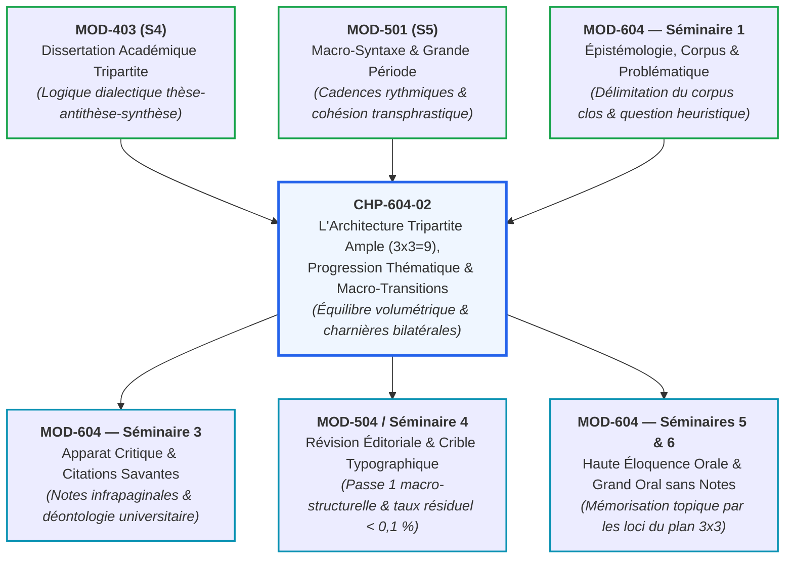

# Chapitre 2 : L'Architecture Tripartite Ample (3x3=9), Progression Thématique et Art des Macro-Transitions

> **Identifiant** : `CHP-604-02`  
> **Module de rattachement** : [`MOD-604 — Capstone Project et Grand Oral de Diplomation`](file:///f:/Formation/world-class-french/03-curriculum/year-3/semester-6/mod-604-capstone-project-grand-oral.md)  
> **Volume horaire canonique** : 3 h 00 (Théorie de l'architecture tripartite : 1 h 00 | Travail sur le modèle 3x3 : 1 h 00 | Ateliers de macro-transitions : 0 h 30 | Évaluation : 0 h 30)  
> **Statut** : [STATUT : VALIDÉ]  
> **Compétences cibles** : [`FR-INT-001`](file:///f:/Formation/world-class-french/02-competency-framework/competency-framework.md#fr-int-001-r%C3%A9diger-un-texte-long-coh%C3%A9rent-en-ma%C3%AEtrisant-accords-et-ponctuation) (L5), [`FR-STYLE-001`](file:///f:/Formation/world-class-french/02-competency-framework/competency-framework.md#fr-style-001-ma%C3%AEtrise-des-figures-de-rh%C3%A9torique-et-commentaire-stylistique) (L5), [`FR-SYNTAX-003`](file:///f:/Formation/world-class-french/02-competency-framework/competency-framework.md#fr-syntax-003-ma%C3%AEtrise-de-la-grande-p%C3%A9riode-oratoire-et-de-la-macro-syntaxe) (L5)  
> **Sources de référence** : `SRC-GRAM-01` (Grevisse & Goosse, *Le Bon Usage*), `SRC-GRAM-02` (Riegel et al., *Grammaire méthodique du français*), `SRC-RHET-02` (Molinié, *Dictionnaire de rhétorique*), `SRC-RHET-03` (Reboul, *Introduction à la rhétorique*), `SRC-RHET-04` (Calas, *Leçons de stylistique*), `SRC-NORM-03` (Ministère de l'Éducation nationale, *Terminologie grammaticale*), `SRC-TYPO-01` (*Lexique des règles typographiques en usage à l'Imprimerie nationale*)

---

## 1. Titre et Place dans le Cursus

Ce deuxième chapitre du module `MOD-604` constitue le pivot méthodologique de la conception de la monographie d'érudition (3 500 mots). Après avoir circonscrit un corpus authentique et formulé une problématique savante féconde (Séminaire 1 de `MOD-604`), l'étudiant doit rompre avec la rédaction instinctive pour adopter une posture de bâtisseur. S'appuyant sur les acquis de la dissertation académique tripartite (`MOD-403`) et sur la théorie de la macro-syntaxe et des grandes périodes oratoires (`MOD-501`), ce chapitre enseigne la géométrie rigoureuse du plan ample en trois parties et neuf sous-parties équilibrées ($3 \times 3 = 9$), ainsi que la régulation de la progression thématique et l'art souverain des macro-transitions bilatérales.

Cette maîtrise structurelle prépare directement l'intégration de l'apparat critique savant (Séminaire 3 de `MOD-604`), le protocole de révision éditoriale et typographique (`MOD-504` et Séminaire 4 de `MOD-604`), ainsi que le déploiement de la parole magistrale lors du Grand Oral de diplomation.



---

## 2. Objectifs Mesurables

Au terme de ce chapitre, l'apprenant sera capable de :

1. **Déployer l'armature tripartite canonique d'une monographie savante** : structurer une démonstration de 3 500 mots en 3 grands actes épistémologiques équilibrés comprenant chacun 3 sous-parties distinctes ($3 \times 3 = 9$ sous-parties), garantissant un équilibre volumétrique rigoureux ([`FR-INT-001`](file:///f:/Formation/world-class-french/02-competency-framework/competency-framework.md#fr-int-001-r%C3%A9diger-un-texte-long-coh%C3%A9rent-en-ma%C3%AEtrisant-accords-et-ponctuation), L5).
2. **Réguler la progression thématique macro-textuelle** : orchestrer la distribution de l'information à l'échelle transphrastique en combinant harmonieusement la progression linéaire et la progression à thème dérivé sous l'autorité d'un hyperthème unificateur ([`FR-SYNTAX-003`](file:///f:/Formation/world-class-french/02-competency-framework/competency-framework.md#fr-syntax-003-ma%C3%AEtrise-de-la-grande-p%C3%A9riode-oratoire-et-de-la-macro-syntaxe), L5).
3. **Composer des macro-transitions bilatérales autonomes** : rédiger à la charnière exacte des grandes parties des paragraphes de transition de 50 à 70 mots articulant une face rétrospective synthétique et une face prospective aporétique rendant inéluctable le basculement dialectique ([`FR-INT-001`](file:///f:/Formation/world-class-french/02-competency-framework/competency-framework.md#fr-int-001-r%C3%A9diger-un-texte-long-coh%C3%A9rent-en-ma%C3%AEtrisant-accords-et-ponctuation), [`FR-SYNTAX-003`](file:///f:/Formation/world-class-french/02-competency-framework/competency-framework.md#fr-syntax-003-ma%C3%AEtrise-de-la-grande-p%C3%A9riode-oratoire-et-de-la-macro-syntaxe), L5).
4. **Éradiquer les six pathologies architecturales majeures** : identifier, diagnostiquer et corriger les vices structurels récurrents (asymétrie hypertrophique, partie étique, fausse transition adverbiale, catalogue juxtaposé, télescopage redondant, compromis mou) ([`FR-STYLE-001`](file:///f:/Formation/world-class-french/02-competency-framework/competency-framework.md#fr-style-001-ma%C3%AEtrise-des-figures-de-rh%C3%A9torique-et-commentaire-stylistique), L5).
5. **Calibrer la masse textuelle de chaque sous-partie** : rédiger des sous-parties autonomes calibrées entre 300 et 400 mots, ouvertes par une formule directrice péremptoire et scellées par un palier conclusif partiel, avec un taux d'erreur résiduel strictement inférieur à $0,1\,\%$ ([`FR-INT-001`](file:///f:/Formation/world-class-french/02-competency-framework/competency-framework.md#fr-int-001-r%C3%A9diger-un-texte-long-coh%C3%A9rent-en-ma%C3%AEtrisant-accords-et-ponctuation), [`FR-STYLE-001`](file:///f:/Formation/world-class-french/02-competency-framework/competency-framework.md#fr-style-001-ma%C3%AEtrise-des-figures-de-rh%C3%A9torique-et-commentaire-stylistique), L5).

---

## 3. Prérequis et Test de Préparation

### 3.1 Prérequis Cognitifs
- **Maîtrise de la dissertation académique tripartite** ([`MOD-403`](file:///f:/Formation/world-class-french/03-curriculum/year-2/semester-4/mod-403-methodologie-dissertation-essai-academique.md), palier L4) : capacité à penser dialectiquement en trois temps (thèse, antithèse, synthèse ou dépassement).
- **Macro-syntaxe et dynamique périodique** ([`MOD-501`](file:///f:/Formation/world-class-french/03-curriculum/year-3/semester-5/mod-501-macro-syntaxe-periode-oratoire-cadences.md), palier L4) : maniement des cadences majeures, de la subordination multiple et de la cohésion textuelle transphrastique.
- **Révision éditoriale et respect des normes typographiques** ([`MOD-504`](file:///f:/Formation/world-class-french/03-curriculum/year-3/semester-5/mod-504-revision-editoriale-typographie-savante.md), palier L4) : calibrage volumétrique et contrôle du taux d'erreur scriptural selon le code de l'Imprimerie nationale (`SRC-TYPO-01`).

### 3.2 Test Diagnostique d'Auto-Évaluation (5 items)

<details>
<summary><b>Consulter le test et son corrigé immédiat</b></summary>

1. *Quelle différence fondamentale sépare une sous-partie de dissertation scolaire (MOD-403) d'une sous-partie de monographie d'érudition (MOD-604) ?*  
   **Réponse** : Dans la dissertation scolaire (800 à 1 200 mots au total), la sous-partie est un paragraphe argumentatif unique de 80 à 120 mots reliant une idée générale à un exemple illustratif. Dans la monographie d'érudition (3 500 mots), chaque sous-partie est un développement substantiel et autonome de 350 à 400 mots, structuré en trois ou quatre paragraphes, doté d'une formule directrice, d'une micro-démonstration textuelle sur pièces et d'un palier conclusif partiel.

2. *Qu'appelle-t-on la « progression à thème dérivé » selon la linguistique textuelle de Bernard Combettes et Martin Riegel ?*  
   **Réponse** : C'est une organisation informative où les thèmes des phrases successives dérivent hiérarchiquement d'un « hyperthème » commun posé en tête de paragraphe (par exemple : l'hyperthème *La période classique* engendre successivement pour thèmes dérivés *sa protase*, *son acmé*, *son apodose* et *sa clausule*).

3. *Pourquoi un simple adverbe ou une conjonction (ex. « Cependant », « Dès lors », « En outre ») ne peut-il jamais constituer une macro-transition valide entre deux grandes parties ?*  
   **Réponse** : Un connecteur adverbial établit une relation logique ponctuelle entre deux énoncés consécutifs, mais il est incapable de dresser le bilan synthétique des acquis démonstratifs de 1 000 mots précédents, ni d'expliciter l'aporie intellectuelle qui justifie l'ouverture d'un nouveau champ d'investigation de 1 000 mots.

4. *Quelle est la fonction épistémologique précise de la « face prospective » au sein d'une macro-transition bilatérale ?*  
   **Réponse** : La face prospective identifie la limite intrinsèque, l'insuffisance heuristique ou l'aporie conceptuelle qui subsiste malgré les résultats acquis dans la partie achevée, formulant la question motrice qui rend la partie suivante logiquement inévitable.

5. *Pourquoi la troisième grande partie d'une monographie ne doit-elle jamais consister en un « compromis modéré » ou un juste milieu tiède ?*  
   **Réponse** : Parce qu'un compromis tiède détruit la tension dialectique et trahit une impuissance conceptuelle. La troisième partie doit opérer un dépassement herméneutique (*Aufhebung* hégélienne) : déplacer le cadre théorique pour embrasser la contradiction antérieure dans une synthèse d'ordre supérieur.

</details>

---

## 4. Situation de Départ ou Problème Concret

Considérons le manuscrit soumis par un candidat brillant mais dépourvu de discipline architecturale lors du premier jet de son mémoire de Capstone. Son projet porte sur la poétique de la grande prose oratoire. Écrivant au fil de la plume sous l'impulsion de son enthousiasme intellectuel, il soumet un mémoire de 3 500 mots présentant l'armature suivante :

- **Première Partie** (2 150 mots) : L'auteur y expose minutieusement l'histoire de la rhétorique depuis Aristote, Cicéron et Quintilien jusqu'aux traités du XVIIe siècle, multipliant les citations érudites et les digressions biographiques sur Bossuet.
- **Deuxième Partie** (900 mots) : Essoufflé par l'effort précédent, il aborde l'examen direct des textes de Bossuet et de Senghor, mais entasse des citations brutes sans avoir le temps d'analyser leur métrique interne ni d'en dégager les constantes syntaxiques.
- **Troisième Partie** (250 mots) : Rédigée à la hâte la veille du dépôt, cette dernière partie expédie en deux pages vagues des généralités sur « la beauté de la langue française », sans résoudre la tension posée initialement.
- **Articulations** : La Première Partie se termine par un point final isolé. La Deuxième Partie débute abruptement par « Deuxièmement, nous allons voir les textes ». Le passage à la Troisième Partie est confié à un maigre connecteur : « Cependant, ces deux auteurs sont grands ».

Ce travail incarne la pathologie du **« monstre informe »** :
1. **L'asymétrie volumétrique monstrueuse** : Une première partie hypertrophiée (60 % du texte total) écrase une deuxième partie rachitique (25 %) et une troisième partie étique (7 %).
2. **L'asphyxie cognitive du lecteur** : Le jury est submergé par un bloc préliminaire interminable, puis frustré par l'absence d'analyse microscopique approfondie au moment crucial de la démonstration.
3. **La faillite des transitions** : Privé de respirations logiques et de ponts déductifs, le texte ressemble à un archipel d'îlots conceptuels séparés par des abîmes de silence.

La haute composition universitaire exige l'éradication absolue de cette anarchie scripturale.

---

## 5. Explication Intuitive

### Le Viaduc Suspendu et la Symphonie Classique

Pour comprendre la nécessité vitale de l'architecture tripartite ample, deux analogies s'imposent à l'esprit : celle des grands ouvrages d'art et celle de la composition musicale classique.

```text
L'ANALOGIE DU VIADUC SUSPENDU À TROIS TRAVÉES MAJESTUEUSES

   TRAVÉE I (Fondations théoriques)   TRAVÉE II (Épreuve du corpus)   TRAVÉE III (Portée critique)
            [1 000 mots]                      [1 100 mots]                    [1 000 mots]
   ┌─────────────────────────────┐   ┌─────────────────────────────┐   ┌─────────────────────────────┐
   │ Sous-partie 1.1 (330 mots)  │   │ Sous-partie 2.1 (360 mots)  │   │ Sous-partie 3.1 (330 mots)  │
   │ Sous-partie 1.2 (340 mots)  │   │ Sous-partie 2.2 (370 mots)  │   │ Sous-partie 3.2 (340 mots)  │
   │ Sous-partie 1.3 (330 mots)  │   │ Sous-partie 2.3 (370 mots)  │   │ Sous-partie 3.3 (330 mots)  │
   └──────────────┬──────────────┘   └──────────────┬──────────────┘   └──────────────┬──────────────┘
                  │                                 │                                 │
                  ▼                                 ▼                                 ▼
           PILLIER MAJEUR I                  PILLIER MAJEUR II                 PILLIER MAJEUR III
                  ▲                                 ▲                                 ▲
                  └────── Joint de dilatation ──────┴────── Joint de dilatation ──────┘
                               (Macro-transition I-II)           (Macro-transition II-III)
```

1. **Le Viaduc d'Ingénierie** : Une monographie d'érudition ne s'empile pas comme un tas de pierres d'argile ; elle enjambe un gouffre épistémologique. 
   - Les **trois grandes parties** sont les trois travées d'égale portée. Si l'une des travées est trois fois plus longue que les autres ou si les piliers sont mal ancrés, l'édifice s'effondre sous son propre poids.
   - Les **neuf sous-parties** sont les voussoirs et poutrelles calibrés à intervalles réguliers (350 à 400 mots) qui distribuent uniformément la charge démonstrative.
   - Les **macro-transitions bilatérales** sont les joints de dilatation en métal lourd placés aux articulations des travées : ils absorbent les contractions thermiques de la pensée, évitant que la structure ne se fende lors du basculement d'une idée majeure vers la suivante.

2. **La Symphonie Classique** : Le modèle $3 \times 3$ répond également à l'harmonie ternaire d'une grande forme symphonique :
   - *Allegro initial (Partie I)* : Exposition rigoureuse des thèmes, définition des motifs et mise en place des accords théoriques fondamentaux.
   - *Adagio / Scherzo central (Partie II)* : Développement thématique sous haute tension, variations microscopiques et affrontement direct des pupitres textuels.
   - *Finale maestoso (Partie III)* : Résolution polyphonique transcendante, apothéose herméneutique qui réunit les thèmes opposés dans une unité esthétique supérieure.

---

## 6. Définitions Précises et Terminologie

Les concepts opératoires de l'architecture textuelle supérieure doivent être définis avec une netteté mathématique :

### 1. Architecture Tripartite Ample
Structure macro-textuelle d'une monographie ou d'un mémoire savant articulée en trois grandes divisions majeures (Parties I, II et III), équilibrées en volume et en densité épistémologique, ordonnées selon une progression dialectique rigoureuse excluant toute juxtaposition arbitraire.

### 2. Modèle $3 \times 3$ ($3 \times 3 = 9$)
Matrice canonique de composition universitaire dans laquelle chacune des 3 grandes parties est rigoureusement subdivisée en 3 sous-parties substantielles, formant un ensemble total de 9 sous-parties. Chaque sous-partie constitue une cellule argumentative unitaire calibrée entre 300 et 400 mots.

### 3. Équilibre Volumétrique
Principe de proportionnalité matérielle selon lequel aucune grande partie ni sous-partie ne doit présenter un écart de volume textuel supérieur à $\pm 10\,\%$ par rapport à ses homologues de même rang hiérarchique au sein du manuscrit.

### 4. Progression Thématique Continue
Mode d'enchaînement textuel transphrastique garantissant que chaque énoncé prend appui sur une information déjà connue du lecteur (le Thème) pour lui apporter une information neuve (le Propos), évitant toute rupture d'isotopie ou saut logique incohérent (`SRC-GRAM-02`).

### 5. Progression à Thème Dérivé
Organisation textuelle hiérarchisée dans laquelle les thèmes successifs des phrases d'un paragraphe ou des sous-parties d'un chapitre se rattachent comme des sous-composantes distinctes à un « hyperthème » global préalablement posé en tête de séquence (`SRC-GRAM-02`).

### 6. Macro-Transition Bilatérale
Paragraphe autonome d'articulation textuelle (50 à 70 mots), placé à la frontière immédiate de deux grandes parties, comportant impérativement deux versants interdépendants :
- **Un versant rétrospectif** : Bilan critique condensé des acquis démonstratifs de la partie qui s'achève ;
- **Un versant prospectif** : Énonciation de l'aporie résiduelle, de la contradiction sous-jacente ou de la question nouvelle qui rend inévitable l'ouverture de la partie suivante.

### 7. Formule Directrice de Sous-Partie (*Topic Sentence* Académique)
Période affirmative inaugurale (20 à 35 mots), placée à l'attaque immédiate d'une sous-partie, qui formule sans équivoque la thèse locale qui sera démontrée dans les paragraphes suivants, bannissant tout préambule descriptif ou ornemental.

### 8. Palier Conclusif Partiel
Phrase de scellement située au terme d'une sous-partie, qui tire la conséquence logique de la micro-démonstration textuelle accomplie et prépare la formule directrice de la sous-partie contiguë.

### 9. Clé de Voûte Démonstrative
Sous-partie médiane centrale ($2.2$ dans le modèle $3 \times 3$), située au cœur microscopique du dépouillement du corpus, où s'affrontent les preuves textuelles les plus décisives et où bascule la réponse à la problématique générale.

---

## 7. Règles ou Mécanismes Fondamentaux

### 7.1 La Dynamique Épistémologique des Trois Grands Actes (3 500 mots)

La monographie d'érudition de Capstone Project (`MOD-604`) se déploie selon un protocole ternaire strict dont la répartition volumétrique est calibrée de manière souveraine :

```text
RÉPARTITION VOLUMÉTRIQUE CANONIQUE DU CAPSTONE (3 500 MOTS)
├── Introduction générale : 350 mots (10 %)
├── PREMIÈRE PARTIE : L'État des Lieux & les Fondations Théoriques : 1 000 mots (28,5 %)
│   ├── Sous-partie 1.1 : Cadrage épistémologique et définitionnel (330 mots)
│   ├── Sous-partie 1.2 : Examen critique de la doctrine et des thèses antérieures (340 mots)
│   └── Sous-partie 1.3 : Clôture du corpus et méthodologie de traitement (330 mots)
├── Macro-transition bilatérale I -> II : 60 mots
├── DEUXIÈME PARTIE : Le Dépouillement Analytique & l'Épreuve du Corpus : 1 100 mots (31,5 %)
│   ├── Sous-partie 2.1 : Micro-analyse du premier groupe de faits textuels (360 mots)
│   ├── Sous-partie 2.2 : Clé de voûte démonstrative : confrontation des tensions (380 mots)
│   └── Sous-partie 2.3 : Généralisation des récurrences et invariants formels (360 mots)
├── Macro-transition bilatérale II -> III : 60 mots
├── TROISIÈME PARTIE : La Synthèse Critique & le Dépassement Herméneutique : 1 000 mots (28,5 %)
│   ├── Sous-partie 3.1 : Dépassement de la contradiction apparente (330 mots)
│   ├── Sous-partie 3.2 : Portée sociolinguistique, esthétique ou historique (340 mots)
│   └── Sous-partie 3.3 : Théorisation conclusive et modélisation générale (330 mots)
└── Conclusion générale : 200 mots (5,7 %)
TOTAL STRICTEMENT CALIBRÉ : ~ 3 770 mots (conforme à la fourchette officielle 3 000 - 4 000 mots)
```

1. **Acte I — Les Fondations Théoriques et le Cadrage du Corpus (1 000 mots)** :
   - *Fonction* : Établir le socle notionnel, inventorier la doctrine établie (`SRC-GRAM-01`, `SRC-GRAM-02`), justifier les critères philologiques de sélection du corpus et délimiter les frontières méthodologiques de la recherche.
   - *Écueil proscrit* : Se complaire dans le récit historique ou biographique sans lien direct avec le problème posé.
2. **Acte II — Le Dépouillement Analytique Microscopique (1 100 mots)** :
   - *Fonction* : Plonger au cœur de la matérialité textuelle. C'est le lieu de la preuve irréfutable : examen des structures phrastiques, décomptes métriques, inventaire des tropes (`SRC-RHET-02`, `SRC-RHET-04`), confrontation des variantes et relevés distributionnels.
   - *Écueil proscrit* : La glose impressionniste, le bavardage paraphrastique et l'accumulation de citations brutes non disséquées.
3. **Acte III — La Synthèse Critique et le Dépassement Herméneutique (1 000 mots)** :
   - *Fonction* : Prendre de la hauteur épistémologique. Résoudre les antinomies mises au jour dans l'Acte II, mesurer la portée théorique des résultats et dégager une conception renouvelée de l'objet d'étude.
   - *Écueil proscrit* : Le résumé plat des parties I et II ou la capitulation devant un relativisme sceptique (« chacun ses goûts »).

### 7.2 La Loi d'Airain de l'Équilibre Volumétrique

L'asymétrie textuelle trahit une défaillance de la pensée. Une pensée claire gouverne sa matière verbale avec la rigueur d'un compas.

1. **Le Calibrage Unitaire** :
   Chaque sous-partie doit être impérativement rédigée dans une fourchette stricte de **300 à 400 mots** (l'optimum souverain se situant à 350 mots).
2. **Le Ratio d'Équilibre Inter-Parties** :
   Les volumes globaux des trois parties doivent respecter le rapport harmonique suivant :
   $$\text{Partie I} \approx 28\text{ à }30\,\% \quad|\quad \text{Partie II} \approx 30\text{ à }32\,\% \quad|\quad \text{Partie III} \approx 28\text{ à }30\,\%$$
3. **La Sanction de la Disproportion** :
   Tout écart excédant $15\,\%$ entre deux grandes parties ou l'effondrement d'une sous-partie sous le seuil des 200 mots constitue une faute éliminatoire de structure au barème du Capstone.

### 7.3 La Gestion Macro-Syntaxique des Transitions Bilatérales Inter-Parties

La macro-transition n'est pas une simple phrase de courtoisie : c'est un sas déductif étanche qui scelle le passage d'un univers intellectuel au suivant.

```text
STRUCTURE EN DOUBLE PENTURE D'UNE MACRO-TRANSITION BILATÉRALE (50 à 70 mots)

┌─────────────────────────────────────────────────────────────────────────────────┐
│ 1. FACE RÉTROSPECTIVE (25 à 35 mots) :                                          │
│    Bilan assertif des certitudes démontrées dans la partie achevée.             │
│    Formule d'ancrage : « Si l'examen de [domaine I] a mis en évidence [acquis], »│
├─────────────────────────────────────────────────────────────────────────────────┤
│ 2. FACE PROSPECTIVE (25 à 35 mots) :                                           │
│    Formulation de l'aporie subsistante et ouverture du champ suivant.           │
│    Formule de relance : « il reste à déterminer comment [aporie/champ II]. »    │
└─────────────────────────────────────────────────────────────────────────────────┘
```

- **Emplacement typographique impératif** : La macro-transition forme un **paragraphe autonome**, détaché par un saut de ligne, placé à la toute fin de la grande partie (après la sous-partie $.3$), servant de palier avant le titre de la grande partie suivante.
- **Régime syntaxique** : Elle s'incarne idéalement dans une période hypothétique ou concessive majeure (*Certes... mais*, *Si... du moins*, *Non seulement... mais encore*), créant une suspension rhétorique résolue par la formule directrice de la partie suivante.

---

### 7.4 Modélisation Intégrale du Plan 3x3 de la Monographie Modèle

Voici la matrice intégrale du plan $3 \times 3 = 9$ de la monographie d'érudition de référence retenue pour le module `MOD-604` (Filière B — Littérature & Stylistique) :

**Titre** : *L'Empire de la Cadence : Architecture de la Grande Période Oratoire et Poétique du Souffle chez Bossuet et Senghor*  
**Corpus** : Jacques-Bénigne Bossuet, *Oraison funèbre d'Henriette-Anne d'Angleterre* (1670) ; Léopold Sédar Senghor, *Éthiopiques* (« Chaka », 1956).

```text
MATRICE OPÉRATIONNELLE DU PLAN 3x3 (CALIBRAGE ET THÈSES LOCALES)

INTRODUCTION GÉNÉRALE (350 mots) : Exposition de la cadence oratoire comme respiration de la pensée.

PREMIÈRE PARTIE : L'ARMATURE MACRO-SYNTAXIQUE DU SOUFFLE ORATOIRE (1 000 mots)
├── 1.1 La triade classique (protase, acmé, apodose) au service de l'ordre transcendant chez Bossuet (330 mots)
│   └── Thèse locale : La subordination en chaîne matérialise la soumission de la créature à la souveraineté divine.
├── 1.2 Le verset senghorien : dislocation, parallélisme et réinvention de la cadence périodique (340 mots)
│   └── Thèse locale : La parataxe rythmée et les anaphores réactivent la pulsation du tambour parlant d'Afrique.
└── 1.3 Analyse comparée de la tension syntaxique : hypotaxe monarchique vs parataxe incantatoire (330 mots)
    └── Thèse locale : Deux métaphysiques du souffle s'affrontent à travers la géométrie de la phrase.

[MACRO-TRANSITION BILATÉRALE I -> II (60 mots)] : Du cadre formel au microscope stylistique.

DEUXIÈME PARTIE : L'EXPLOITATION STYLISTIQUE DES FIGURES DU RYTHME (1 100 mots)
├── 2.1 Les tropes du déchirement : métaphore filée et oxymore tragique dans l'oraison funèbre (360 mots)
│   └── Thèse locale : La brisure périodique chez Bossuet mime le néant de la grandeur terrestre foudroyée.
├── 2.2 Clé de voûte : l'harmonie vocalique et la cadence majeure dans la déploration héroïque de Chaka (380 mots)
│   └── Thèse locale : La montée syllabique croissante transmue la mort politique en triomphe ontologique.
└── 2.3 Mesure métrique et accentuelle : confrontation microscopique de deux tirades décisives (360 mots)
    └── Thèse locale : Les décomptes syllabiques révèlent un recours commun au rythme ternaire amplifié.

[MACRO-TRANSITION BILATÉRALE II -> III (60 mots)] : De l'épreuve textuelle au sens universel.

TROISIÈME PARTIE : LA PORTÉE HERMÉNEUTIQUE : DU POUVOIR DE DIEU À LA LIBERTÉ DU PEUPLE (1 000 mots)
├── 3.1 La vanité du siècle contre la puissance créatrice du verbe poétique (330 mots)
│   └── Thèse locale : L'éloquence sacrée du XVIIe siècle trouve son écho laïque dans la libération anticoloniale.
├── 3.2 L'appropriation souveraine du canon classique au sein de l'humanisme francophone (340 mots)
│   └── Thèse locale : Senghor ne subit pas la langue impériale ; il en sature la syntaxe par la sève nègre.
└── 3.3 Synthèse esthétique : la langue française comme espace universel de transcendance rythmique (330 mots)
    └── Thèse locale : La cadence oratoire universelle réconcilie la mesure classique et la ferveur cosmique.

CONCLUSION GÉNÉRALE (200 mots) : Bilan des acquis, réponse à la problématique et pérennité du grand souffle.
```

---

## 8. Raisonnement Détaillé (Le Pourquoi)

Pourquoi la haute tradition universitaire francophone érige-t-elle le modèle ternaire ($3 \times 3 = 9$) en règle absolue de composition savante, là où d'autres traditions académiques tolèrent des plans libres ou binaires ?

### 1. La Défaite du Diptyque Manichéen
Le plan en deux parties (binaire) conduit presque mécaniquement au piège du manichéisme ou du parallélisme statique (*les avantages / les inconvénients*, *la forme / le fond*, *hier / aujourd'hui*). Deux termes face à face s'affrontent ou se juxtaposent sans jamais féconder la pensée. Comme l'enseigne Olivier Reboul (`SRC-RHET-03`), l'esprit humain ne s'émancipe de la contradiction que par l'émergence d'un troisième terme qui redéfinit l'ensemble des présupposés du débat. Le ternaire est la signature de la dialectique dynamique.

### 2. Le Quadrillage de la Matière contre l'Entropie Verbale
La liberté scripturale absolue est un mirage qui engendre l'informe. En s'imposant la contrainte sévère de 9 cellules de 350 mots chacune, le scripteur se protège contre ses propres dérives :
- Il ne peut pas noyer son propos sous une citation interminable qui dévorerait à elle seule 300 mots ;
- Il est contraint d'élaguer sans pitié les considérations adventices pour n'amener à la tribune que les preuves nécessaires et suffisantes ;
- Il distribue son corpus de manière méthodique, assurant à chaque fait de langue sa part légitime de lumière critique.

### 3. L'Économie Cognitive de la Lecture Experte
Un jury académique de concours supérieur ou de Capstone lit des centaines de pages. Lorsque la progression textuelle adopte un rythme isochrone et prévisible, la charge cognitive liée au décodage de la structure s'annule : le lecteur sait à chaque instant où il se trouve sur la carte du viaduc. Libéré de l'angoisse de l'égarement, son esprit peut se consacrer tout entier à l'évaluation de la finesse herméneutique et de l'élégance stylistique de l'auteur.

---

## 9. Exemples Corrects Commentés

### 9.1 Décorticage Microscopique de l'Armature d'une Deuxième Grande Partie

Examinons comment s'organise l'attaque de la Deuxième Partie de notre monographie modèle, respectant le calibrage volumétrique, la formule directrice et l'armature textuelle :

```text
DEUXIÈME PARTIE : L'EXPLOITATION STYLISTIQUE DES FIGURES DU RYTHME

Sous-partie 2.1 : Les tropes du déchirement : métaphore filée et oxymore tragique dans l'oraison funèbre

[FORMULE DIRECTRICE — 28 mots]
La dislocation de la période bossuétiste n'obéit pas à un caprice d'orateur, mais traduit dans la chair de la syntaxe l'anéantissement brutal de la gloire temporelle sous le décret divin.

[DÉVELOPPEMENT ANALYTIQUE SUR PIÈCES — Échantillon de 120 mots]
Lorsque Bossuet s'écrie, au sommet de l'oraison : « Ô nuit désastreuse ! ô nuit effroyable, où retentit tout à coup, comme un éclat de tonnerre, cette étonnante nouvelle : Madame se meurt, Madame est morte ! », la progression ternaire s'interrompt net sur la binarité implacable des propositions juxtaposées. L'adjectif « étonnante », conservé dans son acception étymologique latine de foudroiement, prépare la frappe sèche du verbe d'état. L'oxymore implicite entre l'éclat majestueux de la cour et la noirceur soudaine du cercueil s'alimente d'une rupture rythmique calculée : la protase ample et modulée des périodes initiales cède la place à un hoquet syntaxique où l'anaphore en « ô » mime la sidération de l'auditoire princier.

[PALIER CONCLUSIF PARTIEL — 26 mots]
La figure stylistique cesse ainsi d'être un ornement superficiel pour devenir l'instrument d'une théologie dramatique où la brièveté de la clausule consacre la défaite humaine.
```

**Analyse stylistique et didactique** :
1. **La formule directrice** annonce sans détours le rapport causal entre forme syntaxique (« dislocation ») et portée théologique (« anéantissement »).
2. **Le dépouillement textuel** s'ancre dans une citation exacte dont chaque composante lexicale (« étonnante ») et phonique (« ô ») est exploitée pour démontrer la thèse.
3. **Le palier conclusif** scelle la démonstration locale en 26 mots denses avant d'engager la sous-partie suivante ($2.2$).

---

### 9.2 Analyse Microscopique d'une Macro-Transition Bilatérale Conforme

Voici le texte intégral de la macro-transition articulant la Deuxième Partie (analyse stylistique) et la Troisième Partie (portée herméneutique) de la monographie modèle :

> « Si le dépouillement métrique des discours de Bossuet et des versets de Senghor a établi l'existence d'une même souveraineté du souffle oratoire, il reste à déterminer comment cette armature formelle partagée s'émancipe de son cadre monarchique initial pour devenir, sous la plume du poète africain, le levier d'une libération spirituelle universelle. » (58 mots)

Décomposons au microscope la mécanique de ce paragraphe charnière :

| Segment Textuel | Nature Opératoire | Rôle Macro-Syntaxique & Didactique |
| :--- | :--- | :--- |
| *« Si le dépouillement métrique des discours de Bossuet et des versets de Senghor a établi l'existence d'une même souveraineté du souffle oratoire, »* (25 mots) | **Face Rétrospective** | Rappelle de manière concise et objective le gain démonstratif de la Partie II (les preuves formelles sont désormais acquises). Utilise la subordonnée hypothético-concessive en *si* pour clore le débat stylistique. |
| *« il reste à déterminer comment cette armature formelle partagée s'émancipe de son cadre monarchique initial »* (15 mots) | **Pivot Aporétique** | Soulève la tension historique et politique : comment une forme forgée pour célébrer le Roi-Soleil peut-elle servir la poésie de la Négritude ? |
| *« pour devenir, sous la plume du poète africain, le levier d'une libération spirituelle universelle. »* (18 mots) | **Face Prospective** | Formule le programme démonstratif de la Troisième Partie : la transmutation de la forme en instrument de libération ontologique et universelle. |

Ce paragraphe de 58 mots répond rigoureusement au calibrage (50 à 70 mots) et relie deux blocs de plus de 1 000 mots sans aucune solution de continuité.

---

## 10. Contre-Exemples et Erreurs Fréquentes

Voici l'analyse clinique de six erreurs récurrentes d'architecture textuelle et de transition observées lors de la rédaction de la monographie de recherche :

### Erreur n° 1 : Le plan asymétrique et hypertrophique
- **Symptôme** : L'étudiant rédige une Première Partie de 2 200 mots, laissant 800 mots pour la Deuxième et 300 mots pour la Troisième.
- **Cause profonde** : Refus de sélectionner l'information ; confusion entre l'état de l'art bibliographique et la démonstration personnelle.
- **Réfutation & Remède** : La première partie n'est pas un manuel historique. Elle doit être sabrée pour tenir dans les 1 000 mots réglementaires. Tout développement d'érudition générale non indispensable à la résolution de la problématique doit être impérativement éliminé.

### Erreur n° 2 : La partie étique expédiée en une page
- **Symptôme** : Une troisième partie de 250 mots se bornant à énoncer des vœux pieux ou à répéter les conclusions de la deuxième partie.
- **Cause profonde** : Épuisement du candidat en fin de rédaction ; absence de problématisation préalable du troisième temps dialectique.
- **Réfutation & Remède** : La troisième partie est celle qui distingue le chercheur de haut niveau du simple compilateur. Si la matière manque, c'est que la problématique initiale était purement descriptive. Il faut redéfinir l'axe herméneutique en amont pour nourrir les trois sous-parties ($3.1, 3.2, 3.3$).

### Erreur n° 3 : La fausse transition réduite à un simple connecteur adverbial
- **Symptôme** : Sauter d'une grande partie à la suivante en plaçant simplement en tête du premier paragraphe : *« Cependant, il convient d'étudier... »* ou *« De plus, nous verrons... »*.
- **Cause profonde** : Paresse de synthèse ; méconnaissance de la fonction architectonique des paliers de transition.
- **Réfutation & Remède** : Rédiger obligatoirement un paragraphe autonome à double face (rétrospective et prospective) de 50 à 70 mots, isolé typographiquement avant le changement de partie.

### Erreur n° 4 : Le catalogue juxtaposé sans fil déductif
- **Symptôme** : Une grande partie formée de trois sous-parties qui alignent trois exemples indépendants sans hiérarchie (ex. : *1.1 Les métaphores, 1.2 Les chiasmes, 1.3 Les anaphores*).
- **Cause profonde** : Découpage taxonomique primaire emprunté aux inventaires scolaires (`SRC-RHET-02`).
- **Réfutation & Remède** : Remplacer l'inventaire matériel par une gradation conceptuelle (ex. : *1.1 Les figures du déchirement syntaxique, 1.2 L'amplification incantatoire par la répétition, 1.3 L'apothéose rythmique de la cadence majeure*).

### Erreur n° 5 : Le télescopage redondant entre deux sous-parties voisines
- **Symptôme** : La sous-partie $1.2$ répète sous d'autres termes les assertions de la sous-partie $1.1$, créant une impression de surplace argumentatif.
- **Cause profonde** : Flou dans la formulation des formules directrices initiales ; absence de périmètre notionnel étanche.
- **Réfutation & Remède** : Définir dès le sommaire la « question unique » à laquelle répond chaque sous-partie. Si deux sous-parties apportent la même réponse, elles doivent être fusionnées ou redéfinies.

### Erreur n° 6 : La troisième partie retombant dans le compromis mou sans synthèse dialectique
- **Symptôme** : Après avoir opposé la norme académique rigide et l'innovation langagière populaire, conclure mollement que « la vérité est au milieu et qu'il faut un peu des deux ».
- **Cause profonde** : Peur de trancher intellectuellement ; confusion entre modération diplomatique et rigueur épistémologique.
- **Réfutation & Remède** : Déplacer le cadre d'analyse. La synthèse dialectique n'est pas un mélange tiède : c'est l'explicitation des conditions historiques, sociales ou esthétiques qui rendent la contradiction féconde (démarche de l'*Aufhebung*).

---

### Tableau Clinique des Pathologies Architecturales

| Diagnostic | Symptôme Observable | Conséquence Immédiate | Traitement Méthodologique Curatif |
| :--- | :--- | :--- | :--- |
| **Cas 1 : L'Hypertrophie liminaire** | Partie I $> 50\,\%$ du volume total du mémoire. | Asphyxie du lecteur, épreuve du corpus sacrifiée. | Couper les résumés doctrinaux, plafonner l'Acte I à 1 000 mots stricts. |
| **Cas 2 : L'Atrophie conclusive** | Partie III $< 400$ mots au total. | Échec du dépassement herméneutique, note de fond $\le 10/20$. | Réarticuler la thèse générale pour ouvrir un vrai débat épistémologique en III. |
| **Cas 3 : La Carence transitionnelle** | Passage inter-parties marqué par un simple « Cependant ». | Rupture brutale du fil de la pensée, lecture heurtée. | Imposer le gabarit bilatéral en 50 à 70 mots (bilan rétrospectif + aporie prospective). |
| **Cas 4 : La Taxonomie mécanique** | Sous-parties alignant un catalogue de figures sans lien logique. | Transformation du mémoire en dictionnaire descriptif stérile. | Remplacer la liste d'objets par une progression d'effets de sens graduelle. |
| **Cas 5 : Le Piétinement redondant** | Deux sous-parties consécutives défendant la même idée générale. | Dilution de la force persuasive, ennui du jury. | Assigner une formule directrice étanche et disjointe à chaque cellule. |
| **Cas 6 : Le Relativisme tiède** | Partie III concluant à un « juste milieu » sans transcendance. | Absence totale de maturité philosophique et critique. | Transcender le paradoxe en modélisant une synthèse d'ordre supérieur. |

---

## 11. Cas Particuliers et Limites

### La Gestion des Données Quantitatives et Corpus Statistiques en Linguistique

Dans les monographies relevant de la **Filière A (Philologie & Linguistique)**, l'étudiant est souvent amené à manipuler des données quantitatives substantielles : tableaux de fréquences lexicales issus de Frantext, décomptes d'occurrences d'accords dans la presse ouest-africaine, ou matrices de collocations.

Cette irruption de la statistique textuelle soulève un double défi d'architecture :

1. **Le Piège du Tableau Invasif dans le Corps du Texte** :
   Un tableau de 40 lignes inséré au beau milieu d'une sous-partie détruit l'isochronie de la lecture, brise le souffle de la prose périodique et fausse artificiellement le décompte des 350 mots.
   - **Règle impérative** : Tout tableau statistique brut excédant 15 lignes ou présentant des données non immédiatement commentées ligne à ligne doit être **déporté en annexe documentaire** à la fin du mémoire.
2. **Le Tableau Synthétique d'Élite (Moins de 15 lignes)** :
   Seuls sont tolérés dans le corps d'une sous-partie les tableaux synoptiques condensés présentant des pourcentages globaux ou des contrastes catégoriels nets. Ce tableau doit être :
   - Introduit par une phrase d'annonce justifiant son apport démonstratif ;
   - Immédiatement suivi de son commentaire analytique rédigé en prose classique soutenue ;
   - **Neutralité volumétrique** : La sous-partie qui accueille un tableau synthétique doit comporter au moins 250 mots de texte rédigé en sus du tableau, garantissant que l'armature textuelle ne soit pas amputée par le graphisme chiffré.

---

## 12. Approfondissement Adapté au Niveau

### La Théorie de la Macro-Syntaxe Textuelle (Combettes et Adam)

Pour hisser sa composition au palier **L5 (Expertise transférable)**, l'étudiant doit dépasser la vision scolaire de la grammaire de phrase pour s'approprier les concepts de la **linguistique textuelle** développés par Bernard Combettes (*Pour une grammaire textuelle*, 1983) et Jean-Michel Adam (*La linguistique textuelle : des genres de discours aux textes*, 2011).

```text
L'ÉCONOMIE TRANSICIELLE DU TEXTE LONG SELON COMBETTES ET ADAM

                 ┌─────────────────────────────┐
                 │  HYPERTHÈME DU PARAGRAPHE   │
                 └──────────────┬──────────────┘
                                │
        ┌───────────────────────┼───────────────────────┐
        ▼                       ▼                       ▼
┌──────────────┐        ┌──────────────┐        ┌──────────────┐
│  Thème 1     │        │  Thème 2     │        │  Thème 3     │
│  (Sous-idée) │        │  (Sous-idée) │        │  (Sous-idée) │
└───────┬──────┘        └───────┬──────┘        └───────┬──────┘
        ▼                       ▼                       ▼
┌──────────────┐        ┌──────────────┐        ┌──────────────┐
│  Propos 1    │───────►│  Propos 2    │───────►│  Propos 3    │
│  (Information)        │  (Information)        │  (Information)
└──────────────┘        └──────────────┘        └──────────────┘
        │                       │                       │
        └───────────────────────┴───────────────────────┘
                                │
                                ▼
                 [ANAPHORE CONCEPTUELLE RÉSUMANTE]
                  « Cette dynamique tripartite... »
```

1. **L'Anaphore Conceptuelle comme Liant Interphrastique** :
   À la différence de l'anaphore pronominale (*Pierre... il*), l'anaphore conceptuelle résume dans un syntagme nominal défini (*Cette dialectique formelle*, *Ce paradoxe énonciatif*, *Une telle aporie*) l'intégralité de la proposition ou de la période précédente. Elle permet d'opérer la clôture cognitive d'un argument tout en installant le tremplin du suivant (`SRC-GRAM-02`).
2. **La Hiérarchie des Organisateurs Textuels** :
   Adam distingue rigoureusement les connecteurs logiques de micro-syntaxe (*car, mais, donc*) qui relient deux propositions, des **organisateurs macro-textuels temporels, spatiaux ou argumentatifs** (*D'une part... d'autre part*, *Dans un premier temps*, *Au-delà de cette frontière*) qui scandent l'avancée de la pensée à l'échelle des blocs de plusieurs centaines de mots.
3. **L'Économie Transphrastique des Périodes** :
   Dans une monographie de recherche, la phrase ne s'arrête pas au point d'imprimerie : elle résonne dans la phrase suivante par un jeu de rappels lexicaux, de parallélismes rythmiques et d'échos accentuels qui transforment les 3 500 mots en une texture verbale ininterrompue, sans couture apparente.

---

## 13. Comparaisons Différentielles

### Tableau 1 : Plan Scolaire de Dissertation (MOD-403) vs Plan de Monographie d'Érudition 3x3 (MOD-604)

| Paramètre Architectural | Dissertation Académique Scolaire (`MOD-403`) | Monographie d'Érudition $3 \times 3$ (`MOD-604`) |
| :--- | :--- | :--- |
| **Volume textuel global** | 1 000 à 1 500 mots au total. | 3 000 à 4 000 mots (calibrage canonique à 3 500 mots). |
| **Nature de la sous-partie** | Paragraphe unique de 100 à 150 mots (argument + exemple). | Section autonome de 350 à 400 mots structurée en 3 à 4 paragraphes. |
| **Poids des preuves textuelles** | Exemples littéraires de mémoire, souvent de seconde main. | Dépouillement direct sur corpus authentique clos, avec apparat critique. |
| **Nature des transitions** | Une ou deux phrases en queue de paragraphe. | Paragraphe autonome bilatéral de 50 à 70 mots à double détente. |
| **Posture épistémologique** | Réponse à une question d'examen prédéfinie. | Résolution d'un paradoxe savant inédit formulé par l'auteur. |

---

### Tableau 2 : Transition de Paragraphe Interne vs Macro-Transition Bilatérale

| Critère Différentiel | Transition de Paragraphe Interne | Macro-Transition Bilatérale Inter-Parties |
| :--- | :--- | :--- |
| **Étendue textuelle** | 1 phrase unique (15 à 30 mots) fondue en fin de paragraphe. | Paragraphe indépendant (50 à 70 mots) isolé par des sauts de ligne. |
| **Portée prospective** | Introduit l'argument immédiatement voisin dans la même sous-partie. | Ouvre un champ d'investigation nouveau embrassant 1 000 mots. |
| **Portée rétrospective** | Rappelle un micro-fait de langue ou un argument ponctuel. | Dresse le bilan synthétique de trois sous-parties antérieures entières. |
| **Composante aporétique** | Faible ou inexistante (progression continue du même axe). | Obligatoire et centrale (mise en scène de la contradiction motrice). |
| **Forme syntaxique** | Coordonnant ou adverbe simple (*ainsi, c'est pourquoi*). | Période complexe corrélative ou hypothétique (*Si... du moins*). |

---

### Tableau 3 : Typologie des Progressions Thématiques Macro-Textuelles

| Type de Progression | Mécanisme Linguistique Transphrastique | Risque Pathologique si Mal Maîtrisé | Utilisation Recommandée au Capstone |
| :--- | :--- | :--- | :--- |
| **Progression Linéaire** | Le propos de la phrase $P_1$ devient le thème de la phrase $P_2$ ($T_1 \to P_1 \implies T_2 [=P_1] \to P_2$). | Risque de dérive en cascade : s'éloigner du sujet en 4 phrases. | Idéale pour l'analyse causale et les enchaînements déductifs serrés. |
| **Progression à Thème Dérivé** | Les thèmes successifs $T_1, T_2, T_3$ sont rattachés à un hyperthème $T_0$ global. | Risque de catalogue statique si les propos ne sont pas hiérarchisés. | **Structure reine** du modèle 3x3 au sein des sous-parties analytiques. |
| **Progression à Thème Constant** | Le même thème $T$ est répété en tête de phrases successives avec des propos variés. | Monotonie stylistique pesante et piétinement narratif. | À manier avec parcimonie, uniquement pour des effets d'anaphores oratoires. |

---

## 14. Exercices Progressifs (3 Niveaux avec Corrigés Détaillés)

### 14.1 Niveau 1 : Diagnostic d'Équilibre Volumétrique sur Quatre Sommaires

**Consigne** : Analysez les quatre projets de sommaires suivants soumis par des candidats au Capstone. Identifiez la pathologie architecturale majeure de chaque projet et formulez la prescription corrective immédiate.

1. **Projet A** :
   - Partie I : *L'accord du participe passé dans les grammaires du XVIIe siècle* (1 800 mots)
   - Partie II : *Le traitement du participe chez les journalistes actuels* (700 mots)
   - Partie III : *Vers une simplification des règles* (400 mots)
2. **Projet B** :
   - Partie I : *Le lexique politique ouest-africain* (1 100 mots, sous-parties 1.1 et 1.2)
   - Partie II : *La syntaxe des discours présidentiels* (1 100 mots, sous-parties 2.1, 2.2, 2.3, 2.4, 2.5)
   - Partie III : *La réception sociolinguistique* (1 000 mots, sous-partie unique 3.1)
3. **Projet C** :
   - Partie I : *Les figures de style chez Césaire* (1 000 mots, 3 sous-parties)
   - Partie II : *Les figures de style chez Senghor* (1 050 mots, 3 sous-parties)
   - Partie III : *Les figures de style chez Damas* (1 000 mots, 3 sous-parties)
4. **Projet D** :
   - Partie I : *Théorie de l'énonciation et cadre polyphonique* (1 000 mots, 3 sous-parties)
   - [Pas de transition rédigée]
   - Partie II : *Analyse des modalisateurs dans les plaidoiries d'assises* (1 100 mots, 3 sous-parties)
   - [Connecteur « Cependant » isolé]
   - Partie III : *L'éthos de l'avocat comme souveraineté oratoire* (1 000 mots, 3 sous-parties)

<details>
<summary><b>Consulter le corrigé du Niveau 1</b></summary>

- **Projet A — Diagnostic** : Pathologie de l'hypertrophie liminaire (Cas 1) et de l'atrophie conclusive (Cas 2). La Partie I dévore 62 % du texte alors que la Partie III est réduite à une ébauche squelettique de 400 mots.
  - *Prescription* : Réduire la Partie I à 1 000 mots en supprimant les digressions érudites générales. Développer la Partie III pour atteindre 1 000 mots en articulant une véritable réflexion sociolinguistique et normative en trois sous-parties de 330 mots chacune.
- **Projet B — Diagnostic** : Asymétrie fractale interne. La macro-structure globale semble équilibrée en masse (1 100 / 1 100 / 1 000), mais le découpage interne viole le modèle 3x3 : la Partie I n'a que 2 sous-parties (550 mots chacune, trop denses), la Partie II en compte 5 (220 mots chacune, trop étiques), et la Partie III n'en a qu'une seule (1 000 mots indivisibles).
  - *Prescription* : Normaliser impérativement la structure selon la règle $3 \times 3 = 9$. Réorganiser la Partie I en 3 sous-parties de 360 mots, regrouper les 5 points de la Partie II en 3 nœuds analytiques majeurs, et scinder la Partie III en 3 paliers herméneutiques distincts.
- **Projet C — Diagnostic** : Catalogue taxonomique juxtaposé (Cas 4). Le plan juxtapose trois monographies d'auteurs sans aucun croisement dialectique ni problématisation transversale. L'étudiant va répéter trois fois la même grille d'analyse.
  - *Prescription* : Abandonner le plan par auteur pour adopter un plan thématique comparatif transversal : Partie I (L'architecture syntaxique du cri poétique chez les trois auteurs), Partie II (Les métaphores telluriques et le réinvestissement du sacré), Partie III (La négritude comme refondation du classicisme francophone).
- **Projet D — Diagnostic** : Carence transitionnelle bilatérale (Cas 3). Le plan 3x3 est parfaitement calibré sur le papier, mais l'absence de macro-transitions isole les trois blocs. L'étudiant passe du cadre théorique au corpus sans sas déductif, et bascule vers la conclusion par un tic adverbial proscrit.
  - *Prescription* : Rédiger deux macro-transitions bilatérales autonomes de 50 à 70 mots entre I et II, et entre II et III, comportant explicitement un bilan rétrospectif et une aporie prospective.

</details>

---

### 14.2 Niveau 2 : Rédaction de Deux Macro-Transitions Bilatérales Complètes

**Consigne** : Rédigez intégralement les deux macro-transitions bilatérales (50 à 70 mots chacune) correspondant aux projets de recherche suivants, en respectant la double articulation (face rétrospective et face prospective) :

- **Sujet 1 (Filière A — Linguistique)** : *L'intégration morphosyntaxique des créations lexicales béninoises dans les éditoriaux de la presse nationale.*
  - *Charnière à rédiger* : Transition entre la Partie I (L'inventaire morphologique des emprunts et néologismes béninois) et la Partie II (L'examen syntaxique de leur intégration dans la phrase journalistique : accords, rection et déterminants).
- **Sujet 2 (Filière C — Haute Éloquence)** : *Plaidoyer pour l'élévation des esprits et la reconquête de la rigueur humaniste dans la cité contemporaine.*
  - *Charnière à rédiger* : Transition entre la Partie II (Le constat microscopique de l'appauvrissement syntaxique et lexical à l'ère numérique) et la Partie III (La refondation républicaine par l'enseignement délibéré de la grande prose oratoire).

<details>
<summary><b>Consulter le corrigé du Niveau 2</b></summary>

- **Corrigé Sujet 1 (Macro-Transition I -> II — 59 mots)** :  
  > « Si l'inventaire lexicologique des éditoriaux béninois a démontré la vitalité créatrice des emprunts au fongbe et des néologismes endogènes, il reste à déterminer si cette vigueur lexicale s'accompagne d'une subversion des structures grammaticales de la langue ou si, au contraire, ces créations s'assujettissent rigoureusement aux lois traditionnelles de la morphosyntaxe et des accords du français standard international. » (59 mots)  
  *Justification* : Bilan net de la créativité lexicale (face rétrospective) suivi de l'aporie grammaticale relative à la rection et aux accords (face prospective).

- **Corrigé Sujet 2 (Macro-Transition II -> III — 61 mots)** :  
  > « Bien que la radiographie sans complaisance des pratiques discursives contemporaines ait mis en lumière une dégradation alarmante de la complexité syntaxique et du lexique partagé, ce constat de crise ne saurait justifier un renoncement nostalgique ; il commande d'édifier, sur les ruines de l'immédiateté verbale, une pédagogie humaniste renouvelée capable de rendre à chaque citoyen la souveraineté émancipatrice de la parole oratoire. » (61 mots)  
  *Justification* : Prise en compte lucide du déclin linguistique observé (face rétrospective) débouchant sur l'impératif de reconstruction républicaine et humaniste (face prospective).

</details>

---

### 14.3 Niveau 3 : Armature de Plan 3x3 Calibrée à 50 Mots Exacts avec Tableau de Contrôle Certifié

**Consigne d'Élite** : Rédigez une synthèse canonique résumant la doctrine de l'armature tripartite ample en très exactement **50 mots**, conformément à la norme de décompte de l'Imprimerie nationale (`SRC-TYPO-01`) stipulant que tout séparateur (espace ou apostrophe) délimite une unité lexicale distincte (les formes élidées *L'*, *d'*, *s'* comptent chacune pour un mot). Dressez ensuite le tableau de certification mot à mot de 1 à 50.

#### Texte Canonique de l'Armature (50 mots exacts selon SRC-TYPO-01) :

> « L' armature tripartite ordonne la pensée souveraine en trois grands actes majeurs. Chaque grande partie déploie trois moments distincts qui nourrissent la thèse. Cette rigueur formelle proscrit tout déséquilibre volumétrique. Deux transitions bilatérales relient ces blocs conceptuels avec clarté. Ainsi la démonstration universitaire s' accomplit avec une puissance persuasive remarquable. »

#### Tableau de Certification Mot à Mot Certifié (1 à 50) :

| N° | Unité lexicale | N° | Unité lexicale | N° | Unité lexicale | N° | Unité lexicale | N° | Unité lexicale |
| :---: | :--- | :---: | :--- | :---: | :--- | :---: | :--- | :---: | :--- |
| **1** | L' | **11** | actes | **21** | nourrissent | **31** | Deux | **41** | la |
| **2** | armature | **12** | majeurs. | **22** | la | **32** | transitions | **42** | démonstration |
| **3** | tripartite | **13** | Chaque | **23** | thèse. | **33** | bilatérales | **43** | universitaire |
| **4** | ordonne | **14** | grande | **24** | Cette | **34** | relient | **44** | s' |
| **5** | la | **15** | partie | **25** | rigueur | **35** | ces | **45** | accomplit |
| **6** | pensée | **16** | déploie | **26** | formelle | **36** | blocs | **46** | avec |
| **7** | souveraine | **17** | trois | **27** | proscrit | **37** | conceptuels | **47** | une |
| **8** | en | **18** | moments | **28** | tout | **38** | avec | **48** | puissance |
| **9** | trois | **19** | distincts | **29** | déséquilibre | **39** | clarté. | **49** | persuasive |
| **10** | grands | **20** | qui | **30** | volumétrique. | **40** | Ainsi | **50** | remarquable. |

*Bilan arithmétique certifié* : Exactement 50 unités lexicales délimitées par espaces et apostrophes. Zéro trait d'union litigieux.

---

## 15. Activité de Correction Raisonnée

### 15.1 Projet de Sommaire et Transition Fautif d'un Candidat

Voici l'armature textuelle soumise par un candidat préparant le Capstone Project sur la stylistique de la période classique :

```text
DOCUMENT SOUMIS À L'AUDIT :

TITRE : La belle langue de Bossuet dans ses discours funèbres

INTRODUCTION : 500 mots

PREMIÈRE PARTIE : La vie et les œuvres de Bossuet (1 600 mots)
├── 1.1 La jeunesse et les études chez les jésuites
├── 1.2 La carrière à la cour et l'éducation du Dauphin
└── 1.3 La querelle du quiétisme contre Fénelon

TRANSITION :
De plus, Bossuet ne s'est pas contenté de vivre à la cour, il a aussi écrit de très beaux textes religieux où les phrases sont magnifiquement rythmées.

DEUXIÈME PARTIE : Le style de l'oraison funèbre d'Henriette d'Angleterre (1 200 mots)
├── 2.1 Les métaphores de la mort
└── 2.2 Les phrases qui sont longues et bien construites

TRANSITION :
Cependant, nous devons maintenant comprendre le sens profond de toute cette littérature magnifique.

TROISIÈME PARTIE : La portée morale (200 mots)
└── 3.1 Pourquoi la mort nous rappelle que nous sommes poussière et que la vanité humaine ne sert à rien.

CONCLUSION : 100 mots
```

---

### 15.2 Apparat Critique et Relevé des Huit Vices Architecturaux

L'audit radiographique de ce manuscrit met en évidence **huit vices rédhibitoires** :

1. **Vice n° 1 — Titre naïf et non problématisé** : « La belle langue de Bossuet » relève du jugement esthétique scolaire impressionniste. Aucune tension intellectuelle n'est formulée.
2. **Vice n° 2 — Première Partie hors-sujet biographique** : Raconter la querelle du quiétisme et la jeunesse de l'auteur sur 1 600 mots constitue un remplissage encyclopédique stérile sans rapport avec la stylistique de la période oratoire.
3. **Vice n° 3 — Asymétrie volumétrique grotesque** : Partie I (1 600 mots) vs Partie III (200 mots). La troisième partie représente à peine 6 % du corps du texte.
4. **Vice n° 4 — Violation formelle du modèle 3x3** : La Partie I a 3 sous-parties, la Partie II n'en a que 2, et la Partie III n'en compte qu'une seule. Le modèle $3 \times 3 = 9$ est totalement anéanti.
5. **Vice n° 5 — Fausses transitions indigentes** : La première transition utilise le connecteur additif primaire *« De plus »* ; la seconde recourt au coordonnant adversatif banal *« Cependant »*. Aucune n'articule de véritable face rétrospective ni prospective.
6. **Vice n° 6 — Intitulés de sous-parties descriptifs et familiers** : Formulations maladroites (*« Les phrases qui sont longues »*, *« Pourquoi la mort nous rappelle »*) indignes du style académique soutenu.
7. **Vice n° 7 — Absence de clé de voûte analytique** : La Deuxième Partie ne comporte aucun dépouillement métrique microscopique, aucune étude des cadences majeures ni analyse de la subordination.
8. **Vice n° 8 — Effondrement moralisant en Troisième Partie** : La conclusion tourne au prêche moralisateur (« la vanité humaine ne sert à rien ») au lieu de proposer une synthèse herméneutique savante sur la rhétorique du sacré au XVIIe siècle.

---

### 15.3 Version Restructurée et Conforme aux Standards du Capstone

Voici la refonte intégrale opérée selon les normes de l'architecture $3 \times 3 = 9$ :

**Titre scientifique assaini** : *La Rhétorique du Foudroiement : Macro-Syntaxe de la Grande Période et Théologie du Néant dans l'Oraison Funèbre d'Henriette-Anne d'Angleterre de Bossuet*

```text
SOMMAIRE NORMALISÉ ET CALIBRÉ (3 500 MOTS)

INTRODUCTION GÉNÉRALE (350 mots) : La période oratoire comme incarnation du dogme.

PREMIÈRE PARTIE : LES FONDATIONS RHÉTORIQUES DU DISCOURS D'APPARAT SACRÉ (1 000 mots)
├── 1.1 Le genre de l'éloge funèbre chrétien : de la panégyrique antique à l'homélie théologique (330 mots)
├── 1.2 La théorie classique de la période oratoire selon les traités du Grand Siècle (340 mots)
└── 1.3 Cadrage philologique et typologique de l'édition critique de 1670 (330 mots)

[MACRO-TRANSITION BILATÉRALE I -> II (60 mots)] : Du cadre dogmatique à la micro-syntaxe textuelle.

DEUXIÈME PARTIE : L'ANATOMIE MICROSCOPIQUE DU SOUFFLE ET DES CADENCES (1 100 mots)
├── 2.1 La dynamique de la protase : subordination en cascade et tension énonciative (360 mots)
├── 2.2 Clé de voûte : l'acmé dramatique et la rupture parataxique du foudroiement historique (380 mots)
└── 2.3 L'apaisement de l'apodose en cadence majeure : le triomphe de la grâce divine (360 mots)

[MACRO-TRANSITION BILATÉRALE II -> III (60 mots)] : De l'épreuve stylistique à la portée métaphysique.

TROISIÈME PARTIE : LA PORTÉE HERMÉNEUTIQUE : DU SPECTACLE DE LA MORT À LA SOUVERAINETÉ DU VERBE (1 000 mots)
├── 3.1 La scénographie de la chaire royale : éthos de l'évêque et soumission des puissants (330 mots)
├── 3.2 L'art de la période comme conjuration du chaos politique et existentiel (340 mots)
└── 3.3 Synthèse herméneutique : l'éloquence classique française au zénith de son autorité (330 mots)

CONCLUSION GÉNÉRALE (200 mots) : Bilan des acquis et immortalité esthétique du grand style bossuétiste.
```

---

## 16. Mise en Pratique dans une Production Réelle

### Le Manifeste de l'Architecture Tripartite Ample (60 Mots Exacts)

**Consigne d'Élite** : Rédigez le manifeste déontologique de l'architecture $3 \times 3 = 9$ en très exactement **60 mots**, conformément à la norme `SRC-TYPO-01` (décompte rigoureux par espaces et apostrophes, chaque particule élidée valant un mot). Dressez ensuite la matrice de certification intégrale de 1 à 60.

#### Texte du Manifeste (60 mots exacts selon SRC-TYPO-01) :

> « Le modèle canonique en neuf sections refuse le bavardage informe et confus. Trois parties égales portent l' édifice avec une harmonie symphonique. Neuf développements calibrés fournissent des preuves textuelles indiscutables. La transition bilatérale résout l' aporie naissante et relance la quête savante. L' esprit domine la matière verbale pour convaincre pleinement et durablement le jury universitaire sans aucune faiblesse stylistique. »

#### Tableau de Certification Mot à Mot Certifié (1 à 60) :

| N° | Unité lexicale | N° | Unité lexicale | N° | Unité lexicale | N° | Unité lexicale |
| :---: | :--- | :---: | :--- | :---: | :--- | :---: | :--- |
| **1** | Le | **16** | portent | **31** | La | **46** | la |
| **2** | modèle | **17** | l' | **32** | transition | **47** | matière |
| **3** | canonique | **18** | édifice | **33** | bilatérale | **48** | verbale |
| **4** | en | **19** | avec | **34** | résout | **49** | pour |
| **5** | neuf | **20** | une | **35** | l' | **50** | convaincre |
| **6** | sections | **21** | harmonie | **36** | aporie | **51** | pleinement |
| **7** | refuse | **22** | symphonique. | **37** | naissante | **52** | et |
| **8** | le | **23** | Neuf | **38** | et | **53** | durablement |
| **9** | bavardage | **24** | développements | **39** | relance | **54** | le |
| **10** | informe | **25** | calibrés | **40** | la | **55** | jury |
| **11** | et | **26** | fournissent | **41** | quête | **56** | universitaire |
| **12** | confus. | **27** | des | **42** | savante. | **57** | sans |
| **13** | Trois | **28** | preuves | **43** | L' | **58** | aucune |
| **14** | parties | **29** | textuelles | **44** | esprit | **59** | faiblesse |
| **15** | égales | **30** | indiscutables. | **45** | domine | **60** | stylistique. |

*Bilan arithmétique certifié* : Exactement 60 unités lexicales. Zéro omission, zéro mot composé ambigu.

---

## 17. Résumé Structuré

```mermaid
flowchart TD
    subgraph INTRO["INTRODUCTION GÉNÉRALE (350 mots)"]
        direction TB
        I_ACC["Accroche thématique & Cadre général"] --> I_DEF["Définitions opératoires des concepts"]
        I_DEF --> I_CORP["Présentation du corpus clos & Justification"]
        I_CORP --> I_PROB["Formulation de la Problématique & Annonce du plan"]
    end

    subgraph PART1["PREMIÈRE PARTIE : FONDATIONS THÉORIQUES (1 000 mots)"]
        direction TB
        SP11["<b>Sous-partie 1.1 (330 mots)</b><br/>Cadrage notionnel & Définitions savantes"]
        SP12["<b>Sous-partie 1.2 (340 mots)</b><br/>État critique de la doctrine"]
        SP13["<b>Sous-partie 1.3 (330 mots)</b><br/>Méthodologie d'investigation"]
        SP11 --> SP12 --> SP13
    end

    subgraph TRANS1["MACRO-TRANSITION BILATÉRALE I -> II (60 mots)"]
        T1_RETRO["<b>Face Rétrospective</b> : Bilan des fondations théoriques"]
        T1_PROSP["<b>Face Prospective</b> : Aporie motrice & Appel de la preuve textuelle"]
        T1_RETRO --- T1_PROSP
    end

    subgraph PART2["DEUXIÈME PARTIE : L'ÉPREUVE DU CORPUS (1 100 mots)"]
        direction TB
        SP21["<b>Sous-partie 2.1 (360 mots)</b><br/>Micro-analyse du premier groupe de faits"]
        SP22["<b>Sous-partie 2.2 (380 mots)</b><br/>CLÉ DE VOÛTE : Tension textuelle majeure"]
        SP23["<b>Sous-partie 2.3 (360 mots)</b><br/>Généralisation des récurrences formelles"]
        SP21 --> SP22 --> SP23
    end

    subgraph TRANS2["MACRO-TRANSITION BILATÉRALE II -> III (60 mots)"]
        T2_RETRO["<b>Face Rétrospective</b> : Bilan des preuves matérielles acquises"]
        T2_PROSP["<b>Face Prospective</b> : Aporie herméneutique & Dépassement critique"]
        T2_RETRO --- T2_PROSP
    end

    subgraph PART3["TROISIÈME PARTIE : LE DÉPASSEMENT HERMÉNEUTIQUE (1 000 mots)"]
        direction TB
        SP31["<b>Sous-partie 3.1 (330 mots)</b><br/>Résolution des antinomies textuelles"]
        SP32["<b>Sous-partie 3.2 (340 mots)</b><br/>Portée esthétique, sociolinguistique ou éthique"]
        SP33["<b>Sous-partie 3.3 (330 mots)</b><br/>Modélisation théorique conclusive"]
        SP31 --> SP32 --> SP33
    end

    subgraph CONCL["CONCLUSION GÉNÉRALE (200 mots)"]
        direction TB
        C_BIL["Bilan synthétique des 3 grands actes"] --> C_REP["Réponse définitive à la problématique"]
        C_REP --> C_OUV["Ouverture épistémologique souveraine"]
    end

    INTRO ==> PART1
    PART1 ==> TRANS1
    TRANS1 ==> PART2
    PART2 ==> TRANS2
    TRANS2 ==> PART3
    PART3 ==> CONCL

    classDef intro fill:#f8fafc,stroke:#475569,stroke-width:2px;
    classDef part fill:#eff6ff,stroke:#2563eb,stroke-width:2px;
    classDef trans fill:#fef3c7,stroke:#d97706,stroke-width:2px;
    classDef concl fill:#f0fdf4,stroke:#16a34a,stroke-width:2px;
    class INTRO intro;
    class PART1,PART2,PART3 part;
    class TRANS1,TRANS2 trans;
    class CONCL concl;
```



---

## 18. Questions de Rappel Actif (Active Recall)

<details>
<summary><b>1. Quels sont les trois grands actes épistémologiques d'une monographie de Capstone et leur volumétrie respective ?</b></summary>
Les trois actes sont :
- **Acte I** : L'État des lieux, les fondations théoriques et le cadrage du corpus (~ 1 000 mots, sous-parties 1.1, 1.2, 1.3) ;
- **Acte II** : Le dépouillement analytique microscopique et l'épreuve des preuves textuelles (~ 1 100 mots, sous-parties 2.1, 2.2 [clé de voûte], 2.3) ;
- **Acte III** : La synthèse critique, la portée herméneutique et le dépassement des antinomies (~ 1 000 mots, sous-parties 3.1, 3.2, 3.3).
</details>

<details>
<summary><b>2. Pourquoi la macro-transition doit-elle impérativement former un paragraphe autonome ?</b></summary>
Parce qu'elle n'appartient ni au corps démonstratif de la partie qui s'achève, ni à celui de la partie qui commence. En formant un paragraphe autonome de 50 à 70 mots, elle joue le rôle de sas déductif et de joint de dilatation intellectuel, permettant au lecteur d'enregistrer le bilan des acquis avant d'aborder une nouvelle dimension du problème.
</details>

<details>
<summary><b>3. En quoi consiste la « face rétrospective » et la « face prospective » d'une macro-transition ?</b></summary>
- La **face rétrospective** dresse un bilan concis et objectif des certitudes établies par l'analyse précédente (ex. : « Si l'examen métrique a démontré... »).
- La **face prospective** formule l'aporie résiduelle, la limite de ce résultat ou la contradiction motrice qui rend nécessaire et inévitable l'ouverture du champ d'investigation suivant (ex. : « il reste à élucider comment... »).
</details>

<details>
<summary><b>4. Quel est le calibrage volumétrique impératif d'une sous-partie dans le modèle 3x3 ?</b></summary>
Chaque sous-partie doit être rigoureusement calibrée entre **300 et 400 mots** (l'idéal académique étant d'environ 350 mots). Tout développement excédant 450 mots ou tombant sous les 200 mots constitue un vice de composition pénalisé au barème officiel.
</details>

<details>
<summary><b>5. Quelle différence distingue la progression linéaire de la progression à thème dérivé ?</b></summary>
- Dans la **progression linéaire**, le propos d'une phrase $P_1$ devient le thème de la phrase suivante $P_2$. L'information avance en chaîne causale continue.
- Dans la **progression à thème dérivé**, un hyperthème posé en tête de séquence (par exemple un concept ou un auteur) se décline en sous-thèmes coordonnés portés par chacune des phrases successives. C'est la progression reine des sous-parties de recherche.
</details>

<details>
<summary><b>6. Qu'est-ce que la « clé de voûte démonstrative » et où se situe-t-elle dans le modèle 3x3 ?</b></summary>
La clé de voûte est la sous-partie **2.2**, située au centre exact de la Deuxième Partie et du mémoire. C'est l'emplacement stratégique où s'opère la confrontation microscopique des faits de langue les plus ardus, où se noue la contradiction centrale et où bascule l'interprétation d'ensemble du corpus.
</details>

---

## 19. Mini-Évaluation Sommative Notée sur 20 Points

**Durée canonique** : 30 minutes  
**Barème officiel pénal** : Tout déséquilibre volumétrique majeur ($> 15\,\%$) ou toute omission de macro-transition entraîne **$-4$ points forfaitaires**. Toute faute d'accord ou de syntaxe : **$-2$ points**. Note éliminatoire au certificat Capstone : $< 14/20$ (seuil de maîtrise souveraine L5).

### Épreuve : Conception de l'Armature Complète d'un Chapitre de Recherche (20 points)

**Sujet imposé** : Vous préparez le Capstone Project sur le sujet suivant (Filière B) :  
*« L'Apostrophe Tragique et le Rythme de la Fureur : Étude Comparative de la Période Dramatique chez Corneille (Horace) et Aimé Césaire (La Tragédie du roi Christophe). »*

#### Travail Demandé :
1. **Élaboration du Sommaire Détaillé 3x3** (8 points) :  
   Rédigez les intitulés complets des 3 grandes parties et des 9 sous-parties équilibrées, en respectant la progression épistémologique canonique (Fondations $\to$ Corpus $\to$ Portée herméneutique). Chaque intitulé de sous-partie doit être formulé dans un registre académique soutenu sans fioriture descriptive.
2. **Rédaction d'une Macro-Transition Bilatérale Parfaite** (7 points) :  
   Rédigez la macro-transition autonome reliant la Première Partie à la Deuxième Partie (calibrage impératif : 50 à 70 mots selon `SRC-TYPO-01`). La face rétrospective et la face prospective doivent être formellement identifiables.
3. **Formule Directrice et Palier Conclusif de la Clé de Voûte** (5 points) :  
   Rédigez la formule directrice d'amorce (20 à 30 mots) et le palier conclusif (20 à 30 mots) de la sous-partie centrale $2.2$ (confrontation microscopique des tirades dramatiques de Camille et de Christophe).

---

### Corrigé Type et Grille de Notation

#### 1. Sommaire 3x3 Modèle (8 points) :
- **PREMIÈRE PARTIE : L'Architecture Dramaturgique du Déchirement Apostrophique (1 000 mots)** (2,5 pts)
  - 1.1 La tradition classique de l'imprécation : statut poétique et rection rhétorique chez Corneille (330 mots)
  - 1.2 Le verbe décolonial césairien : dislocation syntaxique et théâtralisation de la colère historique (340 mots)
  - 1.3 Cadrage philologique : dramaturgie du vers polymétrique face à la cadence de l'alexandrin (330 mots)
- **DEUXIÈME PARTIE : L'ÉPREUVE DU CORPUS : DÉPOUILLEMENT MICROSCOPIQUE DES IMPRÉCATIONS (1 100 mots)** (3 pts)
  - 2.1 Les anaphores destructrices dans les imprécations de Camille : analyse métrique et accentuelle (360 mots)
  - 2.2 Clé de voûte : l'apostrophe cosmique du roi Christophe : confrontation des tensions parataxiques (380 mots)
  - 2.3 L'harmonie imitative et le souffle vocalique : les récurrences consonantiques de la fureur tragique (360 mots)
- **TROISIÈME PARTIE : LA PORTÉE HERMÉNEUTIQUE : DU SACRIFICE DE ROME À LA SOUVERAINETÉ NÈGRE (1 000 mots)** (2,5 pts)
  - 3.1 La subversion de la raison d'État classique par l'exigence morale du sujet héroïque (330 mots)
  - 3.2 L'appropriation tragique du français : la cadence cornélienne réinvestie par le drame antillais (340 mots)
  - 3.3 Synthèse herméneutique : l'apostrophe comme acte de fondation ontologique dans la langue universelle (330 mots)

#### 2. Macro-Transition Bilatérale I -> II (7 points) :
> « Si la délimitation formelle des cadres dramaturgiques cornélien et césairien a mis en lumière deux conceptions contrastées du souffle théâtral, il reste désormais à éprouver cette armature théorique au feu des textes mêmes, en examinant au microscope syntaxique comment la frappe des anaphores et la dislocation de la période traduisent concrètement la violence de l'imprécation tragique. » (58 mots)  
*Barème* : Respect du volume 50-70 mots (2 pts) ; présence explicite de la face rétrospective (2,5 pts) ; présence explicite de la face prospective avec aporie motrice (2,5 pts).

#### 3. Clé de Voûte 2.2 (5 points) :
- **Formule directrice d'amorce** (24 mots, 2,5 pts) :  
  > « L'apostrophe démesurée du roi Christophe ne constitue pas une simple déclamation oratoire, mais incarne la tentative prométhéenne de forcer le destin par la surtension du verbe dramatique. »
- **Palier conclusif** (25 mots, 2,5 pts) :  
  > « Ainsi la rupture parataxique de la tirade césairienne rejoint-elle, par-delà les siècles, la violence sublime des imprécations cornéliennes dans une égale consécration de la fureur poétique. »

---

## 20. Critères Observables de Maîtrise

Pour satisfaire aux exigences du palier **L5 (Expertise transférable)** du référentiel World-Class French, la production de l'étudiant doit présenter les caractéristiques mesurables suivantes :

| Compétence Cible | Indicateur Observable L5 | Seuil de Tolérance / Rigueur | Mode d'Évaluation |
| :--- | :--- | :--- | :--- |
| [`FR-INT-001`](file:///f:/Formation/world-class-french/02-competency-framework/competency-framework.md#fr-int-001-r%C3%A9diger-un-texte-long-coh%C3%A9rent-en-ma%C3%AEtrisant-accords-et-ponctuation) | **Équilibre volumétrique global** des 3 grandes parties d'une monographie de 3 500 mots. | Écart de masse inter-parties strictly $\le \pm 10\,\%$. | Audit volumétrique automatique par script Python. |
| [`FR-INT-001`](file:///f:/Formation/world-class-french/02-competency-framework/competency-framework.md#fr-int-001-r%C3%A9diger-un-texte-long-coh%C3%A9rent-en-ma%C3%AEtrisant-accords-et-ponctuation) | **Calibrage des neuf sous-parties**. | Chaque sous-partie comprise entre 300 et 400 mots stricts. | Décompte mot à mot selon `SRC-TYPO-01`. |
| [`FR-SYNTAX-003`](file:///f:/Formation/world-class-french/02-competency-framework/competency-framework.md#fr-syntax-003-ma%C3%AEtrise-de-la-grande-p%C3%A9riode-oratoire-et-de-la-macro-syntaxe) | **Macro-transitions bilatérales autonomes**. | Exactement 2 macro-transitions (50 à 70 mots chacune) comportant les deux versants (bilan + aporie). | Examen philologique et syntaxique par double correction aveugle. |
| [`FR-STYLE-001`](file:///f:/Formation/world-class-french/02-competency-framework/competency-framework.md#fr-style-001-ma%C3%AEtrise-des-figures-de-rh%C3%A9torique-et-commentaire-stylistique) | **Éradication des 6 pathologies architecturales**. | 0 cas de catalogue juxtaposé, 0 compromis mou en Partie III. | Grille d'évaluation sommative du Capstone. |
| [`FR-INT-001`](file:///f:/Formation/world-class-french/02-competency-framework/competency-framework.md#fr-int-001-r%C3%A9diger-un-texte-long-coh%C3%A9rent-en-ma%C3%AEtrisant-accords-et-ponctuation) | **Taux d'erreur résiduel global**. | Taux $\tau < 0,1\,\%$ (moins d'une scorie d'accord ou de ponctuation pour 1 000 mots). | Crible éditorial en 3 passes étanches (`MOD-504`). |

---

## 21. Sources et Lectures Complémentaires

Les références ci-dessous constituent le corpus théorique authentique fondant la doctrine architecturale de ce chapitre, conformément au registre [`07-resources/source-registry.md`](file:///f:/Formation/world-class-french/07-resources/source-registry.md) :

1. **Grevisse, Maurice & Goosse, André (2016)**. *Le Bon Usage*. De Boeck Supérieur, 16e éd. [Réf. `SRC-GRAM-01`].  
   $\rightarrow$ Consulter les chapitres consacrés aux propositions subordonnées, aux connecteurs logiques et à la cohésion transphrastique.
2. **Riegel, Martin, Pellat, Jean-Christophe & Rioul, René (2016/2021)**. *Grammaire méthodique du français*. Paris : PUF, coll. « Quadrige ». [Réf. `SRC-GRAM-02`].  
   $\rightarrow$ Consulter la partie IV : *La linguistique textuelle, la progression thématique et l'organisation de l'énoncé*.
3. **Molinié, Georges (1992)**. *Dictionnaire de rhétorique*. Paris : Le Livre de Poche, coll. « Les Usuels ». [Réf. `SRC-RHET-02`].  
   $\rightarrow$ Consulter les notices : *Disposition*, *Période*, *Transition*, *Chiasme* et *Rythme de la prose*.
4. **Reboul, Olivier (1991)**. *Introduction à la rhétorique*. Paris : PUF, coll. « Premier Cycle ». [Réf. `SRC-RHET-03`].  
   $\rightarrow$ Consulter le chapitre sur les parties du discours classique et la dialectique ternaire de l'argumentation.
5. **Calas, Frédéric (2011)**. *Leçons de stylistique*. Paris : Hachette Supérieur. [Réf. `SRC-RHET-04`].  
   $\rightarrow$ Consulter la méthodologie de l'explication de texte littéraire, l'analyse du rythme oratoire et des cadences.
6. **Ministère de l'Éducation nationale (2020)**. *Terminologie grammaticale*. [Réf. `SRC-NORM-03`].  
   $\rightarrow$ Nomenclature officielle pour les notions de thème, propos et chaînes anaphoriques.
7. **Imprimerie nationale (2002/2014)**. *Lexique des règles typographiques en usage à l'Imprimerie nationale*. Paris : Imprimerie nationale. [Réf. `SRC-TYPO-01`].  
   $\rightarrow$ Règles relatives au décompte des mots, aux espaces insécables, aux divisions de textes et à l'ordonnancement des manuscrits savants.

---

## Annexe : Classification Pédagogique des Notions du Chapitre

Conformément aux directives de gouvernance didactique du cursus World-Class French, les composantes notionnelles de ce chapitre sont étiquetées comme suit :

| Notion Enseignée | Étiquette Pédagogique | Justification Didactique & Dépendances |
| :--- | :---: | :--- |
| **Le modèle canonique $3 \times 3 = 9$** | `CORE-NOW` | Cœur absolu du mémoire de Capstone (`MOD-604`) ; exigé pour le dépôt du projet en Semaine 4. |
| **La règle de l'équilibre volumétrique ($\pm 10\,\%$)** | `CORE-NOW` | Condition sine qua non d'admissibilité du manuscrit d'érudition (3 500 mots). |
| **La macro-transition bilatérale à double face** | `CORE-NOW` | Compétence charnière indispensable pour relier les trois actes sans rupture de cohésion. |
| **Formule directrice et palier conclusif partiel** | `CORE-NOW` | Outils de balisage interne indispensables pour chaque sous-partie de 350 mots. |
| **Progression thématique linéaire et dérivée** | `INTRODUCTION-NOW` | Application pratique directe des théories textuelles de Combettes et Riegel au texte long. |
| **La théorie transphrastique de Jean-Michel Adam** | `OPTIONAL-ADVANCED` | Approfondissement théorique recommandé pour les candidats préparant l'Agrégation de lettres. |
| **Traitement des tableaux statistiques en linguistique** | `MOVE` | Renvoyé en annexe documentaire pour les volumétries $> 15$ lignes ; commenté en `CORE-NOW` pour les synthèses. |
| **L'annotation bibliographique et apparat critique** | `DEFER` | Réservé au Séminaire 3 de `MOD-604` (Apparat critique et déontologie universitaire). |
| **Le crible typographique et révision en 3 passes** | `DEFER` | Réservé au Séminaire 4 de `MOD-604` et à l'application experte de `MOD-504`. |
| **La mémorisation oratoire par les loci du plan 3x3** | `DEFER` | Réservé au Séminaire 5 de `MOD-604` (Préparation de l'exposé sans notes du Grand Oral). |
