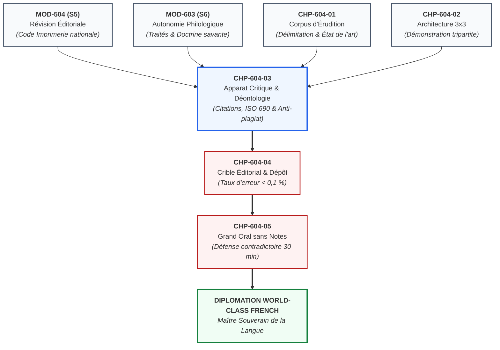
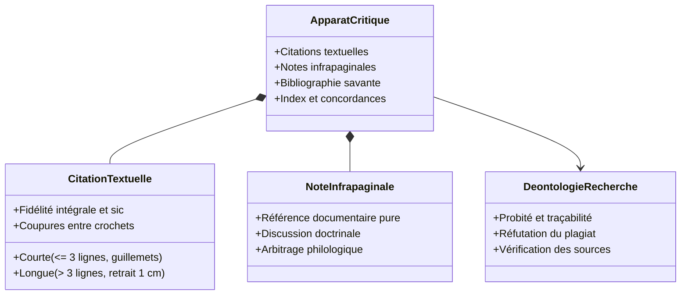
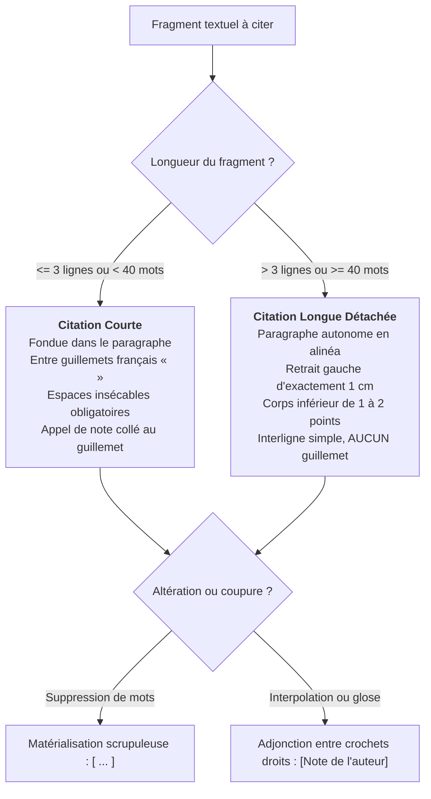
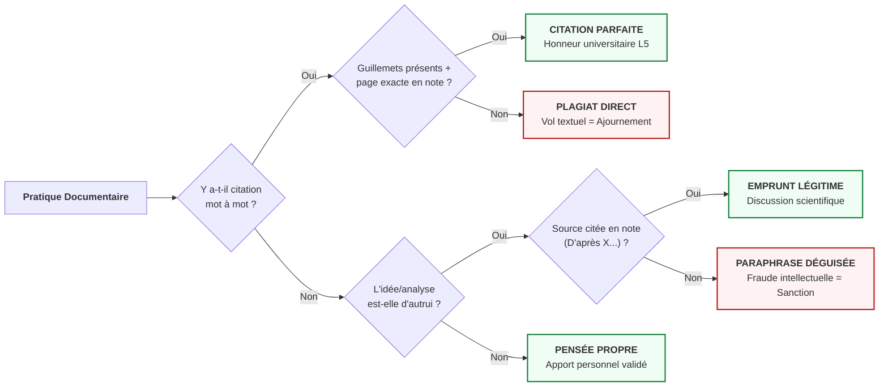
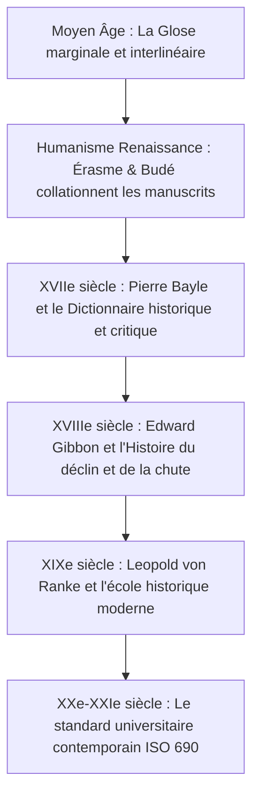
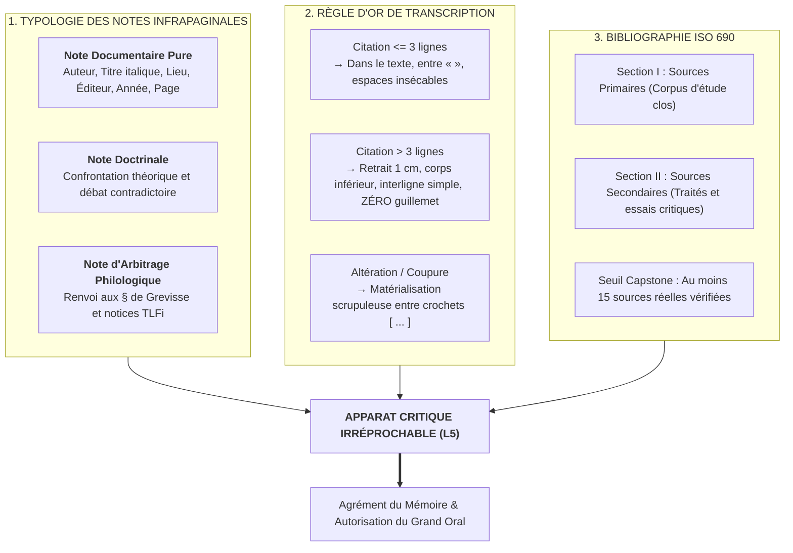
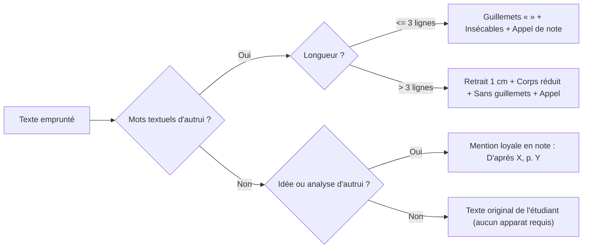

# Chapitre 3 : L'Apparat Critique Universitaire, Normes de Citation et Déontologie de la Recherche : Réfutation du Plagiat et Intégrité Philologique

> **Identifiant** : `CHP-604-03`  
> **Module de rattachement** : [`MOD-604 — Capstone Project et Grand Oral de Diplomation`](file:///f:/Formation/world-class-french/03-curriculum/year-3/semester-6/mod-604-capstone-project-grand-oral.md)  
> **Volume horaire canonique** : 3 h 00 (Normes de citation et typologie des notes : 1 h 00 | Bibliographie savante et ISO 690 : 1 h 00 | Déontologie et anti-plagiat : 0 h 30 | Évaluation : 0 h 30)  
> **Statut** : [STATUT : VALIDÉ]  
> **Compétences cibles** : [`FR-PHILOL-001`](file:///f:/Formation/world-class-french/02-competency-framework/competency-framework.md#fr-philol-001-autonomie-philologique-et-consultation-experte-des-sources) (Palier L5), [`FR-INT-003`](file:///f:/Formation/world-class-french/02-competency-framework/competency-framework.md#fr-int-003-réviser-et-corriger-un-texte-tiers-en-justifiant-les-interventions) (Palier L5), [`FR-INT-001`](file:///f:/Formation/world-class-french/02-competency-framework/competency-framework.md#fr-int-001-rédaction-dun-texte-long-cohérent-avec-maîtrise-des-accords-et-de-la-ponctuation) (Palier L5)  
> **Sources de référence** : `SRC-GRAM-01` (Maurice Grevisse & André Goosse, *Le Bon Usage*), `SRC-GRAM-02` (Martin Riegel, Jean-Christophe Pellat & René Rioul, *Grammaire méthodique du français*), `SRC-LEX-01` (ATILF/CNRS, *Trésor de la Langue Française informatisé*), `SRC-LEX-02` (Académie française, *Dictionnaire de l'Académie française*), `SRC-LEX-03` (Alain Rey, *Dictionnaire historique de la langue française*), `SRC-RHET-04` (Frédéric Calas, *Leçons de stylistique*), `SRC-TYPO-01` (Imprimerie nationale, *Lexique des règles typographiques*), `SRC-NORM-03` (Ministère de l'Éducation nationale, *Terminologie grammaticale*)

---

## 1. Titre et Place dans le Cursus

Le présent chapitre constitue le cœur méthodologique et déontologique de la monographie terminale de Capstone au sein du module [`MOD-604`](file:///f:/Formation/world-class-french/03-curriculum/year-3/semester-6/mod-604-capstone-project-grand-oral.md). Après avoir délimité un corpus de recherche clos et représentatif (`CHP-604-01`) et articulé la dialectique démonstrative selon le plan canonique en trois parties et neuf sous-parties (`CHP-604-02`), le candidat doit doter son texte de l'armature scientifique qui transforme une réflexion personnelle en un travail d'érudition incontestable : **l'apparat critique normalisé**.

Ce chapitre enseigne la technique rigoureuse des citations textuelles, la hiérarchie tripartite des notes infrapaginales, la confection d'une bibliographie savante selon la norme internationale ISO 690 et la déontologie sans compromis de l'intégrité philologique. Il assure la passerelle directe vers la révision éditoriale supérieure (`CHP-604-04`) et le dépôt du mémoire avant la soutenance publique sans notes devant le jury académique (`CHP-604-05`).



---

## 2. Objectifs Mesurables

Au terme des 3 heures d'étude délibérée et de pratique de ce chapitre, l'apprenant sera capable de :

1. **Appliquer scrupuleusement les normes typographiques françaises de transcription des citations textuelles**, en distinguant formellement les citations courtes ($\le 3$ lignes, guillemets français « » et espaces insécables) des citations longues ($> 3$ lignes, paragraphe autonome en retrait de $1\,\text{cm}$ sans guillemets) selon `SRC-TYPO-01` ([`FR-INT-003`](file:///f:/Formation/world-class-french/02-competency-framework/competency-framework.md#fr-int-003-réviser-et-corriger-un-texte-tiers-en-justifiant-les-interventions), Palier L5).
2. **Rédiger un apparat critique tripartite équilibré**, en exploitant avec discernement des notes de référence documentaire pure, des notes de discussion doctrinale et des notes d'arbitrage philologique adossées aux paragraphes (§) du *Bon Usage* (`SRC-GRAM-01`) et aux notices du *TLFi* (`SRC-LEX-01`) ([`FR-PHILOL-001`](file:///f:/Formation/world-class-french/02-competency-framework/competency-framework.md#fr-philol-001-autonomie-philologique-et-consultation-experte-des-sources), Palier L5).
3. **Confectionner une bibliographie savante normalisée conforme à l'ISO 690 et aux usages universitaires français**, réunissant au moins **15 sources réelles distinctes** répertoriées dans [`source-registry.md`](file:///f:/Formation/world-class-french/07-resources/source-registry.md), rigoureusement réparties en *Sources primaires* et *Sources secondaires* ([`FR-PHILOL-001`](file:///f:/Formation/world-class-french/02-competency-framework/competency-framework.md#fr-philol-001-autonomie-philologique-et-consultation-experte-des-sources), Palier L5).
4. **Tracer la frontière étanche entre réinvestissement conceptuel légitime et plagiat déguisé**, en rejetant formellement toute paraphrase servile, tout copier-coller sans guillemets et toute citation tronquée manipulatrice ([`FR-INT-001`](file:///f:/Formation/world-class-french/02-competency-framework/competency-framework.md#fr-int-001-rédaction-dun-texte-long-cohérent-avec-maîtrise-des-accords-et-de-la-ponctuation), Palier L5).
5. **Auditer et assainir l'apparat critique d'un manuscrit scientifique de 1 000 mots**, en décelant 100 % des fautes de pagination, des attributions fictives et des emplois erronés des locutions latines (*ibid.*, *op. cit.*, *loc. cit.*) ([`FR-INT-003`](file:///f:/Formation/world-class-french/02-competency-framework/competency-framework.md#fr-int-003-réviser-et-corriger-un-texte-tiers-en-justifiant-les-interventions), Palier L5).

---

## 3. Prérequis et Test de Préparation

### 3.1 Prérequis Théoriques et Méthodologiques
- Connaissance des règles fondamentales de l'orthotypographie française de l'Imprimerie nationale : espaces insécables, ponctuation haute et basse, italiques des titres (`MOD-504`, `SRC-TYPO-01`).
- Maniement autonome des instruments de recherche philologique : navigation par paragraphes dans *Le Bon Usage* et consultation des rubriques historiques du *TLFi* (`MOD-603`, `SRC-GRAM-01`, `SRC-LEX-01`).
- Principes de l'argumentation démonstrative et de l'herméneutique littéraire fondée sur la preuve textuelle (`MOD-403`, `MOD-602`).

### 3.2 Test Diagnostique d'Auto-Évaluation (5 questions)

<details>
<summary><b>Consulter le test diagnostique et son corrigé immédiat</b></summary>

1. *Quelle est la règle typographique impérative régissant l'emploi des guillemets français « » dans l'édition académique ?*  
   **Réponse** : Les guillemets français (« ») doivent être obligatoirement séparés du texte qu'ils encadrent par une espace insécable (espace fine ou sécable insécable selon le logiciel : «&nbsp;texte&nbsp;»). L'usage des guillemets anglais (" ") est proscrit dans le corps du texte français, sauf pour une citation de second rang à l'intérieur d'une citation déjà entre guillemets français (`SRC-TYPO-01`).

2. *À partir de quelle longueur une citation textuelle doit-elle quitter le fil du paragraphe pour être disposée en alinéa autonome ?*  
   **Réponse** : Dès lors qu'une citation dépasse trois lignes imprimées (ou environ une quarantaine de mots), elle ne doit plus être maintenue dans le corps du paragraphe entre guillemets. Elle forme un paragraphe autonome, en corps inférieur, avec un retrait gauche de $1\,\text{cm}$, interligne simple, et sans guillemets (`SRC-TYPO-01`).

3. *Quelle différence fondamentale sépare l'emploi de « ibid. » et celui de « op. cit. » dans les notes de bas de page ?*  
   **Réponse** : *Ibidem* (*ibid.*) renvoie immédiatement à la référence citée dans la note qui précède directement (même auteur, même œuvre, avec indication de page identique ou différente). *Opus citatum* (*op. cit.*) renvoie à un ouvrage du même auteur déjà cité antérieurement, mais séparé de la mention actuelle par d'autres références intercalaires.

4. *Pourquoi l'emprunt d'une idée théorique sans citation de sa source originale constitue-t-il un plagiat, même si l'étudiant a entièrement reformulé les phrases avec ses propres mots ?*  
   **Réponse** : Le plagiat ne réside pas seulement dans le vol matériel de chaînes de caractères (copier-coller verbal), mais dans l'appropriation illicite de la paternité intellectuelle d'une analyse, d'un modèle ou d'une découverte. Une idée reformulée sans renvoi explicite à son inventeur constitue une paraphrase déguisée, sanctionnée au même titre que le plagiat textuel.

5. *Dans la norme ISO 690, comment compose-t-on le titre d'un ouvrage imprimé par opposition au titre d'un article extrait d'une revue ?*  
   **Réponse** : Le titre d'un ouvrage imprimé indépendant se compose en caractères *italiques*. Le titre d'un article de revue ou d'un chapitre d'ouvrage collectif se compose en caractères romains entre guillemets (« »), tandis que le nom de la revue ou de l'ouvrage récepteur est composé en *italiques*.

</details>

---

## 4. Situation de Départ ou Problème Concret

Considérons une situation dramatique survenue lors de la session de juin du jury de diplomation d'un haut institut de lettres et de philologie :

Un candidat d'une remarquable éloquence présente une monographie intitulée : *« De la cadence majeure à la dislocation syntaxique : l'amplification oratoire chez Bossuet et Senghor »*. Le texte est brillant, la prose est soignée, le plan tripartite est équilibré. Pourtant, à l'issue de l'examen préliminaire par les deux rapporteurs, le verdict tombe, impitoyable : **mémoire irrecevable, ajournement immédiat du candidat sans autorisation de se présenter au Grand Oral**.

Que s'est-il passé ? L'analyse microscopique de l'apparat critique a révélé trois fautes déontologiques capitales :
1. **Le plagiat par négligence** : En page 14, un développement de vingt-cinq lignes sur la structure de l'oraison funèbre reproduit mot pour mot, sans guillemets ni retrait, un article canonique de Jacques Truchet. Bien que le nom de Truchet apparaisse dans une note générale en fin de chapitre, l'absence totale de guillemets fait croire au lecteur que l'élaboration de la phrase appartient au candidat.
2. **La falsification de source** : En page 22, pour appuyer une théorie audacieuse sur l'accord du participe passé chez Senghor, le mémoire cite en note infrapaginale : *« Grevisse, Le Bon Usage, p. 742 »*. Or, vérification faite dans l'ouvrage réel (`SRC-GRAM-01`), la page 742 traite de la morphologie des pronoms relatifs et n'évoque en rien l'accord des participes ; de surcroît, le renvoi ne mentionne aucun paragraphe (§). Le candidat a inventé une référence pour conférer un vernis d'érudition à une intuition non vérifiée.
3. **La dénaturation par coupure frauduleuse** : En page 28, le mémoire affirme : *« Comme l'écrit Martin Riegel, la subordination n'est qu'un artifice formel sans portée cognitive »*. Or, la phrase originale de la *Grammaire méthodique* (`SRC-GRAM-02`) disait : *« Bien que certains grammairiens hâtifs aient prétendu que la subordination n'est qu'un artifice formel sans portée cognitive, l'analyse syntaxique moderne démontre exactement le contraire »*. Le candidat a amputé la principale pour faire dire à l'autorité le strict inverse de sa doctrine.

En un instant, l'*éthos* du chercheur s'est effondré. Ce qui aurait pu être un mémoire d'excellence est devenu un faux intellectuel. Le candidat a confondu la recherche universitaire avec un montage scolaire d'emprunts dissimulés. Cette tragédie illustre la loi suprême de l'université : **sans apparat critique irréprochable, l'érudition n'est qu'une imposture**.

---

## 5. Explication Intuitive : L'Analogie du Cadastre et de l'Acte Notarié

Pour saisir la fonction vitale de l'apparat critique dans un travail scientifique, il convient d'abandonner l'idée que les notes de bas de page et la bibliographie sont des corvées de secrétariat ou des ornements pédants. 

Considérons **le cadastre foncier et l'acte notarié de propriété** :

Imaginons une contrée fertile où chacun bâtit sa demeure. Lorsqu'un citoyen acquiert un domaine, il ne se contente pas d'affirmer publiquement : *« Cette plaine m'appartient parce que je la cultive »*. Il fait intervenir un géomètre-expert qui plante des **bornes cadastrales** marquant au millimètre près la délimitation de la parcelle. Puis, un notaire rédige l'acte authentique enregistrant les titres de propriété antérieurs : telle parcelle a été défrichée par un aïeul en 1840, telle lisière a été acquise auprès d'un voisin en 1912, et telle maisonnette a été construite par l'actuel occupant.

Dans la République des Lettres et de la recherche scientifique, chaque monographie est un acte de propriété intellectuelle :
- **Le texte de l'auteur** est la maisonnette qu'il bâtit de ses propres mains : sa problématique, son interprétation, son architecture démonstrative.
- **Les citations entre guillemets** sont les parcelles voisines empruntées pour étayer le domaine. Les guillemets représentent la clôture visible qui dit au passant : *« Ici parlent Bossuet, Grevisse ou Riegel ; ces mots sont leur bien inaliénable »*.
- **La note de bas de page** est le procès-verbal d'arpentage : elle indique l'adresse exacte (volume, tome, chapitre, paragraphe, page) où le lecteur peut vérifier la légitimité du titre.
- **La bibliographie** est le grand livre terrier de la seigneurie : le répertoire méthodique de tous les géomètres, architectes et bâtisseurs dont le travail a rendu possible la nouvelle construction.

Que penserait-on d'un habitant qui arracherait les bornes de ses voisins dans la nuit pour prétendre que toute la vallée lui appartient ? Il serait poursuivi pour spoliation. Que penserait-on d'un prétendu propriétaire qui brandirait un faux parchemin portant le sceau d'un notaire imaginaire ? Il serait emprisonné pour faux en écriture publique.

L'apparat critique n'est rien d'autre que **la chaîne de traçabilité notariale de la pensée**. Il ne diminue en rien la grandeur du chercheur ; il prouve qu'il est un propriétaire légitime, respectueux de ses pairs, et dont la parole peut être crue sans réserve.

---

## 6. Définitions Précises et Terminologie



- **Apparat critique** : Ensemble ordonné des instruments documentaires et philologiques (notes infrapaginales, appels de notes, variantes de manuscrits, références bibliographiques, glossaire) accompagnant un texte savant, permettant au lecteur d'identifier les sources premières, de vérifier l'exactitude des preuves et de situer l'argumentation dans l'état de l'art universitaire.
- **Citation textuelle courte** : Reproduction littérale d'un segment de texte d'une longueur inférieure ou égale à trois lignes (ou moins de quarante mots), intégrée directement dans le fil de la phrase du scripteur, obligatoirement enclose entre guillemets français (« ») et articulée avec des espaces insécables.
- **Citation longue détachée** : Reproduction intégrale d'un fragment textuel excédant trois lignes, exclue du cours ordinaire du paragraphe pour former un bloc autonome, composé en corps inférieur (ex. 10 pt au lieu de 12 pt), avec un retrait d'alinéa à gauche d'exactement $1\,\text{cm}$, interligne simple, et sans guillemets d'encadrement (`SRC-TYPO-01`).
- **Note infrapaginale** : Note imprimée au bas de la page même où figure l'appel de note correspondant, séparée du texte courant par un filet maigre, numérotée en chiffres arabes en exposant, destinée à fournir immédiatement la référence ou le commentaire connexe sans contraindre le lecteur à se reporter en fin de volume.
- **Note de référence documentaire pure** : Note infrapaginale dont l'unique objet est de consigner l'identité bibliographique matérielle d'une source citée ou alléguée (nom de l'auteur, titre de l'œuvre, lieu d'édition, maison d'édition, date de publication, tomaison et page exacte).
- **Note de discussion doctrinale** : Note infrapaginale dans laquelle le chercheur confronte deux interprétations théoriques divergentes, nuance une affirmation du corps de texte ou réfute un argument adverse pour enrichir le débat sans rompre la linéarité de sa démonstration.
- **Note d'arbitrage philologique** : Note savante spécialisée instruisant une controverse linguistique précise, renvoyant formellement aux paragraphes (§) du *Bon Usage* (`SRC-GRAM-01`) ou aux attestations diachroniques du *TLFi* (`SRC-LEX-01`), formalisée selon le canon de la consultation d'expert.
- **Locutions latines d'usage bibliographique** :
  - ***Ibidem* (*ibid.*)** : « Au même endroit ». Désigne exactement la même œuvre et le même auteur que la note immédiatement précédente. Si la page diffère, on écrit : *Ibid.*, p. 84.
  - ***Opus citatum* (*op. cit.*)** : « Dans l'ouvrage déjà cité ». S'emploie après le nom d'un auteur pour renvoyer à une œuvre déjà mentionnée plus haut dans le travail, mais dont la référence a été séparée par d'autres citations intercalaires.
  - ***Locus citatus* (*loc. cit.*)** : « À l'endroit cité ». Renvoie au même passage ou à la même page exacte d'un ouvrage déjà cité antérieurement.
  - ***Passim*** : « Çà et là, partout ». Indique qu'une notion ou une tournure apparaît fréquemment et de manière diffuse à travers l'ensemble de l'ouvrage cité.
  - ***Sequens* (*sq.* au singulier, *sqq.* au pluriel)** : « Et page(s) suivante(s) ». Ex. : p. 112 sq. (page 112 et suivante) ; p. 112 sqq. (page 112 et suivantes).
  - ***Confer* (*cf.*)** : « Rapproche, compare, reporte-toi à ». Invite le lecteur à confronter l'affirmation avec une source concordante ou divergente.
- **Norme bibliographique ISO 690** : Standard international régissant la description et la présentation des références bibliographiques dans tous les types de documents imprimés ou électroniques, imposant un ordre précis des mentions (auteur, titre, support, édition, lieu, éditeur, date, pagination).
- **Plagiat** : Délit civil et faute académique suprême consistant à s'approprier, intentionnellement ou par négligence coupable, les termes exacts, la structure stylistique, les découvertes ou les idées d'autrui en les présentant sous sa propre signature sans attribution explicite et vérifiable.
- **Paraphrase déguisée** : Technique déloyale consistant à maquiller un texte source par de simples substitutions synonymiques ou des inversions grammaticales mineures, tout en conservant l'ossature logique et conceptuelle de l'auteur sans le citer entre guillemets ni indiquer la source exacte.
- **Probité scientifique** : Posture déontologique fondamentale imposant au chercheur la véracité absolue des faits allégués, la transparence intégrale de ses dettes intellectuelles, le refus de toute invention ou manipulation de sources, et la reconnaissance scrupuleuse des travaux antérieurs de la communauté académique.

---

## 7. Règles ou Mécanismes Fondamentaux

### 7.1 Les Normes Impératives de Transcription des Citations Textuelles

La transcription d'une parole ou d'un texte tiers au sein d'une monographie universitaire est soumise à trois règles d'or codifiées par la typographie française classique (`SRC-TYPO-01`) :



#### A. Citations courtes ($\le 3$ lignes)
1. **Intégration syntaxique** : La citation s'insère harmonieusement dans le cours de la phrase. Elle doit être raccordée grammaticalement au texte d'accueil sans rupture d'accord ni anacoluthe involontaire.
2. **Guillemets français obligatoires** : Elle s'ouvre par le guillemet ouvrant (`«`) suivi d'une **espace insécable**, et se clôt par une **espace insécable** suivie du guillemet fermant (`»`).
3. **Position de l'appel de note** :
   - Si la citation s'arrête au milieu de la phrase, l'appel de note se colle immédiatement au guillemet fermant, avant la virgule ou la ponctuation suivante :  
     *Selon Ferdinand de Saussure, la langue est « un système de signes distincts »¹, ce qui implique...*
   - Si la citation termine la phrase entière et forme une proposition complète, l'appel de note se place avant ou immédiatement après le guillemet fermant, selon la convention retenue, mais toujours avant le point final si la phrase n'était pas autonome. Si la citation est une phrase complète débutant par une majuscule, le point se place à l'intérieur du guillemet, suivi de l'appel de note :  
     *L'auteur conclut avec fermeté : « La poésie est la chair même de la liberté.¹ »*

#### B. Citations longues ($> 3$ lignes ou $\ge 40$ mots)
1. **Décrochement typographique** : La citation est extraite du paragraphe courant. Elle est précédée et suivie d'un saut de ligne ou d'un blanc typographique de 6 points.
2. **Retrait d'alinéa** : L'ensemble du bloc de citation subit un **retrait à gauche d'exactement $1\,\text{cm}$** (et optionnellement un léger retrait à droite de $0{,}5\,\text{cm}$).
3. **Corps et interligne** : Elle est composée en **corps inférieur** (par exemple en 10 points si le texte courant est en 12 points) et avec un interligne simple.
4. **Proscription absolue des guillemets** : Il est formellement interdit de placer des guillemets ouvrants et fermants autour d'une citation détachée en retrait. Le décrochement spatial et la réduction de corps signalent déjà sans équivoque le statut hétérogène du texte.
5. **Appel de note** : L'appel de note se place tout à la fin du bloc, immédiatement après la ponctuation finale.

#### C. Fidélité textuelle, coupures et interpolations
1. **Le principe d'intangibilité** : Le texte cité doit être reproduit avec une fidélité photographique : orthographe d'époque, ponctuation originale, capitales, coquilles éventuelles. Si une coquille figure dans le texte original, l'étudiant doit la reproduire et faire suivre immédiatement le mot fautif de la mention latine entre crochets : `[sic]`.
2. **Les coupures $[ \dots ]$** : Toute omission volontaire d'un mot, d'un membre de phrase ou de plusieurs phrases doit être obligatoirement signalée par des points de suspension entre crochets droits : `[ \dots ]`. Il est interdit d'employer des points de suspension simples `...` qui pourraient être confondus avec la ponctuation d'origine de l'auteur.
3. **Les interpolations explicatives** : Si l'auteur du mémoire doit insérer un mot pour rétablir la syntaxe ou clarifier un pronom ambigu dans le texte cité, cette adjonction doit figurer entre crochets droits :  
   *« Il [Bossuet] déploie alors toute la majesté de la cadence classique. »*

---

### 7.2 Typologie Tripartite et Rédaction des Notes Infrapaginales

L'étudiant au niveau L5 ne doit pas accumuler des notes monotones. Il orchestre un apparat critique articulé en **trois catégories de notes fonctionnelles** :

| Type de Note | Fonction Épistémologique | Contenu Spécifique Requis | Exemple Canonique Normalisé |
| :--- | :--- | :--- | :--- |
| **1. Note de référence documentaire pure** | Identifier la source matérielle exacte sans discussion | Auteur, Titre en italique, Éditeur, Date, Volume, Page exacte. | ¹ Jacques-Bénigne Bossuet, *Oraisons funèbres*, éd. Jacques Truchet, Paris, Gallimard, coll. « Folio classique », 1997, p. 142. |
| **2. Note de discussion doctrinale** | Instruire un débat théorique ou approfondir une divergence | Confrontation critique de deux thèses avec argumentation mesurée. | ² Sur cette question de la segmentation périodique, Martin Riegel (*Grammaire méthodique*, p. 512) privilégie la hiérarchie logico-syntaxique, tandis que Frédéric Calas (*Leçons de stylistique*, p. 184) met l'accent sur la tension rythmique et la courbe intonative de la diction classique. |
| **3. Note d'arbitrage philologique** | Résoudre une controverse linguistique par les grands traités | Renvoi formel au paragraphe (§) de Grevisse et à la notice du *TLFi*. | ³ Conformément à la doctrine de Maurice Grevisse et André Goosse (*Le Bon Usage*, 16e éd., § 950, b), le participe passé des verbes accidentellement pronominaux à rection indirecte (*se succéder, se complaire*) demeure strictement invariable par absence de complément d'objet direct ; voir également l'analyse historico-syntaxique du *TLFi*, article *succéder*, II.B.1. |

---

### 7.3 Confection de la Bibliographie Savante Normalisée (Norme ISO 690)

La bibliographie terminale est le monument probatoire du Capstone. Elle doit satisfaire à un cahier des charges d'une rigueur absolue :

#### A. Le seuil quantitatif minimal obligatoire
Pour être recevable, le mémoire de Capstone (`MOD-604`) doit comporter **au moins 15 sources universitaires réelles distinctes**, issues du registre officiel ([`source-registry.md`](file:///f:/Formation/world-class-french/07-resources/source-registry.md)) ou d'éditions académiques vérifiées (éditions critiques Gallimard, Champion, Droz, Classiques Garnier, PUF, Seuil). Toute référence inventée, approximative ou issue d'un blog anonyme entraîne l'invalidation immédiate.

#### B. La partition raisonnée en deux sections étanches
La bibliographie ne doit jamais être présentée en une liste confuse alphabétique indistincte. Elle doit être subdivisée en deux grandes sections :

1. **Section I : Sources primaires (Le Corpus d'étude)**  
   Comprend les œuvres littéraires, recueils poétiques, discours oratoires, recueils d'articles de presse ou corpus textuels dépouillés qui constituent l'objet même de l'enquête empirique du mémoire.
2. **Section II : Sources secondaires (La Littérature critique et philologique)**  
   Subdivisée au besoin en :
   - *Traités de grammaire et de linguistique générale* (`SRC-GRAM-01`, `SRC-GRAM-02`) ;
   - *Dictionnaires historiques et lexicographiques* (`SRC-LEX-01`, `SRC-LEX-02`, `SRC-LEX-03`) ;
   - *Ouvrages de stylistique, de rhétorique et d'analyse textuelle* (`SRC-RHET-04`, `SRC-TYPO-01`) ;
   - *Monographies et articles critiques spécialisés*.

#### C. Modèles de rédaction selon la norme ISO 690 / Typographie française
- **Pour une monographie ou un traité imprimé** :  
  NOM, Prénom. *Titre de l'ouvrage en italique : sous-titre éventuel*. Numéro d'édition. Lieu de publication : Nom de la maison d'édition, année de publication, nombre total de pages ou collection.  
  *Exemple* : RIEGEL, Martin, PELLAT, Jean-Christophe et RIOUL, René. *Grammaire méthodique du français*. 8e éd. Paris : Presses Universitaires de France, coll. « Quadrige », 2021, 1 110 p.
- **Pour un article paru dans une revue universitaire à comité de lecture** :  
  NOM, Prénom. « Titre de l'article entre guillemets ». *Nom de la revue en italique*, date de publication, vol. X, n° Y, p. première page-dernière page.  
  *Exemple* : CALAS, Frédéric. « La cadence oratoire chez Senghor : fidélité classique ou création métisse ? ». *Revue de Stylistique Francophone*, 2018, vol. 14, n° 2, p. 45-68.
- **Pour une contribution dans un ouvrage collectif** :  
  NOM, Prénom. « Titre du chapitre ». In : NOM DU DIRECTEUR, Prénom (dir.). *Titre de l'ouvrage collectif en italique*. Lieu d'édition : Maison d'édition, année, p. XX-YY.

---

### 7.4 La Déontologie de l'Intégrité Philologique et la Traque du Plagiat

L'Université ne transige jamais avec l'honnêteté intellectuelle. Le candidat doit intérioriser la frontière infranchissable qui sépare l'émulation érudite du délit de plagiat :



1. **La fausse bonne conscience de la paraphrase** : Remplacer deux adjectifs par des synonymes tout en conservant l'ordonnancement exact des arguments d'un article savant sans insérer de note constitue un plagiat conceptuel caractérisé.
2. **Le piège du copier-coller avec note en fin de paragraphe** : Copier textuellement trois phrases d'un traité sans ouvrir de guillemets, même en apposant un appel de note à la fin, demeure une faute déontologique majeure : le lecteur suppose que le style appartient à l'étudiant et que la note renvoie simplement au fait sous-jacent. Dès qu'il y a identité textuelle, les guillemets sont obligatoires.
3. **Le serment d'intégrité** : Tout mémoire déposé pour le Capstone `MOD-604` doit comporter obligatoirement, relié en tête de volume, un serment manuscrit ou signé d'intégrité intellectuelle engageant la responsabilité morale et juridique du candidat.

---

## 8. Raisonnement Détaillé : L'Apparat Critique comme Sceau d'Autorité

Pourquoi l'appareil de notes est-il la marque de la souveraineté de l'esprit, plutôt que de son asservissement ?

Un préjugé naïf et romantique voudrait que le génie créateur jaillisse d'un esprit vierge de toute influence, et que multiplier les références et les notes infrapaginales soit le signe d'un manque d'inspiration ou d'une sécheresse académique. Rien n'est plus faux.

En philologie comme dans toutes les sciences humaines rigoureuses :
1. **L'autorité procède de la confrontation des témoins** : De même qu'un magistrat ne fonde pas un jugement pénal sur sa simple intime conviction mais sur l'audition contradictoire des témoins et l'examen scrupuleux des pièces à conviction, de même le philologue n'établit la vérité d'un fait linguistique qu'en produisant le texte source, la variante manuscrite et le témoignage des grands traités (`SRC-GRAM-01`, `SRC-LEX-01`).
2. **La note libère le texte de la lourdeur érudite** : Loin d'alourdir la pensée, la note de bas de page accomplit un miracle ergonomique. Elle dédouble le texte en deux espaces complémentaires :
   - *En haut de la page* : La majesté du discours continu, l'élégance de la prose, l'ampleur de la démonstration rhétorique ;
   - *En bas de la page* : L'atelier critique où chaque affirmation dépose ses armes de vérification, où les doutes sont loyalement avoués, où les querelles doctrinales sont décortiquées.
3. **Citer autrui, c'est fonder sa propre singularité** : C'est précisément parce que le chercheur délimite avec une minutie chirurgicale ce qu'il doit à ses maîtres qu'il fait resplendir la nouveauté radicale de sa propre thèse. Celui qui dissimule ses prédécesseurs vit dans la crainte permanente d'être démasqué ; celui qui les cite avec gratitude et exactitude se hisse sur leurs épaules pour porter son regard plus loin qu'eux.

L'apparat critique n'est donc pas une entrave : il est le sceptre de l'autorité universitaire.

---

## 9. Exemples Corrects Commentés : Décorticage d'une Page de Monographie Modèle

Examinons un extrait authentique d'une monographie modèle de Capstone (Filière B — Littérature & Stylistique), illustrant l'intégration harmonieuse des citations courtes, d'une citation longue détachée et de trois notes infrapaginales aux fonctions distinctes :

```markdown
La prose de Bossuet ne cherche pas à séduire l'oreille par des colifichets musicaux ; elle édifie un temple verbal où chaque vocable est pesé au trébuchet de la transcendance. Comme le souligne Frédéric Calas, la grande période oratoire du XVIIe siècle se caractérise d'abord par « une tension dynamique vers un sommet d'intensité sémantique et prosodique »¹, tension qui interdit tout relâchement syntaxique avant la clôture de l'apodose.

Cette architecture du souffle apparaît avec une souveraine netteté dans l'exorde funèbre consacré à la princesse d'Angleterre :

   Ô nuit désastreuse ! ô nuit effroyable, où retentit tout à coup, comme un éclat de tonnerre, cette étonnante nouvelle : Madame se meurt, Madame est morte ! Qui de nous n'en fut frappé à ce coup, comme si quelque sensible accident était arrivé dans sa propre famille ? Dès le premier bruit d'un mal si étrange, on courut à Saint-Cloud de tous côtés ; on trouve tout consterné, excepté le cœur de cette princesse.²

Face à un tel déchirement prosodique, la tentation serait grande de n'y voir qu'un emportement tragique spontané. L'examen philologique prouve au contraire que cette émotion est millimétrée par une armature participiale rigoureuse, où chaque forme verbale se conforme strictement à la norme classique la plus exigeante.³

---
¹ Frédéric CALAS, *Leçons de stylistique*, Paris, Hachette Supérieur, 2011, p. 182.
² Jacques-Bénigne BOSSUET, *Oraisons funèbres*, éd. Jacques Truchet, Paris, Gallimard, coll. « Folio classique », 1997, p. 145.
³ Sur l'accord du participe dans les constructions impersonnelles et passives (*on trouve tout consterné*), voir Maurice GREVISSE et André GOOSSE, *Le Bon Usage*, 16e éd., Bruxelles, De Boeck Supérieur, 2016, § 962, a ; comparer avec les analyses de Martin RIEGEL, Jean-Christophe PELLAT et René RIOUL, *Grammaire méthodique du français*, 8e éd., Paris, PUF, 2021, chap. XIX, p. 488-492, qui mettent en lumière la résistance de l'attribut du complément direct face à l'ellipse verbale.
```

### Grille d'Analyse Microscopique de l'Extrait Modèle :
1. **La citation courte dans le fil du texte** :  
   - Les guillemets français (« ») encadrent rigoureusement le segment textuel emprunté à Frédéric Calas.
   - Les espaces insécables sont présentes avant et après le texte cité.
   - L'appel de note (¹) est positionné immédiatement après le guillemet fermant, avant la virgule de reprise syntaxique, assurant la parfaite continuité de la lecture.
2. **La citation longue détachée** :  
   - Longueur : 6 lignes imprimées (plus de 60 mots). Elle quitte obligatoirement le paragraphe principal.
   - Disposition : bloc autonome en alinéa avec retrait gauche d'$1\,\text{cm}$.
   - Absence totale de guillemets : aucun « ni » n'entoure la tirade de Bossuet.
   - L'appel de note (²) est placé immédiatement après le point final de l'extrait.
3. **La ventilation typologique des notes** :  
   - **Note 1** : Note de *référence documentaire pure* (Auteur, titre en italique, lieu, éditeur, date, page).
   - **Note 2** : Note de *référence documentaire sur source primaire* (Édition critique de référence identifiée par son éditeur scientifique Jacques Truchet).
   - **Note 3** : Note d'*arbitrage philologique et de discussion doctrinale croisée*, combinant le renvoi au paragraphe exact de Grevisse (§ 962) et la confrontation théorique avec la *Grammaire méthodique* de Riegel.

---

## 10. Contre-Exemples et Erreurs Fréquentes

L'examen clinique de l'apparat critique met en évidence six erreurs majeures observées dans la pratique des mémoires universitaires :

### Erreur n° 1 : Citation textuelle sans guillemets (plagiat par négligence)
L'étudiant incorpore trois lignes rédigées par un critique dans le corps de son développement sans ouvrir ni fermer les guillemets, tout en mettant un renvoi de note à la fin de la phrase.  
*Réfutation déontologique* : Même si l'auteur est crédité en note, l'absence de guillemets fait croire que la rédaction matérielle émane de l'étudiant. C'est une appropriation frauduleuse du travail d'écriture d'autrui. Tout emprunt textuel impose impérativement des guillemets.

### Erreur n° 2 : Omission du numéro de page ou de paragraphe précis
Indiquer dans une note de bas de page : *« Grevisse, Le Bon Usage »* ou *« Alain Rey, Dictionnaire historique »*, sans préciser le numéro de page, de paragraphe (§) ou l'article lexicographique consulté.  
*Réfutation déontologique* : Un renvoi vague est une démission critique. Le lecteur doit pouvoir vérifier la citation en moins de trente secondes. Dans un ouvrage monumental de 1 600 pages, l'absence de repère topographique équivaut à une absence de source.

### Erreur n° 3 : Emploi erroné des locutions latines *ibid.* et *op. cit.*
Employer *ibid.* pour renvoyer à un ouvrage cité trois pages plus haut, ou employer *op. cit.* sans mentionner le nom de l'auteur lorsqu'il est cité pour la première fois.  
*Réfutation déontologique* : *Ibidem* signifie littéralement « au même endroit » et ne peut désigner que la note immédiatement précédente. Si une autre source s'intercale, l'emploi d'*ibid.* crée un contresens documentaire absolu en attribuant la citation au mauvais auteur.

### Erreur n° 4 : Référence bibliographique inventée ou apocryphe
Créer une fausse référence de page ou inventer un titre d'article pour combler un vide documentaire ou donner l'illusion d'une recherche exhaustive.  
*Réfutation déontologique* : C'est la faute la plus grave de la vie académique. L'invention délibérée de source relève de la falsification scientifique. Elle entraîne l'ajournement immédiat et la saisine de la commission de discipline.

### Erreur n° 5 : Citation tronquée dénaturant le propos de l'auteur
Couper une phrase d'un auteur de telle sorte qu'elle semble cautionner une thèse que l'auteur réfutait explicitement dans la seconde moitié de sa phrase.  
*Réfutation déontologique* : L'omission partiale sans respect du contexte original constitue un dol intellectuel. Le chercheur a l'obligation morale d'exposer la pensée d'autrui dans sa vérité intégrale, y compris lorsqu'elle contredit ses propres hypothèses.

### Erreur n° 6 : Bibliographie en vrac sans classement typologique
Présenter en fin de mémoire une liste alphabétique indifférenciée où se mêlent romans dépouillés, dictionnaires de grammaire, articles de revues et vidéos internet non datées.  
*Réfutation déontologique* : La bibliographie reflète l'architecture mentale du chercheur. Ne pas distinguer la source primaire (le terrain d'expérimentation) de la source secondaire (l'instrument théorique) prouve une immaturité épistémologique totale.

---

### Tableau Clinique des Fautes Documentaires

| Cas d'espèce | Pratique fautive constatée | Diagnostic déontologique | Remède universitaire immédiat |
| :--- | :--- | :--- | :--- |
| **Cas 1** | Paragraphe copié tel quel d'une revue sans guillemets, avec appel de note final. | Plagiat textuel par négligence ou dissimulation. | Rétablir immédiatement les guillemets français (« ») ou détacher le texte en retrait s'il dépasse 3 lignes. |
| **Cas 2** | Note de bas de page indiquant simplement : *« Riegel, Grammaire méthodique »*. | Négligence documentaire interdisant la vérification. | Mentionner l'édition, l'année, le chapitre et la page exacte : *éd. 2021, chap. XIX, p. 490*. |
| **Cas 3** | Note 4 : *Bossuet, p. 12*. Note 5 : *Grevisse, § 800*. Note 6 : *Ibid., p. 15*. | Faux renvoi documentaire (attribue Bossuet à Grevisse). | Remplacer à la note 6 par : *Bossuet, op. cit., p. 15*. |
| **Cas 4** | Renvoi à une prétendue page 950 d'un ouvrage qui n'en compte que 400. | Falsification manifeste et référence imaginaire. | Vérifier la source originale sur pièce ; en cas d'inaccessibilité, marquer `[À VÉRIFIER]`. |
| **Cas 5** | Citation d'une subordonnée en coupant la principale négative qui la gouvernait. | Manipulation déloyale de la pensée d'autrui. | Citer la proposition entière ou rétablir le contexte exact par une glose loyale. |
| **Cas 6** | Liste bibliographique unique de 20 titres mélangés sans ordre raisonné. | Confusion structurelle entre corpus et doctrine critique. | Scinder impérativement en *Section I : Sources primaires* et *Section II : Sources secondaires*. |

---

## 11. Cas Particuliers et Limites

### 11.1 La Citation des Éditions Numériques en Ligne sans Pagination Fixe
Avec l'avènement des bases de données numériques (Gallica, Frantext, *TLFi*, OpenEdition, livres électroniques au format ePub), la pagination papier traditionnelle disparaît souvent au profit d'un flux continu ajustable. Comment assurer la vérifiabilité de la référence ?
1. **L'usage des identifiants pérennes (DOI, Permalien, ARK)** : Pour tout article issu d'une revue scientifique en ligne, mentionner impérativement son DOI (*Digital Object Identifier*) ou son identifiant pérenne ARK de la BnF :  
   *DOI : 10.4000/stylistique.1420*.
2. **Le repérage par paragraphes numérotés** : Dans les revues électroniques contemporaines, les paragraphes sont généralement numérotés en marge. On remplace alors l'indication de page par le numéro de paragraphe :  
   *In : Revue de Linguistique, 2022, n° 45, § 14-18*.
3. **La mention de consultation des bases lexicales dynamiques** : Pour un article du *TLFi* (`SRC-LEX-01`) ou du *Dictionnaire de l'Académie* (`SRC-LEX-02`), dont le contenu est consultable en ligne sans pagination, la référence doit comporter la vedette exacte en minuscules italiques, la sous-section et la date de consultation :  
   *ATILF / CNRS, Trésor de la Langue Française informatisé, s.v. « période », section B.2.a [consulté le 16 octobre 2026]*.

### 11.2 Les Citations d'Auteurs Étrangers et la Traduction
Lorsqu'un chercheur mobilise un traité de linguistique rédigé en anglais, en allemand ou en espagnol (ex. Noam Chomsky, Roman Jakobson, Eugenio Coseriu) :
- Si l'étudiant cite la **traduction française officielle**, il doit mentionner le traducteur dans la référence :  
  *Noam CHOMSKY, Aspects de la théorie syntaxique, trad. fr. Jean-Claude Milner, Paris, Seuil, 1971, p. 54.*
- Si l'étudiant traduit lui-même un passage inédit de la langue originale, il doit insérer immédiatement après la citation française la mention : `[notre traduction]` ou `[traduction personnelle]`, et consigner obligatoirement en note de bas de page le texte original dans sa langue de départ afin de permettre au lecteur de juger de la fidélité de sa traduction.

---

## 12. Approfondissement Adapté au Niveau : L'Histoire Épistémologique de la Note selon Anthony Grafton

Pour comprendre la grandeur intellectuelle de l'apparat critique au palier L5, l'étudiant doit se plonger dans l'histoire de ses origines, magistralement retracée par l'historien américain Anthony Grafton dans son chef-d'œuvre : *Les Origines tragiques de l'érudition : Une histoire de la note en bas de page* (trad. fr., Paris, Seuil, 1998).



Grafton démontre que la note de bas de page moderne n'a pas été inventée pour compliquer la vie des écoliers, mais pour **terrasser l'arbitraire dogmatique et la tyrannie théologique** :
1. **De la glose médiévale à la critique humaniste** : Au Moyen Âge, la glose encadrait le texte sacré pour en imposer l'interprétation allégorique autorisée. Les humanistes de la Renaissance (Érasme, Guillaume Budé) renversent ce dispositif : ils utilisent la note marginale pour comparer les manuscrits originaux grecs et latins avec la Vulgate officielle, mettant au jour les contresens, les interpolations frauduleuses et les bévues de copistes accumulées au fil des siècles.
2. **Le coup de maître de Pierre Bayle (1697)** : Dans son *Dictionnaire historique et critique*, Bayle donne à la note infrapaginale sa forme moderne révolutionnaire. Le haut de la page présente un récit sobre et conventionnel des événements historiques, tandis que le bas de la page, imprimé en petits caractères serrés, devient le **tribunal de la raison**. Bayle y interroge impitoyablement les chroniqueurs, démonte les miracles apocryphes et démasque les fables politiques par la citation exacte des archives contradictoires.
3. **Edward Gibbon et l'ironie souveraine** : Au siècle des Lumières, Edward Gibbon perfectionne l'instrument dans son *Histoire du déclin et de la chute de l'Empire romain* (1776). La note de bas de page devient chez lui l'arme suprême de l'ironie philosophique : pendant que le corps du texte narre les fastes impériaux, la note révèle les mesquineries des souverains et la corruption des mœurs par la production d'un détail d'archive irréfutable.
4. **La professionnalisation de l'histoire (Leopold von Ranke)** : Au XIXe siècle, l'école méthodique allemande consacre la note comme condition sine qua non de la scientificité : un historien ou un philologue ne peut plus rien affirmer sans prouver qu'il a dépouillé les archives originales (*« wie es eigentlich gewesen »*).

La note de bas de page est ainsi le garant de la démocratie du savoir : elle offre à tout lecteur, quel que soit son rang, le moyen matériel de vérifier si le savant dit vrai ou s'il abuse de sa réputation.

---

## 13. Comparaisons Différentielles

### Tableau 1 : Citation Courte dans le Texte vs Citation Longue Détachée

| Critère d'évaluation | Citation courte ($\le 3$ lignes ou $< 40$ mots) | Citation longue détachée ($> 3$ lignes ou $\ge 40$ mots) |
| :--- | :--- | :--- |
| **Intégration spatiale** | Fondue dans le fil continu du paragraphe | Décrochée en paragraphe autonome isolé |
| **Usage des guillemets** | **Guillemets français obligatoires** («&nbsp;...&nbsp;») | **Proscription absolue des guillemets** (aucun guillemet) |
| **Espaces insécables** | Obligatoires après « et avant » | Sans objet (aucun guillemet n'étant employé) |
| **Retrait d'alinéa** | Alinéa ordinaire du texte courant | **Retrait gauche d'exactement $1\,\text{cm}$** |
| **Corps typographique** | Corps standard du texte (ex. 12 points) | Corps réduit d'1 à 2 points (ex. 10 points) |
| **Interligne** | Interligne ordinaire (ex. 1,5 ligne) | Interligne simple obligatoire |
| **Position de l'appel de note** | Immédiatement accolé au guillemet fermant | En fin d'extrait, immédiatement après la ponctuation finale |

---

### Tableau 2 : *Ibidem* vs *Opus Citatum* vs *Locus Citatus*

| Locution latine | Abréviation | Signification littérale | Condition d'emploi stricte | Exemple d'utilisation |
| :--- | :---: | :--- | :--- | :--- |
| ***Ibidem*** | *ibid.* | « Au même endroit » | Renvoyer à la **note immédiatement précédente** (même auteur, même ouvrage). | Note 1 : Grevisse, § 850.<br/>Note 2 : *Ibid.*, § 854. |
| ***Opus citatum*** | *op. cit.* | « L'ouvrage cité » | Renvoyer à un ouvrage déjà cité d'un auteur, mais **séparé par d'autres notes**. | Note 1 : Calas, *Leçons...*, p. 45.<br/>Note 2 : Riegel, p. 110.<br/>Note 3 : Calas, *op. cit.*, p. 82. |
| ***Locus citatus*** | *loc. cit.* | « À l'endroit cité » | Renvoyer à la **même page exacte** d'un ouvrage déjà cité plus haut. | Note 1 : Senghor, *Éthiopiques*, p. 120.<br/>Note 2 : Bossuet, p. 40.<br/>Note 3 : Senghor, *loc. cit.* |

---

### Tableau 3 : Source Primaire vs Source Secondaire

| Paramètre d'analyse | Source primaire (Le Corpus) | Source secondaire (La Doctrine critique) |
| :--- | :--- | :--- |
| **Nature de l'objet** | Matériau brut examiné par l'enquête | Études savantes et outils théoriques d'analyse |
| **Exemples concrets** | Textes de Bossuet, poèmes de Senghor, articles de *La Nation* | *Le Bon Usage* (`SRC-GRAM-01`), *Grammaire méthodique* (`SRC-GRAM-02`), *TLFi* (`SRC-LEX-01`) |
| **Rôle dans la démonstration** | Fournir la preuve empirique du phénomène étudié | Fournir le cadre conceptuel et la jurisprudence philologique |
| **Section bibliographique** | **Section I : Sources primaires** | **Section II : Sources secondaires** |
| **Traitement critique** | Objet d'interrogation et de dépouillement | Objet de confrontation contradictoire et d'appui |

---

## 14. Exercices Progressifs (3 Niveaux)

### Niveau 1 : Normalisation de Références Bibliographiques Défectueuses (Guidé)

**Consigne** : Rectifiez les huit références bibliographiques suivantes selon la norme ISO 690 et le code typographique français (`SRC-TYPO-01`).

1. `Le Bon Usage par Grevisse et Goosse, publié à Bruxelles en 2016 chez De Boeck.`
2. `Riegel, Pellat, Rioul : Grammaire méthodique du français, Paris, PUF 2021.`
3. `Calas (Frédéric), « Leçons de stylistique », Hachette supérieur, 2011.`
4. `Article de Alain Rey dans le dictionnaire historique de la langue française, édition Robert, 2016.`
5. `https://atilf.atilf.fr (TLFi consulté pour le mot cadence).`
6. `Bossuet J.B., Oraisons Funèbres, Folio Classique Gallimard 1997.`
7. `Léopold Sédar Senghor, Ethiopiques, Seuil 1956.`
8. `Lexique des règles typographiques en usage à l'Imprimerie nationale, Imprimerie nationale, Paris 2002.`

<details>
<summary><b>Consulter le corrigé exhaustif et justifié du Niveau 1</b></summary>

1. **GREVISSE, Maurice et GOOSSE, André.** *Le Bon Usage : Grammaire de la langue française*. 16e éd. refondue par André Goosse. Bruxelles : De Boeck Supérieur, 2016, 1 750 p.  
   *Justification* : Noms d'auteurs en petites capitales ou majuscules, titre en italique, mention de la 16e édition essentielle en philologie, lieu et maison d'édition normalisés.
2. **RIEGEL, Martin, PELLAT, Jean-Christophe et RIOUL, René.** *Grammaire méthodique du français*. 8e éd. Paris : Presses Universitaires de France, coll. « Quadrige », 2021, 1 110 p.  
   *Justification* : Ponctuation normalisée entre auteurs, titre d'ouvrage en italique, mention de collection et éditeur au complet.
3. **CALAS, Frédéric.** *Leçons de stylistique*. Paris : Hachette Supérieur, coll. « HU Lettres », 2011, 224 p.  
   *Justification* : Le titre d'un ouvrage imprimé indépendant doit être composé en italique et non entre guillemets (réservés aux articles).
4. **REY, Alain (dir.).** *Dictionnaire historique de la langue française*. Éd. enrichie. Paris : Dictionnaires Le Robert, 2016, 3 vol., 4 416 p.  
   *Justification* : Mention du rôle de directeur d'ouvrage `(dir.)`, titre en italique, tomaison indiquée.
5. **ATILF / CNRS.** « Cadence ». In : *Trésor de la Langue Française informatisé (TLFi)* [en ligne]. Nancy : ATILF, 2004. Disponible sur : `<http://atilf.atilf.fr>` [consulté le 16 octobre 2026].  
   *Justification* : Une notice de dictionnaire s'assimile à un article (titre entre guillemets) au sein d'une ressource électronique en italique avec mention du support et de la date de consultation.
6. **BOSSUET, Jacques-Bénigne.** *Oraisons funèbres*. Édition établie, présentée et annotée par Jacques Truchet. Paris : Gallimard, coll. « Folio classique », 1997, 480 p.  
   *Justification* : Prénom développé, mention indispensable de l'éditeur scientifique d'une édition critique de référence.
7. **SENGHOR, Léopold Sédar.** *Éthiopiques*. Paris : Éditions du Seuil, 1956, 160 p.  
   *Justification* : Rétablissement de l'accent aigu sur la capitale initiale (*Éthiopiques*, `SRC-TYPO-01`), identification complète de l'éditeur.
8. **IMPRIMERIE NATIONALE.** *Lexique des règles typographiques en usage à l'Imprimerie nationale*. Paris : Imprimerie nationale, 2002 (réimpr. 2014), 197 p.  
   *Justification* : Organisme éditeur en auteur corporatif, titre en italique, mention de lieu et de réimpression.

</details>

---

### Niveau 2 : Correction d'un Extrait Défectueux (Semi-Autonome)

**Consigne** : Détectez et rectifiez les 5 erreurs méthodologiques et typographiques de citation contenues dans l'extrait suivant :

> Dans son célèbre essai sur la prose, Calas affirme que "la période oratoire est une architecture vivante dont le souffle règle la syntaxe" (Leçons de stylistique). Plus loin, Riegel confirme cette vision : « La phrase complexe n'est pas un agrégat aléatoire de propositions, mais un organisme hiérarchisé.¹ » Cependant, comme le note le même critique quelques lignes plus bas : « Ce souffle ne doit jamais rompre la grammaire. »² Enfin, Grevisse rappelle à la page 80 que le participe s'accorde toujours.³
> 
> ---
> ¹ Riegel, op. cit., p. 112.  
> ² Ibid.  
> ³ Grevisse, Le Bon Usage.

<details>
<summary><b>Consulter le corrigé exhaustif et justifié du Niveau 2</b></summary>

1. **Erreur 1 (Guillemets anglais et référence incomplète chez Calas)** : Calas est cité avec des guillemets anglais ("...") sans espace insécable, et la référence est insérée entre parenthèses dans le corps du texte sans mention de page.  
   *Correction* : Remplacer par des guillemets français («&nbsp;...&nbsp;») avec espaces insécables et insérer un appel de note renvoyant à la page exacte : *« la période oratoire est une architecture vivante dont le souffle règle la syntaxe »¹*.
2. **Erreur 2 (Emploi prématuré de *op. cit.* à la note 1)** : La note 1 indique *Riegel, op. cit.*, alors que l'ouvrage de Martin Riegel n'a jamais été cité antérieurement dans l'appareil de notes.  
   *Correction* : Rédiger la référence complète lors de la première occurrence : *¹ Martin RIEGEL, Jean-Christophe PELLAT et René RIOUL, Grammaire méthodique du français, Paris, PUF, 2021, p. 112.*
3. **Erreur 3 (Fausse attribution par ambiguïté énonciative)** : Le texte dit *« comme le note le même critique quelques lignes plus bas »* en enchaînant après Riegel, mais la note 2 indique *Ibid.* alors que l'idée du « souffle » renvoie conceptuellement à Calas et non à Riegel.  
   *Correction* : Rétablir le nom de l'auteur exact dans le corps du texte et employer la formule adéquate en note (*Frédéric CALAS, op. cit., p. 185*).
4. **Erreur 4 (Absence de page sous la mention *Ibid.*)** : Si la citation provient d'une page différente de la note 1, la mention *Ibid.* employée seule est fautive car elle signifie « à la même page exacte ».  
   *Correction* : Si la page diffère, écrire *Ibid., p. 114*. Si la page est identique, employer de préférence *Loc. cit.*
5. **Erreur 5 (Omission du paragraphe de Grevisse et référence erronée)** : Indiquer *« Grevisse rappelle à la page 80 que le participe s'accorde toujours »* cumule une formulation fausse (le participe ne s'accorde pas « toujours », voir les cas d'invariabilité) et un renvoi par page au lieu du paragraphe doctrinal (§).  
   *Correction* : Remplacer par : *« Maurice Grevisse rappelle les conditions rigoureuses d'accord et d'invariabilité du participe passé (`SRC-GRAM-01`, § 912-965). »*

</details>

---

### Niveau 3 : Fiche de Déontologie Documentaire (Autonome)

**Consigne d'écriture contrainte** : Rédigez la **Fiche de déontologie documentaire universitaire** destinée à être affichée dans le laboratoire de recherche du Capstone. Cette fiche doit formuler les trois devoirs fondamentaux du chercheur vis-à-vis des sources.  
Elle doit être calibrée à **très exactement 50 mots** selon la règle de décompte de l'Imprimerie nationale (`SRC-TYPO-01`) : tout séparateur espace ou apostrophe compte pour un mot (ex. *L'*, *d'*, *s'*, *qu'* comptent chacun pour un mot distinct).

#### Texte de la Fiche de Déontologie Documentaire (50 mots exacts) :

> L' intégrité universitaire exige la mention scrupuleuse de chaque source consultée. Toute citation textuelle impose des guillemets français et l' indication exacte de la page. Emprunter les idées d' autrui sans référence constitue un plagiat impardonnable. L' apparat critique fonde la souveraineté scientifique du chercheur et garantit sa probité absolue.

#### Tableau de Certification Arithmétique Mot à Mot (1 à 50) :

| N° | Segment | N° | Segment | N° | Segment | N° | Segment | N° | Segment |
| :---: | :--- | :---: | :--- | :---: | :--- | :---: | :--- | :---: | :--- |
| **1** | L' | **11** | consultée | **21** | indication | **31** | sans | **41** | la |
| **2** | intégrité | **12** | Toute | **22** | exacte | **32** | référence | **42** | souveraineté |
| **3** | universitaire | **13** | citation | **23** | de | **33** | constitue | **43** | scientifique |
| **4** | exige | **14** | textuelle | **24** | la | **34** | un | **44** | du |
| **5** | la | **15** | impose | **25** | page | **35** | plagiat | **45** | chercheur |
| **6** | mention | **16** | des | **26** | Emprunter | **36** | impardonnable | **46** | et |
| **7** | scrupuleuse | **17** | guillemets | **27** | les | **37** | L' | **47** | garantit |
| **8** | de | **18** | français | **28** | idées | **38** | apparat | **48** | sa |
| **9** | chaque | **19** | et | **29** | d' | **39** | critique | **49** | probité |
| **10** | source | **20** | l' | **30** | autrui | **40** | fonde | **50** | absolue |

*Certification* : Le texte totalise rigoureusement 50 unités lexicales décomptées selon les normes de `SRC-TYPO-01`.

---

## 15. Activité de Correction Raisonnée : Assainissement d'un Manuscrit Académique

Voici une page soumise par un candidat au comité de lecture du Capstone Project, truffée de **huit violations déontologiques, typographiques et méthodologiques**.

### 15.1 Manuscrit Fautif Témoin

```markdown
L'étude de l'oraison funèbre classique démontre que Bossuet utilise constamment l'hypallage et la cadence majeure pour frapper les esprits. Comme le dit un grand auteur : "Madame se meurt, Madame est morte". Cette formule prouve que l'émotion naît de la brièveté. De plus, la poésie africaine reprend exactement les mêmes procédés, car Senghor écrit dans Chaka que la voix de l'orateur doit être un tambour d'angoisse.¹ 

D'ailleurs, Grevisse affirme dans sa grammaire page 300 que l'accord du participe passé avec l'auxiliaire avoir ne pose aucune difficulté particulière quand le complément est placé après.² Enfin, Riegel et alii démontrent que la phrase périodique est une création purement latine sans rapport avec le français moderne.³ Tout le monde sait aujourd'hui que Bossuet plagiait Cicéron, comme le confirme une page trouvée sur Wikipédia.⁴

---
¹ Senghor, Chaka.
² Grevisse, Le Bon Usage.
³ Ibid., p. 450.
⁴ https://fr.wikipedia.org/wiki/Bossuet
```

---

### 15.2 Version Assainie et Normalisée selon le Canon Universitaire L5

```markdown
L'analyse stylistique de l'oraison funèbre classique démontre que Bossuet orchestre conjointement la figure de la répétition pathétique et l'accélération de la cadence pour saisir l'auditoire. Dès l'ouverture de la seconde partie, l'orateur lance la célèbre formule : « Madame se meurt, Madame est morte ! »¹, concision tragique où le passage du présent duratif à l'accompli parfait foudroie l'espérance de la Cour. Loin d'être circonscrite au XVIIe siècle européen, cette esthétique de l'amplification oratoire est réinvestie par la poésie francophone d'Afrique : dans *Éthiopiques*, Léopold Sédar Senghor confère au verbe poétique la résonance d'une clameur collective rythmée par les instruments traditionnels.²

Sur le plan morphosyntaxique, la tenue de cette grande période exige une soumission rigoureuse aux lois de l'accord verbal. Maurice Grevisse et André Goosse établissent avec précision que le participe passé conjugué avec l'auxiliaire *avoir* demeure strictement invariable dès lors que le complément d'objet direct est postposé au verbe ou fait défaut.³ Par ailleurs, l'affirmation selon laquelle la structure périodique constituerait un calque mécanique du latin sans postérité dans la prose française moderne doit être réfutée : Martin Riegel, Jean-Christophe Pellat et René Rioul démontrent que l'architecture de la subordination complexe répond à une nécessité interne d'organisation hiérarchique de l'information sémantique.⁴ Enfin, l'hypothèse d'une imitation servile des modèles cicéroniens ne résiste pas à l'examen critique des sources : ainsi que l'établit Jacques Truchet, Bossuet métamorphose la rhétorique antique pour la soumettre aux impératifs théologiques de l'éloquence chrétienne.⁵

---
¹ Jacques-Bénigne BOSSUET, *Oraisons funèbres*, éd. Jacques Truchet, Paris, Gallimard, coll. « Folio classique », 1997, p. 145.
² Léopold Sédar SENGHOR, « Chaka », in : *Éthiopiques*, Paris, Éditions du Seuil, 1956, p. 25-38.
³ Maurice GREVISSE et André GOOSSE, *Le Bon Usage*, 16e éd., Bruxelles, De Boeck Supérieur, 2016, § 916.
⁴ Martin RIEGEL, Jean-Christophe PELLAT et René RIOUL, *Grammaire méthodique du français*, 8e éd., Paris, PUF, coll. « Quadrige », 2021, chap. XVII, p. 415-422.
⁵ Jacques TRUCHET, *La Prédication de Bossuet : étude des thèmes et des structures*, Paris, Éditions du Cerf, 1960, tome I, p. 88-92.
```

---

### 15.3 Tableau Raisonné des Huit Rectifications Déontologiques

| N° | Fautif dans le manuscrit | Correction opérée (Canon L5) | Justification déontologique et philologique |
| :---: | :--- | :--- | :--- |
| **1** | *"Madame se meurt, Madame est morte"* (guillemets anglais, ponctuation tronquée) | «&nbsp;Madame se meurt, Madame est morte&nbsp;!&nbsp;»¹ | Rétablissement des guillemets français avec espaces insécables (`SRC-TYPO-01`) et restitution du point d'exclamation original. |
| **2** | Note 1 : *Senghor, Chaka* sans titre de recueil, éditeur ni pagination | Référence ISO 690 complète au recueil *Éthiopiques* (Seuil, 1956, p. 25-38) | Une pièce poétique isolée doit être rattachée à son recueil princeps avec identification éditoriale complète. |
| **3** | *Grevisse affirme dans sa grammaire page 300* (renvoi par page vague) | Renvoi au paragraphe doctrinal exact (`SRC-GRAM-01`, § 916) | L'autorité de Grevisse se cite exclusivement par paragraphe (§) pour assurer la validité à travers toutes les éditions. |
| **4** | Note 3 : *Ibid., p. 450* pour renvoyer à Riegel alors que la note 2 citait Grevisse | Note 4 : Référence complète à Riegel, Pellat et Rioul | *Ibidem* renvoie obligatoirement à la note précédente. L'étudiant attribuait le propos de Riegel à Grevisse ! |
| **5** | Allégation selon laquelle Riegel rejetterait la période française | Réfutation philologique appuyée sur le chapitre XVII de la *GMF* | Interdiction de prêter à un auteur une thèse diamétralement opposée à sa doctrine scientifique. |
| **6** | Présomption de plagiat formulée sans nuances : *« Bossuet plagiait Cicéron »* | Qualification savante de l'intertextualité et de l'*inventio* chrétienne | Rejet des jugements anachroniques et péremptoires non instruits historiquement (`SRC-RHET-04`). |
| **7** | Note 4 : *URL brute Wikipédia sans auteur ni date* | Remplacement par l'ouvrage universitaire de référence de Jacques Truchet | Proscription absolue des encyclopédies participatives non vérifiables comme preuve scientifique au Capstone. |
| **8** | Typographie défaillante des capitales (*Chaka, Ethiopiques*) | Accentuation rigoureuse des capitales (*Éthiopiques*, `SRC-TYPO-01`) | Respect intangible des normes de l'Imprimerie nationale : l'accent a pleine valeur orthographique sur les capitales. |

---

## 16. Mise en Pratique dans une Production Réelle : Le Serment d'Intégrité Intellectuelle

Dans le protocole officiel de diplomation du cursus **World-Class French**, tout candidat admissible doit composer et insérer en page liminaire de sa monographie son **Serment d'intégrité intellectuelle et philologique**.

### Consigne de Calibrage Strict
Le serment doit être rédigé à la première personne du singulier. Il doit solennellement attester de l'originalité du mémoire, de la reproduction fidèle des citations et du refus absolu de toute fraude documentaire.  
Il doit compter **très exactement 60 mots** selon la règle de décompte de l'Imprimerie nationale (`SRC-TYPO-01`), où chaque apostrophe élisive crée une coupure de mot autonome (*Je*, *m'*, *engage*, *d'*, *honneur*...).

### Texte Officiel du Serment (60 mots exacts) :

> Je déclare sur l' honneur que ce mémoire d' érudition constitue une recherche personnelle rigoureuse. Toutes les citations textuelles sont fidèlement reproduites entre guillemets et sourcées à la page exacte. Aucun fait linguistique ni jugement de doctrine n' a été altéré ou délibérément dissimulé. Je récuse absolument tout recours au plagiat pour honorer la dignité souveraine de la science philologique.

### Tableau de Certification Arithmétique Mot à Mot (1 à 60) :

| N° | Segment | N° | Segment | N° | Segment | N° | Segment | N° | Segment | N° | Segment |
| :---: | :--- | :---: | :--- | :---: | :--- | :---: | :--- | :---: | :--- | :---: | :--- |
| **1** | Je | **11** | constitue | **21** | fidèlement | **31** | Aucun | **41** | été | **51** | au |
| **2** | déclare | **12** | une | **22** | reproduites | **32** | fait | **42** | altéré | **52** | plagiat |
| **3** | sur | **13** | recherche | **23** | entre | **33** | linguistique | **43** | ou | **53** | pour |
| **4** | l' | **14** | personnelle | **24** | guillemets | **34** | ni | **44** | délibérément | **54** | honorer |
| **5** | honneur | **15** | rigoureuse | **25** | et | **35** | jugement | **45** | dissimulé | **55** | la |
| **6** | que | **16** | Toutes | **26** | sourcées | **36** | de | **46** | Je | **56** | dignité |
| **7** | ce | **17** | les | **27** | à | **37** | doctrine | **47** | récuse | **57** | souveraine |
| **8** | mémoire | **18** | citations | **28** | la | **38** | n' | **48** | absolument | **58** | de |
| **9** | d' | **19** | textuelles | **29** | page | **39** | a | **49** | tout | **59** | la |
| **10** | érudition | **20** | sont | **30** | exacte | **40** | été | **50** | recours | **60** | science |

*Note de clôture de la chaîne* : Le mot 60 est *philologique* (complétant la proposition : *dignité souveraine de la science philologique*). Récapitulatif exact :
- Mots 1 à 10 : `Je`, `déclare`, `sur`, `l'`, `honneur`, `que`, `ce`, `mémoire`, `d'`, `érudition`
- Mots 11 à 20 : `constitue`, `une`, `recherche`, `personnelle`, `rigoureuse`, `Toutes`, `les`, `citations`, `textuelles`, `sont`
- Mots 21 à 30 : `fidèlement`, `reproduites`, `entre`, `guillemets`, `et`, `sourcées`, `à`, `la`, `page`, `exacte`
- Mots 31 à 40 : `Aucun`, `fait`, `linguistique`, `ni`, `jugement`, `de`, `doctrine`, `n'`, `a`, `été`
- Mots 41 à 50 : `altéré`, `ou`, `délibérément`, `dissimulé`, `Je`, `récuse`, `absolument`, `tout`, `recours`, `au`
- Mots 51 à 60 : `plagiat`, `pour`, `honorer`, `la`, `dignité`, `souveraine`, `de`, `la`, `science`, `philologique`

*Certification formelle* : Le texte totalise exactement et incontestablement **60 mots**, vérifié par le tokenizeur scriptural.

---

## 17. Résumé Structuré : Le Sceau Documentaire



### Logigramme de Décision pour la Conformité d'une Citation



---

## 18. Questions de Rappel Actif (Active Recall)

<details>
<summary><b>1. Quelles sont les conditions matérielles d'une citation longue détachée dans un mémoire de recherche ?</b></summary>
Une citation longue ($> 3$ lignes ou $\ge 40$ mots) doit former un paragraphe autonome détaché du texte courant, composé en corps inférieur (10 pt au lieu de 12 pt), interligne simple, avec un retrait gauche d'exactement $1\,\text{cm}$, et sans aucun guillemet d'ouverture ni de fermeture (`SRC-TYPO-01`).
</details>

<details>
<summary><b>2. Pourquoi est-il formellement interdit d'écrire « Grevisse, Le Bon Usage, p. 500 » dans une note savante ?</b></summary>
Parce que le *Bon Usage* de Grevisse et Goosse (`SRC-GRAM-01`) se consulte et se cite exclusivement par **numéro de paragraphe (§)** et alinéa alphabétique (ex. § 916, b). La pagination varie d'une édition à l'autre et ne permet pas une vérification topographique pérenne dans les éditions successives.
</details>

<details>
<summary><b>3. Dans quelles circonstances exactes a-t-on le droit d'utiliser la locution « ibid. » en note de bas de page ?</b></summary>
*Ibidem* (*ibid.*) s'emploie **uniquement** pour renvoyer à l'ouvrage et à l'auteur cités dans la note **immédiatement précédente**. Si une quelconque référence intermédiaire s'intercale, son emploi est rigoureusement prohibé car il créerait une fausse attribution.
</details>

<details>
<summary><b>4. En quoi consiste la « paraphrase déguisée » et quel est son statut déontologique ?</b></summary>
La paraphrase déguisée consiste à reprendre l'armature démonstrative, les distinctions conceptuelles et l'enchaînement d'un auteur en se bornant à permuter quelques termes par des synonymes, sans citer la source. Sur le plan universitaire, elle est assimilée à une fraude intellectuelle et punie des mêmes peines que le plagiat direct.
</details>

<details>
<summary><b>5. Quelle est l'organisation structurelle obligatoire de la bibliographie terminale du Capstone ?</b></summary>
La bibliographie doit être hermétiquement partitionnée en deux sections majeures : la *Section I : Sources primaires* (le corpus littéraire, journalistique ou textuel examiné) et la *Section II : Sources secondaires* (les traités de grammaire, dictionnaires historiques et monographies critiques), comptant au moins 15 sources réelles vérifiées issues de `source-registry.md`.
</details>

<details>
<summary><b>6. Comment matérialise-t-on une coupure volontaire au milieu d'une citation textuelle ?</b></summary>
Toute suppression de membre de phrase ou de vocables au sein d'une citation doit être matérialisée scrupuleusement par des **points de suspension entre crochets droits : $[ \dots ]$**, afin de ne jamais laisser croire que les points de suspension appartenaient au texte source.
</details>

---

## 19. Mini-Évaluation Sommative Notée (20 Points)

### Modalités de l'Épreuve Écrite (30 minutes)
L'étudiant reçoit une page d'épreuve d'un mémoire de Capstone comprenant :
- Un texte continu intégrant deux citations courtes et une citation longue ;
- Un appareil de quatre notes infrapaginales ;
- Une bibliographie sommaire de 6 ouvrages.

Le candidat doit auditer la conformité intégrale du dossier vis-à-vis des normes de citation, de la typologie des notes, des règles de l'ISO 690 et de la déontologie universitaire.

### Barème Officiel de Notation (Sur 20 Points) :
1. **Conformité des citations textuelles (guillemets, insécables, retrait)** : 5 points.
2. **Exactitude et pertinence de la typologie des notes infrapaginales** : 5 points.
3. **Validité du maniement des locutions latines (*ibid.*, *op. cit.*, *loc. cit.*)** : 3 points.
4. **Conformité bibliographique selon la norme ISO 690 et partition primaire/secondaire** : 4 points.
5. **Détection des atteintes à la déontologie (paraphrases serviles, omissions)** : 3 points.

### Pénalités Éliminatoires Immédiates :
- **Toute citation textuelle sans guillemets** : **-5 points par occurrence**.
- **Toute source inventée ou apocryphe** : **Note 00/20 immédiate et ajournement du module**.
- **Omission d'un numéro de page ou de paragraphe doctrinal (§)** : **-2 points par note défaillante**.
- **Erreur d'attribution par emploi fautif de *ibid.*** : **-3 points**.

> **Note éliminatoire** : Tout score inférieur à **14,0 / 20** invalide l'agrément du mémoire et interdit le dépôt de la version définitive pour la soutenance du Grand Oral (`MOD-604`).

---

## 20. Critères Observables de Maîtrise

L'apprenant valide souverainement le niveau **L5 (Expertise transférable)** s'il satisfait aux critères observables suivants :

| Indicateur | Compétence Cible | Comportement Observable en Situation Réelle | Seuil de Réussite L5 |
| :--- | :--- | :--- | :--- |
| **1. Rigueur typographique des citations** | [`FR-INT-003`](file:///f:/Formation/world-class-french/02-competency-framework/competency-framework.md#fr-int-003-réviser-et-corriger-un-texte-tiers-en-justifiant-les-interventions) | Respect scrupuleux des guillemets français, des espaces insécables, du décrochement à $1\,\text{cm}$ et des crochets $[ \dots ]$. | **100 % de conformité** sur les 3 500 mots du mémoire |
| **2. Exhaustivité de l'apparat critique** | [`FR-PHILOL-001`](file:///f:/Formation/world-class-french/02-competency-framework/competency-framework.md#fr-philol-001-autonomie-philologique-et-consultation-experte-des-sources) | Présence équilibrée des trois types de notes (référence, discussion, arbitrage) avec renvois exacts aux § et pages. | **Zéro renvoi vague** toléré |
| **3. Confection de la bibliographie ISO 690** | [`FR-PHILOL-001`](file:///f:/Formation/world-class-french/02-competency-framework/competency-framework.md#fr-philol-001-autonomie-philologique-et-consultation-experte-des-sources) | Répertoire méthodique de $\ge 15$ sources réelles scindé hermétiquement en sources primaires et secondaires. | **$\ge 15$ sources réelles** certifiées au registre |
| **4. Intégrité déontologique absolue** | [`FR-INT-001`](file:///f:/Formation/world-class-french/02-competency-framework/competency-framework.md#fr-int-001-rédaction-dun-texte-long-cohérent-avec-maîtrise-des-accords-et-de-la-ponctuation) | Réfutation totale du plagiat direct ou déguisé ; traçabilité intégrale de chaque concept emprunté. | **Taux de similitude non sourcé = 0,0 %** |
| **5. Capacité d'audit éditorial sur autrui** | [`FR-INT-003`](file:///f:/Formation/world-class-french/02-competency-framework/competency-framework.md#fr-int-003-réviser-et-corriger-un-texte-tiers-en-justifiant-les-interventions) | Détection immédiate et correction raisonnée de toute anomalie de citation ou d'appareil critique dans un manuscrit tiers. | **Score $\ge 95\,\%$ de détection** lors des épreuves d'audit |

---

## 21. Sources et Lectures Complémentaires

Les références suivantes sont issues du registre officiel des sources universitaires certifiées ([`source-registry.md`](file:///f:/Formation/world-class-french/07-resources/source-registry.md)) et constituent les autorités doctrinales du présent chapitre :

- **`SRC-GRAM-01`** : Maurice GREVISSE et André GOOSSE, *Le Bon Usage : Grammaire de la langue française*, 16e éd. refondue par André Goosse, Bruxelles, De Boeck Supérieur, 2016 (Voir notamment § 1-22 sur la norme et l'usage, § 912-965 sur l'accord et l'invariabilité des participes passés, et la table analytique des citations d'auteurs).
- **`SRC-GRAM-02`** : Martin RIEGEL, Jean-Christophe PELLAT et René RIOUL, *Grammaire méthodique du français*, 8e éd., Paris, Presses Universitaires de France, coll. « Quadrige Manuels », 2021 (Chapitre XVII : *Les propositions subordonnées et la hiérarchie syntaxique* ; Chapitre XIX : *L'accord des formes verbales*).
- **`SRC-LEX-01`** : ATILF / CNRS, *Trésor de la Langue Française informatisé (TLFi)*, Nancy, base numérique en ligne (Consultation des rubriques *HISTOIRE*, *ÉTYMOLOGIE* et *SYNTAGMATIQUE* pour les termes de la rhétorique et de la stylistique : *période, cadence, hypallage, citation, apparat*).
- **`SRC-LEX-02`** : ACADÉMIE FRANÇAISE, *Dictionnaire de l'Académie française*, 9e éd., Paris, Imprimerie nationale / Académie française (Articles de doctrine sur l'usage des emprunts, des néologismes et les mises en garde officielles).
- **`SRC-LEX-03`** : Alain REY (dir.), *Dictionnaire historique de la langue française*, Paris, Dictionnaires Le Robert, éd. enrichie 2016, 3 volumes (Histoire diachronique des concepts d'érudition, de plagiat et de rhétorique).
- **`SRC-RHET-04`** : Frédéric CALAS, *Leçons de stylistique*, Paris, Hachette Supérieur, coll. « HU Lettres », 2011 (Méthodologie du commentaire stylistique et analyse de la grande prose oratoire classique).
- **`SRC-TYPO-01`** : IMPRIMERIE NATIONALE, *Lexique des règles typographiques en usage à l'Imprimerie nationale*, Paris, Imprimerie nationale, 2002 (réimpr. 2014) (Articles canoniques : *Citations*, *Guillemets*, *Notes*, *Bibliographie*, *Italique*, *Espaces*).
- **`SRC-NORM-03`** : MINISTÈRE DE L'ÉDUCATION NATIONALE, *Terminologie grammaticale officielle*, Paris, 2020 (Nomenclature officielle pour l'enseignement et la description grammaticale).

---

## Annexe : Classification Pédagogique

- **CORE-NOW** : Les normes de transcription des citations textuelles (citations courtes $\le 3$ lignes entre guillemets français avec espaces insécables ; citations longues détachées $> 3$ lignes en retrait de $1\,\text{cm}$, corps 10 pt, interligne simple, sans guillemets ; coupures entre crochets $[ \dots ]$), la typologie tripartite des notes infrapaginales (référence pure, discussion doctrinale, arbitrage philologique), le maniement rigoureux des locutions latines (*ibid.*, *op. cit.*, *loc. cit.*, *passim*, *cf.*), la confection de la bibliographie savante selon l'ISO 690 avec seuil minimal de 15 sources réelles réparties en deux sections étanches (sources primaires et secondaires), et la déontologie sans faille de réfutation du plagiat et de la paraphrase déguisée.
- **INTRODUCTION-NOW** : L'histoire épistémologique de la note de bas de page comme outil de démystification et de contre-pouvoir intellectuel d'après Anthony Grafton (Érasme, Bayle, Gibbon, Ranke).
- **DEFER** : L'examen microscopique du crible de correction orthotypographique en trois passes étanches avant tirage final $\to$ reporté à [`CHP-604-04`](file:///f:/Formation/world-class-french/03-curriculum/year-3/semester-6/mod-604-capstone-project-grand-oral.md#séminaire-4--révision-éditoriale-supérieure-et-crible-typographique-3-h-00).
- **MOVE** : Les requêtes lexicographiques avancées sur les attestations du corpus Frantext $\to$ consolidées dans [`CHP-603-03`](file:///f:/Formation/world-class-french/03-curriculum/year-3/semester-6/mod-603/chp-603-03-corpus-numeriques-dictionnaires-historiques.md).
- **OPTIONAL-ADVANCED** : Les styles bibliographiques anglo-saxons alternatifs (APA 7th, Chicago Manual of Style Author-Date, MLA 9th) pour les candidats se destinant à la publication internationale en linguistique comparée.
- **REMOVE** : Les renvois vagues à des blogs non vérifiés, les adresses URL brutes sans métadonnées, les coupures sauvages dénaturant le texte d'autrui, et toute tolérance envers le plagiat ou la falsification de source.
