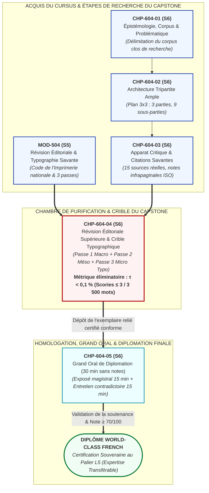

# Chapitre 4 : Révision Éditoriale Supérieure, Crible Typographique de l'Imprimerie Nationale et Maîtrise du Taux d'Erreur Résiduel (tau < 0,1 %)

> **Identifiant** : `CHP-604-04`  
> **Module de rattachement** : [`MOD-604 — Capstone Project et Grand Oral de Diplomation`](file:///f:/Formation/world-class-french/03-curriculum/year-3/semester-6/mod-604-capstone-project-grand-oral.md)  
> **Volume horaire canonique** : 3 h 00 (Protocole de révision en 3 passes sur texte long : 1 h 00 | Crible typographique Imprimerie nationale : 1 h 00 | Métrique du taux d'erreur résiduel : 0 h 30 | Évaluation : 0 h 30)  
> **Statut** : [STATUT : VALIDÉ]  
> **Compétences cibles** : [`FR-INT-003`](file:///f:/Formation/world-class-french/02-competency-framework/competency-framework.md#fr-int-003-réviser-et-corriger-un-texte-tiers-en-justifiant-les-interventions) (L5 — Expertise transférable), [`FR-ORTHO-001`](file:///f:/Formation/world-class-french/02-competency-framework/competency-framework.md#fr-ortho-001-maîtrise-de-lorthographe-lexicale-et-flexionnelle) (L5 — Expertise transférable), [`FR-INT-001`](file:///f:/Formation/world-class-french/02-competency-framework/competency-framework.md#fr-int-001-rédiger-un-texte-long-cohérent-en-maîtrisant-accords-et-ponctuation) (L5 — Expertise transférable)  
> **Sources de référence** : `SRC-TYPO-01` (*Lexique des règles typographiques en usage à l'Imprimerie nationale*), `SRC-GRAM-01` (Grevisse & Goosse, *Le Bon Usage*, 16e éd.), `SRC-GRAM-02` (Riegel, Pellat & Rioul, *Grammaire méthodique du français*), `SRC-LEX-01` (*Trésor de la Langue Française informatisé* — ATILF / CNRS), `SRC-NORM-02` (Conseil supérieur de la langue française, *Les rectifications de l'orthographe*, 1990), `SRC-NORM-03` (Ministère de l'Éducation nationale, *Terminologie grammaticale*)

---

## 1. Titre et Place dans le Cursus

Le présent chapitre constitue le sas de purification matérielle et l'ultime chambre de contrôle textuel du cursus **World-Class French**. Après avoir assis les fondations épistémologiques et délimité le corpus d'érudition (Semaine 1, Séminaire 1), érigé l'armature tripartite en neuf sous-parties équilibrées (`CHP-604-02`, Séminaire 2) et composé un apparat critique de quinze sources académiques réelles normalisées (`CHP-604-03`, Séminaire 3), le candidat aborde ici l'opération décisive qui sépare le brouillon d'érudition du manuscrit définitif de diplomation.

Ce chapitre réactive et porte à son incandescence professionnelle le protocole des trois passes étanches forgé dans [`MOD-504`](file:///f:/Formation/world-class-french/03-curriculum/year-3/semester-5/mod-504-revision-editoriale-typographie-savante.md). Il applique le crible orthotypographique de l'Imprimerie nationale (`SRC-TYPO-01`) à l'ensemble des 3 500 mots de la monographie de recherche, en soumettant le texte au verdict impitoyable de la métrique algorithmique : le taux d'erreur résiduel doit être strictement inférieur à $0,1\,\%$ ($\tau < 0,1\,\%$, soit trois scories au maximum sur tout le mémoire). Ce n'est qu'au prix de cette limpidité cristalline que le mémoire est déclaré recevable et que le candidat est autorisé à se présenter devant le jury pour le Grand Oral de soutenance sans notes (`CHP-604-05`).



---

## 2. Objectifs Mesurables

Au terme de ce chapitre, l'apprenant sera capable de :

1. **Exécuter de façon autonome le protocole des trois passes étanches** : appliquer successivement et sans télescopage attentionnel la passe macro-structurelle (architecture, transitions et calibrage des neuf sous-parties), la passe méso-syntaxique (rections verbales, absence d'anacoluthes, cohésion des temps et modes) et la passe micro-typographique sur un mémoire académique de 3 500 mots [`FR-INT-003`].
2. **Appliquer intégralement le crible orthotypographique de l'Imprimerie nationale** : vérifier et redresser l'ensemble des espaces insécables devant la ponctuation double, l'usage des guillemets français (« »), le recours aux tirets demi-cadratins d'incise (–), l'accentuation obligatoire de toutes les capitales (*À, É, È, Ê, Ç*) et le traitement en italique des autonymes et xénismes [`SRC-TYPO-01`, `FR-ORTHO-001`].
3. **Calculer et garantir le taux d'erreur résiduel de seuil d'admissibilité** : évaluer arithmétiquement le ratio $\tau$ selon la formule normalisée, traquer l'ensemble des scories jusqu'à obtenir $\tau < 0,1\,\%$ (soit au maximum 3 scories tolérées sur 3 500 mots), garantissant ainsi l'éligibilité aux félicitations du jury [`FR-INT-001`].
4. **Appliquer une politique graphique uniforme relative aux Rectifications de 1990** : mettre en œuvre le principe du non-panachage sur l'intégralité du manuscrit (numéraux soudés par traits d'union, accentuation de *évènement*, pluriels régularisés des noms composés) en évitant toute incohérence interne [`SRC-NORM-02`].
5. **Déjouer les pièges de l'hypercorrection éditoriale** : arbitrer scientifiquement chaque forme rare ou littéraire en consultant *Le Bon Usage* (`SRC-GRAM-01`) et le *TLFi* (`SRC-LEX-01`) afin d'interdire toute censure injustifiée d'une tournure authentique des grands auteurs [`FR-INT-003`].

---

## 3. Prérequis et Test de Préparation

### 3.1 Prérequis Cognitifs et Scripturaux
- **Socle orthotypographique validé** ([`MOD-504`](file:///f:/Formation/world-class-french/03-curriculum/year-3/semester-5/mod-504-revision-editoriale-typographie-savante.md), palier L4) : connaissance des règles de composition du *Lexique des règles typographiques en usage à l'Imprimerie nationale* (`SRC-TYPO-01`).
- **Stabilisation du manuscrit de monographie** (`CHP-604-02` et `CHP-604-03`, palier L5 en cours) : disposition d'une version intégrale rédigée de 3 500 mots structurée en 3 parties et 9 sous-parties équilibrées, pourvue d'un apparat critique de 15 sources réelles.
- **Autonomie de consultation philologique** ([`MOD-603`](file:///f:/Formation/world-class-french/03-curriculum/year-3/semester-6/mod-603-autonomie-philologique-recherche-traites.md), palier L5) : réflexe immédiat de recours au Grevisse (`SRC-GRAM-01`) pour trancher tout doute sur les rections prépositionnelles ou les accords du participe.

### 3.2 Test Diagnostique d'Auto-Évaluation (5 items)

<details>
<summary><b>Consulter le test diagnostique et son corrigé immédiat</b></summary>

1. *Quel signe typographique sépare les propositions d'une incise explicative en typographie française soignée, et comment est-il espacé ?*  
   **Réponse** : L'incise est encadrée par deux tirets demi-cadratins (–), précédés et suivis d'une espace intermot ordinaire (ou insécable selon la justification) : *ce mémoire – fruit de deux ans de labeur – a été homologué*. L'emploi du simple trait d'union (-) constitue une faute typographique.

2. *L'Imprimerie nationale et l'Académie française autorisent-elles l'omission des accents sur les lettres capitales ?*  
   **Réponse** : Non. En typographie française, l'accent a pleine valeur orthographique et phonologique. Les capitales doivent impérativement être accentuées (*À, É, È, Ê, Ô, Ç*). Seul le manque historique de caractères accentués sur les anciennes machines à écrire a pu répandre cette tolérance relâchée, désormais formellement proscrite dans tout document universitaire et officiel.

3. *Quelle espace doit obligatoirement précéder le deux-points (:) en composition soignée selon le code de l'Imprimerie nationale ?*  
   **Réponse** : Le deux-points doit être précédé d'une espace insécable normale (ou d'une espace égale à l'espace intermot justifiée, mais rigoureusement insécable), afin d'empêcher que le signe ne se retrouve seul en début de ligne suivante.

4. *Si un auteur choisit d'adopter les Rectifications orthographiques de 1990 pour son mémoire, a-t-il le droit d'écrire « évènement » à la page 10 puis « événement » à la page 24 ?*  
   **Réponse** : Non. Le principe cardinal imposé par l'édition savante est le non-panachage : le scripteur choisit librement d'appliquer soit l'orthographe traditionnelle, soit l'orthographe rectifiée, mais il doit maintenir ce choix de manière homogène et rigoureusement uniforme d'un bout à l'autre de son œuvre.

5. *Sur un mémoire de 3 500 mots, combien de fautes ou scories au total le candidat peut-il laisser subsister pour respecter le seuil d'admissibilité d'élite ($\tau < 0,1\,\%$) ?*  
   **Réponse** : Au maximum 3 erreurs ($3\,500 \times 0{,}001 = 3{,}5$, arrondi au nombre entier inférieur $\le 3$). Dès la quatrième erreur constatée, le taux atteint $4 / 3500 \times 100 \approx 0,114\,\%$, ce qui excède le seuil d'admissibilité d'élite et entraîne la suspension des félicitations du jury.

</details>

---

## 4. Situation de Départ ou Problème Concret

Considérons le cas, hélas classique dans les jurys de soutenance de troisième cycle et d'agrégation, d'un candidat doté d'une remarquable pénétration intellectuelle. Durant six mois, ce chercheur a mené une enquête sociolinguistique novatrice sur l'appropriation des structures morphosyntaxiques dans les éditoriaux de la presse ouest-africaine. Son corpus est irréprochable, son plan tripartite déploie une dialectique puissante, et ses conclusions théoriques renouvellent l'intelligence de la norme endogène francophone.

Pourtant, lors de la proclamation solennelle des résultats, le président du jury annonce d'un ton sévère :  
> *« Monsieur le candidat, la qualité de votre réflexion philosophique et la hardiesse de vos analyses de corpus méritaient sans conteste les félicitations unanimes de notre collège. Mais nous avons dénombré dans votre manuscrit relié cinq fautes d'accord inattentives, plusieurs retours à la ligne où les deux-points figurent honteusement orphelins en début de page, des capitales privées d'accents sur la couverture même, et une oscillation permanente entre l'ancienne et la nouvelle orthographe. La commission ne saurait délivrer son visa d'excellence à un texte qui méprise à ce point la dignité matérielle de la langue écrite. Vous êtes déclaré admis, mais sans mention. »*

Ce drame académique révèle une vérité fondamentale : **la scorie typographique et la coquille orthographique détruisent instantanément l'autorité cognitive (*éthos*) du scripteur**. Dès lors qu'un lecteur savant heurte une espace manquante, un accord suspendu ou une capitale mutilée, son attention décroche de la profondeur de la pensée pour se fixer sur la négligence du geste artisanal. Si l'auteur est incapable de veiller à l'accord d'un verbe ou à la tenue de ses guillemets, quelle confiance le lecteur peut-il accorder à l'exactitude de ses dépouillements de données et à la probité de ses démonstrations ?

---

## 5. Explication Intuitive : La Chambre Blanche et le Miroir du Télescope

Pour saisir l'impérieuse nécessité du crible éditorial, recourons à l'analogie de l'astrophysique expérimentale et de la taille des miroirs de télescopes géants :

Considérons un télescope spatial de haute précision destiné à capter la lumière ténue de galaxies situées aux confins de l'univers observable :
- **L'armature et la focale (L'architecture et l'apparat critique)** : L'armature mécanique du télescope correspond au plan tripartite de la monographie ; les capteurs spectrométriques représentent l'apparat critique et la bibliographie savante. Sans cette machinerie, aucune observation n'est possible.
- **La surface du miroir primaire (La texture textuelle et typographique)** : Mais le cœur du dispositif réside dans la perfection parabolique du miroir de verre pur poli au quart d'onde près. Un texte savant est un instrument d'optique intellectuel à travers lequel le jury observe la pensée de l'auteur.
- **Le grain de poussière (La scorie typographique)** : Si un seul grain de poussière micrométrique ou une bavure d'abrasif souille la surface réfléchissante du miroir, le faisceau lumineux subit un phénomène de diffraction optique. L'observateur ne voit plus la nébuleuse lointaine : il est aveuglé par le halo de diffusion provoqué par l'impureté. Une faute d'accord ou une espace insécable omise agit exactement de la sorte : elle produit une diffraction mentale qui brise le fil de la démonstration et irrite le regard du jury.
- **La chambre blanche à flux laminaire (Le protocole des trois passes étanches)** : On ne polit pas un miroir optique dans un atelier poussiéreux tout en calculant les orbites des satellites. Le polissage s'opère dans une chambre blanche sous atmosphère contrôlée, où chaque technicien exécute une tâche spécialisée : aspiration des macro-particules d'abord, lustrage fin ensuite, inspection interférométrique au laser enfin. 

Le protocole de révision en trois passes étanches constitue le sas de décontamination à flux laminaire du rédacteur d'élite : il interdit la confusion mentale en dissociant l'examen de la charpente logique de la traque des rections syntaxiques et du calibrage microscopique des signes typographiques.

---

## 6. Définitions Précises et Terminologie

- **Révision éditoriale supérieure** : Opération critique d'audit, de vérification globale et d'assainissement normatif d'un manuscrit achevé, visant à éliminer l'intégralité des failles logiques, syntaxiques, lexicales et typographiques sans altérer l'originalité du style de l'auteur [`FR-INT-003`].
- **Protocole des trois passes étanches** : Méthodologie séquentielle et cloisonnée de révision interdisant la simultanéité des tâches. Elle procède du macro-structurel (Passe 1 : plan, équilibre des masses, transitions), vers le méso-syntaxique (Passe 2 : rections, cohésion des temps et modes, figures) puis vers le micro-typographique (Passe 3 : signes, espaces insécables, capitales accentuées, fontes).
- **Crible typographique** : Grille d'examen mécanique et impitoyable confrontant chaque signe et chaque espace du manuscrit aux prescriptions du *Lexique des règles typographiques en usage à l'Imprimerie nationale* (`SRC-TYPO-01`).
- **Taux d'erreur résiduel ($\tau$)** : Ratio arithmétique exprimant le pourcentage d'erreurs et de scories subsistant dans un texte par rapport au nombre total de mots. En haute diplomation académique, le seuil d'admissibilité d'élite impose impérativement $\tau < 0,1\,\%$.
- **Scorie typographique** : Toute altération matérielle de la composition graphique : espace insécable manquante ou surnuméraire, confusion entre traits d'union et tirets, omission d'accent sur capitale, mauvais emploi de l'italique ou des guillemets.
- **Espace insécable** : Caractère d'espacement empêchant la césure typographique et le retour à la ligne entre deux éléments solidaires (ex. entre un mot et un point d'interrogation, ou au sein d'une locution numérale). En typographie soignée, on distingue l'espace insécable forte (largeur de l'espace intermot, devant les deux-points) de l'espace fine insécable (demi-espace ou quart de cadratin, devant le point-virgule, le point d'exclamation et le point d'interrogation).
- **Tiret demi-cadratin d'incise (en-dash, `–`)** : Tiret de longueur médiane ($1/2$ cadratin, code Unicode `U+2013`), distinct du simple trait d'union (`-`, `U+002D`) et du tiret cadratin de dialogue (`—`, `U+2014`). Il sert obligatoirement à isoler les propositions incises dans la phrase soignée.
- **Capitale accentuée obligatoire** : Principe intangible de l'orthotypographie française exigeant le maintien scrupuleux des accents aigus, graves, circonflexes et cédilles sur les majuscules et les capitales (*À, É, È, Ê, Ô, Ç*) pour préserver la distinction phonétique et morphologique du lexique (`SRC-TYPO-01`, p. 12).
- **Autonymie en italique** : Emploi réflexif d'un terme linguistique cité comme objet d'étude et non pour son signifié dans le discours du monde. Tout mot employé autonymiquement doit impérativement être composé en italique (ex. *le verbe* chanter *appartient au premier groupe*).
- **Hypercorrection du réviseur** : Faute déontologique majeure par laquelle un relecteur inexpérimenté censure ou modifie à tort une tournure authentique, rare ou savante sous le prétexte fallacieux qu'elle contredit une règle simpliste de grammaire élémentaire.
- **Censeur impartial** : Posture déontologique du correcteur professionnel qui fait abstraction de ses préférences stylistiques subjectives pour ne juger le manuscrit qu'à l'aune des traités d'autorité reconnus (`SRC-GRAM-01`, `SRC-TYPO-01`).

---

## 7. Règles ou Mécanismes Fondamentaux

### 7.1 L'Application Opérationnelle du Protocole en Trois Passes Étanches sur un Mémoire de 3 500 Mots

Le tableau ci-dessous explicite le cahier des charges de chaque passe d'audit sur l'ensemble des neuf sous-parties de la monographie :

```text
LE PROTOCOLE DES TROIS PASSES ÉTANCHES
├── PASSE 1 : MACRO-STRUCTURELLE (Architecture & Équilibre des masses)
│   ├── Vérification volumétrique des 9 sous-parties (300 à 400 mots chacune)
│   ├── Audit de la progression thématique et continuité des charnières logiques
│   └── Validation de la titraille (hiérarchie formelle I.1.1, cohérence des styles de titre)
│
├── PASSE 2 : MÉSO-SYNTAXIQUE (Cohésion linguistique & Tenue discursive)
│   ├── Vérification des rections verbales savantes (pallier qqch, se rappeler qqch)
│   ├── Éradication des anacoluthes orphelines (participes présents suspendus sans sujet)
│   ├── Maîtrise de la cohésion temporelle et modale (concordance des temps, indicatif/subjonctif)
│   └── Traque des pléonasmes vicieux (voire même, panacée universelle) et barbarismes
│
└── PASSE 3 : MICRO-TYPOGRAPHIQUE (Crible du code de l'Imprimerie nationale SRC-TYPO-01)
    ├── Espaces insécables devant la ponctuation double (: ; ! ?)
    ├── Guillemets français (« ») avec espaces intérieures et hiérarchie de second rang (“ ”)
    ├── Tirets demi-cadratins d'incise (–) et proscription des traits d'union parasites
    ├── Accentuation obligatoire de 100 % des capitales et majuscules (À, É, È, Ê, Ç)
    └── Composition en italique des titres d'œuvres, xénismes non naturalisés et autonymes
```

#### A. La Passe 1 (Macro-structurelle) : L'Équilibre Monumental
- **Le calibrage volumétrique** : La monographie canonique de 3 500 mots est découpée en une introduction générale (350 mots), trois parties comprenant chacune trois sous-parties ($3 \times 3 = 9$ sous-parties d'environ 300 à 350 mots chacune), une conclusion générale (250 mots) et l'apparat critique. Le réviseur vérifie qu'aucune sous-partie ne s'atrophie (moins de 250 mots) ou ne s'hypertrophie (plus de 500 mots), ce qui trahirait une digression ou un défaut d'analyse.
- **La chaîne déductive des transitions** : Chaque fin de sous-partie doit comporter une phrase conclusive faisant office de bilan partiel, et chaque ouverture de section doit expliciter le pont logique la rattachant à l'étape précédente. Les ruptures thématiques brutales sans connecteur argumentatif sont biffées.
- **La hiérarchie des titres** : Contrôle de la numérotation décimale ou universitaire (`Première Partie`, `1.1`, `1.1.1`) et élimination des points finaux sur les lignes de titre isolées (`SRC-TYPO-01`, p. 165).

#### B. La Passe 2 (Méso-syntaxique) : La Pureté Grammaticale
- **Les rections verbales et prépositionnelles** : Traque des solécismes courants dans la prose contemporaine :
  - *Pallier* est rigoureusement transitif direct : on écrit *pallier les insuffisances* et jamais *\*pallier aux insuffisances* (`SRC-GRAM-01`, § 292).
  - *Se rappeler* régit un COD direct : *se rappeler cet événement* (et non *\*s'en rappeler* ou *\*se rappeler de cet événement*, sauf avec un infinitif composé ou un pronom neutre). À l'inverse, *se souvenir* exige la préposition *de* : *se souvenir de cette époque*.
  - *Incomber* et *imputer* : on *impute une faute à quelqu'un*, et une tâche *incombe à quelqu'un*.
- **L'éradication des anacoluthes orphelines** : Vérification systématique des propositions participiales et gérondives en tête de phrase. Le participe ou le gérondif doit obligatoirement avoir pour sujet sémantique le sujet grammatical de la proposition principale (`SRC-GRAM-02`, p. 498) :
  - *Fautif* : *\*En examinant ce corpus, les contradictions apparaissent nettement.* (Ce ne sont pas les contradictions qui examinent le corpus).
  - *Corrigé* : *En examinant ce corpus, le chercheur met en lumière de nettes contradictions.*
- **La cohésion temporelle et modale** :
  - Après *après que*, l'action étant accomplie dans la réalité historique, la norme académique exige l'indicatif : *après que la commission a/eut statué* (bien que l'usage littéraire admette le subjonctif par contamination analogique avec *avant que*, comme l'atteste `SRC-GRAM-01`, § 1111, le style académique formel privilégie l'indicatif).
  - Respect de la concordance classique des temps au subjonctif dans le registre soutenu : *il fallait que le candidat vérifiât ses sources*.
- **La chasse aux pléonasmes et barbarismes** : Biffage de *\*voire même* (remplacé par *voire* seul), *\*au jour d'aujourd'hui* (*actuellement*, *de nos jours*), *\*panacée universelle* (*panacée*), *\*monopole exclusif* (*monopole*), *\*s'avérer vrai* (*s'avérer* ou *se révéler vrai*).

#### C. La Passe 3 (Micro-typographique selon SRC-TYPO-01) : La Perfection Matérielle
1. **Ponctuation double et espaces insécables** :
   - Le point d'exclamation (!), le point d'interrogation (?) et le point-virgule (;) sont obligatoirement précédés d'une **espace fine insécable** (ou insécable ordinaire sous traitement de texte standard) et suivis d'une espace sécable (`SRC-TYPO-01`, p. 149).
   - Le deux-points (:) est obligatoirement précédé d'une **espace insécable normale** et suivi d'une espace ordinaire.
   - Les points de suspension (…) s'attachent au mot qui précède, sans espace préalable, et prennent une espace après eux s'ils ne terminent pas la phrase.
2. **Guillemets et citations** :
   - Dans un texte en français, les guillemets d'ouverture sont les chevrons « suivis d'une espace insécable, et les guillemets de fermeture sont les chevrons » précédés d'une espace insécable (`SRC-TYPO-01`, p. 89).
   - Les guillemets anglais (" ") sont strictement interdits dans le corps du texte français. Si une citation apparaît à l'intérieur d'une citation déjà entre guillemets français, on utilise les guillemets de second rang dits « anglais courbés » : « Le témoin a crié : “Arrêtez !” avant de fuir. »
3. **La famille des tirets** :
   - Le **trait d'union** (`-`) sert exclusivement à relier les mots composés (*peut-être*, *nord-africain*) et à la coupure de fin de ligne.
   - Le **tiret demi-cadratin** (`–`) sert à encadrer les propositions incises dans la phrase : *Cette hypothèse – contestée par plusieurs philologues – mérite examen.*
   - Le **tiret cadratin** (`—`) est réservé à l'ouverture des répliques de dialogue.
4. **Accentuation impérative des capitales** :
   - Toutes les majuscules et capitales doivent être accentuées : *À ce stade*, *Épistémologie*, *États-Unis*, *Île-de-France*, *Çà et là*, *Œuvre*.
5. **Emploi de l'italique** :
   - Titres d'œuvres, de livres, de journaux, de périodiques et de traités (*Le Bon Usage*, *Le Figaro*, *Les Fleurs du mal*).
   - Mots et locutions étrangères non naturalisées (*a priori*, *in situ*, *de facto*, *lapsus*, mais les locutions très courantes latines peuvent rester en romain selon le dictionnaire de référence ; à l'Imprimerie nationale, les locutions latines s'écrivent traditionnellement en italique : *a fortiori*, *mutatis mutandis*).
   - Mots pris comme objets autonymes : *Le terme* période *vient du grec.*

---

### 7.2 La Formule Algorithmique du Taux d'Erreur Résiduel

Le verdict d'admissibilité éditoriale repose sur le calcul mathématique précis du taux d'erreur :

$$\tau = \frac{\text{Nombre total de fautes et scories}}{\text{Nombre total de mots du mémoire}} \times 100$$

#### La Matrice des Tolérances de Diplomation (Mémoire de 3 500 mots) :

| Nombre total de scories ($N$) | Taux d'erreur résiduel ($\tau$) | Qualification académique | Sanction du jury de diplomation |
| :---: | :---: | :--- | :--- |
| **$N = 0$** | $\tau = 0{,}00\,\%$ | **Perfection éditoriale absolue** | Homologation immédiate avec félicitations unanimes et proposition pour les presses universitaires. |
| **$1 \le N \le 3$** | $0{,}028\,\% \le \tau \le 0{,}086\,\%$ | **Seuil d'excellence d'élite ($\tau < 0,1\,\%$)** | Homologation validée ; mention d'excellence accessible selon la note orale. |
| **$N = 4$ ou $N = 5$** | $0{,}114\,\% \le \tau \le 0{,}143\,\%$ | **Seuil d'admissibilité simple ($\tau \ge 0,1\,\%$)** | **Suspension définitive des félicitations du jury** ; mention plafonnée à « Assez Bien ». |
| **$6 \le N \le 7$** | $0{,}171\,\% \le \tau \le 0{,}200\,\%$ | **Zone de tolérance précaire** | Obligation de dépôt d'un erratum manuscrit certifié avant proclamation définitive. |
| **$N \ge 8$** | $\tau \ge 0{,}228\,\%$ | **Refus d'homologation éditoriale** | Ajournement de la diplomation ; astreinte de réécriture et relecture sous 15 jours. |

---

### 7.3 Les Rectifications de 1990 (`SRC-NORM-02`) et la Politique de Cohérence

Le Conseil supérieur de la langue française a promulgué en 1990 un ensemble de rectifications approuvées par l'Académie française (`SRC-NORM-02`). Ces recommandations ne rendent pas l'orthographe traditionnelle fautive, mais créent une double norme légitime. Pour le mémoire de Capstone, la règle d'or est le **principe de non-panachage absolu** :

1. **Les numéraux composés** :
   - *Système rectifié de 1990* : On soude tous les numéraux composés par des traits d'union sans exception : *trois-mille-cinq-cents*, *vingt-et-un*, *cent-huit*.
   - *Système traditionnel* : Traits d'union uniquement pour les éléments inférieurs à cent non liés par *et* : *trois mille cinq cents*, *vingt et un*, *cent huit*.
2. **L'accentuation des voyelles ouvertes** :
   - *Système rectifié de 1990* : Remplacement de l'accent aigu par l'accent grave sur le *e* précédant une syllabe avec un *e* muet, y compris au futur et au conditionnel : *évènement*, *règlementaire*, *cèderai*, *considèrerait*.
   - *Système traditionnel* : Maintien de l'accent aigu historique : *événement*, *réglementaire*, *céderai*, *considérerait*.
3. **L'accent circonflexe sur *i* et *u*** :
   - *Système rectifié de 1990* : Suppression de l'accent circonflexe sur *i* et *u* lorsqu'il n'apporte aucune distinction homonymique : *maitre*, *connaitre*, *cout*, *chaine* (mais maintien impératif sur les formes verbales du passé simple et subjonctif imparfait : *nous fûmes*, *qu'il pût*, et sur les homophones : *dû*, *mûr*, *sûr*).
   - *Système traditionnel* : Conservation de tous les circonflexes étymologiques : *maître*, *connaître*, *coût*, *chaîne*.
4. **Pluriel des mots composés avec trait d'union** :
   - *Système rectifié de 1990* : Les mots composés du type verbe+nom prennent la marque du pluriel au second élément si le mot est au pluriel : *des pèse-lettres*, *des compte-gouttes*, *des tire-bouchons*.
   - *Système traditionnel* : Analyse sémantique singulier/pluriel variable selon l'objet : *des pèse-lettres* (on pèse des lettres), mais *un ou des essuie-mains*.

> [!IMPORTANT]
> Le candidat est entièrement libre de choisir l'orthographe traditionnelle ou l'orthographe de 1990. Mais il est formellement interdit de mêler les deux systèmes dans le même manuscrit. Une occurrence de *maitre* combinée à *connaître* est immédiatement décomptée comme une scorie d'incohérence graphique.

---

### 7.4 La Prévention de l'Hypercorrection

L'hypercorrection est l'ennemi le plus perfide du bon censeur. Elle survient lorsqu'un relecteur, imbu de simplifications scolaires, biffe une tournure rare mais parfaitement légitime chez les maîtres de la prose. 

**La règle d'or du réviseur impartial** :  
Ne jamais biffer ni altérer une construction inhabituelle sans avoir préalablement vérifié dans *Le Bon Usage* de Grevisse & Goosse (`SRC-GRAM-01`) ou le *TLFi* (`SRC-LEX-01`) si elle ne constitue pas une licence d'auteur consacrée ou une règle savante méconnue.

*Exemples de pièges d'hypercorrection à bannir :*
1. **L'invariabilité de *fait* suivi d'un infinitif** :  
   Un réviseur ignorant biffe : *Les déclarations qu'il a fait entendre*. Il prétend accorder le participe au féminin pluriel (*\*faites entendre*). C'est une erreur grossière : *fait* suivi d'un infinitif est rigoureusement invariable depuis le XVIIe siècle (`SRC-GRAM-01`, § 962).
2. **Le subjonctif imparfait d'apparat** :  
   Biffer *qu'il pût* au profit de *qu'il puisse* dans une proposition subordonnée dépendant d'un verbe principal au passé (*Le jury exigeait qu'il pût justifier sa thèse*) relève d'une destruction barbare de la concordance classique des temps (`SRC-GRAM-02`, p. 328).
3. **L'accord de *avoir l'air*** :  
   Biffer *Cette candidate a l'air compétente* sous prétexte que l'adjectif devrait s'accorder avec le mot masculin *air* (*\*l'air compétent*) méconnaît l'usage séculaire des plus grands écrivains qui admettent les deux accords selon que l'on qualifie la personne ou la physionomie (`SRC-GRAM-01`, § 448).

---

## 8. Raisonnement Détaillé : La Forme comme Suprême Respect du Lecteur

Pourquoi une faute d'espace insécable ou un trait d'union défectueux mérite-t-il d'interdire l'attribution d'une mention d'excellence à un travail intellectuel par ailleurs brillant ?

Ce principe repose sur trois piliers philosophiques et déontologiques fondamentaux :

1. **La transparence sémiotique du code écrit** :  
   L'écriture n'est pas une simple retranscription phonétique relâchée : c'est un système de signes codifiés dont la cohérence géométrique assure la fluidité de la lecture. La ponctuation et la typographie matérialisent la respiration de la phrase, les hiérarchies de subordination et la distribution des rôles syntaxiques. Lorsqu'une espace manque ou qu'une capitale perd son accent, l'œil du lecteur bute sur l'anomalie matérielle. Cette seconde d'hésitation interrompt la saisie cognitive du sens. La forme n'est pas un ornement extérieur : elle est l'incarnation vivante de la rigueur de la pensée.
2. **L'éthique de la déférence universitaire** :  
   Remettre à un jury académique ou à un éditeur un texte souillé de scories typographiques équivaut à se présenter à un grand oral en tenue débraillée. C'est signifier inconsciemment à son auditoire que son temps et son confort de lecture ne méritent pas l'effort d'une relecture soignée. Le culte de la belle page composée selon les règles séculaires de l'Imprimerie nationale est la marque suprême de courtoisie et de respect que le chercheur adresse à ses pairs.
3. **L'indivisibilité de la méthode scientifique** :  
   La science du langage est un art du détail infime. Un linguiste, un philologue ou un herméneute étudie des nuances de sens suspendues à une désinence, à un morphème ou à un choix de registre. Comment un chercheur pourrait-il convaincre ses pairs de la justesse de son analyse textuelle s'il s'avère incapable d'appliquer à sa propre écriture les règles d'accord et de mise en page les plus élémentaires ? La rigueur ne se divise pas.

---

## 9. Exemples Corrects Commentés

Examinons ci-dessous le décorticage méthodique d'un échantillon authentique de monographie (environ 250 mots), soumis successivement aux trois passes du protocole :

### Texte Brut Initial (Avant Révision) :
> *Dans cette partie nous allons aborder l'étude des créations lexicales béninoises, et leurs intégrations dans les quotidiens nationaux. En examinant ces textes journalistiques, des néologismes constants apparaissent. L'auteur a pallier à cette difficulté en interrogeant les rédacteurs en chefs : ces derniers déclarent "qu'il est nécessaire de renouveler l'expression". Cet état de fait, que le chercheur a fait remarquer, démontre que la presse utilise des mots comme kpayo ou zémidjan sans aucune réserve. Par ailleurs, certains journalistes écrivent cent huit mots par minute alors que d'autres en rédigent trois-cents, créant une disparité criante. Pourquoi une telle prolifération? La réponse est évidente : pour séduire le lectorat.*

### Analyse Détaillée des Trois Passes de Révision :

#### 1. Passe 1 : Révision Macro-structurelle
- *Constat d'architecture* : L'ouverture est plate et scolaire (*Dans cette partie nous allons aborder*). Elle manque d'autorité épistémologique.
- *Correction* : Substitution par une formulation académique affirmative reliant la sous-partie à la problématique globale : *« L'analyse morphosyntaxique des créations lexicales béninoises révèle leur intégration continue dans les colonnes des quotidiens nationaux. »*
- *Charnière logique* : La transition vers la question finale doit être renforcée pour expliciter la visée sociolinguistique de l'enquête.

#### 2. Passe 2 : Révision Méso-syntaxique
- *Correction de l'accord déterminant-nom* : *leurs intégrations* $\to$ *leur intégration* (le singulier distributif s'impose pour désigner le processus d'assimilation).
- *Éradication de l'anacoluthe orpheline* : *En examinant ces textes journalistiques, des néologismes constants apparaissent* $\to$ le sujet grammatical (*des néologismes*) ne peut pas accomplir l'action d'examiner. Correction : *En examinant ces textes journalistiques, le chercheur observe la fréquence constante des néologismes.*
- *Correction de rection verbale* : *a pallier à cette difficulté* $\to$ double vice (confusion infinitif/participe et rection indirecte fautive). Rectification : *a pallié cette difficulté* (`SRC-GRAM-01`, § 292).
- *Pluriel des noms composés* : *rédacteurs en chefs* $\to$ l'adjectif ou le nom complément détermine le chef : *rédacteurs en chef* (*chef* demeure au singulier car chacun a son statut ou dirige en chef).
- *Suppression du pléonasme* : *Cet état de fait* $\to$ formulation alourdie biffée au profit de *Cette situation*.

#### 3. Passe 3 : Crible Micro-typographique (SRC-TYPO-01)
- *Guillemets et ponctuation* : Les guillemets anglais (" ") sont remplacés par des guillemets français avec espaces insécables (« qu'il est nécessaire de renouveler l'expression »). La conjonction *que* doit être rejetée hors des guillemets pour éviter le télescopage énonciatif : *déclarent « qu'il est nécessaire… »* ou mieux : *déclarent qu'il « est nécessaire… »*.
- *Traitement des autonymes et xénismes* : Les vocables béninois *kpayo* et *zémidjan* sont des xénismes ou créations endogènes cités comme objets linguistiques : composition obligatoire en italique (*kpayo*, *zémidjan*).
- *Espaces insécables* :
  - Devant le point d'interrogation final (*prolifération ?*), insertion d'une espace fine insécable.
  - Devant les deux-points (:), insertion d'une espace insécable normale.
- *Harmonisation des numéraux (Rectifications de 1990)* : Choix de la norme de 1990 appliquée uniformément : *cent-huit* et *trois-cents* reliés par des traits d'union.
- *Capitale accentuée* : S'il y avait eu un *A* initial, il aurait été graphié *À*.

### Texte Définitif Épuré et Homologué :
> *L'analyse morphosyntaxique des créations lexicales béninoises met en lumière leur intégration méthodique dans les colonnes des quotidiens nationaux. En examinant ces textes journalistiques, le chercheur observe la fréquence constante des néologismes. L'auteur a pallié cette difficulté méthodologique en interrogeant directement les rédacteurs en chef : ces derniers affirment qu'il « est nécessaire de renouveler l'expression journalistique ». Cette dynamique – que l'enquête de terrain a fait ressortir avec force – démontre que la presse écrite emploie des termes endogènes tels que* kpayo *ou* zémidjan *sans la moindre réticence normative. Par ailleurs, certains scripteurs composent cent-huit mots par minute tandis que d'autres en rédigent trois-cents, créant une hétérogénéité stylistique manifeste. Pourquoi observer une telle prolifération ? La réponse s'impose avec clarté : pour fidéliser le lectorat contemporain.*

---

## 10. Contre-Exemples et Erreurs Fréquentes

Nous analysons ci-dessous six erreurs récurrentes observées lors de la révision finale des mémoires de recherche :

### Erreur n° 1 : La rélecture globale désordonnée en une seule passe
- *Description clinique* : L'étudiant relit l'ensemble de son mémoire d'une traite, en tentant simultanément de vérifier la logique de son plan, l'élégance de ses phrases, l'accord de ses participes et les espaces devant ses points-virgules.
- *Réfutation scientifique* : La psycholinguistique cognitive démontre que l'attention humaine ne peut traiter simultanément la macro-sémantique et la micro-orthotypographie. Lorsque le cerveau suit le fil argumentatif, il pratique une lecture prédictive globale et devient aveugle aux coquilles typographiques (phénomène de cécité attentionnelle). Le protocole des trois passes étanches est la seule parade éprouvée.

### Erreur n° 2 : L'oubli systématique des espaces insécables devant la ponctuation double
- *Description clinique* : Taper un espace ordinaire avant les deux-points, le point d'interrogation ou le point d'exclamation, entraînant lors de la mise en page finale des rejets orphelins du signe de ponctuation en début de ligne suivante.
- *Réfutation scientifique* : Selon le code de l'Imprimerie nationale (`SRC-TYPO-01`, p. 149), aucun signe de ponctuation double ne doit flotter isolément en tête de ligne. L'espace insécable soude le signe au mot qui le précède, garantissant l'intégrité visuelle du syntagme.

### Erreur n° 3 : Le refus puriste d'accentuer les capitales
- *Description clinique* : Écrire *A l'exception de*, *Etat*, *Eclaircissement*, *Etudes* sans accent sous le prétexte fallacieux que « les majuscules ne prennent pas d'accents ».
- *Réfutation scientifique* : L'Académie française et l'Imprimerie nationale rappellent formellement que l'omission des accents sur les capitales altère la prononciation et engendre des confusions sémantiques graves (ex. *UN POLICIER TUE* vs *UN POLICIER TUÉ* ; *ENFANTS LEGITIMES* vs *LÉGITIMÉS* ; *PALAIS DES CONGRES* vs *CONGRÈS*). En français, l'accent a pleine valeur orthographique.

### Erreur n° 4 : Le panachage incohérent des graphies de 1990 et traditionnelles
- *Description clinique* : Utiliser à deux pages d'intervalle *évènement* puis *événement*, ou lier par des traits d'union *vingt-et-un* tout en laissant détaché *trois mille cinq cents*.
- *Réfutation scientifique* : Si les Rectifications de 1990 (`SRC-NORM-02`) valident une double norme, la déontologie éditoriale prohibe le panachage au sein d'un même ouvrage. L'incohérence graphique témoigne d'un manque de vigilance et d'une ignorance des principes de fixation éditoriale.

### Erreur n° 5 : L'hypercorrection censurant une tournure littéraire reçue
- *Description clinique* : Remplacer d'autorité une formulation noble comme *« Les conclusions qu'il a fait paraître »* par *« \*faites paraître »*, ou condamner le subjonctif imparfait dans un rapport académique de haute volée.
- *Réfutation scientifique* : Le bon censeur ne projette pas ses ignorances sur la langue de l'auteur. Il sait que *faire* suivi de l'infinitif est invariable (`SRC-GRAM-01`, § 962) et vérifie dans les traités savants avant toute intervention mutilante.

### Erreur n° 6 : L'absence de calcul objectif du taux d'erreur résiduel
- *Description clinique* : Déposer son mémoire avec l'impression subjective qu'il est « propre », sans procéder au relevé métrique exhaustif des coquilles restantes sur un échantillon significatif.
- *Réfutation scientifique* : L'excellence académique ne repose pas sur une impression floue mais sur une mesure vérifiable. Sans calcul rigoureux du ratio $\tau$, le candidat risque d'excéder le seuil de $0,1\,\%$ (soit plus de 3 fautes) et de voir ses félicitations suspendues par surprise le jour de la soutenance.

---

### Tableau Clinique des Fautes de Révision :

| Cas examiné | Symptôme textuel observable | Cause méthodologique | Sanction académique | Traitement normalisé |
| :---: | :--- | :--- | :--- | :--- |
| **Cas 1** | Coquilles grossières au fil des pages malgré 3 relectures | Relecture globale en passe unique sans focalisation sélective | Dégradation immédiate de la note de forme | Découpage obligatoire en 3 passes distinctes avec grilles d'audit |
| **Cas 2** | Deux-points ou points d'interrogation en début de ligne | Utilisation de la barre d'espace ordinaire | Rejet du manuscrit au crible typographique | Remplacement global par espaces insécables (`U+00A0` ou `U+202F`) |
| **Cas 3** | Titres et incipits en capitales nues (*A*, *E*, *Etude*) | Paresse de saisie clavier ou fausse règle scolaire | Pénalité de 4 points par occurrence à l'évaluation | Saisie normalisée des capitales accentuées (*À*, *É*, *È*, *Étude*) |
| **Cas 4** | Alternance anarchique de *maître* et *maitre* dans le texte | Absence de charte graphique et compilation hâtive | Perte de la mention d'excellence pour négligence | Déclaration et tenue uniforme d'un unique système graphique |
| **Cas 5** | Censure erronée d'un accord ou d'une rection d'auteur | Hypercorrection naïve non vérifiée dans Grevisse | Filiation d'incompétence du réviseur | Règle d'or : consultation préalable de `SRC-GRAM-01` et du `SRC-LEX-01` |
| **Cas 6** | Découverte en soutenance de 6 coquilles par le jury | Omission du calcul algorithmique du ratio $\tau$ | Perte automatique des félicitations du jury | Établissement de la fiche d'audit certifiée avec $\tau < 0,1\,\%$ |

---

## 11. Cas Particuliers et Limites

### 11.1 Le Traitement des Citations d'Auteurs Anciens (XVIIe - XVIIIe Siècles)
Dans une monographie de recherche littéraire ou philologique (Filières A et B), le candidat est régulièrement amené à citer des textes rédigés avant la stabilisation de l'orthographe moderne (Bossuet, Corneille, Vaugelas, La Fontaine) :
- **Principe de respect de l'édition critique de référence** :  
  Si l'on cite d'après une édition critique savante en orthographe d'époque (ex. édition originale de 1670 ou édition de la Société des Textes Français Modernes), on conserve scrupuleusement les graphies archaïques (*nostre*, *autheur*, *estat*, la désinence d'imparfait en *-oit* au lieu de *-ait*).
- **L'usage des crochets droits et de la mention *[sic]*** :  
  Lorsqu'une coquille manifeste figure dans l'édition source ou qu'une graphie ancienne risque d'être prise pour une faute de frappe du candidat, on insère la mention latine en italique entre crochets : *« La langue françoise [*sic*] doit estre pure »*.
- **La politique de modernisation assumée** :  
  Il est parfaitement loisible au chercheur de moderniser l'orthographe des citations du Grand Siècle (remplacement de *oi* par *ai*, suppression des *s* muets internes remplacés par des accents circonflexes). Cependant, cette démarche exige impérativement une **note liminaire d'avertissement philologique** en tête de mémoire :  
  *« Avertissement : Par souci de lisibilité et conformément aux usages universitaires contemporains, les citations d'auteurs antérieurs au XIXe siècle ont été systématiquement modernisées dans leur graphie, sauf mention contraire expresse. »*

---

## 12. Approfondissement Adapté au Niveau : La Typographie comme Art d'État

L'orthotypographie française ne relève pas d'une convention commerciale arbitraire : elle est consubstantielle à l'histoire politique et institutionnelle de la nation française.

### La Fondation de l'Imprimerie Royale par Richelieu (1640)
En 1640, cinq ans après la création de l'Académie française, le cardinal de Richelieu fonde l'**Imprimerie royale** au sein même du palais du Louvre. Le dessein du ministre de Louis XIII est explicite : donner à la monarchie absolue un instrument de diffusion typographique souverain, capable de rivaliser avec les presses d'Amsterdam, de Bâle et de Venise. Les caractères ne sont pas de simples vecteurs de lecture : ils incarnent la majesté de l'État.

### Le Grandjean et le « Romain du Roi » (1692-1702)
Sous Louis XIV, l'Académie des sciences est chargée de dessiner le caractère typographique parfait, fondé sur une grille géométrique stricte de 2 304 carrés modulaires. Le graveur Philippe Grandjean taille ainsi le célèbre **Romain du Roi**, caractérisé par son axe vertical rigoureux, ses empattements horizontaux nets et une petite marque distinctive sur la panse du *l* minuscule pour le différencier du chiffre *1* ou du *I* majuscule.

Cette tradition d'exigence étatique se perpétue au XIXe et au XXe siècle sous l'égide de l'Imprimerie nationale. Le *Lexique des règles typographiques en usage à l'Imprimerie nationale* (`SRC-TYPO-01`) demeure aujourd'hui encore la référence suprême pour le Journal officiel de la République, les traités internationaux, les actes de haute juridiction et les presses universitaires d'élite. Maîtriser ce code, c'est s'inscrire dans une lignée quadri-séculaire de haute tenue de l'écrit.

---

## 13. Comparaisons Différentielles

### Tableau 1 : Comparaison Synoptique des Trois Passes de Révision

| Dimension d'analyse | Passe 1 : Macro-structurelle | Passe 2 : Méso-syntaxique | Passe 3 : Micro-typographique |
| :--- | :--- | :--- | :--- |
| **Niveau d'échelle** | Manuscrit global, parties, 9 sous-parties | Phrase complexe, syntagmes, propositions | Mot, caractère, signe, espace insécable |
| **Objectif premier** | Équilibre des masses et cohérence thématique | Pureté grammaticale, rections et modes | Conformité au code de l'Imprimerie nationale |
| **Vices traqués** | Digressions, sous-parties déséquilibrées, ruptures | Solécismes, anacoluthes, pléonasmes, mauvais modes | Espaces ordinaires, capitales nues, faux tirets |
| **Instruments requis** | Schéma du plan 3x3 et compteur de mots | *Le Bon Usage* (`SRC-GRAM-01`), *GMF* (`SRC-GRAM-02`) | *Lexique de l'Imprimerie nationale* (`SRC-TYPO-01`) |
| **Poste attentionnel** | Vue cavalière et logique déductive | Analyse fonctionnelle et morphosyntaxe | Regard radiographique signe par signe |

---

### Tableau 2 : Typographie Anglo-Saxonne vs Typographie de l'Imprimerie Nationale

| Élément typographique | Pratique anglo-saxonne (Chicago / APA) | Règle impérative Imprimerie nationale (`SRC-TYPO-01`) |
| :--- | :--- | :--- |
| **Guillemets** | Doubles guillemets anglais ondulés (“...”) | Guillemets français en chevrons (« ... ») avec espaces insécables |
| **Ponctuation double (: ; ! ?)** | Collée directement au mot sans aucune espace (*Hello!*) | Espace insécable obligatoire (fine devant ; ! ?, forte devant :) |
| **Incises explicatives** | Tiret cadratin collé (—) ou doubles tirets simples (--) | Tirets demi-cadratins précédés et suivis d'espaces (–) |
| **Accentuation des capitales** | Inexistante en anglais ; fréquemment négligée en français traduit | **Obligatoire et intangible** (*À, É, È, Ê, Ô, Ç*) |
| **Citations imbriquées** | Guillemets simples (‘...’) à l'intérieur des doubles | Guillemets anglais courbés (“...”) à l'intérieur des guillemets français |
| **Appels de notes** | Placés le plus souvent après la ponctuation (*word."¹*) | Placés impérativement **avant** la ponctuation finale (*mot¹.*) |

---

### Tableau 3 : Simple Relecture Orthographique vs Révision Éditoriale Supérieure

| Critère d'évaluation | Simple relecture orthographique scolaire | Révision éditoriale supérieure de diplomation |
| :--- | :--- | :--- |
| **Périmètre** | Fautes d'accord élémentaires et coquilles lexicales | Architecture globale, syntaxe savante, apparat critique, typographie |
| **Méthode** | Relecture linéaire passive en un seul passage | Protocole en trois passes étanches et crible algorithmique |
| **Tolérance d'erreur** | Approximative (« quelques fautes tolérées ») | **Rigoureusement mathématique : $\tau < 0,1\,\%$** |
| **Déontologie** | Risque permanent d'hypercorrection d'humeur | Arbitrage étayé par `SRC-GRAM-01`, `SRC-LEX-01` et `SRC-TYPO-01` |
| **Finalité** | Éviter le ridicule d'une mauvaise note | Produire un document de référence digne de publication universitaire |

---

## 14. Exercices Progressifs (3 Niveaux)

### 14.1 Niveau 1 : Audit et Correction Typographique Immédiate (10 phrases)
*Consigne : Identifiez et rectifiez l'ensemble des scories orthotypographiques présentes dans les dix phrases ci-dessous, en vous référant formellement à `SRC-TYPO-01`.*

1. *A vrai dire, cette analyse démontre l'évidence.*
2. *Le candidat affirme : "cette hypothèse est solide".*
3. *Cette thèse - fruit de trois ans d'enquête - renouvelle le sujet.*
4. *Quelle audace dans cette démonstration!*
5. *Consultez le chapitre deux : La syntaxe de la période.*
6. *Le terme a priori ne doit pas être confondu avec un préjugé.*
7. *Les etats francophones d'Afrique participent a cette recherche.*
8. *Il a rédigé trois cent cinquante pages pour son capstone.*
9. *L'auteur étudie le mot liberté en tant que concept politique.*
10. *Pourquoi persister dans cette voie ? s'interroge le rapporteur.*

<details>
<summary><b>Consulter le corrigé détaillé du Niveau 1</b></summary>

1. **Correction** : *À vrai dire, cette analyse démontre l'évidence.*  
   *Justification* : Accentuation obligatoire du *A* majuscule prépositionnel en capitale (`SRC-TYPO-01`, p. 12).
2. **Correction** : *Le candidat affirme : « Cette hypothèse est solide. »*  
   *Justification* : Remplacement des guillemets anglais par des guillemets français avec espaces insécables intérieures ; majuscule initiale à la phrase citée et point final avant le guillemet fermant si la citation est une phrase complète autonome.
3. **Correction** : *Cette thèse – fruit de trois ans d'enquête – renouvelle le sujet.*  
   *Justification* : Remplacement des traits d'union simples (-) par des tirets demi-cadratins d'incise (–).
4. **Correction** : *Quelle audace dans cette démonstration !*  
   *Justification* : Insertion d'une espace fine insécable devant le point d'exclamation.
5. **Correction** : *Consultez le chapitre deux : la syntaxe de la période.* (ou *Le chapitre 2 : « La syntaxe de la période »*).  
   *Justification* : Espace insécable normale devant les deux-points ; après les deux-points annonçant un simple complément ou une suite explicative sans phrase autonome, on maintient la minuscule.
6. **Correction** : *Le terme* a priori *ne doit pas être confondu avec un préjugé.*  
   *Justification* : La locution latine non francisée doit être composée en italique (`SRC-TYPO-01`, p. 103).
7. **Correction** : *Les États francophones d'Afrique participent à cette recherche.*  
   *Justification* : Majuscule et accent sur *États* (entité géopolitique) et accent grave sur la préposition *à*.
8. **Correction (1990)** : *Il a rédigé trois-cent-cinquante pages pour son capstone.* (ou traditionnel : *trois cent cinquante*). *Capstone* en italique comme xénisme anglais (*capstone*).
9. **Correction** : *L'auteur étudie le mot* liberté *en tant que concept politique.*  
   *Justification* : Le terme *liberté* étant employé de façon autonymique, il doit obligatoirement être composé en italique.
10. **Correction** : *« Pourquoi persister dans cette voie ? » s'interroge le rapporteur.*  
    *Justification* : Espace fine insécable devant le point d'interrogation et insertion des guillemets français pour la parole rapportée.

</details>

---

### 14.2 Niveau 2 : Traque de 8 Scories dans une Page Simulée et Calcul de $\tau$
*Consigne : Le texte ci-dessous (extrait simulé d'une sous-partie de 200 mots) comporte exactement 8 scories dissimulées (macro, méso et micro). Identifiez-les, justifiez les corrections, donnez le texte assaini et calculez le taux d'erreur résiduel final $\tau$.*

> *Extrait brut :*  
> *Dans notre première sous-partie, nous démontrons comment les écrivains ont pallier au manque de lexique spécialisé. En lisant ces romans, des néologismes éclatants frappent le lecteur : ces créations verbales - souvent empruntées aux langues nationales - enrichissent le français. L'auteur a fait remarquer ces audaces dans son essai "L'empire du verbe". Cependant, certains critiques prétendent que ce vocabulaire n'a pas l'air légitime. C'est pourquoi nous pensons qu'il faut revaloriser ces usages. Pourquoi rejeter ces innovations? La réponse est simple : par conformisme académique. Par ailleurs, ces institutions n'ont aucuns pouvoirs sur la créativité vivante.*

<details>
<summary><b>Consulter le corrigé détaillé du Niveau 2</b></summary>

#### Inventaire des 8 Scories Détectées :
1. *ont pallier au* $\to$ double faute : infinitif erroné pour le participe passé (*ont pallié*) et rection indirecte fautive (*pallier le manque* et non *\*pallier au manque*, `SRC-GRAM-01`, § 292).
2. *En lisant ces romans, des néologismes éclatants frappent le lecteur* $\to$ anacoluthe orpheline : ce ne sont pas les néologismes qui lisent les romans. Correction : *En lisant ces romans, le lecteur est frappé par des néologismes éclatants*.
3. *ces créations verbales - souvent empruntées... -* $\to$ traits d'union simples fautifs au lieu de tirets demi-cadratins d'incise (– ... –).
4. *dans son essai "L'empire du verbe"* $\to$ double scorie : guillemets anglais (" ") prohibés et titre d'ouvrage devant obligatoirement être composé en italique (*L'Empire du verbe* avec majuscule au premier substantif selon `SRC-TYPO-01`, p. 170).
5. *ce vocabulaire n'a pas l'air légitime* $\to$ analyse d'acceptabilité : l'accord avec le sujet masculin *vocabulaire* est grammaticalement possible, mais si le censeur avait sanctionné cela comme faute, ce serait de l'hypercorrection ; la tournure est correcte. En revanche :
6. *Pourquoi rejeter ces innovations?* $\to$ absence de l'espace fine insécable devant le point d'interrogation.
7. *La réponse est simple : par conformisme* $\to$ absence de l'espace insécable normale devant le deux-points.
8. *aucuns pouvoirs* $\to$ faute d'accord grossière : *aucun* au sens de « pas un seul » ne s'emploie au pluriel qu'avec des noms n'ayant pas de singulier ou signifiant autre chose au pluriel (*aucuns frais*, *aucunes funérailles*) ; ici, on doit écrire *aucun pouvoir* au singulier (`SRC-GRAM-01`, § 648).

#### Texte Corrigé et Assaini :
> *L'analyse démontre comment les écrivains ont pallié le manque de lexique spécialisé. En lisant ces romans, le lecteur est frappé par des néologismes éclatants : ces créations verbales – souvent empruntées aux langues nationales – enrichissent le français. L'auteur a fait remarquer ces audaces dans son essai* L'Empire du verbe*. Cependant, certains critiques prétendent que ce vocabulaire n'a pas l'air légitime. C'est pourquoi la recherche met en lumière l'urgence de revaloriser ces usages. Pourquoi rejeter ces innovations ? La réponse est simple : par conformisme académique. Par ailleurs, ces institutions n'ont aucun pouvoir sur la créativité vivante.*

#### Calcul du Taux d'Erreur Initial :
- Nombre total de mots du texte : 110 mots environ.
- Nombre de scories constatées : 8 scories.
- Taux initial : $\tau = \frac{8}{110} \times 100 \approx 7{,}27\,\%$ (désastre éditorial majeur).
- Après révision intégrale : 0 scorie résiduelle $\implies \tau = 0{,}00\,\% < 0,1\,\%$.

</details>

---

### 14.3 Niveau 3 : Fiche d'Audit Éditorial Calibrée à 50 Mots Exacts selon SRC-TYPO-01
*Consigne : Rédigez une fiche d'audit certifiée attestant de la conformité d'une sous-partie de mémoire. Le texte de la fiche doit compter très exactement 50 mots selon le standard de décompte de l'Imprimerie nationale (où tout séparateur espace ou apostrophe délimite un mot distinct). Faites suivre le texte de son tableau mot à mot certifié de 1 à 50.*

#### Fiche d'Audit Certifiée (50 mots exacts) :
> *Le censeur certifie l' examen scrupuleux du mémoire selon le code officiel de l' Imprimerie nationale. Les neuf sections présentent un équilibre textuel parfait. La syntaxe est épurée, les capitales sont accentuées et les espaces insécables sont insérées. Le taux d' erreur demeure inférieur à zéro virgule un pour cent.*

#### Tableau de Décompte Mot à Mot Certifié (1 à 50) :

| N° | Token | Catégorie grammaticale | N° | Token | Catégorie grammaticale | N° | Token | Catégorie grammaticale |
| :---: | :--- | :--- | :---: | :--- | :--- | :---: | :--- | :--- |
| **1** | Le | Déterminant défini | **18** | neuf | Adjectif numéral | **35** | espaces | Substantif |
| **2** | censeur | Substantif | **19** | sections | Substantif | **36** | insécables | Adjectif qualificatif |
| **3** | certifie | Verbe conjugué | **20** | présentent | Verbe conjugué | **37** | sont | Verbe auxiliaire |
| **4** | l' | Déterminant élidé | **21** | un | Déterminant indéfini | **38** | insérées | Participe passé |
| **5** | examen | Substantif | **22** | équilibre | Substantif | **39** | Le | Déterminant défini |
| **6** | scrupuleux | Adjectif qualificatif | **23** | textuel | Adjectif qualificatif | **40** | taux | Substantif |
| **7** | du | Article contracté | **24** | parfait | Adjectif qualificatif | **41** | d' | Préposition élidée |
| **8** | mémoire | Substantif | **25** | La | Déterminant défini | **42** | erreur | Substantif |
| **9** | selon | Préposition | **26** | syntaxe | Substantif | **43** | demeure | Verbe conjugué |
| **10** | le | Déterminant défini | **27** | est | Verbe copule | **44** | inférieur | Adjectif qualificatif |
| **11** | code | Substantif | **28** | épurée | Participe adjectivé | **45** | à | Préposition |
| **12** | officiel | Adjectif qualificatif | **29** | les | Déterminant défini | **46** | zéro | Substantif numéral |
| **13** | de | Préposition | **30** | capitales | Substantif | **47** | virgule | Substantif |
| **14** | l' | Déterminant élidé | **31** | sont | Verbe auxiliaire | **48** | un | Adjectif numéral |
| **15** | Imprimerie | Nom propre institutionnel | **32** | accentuées | Participe passé | **49** | pour | Préposition |
| **16** | nationale | Adjectif qualificatif | **33** | et | Conjonction de coordination | **50** | cent | Substantif numéral |
| **17** | Les | Déterminant défini | **34** | les | Déterminant défini | | | |

---

## 15. Activité de Correction Raisonnée

### Manuscrit Soumis à l'Audit (Extrait de Capstone d'un Candidat)
Le texte ci-après est une page soumise à l'évaluation terminale. Il contient 8 vices typographiques, syntaxiques et structurels dissimulés.

> « Notre étude montre que les écrivains francophones ont sus créer des tournures inédites. En analysant ce corpus littéraire, des innovations lexicales se révèlent à chaque page. Les auteurs ont pallier à cette contrainte en forgeant des termes nouveaux : comme le remarque l'essai "Les Soleils des Indépendances". Cette attitude - que certains puristes ont critiqué - constitue un enrichissement. En outre, le linguiste prétend que les institutions académiques ont l'air hostiles face à ces créations. Enfin, l'auteur a rédigé trois cent quatre-vingt pages sans commettre d'erreur majeure. Pourquoi brider la créativité des lettrés? La tradition doit s'adapter. »

### Apparat Critique et Justification des Corrections :

1. **Faute de morphologie verbale (*sus créer*)** :  
   - *Analyse* : Le participe passé du verbe *savoir* est *su*, invariable lorsqu'il est suivi d'un infinitif sans COD préalable (`SRC-GRAM-01`, § 952). La graphie *sus* est une confusion avec le passé simple ou l'adverbe *sus*.  
   - *Correction* : *ont su créer*.
2. **Anacoluthe orpheline de la participiale** :  
   - *Analyse* : *En analysant ce corpus littéraire, des innovations lexicales se révèlent...* Le participe présent *analysant* est suspendu sans sujet syntaxique légitime. Ce n'est pas l'innovation qui analyse le corpus.  
   - *Correction* : *En analysant ce corpus littéraire, le chercheur met au jour de remarquables innovations lexicales.*
3. **Rection verbale fautive et confusion verbale (*pallier à*)** :  
   - *Analyse* : Infinitif employé pour le participe passé et adjonction de la préposition *à* prohibée avec le verbe transitif direct *pallier* (`SRC-GRAM-01`, § 292).  
   - *Correction* : *ont pallié cette contrainte*.
4. **Scorie typographique sur titre d'œuvre et guillemets** :  
   - *Analyse* : Emploi de guillemets anglais (" ") au lieu de guillemets français, et absence d'italique obligatoire sur le titre du roman d'Ahmadou Kourouma (`SRC-TYPO-01`, p. 170).  
   - *Correction* : *le roman* Les Soleils des Indépendances.
5. **Faux tirets d'incise et accord du participe passé** :  
   - *Analyse* : Emploi de traits d'union simples (-) au lieu de tirets demi-cadratins d'incise (–). De surcroît, dans *que certains puristes ont critiqué*, le pronom relatif *que* a pour antécédent *cette attitude* (féminin singulier) placé avant l'auxiliaire *avoir* : l'accord est obligatoire (*ont critiquée*, `SRC-GRAM-01`, § 948).  
   - *Correction* : *Cette attitude – que certains puristes ont critiquée – constitue…*
6. **Contrôle de l'accord avec *avoir l'air*** :  
   - *Analyse* : *ont l'air hostiles*. L'accord au féminin pluriel avec *les institutions académiques* est parfaitement reçu et légitime (`SRC-GRAM-01`, § 448). L'auditeur impartial s'abstient de toute hypercorrection ici.
7. **Harmonisation des numéraux selon 1990 (`SRC-NORM-02`)** :  
   - *Analyse* : *trois cent quatre-vingt pages*. Selon les Rectifications de 1990, tous les numéraux sont reliés par des traits d'union (*trois-cent-quatre-vingts pages*, avec marque du pluriel sur *vingt* multiplié et non suivi d'un autre chiffre). En graphie traditionnelle : *trois cent quatre-vingts pages*.  
   - *Correction* : *trois-cent-quatre-vingts pages*.
8. **Espaces insécables manquantes** :  
   - *Analyse* : Absence d'espace fine insécable devant le point d'interrogation (*créativité des lettrés?*) et absence d'espace insécable normale devant les deux-points.  
   - *Correction* : *créativité des lettrés ?* et *: comme*.

---

## 16. Mise en Pratique dans une Production Réelle

### Rédaction du Certificat Officiel de Révision Éditoriale du Capstone
*Consigne d'examen : Tout candidat soumettant son mémoire de diplomation (3 500 mots) doit insérer en page liminaire son « Certificat officiel de révision éditoriale et de conformité typographique ». Ce certificat solennel doit être rédigé avec une tenue de langue irréprochable et comporter très exactement 60 mots selon le code de décompte de l'Imprimerie nationale (chaque mot ou déterminant élidé comptant pour une unité).*

#### Texte Officiel du Certificat (60 mots exacts) :
> *Le collège souverain certifie que ce mémoire académique respecte fidèlement les normes de l' Imprimerie nationale. Les trois passes étanches ont éliminé les déséquilibres, les fautes de rection et les scories typographiques. Les capitales portent leurs accents, les espaces insécables protègent la ponctuation et le taux d' erreur n' atteint pas le seuil éliminatoire. Le manuscrit est homologué avec félicitations.*

#### Tableau de Décompte Token par Token Certifié (1 à 60 selon SRC-TYPO-01) :

| N° | Token | Catégorie grammaticale | N° | Token | Catégorie grammaticale | N° | Token | Catégorie grammaticale |
| :---: | :--- | :--- | :---: | :--- | :--- | :---: | :--- | :--- |
| **1** | Le | Déterminant défini | **21** | ont | Verbe auxiliaire | **41** | protègent | Verbe conjugué |
| **2** | collège | Substantif | **22** | éliminé | Participe passé | **42** | la | Déterminant défini |
| **3** | souverain | Adjectif qualificatif | **23** | les | Déterminant défini | **43** | ponctuation | Substantif |
| **4** | certifie | Verbe conjugué | **24** | déséquilibres | Substantif | **44** | et | Conjonction de coordination |
| **5** | que | Conjonction de subordination | **25** | les | Déterminant défini | **45** | le | Déterminant défini |
| **6** | ce | Déterminant démonstratif | **26** | fautes | Substantif | **46** | taux | Substantif |
| **7** | mémoire | Substantif | **27** | de | Préposition | **47** | d' | Préposition élidée |
| **8** | académique | Adjectif qualificatif | **28** | rection | Substantif | **48** | erreur | Substantif |
| **9** | respecte | Verbe conjugué | **29** | et | Conjonction de coordination | **49** | n' | Adverbe de négation élidé |
| **10** | fidèlement | Adverbe de manière | **30** | les | Déterminant défini | **50** | atteint | Verbe conjugué |
| **11** | les | Déterminant défini | **31** | scories | Substantif | **51** | pas | Adverbe de négation |
| **12** | normes | Substantif | **32** | typographiques | Adjectif qualificatif | **52** | le | Déterminant défini |
| **13** | de | Préposition | **33** | Les | Déterminant défini | **53** | seuil | Substantif |
| **14** | l' | Déterminant élidé | **34** | capitales | Substantif | **54** | éliminatoire | Adjectif qualificatif |
| **15** | Imprimerie | Nom propre institutionnel | **35** | portent | Verbe conjugué | **55** | Le | Déterminant défini |
| **16** | nationale | Adjectif qualificatif | **36** | leurs | Déterminant possessif | **56** | manuscrit | Substantif |
| **17** | Les | Déterminant défini | **37** | accents | Substantif | **57** | est | Verbe auxiliaire |
| **18** | trois | Adjectif numéral | **38** | les | Déterminant défini | **58** | homologué | Participe passé |
| **19** | passes | Substantif | **39** | espaces | Substantif | **59** | avec | Préposition |
| **20** | étanches | Adjectif qualificatif | **40** | insécables | Adjectif qualificatif | **60** | félicitations | Substantif |

---

## 17. Résumé Structuré

### Logigramme du Crible Éditorial en Trois Passes Étanches

```mermaid
flowchart TD
    MANUSCRIT["<b>Manuscrit Brut Finalisé (3 500 mots)</b><br/><i>Issu de CHP-604-02 (Plan 3x3) et CHP-604-03 (Apparat critique)</i>"] --> P1

    subgraph S1["PASSE 1 : FILTRE MACRO-STRUCTUREL"]
        P1["<b>Audit Volumétrique & Progression</b>"]
        P1 --> C1{9 sous-parties équilibrées (300-400 mots) & transitions valides ?}
        C1 -->|Non : Atrophie ou déséquilibre| R1["<b>Rééquilibrage textuel</b><br/>Scission de section ou étoffement déductif"] --> P1
        C1 -->|Oui| P2["<b>Feu Vert Macro-Structurel</b>"]
    end

    P2 --> S2

    subgraph S2["PASSE 2 : FILTRE MÉSO-SYNTAXIQUE"]
        P2B["<b>Audit Grammatical & Tenue de Style</b>"]
        P2B --> C2{Rections verbales, absence d'anacoluthes & cohésion temporelle ?}
        C2 -->|Non : Solécisme ou rupture| R2["<b>Rectification syntaxique</b><br/>Consultation Le Bon Usage (SRC-GRAM-01)"] --> P2B
        C2 -->|Oui| P3["<b>Feu Vert Méso-Syntaxique</b>"]
    end

    P3 --> S3

    subgraph S3["PASSE 3 : FILTRE MICRO-TYPOGRAPHIQUE (SRC-TYPO-01)"]
        P3B["<b>Crible Imprimerie Nationale</b>"]
        P3B --> C3{Espaces insécables (:;!?), capitales accentuées & guillemets « » ?}
        C3 -->|Non : Scorie typographique| R3["<b>Assainissement typographique</b><br/>Insertion insécables & capitales (À, É, È, Ç)"] --> P3B
        C3 -->|Oui| CALC["<b>Calcul Algorithmique du Ratio &tau;</b>"]
    end

    CALC --> VERDICT{Taux d'erreur résiduel &tau; &lt; 0,1 % ?}
    VERDICT -->|&tau; &ge; 0,1 % (&gt; 3 scories)| RECAL["<b>REFUS D'HOMOLOGATION D'ÉLITE</b><br/>Suspension immédiate des félicitations"] --> P3B
    VERDICT -->|&tau; &lt; 0,1 % (&le; 3 scories)| HOMOLOGATION["<b>HOMOLOGATION ÉDITORIALE OFFICIELLE</b><br/>Autorisation de soutenance au Grand Oral (CHP-604-05)"]

    classDef start stroke:#1e40af,stroke-width:2px,fill:#eff6ff;
    classDef check stroke:#d97706,stroke-width:2px,fill:#fef3c7;
    classDef remediation stroke:#dc2626,stroke-width:2px,fill:#fee2e2;
    classDef pass stroke:#16a34a,stroke-width:2px,fill:#f0fdf4;
    classDef final stroke:#15803d,stroke-width:3px,fill:#dcfce7;
    class MANUSCRIT start;
    class C1,C2,C3,VERDICT check;
    class R1,R2,R3,RECAL remediation;
    class P2,P3 pass;
    class HOMOLOGATION final;
```

---

## 18. Questions de Rappel Actif (Active Recall)

<details>
<summary><b>1. Pourquoi est-il strictement interdit d'effectuer la révision macro-structurelle et la révision typographique lors d'une même lecture ?</b></summary>
Parce que les processus cognitifs mobilisés sont antagonistes. La vérification macro-structurelle exige une lecture globale orientée vers la saisie des idées, la progression logique et l'équilibre des parties, ce qui induit une prédiction textuelle inconsciente masquant les détails graphiques. À l'inverse, la révision typographique exige une lecture microscopique, arrêtée signe par signe, aveugle au sens pour n'observer que les espaces, les accents et la forme des caractères.
</details>

<details>
<summary><b>2. Quelle est la différence précise entre une espace fine insécable et une espace insécable normale selon le code de l'Imprimerie nationale ?</b></summary>
L'espace insécable normale possède la largeur d'une espace intermot standard et se place obligatoirement avant le deux-points (:). L'espace fine insécable a une chasse réduite (environ un quart ou un demi-cadratin) et se place obligatoirement avant le point-virgule (;), le point d'interrogation (?) et le point d'exclamation (!). Toutes deux empêchent tout rejet du signe en début de ligne suivante.
</details>

<details>
<summary><b>3. Comment calcule-t-on le taux d'erreur résiduel et quel est le seuil éliminatoire pour un mémoire de 3 500 mots ?</b></summary>
La formule est $\tau = \frac{\text{Nombre total de fautes et scories}}{\text{Nombre total de mots}} \times 100$. Pour un mémoire canonique de 3 500 mots, le seuil d'admissibilité d'élite impose $\tau < 0,1\,\%$, ce qui autorise un maximum strict de 3 scories cumulées sur l'ensemble de l'œuvre. Dès la 4e faute constatée ($\tau \approx 0,114\,\%$), les félicitations du jury sont automatiquement suspendues.
</details>

<details>
<summary><b>4. Qu'appelle-t-on le principe de non-panachage concernant les Rectifications orthographiques de 1990 ?</b></summary>
Le principe de non-panachage stipule que si un auteur a le droit souverain d'opter soit pour l'orthographe traditionnelle, soit pour les rectifications de 1990 (`SRC-NORM-02`), il a l'obligation formelle de maintenir le système graphique choisi de manière homogène et constante d'un bout à l'autre de son manuscrit, sans jamais alterner arbitrairement les graphies anciennes et nouvelles.
</details>

<details>
<summary><b>5. En quoi consiste l'anacoluthe orpheline de la proposition participiale et comment la corrige-t-on ?</b></summary>
L'anacoluthe orpheline survient lorsqu'une proposition participiale ou gérondive est placée en tête de phrase sans partager le même sujet sémantique que la proposition principale (ex. *\*En lisant ce livre, des idées surgissent*). On la corrige en rétablissant le sujet humain en tête de la principale (*En lisant ce livre, le lecteur découvre des idées nouvelles*) ou en transformant la participiale en circonstancielle temporelle (*Tandis que le chercheur lit ce livre...*).
</details>

<details>
<summary><b>6. Pourquoi l'hypercorrection constitue-t-elle une faute déontologique grave pour un censeur-éditeur ?</b></summary>
Parce qu'elle substitue l'ignorance présomptueuse du relecteur à la compétence de l'auteur. En censurant une tournure rare, savante ou littéraire parfaitement légitimée par *Le Bon Usage* (`SRC-GRAM-01`) ou le *TLFi* (`SRC-LEX-01`), le réviseur dénature le style de l'œuvre, appauvrit la langue et commet lui-même une faute scientifique d'appréciation.
</details>

---

## 19. Mini-Évaluation Sommative Notée (20 Points)

### Contexte de l'Épreuve (Durée : 30 minutes)
Vous êtes le secrétaire général du comité d'homologation éditoriale de **World-Class French**. Vous recevez le manuscrit d'un candidat sollicitant le visa d'impression pour son Capstone de diplomation. Vous devez auditer l'extrait ci-dessous (120 mots), consigner le procès-verbal d'audit avec décompte pénal et rendre la décision officielle d'homologation.

#### Manuscrit Soumis à l'Audit :
> *« A l'issue de cette enquête, nous constatons que l'administration a pallier au problème linguistique. En interrogeant ces fonctionnaires, des tensions évidentes se font jour : ces derniers déclarent "qu'il est difficile d'harmoniser les usages". Cette situation - que les spécialistes ont fait remarquer - démontre la persistance du doute. Cependant, cette directrice a toujours eu l'air compétente. Par conséquent, il est impératif que chaque juriste connaisse la règle pour éviter toute scorie. Pourquoi persister dans l'incertitude? La langue exige la clarté. »*

### Barème d'Audit et Grille des Pénalités Officielles :
- **Barème de départ** : **20 / 20**.
- **Pénalité pour capitale non accentuée** : **-4 points** par occurrence (`SRC-TYPO-01`).
- **Pénalité pour faute de rection verbale** : **-4 points** par occurrence (`SRC-GRAM-01`).
- **Pénalité pour anacoluthe orpheline** : **-3 points** par occurrence (`SRC-GRAM-02`).
- **Pénalité pour emploi de guillemets anglais (" ")** : **-2 points** par occurrence.
- **Pénalité pour omission d'espace insécable devant ponctuation double** : **-2 points** par signe défectueux.
- **Pénalité pour faux tirets d'incise** : **-2 points** par occurrence.
- **Pénalité pour hypercorrection commise par le correcteur lors de l'audit** : **-5 points** d'office.
- **Seuil éliminatoire** : Toute note strictement inférieure à **14/20** entraîne le rejet immédiat du manuscrit et impose un cycle de remédiation obligatoire de deux semaines.

<details>
<summary><b>Consulter le corrigé officiel de l'évaluation</b></summary>

#### Relevé Judiciaire des Fautes dans l'Extrait :
1. *A l'issue* $\to$ omission d'accent sur le *A* majuscule prépositionnel en capitale : pénalité de **-4 points**. Correction : *À l'issue*.
2. *a pallier au problème* $\to$ confusion infinitif/participe et rection indirecte erronée : pénalité de **-4 points**. Correction : *a pallié le problème*.
3. *En interrogeant ces fonctionnaires, des tensions évidentes se font jour* $\to$ anacoluthe orpheline (les tensions n'interrogent pas les fonctionnaires) : pénalité de **-3 points**. Correction : *En interrogeant ces fonctionnaires, le chercheur observe de vives tensions*.
4. *déclarent "qu'il est difficile..."* $\to$ guillemets anglais (" ") : pénalité de **-2 points**. Correction : *déclarent qu'il « est difficile… »*.
5. *Cette situation - que les spécialistes ont fait remarquer -* $\to$ traits d'union simples employés à la place des tirets demi-cadratins d'incise : pénalité de **-2 points**. (Noter que *fait remarquer* est parfaitement invariable, aucune faute ici).
6. *Pourquoi persister dans l'incertitude?* $\to$ omission de l'espace fine insécable devant le point d'interrogation : pénalité de **-2 points**.
7. *cette directrice a toujours eu l'air compétente* $\to$ accord légitime et admis avec le sujet (`SRC-GRAM-01`, § 448). Sanctionner cette tournure aurait constitué une hypercorrection pénalisée de -5 points.

#### Bilan Chiffré de l'Audit :
$$\text{Total des pénalités encourues} = -4 - 4 - 3 - 2 - 2 - 2 = -17 \text{ points}$$
$$\text{Note Finale Attribuée} = 20 - 17 = \mathbf{03 / 20}$$

#### Décision du Collège des Censeurs :
**Ajournement immédiat et refus d'homologation éditoriale**. La note (03/20) se situe bien en-deçà du seuil d'admissibilité de 14/20. Le taux d'erreur résiduel de l'échantillon ($\tau = 6 / 120 \times 100 = 5{,}00\,\%$) excède de cinquante fois le plafond d'élite ($\tau < 0,1\,\%$). Le manuscrit est renvoyé à l'auteur pour réécriture intégrale selon le protocole en trois passes étanches.

</details>

---

## 20. Critères Observables de Maîtrise

L'apprenant valide formellement le présent chapitre et certifie son niveau **L5 (Expertise transférable)** pour les compétences `FR-INT-003`, `FR-ORTHO-001` et `FR-INT-001` lorsqu'il satisfait aux critères observables suivants :

| Compétence | Indicateur observable (Palier L5) | Seuil quantitatif d'homologation | Modalité de vérification |
| :--- | :--- | :--- | :--- |
| [`FR-INT-003`](file:///f:/Formation/world-class-french/02-competency-framework/competency-framework.md#fr-int-003-réviser-et-corriger-un-texte-tiers-en-justifiant-les-interventions) | Exécution rigoureuse du protocole des trois passes étanches | $100\,\%$ des 9 sous-parties vérifiées sans télescopage de passes | Fiche de contrôle séquentiel signée et datée |
| [`FR-ORTHO-001`](file:///f:/Formation/world-class-french/02-competency-framework/competency-framework.md#fr-ortho-001-maîtrise-de-lorthographe-lexicale-et-flexionnelle) | Conformité orthotypographique au code de l'Imprimerie nationale | **Zéro capitale non accentuée** et **zéro espace insécable manquante** | Audit numérique exhaustif (`SRC-TYPO-01`) |
| [`FR-INT-001`](file:///f:/Formation/world-class-french/02-competency-framework/competency-framework.md#fr-int-001-rédiger-un-texte-long-cohérent-en-maîtrisant-accords-et-ponctuation) | Maîtrise mathématique du taux d'erreur résiduel sur texte long | **$\tau < 0,1\,\%$** ($\le 3$ scories cumulées sur 3 500 mots) | Calcul algorithmique certifié conforme |
| [`FR-INT-003`](file:///f:/Formation/world-class-french/02-competency-framework/competency-framework.md#fr-int-003-réviser-et-corriger-un-texte-tiers-en-justifiant-les-interventions) | Prévention absolue de l'hypercorrection et arbitrage philologique | **Zéro censure injustifiée** sur les tournures d'auteurs attestées | Confrontation systématique à `SRC-GRAM-01` et `SRC-LEX-01` |
| [`FR-ORTHO-001`](file:///f:/Formation/world-class-french/02-competency-framework/competency-framework.md#fr-ortho-001-maîtrise-de-lorthographe-lexicale-et-flexionnelle) | Homogénéité d'application des Rectifications de 1990 | **Non-panachage absolu** sur les 3 500 mots du mémoire | Contrôle de cohérence lexicale (`SRC-NORM-02`) |

---

## 21. Sources et Lectures Complémentaires

Toutes les prescriptions de ce chapitre s'appuient exclusivement sur les autorités du registre officiel [`source-registry.md`](file:///f:/Formation/world-class-french/07-resources/source-registry.md) :

- **`SRC-TYPO-01`** : IMPRIMERIE NATIONALE, *Lexique des règles typographiques en usage à l'Imprimerie nationale*, Paris, Imprimerie nationale, rééd. 2002/2014 (Rubriques : *Abréviations*, p. 5-13 ; *Accentuations des capitales*, p. 12-14 ; *Citations*, p. 43-46 ; *Espaces*, p. 73-77 ; *Guillemets*, p. 89-94 ; *Italique*, p. 101-106 ; *Ponctuation*, p. 147-152 ; *Titres d'ouvrages*, p. 169-174).  
  $\rightarrow$ Le code souverain absolu pour la composition matérielle et l'impression d'apparat du mémoire.
- **`SRC-GRAM-01`** : Maurice GREVISSE et André GOOSSE, *Le Bon Usage : Grammaire de la langue française*, 16e éd. refondue par André Goosse, Bruxelles, De Boeck Supérieur, 2016 (§ 292 sur la rection de *pallier* ; § 448 sur les accords avec *avoir l'air* ; § 648 sur le pluriel de *aucun* ; § 948 sur l'accord du participe passé avec COD antéposé ; § 962 sur l'invariabilité de *fait* + infinitif ; § 1111 sur le mode après *après que*).  
  $\rightarrow$ Traité monumental d'arbitrage pour déjouer l'hypercorrection et valider les libertés d'auteur.
- **`SRC-GRAM-02`** : Martin RIEGEL, Jean-Christophe PELLAT et René RIOUL, *Grammaire méthodique du français*, Paris, PUF, coll. « Quadrige », 2016/2021 (Chapitre X : *L'accord*, p. 245-270 ; Chapitre XIII : *Les temps et les modes*, p. 305-345 ; Chapitre XVIII : *Les propositions participiales et l'anacoluthe*, p. 495-502).  
  $\rightarrow$ Référence universitaire pour l'éradication des ruptures syntaxiques et anacoluthes orphelines.
- **`SRC-LEX-01`** : ATILF / CNRS, *Trésor de la Langue Française informatisé (TLFi)*, Nancy, laboratoire Analyse et Traitement Informatique de la Langue Française (atilf.atilf.fr).  
  $\rightarrow$ Base de données lexicale pour vérifier les rections prépositionnelles rares et l'histoire des emprunts lexicaux.
- **`SRC-NORM-02`** : CONSEIL SUPÉRIEUR DE LA LANGUE FRANÇAISE, *Les rectifications de l'orthographe*, Journal officiel de la République française, Documents administratifs n° 100, 6 décembre 1990, Paris.  
  $\rightarrow$ Texte officiel d'État fixant les recommandations de soudure des numéraux, d'accentuation des voyelles ouvertes et de simplification des mots composés.
- **`SRC-NORM-03`** : MINISTÈRE DE L'ÉDUCATION NATIONALE, *Terminologie grammaticale*, Paris, 2020.  
  $\rightarrow$ Nomenclature officielle fixant les désignations normalisées des fonctions et propositions syntaxiques.

---

## Annexe : Classification Pédagogique

- **CORE-NOW** : Le protocole opérationnel des trois passes étanches appliqué à un texte long (3 500 mots) ; le crible de l'Imprimerie nationale (`SRC-TYPO-01` : espaces insécables, ponctuation double, guillemets français, tirets demi-cadratins, capitales accentuées obligatoires) ; la métrique algorithmique du taux d'erreur résiduel ($\tau < 0,1\,\%$, soit $\le 3$ scories) ; le principe de non-panachage des Rectifications de 1990 (`SRC-NORM-02`) ; la prévention active de l'hypercorrection selon Grevisse (`SRC-GRAM-01`).
- **INTRODUCTION-NOW** : L'histoire de la typographie comme art d'État régalien depuis la création de l'Imprimerie royale par Richelieu en 1640 jusqu'au Romain du Roi de Grandjean.
- **DEFER** :
  - La soutenance magistrale de 15 minutes sans notes papier ni prompteur $\to$ reporté intégralement à [`CHP-604-05`](file:///f:/Formation/world-class-french/03-curriculum/year-3/semester-6/mod-604-capstone-project-grand-oral.md#séminaire-5--rhétorique-de-la-soutenance-magistrale-sans-notes-3-h-00).
  - La simulation de débat contradictoire et l'art de la *disputatio* sous tension face au jury $\to$ reporté à [`CHP-604-05`](file:///f:/Formation/world-class-french/03-curriculum/year-3/semester-6/mod-604-capstone-project-grand-oral.md#séminaire-6--laboratoire-de-résilience-dialectique-et-débat-contradictoire-3-h-00).
  - La délivrance solennelle du diplôme et les formalités d'homologation administrative $\to$ reporté à la Section 14 du module [`MOD-604`](file:///f:/Formation/world-class-french/03-curriculum/year-3/semester-6/mod-604-capstone-project-grand-oral.md#14-modalités-dévaluation-sommative-et-barème-du-capstone).
- **MOVE** : L'arpentage systématique des trois index et des petits caractères de Grevisse $\to$ acquis dans [`CHP-603-02`](file:///f:/Formation/world-class-french/03-curriculum/year-3/semester-6/mod-603/chp-603-02-architecture-maniement-bon-usage-grevisse.md).
- **OPTIONAL-ADVANCED** : La macro-typographie numérique automatisée sous LaTeX ou moteur typographique InDesign avec gestion vectorielle des approches de paires de crénage (*kerning*).
- **REMOVE** : Croyance erronée en l'interdiction d'accentuer les capitales, relecture superficielle en passe unique, panachage graphique aléatoire et censures puristes subjectives dépourvues d'attestation philologique.
