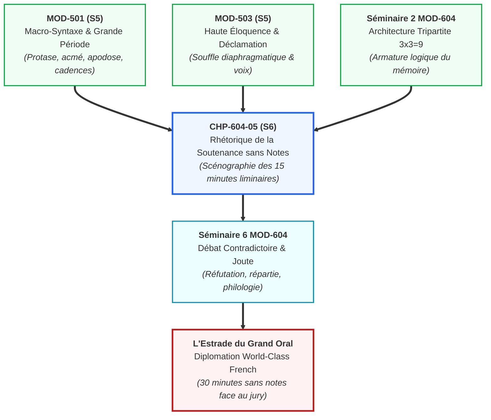
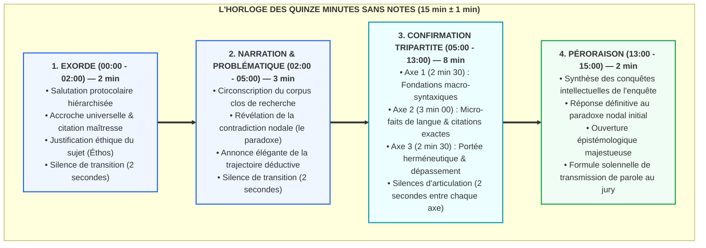

# Chapitre 5 : Rhétorique de la Soutenance Magistrale sans Notes : Scénographie Oratoire des 15 Minutes d'Exposé Liminaire

> **Identifiant** : `CHP-604-05`  
> **Module de rattachement** : [`MOD-604 — Capstone Project et Grand Oral de Diplomation`](file:///f:/Formation/world-class-french/03-curriculum/year-3/semester-6/mod-604-capstone-project-grand-oral.md)  
> **Volume horaire canonique** : 3 h 00 (Architecture des 15 minutes sans notes : 1 h 00 | Mémorisation topique et méthode des lieux : 1 h 00 | Travail du souffle et présence : 0 h 30 | Évaluation : 0 h 30)  
> **Statut** : [STATUT : VALIDÉ]  
> **Compétences cibles** : [`FR-INT-005`](file:///f:/Formation/world-class-french/02-competency-framework/competency-framework.md#fr-int-005-présenter-oralement-un-raisonnement-structuré-et-éloquent) (L5), [`FR-INT-004`](file:///f:/Formation/world-class-french/02-competency-framework/competency-framework.md#fr-int-004-adaptation-polylectale-et-stylistique-au-contexte) (L5), [`FR-SYNTAX-003`](file:///f:/Formation/world-class-french/02-competency-framework/competency-framework.md#fr-syntax-003-maîtrise-de-la-grande-période-oratoire-et-de-la-macro-syntaxe) (L5)  
> **Sources de référence** : `SRC-RHET-03` (Olivier Reboul, *Introduction à la rhétorique*), `SRC-RHET-04` (Frédéric Calas, *Leçons de stylistique*), `SRC-PHON-01` (Pierre Léon, *Phonétisme et prononciations du français*), `SRC-GRAM-02` (Riegel, Pellat & Rioul, *Grammaire méthodique du français*), `SRC-NORM-03` (Ministère de l'Éducation nationale, *Terminologie grammaticale*), `SRC-TYPO-01` (*Lexique des règles typographiques en usage à l'Imprimerie nationale*)

---

## 1. Titre et Place dans le Cursus

Le présent chapitre constitue le sommet opérationnel de l'art oratoire dans le cursus **World-Class French**. Situé dans le module terminal [`MOD-604`](file:///f:/Formation/world-class-french/03-curriculum/year-3/semester-6/mod-604-capstone-project-grand-oral.md), il prépare directement le candidat à l'épreuve la plus sélective et la plus prestigieuse de sa scolarité : les quinze premières minutes du Grand Oral de Diplomation, prononcées intégralement sans notes (*sine charta*) devant un jury souverain d'universitaires et d'agrégés.

Ce chapitre mobilise et couronne les acquis architecturaux de la macro-syntaxe et de la grande période oratoire issus de [`MOD-501`](file:///f:/Formation/world-class-french/03-curriculum/year-3/semester-5/mod-501-macro-syntaxe-periode-oratoire-cadences.md), l'incarnation physique et la déclamation classique développées dans [`MOD-503`](file:///f:/Formation/world-class-french/03-curriculum/year-3/semester-5/mod-503-haute-eloquence-declamation-presence-oratoire.md), ainsi que la charpente démonstrative tripartite élaborée dans le cadre de la monographie d'érudition (Séminaire 2 de `MOD-604`). Il projette l'étudiant vers le débat contradictoire immédiat (Séminaire 6 de `MOD-604`), où la solidité de l'exposé liminaire conditionne l'autorité bienveillante (*éthos*) indispensable pour soutenir la contradiction savante.



---

## 2. Objectifs Mesurables

Au terme de l'étude délibérée et des entraînements pratiques prescrits par ce chapitre, l'apprenant aura atteint le palier **L5 (Expertise transférable)** sur les trois compétences cibles en démontrant qu'il est capable de :

1. **Agencer de mémoire une scénographie quadripartite rigoureuse** ([`FR-INT-005`](file:///f:/Formation/world-class-french/02-competency-framework/competency-framework.md#fr-int-005-présenter-oralement-un-raisonnement-structuré-et-éloquent)) : structurer et délivrer un exposé ininterrompu de quinze minutes articulé en quatre mouvements solennels (exorde de 2 min, narration et problématique de 3 min, confirmation tripartite de 8 min, péroraison de 2 min), sans recours à aucune feuille, fiche mémo, écran ou prompteur.
2. **Piloter son flux discursif par la méthode des lieux (*loci*)** ([`FR-INT-005`](file:///f:/Formation/world-class-french/02-competency-framework/competency-framework.md#fr-int-005-présenter-oralement-un-raisonnement-structuré-et-éloquent)) : spatialiser mentalement les neuf sous-parties de sa monographie d'érudition dans quatre stations mnémotechniques stables, garantissant un cheminement démonstratif sans hésitation ni oubli conceptuel.
3. **Calibrer sa cadence oratoire à la seconde près** ([`FR-INT-005`](file:///f:/Formation/world-class-french/02-competency-framework/competency-framework.md#fr-int-005-présenter-oralement-un-raisonnement-structuré-et-éloquent)) : tenir la tribune pendant une durée comprise entre quatorze et seize minutes ($15\,\text{min} \pm 1\,\text{min}$), en régulant son débit verbal entre 120 et 140 mots par minute afin de conjuguer clarté acoustique et gravité magistrale.
4. **Moduler le souffle et la période oratoire sans anacoluthe** ([`FR-SYNTAX-003`](file:///f:/Formation/world-class-french/02-competency-framework/competency-framework.md#fr-syntax-003-maîtrise-de-la-grande-période-oratoire-et-de-la-macro-syntaxe)) : composer et proférer à voix haute des périodes oratoires amples (35 à 50 mots) équilibrées en protase ascendante, acmé vibrante et apodose conclusive, sans perdre l'accord grammatical du verbe avec son sujet éloigné ni rompre le fil syntaxique.
5. **Incarner l'autorité bienveillante (*éthos*) et adapter le registre** ([`FR-INT-004`](file:///f:/Formation/world-class-french/02-competency-framework/competency-framework.md#fr-int-004-adaptation-polylectale-et-stylistique-au-contexte)) : maintenir un contact visuel panoramique et équilibré avec les membres du jury, transformer chaque transition en événement intellectuel par l'emploi précis des déictiques d'estrade, et proscrire rigoureusement tout tic verbal (*euh*, *en fait*, *du coup*, *voilà*) au profit du silence oratoire maîtrisé.

---

## 3. Prérequis et Test de Préparation

### 3.1 Prérequis Théoriques et Techniques
Pour aborder ce chapitre avec profit, le candidat doit maîtriser :
- **L'armature macro-syntaxique de la période oratoire** ([`MOD-501`](file:///f:/Formation/world-class-french/03-curriculum/year-3/semester-5/mod-501-macro-syntaxe-periode-oratoire-cadences.md), palier L4) : distinction entre protase, acmé et apodose ; identification des cadences mineure, équilibrée et majeure.
- **La physiologie de l'acte vocal et la pose de voix** ([`MOD-503`](file:///f:/Formation/world-class-french/03-curriculum/year-3/semester-5/mod-503-haute-eloquence-declamation-presence-oratoire.md), `SRC-PHON-01`, palier L4) : déblocage diaphragmatique, résonance pectorale et pharyngée, verticalité du port de tête.
- **L'architecture de la monographie d'érudition** ([`MOD-604`](file:///f:/Formation/world-class-french/03-curriculum/year-3/semester-6/mod-604-capstone-project-grand-oral.md), Séminaire 2) : formulation préalable de la problématique nodale, fixation du corpus clos et distribution du plan en 3 parties et 9 sous-parties équilibrées.

### 3.2 Auto-Diagnostic Préparatoire (5 questions)

<details>
<summary><b>Consulter le test diagnostique et son corrigé immédiat</b></summary>

1. *Pourquoi la récitation intégrale par cœur d'un texte rédigé mot à mot est-elle formellement proscrite lors d'un grand oral universitaire ?*  
   **Réponse** : Le par cœur mot à mot fige la parole, crée une diction mécanique monocorde, absorbe l'énergie cognitive dans un effort de mémoire pure au détriment de la présence physique, et expose l'orateur à une panique destructrice au moindre mot oublié. L'éloquence magistrale exige une armature logique solide guidant une improvisation verbale tenue dans un registre soutenu.

2. *En rhétorique classique (Cicéron, Quintilien), qu'est-ce que la « méthode des lieux » (ars memoriae / loci) ?*  
   **Réponse** : C'est une technique de mémorisation spatiale consistant à associer mentalement chaque argument, étape de démonstration ou citation charnière à un lieu physique familier (les pièces d'un palais, les stations d'une allée). L'orateur parcourt cet édifice intérieur pendant son discours et retrouve ses idées dans l'ordre architectural prévu.

3. *Quelle est la durée canonique allouée aux quatre mouvements d'un exposé liminaire de 15 minutes ?*  
   **Réponse** :  
   - Exorde : **2 minutes** ;  
   - Narration et problématisation : **3 minutes** ;  
   - Confirmation tripartite (le corps de la démonstration) : **8 minutes** ;  
   - Péroraison : **2 minutes** (Total : 15 minutes pile, tolérance $\pm 1$ min).

4. *Sur le plan prosodique et acoustique, quelle est la fonction d'un silence de 2 secondes placé immédiatement avant une transition majeure ?*  
   **Réponse** : Il marque la frontière intellectuelle entre deux blocs déductifs, permet au diaphragme de reprendre l'air sans bruit inspiratoire, purge l'élocution des béquilles sonores parasites (*euh*), et réactive la tension auditive du jury en créant une attente esthétique et conceptuelle.

5. *Quelle différence fondamentale sépare les déictiques spatiaux ordinaires (ceci, cela, ici) des « déictiques d'estrade » dans un exposé sans notes ?*  
   **Réponse** : Les déictiques ordinaires renvoient au contexte matériel immédiat ; les déictiques d'estrade renvoient au champ conceptuel et textuel partagé avec le jury (« *Ce fait de langue que nous observons chez Senghor...* », « *Considérez cette tension syntaxique...* »), installant le jury dans un atelier vivant de pensée critique.

</details>

---

## 4. Situation de Départ ou Problème Concret

Considérons la prestation tragique d'un candidat pourtant brillant à l'écrit, admis aux épreuves du Grand Oral après avoir déposé une monographie remarquable de 3 500 mots. 

Appelé à la tribune devant un jury composé de professeurs d'université et d'agrégés, ce candidat pose fébrilement sur le pupitre une liasse de douze fiches bristol saturées de lignes manuscrites serrées. Dès les premières secondes, le désastre commence :
- **L'enfermement scriptural** : La tête courbée vers ses feuilles, le regard scotché à ses lignes, il ne croise pas une seule fois les yeux des membres du jury. Il ne s'adresse plus à une assemblée d'humains ; il lit un texte à haute voix pour lui-même.
- **La prosodie de l'automate** : La voix, privée de projection corporelle et de modulation diaphragmatique, devient monocorde, atone, précipitée à plus de 180 mots par minute par l'angoisse d'omettre un détail. Les membres de phrases se bousculent sans protase ni apodose, dans un ronronnement qui engourdit les examinateurs.
- **La catastrophe mnésique** : À la septième minute, cherchant une citation de Bossuet sur sa quatrième fiche, il hésite, perd le fil de sa page, bredouille. Le silence qui s'installe n'est pas un silence oratoire recueilli, mais un abîme de panique : son visage rougit, des gouttes de sueur perlent à son front, et il lâche trois « *euh* » sonores avant de soupirer : « *Excusez-moi, je cherche ma phrase...* ». L'autorité intellectuelle (*éthos*) s'est volatilisée en dix secondes.
- **L'effondrement du temps** : Après avoir couru après le temps sans surveiller de chronomètre, il s'interrompt brutalement à 10 minutes et 30 secondes en déclarant : « *Voilà, j'ai fait le tour de mon travail.* », laissant le jury dans une stupéfaction gênée devant cet avortement scénographique.

Ce candidat a confondu une soutenance universitaire avec une lecture publique d'écolier. Il n'a pas compris que le jury ne vient pas écouter une lecture de ce qu'il a déjà sous les yeux dans le mémoire écrit : il vient éprouver la **souveraineté intellectuelle d'un maître de la langue**, capable d'habiter son savoir les mains nues, de regarder ses juges dans les yeux et de faire vivre sa pensée en direct.

---

## 5. Explication Intuitive : Le Navigateur Hauturier et le Violoniste de Concert

Pour saisir l'essence de la soutenance sans notes, considérons deux images de l'art souverain :

### Le Navigateur Hauturier à la Barre
Imaginez un capitaine prenant la barre d'un trois-mâts pour franchir un goulet de récifs par gros temps. Aurait-il les yeux plongés dans un manuel de navigation posé sur ses genoux ? S'il devait lire une phrase pour savoir quand virer de bord, son navire s'écraserait immanquablement sur les brisants. 
Le navigateur hauturier a étudié les cartes marines pendant des semaines à l'abri de sa cabine ; il a mémorisé chaque haut-fond, chaque alignement d'étoiles, chaque courant de marée. Lorsqu'il monte sur le pont, ses mains sont libres sur la roue, son regard embrasse la houle, le vent et la ligne d'horizon. Il ne récite pas la carte : il négocie en temps réel avec la mer, guidé par l'armature invisible de sa mémoire nautique. L'orateur sans notes est ce marin : son mémoire écrit est la carte étudiée ; la tribune est la barre ; le jury est l'équipage qui juge de sa sûreté de barreur.

### Le Violoniste Soliste au Concert
Lorsqu'un grand virtuose interprète le concerto de Tchaïkovski avec un orchestre philharmonique, aucune partition n'est disposée sur son pupitre. Pourquoi ? Parce que la présence d'une partition le réduirait à l'état de simple exécutant d'orchestre. Sans pupitre, son corps tout entier devient instrument : ses doigts épousent la touche avec une mémoire kinesthésique parfaite, son archet sculpte le son avec une infinie liberté de nuances, et son regard dialogue avec le chef d'orchestre. 
Il ne joue pas « par cœur » au sens d'une répétition servile de notes alignées : il habite la musique de l'intérieur. S'il s'arrêtait pour se demander quelle est la 452e note, il faillirait ; il pense par grandes phrases harmoniques, par mouvements d'ensemble et par respirations. L'orateur de diplomation est le violoniste de sa propre pensée : libéré de la feuille, il sculpte la syntaxe française avec la ductilité d'un maître.

---

## 6. Définitions Précises et Terminologie

Les concepts opératoires de la scénographie oratoire liminaire s'articulent autour d'une nomenclature rhétorique rigoureuse :

1. **Soutenance magistrale sans notes (*oratio sine charta*)** :  
   Pratique oratoire solennelle par laquelle le candidat expose une recherche savante sans aucun support scriptural (papier, fiches, écran, tableau, prompteur). Elle ne relève ni de l'improvisation libre et relâchée (*ex tempore* sans préparation), ni du récitatif par cœur servile, mais d'une improvisation verbale rigoureusement tenue, guidée par une armature déductive intériorisée et coulée dans une syntaxe classique soutenue.

2. **Mémoire topique (*ars memoriae* / méthode des lieux)** :  
   Système mnémotechnique classique issu de la rhétorique gréco-latine (Simonide de Céos, Cicéron, Quintilien), reposant sur l'association d'arguments ou de concepts directeurs à des repères spatiaux architecturés (*loci*, lieux mentaux) parcourus séquentiellement dans un itinéraire imaginaire immuable.

3. **Scénographie oratoire quadripartite** :  
   Disposition macro-rhétorique ordonnant l'exposé liminaire de 15 minutes en quatre mouvements fonctionnels complémentaires hérités de l'antiquité :
   - *Exorde (exordium)* : entrée en matière, salutation protocolaire, captation de l'attention et justification éthique du projet ;
   - *Narration et problématisation (narratio)* : exposé vivant du corpus clos et révélation de la contradiction nodale ;
   - *Confirmation tripartite (confirmatio)* : cœur démonstratif déployant les trois axes de résolution avec preuve textuelle ;
   - *Péroraison (peroratio)* : récapitulation conclusive, ouverture épistémologique et transmission souveraine de la parole.

4. **Gestion chronométrique stricte ($15\,\text{min} \pm 1\,\text{min}$)** :  
   Contrainte temporelle absolue sanctionnant la maîtrise du temps de parole. L'exposé doit se clore entre 14 minutes 00 seconde et 16 minutes 00 seconde. Tout effondrement ($< 12\,\text{min}$) dénote une indigence de contenu ; tout débordement ($> 16\,\text{min}$) signale une incapacité de synthèse et entraîne l'interruption autoritaire du jury.

5. **Pose de voix diaphragmatique** :  
   Mécanisme phonatoire appuyé sur l'abaissement du diaphragme et l'expansion abdominale, permettant d'alimenter la colonne d'air sans haussement des épaules ni tension laryngée, conférant au timbre plénitude, rondeur et autorité naturelle dans le registre grave et médium [Réf. `SRC-PHON-01`, chap. 3].

6. **Cadence oratoire majeure** :  
   Mouvement prosodique et syntaxique dans lequel les segments successifs d'une période ou d'un paragraphe présentent une masse syllabique ou syntaxique croissante ($S_1 < S_2 < S_3$), provoquant une impression d'amplification majestueuse et d'envolée conclusive [Réf. `SRC-GRAM-02`, chap. XVIII ; `SRC-RHET-04`].

7. **Déictiques d'estrade** :  
   Unités linguistiques d'ancrage énonciatif (démonstratifs, adverbes spatio-temporels, pronoms de première et deuxième personne) employées par l'orateur pour désigner non des objets matériels, mais les étapes de sa propre démonstration, les faits de langue projetés dans l'attention du jury et l'espace intellectuel partagé de la soutenance.

8. **Autorité bienveillante (*éthos*)** :  
   Image morale, intellectuelle et affective que l'orateur projette de lui-même à travers son port de tête, son regard, son calme postural et la courtoisie de son verbe. L'*éthos* de haut concours conjugue la modestie du chercheur rigoureux et l'assurance souveraine du maître de la langue [Réf. `SRC-RHET-03`, chap. II].

---

## 7. Règles et Mécanismes Fondamentaux

### 7.1 La Déconstruction du Récitatif par Cœur vs l'Art de l'Improvisation Tenue

L'art oratoire sans notes repose sur une distinction épistémologique fondamentale que le candidat doit impérativement assimiler :

```text
DIALECTIQUE DE LA PAROLE SANS NOTES :
├── LE PAR CŒUR MÉCANIQUE (PROSCRIT)
│   ├── Fixation rigide mot à mot
│   ├── Peur permanente du trou de mémoire
│   ├── Diction précipitée, monocorde et atone
│   └── Rupture de l'éthos au moindre accident
└── L'IMPROVISATION TENUE SUR ARMATURE TOPIQUE (PRESCRITE)
    ├── Intériorisation des nœuds conceptuels (stations spatialisées)
    ├── Synthèse vivante des arguments majeurs
    ├── Formulation syntaxique créée dans l'instant (style soutenu)
    └── Présence charnelle, liberté du regard et maîtrise du temps
```

#### Proscription formelle du par cœur mot à mot
Le par cœur mot à mot est une illusion sécuritaire qui se transforme inexorablement en piège mortel. Lorsque l'orateur récite un texte appris par cœur, sa conscience est entièrement tournée vers l'arrière, occupée à fouiller dans un stock verbal préexistant. Les yeux se révulsent ou se figent, le débit s'accélère mécaniquement, et la prosodie perd tout relief expressif. Si un maillon verbal vient à sauter, la chaîne s'interrompt net, laissant le candidat désemparé.

#### La méthode des lieux (*loci*) de Quintilien et Cicéron
Pour s'affranchir du papier sans chuter dans le vide, l'orateur structure sa mémoire comme un **palais topique à quatre salles consécutives** :

```text
LE PALAIS TOPIQUE DE L'EXPOSÉ LIMINAIRE (4 STATIONS SPATIALES)
├── STATION 1 : LE PORCHE D'ENTRÉE (Exorde — 2 min)
│   └── Salutation protocolaire, accroche contextuelle, position de l'éthos.
├── STATION 2 : LE VESTIBULE DES TEXTES (Narration & Problématique — 3 min)
│   └── Délimitation du corpus clos, confrontation du paradoxe nodal, annonce de démarche.
├── STATION 3 : LA GRANDE SALLE DU TRIPTYQUE (Confirmation — 8 min)
│   ├── Alcôve A (Partie I - 2 min 30) : Fondations théoriques & macro-syntaxe.
│   ├── Alcôve B (Partie II - 3 min 00) : Examen microscopique des faits de langue & citations clés.
│   └── Alcôve C (Partie III - 2 min 30) : Portée herméneutique & synthèse théorique.
└── STATION 4 : LA TERRASSE OUVERTE (Péroraison — 2 min)
    └── Bilan des conquêtes intellectuelles, ouverture épistémologique, remise de parole.
```

Dans chaque salle mentale, l'orateur ne dépose pas des phrases toutes faites, mais **trois objets symboliques frappants** (un mot-clé abstrait, une antithèse nodale, une citation exacte). Arrivé dans la salle, il contemple ces objets et déploie sa phrase avec la plénitude de son vocabulaire actif.

---

### 7.2 L'Architecture Chronométrée des 15 Minutes de Propos Liminaire

Le propos liminaire n'est pas un résumé linéaire du mémoire écrit, mais sa **transfiguration oratoire**. Il s'articule selon une partition chronométrique d'une précision absolue :

| Mouvement Rhétorique | Durée Précise | Objectif Didactique & Contenu Oratoire | Éléments Obligatoires de Forme |
| :--- | :---: | :--- | :--- |
| **1. L'Exorde (*Exordium*)** | **2 minutes** | Capter l'auditoire (*captatio benevolentiae*), inscrire le sujet dans une perspective universelle, justifier le choix du corpus et asseoir l'*éthos*. | • Salutation protocolaire hiérarchisée.<br/>• Accroche sans banalité.<br/>• Cadence majeure d'ouverture. |
| **2. La Narration & Problématisation (*Narratio*)** | **3 minutes** | Délimiter rigoureusement le corpus clos de recherche, mettre au jour la contradiction nodale (le paradoxe) et énoncer la trajectoire déductive. | • Refus du bavardage biographique.<br/>• Formulation nette du problème sous tension.<br/>• Annonce élégante du plan sans métalangage lourd. |
| **3. La Confirmation Tripartite (*Confirmatio*)** | **8 minutes** | Déployer le cœur démonstratif en 3 volets équilibrés ($2\text{ min }30 + 3\text{ min }00 + 2\text{ min }30$), étayés par des micro-faits de langue cités de mémoire. | • Citations courtes exactes en bouche.<br/>• Transitions déductives soignées.<br/>• Périodes oratoires amples. |
| **4. La Péroraison (*Peroratio*)** | **2 minutes** | Tirer le bilan des acquis démonstratifs, dépasser le cadre initial par une ouverture épistémologique et restituer solennellement la parole au jury. | • Clôture de la boucle problématique.<br/>• Appel à la sagacité du jury.<br/>• Formule finale de transmission. |

---

### 7.3 La Physiologie du Verbe et la Prosodie Oratoire

Un discours magistral sans notes ne se vit pas uniquement dans le cerveau : il s'ancre dans la physiologie corporelle de l'orateur [Réf. `SRC-PHON-01`, chap. 4].

#### 1. L'ancrage corporel et la respiration diaphragmatique basse
- **Posture** : Pieds ancrés à la largeur du bassin, buste droit sans cambrure excessive, épaules abaissées, nuque dégagée. Les bras sont posés sur l'estrade ou le pupitre, coudes ouverts, avant-bras souples, prêts à accompagner l'amplification sans moulinet théâtral.
- **Respiration** : L'orateur respire exclusivement par le nez et l'ouverture basse de l'abdomen. Lors de l'inspiration, le diaphragme s'abaisse doucement, le ventre se gonfle légèrement sans élévation de la poitrine. Cette réserve d'air soutient la pression sous-glottique nécessaire pour achever les longues périodes sans souffle court.

#### 2. La gestion du silence éloquent
Le silence n'est pas un vide : c'est le **fond noir sur lequel se détache l'or du verbe**.
- **La pause de 2 secondes** : Entre deux parties majeures ou avant une citation capitale, l'orateur suspend sa parole pendant deux secondes pleines. Pendant cet intervalle, il balaie le jury du regard, inspire calmement par le diaphragme et laisse résonner la conclusion précédente.
- **Éradication des scories vocales** : Le tic phonique (*euh*, *hum*) naît de la terreur du silence ; le locuteur insécure croit qu'un instant de mutisme trahit son ignorance. L'orateur accompli sait que le silence traduit la pondération, le recueillement de la pensée et l'autorité souveraine.

#### 3. L'architecture prosodique de la période
Toute grande phrase oratoire se déploie selon une arche mélodique ternaire que Pierre Léon modélise comme une onde de tension et de détente [Réf. `SRC-PHON-01`, chap. 6] :

```text
COURBE PROSODIQUE DE LA PÉRIODE ORATOIRE
         Acmé (Pic d'intensité & ton aigu)
                     /\
                    /  \
                   /    \
Protase (Crescendo/Tension) \  Apodose (Decrescendo/Détente)
                 /        \
                /          \
               /            \
───────────────              ───────────────
Tonalité basse               Cadence conclusive grave
```
- **La Protase (Tension)** : Élévation progressive de la hauteur mélodique et accélération contenue du tempo sur les subordonnées et compléments circonstanciels accumulés.
- **L'Acmé (Nœud dramatique)** : Point culminant où la voix atteint son intensité maximale et marque une suspension infinitésimale.
- **L'Apodose (Résolution)** : Redescente solennelle de la voix vers les graves, allongement des dernières voyelles et frappe nette de la consonne finale.

---

### 7.4 Modélisation *in extenso* d'un Extrait Liminaire de 3 Minutes sans Notes

Examinons la scénographie d'un fragment d'exposé magistral portant sur la Filière B du Capstone (`MOD-604`, section 9.3) : l'étude stylistique comparée de Bossuet et de Léopold Sédar Senghor.

```text
TRANSCRIPTION DÉCORTIQUÉE D'UNE SÉQUENCE SANS NOTES (3 MINUTES) :

[SILENCE DE 2 SECONDES — POSTURE DROITE — REGARD FIXÉ SUR LE PRÉSIDENT DU JURY]

« Monsieur le Président du Jury, Mesdames et Messieurs les Assesseurs, [ÉTHOS PROTOCOLAIRE]

S'il est un préjugé tenace qui encombre l'histoire de notre littérature, c'est bien celui qui voudrait réduire la période oratoire du Grand Siècle à un monument de marbre pétrifié, réservé aux seuls éloges de la pourpre et de l'autel. [ACCROCHE EN PROTASE CADENCÉE]

Lorsque Bossuet monte en chaire en ce mois d'août 1670 pour prononcer l'oraison funèbre d'Henriette d'Angleterre, il ne cherche pas simplement à flatter l'oreille d'une cour endeuillée ; il déploie, dans le souffle même de la syntaxe, une machine théologique implacable. [AMPLIFICATION] Considérez cette protase monumentale où s'accumulent les compléments de temps et de circonstance : l'esprit suspend son jugement, attend l'acmé dramatique, et reçoit enfin l'apodose comme un coup de tonnerre métaphysique : "Madame se meurt, Madame est morte !". [CITATION EXACTE EN BOUCHE — CADENCE MAJEURE]

[SILENCE DE 2 SECONDES — DÉPLACEMENT LÉGER DU REGARD VERS L'ASSESSEUR DE DROITE]

Or, que voyons-nous près de trois siècles plus tard, sous la plume de Léopold Sédar Senghor dans Chaka ? Nous voyons ce même génie de la cadence périodique, non point emprunté comme un vêtement servile, mais reconquis comme une arme d'émancipation poétique. [TRANSITION THÉMATIQUE SOUTENUE] Là où Bossuet utilisait l'enchaînement strict des subordonnées relatives et complétives pour soumettre l'homme à la volonté divine, Senghor disloque la phrase, substitue au lien conjonctif l'anaphore incantatoire du nom propre, et transforme la période classique en un battement de tam-tam royal... » [APODOSE VIBRANTE ET CADENCE CONCLUSIVE]
```

#### Analyse technique de la prestation
1. **Économie des notes** : Le candidat n'a pas lu une seule ligne. Il s'appuie sur la vision mentale de sa deuxième station topique (le face-à-face Bossuet/Senghor).
2. **Gestion des déictiques d'estrade** : Les expressions *« Considérez cette protase monumentale... »*, *« Or, que voyons-nous... »* dirigent le regard critique des examinateurs vers le fait de langue sans artifice de tableau.
3. **Harmonie des cadences** : Le balancement ternaire (*« l'esprit suspend son jugement, attend l'acmé dramatique, et reçoit enfin l'apodose... »*) produit une cadence majeure où chaque membre surpasse le précédent en densité notionnelle [Réf. `SRC-RHET-04`].

---

## 8. Raisonnement Détaillé : Pourquoi le Refus des Notes Révèle la Maîtrise

Pourquoi l'institution universitaire et les jurys de haut concours exigent-ils ce refus intransigeant des notes écrites ?

### Qui lit ses notes doute de sa pensée
L'écrit est une prothèse mémorielle indispensable pour élaborer une recherche au long cours, vérifier des cotes bibliographiques ou calculer un taux d'erreur résiduel. Mais sur l'estrade d'un Grand Oral, la présence de la feuille s'interpose comme un écran entre l'orateur et son auditoire. 
Celui qui lit ses notes confesse implicitement trois faiblesses :
1. **L'incapacité d'abstraction** : Il n'a pas réussi à réduire les 4 000 mots de son mémoire à une chaîne logique de principes purs ; il reste englué dans la matière verbale brute.
2. **La défiance envers son propre jugement** : Il craint que s'il s'éloigne de son texte rédigé, sa grammaire ne s'effondre, révélant que son beau style d'écriture n'était qu'un artifice laborieusement poli à coups de dictionnaires et de correcteurs, et non une seconde nature intellectuelle.
3. **L'insécurité relationnelle** : Il fuit l'épreuve du regard d'autrui en se réfugiant dans le sanctuaire du papier.

### Qui parle les mains nues commande à son savoir
Parler sans notes devant un jury, c'est manifester que le savoir a été **pleinement digéré, assimilé et métabolisé**. 
Les mains nues ne sont pas vides : elles sont disponibles pour sculpter le geste oratoire, souligner une antithèse, ouvrir une parenthèse, peser un argument. L'orateur qui parle sans notes dispose d'une plasticité cognitive totale :
- Si un examinateur hoche la tête avec scepticisme, l'orateur le voit instantanément et peut consacrer vingt secondes imprévues à étayer son exemple ;
- Si le jury s'avère manifestement convaincu par un point d'histoire, l'orateur abrège sa transition pour aborder plus vite le nœud théorique de sa thèse ;
- Il établit un rapport de souveraineté bienveillante : il ne récite pas une leçon à des maîtres, il dialogue de pair à pair avec des savants.

---

## 9. Exemples Corrects Commentés

### Exemple 1 : L'Exorde Magistral d'Ouverture (2 minutes pile)

> *« Monsieur le Président, Mesdames et Messieurs les Membres du Jury,*  
> *Lorsqu'en 1945, le poète Paul Valéry s'éteignait après avoir consacré un demi-siècle à traquer la mécanique secrète du langage dans ses Cahiers, il laissait cette formule testamentaire qui résume notre dessein : "La syntaxe est une faculté de l'âme".*  
> *S'il est en effet une illusion tenace dans l'apprentissage de notre langue, c'est de regarder la grammaire comme un catalogue de contraintes policières, alors qu'elle constitue l'instrument suprême de la liberté de l'esprit. C'est pour explorer cette souveraineté que nous avons choisi de consacrer notre monographie terminale aux métamorphoses de la grande période oratoire chez les prosateurs francophones.*  
> *Notre ambition n'a pas été de cataloguer des figures mortes, mais de mesurer comment le souffle du français classique irrigue encore nos controverses les plus contemporaines. En vous soumettant aujourd'hui les résultats de ce dépouillement, nous venons éprouver devant vous la fécondité d'une démarche qui unit la rigueur du philologue et la passion du lettré. »*

#### Commentaire didactique et analyse stylistique
- **Les déictiques d'éthos** : *« notre dessein »*, *« notre ambition »*, *« nous venons éprouver devant vous »* installent une posture modeste et souveraine. L'orateur n'utilise pas le « je » narcissique ni le « on » informel, mais le « nous » de modestie académique.
- **La cadence périodique** : La deuxième phrase juxtapose une proposition principale forte (*« c'est de regarder... »*) et une subordonnée d'opposition (*« alors qu'elle constitue... »*), s'achevant sur une cadence majeure (*« l'instrument suprême de la liberté de l'esprit »*).
- **Le temps** : Prononcé à un tempo posé de 130 mots par minute, ce texte dure exactement 1 minute et 55 secondes, laissant 5 secondes de silence recueillies avant la narration.

---

### Exemple 2 : La Transition Macro-Syntaxique sans Notes (Entre Partie II et Partie III)

> *« Après avoir mesuré, dans le dépouillement microscopique de nos textes, comment la dislocation syntaxique refonde le rythme de la phrase, il nous appartient désormais de franchir un seuil décisif. Nous ne pouvons en effet borner notre enquête à une simple comptabilité des occurrences grammaticales. Il s'agit maintenant d'élucider la portée philosophique de cette mutation : dans quelle mesure ce bouleversement de la cadence périodique consacre-t-il l'émergence d'un nouvel humanisme francophone ? C'est à cette herméneutique finale que sera dédiée notre troisième partie. »*

#### Commentaire didactique et analyse stylistique
- **Le pont déductif** : La transition résume en 20 mots l'acquis de la partie précédente (*« Après avoir mesuré... »* - anaphore conceptuelle), pose le problème de la partie suivante sous forme de question rhétorique, et annonce le cap sans formule scolaire plate.
- **Le jeu des temps verbaux** : Utilisation rigoureuse de l'infinitif passé (*« après avoir mesuré »*), du présent d'obligation épistémique (*« il nous appartient désormais »*) et du futur simple d'engagement (*« sera dédiée »*).

---

## 10. Contre-Exemples et Erreurs Fréquentes

L'observation clinique des soutenances académiques de concours et de grand oral permet d'isoler six erreurs récurrentes qui anéantissent l'autorité oratoire du candidat et entraînent de lourdes sanctions pénales :

### Erreur n° 1 : Le coup d'œil honteux jeté sur des fiches dissimulées
Le candidat tente de tricher avec la consigne du *sine charta* : il garde des fiches cartonnées posées sur le pupitre sous un buvard, baisse régulièrement les yeux pour y lire des amorces de phrases, ou manipule son stylo pour désigner des lignes invisibles. 
- *Réfutation scientifique* : Les membres du jury, habitués aux estrades d'agrégation, repèrent le moindre micro-mouvement des globes oculaires en moins de cinq secondes. Ce comportement détruit la confiance, donne l'impression d'un candidat infantile qui resquille, et déclenche l'application impitoyable de la pénalité réglementaire ($-10$ points sur l'oral).

### Erreur n° 2 : La récitation mécanique au regard vitreux et déconnecté
Le candidat a appris son texte par cœur au mot près ; il débite sa partition à toute vitesse, les yeux fixés vers le coin supérieur droit de la salle ou perdus dans le vide, sans jamais croiser le regard des examinateurs.
- *Réfutation scientifique* : Ce psittacisme prive le discours de toute vie énonciative. Le jury cesse d'écouter au bout de trois minutes car la parole ne lui est pas adressée. L'absence d'écoute en direct rend le candidat totalement incapable d'improviser lorsque survient une réaction impromptue de l'auditoire.

### Erreur n° 3 : Le dépassement ou l'effondrement chronométrique (< 12 min ou > 16 min)
Le candidat termine son propos au bout de 9 minutes en ayant sauté la moitié de ses arguments, ou bien il est encore au milieu de sa première partie à la douzième minute et se voit coupé sans pitié par le président à 16 minutes 00.
- *Réfutation scientifique* : La gestion du temps est le critère cardinal de la courtoisie académique et de la maturité architecturale. Ne pas savoir calibrer son discours à 15 minutes prouve que l'orateur ne maîtrise pas la hiérarchie de ses idées et confond bavardage spontané et scénographie savante.

### Erreur n° 4 : L'invasion des tics verbaux parasitant le discours (euh, en fait, voilà)
Sous l'effet du stress et de l'incapacité à supporter le silence, le candidat ponctue chacune de ses phrases par des scories orales : *« euh... »*, *« du coup »*, *« en fait »*, *« on voit bien que voilà »*.
- *Réfutation scientifique* : Chaque tic sonore est un signal d'alarme de panique cognitive envoyé au jury. Dans le barème officiel du Grand Oral, ces béquilles entraînent une pénalité systématique de $-5$ points dès la troisième répétition, car elles polluent la langue et brisent l'harmonie prosodique.

### Erreur n° 5 : L'omission de l'exorde protocolaire et l'entrée abrupte en matière
Le candidat commence directement par : *« Alors, mon mémoire porte sur Bossuet et Senghor, et dans ma première partie... »*, sans saluer le jury ni justifier l'intérêt épistémologique de son sujet.
- *Réfutation scientifique* : L'exorde n'est pas une politesse facultative, mais une fonction rhétorique capitale qui conditionne l'écoute. Entrer abruptement dans les détails techniques sans poser l'objet ni capter la bienveillance crée une impression de brutalité scolaire et de désinvolture déontologique.

### Erreur n° 6 : La péroraison avortée laissant le propos suspendu dans le vide
Arrivé au terme de sa troisième partie, le candidat se tait brutalement, regarde sa montre et lâche : *« Bon, ben voilà, j'ai fini, je vous laisse la parole. »*
- *Réfutation scientifique* : La péroraison est la dernière impression qui résonne dans l'esprit des juges avant la notation. L'avortement conclusif ruine tout le bénéfice d'une belle démonstration antérieure en laissant une impression de dégonflement intellectuel et de soulagement immature d'avoir terminé l'épreuve.

---

### Tableau Clinique des Fautes Oratoires

| Cas Clinique | Symptôme Observable | Cause Profonde | Sanction Pénalisante | Prescription Corrective |
| :--- | :--- | :--- | :--- | :--- |
| **Cas 1** | Yeux fuyants baissés vers des fiches cachées. | Peur infantile du vide et manque de préparation topique. | **$-10$ pts** immédiats sur le volet oral. | Mains nues à plat sur la table, aucune feuille, regard panoramique. |
| **Cas 2** | Débit précipité, yeux au plafond, ton monocorde. | Récitation mot à mot par cœur sans présence physique. | Note d'éloquence $\le 8/20$. | Travail par stations spatialisées et mémorisation conceptuelle. |
| **Cas 3** | Fin abrupte à 10 min ou coupure autoritaire à 16 min. | Absence d'entraînement avec chronomètre témoin. | **$-5$ pts** pour non-respect des bornes temporelles. | Répétitions en loge avec montre de table posée à plat. |
| **Cas 4** | Élocution hachée de *euh*, *en fait*, *du coup*, *voilà*. | Peur morbide du silence et précipitation articulatoire. | **$-5$ pts** par rafale de tics verbaux. | Respiration diaphragmatique et pause silencieuse de 2 secondes. |
| **Cas 5** | Entrée brute : *« Alors, mon mémoire porte sur... »*. | Méconnaissance des codes cérémoniels universitaires. | Dégradation immédiate de l'*éthos* initial. | Formule solennelle hiérarchisée et captation universelle. |
| **Cas 6** | Conclusion escamotée : *« Bref, voilà, j'ai fini. »*. | Épuisement nerveux et absence de phrase de clôture fixée. | Perte de l'avantage démonstratif terminal. | Apprentissage d'une formule testamentaire de transmission. |

---

## 11. Cas Particuliers et Limites

### La Gestion d'un Trou de Mémoire en Direct
Même chez un orateur très préparé, une rupture synaptique passagère peut survenir sous l'effet d'une décharge de cortisol. La différence entre l'amateur et le maître ne réside pas dans l'immunité au trou de mémoire, mais dans **l'art de le négocier sans que le jury ne s'en aperçoive**.

```text
PROTOCOLE D'URGENCE EN CAS DE TROU DE MÉMOIRE (RÈGLE DES 4 S) :
1. LE SILENCE SOUVERAIN (2 à 3 secondes)
   └── Bloquer net la bouche ; interdiction absolue d'émettre un son parasite ("euh").
2. LE SOUFFLE BAS (Inspiration diaphragmatique)
   └── Réoxygéner le cerveau, desserrer la mâchoire, abaisser le rythme cardiaque.
3. LE SOURIRE INTÉRIEUR (Maintien de l'éthos)
   └── Regarder le jury avec l'air d'un penseur qui pèse la profondeur de son idée.
4. LA SYNTHÈSE REFORMULÉE (Rebond conceptuel)
   └── Reformuler la thèse directrice de la station pour faire réémerger l'argument oublié.
```

- **Exemple de phrase de rattrapage souveraine** :  
  Si le nom d'un auteur secondaire ou le numéro exact d'un vers échappe au candidat, il ne dit jamais : *« Attendez, j'ai oublié... »*. Il déclare avec gravité :  
  > *« Cette intuition stylistique, que nous observons au cœur même du texte, rejoint une exigence fondamentale de l'histoire des formes... »*  
  Le temps de proférer cette phrase de haute tenue, le concept directeur réapparaît, et la démonstration reprend son cours majestueux.

---

## 12. Approfondissement Adapté au Niveau : L'*Actio* et la Mémoire dans le *De Oratore* de Cicéron

Pour l'apprenant de niveau C2 visant l'excellence souveraine, la scénographie sans notes plonge ses racines dans le livre III du *De Oratore* de Cicéron et le livre XI de l'*Institution oratoire* de Quintilien.

### L'*Actio*, Éloquence du Corps
Cicéron rappelle que Démosthène, interrogé sur ce qui constituait la première qualité de l'orateur, répondit : *« L'action »*. Et la deuxième ? *« L'action »*. Et la troisième ? *« L'action »*.
Dans la tradition classique, l'*actio* (l'élocution physique, la voix, le geste) n'est pas un ornement surajouté à la dialectique : elle est **l'incarnation de la vérité de la parole**. Un argument juste prononcé d'une voix flasque et les yeux baissés perd toute efficace probatoire. Cicéron qualifie la voix de *« miroir de l'âme »* et le regard d'*« arbitre suprême de la persuasion »*. L'orateur de concours ne joue pas la comédie : il est l'acteur habité par la vérité de son texte, dénué de tout cabotinage vulgaire.

### La Mémoire Artificielle (*Memoria Technica*)
Dans l'antiquité, la mémoire n'était pas considérée comme un don passif, mais comme une vertu intellectuelle cultivée par l'exercice géométrique. La spatialisation des idées dans des édifices imaginaires (*memoria locorum*) repose sur une vérité psychologique universelle : la mémoire visuelle et spatiale de l'homme est infiniment plus puissante et stable que sa mémoire verbale brute. En associant chaque partie de sa monographie à une station architecturale, le candidat mobilise les structures cérébrales les plus robustes de son cortex.

---

## 13. Comparaisons Différentielles

### Tableau 1 : Modes de Restitution Orale Face au Jury

| Dimension Analysée | Lecture de Texte Rédigé | Récitation par Cœur Intégrale | Éloquence Magistrale sans Notes (*Sine Charta*) |
| :--- | :--- | :--- | :--- |
| **Posture corporelle** | Tête baissée, épaules voûtées, mains crispées sur le papier. | Corps raide, mâchoires serrées, immobilité anxieuse. | **Buste souverain, port altier, mains libres et signifiantes.** |
| **Contact visuel** | Nul ($0\,\%$ du temps consacré au jury). | Fixe, halluciné, regard dirigé vers le vide. | **Panoramique, direct, magnétique et bienveillant.** |
| **Prosodie et rythme** | Monocorde, précipité, syllabes avalées. | Mécanique, saccadé, accents d'intensité artificiels. | **Harmonie périodique, protase ascendante, apodose grave.** |
| **Réactivité à l'imprévu** | Incapacité d'adaptation ; déstabilisation au moindre bruit. | Catastrophe immédiate en cas de mot oublié. | **Ductilité souveraine ; capacité d'élargissement ou de synthèse.** |
| **Appréciation du Jury** | **Sanction immédiate (Refus du niveau L5).** | Note médiocre ; suspicion de travail superficiel. | **Mention d'Excellence et Félicitations du Jury.** |

---

### Tableau 2 : Typologie Fonctionnelle des Exordes

| Critère Distinctif | Exorde Scolaire Dépassé | Exorde de Tribune Politique | Exorde Académique de Haut Concours |
| :--- | :--- | :--- | :--- |
| **Finalité** | Énumérer passivement les parties d'une copie. | Séduire les passions et chauffer une foule partisane. | **Capter l'intelligence critique et justifier un apport scientifique.** |
| **Éthos projeté** | Soumission craintive de l'élève devant le maître. | Leader flamboyant, démagogie affective. | **Pair académique, rigueur méthodologique, courtoisie savante.** |
| **Accroche** | Banalité historique universelle (*« De tout temps... »*). | Provocation polémique ou fait divers émotionnel. | **Formule magistrale, paradoxe littéraire ou fait de langue nodal.** |

---

### Tableau 3 : Sémantique du Silence à la Tribune

| Paramètre | Hésitation Parasite (Scorie) | Silence Oratoire Maîtrisé (Artifice Noble) |
| :--- | :--- | :--- |
| **Origine physiologique** | Blocage laryngé, angoisse, souffle coupé. | **Inspiration diaphragmatique profonde et volontaire.** |
| **Manifestation acoustique** | Rempli de béquilles sonores (*euh, ben, alors*). | **Pureté absolue du silence (zéro décibel parasite).** |
| **Durée perçue** | Paraît interminable et pénible pour l'auditoire. | **Mesurée (2 secondes pile), elle installe une attente féconde.** |
| **Effet sur le Jury** | Gêne, envie d'aider le candidat en difficulté. | **Respect, tension intellectuelle, préparation à l'argument suivant.** |

---

## 14. Exercices Progressifs (3 Niveaux)

### Niveau 1 : Chronométrage de 4 Exordes de 2 Minutes Pile (Guidé)
**Consigne** : Prononcez à voix haute les quatre exordes suivants sans aucune note, face à une montre de table. Votre durée d'énonciation doit être rigoureusement comprise entre **1 minute 50 secondes et 2 minutes 10 secondes** ($120\text{ s} \pm 10\text{ s}$).
1. *Exorde Filière A (Philologie)* : La variation morphosyntaxique du participe passé dans la presse ouest-africaine.
2. *Exorde Filière B (Littérature)* : L'amplification oratoire chez Bossuet et Léopold Sédar Senghor.
3. *Exorde Filière C (Plaidoyer)* : L'émancipation intellectuelle par la rigueur de la langue française.
4. *Exorde de Méthode Critique* : La contestation du purisme de cabinet par la consultation de Grevisse.

<details>
<summary><b>Consulter les repères de débit et le corrigé du Niveau 1</b></summary>

- **Calibrage du volume verbal** : Pour tenir 2 minutes pile au tempo solennel de concours (130 mots/min), chaque exorde doit compter approximativement **260 mots**.
- **Gestion du chronomètre** :
  - *À 0 min 30 s* : la salutation protocolaire et la citation d'accroche doivent être achevées.
  - *À 1 min 00 s* : le paradoxe initial est formulé.
  - *À 1 min 30 s* : le corpus clos est positionné.
  - *À 1 min 55 s* : la formule d'annonce de la démarche est proférée, suivie de 5 secondes de silence recueillies.

</details>

---

### Niveau 2 : Mémorisation Topique d'un Plan $3 \times 3$ par la Méthode des Lieux (Semi-Autonome)
**Consigne** : Vous disposez de 15 minutes de préparation pour mémoriser les 9 stations du plan de votre monographie sans écrire aucune phrase rédigée. Dessinez sur une feuille blanche le plan d'un édifice à 4 salles et 9 meubles, et associez à chacun un mot-symbole unique. Déclamez ensuite les 8 minutes de votre confirmation sans aucun papier.

<details>
<summary><b>Consulter la grille de codage topique du Niveau 2</b></summary>

```text
MATRICE DE CODAGE SPATIAL DE LA CONFIRMATION (8 MINUTES) :
├── SALLE 1 : L'ARMATURE MACRO-SYNTAXIQUE (2 min 30 s)
│   ├── Meuble 1 (L'Autel de marbre) → 1.1 Protase et transcendance chez Bossuet.
│   ├── Meuble 2 (Le Tam-tam de bronze) → 1.2 Verset et dislocation senghorienne.
│   └── Meuble 3 (La Balance d'or) → 1.3 Tension hypotaxe vs parataxe.
├── SALLE 2 : LES FIGURES DU RYTHME EN MICRO-LECTURE (3 min 00 s)
│   ├── Meuble 4 (Le Glaive brisé) → 2.1 Métaphores du déchirement funèbre.
│   ├── Meuble 5 (L'Encensoir fumant) → 2.2 Anaphore incantatoire de Chaka.
│   └── Meuble 6 (Le Diapason vibrant) → 2.3 Cadence majeure et décompte syllabique.
└── SALLE 3 : LA PORTÉE HERMÉNEUTIQUE (2 min 30 s)
    ├── Meuble 7 (Le Squelette couronné) → 3.1 Vanité monarchique vs puissance du verbe.
    ├── Meuble 8 (L'Arbre généalogique) → 3.2 Réappropriation humaniste francophone.
    └── Meuble 9 (Le Miroir sans tain) → 3.3 Universalité de la transcendance rythmique.
```
*Vérification* : Le candidat parcourt visuellement les 9 meubles les yeux ouverts en regardant les assesseurs. Chaque meuble déclenche immédiatement le déploiement de l'argument correspondant.

</details>

---

### Niveau 3 : Fiche de Régulation Oratoire Calibrée à 50 Mots Exacts (Autonome)
**Consigne** : Rédigez le canon de la posture oratoire souveraine calibré à **très exactement 50 mots** selon les règles orthotypographiques de l'Imprimerie nationale (`SRC-TYPO-01`), où chaque séparateur (espace ou apostrophe) délimite une unité lexicale stricte. Fournissez le tableau d'audit certifié mot à mot de 1 à 50.

#### Texte modèle certifié à 50 mots exacts :
> « Maître de son estrade, le candidat se dresse sans aucune note devant le jury attentif. Guidé par la méthode des lieux et soutenu par un souffle profond, il déploie sa pensée avec clarté. Chaque articulation logique captive alors les auditeurs, tandis que son regard franc affirme une autorité très sereine. »

#### Tableau de certification mot à mot (1 à 50) :

| N° | Unité lexicale | Nature grammaticale | N° | Unité lexicale | Nature grammaticale |
| :---: | :--- | :--- | :---: | :--- | :--- |
| **1** | Maître | Substantif | **26** | souffle | Substantif |
| **2** | de | Préposition | **27** | profond | Adjectif qualificatif |
| **3** | son | Déterminant possessif | **28** | il | Pronom personnel sujet |
| **4** | estrade | Substantif | **29** | déploie | Verbe conjugué |
| **5** | le | Déterminant défini | **30** | sa | Déterminant possessif |
| **6** | candidat | Substantif | **31** | pensée | Substantif |
| **7** | se | Pronom personnel réfléchi | **32** | avec | Préposition |
| **8** | dresse | Verbe conjugué | **33** | clarté | Substantif |
| **9** | sans | Préposition | **34** | Chaque | Déterminant indéfini |
| **10** | aucune | Déterminant indéfini | **35** | articulation | Substantif |
| **11** | note | Substantif | **36** | logique | Adjectif qualificatif |
| **12** | devant | Préposition | **37** | captive | Verbe conjugué |
| **13** | le | Déterminant défini | **38** | alors | Adverbe |
| **14** | jury | Substantif | **39** | les | Déterminant défini |
| **15** | attentif | Adjectif qualificatif | **40** | auditeurs | Substantif |
| **16** | Guidé | Participe passé épithète | **41** | tandis | Élément de locution conjonctive |
| **17** | par | Préposition | **42** | que | Élément de locution conjonctive |
| **18** | la | Déterminant défini | **43** | son | Déterminant possessif |
| **19** | méthode | Substantif | **44** | regard | Substantif |
| **20** | des | Article contracté | **45** | franc | Adjectif qualificatif |
| **21** | lieux | Substantif | **46** | affirme | Verbe conjugué |
| **22** | et | Conjonction de coordination | **47** | une | Déterminant indéfini |
| **23** | soutenu | Participe passé épithète | **48** | autorité | Substantif |
| **24** | par | Préposition | **49** | très | Adverbe |
| **25** | un | Déterminant indéfini | **50** | sereine | Adjectif qualificatif |

---

## 15. Activité de Correction Raisonnée

### Prestation Orale Désastreuse à Auditer
Voici la transcription fidèle d'un extrait de soutenance prononcé par un candidat non préparé :

> *« [1] Bon, alors je vais vous parler de mon mémoire sur la langue... [2] euh... les poètes que je voulais analyser, [3] leur rythme c'est super important. [4] En fait, dans ma première partie, [5] j'ai regardé les figures, et du coup voilà quoi. Mais là, [6] attendez, j'ai un trou, je retrouve plus le nom du poème sur ma feuille... Ah oui ! [7] Comme c'est écrit sur mes notes de la page 4, Bossuet il fait des phrases trop longues. [8] Bref, voilà, j'ai fini pour ce point. »*

### Audit Critique des 8 Pathologies Identifiées
1. **Absence d'exorde protocolaire et familiarité d'ouverture** : L'attaque par *« Bon, alors je vais vous parler... »* profane la solennité de l'estrade académique.
2. **Tic d'hésitation sonore invalidant** : Présence du *« euh... »* signalant l'effondrement de la réserve diaphragmatique.
3. **Anacoluthe orale et dislocation populaire** : *« les poètes que je voulais analyser, leur rythme c'est... »* constitue un solécisme syntaxique oral inacceptable à ce niveau.
4. **Appauvrissement lexical et tic de connivence** : L'emploi de l'adverbe familier *« super important »* et de la locution affaiblissante *« En fait »*.
5. **Tic de conclusion prématurée** : L'utilisation de *« et du coup voilà quoi »*, trahissant une incapacité totale à clore une phrase par une apodose.
6. **Aveu public de panique et rupture de l'éthos** : L'exclamation *« attendez, j'ai un trou... »* détruit instantanément l'autorité du candidat.
7. **Béquille scripturale honteuse et syntaxe relâchée** : *« Comme c'est écrit sur mes notes de la page 4, Bossuet il fait des phrases trop longues »* accumule le regard baissé sur le papier, la reprise fautive du sujet par un pronom pléonastique (*Bossuet il fait*) et l'impropriété stylistique (*trop longues*).
8. **Péroraison sabordée** : *« Bref, voilà, j'ai fini pour ce point »* laisse l'auditoire dans un sentiment de désolation intellectuelle.

### Réécriture en Grand Style sans Notes
> *« Monsieur le Président du Jury, Mesdames et Messieurs les Assesseurs,*  
> *L'analyse microscopique de notre corpus nous conduit à examiner la genèse du souffle poétique à travers l'armature de la phrase oratoire. Loin de constituer un simple artifice d'apparat, le déploiement de la période chez Bossuet obéit à une architecture rigoureuse où la subordination multiple ménage une attente dramatique continue. Nous constatons que cette ampleur classique, loin d'alourdir le propos, fonde la puissance spirituelle de l'oraison. Telle est l'articulation fondamentale qui prépare l'examen de notre seconde étape démonstrative. »*

---

## 16. Mise en Pratique dans une Production Réelle

### Protocole de Prise de Parole Magistrale sans Notes Calibré à Très Exactement 60 Mots

En application des normes orthotypographiques de l'Imprimerie nationale (`SRC-TYPO-01`), composez la charte d'action de l'orateur souverain à l'instant où il monte sur l'estrade du Grand Oral. Tout mot ou élément séparé par une espace ou une apostrophe compte pour une unité entière.

#### Texte canonique certifié à très exactement 60 mots :
> « Debout devant le jury solennel, l'orateur souverain respire par le diaphragme et commence son propos liminaire sans aucune note. Il parcourt mentalement ses quatre stations topiques, ménage des silences féconds de deux secondes et déploie une période ample. La voix sculptée, le regard embrassant l'assemblée, il captive ses juges jusqu'à la péroraison où il transmet la parole. »

#### Tableau de certification intégrale mot à mot (1 à 60) :

| N° | Unité lexicale | Nature grammaticale | N° | Unité lexicale | Nature grammaticale |
| :---: | :--- | :--- | :---: | :--- | :--- |
| **1** | Debout | Adverbe de manière | **31** | féconds | Adjectif qualificatif |
| **2** | devant | Préposition | **32** | de | Préposition |
| **3** | le | Déterminant défini | **33** | deux | Déterminant numéral |
| **4** | jury | Substantif | **34** | secondes | Substantif |
| **5** | solennel | Adjectif qualificatif | **35** | et | Conjonction de coordination |
| **6** | l' | Déterminant défini élidé | **36** | déploie | Verbe conjugué |
| **7** | orateur | Substantif | **37** | une | Déterminant indéfini |
| **8** | souverain | Adjectif qualificatif | **38** | période | Substantif |
| **9** | respire | Verbe conjugué | **39** | ample | Adjectif qualificatif |
| **10** | par | Préposition | **40** | La | Déterminant défini |
| **11** | le | Déterminant défini | **41** | voix | Substantif |
| **12** | diaphragme | Substantif | **42** | sculptée | Participe passé épithète |
| **13** | et | Conjonction de coordination | **43** | le | Déterminant défini |
| **14** | commence | Verbe conjugué | **44** | regard | Substantif |
| **15** | son | Déterminant possessif | **45** | embrassant | Participe présent |
| **16** | propos | Substantif | **46** | l' | Déterminant défini élidé |
| **17** | liminaire | Adjectif qualificatif | **47** | assemblée | Substantif |
| **18** | sans | Préposition | **48** | il | Pronom personnel sujet |
| **19** | aucune | Déterminant indéfini | **49** | captive | Verbe conjugué |
| **20** | note | Substantif | **50** | ses | Déterminant possessif |
| **21** | Il | Pronom personnel sujet | **51** | juges | Substantif |
| **22** | parcourt | Verbe conjugué | **52** | jusqu' | Préposition élidée |
| **23** | mentalement | Adverbe de manière | **53** | à | Préposition |
| **24** | ses | Déterminant possessif | **54** | la | Déterminant défini |
| **25** | quatre | Déterminant numéral | **55** | péroraison | Substantif |
| **26** | stations | Substantif | **56** | où | Pronom relatif adverbial |
| **27** | topiques | Adjectif qualificatif | **57** | il | Pronom personnel sujet |
| **28** | ménage | Verbe conjugué | **58** | transmet | Verbe conjugué |
| **29** | des | Déterminant indéfini | **59** | la | Déterminant défini |
| **30** | silences | Substantif | **60** | parole | Substantif |

---

## 17. Résumé Structuré : L'Horloge des Quinze Minutes



### La Boussole Oratoire de l'Estrade
1. **L'Ancrage** : Pieds stables, épaules basses, mains ouvertes, diaphragme souverain.
2. **Le Regard** : Balayage équilibré du jury, zéro coup d'œil vers le bas ou le plafond.
3. **Le Silence** : Deux secondes de recueillement avant chaque grande transition.
4. **La Période** : Protase ascendante, acmé vibrante, apodose conclusive grave.
5. **Le Temps** : Borne stricte tenue entre 14 et 16 minutes ($15\,\text{min} \pm 1$).

---

## 18. Questions de Rappel Actif (Active Recall)

<details>
<summary><b>1. Quels sont les quatre mouvements de la scénographie quadripartite et leur durée respective lors de l'exposé liminaire de 15 minutes ?</b></summary>
1. Exorde : **2 minutes**  
2. Narration et problématisation : **3 minutes**  
3. Confirmation tripartite (corps démonstratif) : **8 minutes**  
4. Péroraison : **2 minutes**  
Total : **15 minutes** (tolérance réglementaire : 14 à 16 minutes).
</details>

<details>
<summary><b>2. Pourquoi la méthode des lieux (loci) surpasse-t-elle le par cœur mot à mot pour une soutenance de haute volée ?</b></summary>
Parce qu'elle repose sur la mémoire visuelle et spatiale, infiniment plus stable que la mémoire verbale. L'orateur mémorise une série de stations et de concepts clés au lieu de figer des mots ; il conserve ainsi une liberté totale pour façonner sa syntaxe en direct selon la réceptivité du jury, sans risquer le blocage catastrophique au premier mot oublié.
</details>

<details>
<summary><b>3. Comment se déploie la courbe prosodique d'une grande période oratoire proférée sans notes ?</b></summary>
Elle comprend trois phases dynamiques :
1. La **protase** : tension mélodique ascendante et crescendo rythmique sur les subordonnées et compléments circonstanciels accumulés ;
2. L'**acmé** : sommet d'intensité expressive et suspension infinitésimale de la voix ;
3. L'**apodose** : détente mélodique descendante, retour solennel vers les graves et cadence conclusive sur la proposition principale.
</details>

<details>
<summary><b>4. Quelle est la prescription technique immédiate en cas de trou de mémoire à la tribune ?</b></summary>
Appliquer la règle des 4 S :
1. Garder un **Silence** absolu sans émettre aucun tic sonore (*euh*) ;
2. Prendre une inspiration basse par le **Souffle** diaphragmatique ;
3. Maintenir son éthos par un **Sourire** intérieur calme ;
4. Opérer une **Synthèse** en reformulant la thèse directrice de la station topique en cours pour relancer la chaîne démonstrative.
</details>

<details>
<summary><b>5. Quelle sanction pénale le barème officiel du Grand Oral applique-t-il au candidat qui lit des notes ou des fiches dissimulées ?</b></summary>
Une pénalité forfaitaire immédiate de **$-10$ points** sur l'épreuve orale, accompagnée du refus de la mention d'excellence, la consigne du *sine charta* étant un critère éliminatoire de souveraineté intellectuelle.
</details>

<details>
<summary><b>6. Qu'est-ce qu'un « déictique d'estrade » et quel est son rôle vis-à-vis du jury ?</b></summary>
C'est un démonstratif ou un syntagme d'ancrage (*« Considérez cette protase... »*, *« Ce fait de langue que nous observons... »*) par lequel l'orateur projette l'attention du jury sur les faits textuels et les articulations logiques de son discours, installant un espace de réflexion collégiale de haut niveau.
</details>

---

## 19. Mini-Évaluation Sommative Notée (20 Points)

### Contexte de l'Épreuve (Durée : 30 minutes de préparation, 15 minutes de prestation)
Vous vous présentez devant la commission d'examen du Grand Oral de Diplomation World-Class French. Vous devez prononcer l'intégralité de votre exposé liminaire de 15 minutes sans aucune note, en respectant la scénographie quadripartite.

### Barème Officiel d'Évaluation sur 20 Points :
- **1. Scénographie et architecture déductive (5 points)** :  
  Équilibre parfait des 4 mouvements (Exorde : 2 min, Narration : 3 min, Confirmation : 8 min, Péroraison : 2 min). Fluidité des transitions logiques sans hésitation de parcours.
- **2. Souveraineté sans notes et méthode des lieux (5 points)** :  
  Absence intégrale de notes écrites, de fiches ou d'écrans. Déploiement souverain de l'armature topique intériorisée.
- **3. Tenue linguistique et harmonie de la période (5 points)** :  
  Niveau de langue académique soutenu. Présence de périodes amples équilibrées en protase, acmé et apodose. Respect scrupuleux des accords et zéro anacoluthe orale.
- **4. Présence scénique, éthos et maîtrise du temps (5 points)** :  
  Ancrage physique, respiration diaphragmatique basse, gestion des silences de 2 secondes, regard panoramique magnétique. Respect strict de la borne chronométrique ($15\,\text{min} \pm 1\,\text{min}$).

### Sanctions Pénales et Critère Éliminatoire :
- **Recours à des notes écrites ou coup d'œil jeté sur des fiches** : **$-10$ points** de plein droit.
- **Tic verbal récurrent (*euh, en fait, du coup, voilà*)** : **$-2$ points** par occurrence au-delà de 2 récurrences (plafond à **$-5$ points**).
- **Écart chronométrique ($< 13\,\text{min}$ ou $> 16\,\text{min}$)** : **$-5$ points** immédiats.
- **Seuil éliminatoire** : Toute note strictement inférieure à **14/20** entraîne l'ajournement immédiat du candidat au Grand Oral et impose une session de rattrapage au semestre suivant.

---

## 20. Critères Observables de Maîtrise (Palier L5 Expertise)

L'apprenant valide le présent chapitre et démontre son élévation au palier **L5 (Expertise transférable)** lorsqu'il satisfait aux critères observables suivants :

| Compétence Cible | Indicateur Observable L5 | Seuil Quantitatif Exigé |
| :--- | :--- | :---: |
| [`FR-INT-005`](file:///f:/Formation/world-class-french/02-competency-framework/competency-framework.md#fr-int-005-présenter-oralement-un-raisonnement-structuré-et-éloquent) | **Tenue intégrale du propos sans notes** : Déploiement de 15 minutes de parole ininterrompue sans aucun support écrit ni prompteur devant jury. | **100 % mains nues** |
| [`FR-INT-005`](file:///f:/Formation/world-class-french/02-competency-framework/competency-framework.md#fr-int-005-présenter-oralement-un-raisonnement-structuré-et-éloquent) | **Précision chronométrique** : Respect strict du volume horaire imparti pour les 4 mouvements rhétoriques. | **$15\,\text{min} \pm 1\,\text{min}$** |
| [`FR-SYNTAX-003`](file:///f:/Formation/world-class-french/02-competency-framework/competency-framework.md#fr-syntax-003-maîtrise-de-la-grande-période-oratoire-et-de-la-macro-syntaxe) | **Architecture périodique orale** : Profération spontanée de grandes périodes oratoires amples (35 à 50 mots) en cadence majeure sans rupture syntaxique. | **$\ge 3$ périodes par soutenance** |
| [`FR-INT-004`](file:///f:/Formation/world-class-french/02-competency-framework/competency-framework.md#fr-int-004-adaptation-polylectale-et-stylistique-au-contexte) | **Pureté acoustique et éthos** : Éradication totale des béquilles verbales (*euh*) au profit du silence oratoire de 2 secondes. | **$< 2$ tics sonores tolérés** |
| [`FR-INT-004`](file:///f:/Formation/world-class-french/02-competency-framework/competency-framework.md#fr-int-004-adaptation-polylectale-et-stylistique-au-contexte) | **Stabilité du regard et présence** : Balayage équitable et direct de l'ensemble des membres de la commission d'examen. | **$\ge 90\,\%$ du temps les yeux au jury** |

---

## 21. Sources et Lectures Complémentaires

- **`SRC-RHET-03`** : Olivier REBOUL, *Introduction à la rhétorique*, Paris, Presses Universitaires de France (PUF), coll. « Premier Cycle », 1991 (Chapitre II : *L'orateur et son auditoire : ethos, pathos, logos*, p. 45-68 ; Chapitre IV : *Les parties de la rhétorique : inventio, dispositio, elocutio, actio, memoria*, p. 89-122).
- **`SRC-RHET-04`** : Frédéric CALAS, *Leçons de stylistique*, Paris, Hachette Supérieur, coll. « HU Lettres », 2011 (Partie III : *Le rythme de la prose et la période oratoire classique*, p. 142-178).
- **`SRC-PHON-01`** : Pierre LÉON, *Phonétisme et prononciations du français*, 6e éd. refondue, Paris, Armand Colin, coll. « Cursus », 2011 (Chapitre 3 : *L'appareil phonatoire et la dynamique du souffle*, p. 35-52 ; Chapitre 6 : *L'intonation expressive, les accents d'insistance et les pauses oratoires*, p. 115-148).
- **`SRC-GRAM-02`** : Martin RIEGEL, Jean-Christophe PELLAT et René RIOUL, *Grammaire méthodique du français*, Paris, PUF, coll. « Quadrige Manuels », 2016/2021 (Chapitre XVIII : *L'organisation macro-syntaxique de l'énoncé et la cadence majeure*, p. 785-812).
- **`SRC-NORM-03`** : MINISTÈRE DE L'ÉDUCATION NATIONALE, *Terminologie grammaticale*, Paris, 2020 (Rubrique : *Syntaxe de la phrase complexe, coordination et subordination*, p. 42-58).
- **`SRC-TYPO-01`** : IMPRIMERIE NATIONALE, *Lexique des règles typographiques en usage à l'Imprimerie nationale*, Paris, Imprimerie nationale, rééd. 2002/2014 (Rubrique : *Citations, ponctuation et décomptes typographiques*, p. 53-65).

---

## Annexe : Classification Pédagogique

- **CORE-NOW** : Scénographie quadripartite des 15 minutes d'exposé liminaire (Exorde, Narration, Confirmation, Péroraison) ; méthode des lieux (*loci*) appliquée à la mémorisation du plan $3 \times 3$ ; physiologie de la respiration diaphragmatique basse ; gestion du silence oratoire de 2 secondes ; courbe prosodique de la période (protase, acmé, apodose) ; clinique des six erreurs oratoires capitales et tableau synoptique de remédiation ; protocole d'urgence en cas de trou de mémoire (règle des 4 S).
- **INTRODUCTION-NOW** : Théorie cicéronienne de l'*actio* comme incarnation corporelle de la vérité dialectique ; usage des déictiques d'estrade pour théâtraliser l'espace critique sans artifice matériel.
- **DEFER** :
  - La dialectique de l'entretien contradictoire sous tension et les techniques de réfutation philologique instantanée face aux objections pièges du jury $\to$ reporté intégralement au Séminaire 6 de [`MOD-604`](file:///f:/Formation/world-class-french/03-curriculum/year-3/semester-6/mod-604-capstone-project-grand-oral.md) (Débat contradictoire et joutes oratoires).
  - La défense sur pièces des choix orthotypographiques et des cotes de bas de page de la monographie d'érudition $\to$ reportée à la deuxième moitié du Grand Oral (les 15 minutes d'échanges contradictoires).
- **MOVE** :
  - Les exercices initiaux de déclamation poétique classique et de scansion alexandrine $\to$ maintenus dans [`MOD-503`](file:///f:/Formation/world-class-french/03-curriculum/year-3/semester-5/mod-503-haute-eloquence-declamation-presence-oratoire.md).
  - L'analyse théorique de l'hypotaxe latine et de la période cicéronienne originelle $\to$ maintenue dans [`MOD-501`](file:///f:/Formation/world-class-french/03-curriculum/year-3/semester-5/mod-501-macro-syntaxe-periode-oratoire-cadences.md).
- **OPTIONAL-ADVANCED** : Confrontation historique entre la rhétorique parlementaire de Mirabeau et de Jaurès et la tradition de la chaire classique (Bossuet, Bourdaloue).
- **REMOVE** : Techniques de manipulation oratoire sophistique dénuées d'éthique, astuces de prompteurs numériques ou de fiches cartonnées dissimulées, et bavardage introspectif improvisé sans armature déductive.
