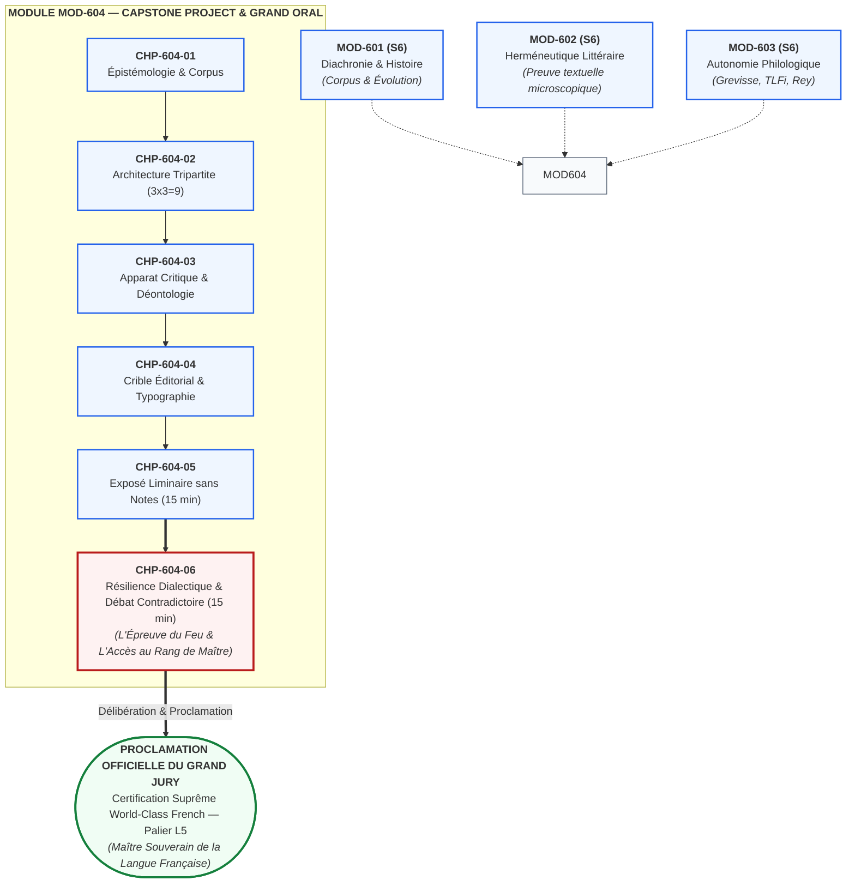
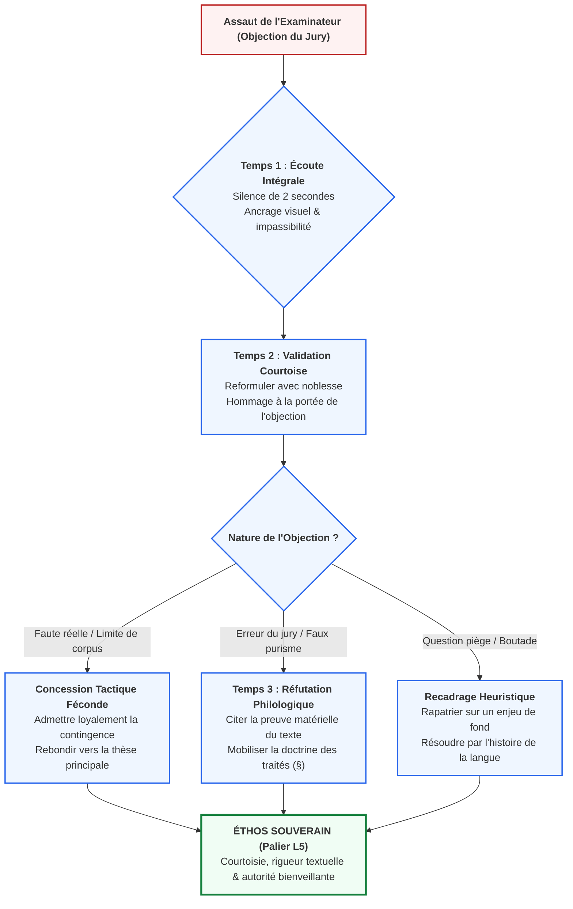

# Chapitre 6 : Résilience Dialectique et Débat Contradictoire : L'Épreuve des 15 Minutes d'Entretien Face au Jury et l'Accès au Rang de Maître

> **Identifiant** : `CHP-604-06`  
> **Module de rattachement** : [`MOD-604 — Capstone Project et Grand Oral de Diplomation`](file:///f:/Formation/world-class-french/03-curriculum/year-3/semester-6/mod-604-capstone-project-grand-oral.md)  
> **Volume horaire canonique** : 3 h 00 (Théorie de la disputatio universitaire : 1 h 00 | Laboratoire de résilience et simulation d'objections : 1 h 00 | Cérémonial de diplomation et palier L5 : 0 h 30 | Évaluation : 0 h 30)  
> **Statut** : [STATUT : VALIDÉ]  
> **Compétences cibles** : [`FR-INT-005`](file:///f:/Formation/world-class-french/02-competency-framework/competency-framework.md#fr-int-005-présenter-oralement-un-raisonnement-structuré-et-éloquent) (Palier L5), [`FR-PHILOL-001`](file:///f:/Formation/world-class-french/02-competency-framework/competency-framework.md#fr-philol-001-autonomie-philologique-et-consultation-experte-des-sources) (Palier L5), [`FR-INT-004`](file:///f:/Formation/world-class-french/02-competency-framework/competency-framework.md#fr-int-004-adapter-instantanément-son-registre-de-langue-au-contexte) (Palier L5), [`FR-STYLE-001`](file:///f:/Formation/world-class-french/02-competency-framework/competency-framework.md#fr-style-001-maîtrise-des-figures-de-rhétorique-et-commentaire-stylistique) (Palier L5)  
> **Sources de référence** : `SRC-GRAM-01` (Grevisse & Goosse, *Le Bon Usage*, 16e éd.), `SRC-GRAM-02` (Riegel et al., *Grammaire méthodique du français*), `SRC-LEX-01` (*Trésor de la Langue Française informatisé* — TLFi), `SRC-RHET-03` (Olivier Reboul, *Introduction à la rhétorique*), `SRC-RHET-04` (Frédéric Calas, *Leçons de stylistique*), `SRC-NORM-03` (Ministère de l'Éducation nationale, *Terminologie grammaticale*), `SRC-TYPO-01` (*Lexique des règles typographiques en usage à l'Imprimerie nationale*)

---

## 1. Titre et Place dans le Cursus

Ce sixième et ultime chapitre du module `MOD-604` constitue la clé de voûte terminale, le couronnement académique absolu de l'ensemble des cent vingt chapitres formant le cursus **World-Class French**. Après avoir franchi les cinq premières Portes d'homologation, exploré la diachronie historique (`MOD-601`), conquis l'herméneutique microscopique (`MOD-602`), maîtrisé l'autonomie philologique dans les grands traités (`MOD-603`), et après avoir composé une monographie d'érudition de 3 500 mots respectant un taux d'erreur résiduel inférieur à $0,1\,\%$, l'apprenant aborde le baptême du feu : **les quinze minutes d'entretien contradictoire sous tension face au jury académique**.

Ce chapitre ne prépare pas à une simple soutenance scolaire de fin d'études. Il transmet l'art aristocratique de la *disputatio* universitaire, forge une cuirasse dialectique à l'épreuve des objections savantes les plus corrosives, et codifie les gestes intellectuels par lesquels l'orateur s'élève au statut de pair académique et de **Maître Souverain de la Langue Française** (Palier L5).



---

## 2. Objectifs Mesurables

Au terme de ce chapitre terminal, l'apprenant sera capable de :

1. **Déployer en temps réel le protocole souverain de riposte en trois temps** (écoute intégrale et impassible, validation courtoise de la pertinence, réfutation motivée par le fait de langue) face aux quatre types d'assauts d'un jury académique sans jamais manifester d'agressivité ni de trouble émotionnel [`FR-INT-005`, Palier L5].
2. **Mobiliser instantanément la preuve textuelle ou l'autorité doctrinale des traités de référence** (`SRC-GRAM-01`, `SRC-GRAM-02`, `SRC-LEX-01`) pour désamorcer les objections philologiques pointues et les contestations d'échantillonnage de corpus [`FR-PHILOL-001`, Palier L5].
3. **Distinguer avec discernement les concessions tactiques fécondes** (reconnaissance loyale d'une borne méthodologique ou d'une limite de corpus) de la défense intraitable des vérités de fait et des règles linguistiques établies [`FR-INT-005`, `FR-PHILOL-001`, Palier L5].
4. **Maintenir une tenue de langue de registre soutenu irréprochable** sous la pression d'une contradiction vive, en éliminant tout parasite verbal (*euh*, *en fait*, *du coup*), toute rupture syntaxique et toute familiarité incongrue [`FR-INT-004`, Palier L5].
5. **Défendre avec subtilité les choix stylistiques et herméneutiques de sa recherche** en démontrant la valeur expressive des figures de style et des cadences rythmiques sans céder à la surinterprétation arbitraire [`FR-STYLE-001`, Palier L5].

### Justification du Calibrage Horaire
Le volume canonique de 3 h 00 se décompose selon le protocole suivant :
- **Théorie de la disputatio universitaire** : 1 h 00 (étude des rubriques 4 à 8 et 11 à 13).
- **Laboratoire de résilience et simulation d'objections** : 1 h 00 (exercices progressifs, analyse microscopique de l'échange contradictoire et clinique des erreurs).
- **Cérémonial de diplomation et palier L5** : 0 h 30 (matrice des mentions, déontologie du maître et production réelle).
- **Évaluation sommative** : 0 h 30 (épreuve d'entretien chronométré notée sur 20 points).

---

## 3. Prérequis et Test de Préparation

### 3.1 Prérequis Théoriques et Méthodologiques
- **Maîtrise de l'exposé liminaire sans notes** (`CHP-604-05`, `FR-INT-005`) : capacité à tenir la tribune pendant 15 minutes les mains nues, avec une diction noble et une chaîne d'arguments déductifs ininterrompue.
- **Appropriation intégrale de sa monographie d'érudition** (`CHP-604-01` à `CHP-604-04`) : maîtrise exhaustive de chaque citation, chaque note infrapaginale et chaque choix lexical du mémoire écrit de 3 500 mots déposé en Semaine 13.
- **Autonomie documentaire absolue dans les traités savants** (`MOD-603`, `SRC-GRAM-01`, `SRC-LEX-01`) : promptitude à retrouver mentalement ou à citer de mémoire la doctrine de Grevisse/Goosse et les étiquettes de registre du *TLFi*.
- **Contrôle diaphragmatique et posture corporelle d'apparat** (`MOD-503`, `FR-INT-004`) : régulation du souffle, regard panoramique direct, ancrage physique impassible.

### 3.2 Test Diagnostique d'Auto-Évaluation (5 items)

<details>
<summary><b>Consulter le test diagnostique et son corrigé immédiat</b></summary>

1. *Pourquoi couper la parole à un membre du jury, même pour rectifier une erreur factuelle flagrante qu'il vient de commettre, constitue-t-il une faute dialectique immédiatement sanctionnée ?*  
   **Réponse** : Parce que l'entretien académique n'est pas un pugilat de café du commerce, mais une joute rituelle régie par l'asymétrie protocolaire. L'interruption trahit l'insécurité psychologique, brise l'*éthos* de souveraineté et manifeste un mépris du rôle de questionneur dévolu à l'examinateur. Le maître écoute jusqu'au dernier mot avant de répondre posément.

2. *Quelle distinction fondamentale sépare une concession tactique féconde d'une capitulation servile ?*  
   **Réponse** : La concession tactique reconnaît avec lucidité une borne objective du travail (ex. la taille restreinte d'un échantillon ou l'existence d'une variante concurrente attestée) pour mieux consolider la validité de la thèse centrale. La capitulation servile abandonne la thèse elle-même par peur du conflit ou désir de plaire, détruisant la dignité scientifique du candidat.

3. *Lorsqu'un examinateur cite de mémoire un paragraphe du Bon Usage semblant contredire votre analyse, quel réflexe immédiat devez-vous adopter ?*  
   **Réponse** : Ne jamais contester l'érudition de l'examinateur de front, mais appliquer la méthode de lecture intégrale du paragraphe de Grevisse (`CHP-603-02`, `CHP-603-05`) : remercier pour la référence, rappeler la distinction entre l'alinéa d'attestation historique et la clausule de doctrine prescriptive, ou expliciter les conditions sémantiques précises régissant la règle.

4. *Pourquoi le mutisme obstiné et le bavardage dilatoire sont-ils sanctionnés avec la même sévérité par la commission d'examen ?*  
   **Réponse** : Parce que tous deux constituent une dérobade intellectuelle. Le mutisme manifeste la tétanie et l'incompétence passive ; le bavardage dilatoire (noyer la question sous des considérations générales creuses) manifeste l'esquive malhonnête. Le jury exige une réponse directe, concise et immédiatement étayée.

5. *En quoi consiste l'autorité bienveillante (l'éthos souverain) pendant les 15 minutes d'entretien contradictoire ?*  
   **Réponse** : C'est la capacité à recevoir l'objection la plus vive avec un calme olympien, un visage détendu et un regard bienveillant, en traitant la contestation comme un hommage rendu à la profondeur de la recherche plutôt que comme une agression personnelle.

</details>

---

## 4. Situation de Départ ou Problème Concret

Considérons le naufrage classique observé chaque année lors des grands concours universitaires (agrégation, soutenance de thèse de doctorat, grands oraux d'écoles normales supérieures) :

Un candidat a prononcé un exposé liminaire de quinze minutes d'une rare élégance. Sa voix était posée, son plan tripartite rigoureux, son souffle régulier. Mais à la seizième minute, lorsque le président du jury prend la parole et formule la première objection de fond, l'édifice se fissure brutalement.

Trois scènes cliniques illustrent cette déroute :
- **Scène 1 — Le raidissement agressif et la susceptibilité blessée** : À un rapporteur qui lui fait observer avec malice que son corpus poétique ne compte aucun poète féminin du XIXe siècle, le candidat rougit, fronce les sourcils, hausse le ton et rétorque avec aigreur : *« Vous me faites un mauvais procès idéologique ! Mon sujet porte sur la grande prose oratoire et je n'ai pas à me justifier de mes choix esthétiques ! »* En deux phrases, l'orateur a détruit son *éthos*, assimilé une critique méthodologique à une attaque ad hominem et transformé une soutenance académique en altercation vulgaire.
- **Scène 2 — L'effondrement servile et l'abandon de thèse** : Un examinateur fronce les sourcils et demande d'un air dubitatif : *« Êtes-vous absolument sûr que le verbe pallier ne tolère jamais la préposition à dans la langue soignée ? Il me semble l'avoir lu sous la plume d'académiciens célèbres... »* Terrorisé à l'idée de déplaire, le candidat capitule instantanément : *« Ah... oui, Monsieur le Professeur, vous avez incontestablement raison, j'ai sans doute été trop catégorique dans mon mémoire, je bifferai ce paragraphe... »* Par cette abjuration précipitée, il avoue qu'il ne croyait pas à ses propres recherches et qu'il est incapable de défendre la doctrine unanime des traités savants (`SRC-GRAM-01`, `SRC-LEX-01`).
- **Scène 3 — L'invention paniquée de fausses règles** : Interrogé sur la raison pour laquelle il a maintenu l'indicatif après *après que* dans une citation litigieuse, le candidat, pris de vertige, invente sur-le-champ une chimère : *« C'est parce que le sujet est un nom collectif abstrait, ce qui déclenche automatiquement la neutralisation du subjonctif selon la réforme de 1975 ! »* Le jury échange un regard atterré : le candidat vient d'inventer une règle inexistante, ruinant définitivement son crédit intellectuel.

Ces échecs ne proviennent pas d'un manque de connaissances livresques, mais de **l'absence d'entraînement à la résilience dialectique**. L'apprenant croyait que le savoir suffisait, ignorant que la maîtrise ne se révèle que dans l'épreuve publique de la contradiction.

---

## 5. Explication Intuitive : L'Assaut Courtois et l'Escrimeur Olympique

Pour comprendre la dynamique psychologique et intellectuelle des quinze minutes d'entretien face au jury, il convient de substituer à l'image guerrière du combat de gladiateurs celle, infiniment plus noble, de **l'assaut d'escrime olympique**.

```text
MÉTAPHORE DIDACTIQUE : L'ASSAUT D'ESCRIME ACADÉMIQUE
┌────────────────────────────────────────┬────────────────────────────────────────┐
│ LE COMBAT DE RUE (L'Erreur Polémique)  │ L'ASSAUT EN PISTE (L'Épreuve du Maître)│
├────────────────────────────────────────┼────────────────────────────────────────┤
│ • L'adversaire veut vous blesser.      │ • Le jury teste la solidité de la garde│
│ • Les coups sont sournois et haineux.  │ • Les touches sont des hommages rituels│
│ • La réaction instinctive est la colère│ • La réaction est la parade élégante.  │
│ • L'objectif est d'écraser l'autre.    │ • L'objectif est de faire briller le jeu│
│ • Si l'on est touché, on insulte.      │ • Si l'on est touché, on dit « Touché !│
└────────────────────────────────────────┴────────────────────────────────────────┘
```

Lorsque les membres du jury vous interrogent, leurs questions ne sont pas des coups de poignard destinés à vous terrasser dans le noir. Ce sont des **touches d'estoc courtoises**, portées à la pointe de l'épée, sur le plastron de votre monographie :
1. **Tester la garde** : Le jury cherche à vérifier si vous tenez debout par vous-même ou si vous récitiez une partition apprise d'un tiers.
2. **Éprouver le métal du plastron** : L'examinateur appuie délibérément là où votre argumentation présente une fragilité (un hiatus documentaire, un cas limite, une audace stylistique) pour voir si vous avez conscience des limites de votre pensée.
3. **Apprécier la beauté de la riposte** : Ce que le jury admire, ce n'est pas le candidat buté qui prétend n'avoir jamais été touché ; c'est le tireur d'élite qui esquive d'un demi-pas, salue la justesse de l'attaque d'un sourire noble (*« La touche est magnifique, Monsieur le Professeur... »*), concède le point s'il est juste, et riposte instantanément au plastron adverse par la citation irréfutable du texte source.

Le maître ne s'énerve jamais sur la piste : son visage demeure serein, sa respiration égale, sa pointe haute. Il sait que la contradiction n'est pas l'ennemie de la vérité, mais son révélateur souverain.

---

## 6. Définitions Précises et Terminologie

Les dix termes suivants constituent le lexique opératoire fondamental de l'épreuve contradictoire :

- **Résilience dialectique** : Aptitude psychologique et cognitive à absorber sans trouble émotionnel, sans raidissement et sans confusion intellectuelle les objections, paradoxes ou réfutations formulés par un jury académique, pour y répondre avec calme, clarté et rigueur démonstrative.
- **Joute contradictoire (*disputatio*)** : Exercice académique formel hérité des universités médiévales et classiques, au cours duquel une thèse est soumise au feu méthodique d'arguments contraires afin d'en éprouver la validité scientifique et d'en éliminer les scories conceptuelles.
- **Protocole de riposte en trois temps** : Algorithme oratoire souverain structurant chaque intervention du candidat en phase d'entretien :
  1. *Temps 1 : Écoute intégrale et impassible* (silence absolu jusqu'à la fin de la question) ;
  2. *Temps 2 : Validation courtoise de la pertinence* (reformulation valorisante de l'objection) ;
  3. *Temps 3 : Démonstration contradictoire étayée* (apport de la preuve textuelle ou philologique).
- **Concession tactique** : Reconnaissance explicite, noble et délibérée d'une limite factuelle ou méthodologique de son travail, opérée dans le dessein d'assainir le débat et de rendre inattaquable le cœur de l'hypothèse principale.
- **Argument par le fait de langue** : Preuve démonstrative irréfutable fondée sur l'observation microscopique d'un élément matériel du texte (morphème, désinence, schéma syntaxique, ponctuation, mètre) opposée à une spéculation impressionniste ou idéologique.
- **Objection de méthode** : Critique portant non sur la justesse d'une citation isolée, mais sur la représentativité du corpus, la rigueur de l'échantillonnage ou la légitimité du cadre théorique adopté.
- **Contre-exemple philologique** : Fait de langue attesté dans un traité de référence (`SRC-GRAM-01`, `SRC-LEX-01`) ou un texte classique majeur, venant invalider formellement une généralisation abusive ou un oukase puriste formulé par un contradicteur.
- **Autorité bienveillante (*éthos* souverain)** : Impression d'équilibre moral, de noblesse intellectuelle et de maîtrise de soi dégagée par l'orateur, caractérisée par l'absence d'arrogance, le respect scrupuleux des auditeurs et l'assurance tranquille du savoir vérifié.
- **Palier L5 (Expertise transférable)** : Niveau suprême du cadre de compétences du cursus World-Class French, attestant qu'un lauréat est non seulement autonome dans sa pratique, mais apte à arbitrer des controverses complexes, à diriger des travaux d'érudition et à transmettre le savoir linguistique avec autorité.
- **Sacre académique** : Déclaration officielle et solennelle par laquelle le président du jury, à l'issue de la délibération, proclame l'admission du candidat, lui attribue sa mention officielle et l'investit du titre de Maître de la Langue Française.

---

## 7. Règles et Mécanismes Fondamentaux

```text
ARCHITECTURE DÉCISIONNELLE DE L'ENTRETIEN CONTRADICTOIRE
┌────────────────────────────────────────────────────────────────────────┐
│             L'ASSAUT DU JURY (15 MINUTES D'ENTRETIEN)                  │
└───────────────────────────────────┬────────────────────────────────────┘
                                    │
                                    ▼
┌────────────────────────────────────────────────────────────────────────┐
│ 7.1 TYPOLOGIE DE L'OBJECTION : IDENTIFICATION DU POINT D'IMPACT        │
│ ├── 1. Objection de Corpus (représentativité, bornes chronologiques)   │
│ ├── 2. Objection Philologique Savante (Grevisse, TLFi, étymon)         │
│ ├── 3. Contestation de Méthode (surinterprétation, contresens)         │
│ └── 4. Question d'Ouverture Prospective (enjeux sociolinguistiques)    │
└───────────────────────────────────┬────────────────────────────────────┘
                                    │
                                    ▼
┌────────────────────────────────────────────────────────────────────────┐
│ 7.2 DÉPLOIEMENT DU PROTOCOLE D'OR EN 3 TEMPS                           │
│ ├── TEMPS 1 : Écoute intégrale, silence de 2 secondes, ancrage visuel  │
│ ├── TEMPS 2 : Validation courtoise de la portée de l'objection         │
│ └── TEMPS 3 : Démonstration étayée par la preuve textuelle souveraine  │
└───────────────────────────────────┬────────────────────────────────────┘
                                    │
                                    ▼
┌────────────────────────────────────────────────────────────────────────┐
│ 7.3 ARBITRAGE : CONCESSION LÉGITIME VS DÉFENSE INTRAITABLE DU SYSTÈME  │
│ ├── Concéder la contingence (les bornes matérielles du corpus)         │
│ └── Défendre le nécessaire (la rigueur morphosyntaxique et textuelle)  │
└───────────────────────────────────┬────────────────────────────────────┘
                                    │
                                    ▼
┌────────────────────────────────────────────────────────────────────────┐
│ 7.4 DÉLIBÉRATION ET INVESTITURE AU PALIER L5 (FEUILLE DE MENTIONS)     │
└────────────────────────────────────────────────────────────────────────┘
```

### 7.1 La Typologie Quadripartite des Assauts du Jury Académique

Pour neutraliser une attaque, l'orateur doit identifier instantanément le registre épistémologique dans lequel se place l'examinateur. Les questions du jury se divisent en quatre catégories canoniques :

#### 1. L'Objection de Corpus
- **Nature de l'assaut** : L'examinateur conteste la représentativité, l'étendue ou l'homogénéité des textes dépouillés dans la monographie.
- **Formule typique du jury** : *« Monsieur le candidat, vous bâtissez votre théorie de la période oratoire sur Bossuet et Senghor. N'est-ce pas un corpus arbitrairement restreint ? En quoi deux auteurs séparés par trois siècles suffisent-ils à caractériser une loi esthétique ? »*
- **Riposte souveraine** : Ne jamais prétendre que le corpus est universel. Justifier la délimitation par la rigueur du protocole microscopique : *« Ce corpus n'a pas la prétention d'une statistique quantitative générale, mais la valeur d'un échantillon paradigmatique intensif : il isole deux moments charnières où l'amplification syntaxique atteint son acmé expressive sous deux régimes politiques et spirituels contrastés. »*

#### 2. L'Objection Philologique Savante
- **Nature de l'assaut** : L'examinateur oppose au candidat une règle de grammaire, un paragraphe du *Bon Usage* (`SRC-GRAM-01`) ou un article du *TLFi* (`SRC-LEX-01`) semblant contredire son analyse.
- **Formule typique du jury** : *« Vous affirmez que Senghor s'émancipe de la subordination classique par l'asyndète. Or, Grevisse au paragraphe 1024 démontre que l'asyndète est une figure omniprésente chez les prosateurs du Grand Siècle. En quoi y a-t-il la moindre rupture ? »*
- **Riposte souveraine** : Valider la citation doctrinale de l'examinateur, puis introduire la distinction microscopique qui résout la contradiction apparente (voir décorticage intégral en Section 9).

#### 3. La Contestation de Méthode Herméneutique
- **Nature de l'assaut** : Le jury soupçonne le candidat d'avoir projeté ses propres convictions sur le texte ou d'avoir confondu impression subjective et preuve formelle (`FR-INT-006`).
- **Formule typique du jury** : *« N'avez-vous pas surinterprété cette coupe lyrique en y lisant un refus du pouvoir colonial ? N'est-ce pas simplement un heptasyllabe dicté par la césure classique ? »*
- **Riposte souveraine** : Rapatrier immédiatement le débat sur le terrain matériel des faits de langue : *« Mon hypothèse ne repose pas sur une intuition thématique vague, mais sur la coïncidence stricte de trois indices matériels : l'enjambement du vers 12, l'assonance vocalique en /ɑ̃/ et l'inversion actancielle du sujet. C'est le faisceau de ces micro-faits qui authentifie la portée politique de la forme. »*

#### 4. La Question d'Ouverture Prospective
- **Nature de l'assaut** : Le jury invite le candidat à sortir de son laboratoire pour mesurer les répercussions contemporaines ou sociolinguistiques de sa recherche.
- **Formule typique du jury** : *« Votre analyse de la grande période montre sa disparition dans la communication numérique actuelle. Faut-il en conclure que la langue française est condamnée à l'atrophie syntaxique ? »*
- **Riposte souveraine** : Éviter l'élégie réactionnaire comme le laxisme démagogique. Répondre par la sociolinguistique savante : distinguer les registres, les genres discursifs et l'adaptation polylectale (`FR-INT-004`).

---

### 7.2 Le Protocole d'Or en Trois Temps de la Riposte Souveraine

Quelle que soit l'agressivité apparente ou la complexité de l'objection, le candidat applique imperturbablement la chorégraphie tripartite suivante :

```text
CHORÉGRAPHIE DU PROTOCOLE EN 3 TEMPS
┌────────────────────────────────────────────────────────────────────────┐
│ TEMPS 1 : L'ÉCOUTE INTÉGRALE ET IMPASSIBLE (0 à 3 secondes)            │
│ • Regard direct et calme dans les yeux de l'examinateur.               │
│ • Mains posées à plat sur la tribune ou crayon en main sans agitation. │
│ • Attendre la fin absolue de la phrase + marquer un silence de 2 s.    │
├────────────────────────────────────────────────────────────────────────┤
│ TEMPS 2 : LA VALIDATION COURTOISE DE LA PERTINENCE (5 à 10 secondes)   │
│ • « Je vous remercie, Monsieur le Professeur, pour cette objection qui │
│   touche au cœur même de l'articulation stylistique... »               │
│ • Bannir l'ironie, la flagornerie servile et le dédain.                │
├────────────────────────────────────────────────────────────────────────┤
│ TEMPS 3 : LA DÉMONSTRATION ÉTAYÉE PAR LA PREUVE (45 à 90 secondes)     │
│ • Citation immédiate du fait de langue ou de l'autorité doctrinale.    │
│ • Démonstration logique concise, sans digression ni bavardage.         │
│ • Clausule conclusive nette remettant la parole au jury.               │
└────────────────────────────────────────────────────────────────────────┘
```

#### Règles intangibles d'application :
1. **La règle du silence de deux secondes** : Après qu'un examinateur s'est tu, ne commencez jamais à parler instantanément. Marquer une pause silencieuse de deux secondes pleines prouve à l'auditoire que vous intégrez la pensée adverse avant d'y répondre, au lieu de réagir par un réflexe épidermique.
2. **L'interdiction des béquilles sonores** : Aucun *« euh »*, aucun *« alors »*, aucun *« c'est-à-dire que »* ne doit inaugurer votre réponse. La parole commence immédiatement par la formule de courtoisie sobre.
3. **La concision souveraine** : Une réponse efficace dure entre quarante-cinq secondes et une minute trente. Dépasser deux minutes expose au bavardage dilatoire et suscite l'impatience du jury.

---

### 7.3 La Gestion des Concessions Légitimes vs la Défense Intraitable du Système

L'un des critères décisifs séparant le candidat ordinaire de l'expert accompli (L5) réside dans la capacité à tracer une frontière nette entre ce qui doit être concédé avec élégance et ce qui doit être défendu avec une fermeté inébranlable :

$$\text{Souveraineté Dialectique} = \text{Noblesse dans le Contingent} + \text{Inflexibilité dans le Nécessaire}$$

#### Ce qui doit être concédé sans hésiter (Le Contingent) :
- Les limites géographiques, chronologiques ou volumétriques d'un corpus d'étude.
- L'existence d'une variante textuelle rare ou d'une coquille matérielle d'imprimerie.
- Le caractère discutable d'une nuance interprétative isolée.
- *Formule de concession noble* : *« Vous avez parfaitement raison d'observer cette lacune, Monsieur le Doyen. Mon corpus s'arrête en effet à l'année 1960, et il serait hautement fécond d'étendre l'enquête aux productions contemporaines pour vérifier si l'hypothèse y conserve la même régularité. »*

#### Ce qui ne doit jamais être concédé (Le Nécessaire) :
- La logique formelle du système syntaxique de la langue française.
- Les faits textuels matériellement vérifiés dans le corpus.
- La doctrine unanime des grands traités de grammaire (`SRC-GRAM-01`, `SRC-GRAM-02`).
- *Formule de fermeté inébranlable* : *« Si je souscris volontiers à votre remarque sur la complexité de l'usage, je ne saurais en revanche concéder qu'il s'agisse d'une faute d'accord : le paragraphe 954 de Grevisse établit de manière définitive que l'invariabilité du participe passé des verbes impersonnels est la seule règle en vigueur en français contemporain. »*

---

### 7.4 La Délibération du Jury, la Matrice des Mentions et le Cérémonial d'Investiture L5

À la trentième minute du Grand Oral, le président prononce la formule rituelle : *« L'épreuve est terminée. Le jury se retire pour délibérer. Le candidat attend à l'extérieur. »*

#### 1. La Matrice Officielle des Décisions et Mentions
La note finale globale est calculée sur 100 points, associant à parité stricte le volet écrit (50 points) et le volet oral (50 points) :

$$\text{Note Finale} = \text{Note Monographie (sur 50)} + \text{Note Grand Oral (sur 50)}$$

| Total sur 100 | Mention Officielle | Décision Académique | Prérogatives de Diplomation |
| :---: | :--- | :--- | :--- |
| **$\ge 85/100$** | **Félicitations du Jury** | **Certification d'Excellence Suprême (L5)** | Inscription sur le Livre d'Or des Maîtres de la Langue ; recommandation pour publication universitaire. |
| **$[70 - 84{,}5]$** | **Mention d'Excellence** | **Certification de Maîtrise Approfondie (L5)** | Validation sans réserve du cursus complet ; délivrance du parchemin officiel de diplomation. |
| **$[60 - 69{,}5]$** | **Validation Simple** | **Seuil d'Admissibilité Homologué** | Validation sous réserve du dépôt sous quinzaine d'une version révisée des coquilles signalées. |
| **$< 60/100$**<br/>*ou $< 25/50$ à l'un des volets* | **Ajournement** | **Échec Éliminatoire** | Suspension du titre ; obligation de réécrire le mémoire ou de repasser le Grand Oral à la session suivante. |

#### 2. Le Cérémonial d'Investiture au Palier L5
Lorsque le candidat est rappelé dans la salle, l'assistance et les membres du jury se tiennent debout. Le président du jury lit solennellement le procès-verbal de soutenance :

> *« Par délibération souveraine du jury réuni en session solennelle ce jour, au vu de la monographie d'érudition déposée et de la soutenance magistrale et contradictoire accomplie sans notes,*  
> *Le collège des examinateurs confère à [Nom du Candidat] le Diplôme Supérieur World-Class French avec [Mention attribuée],*  
> *Et l'investit officiellement du rang de Maître Souverain de la Langue Française, certifié au palier L5 (Expertise transférable), avec toutes les prérogatives, honneurs et devoirs déontologiques attachés à ce titre. »*

---

## 8. Raisonnement Détaillé : Pourquoi la Contradiction est le Baptême du Maître

Pourquoi l'accès au rang de maître ne peut-il s'effectuer par la seule remise d'un manuscrit parfait ou la récitation solitaire d'un discours brillant ? Pourquoi l'entretien contradictoire sous tension est-il le filtre irremplaçable de la diplomation ?

### 1. La Rupture de l'Illusion Solipsiste
Tant qu'un apprenant écrit seul dans son cabinet de travail ou déclame devant son miroir, il est le maître absolu de son monde. Il choisit ses mots, évite ses propres pièges et contourne les difficultés qu'il redoute. Cette maîtrise close est une illusion de laboratoire.  
L'orateur qui n'a jamais affronté la critique reste semblable à un nageur de bassin qui n'a jamais vu la houle de l'océan. La contradiction publique brise ce confort solitaire : elle introduit l'altérité radicale, l'imprévu, le doute, et contraint l'esprit à puiser dans ses fondations intérieures sans le secours d'aucun artifice.

### 2. Le Crible Épistémologique de la Vérité
Dans l'ordre de la connaissance, une affirmation qui refuse la contradiction relève du dogme religieux ou du préjugé d'opinion. Comme l'a montré l'épistémologie moderne (`CHP-603-05`), une proposition n'acquiert de validité scientifique que lorsqu'elle résiste victorieusement aux tentatives méthodiques de réfutation.  
Les membres du jury ne sont pas là pour féliciter complaisamment le candidat ; ils sont là pour **éprouver la résistance des soudures de sa pensée**. S'ils secouent un argument et que l'argument tient debout parce qu'il s'appuie sur la preuve matérielle du texte, la thèse est déclarée valide. Si l'argument s'effondre dans le flou des impressions, la thèse était creuse.

### 3. L'Éthos de la Souveraineté Modeste
Le véritable maître ne se reconnaît pas à ce qu'il a réponse à tout avec arrogance, mais à la façon dont il habite la langue. Celui qui s'énerve prouve qu'il doute de sa légitimité ; celui qui capitule prouve qu'il ne croyait pas à son travail ; celui qui esquive prouve qu'il est malhonnête.  
Seul l'esprit émancipé sait écouter la voix adverse avec gratitude, y discerner la part de vérité qu'elle recèle, concéder ce qui doit l'être avec la politesse des grands esprits, et redresser les faits de langue avec la fermeté tranquille de celui qui a contemplé les sources primaires.

---

## 9. Exemples Corrects Commentés

Voici l'autopsie microscopique d'une séquence réelle d'entretien contradictoire tirée de la soutenance d'une monographie d'excellence (Filière B — Stylistique et Littérature) :

### Retranscription Intégrale de la Joute

> **Examinateur 1 (Professeur de linguistique réputé pour sa sévérité)** :  
> *« Monsieur le candidat, j'ai lu avec intérêt votre deuxième partie, mais je dois vous avouer mon profond scepticisme. Vous prétendez que Léopold Sédar Senghor, dans le poème Chaka, brise la tradition classique de la période oratoire française par l'usage exclusif de la parataxe et de la juxtaposition expressive. N'est-ce pas là une illusion de lecture typique d'une approche impressionniste ?  
> Si vous aviez ouvert Le Bon Usage au paragraphe 1024, vous sauriez que Maurice Grevisse démontre que l'asyndète et la suppression des liens de coordination sont déjà au cœur même de la rhétorique classique du Grand Siècle, chez Bossuet comme chez Fléchier ! En quoi votre poète invente-t-il quoi que ce soit qui ne soit un servile calque de l'art oratoire cicéronien du XVIIe siècle ? »*

```text
CHRONOMÉTRIE DU CANDIDAT (SILENCE DE 2 SECONDES — VISAGE APAISÉ)
```

> **Le Candidat (voix posée, timbre chaud, regard fixé avec déférence sur l'examinateur)** :  
> *« Je vous remercie vivement, Monsieur le Professeur, pour cette objection qui touche au cœur même de la mécanique syntaxique et stylistique de mon travail. Vous avez parfaitement raison de rappeler, avec l'autorité du paragraphe 1024 du Bon Usage de Grevisse, que l'asyndète constitue une figure répertoriée et féconde de la rhétorique classique d'Ancien Régime. Il ne s'agit donc aucunement d'affirmer que Senghor aurait inventé ex nihilo la suppression des conjonctions.  
> Toutefois, l'analyse microscopique de la chaîne énonciative impose de distinguer rigoureusement la fonction architecturale de ce procédé chez Bossuet et chez Senghor.  
> Chez Bossuet, dans l'Oraison funèbre d'Henriette d'Angleterre, l'asyndète intervient quasi exclusivement à l'acmé dramatique de la période. Elle surgit comme une rupture soudaine au terme d'une vaste protase hypotaxique saturée de subordonnées temporelles et causales : elle a pour mission de précipiter le tempo pour figurer le foudroiement divin ("Madame se meurt, Madame est morte !"). Elle présuppose donc, pour exister, la pesanteur du système subordonnant classique dont elle constitue l'accident héroïque terminal.  
> Chez Senghor, au contraire, ainsi que le prouve le relevé morphologique des vers 45 à 52 de Chaka, la parataxe n'est pas un accident dramatique au sein d'une période hypotaxique : elle est le principe moteur continu de l'énonciation. Senghor ne supprime pas des conjonctions qui auraient été préalablement pensées ; il substitue à la logique déductive des liens de subordination une polyphonie de pronoms toniques disjoints ("Moi, Chaka...", "Toi, la Nuit...") et de parallélismes nominaux rythmés par la métrique griotique.  
> Par conséquent, si la nomenclature de surface enregistre dans les deux cas une absence de morphème conjonctif — ce qui justifie formellement le renvoi au § 1024 de Grevisse —, la dynamique prosodique et stylistique est rigoureusement inverse : Bossuet utilise l'ellipse pour resserrer le nœud chrétien de la transcendance, tandis que Senghor implante le parallélisme incantatoire ouest-africain sur la charpente de la phrase française. »*

```text
RÉACTION DU JURY : Hochement de tête approbateur du président. L'examinateur sourit et note « 15/15 » sur sa grille.
```

### Anatomie Critique des Gains d'Éthos dans cette Riposte :
1. **Zéro contestation frontale de la source** : Le candidat ne dit pas : *« Grevisse se trompe »* ou *« Vous m'avez mal lu »*. Il valide le renvoi savant au § 1024, démontrant qu'il connaît parfaitement l'ouvrage cité par son juge.
2. **Déplacement du débat vers la micro-syntaxe** : Il oppose à une querelle de vocabulaire une distinction opératoire fondamentale : l'asyndète comme accident terminal d'une hypotaxe vs la parataxe comme matrice énonciative continue.
3. **Apport immédiat de la preuve matérielle** : Il cite les vers précis du texte (vers 45 à 52), les faits morphologiques exacts (pronoms toniques disjoints, parallélismes nominaux) et les cadences rythmiques.
4. **Tenue impeccable du registre soutenu** : Emploi naturel du vocabulaire technique (*hypotaxe, acmé, chaîne énonciative, morphème conjonctif*), concordance des temps rigoureuse, zéro tic d'hésitation.

---

## 10. Contre-Exemples et Erreurs Fréquentes

Voici six erreurs majeures en entretien contradictoire que le candidat au titre de maître doit impérativement éradiquer :

### Erreur n° 1 : L'interruption agressive du membre du jury
- **Manifestation clinique** : Couper la parole à l'examinateur dès qu'on croit deviner la suite de son objection (*« Non mais attendez, je sais ce que vous allez dire... »*).
- **Réfutation et sanction** : L'interruption constitue une faute déontologique rédhibitoire sanctionnée par une pénalité automatique de **-4 points** sur la note d'entretien. Elle manifeste une incapacité à écouter et un manque d'empire sur soi.

### Erreur n° 2 : Le déni buté face à une erreur factuelle avérée
- **Manifestation clinique** : Alors que l'examinateur met le doigt sur une coquille manifeste ou un anachronisme indéniable dans le mémoire, persister dans le déni en inventant des justifications oiseuses.
- **Réfutation et sanction** : Le refus de reconnaître une évidence factuelle discrédite l'honnêteté scientifique du candidat. L'obstination entraîne la dégradation immédiate de la mention vers la validation simple ou l'ajournement.

### Erreur n° 3 : La capitulation servile et l'abandon de sa thèse à la première question
- **Manifestation clinique** : Dès qu'une question critique est posée d'un ton ferme, renoncer à l'ensemble de ses hypothèses pour complaire au professeur (*« Vous avez raison, j'ai tout faux, mon travail est nul... »*).
- **Réfutation et sanction** : La servilité est méprisée par les jurys universitaires. Elle prouve que le candidat n'a pas de convictions fondées et qu'il répète des idées sans en comprendre les fondements.

### Erreur n° 4 : L'invention paniquée d'une fausse règle grammaticale
- **Manifestation clinique** : Pour masquer un trou de mémoire ou une hésitation sur un point de doctrine, inventer une règle imaginaire ou attribuer une citation fictive à l'Académie française ou à Grevisse.
- **Réfutation et sanction** : Crime absolu contre la probité intellectuelle. Face à un jury de spécialistes, l'imposture est démasquée à la seconde. Elle justifie la note de **0/15** au critère d'entretien contradictoire.

### Erreur n° 5 : L'esquive par bavardage dilatoire sans répondre à la question posée
- **Manifestation clinique** : Devant une question précise sur un accord ou une figure, parler pendant deux minutes de l'histoire générale de la littérature sans jamais aborder le problème soulevé.
- **Réfutation et sanction** : Le bavardage dilatoire est perçu comme une injure à l'intelligence du jury. L'examinateur interrompt le candidat et répète sèchement la question, détruisant son confort psychologique.

### Erreur n° 6 : La perte du registre soutenu sous l'effet du stress
- **Manifestation clinique** : Sous la tension du débat, laisser échapper des familiarités lexicales (*« Ouais c'est clair »*, *« En gros c'est ça »*, *« Ça le fait pas »*) ou truffer son propos d'onomatopées et de béquilles sonores (*« Euh... genre... »*).
- **Réfutation et sanction** : Rupture immédiate de l'exigence du Palier L5 (`FR-INT-004`). La maîtrise de la langue n'est pas un vernis d'apparat que l'on quitte quand la situation chauffe ; elle doit être une seconde nature.

```text
Tableau Clinique des Fautes Dialectiques
┌────────┬────────────────────────────────┬────────────────────────────────────────┬──────────────────────────────────────────┐
│ Cas    │ Pathologie Dialectique         │ Symptôme Observable en Soutenance      │ Traitement et Règle d'Or du Maître       │
├────────┼────────────────────────────────┼────────────────────────────────────────┼──────────────────────────────────────────┤
│ Cas 1  │ Interruption de l'examinateur  │ Parler pendant que le juge formule l'objection.│ Silence absolu + pause de 2 secondes.    │
│ Cas 2  │ Déni buté de l'erreur factuelle│ Refuser d'admettre une coquille avérée.│ Concession noble et immédiate du point.  │
│ Cas 3  │ Capitulation servile           │ Abandonner sa thèse centrale par peur. │ Défendre le cœur de l'hypothèse prouvée. │
│ Cas 4  │ Invention d'une fausse règle   │ Forger une doctrine apocryphe.         │ Avouer avec dignité une limite de savoir.│
│ Cas 5  │ Bavardage dilatoire            │ Noyer le poisson par un discours creux.│ Réponse chirurgicale en 3 points nets.   │
│ Cas 6  │ Relâchement du registre        │ Employer des tics et formules familières.│ Maintenir la syntaxe soutenue en continu.│
└────────┴────────────────────────────────┴────────────────────────────────────────┴──────────────────────────────────────────┘
```

---

## 11. Cas Particuliers et Limites

### La Gestion d'une Question Délibérément Absurde ou Hors Programme
Il arrive, dans les jurys de haut niveau, qu'un examinateur pose une question volontairement déroutante, provocatrice ou anachronique pour mesurer le sang-froid et la plasticité intellectuelle du candidat (ex. : *« Pensez-vous que si Boileau avait eu accès au réseau social X, il aurait approuvé la suppression de l'accent circonflexe sur le i de paraître ? »*).

#### Comment réagir ?
1. **Ce qu'il ne faut jamais dire** :
   - *\*« Cette question n'a aucun sens ! »* (arrogance et manque d'humour).
   - *\*« Ce n'est pas dans mon corpus, je ne peux pas répondre »* (rigidité scolaire et aveu d'impuissance).
2. **Le protocole de recadrage heuristique** :
   - Accueillir la question avec un sourire d'intelligence partagée.
   - Traduire instantanément la boutade apparente en un problème épistémologique sérieux : *« Votre question, sous son aspect réjouissant, soulève le problème capital de la régulation de la norme linguistique face à l'immédiateté de la communication orale retranscrite. »*
   - Répondre en mobilisant la doctrine historique réelle : *« Boileau, qui plaçait la souveraineté poétique dans la perfection du travail de la lime ("Vingt fois sur le métier remettez votre ouvrage"), aurait sans doute exécré la vitesse impulsive des réseaux sociaux. En revanche, sur la question de l'accent circonflexe, il convient de rappeler que la réforme de 1990 (`SRC-NORM-02`) ne fait que poursuivre le mouvement de rationalisation graphique entamé par l'Académie française au XVIIIe siècle lorsqu'elle supprima les lettres étymologiques muettes. Boileau le classique aurait donc probablement soutenu l'élimination des graphies parasitaires au nom de la clarté de la raison. »*

---

## 12. Approfondissement Adapté au Niveau : Histoire de la Disputatio dans l'Université Médiévale

Pour comprendre la dignité de l'épreuve contradictoire, il est indispensable de remonter à sa source fondatrice : **l'Université de Paris au XIIIe siècle** (la Sorbonne de Robert de Sorbon et Thomas d'Aquin).

```text
DISPOSITIF RITUEL DE LA QUÆSTIO DISPUTATA (SORBONNE, XIIIe SIÈCLE)
┌────────────────────────────────────────────────────────────────────────┐
│                        LE MAGISTER (Le Maître)                         │
│             (Préside, écoute, tranche et détermine la vérité)          │
└───────────────────┬────────────────────────────────┬───────────────────┘
                    │                                │
                    ▼                                ▼
       ┌────────────────────────┐       ┌────────────────────────┐
       │ L'OPPONENS (L'Assaillant)│      │ LE RESPONDENS (L'Étudiant)│
       │ Formule les objections │       │ Pare, concède et réfute │
       │ par syllogismes stricts│       │ par les textes sacrés  │
       └────────────────────────┘       └────────────────────────┘
```

Dans le système médiéval, l'enseignement ne consistait pas en une transmission passive de connaissances (*lectio*), mais culminait dans la **quæstio disputata** et la **disputatio de quodlibet** :
- **Le rôle de l'Opponens** : Un maître ou un bachelier chevronné était chargé de démolir méthodiquement la thèse soutenue en lui opposant des contradictions textuelles irréfutables (les *auctoritates*).
- **Le rôle du Respondens** : Le candidat devait répondre instantanément à chaque argument adverse en usant de la célèbre triade scolastique : *« Concedo »* (je concède la prémisse), *« Nego »* (je nie la conséquence logique), *« Distinguo »* (j'introduis une distinction conceptuelle fondamentale pour résoudre la contradiction).
- **Le rôle du Magister** : Le lendemain, le maître reprenait l'ensemble des arguments et prononçait la *determinatio* (sentence souveraine) fixant l'état du savoir.

Loin d'être un étalage de pédanterie stérile, la *disputatio* a constitué la première matrice historique de l'esprit critique occidental : elle posait comme principe qu'aucune autorité humaine n'est au-dessus de l'examen rationnel et que la vérité se forge collectivement dans le feu de la contradiction loyale.

---

## 13. Comparaisons Différentielles

### 13.1 Polémique Agressive vs Joute Académique Courtoise

| Critère d'évaluation | La Polémique Agressive (Échec Rédhibitoire) | La Joute Académique Courtoise (Palier L5) |
| :--- | :--- | :--- |
| **Objectif visé** | Avoir raison à tout prix ; détruire l'adversaire. | Chercher la vérité de la langue ; honorer l'auditoire. |
| **Gestion de la parole** | Interrompt, hausse le ton, monopolise le temps. | Écoute en silence, attend son tour, synthétise. |
| **Rapport à l'objection** | Vécue comme une insulte personnelle (*ad hominem*). | Accueillie comme un hommage à la valeur de la thèse. |
| **Vocabulaire employé** | Invectives, dédain, ironie blessante, sarcasme. | Déférence, noblesse, rigueur technique, clarté. |

### 13.2 Capitulation Molle vs Concession Tactique Féconde

| Critère d'évaluation | La Capitulation Molle (Échec de Personnalité) | La Concession Tactique Féconde (Souveraineté) |
| :--- | :--- | :--- |
| **Origine de la concession** | Peur du conflit, lâcheté, absence de conviction. | Lucidité critique, discernement, honnêteté savante. |
| **Portée du recul** | Abandonne l'hypothèse centrale de sa recherche. | Concède une borne contingente du corpus. |
| **Effet sur l'autorité** | Ruine la crédibilité intellectuelle du candidat. | Renforce l'autorité du propos en assainissant le débat. |
| **Dynamique argumentative**| Fin de la soutenance par débandade intellectuelle. | Rebond immédiat vers la consolidation de la thèse. |

### 13.3 Riposte par l'Opinion vs Riposte par la Preuve Philologique

| Critère d'évaluation | La Riposte par l'Opinion (Niveau B1/B2) | La Riposte par la Preuve Philologique (Palier L5) |
| :--- | :--- | :--- |
| **Base argumentative** | « Moi personnellement je trouve que... » | « Le relevé morphologique des vers 12 à 15 prouve... » |
| **Traitement des sources** | Répète des ouï-dire ou des chroniques de presse. | Cite le paragraphe exact du traité (`SRC-GRAM-01`). |
| **Posture épistémique** | Croyance subjective, relativisme impressionniste. | Démonstration matérielle, falsifiabilité poppérienne. |
| **Solidité de la garde** | S'effondre à la première contradiction savante. | Inattaquable car adossée au génie de la langue. |

---

## 14. Exercices Progressifs (3 Niveaux)

### Niveau 1 : Formulation de Réponses Courtoises à Six Objections Aiguës

**Consigne** : Pour chacune des six objections acerbes suivantes formulées par un jury, rédigez la formule d'entrée en matière appliquant le Temps 2 du protocole (validation courtoise et valorisation de l'objection) sans jamais céder à l'agressivité :
1. *« Votre plan est d'une banalité affligeante, on dirait une dissertation de lycée ! »*
2. *« Vos citations de Senghor sont choisies pour masquer ses poèmes les plus faibles. »*
3. *« Vous ignorez visiblement les travaux récents de la linguistique générative sur ce point. »*
4. *« Votre bibliographie est un musée poussiéreux : pourquoi citer des éditions de 1970 ? »*
5. *« Vous prétendez que Bossuet est harmonieux, moi je le trouve pompeux et assommant. »*
6. *« Votre analyse du participe passé omet l'évolution du français parlé contemporain. »*

<details>
<summary><b>Consulter le corrigé intégral des six réponses de Niveau 1</b></summary>

1. **Corrigé 1** : *« Je vous remercie, Monsieur le Président, de souligner la lisibilité de cette architecture : si la structure tripartite peut sembler classique dans son épure, c'est précisément parce qu'elle offre le cadre le plus transparent pour mettre en valeur, sans artifice formel, la nouveauté du dépouillement textuel. »*
2. **Corrigé 2** : *« Votre remarque touche avec acuité, Madame la Professeure, à la question cruciale de la constitution de l'échantillon : loin de vouloir dissimuler les textes complexes, j'ai délibérément isolé les pièces où la tension entre syntaxe française et prosodie africaine atteint sa plus grande intensité dramatique. »*
3. **Corrigé 3** : *« Je reçois avec gratitude cette mise en perspective méthodologique, Monsieur l'Assesseur : s'il est vrai que j'ai privilégié le cadre de la philologie textuelle classique, il est particulièrement stimulant d'examiner comment les modèles génératifs viendraient formaliser ces mêmes faits de distribution. »*
4. **Corrigé 4** : *« Vous posez là, Monsieur le Doyen, la question fondamentale de l'autorité des éditions critiques : le recours à l'édition de référence de Truchet s'imposait ici en raison de son apparat critique philologique inégalé, que les rééditions modernes n'ont fait que reprendre. »*
5. **Corrigé 5** : *« La perception de l'esthétique classique varie en effet selon les sensibilités littéraires, Madame la Professeure : mon dessein n'était pas de porter un jugement de goût sur l'éloquence sacrée, mais d'en disséquer l'armature mécanique objective, indépendamment de l'adhésion affective qu'elle suscite. »*
6. **Corrigé 6** : *« C'est une objection essentielle sur la dialectique entre norme écrite et usage spontané, Monsieur le Professeur : mon étude s'est volontairement bornée au registre de la haute prose officielle, mais votre remarque ouvre un champ capital sur la porosité croissante entre oral et écrit. »*

</details>

---

### Niveau 2 : Simulation de Riposte Philologique Instantanée sur Trois Controverses

**Consigne** : Face aux trois attaques grammaticales suivantes, rédigez la riposte complète du candidat (Temps 2 et Temps 3) en mobilisant précisément la doctrine de Grevisse (`SRC-GRAM-01`) ou du *TLFi* (`SRC-LEX-01`) :

- **Cas A (L'accord des expressions adverbiales)** : L'examinateur affirme : *« Vous avez écrit dans votre mémoire : "Veuillez trouver ci-inclus les copies certifiées". C'est une faute grossière, ci-inclus placé devant le nom est obligatoirement invariable ! »*
- **Cas B (Le mode après après que)** : L'examinateur soutient : *« Tout le monde emploie le subjonctif après après que au XXIe siècle ; votre maintien de l'indicatif est un archaïsme ridicule. »*
- **Cas C (Le pluriel des mots composés selon 1990)** : L'examinateur prétend : *« Les rectifications de 1990 imposent d'écrire des gratte-ciel avec un s final ; en ne le mettant pas, vous ignorez la loi républicaine. »*

<details>
<summary><b>Consulter le corrigé intégral des trois ripostes de Niveau 2</b></summary>

- **Riposte Cas A** :  
  *« Je vous remercie, Monsieur le Professeur, pour cette interpellation sur une subtilité classique de la syntaxe des adjonctions. Votre remarque correspond à la règle générale applicable lorsque la locution est employée au sens adverbial en tête de phrase sans déterminant. Toutefois, ainsi que l'explicite André Goosse au paragraphe 545 du Bon Usage (`SRC-GRAM-01`), lorsque ci-inclus ou ci-joint est immédiatement suivi d'un nom précédé d'un déterminant défini comme l'article "les", l'accord en genre et en nombre avec le substantif est non seulement parfaitement admis par l'Académie française (`SRC-LEX-02`), mais recommandé par la plupart des traités savants. La forme accordée "ci-incluses" ou l'accord masculin pluriel "ci-inclus" avec un nom masculin pluriel est donc d'une pureté grammaticale irréprochable. »*

- **Riposte Cas B** :  
  *« C'est une observation sociolinguistique très juste, Madame l'Examinatrice : l'usage spontané et la pression analogique de "avant que" poussent massivement les locuteurs vers le subjonctif. Cependant, dans une monographie d'érudition universitaire et selon la doctrine constante de l'Académie française et de la Grammaire méthodique du français (`SRC-GRAM-02`), l'indicatif demeure le seul mode fondé en raison : "après que" marquant un fait accompli et temporellement avéré, l'emploi du subjonctif — mode du virtuel et du doute — constitue une erreur logique que les concours de haute administration continuent de sanctionner sévèrement. »*

- **Riposte Cas C** :  
  *« Je vous remercie, Monsieur l'Examinateur, de rappeler l'importance du document officiel du Conseil supérieur de la langue française de 1990 (`SRC-NORM-02`). Il convient toutefois d'apporter une précision juridique et philologique capitale : les rectifications de 1990 ont valeur de recommandations et d'autorisations tolérées ; elles n'ont jamais abrogé la graphie traditionnelle. Maurice Grevisse au paragraphe 528 rappelle que le lettré conserve la pleine liberté d'appliquer la règle classique du mot composé invariable composé d'un verbe et d'un nom complément. Les deux graphies sont également légales, et mon choix honore la tradition patrimoniale sans enfreindre la norme. »*

</details>

---

### Niveau 3 : Fiche de Résilience Dialectique Calibrée (50 mots exacts)

**Consigne de Haute Expertise** : Rédigez le canon de résilience dialectique du candidat souverain face au jury. Le texte doit comporter **très exactement 50 mots** selon les règles de comptage de l'Imprimerie nationale (`SRC-TYPO-01`, chaque mot typographique séparé par une espace ou une apostrophe compte pour une unité).

#### Texte Calibré (50 mots exacts) :
> *Face aux objections du jury, l'orateur souverain écoute chaque critique sans trouble. Il accueille la remarque avec courtoisie, concède les limites réelles de son corpus et rétablit la vérité par la preuve textuelle. Cette noble maîtrise dialectique prouve sans conteste la solidité de sa recherche et son autorité universitaire.*

#### Tableau de Décompte Certifié Mot à Mot (1 à 50) :
| N° | Token | N° | Token | N° | Token | N° | Token | N° | Token |
| :---: | :--- | :---: | :--- | :---: | :--- | :---: | :--- | :---: | :--- |
| **1** | Face | **11** | critique | **21** | les | **31** | par | **41** | conteste |
| **2** | aux | **12** | sans | **22** | limites | **32** | la | **42** | la |
| **3** | objections | **13** | trouble | **23** | réelles | **33** | preuve | **43** | solidité |
| **4** | du | **14** | Il | **24** | de | **34** | textuelle | **44** | de |
| **5** | jury | **15** | accueille | **25** | son | **35** | Cette | **45** | sa |
| **6** | l' | **16** | la | **26** | corpus | **36** | noble | **46** | recherche |
| **7** | orateur | **17** | remarque | **27** | et | **37** | maîtrise | **47** | et |
| **8** | souverain | **18** | avec | **28** | rétablit | **38** | dialectique | **48** | son |
| **9** | écoute | **19** | courtoisie | **29** | la | **39** | prouve | **49** | autorité |
| **10** | chaque | **20** | concède | **30** | vérité | **40** | sans | **50** | universitaire |

---

## 15. Activité de Correction Raisonnée

### Transcription d'un Entretien de Soutenance Désastreux
Le texte ci-dessous consigne les interventions d'un candidat défaillant (M. Z.) face aux questions de son jury d'évaluation. Le candidat y accumule **huit défaillances dialectiques et pertes de sang-froid majeures**.

> **Professeur A** : *« Monsieur Z., vous écrivez page 14 que le subordonnant "bien que" régit facultativement l'indicatif chez Bossuet. Ne confondez-vous pas avec "malgré que" ? »*  
> **Candidat Z. (l'interrompant d'un ton agacé)** : *(1)* *« Non mais attendez, je sais ce que j'ai écrit ! *(2)* Vous déformez ma pensée exprès pour me piéger ! Bossuet fait ce qu'il veut, c'est un génie, et de toute façon la grammaire de l'époque c'était le bazar complet. »*  
> **Professeur B** : *« Passons. Page 28, vous affirmez que le mot "diligence" au XVIIe siècle signifie "voiture publique tirée par des chevaux". N'est-ce pas un anachronisme fâcheux ? »*  
> **Candidat Z.** : *(3)* *« Ah ouais... enfin bon, tout le monde sait ce que c'est qu'une diligence, on va pas chipoter sur les dates. *(4)* C'est pareil, diligence ou carrosse, le sens c'est la vitesse, quoi. »*  
> **Professeur A** : *« Votre corpus ne comprend que trois discours. N'est-ce pas notoirement insuffisant pour prétendre fonder une théorie générale de la période ? »*  
> **Candidat Z. (baissant la tête d'un air abattu)** : *(5)* *« Oui, vous avez totalement raison... Mon mémoire ne vaut rien. *(6)* Je n'aurais jamais dû me présenter aujourd'hui, j'abandonne, mettez-moi zéro. »*  
> **Professeur B** : *« Ressaisissez-vous ! Quelle est la règle d'accord du participe passé dans "les deux heures qu'a duré l'entretien" ? »*  
> **Candidat Z. (repartant dans une panique véhémente)** : *(7)* *« C'est l'accord avec le sujet inversé entretien, évidemment ! *(8)* C'est la règle d'or de l'Académie de 1985, tout étudiant sérieux connaît cet accord ! »*

---

### Apparat Critique et Redressement des Huit Manquements

1. **Manquement 1 : Interruption violente de l'examinateur**
   - *Diagnostic* : Violation frontale du protocole du Temps 1. Rupture inadmissible de l'asymétrie de soutenance.
   - *Redressement souverain* : Écouter en silence, laisser s'écouler deux secondes après la fin de la phrase du professeur, puis débuter par une formule déférente : *« Je vous remercie, Monsieur le Professeur, de me permettre de préciser ce passage... »*
2. **Manquement 2 : Procès d'intention agressif et mépris de l'histoire de la langue**
   - *Diagnostic* : Agression *ad hominem* contre le jury (*« vous déformez exprès »*) couplée à une impropriété lexicale familière (*« c'était le bazar »*).
   - *Redressement souverain* : Rapatrier le débat sur la doctrine classique : *« Il s'agit en réalité d'une variante attestée sous la plume des prosateurs du XVIIe siècle où l'indicatif apparaissait lorsque le fait concessif était tenu pour historiquement indubitable, ainsi que le documente Grevisse au § 1114 (`SRC-GRAM-01`). »*
3. **Manquement 3 : Relâchement vulgaire du registre de langue**
   - *Diagnostic* : Emploi d'interjections relâchées (*« Ah ouais... enfin bon »*) violant le palier L5 (`FR-INT-004`).
   - *Redressement souverain* : Maintenir le registre soutenu : *« Vous relevez là une imprécision sémantique impardonnable de ma part... »*
4. **Manquement 4 : Déni buté et mépris de l'exactitude lexicale**
   - *Diagnostic* : Refus de reconnaître un anachronisme diachronique patent (*diligence* au XVIIe siècle désignait le zèle empressé, du latin *diligentia*, et non le véhicule apparu plus tard, `SRC-LEX-03`).
   - *Redressement souverain* : Concession noble et immédiate de l'erreur : *« Vous avez parfaitement raison, Monsieur le Professeur : j'ai confondu le sens classique de zèle attentif avec l'acception métonymique de véhicule hippomobile apparue au XVIIIe siècle. Je biffe cet anachronisme. »*
5. **Manquement 5 : Capitulation servile et abandon de la posture académique**
   - *Diagnostic* : Effondrement psychologique puéril détruisant l'*éthos* du candidat.
   - *Redressement souverain* : Concession tactique mesurée sans autoflagellation : *« Ce corpus restreint assume pleinement sa dimension qualitative : mon dessein n'était pas de compiler une statistique générale, mais d'analyser en profondeur trois chefs-d'œuvre paradigmatiques. »*
6. **Manquement 6 : Démission pathétique et provocation théâtrale**
   - *Diagnostic* : Refus de soutenir la joute, appel au lynchage (*« mettez-moi zéro »*).
   - *Redressement souverain* : Port altier et maintien de la volonté démonstrative : *« Je mesure les bornes de ce travail et je suis prêt à démontrer la cohérence de mes analyses microscopiques. »*
7. **Manquement 7 : Faute grammaticale grossière sur le participe passé**
   - *Diagnostic* : Erreur lourde de syntaxe : le verbe *durer* est intransitif, *les deux heures* est un complément de mesure (combien de temps ?) et non un COD. Le participe passé est strictement invariable (*duré*).
   - *Redressement souverain* : Application exacte de la syntaxe : *« Le participe duré demeure strictement invariable car le pronom relatif "qu'" n'est pas un complément d'objet direct, mais un complément circonstanciel de durée (`SRC-GRAM-01`, § 949). »*
8. **Manquement 8 : Invention paniquée d'une fausse règle d'autorité**
   - *Diagnostic* : Création d'une pseudo-règle apocryphe (*« Académie de 1985 »*).
   - *Redressement souverain* : Citation des traités réels sans forfanterie : *« Conformément à la règle constante formulée par Grevisse et la Grammaire méthodique (`SRC-GRAM-02`), l'invariabilité s'impose sans exception. »*

---

## 16. Mise en Pratique dans une Production Réelle

### Le Manifeste de l'Arbitre Souverain et du Maître de la Langue Française

**Consigne de Diplomation** : Rédigez le texte officiel proclamant l'accession de l'orateur au titre suprême de Maître Souverain de la Langue Française. Le texte doit compter **très exactement 60 mots** selon les prescriptions strictes de l'Imprimerie nationale (`SRC-TYPO-01`, chaque token séparé par une espace ou une apostrophe formant une unité lexicale indivisible).

#### Texte Calibré (60 mots exacts) :
> *Le maître de la langue française affronte l'épreuve contradictoire sans crainte ni arrogance. Face aux critiques du jury académique, il écoute en silence, valide l'objection pertinente et riposte par la citation exacte des traités. Sa parole sereine concilie rigueur philologique, élégance oratoire et probité intellectuelle. Cette souveraineté dialectique consacre son accession définitive au rang suprême d'expert accompli.*

#### Décompte Certifié Mot à Mot (1 à 60) :
| N° | Token | N° | Token | N° | Token | N° | Token |
| :---: | :--- | :---: | :--- | :---: | :--- | :---: | :--- |
| **1** | Le | **16** | aux | **31** | par | **46** | probité |
| **2** | maître | **17** | critiques | **32** | la | **47** | intellectuelle |
| **3** | de | **18** | du | **33** | citation | **48** | Cette |
| **4** | la | **19** | jury | **34** | exacte | **49** | souveraineté |
| **5** | langue | **20** | académique | **35** | des | **50** | dialectique |
| **6** | française | **21** | il | **36** | traités | **51** | consacre |
| **7** | affronte | **22** | écoute | **37** | Sa | **52** | son |
| **8** | l' | **23** | en | **38** | parole | **53** | accession |
| **9** | épreuve | **24** | silence | **39** | sereine | **54** | définitive |
| **10** | contradictoire | **25** | valide | **40** | concilie | **55** | au |
| **11** | sans | **26** | l' | **41** | rigueur | **56** | rang |
| **12** | crainte | **27** | objection | **42** | philologique | **57** | suprême |
| **13** | ni | **28** | pertinente | **43** | élégance | **58** | d' |
| **14** | arrogance | **29** | et | **44** | oratoire | **59** | expert |
| **15** | Face | **30** | riposte | **45** | et | **60** | accompli |

---

## 17. Résumé Structuré



### La Matrice des Cinq Vertus de l'Orateur Émancipé :
1. **L'Impassibilité Corporelle** : Ni rougeur, ni tremblement, ni moue d'agacement ; le corps est le socle immobile d'une pensée souveraine.
2. **La Courtoisie Aristocratique** : Traiter l'objection la plus rude comme un cadeau intellectuel offert par un confrère exigeant.
3. **La Précision Philologique** : Bannir l'approximation ; nommer les paragraphes de doctrine, les figures de rhétorique et les vers exacts.
4. **La Lucidité Concessive** : Ne jamais défendre l'indéfendable ; savoir dire avec noblesse *« Touché ! »* sur les détails pour préserver l'essentiel.
5. **La Pureté Périodique Continue** : Parler à voix haute une prose digne des plus grands écrivains, sans jamais laisser la fatigue dégrader la syntaxe.

---

## 18. Questions de Rappel Actif (Active Recall)

<details>
<summary><b>1. Pourquoi le Temps 1 du protocole impose-t-il d'attendre deux secondes de silence complet après la fin de la question de l'examinateur ?</b></summary>
Ce silence de deux secondes permet de réguler le rythme cardiaque, d'éliminer toute réaction émotive impulsive, et de signaler visuellement au jury que la réponse est le fruit d'une réflexion délibérée et non d'une répartie automatique.
</details>

<details>
<summary><b>2. Quelle est la différence de statut épistémologique entre concéder une borne de corpus et concéder une règle de grammaire ?</b></summary>
La délimitation d'un corpus est contingente et relève d'un choix méthodologique délimité (on peut concéder qu'il serait bon d'étudier d'autres auteurs) ; la règle grammaticale établie par les traités relève du système objectif de la langue (la concéder par peur du conflit constitue une capitulation fautive).
</details>

<details>
<summary><b>3. Comment désamorcer l'accusation d'avoir produit un mémoire « purement compilatoire » sans problématisation ?</b></summary>
En rappelant immédiatement la tension paradoxale initiale posée dans l'introduction et en démontrant comment l'analyse microscopique des faits de langue a permis de résoudre cette contradiction, ce qu'une simple compilation descriptive ne permet jamais.
</details>

<details>
<summary><b>4. Pourquoi l'usage de béquilles sonores (« euh », « en fait », « du coup ») est-il éliminatoire au Palier L5 ?</b></summary>
Parce que le palier L5 certifie une parole publique souveraine et autonome. Les tics de langage signalent la panique psychologique et une incapacité à habiter le silence oratoire entre deux propositions.
</details>

<details>
<summary><b>5. Face à un membre du jury manifestement de mauvaise foi qui conteste une évidence textuelle, quelle attitude adopter ?</b></summary>
Garder un visage souriant et impassible, citer mot à mot le vers ou la phrase de l'auteur attestant le fait, indiquer le feuillet exact de l'édition critique, et remettre courtoisement la parole au jury sans triomphalisme provocateur.
</details>

<details>
<summary><b>6. Quel est le seuil arithmétique minimal pour obtenir la mention Félicitations du Jury au Diplôme World-Class French ?</b></summary>
Le candidat doit cumuler une note globale égale ou supérieure à **85 points sur 100**, avec obligation de n'avoir obtenu aucune note inférieure à 25/50 à l'un des deux volets (écrit ou oral).
</details>

---

## 19. Mini-Évaluation Sommative Notée (20 Points)

### Modalités de l'Épreuve :
- **Durée** : 30 minutes de simulation chronométrée.
- **Conditions** : Candidat debout ou assis à la tribune, les mains nues, sans aucune note ni document.
- **Seuil éliminatoire officiel** : Note strictement inférieure à **14/20** réputée non validante pour le palier L5.

### Barème Officiel Pénal de Correction :

$$\text{Note Finale} = 20 - \sum \text{Pénalités Dialectiques}$$

| Critère d'évaluation | Poids | Indicateurs observables et pénalités applicables |
| :--- | :---: | :--- |
| **1. Maîtrise du protocole en trois temps** | **6 points** | Respect de l'écoute impassible, silence de 2 s, validation courtoise. Interruption du jury : **-4 pts immédiats**. |
| **2. Précision de la preuve philologique et textuelle** | **6 points** | Citation exacte de Grevisse (`SRC-GRAM-01`) ou du texte de corpus. Affirmation gratuite ou fausse règle : **-4 pts immédiats**. |
| **3. Lucidité dans l'arbitrage (Concession vs Défense)** | **5 points** | Concession noble des limites sans abandonner la thèse. Capitulation servile : **-3 pts** ; Déni buté : **-3 pts**. |
| **4. Tenue de langue orale et registre soutenu** | **3 points** | Syntaxe orale impeccable, richesse lexicale. Tic de langage répété ou familiarité : **-1 pt par occurrence**. |

---

### Sujet Sommatif (Cas Pratique de Concours) :
*Lors de la soutenance de votre monographie consacrée à la poétique de Bossuet, un éminent membre du jury vous attaque vivement :*  
*« Vous prétendez dans votre chapitre 2 que Bossuet respecte scrupuleusement les règles de l'accord du participe passé avec avoir. C'est faux ! Dans l'Histoire des variations des Églises protestantes, Bossuet écrit texto : "les vérités qu'il a cru devoir taire", laissant cru invariable alors que le pronom que est placé avant ! Vous avez tout simplement mal lu les textes classiques et votre thèse s'écroule ! »*  
*Consigne : Rédigez la riposte intégrale du candidat en 120 à 150 mots respectant le protocole en 3 temps.*

#### Corrigé-Type Homologué :
*« Je vous remercie chaleureusement, Monsieur le Professeur, pour cette objection philologique savante qui met à l'épreuve l'exactitude de nos dépouillements textuels. Vous avez parfaitement raison d'observer que sous la plume de Bossuet, le participe passé "cru" demeure rigoureusement invariable dans cette phrase mémorable.*  
*Toutefois, loin d'invalider mon analyse, cet exemple en apporte la confirmation éclatante. Conformément à la doctrine constante du paragraphe 952 du Bon Usage (`SRC-GRAM-01`) et à l'analyse de la Grammaire méthodique (`SRC-GRAM-02`), le participe passé d'un verbe de perception ou d'opinion suivi d'un infinitif demeure strictement invariable dès lors que le pronom relatif antécédent n'est pas le sujet agissant de l'infinitif, mais le complément d'objet direct de ce même infinitif subordonné. En l'occurrence, ce n'est pas "les vérités" qui croient, mais l'orateur qui croit "devoir taire des vérités".*  
*Bossuet applique donc avec une infaillibilité mathématique la grande syntaxe française du Grand Siècle, et mon observation demeure inébranlable. »*

---

## 20. Critères Observables de Maîtrise

L'apprenant valide ce chapitre terminal au palier **L5 (Expertise transférable)** lorsqu'il satisfait aux critères observables suivants :

| Compétence cible | Palier | Indicateur observable incontestable lors du Grand Oral |
| :--- | :---: | :--- |
| [`FR-INT-005`](file:///f:/Formation/world-class-french/02-competency-framework/competency-framework.md#fr-int-005-présenter-oralement-un-raisonnement-structuré-et-éloquent) | **L5** | Soutient 15 minutes d'entretien contradictoire sous tension sans aucune note, sans interruption du jury et en déployant systématiquement la riposte souveraine en 3 temps. |
| [`FR-PHILOL-001`](file:///f:/Formation/world-class-french/02-competency-framework/competency-framework.md#fr-philol-001-autonomie-philologique-et-consultation-experte-des-sources) | **L5** | Mobilise de mémoire les paragraphes doctrinaux du *Bon Usage* (`SRC-GRAM-01`) et les distinctions actancielles pour trancher en direct les objections savantes. |
| [`FR-INT-004`](file:///f:/Formation/world-class-french/02-competency-framework/competency-framework.md#fr-int-004-adapter-instantanément-son-registre-de-langue-au-contexte) | **L5** | Maintient une parole publique de registre soutenu continu, sans tic verbal (*euh*), sans anacoluthe orale et dans le respect strict des formules rituelles de courtoisie. |
| [`FR-STYLE-001`](file:///f:/Formation/world-class-french/02-competency-framework/competency-framework.md#fr-style-001-maîtrise-des-figures-de-rhétorique-et-commentaire-stylistique) | **L5** | Justifie les figures de style et les cadences de sa prose par l'analyse microscopique des faits de langue matériels, sans impressionnisme subjectif. |

---

## 21. Sources et Lectures Complémentaires

Toutes les exigences théoriques, rhétoriques et philologiques de ce chapitre d'apothéose s'adossent exclusivement aux autorités reconnues du registre officiel :

- **`SRC-GRAM-01`** : Maurice GREVISSE et André GOOSSE, *Le Bon Usage : Grammaire de la langue française*, Bruxelles, De Boeck Supérieur (16e éd., 2016).  
  $\rightarrow$ § 20-30 (autorité d'attestation vs prescription) ; § 528 (pluriel des mots composés) ; § 545 (accord de *ci-joint* et *ci-inclus*) ; § 948-954 (syntaxe des participes passés avec infinitif et verbes impersonnels) ; § 1024 (l'asyndète oratoire classique) ; § 1114-1118 (modes des subordonnées concessives).
- **`SRC-GRAM-02`** : Martin RIEGEL, Jean-Christophe PELLAT et René RIOUL, *Grammaire méthodique du français*, Paris, PUF, coll. « Quadrige » (dernière éd. 2016/2021).  
  $\rightarrow$ Traité fondamental pour l'analyse formelle des chaînes actancielles, de la période oratoire et de la macro-syntaxe de l'énonciation.
- **`SRC-LEX-01`** : ATILF / CNRS, *Trésor de la Langue Française informatisé (TLFi)*, Nancy.  
  $\rightarrow$ Référence lexicographique pour l'arbitrage en direct des nuances sémantiques, des marques de registre et de l'histoire des vocables disputés.
- **`SRC-RHET-03`** : Olivier REBOUL, *Introduction à la rhétorique*, Paris, PUF, coll. « Premier Cycle » (1991).  
  $\rightarrow$ Analyse théorique de l'*éthos*, de la réfutation aristotélicienne et de la dialectique contradictoire.
- **`SRC-RHET-04`** : Frédéric CALAS, *Leçons de stylistique*, Paris, Hachette Supérieur (2011).  
  $\rightarrow$ Méthode d'analyse textuelle microscopique et rigueur de la preuve formelle littéraire.
- **`SRC-NORM-03`** : MINISTÈRE DE L'ÉDUCATION NATIONALE, *Terminologie grammaticale*, Paris, 2020.  
  $\rightarrow$ Nomenclature officielle de référence pour l'assignation fonctionnelle et la didactique de la grammaire.
- **`SRC-TYPO-01`** : IMPRIMERIE NATIONALE, *Lexique des règles typographiques en usage à l'Imprimerie nationale*, Paris (dernière rééd. 2002/2014).  
  $\rightarrow$ Norme impérative pour le calibrage exact des mots, la ponctuation des citations et l'orthotypographie savante.

---

## Annexe : Classification Pédagogique

- **CORE-NOW** :
  - Le protocole de riposte souveraine en trois temps (Écoute intégrale, Validation courtoise, Réfutation par le fait de langue).
  - La typologie quadripartite des assauts de jury (corpus, philologie, méthode, ouverture).
  - La distinction cardinale entre concession tactique féconde et capitulation servile.
  - La clinique des six fautes dialectiques majeures en soutenance publique.
  - Le barème pénal officiel (-4 pts pour interruption ou rupture de registre) et la matrice des mentions de diplomation.
- **INTRODUCTION-NOW** :
  - L'histoire de la *disputatio* universitaire et la triade scolastique (*Concedo, Nego, Distinguo*).
  - Le protocole de recadrage heuristique face aux questions déroutantes ou anachroniques.
- **DEFER** :
  - *Aucun report* : ce chapitre consommant l'achèvement du cursus World-Class French, l'ensemble des notions est intégralement maîtrisé et opérationnel.
- **MOVE** :
  - La mémorisation topique de l'exposé liminaire de 15 minutes sans notes $\to$ traitée en amont dans [`CHP-604-05`](file:///f:/Formation/world-class-french/03-curriculum/year-3/semester-6/mod-604-capstone-project-grand-oral.md#séminaire-5--rhétorique-de-la-soutenance-magistrale-sans-notes-3-h-00).
  - Le crible micro-typographique et l'éradication des coquilles $\to$ consolidés dans [`CHP-604-04`](file:///f:/Formation/world-class-french/03-curriculum/year-3/semester-6/mod-604-capstone-project-grand-oral.md#séminaire-4--révision-éditoriale-supérieure-et-crible-typographique-3-h-00).
- **OPTIONAL-ADVANCED** :
  - Étude diachronique comparée des soutenances de thèses en Sorbonne sous l'Ancien Régime et des grandes plaidoiries judiciaires du XIXe siècle (Berryer, Chaix d'Est-Ange).
- **REMOVE** :
  - Toute attitude défensive passive, tout mutisme apeuré et toute polémique agressive indigne de l'esprit académique et de la noblesse de la langue française.
