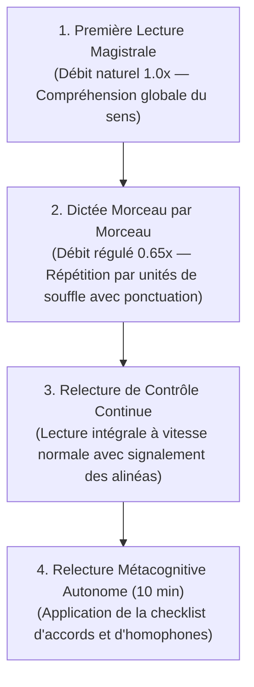

# Corpus des Dictées Étalonnées — World-Class French

> **Statut** : Validé  
> **Alignement** : Référentiel de compétences ([`02-competency-framework/competency-framework.md`](../../02-competency-framework/competency-framework.md)) et Barème pénal officiel ([`02-competency-framework/assessment-rubrics.md`](../../02-competency-framework/assessment-rubrics.md))

Le corpus des dictées étalonnées de **World-Class French** constitue l'instrument probatoire par excellence de la maîtrise orthographique, morphologique et syntaxique. Chaque dictée a été calibrée pour mesurer des objectifs observables précis, sans gratuité ni artifice archaïque déconnecté de la langue savante vivante.

---

## 1. Protocole Officiel de Passation (Double Écoute & Relecture Raisonnée)

Toute épreuve de dictée se déroule en quatre phases chronométrées :

1. **Phase 1 : Écoute globale (3 minutes)** — L'apprenant écoute le texte intégral sans écrire afin d'en saisir la tonalité, la situation d'énonciation, le cadre temporel et la cohérence sémantique.
2. **Phase 2 : Écriture séquencée (15 à 25 minutes)** — Le texte est dicté groupe syntagmatique par groupe syntagmatique (3 à 6 mots), répété deux fois avec indication explicite de la ponctuation standard.
3. **Phase 3 : Écoute de cohérence (3 minutes)** — Relecture complète sans arrêt pour vérifier qu'aucun mot n'a été sauté.
4. **Phase 4 : Relecture active guidée (10 minutes)** — Temps individuel sanctuarisé où l'apprenant passe chaque syntagme au crible de l'algorithme d'audit :
   - *Passe 1 : Repérage des verbes conjugués et validation du donneur d'accord (sujet).*
   - *Passe 2 : Audit des participes passés (auxiliaire être, avoir + recherche du COD antéposé, pronominaux).*
   - *Passe 3 : Audit de la chaîne d'accord nominale (déterminant + nom + adjectifs satellites).*
   - *Passe 4 : Discrimination des homophones grammaticaux (tests de substitution : a/avait, à/pour, son/leur, ce/se).*

---

## 2. Barème Pénal Officiel (Départ à 20/20)

| Catégorie | Code | Description | Retrait |
| :--- | :---: | :--- | :---: |
| **Faute Grammaticale Majeure** | `ERR-GRAM-MAJ` | Accord sujet-verbe, accord du participe passé, confusion homophonique majeure (*a/à, é/er, on/ont, son/sont, ce/se*). | **-2,0 pts** |
| **Faute Grammaticale Mineure** | `ERR-GRAM-MIN` | Accord d'adjectif complexe, pluriel de nom composé simple, confusion *leur/leurs* devant nom, *tout/tous*. | **-1,0 pt** |
| **Faute Lexicale d'Usage** | `ERR-LEX-USAGE` | Consonne double erronée (*apaiser/apercevoir*), graphie d'un terme savant, accent modifiant la prononciation (*évènement/événement*). | **-1,0 pt** |
| **Ponctuation & Diacritiques** | `ERR-PONCT-ACC` | Virgule obligatoire omise (incise, relative explicative), accent manquant sur majuscule (*À, É*), cédille, tréma. | **-0,5 pt** |
| **Typographie & Trait d'Union** | `ERR-TYPO-UNION` | Trait d'union omis ou abusif (*celui-ci, peut-être, va-t-en*), mauvaise élision. | **-0,5 pt** |

*Seuil éliminatoire officiel* : Toute note inférieure à **14/20** requiert un passage en laboratoire de remédiation ciblée.

---

## 3. Répertoire des Dictées du Cursus

| Réf. | Semestre | Cycle | Titre & Thématique | Mots | Règles cibles |
| :--- | :---: | :---: | :--- | :---: | :--- |
| [`DICT-S1-01`](./dictation-s1-01-fondations-accord.md) | S1 | C1 | *L'Aube de l'Écriture et les Premières Règles* | 225 | `FR-101-01`, `FR-102-01`, `FR-103-01` |
| [`DICT-S2-01`](./dictation-s2-01-syntaxe-participe.md) | S2 | C1 | *Le Défi de Clément Marot : La Règle du Participe Passé* | 280 | `FR-201-01`, `FR-202-01`, `FR-203-01` |
| [`DICT-S3-01`](./dictation-s3-01-subordination-pronominaux.md) | S3 | C2 | *Le Labyrinthe des Verbes Réfléchis et Réciproques* | 340 | `FR-301-01`, `FR-302-01`, `FR-303-01` |
| [`DICT-S4-01`](./dictation-s4-01-adjectifs-couleur-invariables.md) | S4 | C2 | *La Nuance des Couleurs et les Subtilités de l'Invariabilité* | 365 | `FR-401-01`, `FR-402-01`, `FR-403-01` |
| [`DICT-S5-01`](./dictation-s5-01-haute-rigueur-classique.md) | S5 | C3 | *L'Éloquence de la Période et l'Héritage Classique* | 410 | `FR-501-01`, `FR-502-01`, `FR-503-01` |
| [`DICT-S6-01`](./dictation-s6-01-concours-pleiade.md) | S6 | C3 | *L'Épreuve Magistrale : Du Manuscrit à l'Impression Critique* | 460 | `FR-601-01`, `FR-602-01`, `FR-603-01` |
