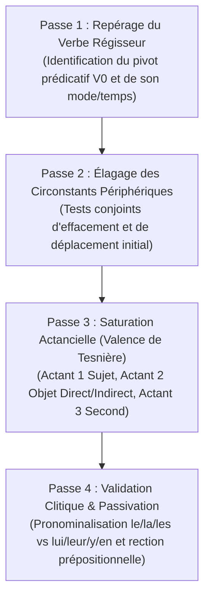

# Laboratoires d'Analyse Grammaticale & Arborescences Syntaxiques

> **Statut** : Validé  
> **Alignement** : Référentiel de compétences ([`02-competency-framework/competency-framework.md`](../../02-competency-framework/competency-framework.md)) — Compétence `FR-SYNTAX-001` (Analyse morphosyntaxique formelle en constituants immédiats et valences)  
> **Cadre Théorique** : Lucien Tesnière (*Éléments de syntaxe structurale*), Riegel, Pellat, Rioul (*Grammaire méthodique du français*), Grevisse (*Le Bon Usage*).

Les laboratoires d'analyse grammaticale apprennent à dépasser l'étiquetage superficiel des mots pour maîtriser la **mécanique fonctionnelle profonde de la phrase française** : nœud verbal, valences actancielles, circonstants périphériques et arborescences de subordination.

---

## 1. Méthode d'Audit Syntaxique en 4 Passes (Protocole Canonique)

Pour toute phrase soumise à l'analyse, l'apprenant applique l'algorithme rigoureux suivant :

1. **Passe 1 : Localisation du verbe conjugué pivot** — Détermination de son sens précis dans l'énoncé (sens plein vs verbe support ou copule).
2. **Passe 2 : Élagage des circonstants** — Isolement des constituants non sous-catégorisés par le verbe (supprimables sans rendre la phrase agrammaticale).
3. **Passe 3 : Détermination de la valence verbale** :
   - *Valence 0 (Avalent)* : `Il (explétif) + V₀` (*pleuvoir, falloir*).
   - *Valence 1 (Monovalent)* : `A1 (Sujet) + V₁` (*dormir, naître*).
   - *Valence 2 (Bivalent)* : `A1 + V₂ + A2 (COD/COI/Attribut/Locatif essentiel)` (*franchir, obéir à, paraître, aller à*).
   - *Valence 3 (Trivalent)* : `A1 + V₃ + A2 (COD) + A3 (COS/Attribut de l'objet)` (*confier qc à qn, considérer qn comme tel*).
4. **Passe 4 : Épreuve formelle de commutation** — Confirmation de la fonction par pronominalisation clitique exacte.

---

## 2. Répertoire des Laboratoires de Grammaire

| Réf. | Semestre | Cycle | Titre du Laboratoire | Compétences Travaillées |
| :--- | :---: | :---: | :--- | :--- |
| [`GRAM-LAB-01`](./lab-01-analyse-actancielle-tesniere.md) | S2 | C1 | *La Valence Verbale et les Arbres Actanciels de Tesnière* | Typologie des valences (0 à 3), actants vs circonstants, verbes attributifs. |
| [`GRAM-LAB-02`](./lab-02-subordonnees-relatives-et-completes.md) | S3 | C2 | *La Hiérarchie de la Subordination Complexe* | Relatives explicatives vs déterminatives, complétives conjonctives, interrogatives indirectes. |
| [`GRAM-LAB-03`](./lab-03-systeme-modal-et-concordance.md) | S3 | C2 | *L'Architecture Temporelle et le Système Modal* | Valeurs d'aspect, subjonctif de rection vs subjonctif d'opinion, conditionnel temporel. |
| [`GRAM-LAB-04`](./lab-04-macro-syntaxe-et-periode.md) | S5 | C3 | *La Macro-Syntaxe de la Grande Période Oratoire* | Protasie, acmé, apodose, parallélismes et ruptures syntaxiques réglées. |
