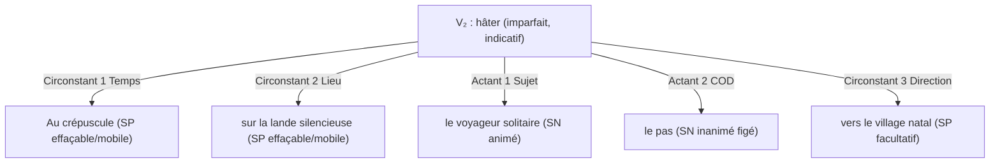
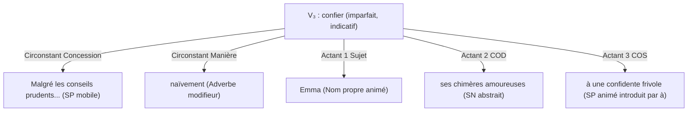
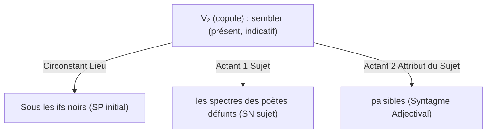

# Laboratoire de Grammaire 01 — La Valence Verbale et les Arbres Actanciels de Tesnière

> **Identifiant** : `GRAM-LAB-01`  
> **Niveau cible** : Cycle 1 (Semestre 2 — Fondations de la Syntaxe Fonctionnelle)  
> **Compétences évaluées** : `FR-SYNTAX-001` (Analyse morphosyntaxique formelle en constituants immédiats et valences)  
> **Corpus d'appui** : 10 phrases étalonnées issues de la littérature classique et contemporaine  
> **Durée estimée** : 50 minutes  
> **Ouvrages de référence** : Lucien Tesnière, *Éléments de syntaxe structurale* (chap. 1 à 8) ; Riegel, Pellat, Rioul, *GMF* (chap. 8).

---

## 1. Rappel Méthodologique : Le Verbe comme Nœud Central

Dans la grammaire structurale moderne, la phrase n'est pas une simple suite linéaire de mots, mais une **arborescence hiérarchisée gouvernée par le verbe conjugué**. Le verbe agit comme un atome doué de crochets (les *valences*) auxquels s'accrochent un nombre strictement limité de participants indispensables : les **actants**.

| Type de Valence | Schéma Canonique | Actants Satellites | Exemple Type |
| :---: | :--- | :--- | :--- |
| **Valence 0 (Avalent)** | `Il (explétif) + V₀` | Aucun participant réel | *Il tonne sur la plaine.* |
| **Valence 1 (Monovalent)** | `A1 + V₁` | Actant 1 : Sujet | *Le vent s'apaise.* |
| **Valence 2 (Bivalent)** | `A1 + V₂ + A2` | Actant 1 (Sujet) + Actant 2 (COD / COI / Attribut / Locatif essentiel) | *L'orateur réfute l'objection.* |
| **Valence 3 (Trivalent)** | `A1 + V₃ + A2 + A3` | Actant 1 (Sujet) + Actant 2 (COD) + Actant 3 (COS) | *L'érudit confie son manuscrit au conservateur.* |

> **Règle d'or de discrimination** : Tout constituant qui peut être **effacé sans rendre la phrase agrammaticale** et qui peut être **déplacé librement en tête d'énoncé** n'est pas un actant, mais un **circonstant périphérique**.

---

## 2. Corpus de Phraséologie à Analyser

Pour chacune des phrases suivantes, vous devez :
1. Identifier le **verbe pivot** et déterminer sa **valence syntaxique** (0, 1, 2 ou 3).
2. Délimiter avec précision chaque **actant** en spécifiant sa fonction formelle (Sujet, COD, COI, COS, Attribut du sujet, Complément essentiel de lieu).
3. Isoler les éventuels **circonstants périphériques** par les tests d'effacement et de déplacement.
4. Établir la **représentation arborescente (stemma)** ou la formule actancielle canonique.

### Phrase 1 (Chateaubriand)
> *Au crépuscule, sur la lande silencieuse, le voyageur solitaire hâtait le pas vers le village natal.*

### Phrase 2 (Flaubert)
> *Malgré les conseils prudents de ses amis, Emma confiait naïvement ses chimères amoureuses à une confidente frivole.*

### Phrase 3 (Bossuet)
> *Il ne reste aux princes de la terre que l'ombre vaine de leur grandeur passée.*

### Phrase 4 (Baudelaire)
> *Sous les ifs noirs, les spectres des poètes défunts semblent paisibles.*

### Phrase 5 (Senghor)
> *La voix des ancêtres murmure au poète attentif les secrets immémoriaux de la nuit africaine.*

---

## 3. Corrigé Raisonné et Arborescences Détaillées

### Phrase 1 : *Au crépuscule, sur la lande silencieuse, le voyageur solitaire hâtait le pas vers le village natal.*

- **Verbe régisseur** : *hâtait* (verbe transitif direct, sens : « accélérer »).
- **Valence** : **Bivalent (Valence 2)**.
- **Actant 1 (Sujet)** : *le voyageur solitaire* (Syntagme Nominal, clitique : *il*).
- **Actant 2 (COD)** : *le pas* (Syntagme Nominal inanimé dans la locution semi-figée *hâter le pas*, passivable en théorie poétique bien que figé : *le pas est hâté par le voyageur*).
- **Circonstants périphériques** :
  - *Au crépuscule* : Circonstant de temps (déplaçable en fin de phrase, supprimable).
  - *sur la lande silencieuse* : Circonstant de lieu (supprimable).
  - *vers le village natal* : Complément circonstanciel de direction (supprimable sans rupture sémantique de l'action de hâter le pas).

---

### Phrase 2 : *Malgré les conseils prudents de ses amis, Emma confiait naïvement ses chimères amoureuses à une confidente frivole.*

- **Verbe régisseur** : *confiait*.
- **Valence** : **Trivalent (Valence 3 / Ditransitif)**.
- **Actant 1 (Sujet)** : *Emma* (Pronominalisation : *elle*).
- **Actant 2 (COD direct)** : *ses chimères amoureuses* (Pronominalisation clitique : *les* $\rightarrow$ *Emma les confiait*).
- **Actant 3 (COS indirect)** : *à une confidente frivole* (Pronominalisation clitique : *lui* $\rightarrow$ *Emma lui confiait*).
- **Test de la double clitisation** : *Emma les lui confiait.* L'apparition conjointe des clitiques *les* (accusatif) et *lui* (datif) prouve de manière irréfutable la trivalence du prédicat.
- **Circonstants** :
  - *Malgré les conseils prudents de ses amis* : Circonstant de concession (effaçable).
  - *naïvement* : Circonstant de manière (effaçable).

---

### Phrase 3 : *Il ne reste aux princes de la terre que l'ombre vaine de leur grandeur passée.*

- **Verbe régisseur** : *reste* (tour impersonnel / verbe d'existence et de reliquat).
- **Valence** : **Bivalent à rection particulière (Tour impersonnel à sujet postposé)**.
- **Sujet grammatical apparent (explétif)** : *Il* (neutre, zéro rôle sémantique).
- **Actant 1 (Séquence postposée / Sujet réel)** : *l'ombre vaine de leur grandeur passée* (restreint par la négation exceptive *ne... que* = « seulement l'ombre vaine »).
- **Actant 2 (COI / Bénéficiaire-Attributaire)** : *aux princes de la terre* (SP introduit par *à*, pronominalisation clitique : *leur* $\rightarrow$ *Il ne leur reste que l'ombre vaine*).
- **Avertissement didactique** : Ne jamais analyser *l'ombre vaine* comme un COD. Le verbe *rester* en emploi impersonnel ne régit aucun COD (*rester quoi ?* est agrammatical).

---

### Phrase 4 : *Sous les ifs noirs, les spectres des poètes défunts semblent paisibles.*

- **Verbe régisseur** : *semblent* (verbe copule / attributif).
- **Valence** : **Bivalent Attributif (Valence 2)**.
- **Actant 1 (Sujet)** : *les spectres des poètes défunts*.
- **Actant 2 (Attribut du Sujet)** : *paisibles* (Adjectif qualificatif relié au sujet par le verbe copule).
- **Preuve par la non-passivation et la clitisation neutre** :
  - *Passivation* : Impossible (*Paisibles sont semblés par les spectres* $\rightarrow$ agrammatical).
  - *Clitique* : Pronominalisation obligatoire par le neutre invariable *le* (*Les spectres le semblent*), démontrant qu'il ne s'agit aucunement d'un COD.

---

### Phrase 5 : *La voix des ancêtres murmure au poète attentif les secrets immémoriaux de la nuit africaine.*

- **Verbe régisseur** : *murmure* (verbe de transmission de parole).
- **Valence** : **Trivalent (Valence 3)**.
- **Actant 1 (Sujet)** : *La voix des ancêtres*.
- **Actant 2 (COD)** : *les secrets immémoriaux de la nuit africaine*.
- **Actant 3 (COS / Destinataire)** : *au poète attentif*.
- **Double clitisation** : *La voix des ancêtres les lui murmure.*

---

## 4. Grille d'Auto-Évaluation et Barème de Notation

| Compétence observée | Critère de validation | Points |
| :--- | :--- | :---: |
| **Identification de la valence (0 à 3)** | Attribution exacte de l'indice de valence pour chaque verbe. | / 5 pts |
| **Délimitation précise des actants** | Absence de confusion entre noyau nominal et expansions du nom. | / 5 pts |
| **Élagage chirurgical des circonstants** | Test conjoints d'effacement et de déplacement documentés. | / 5 pts |
| **Épreuves de commutation (Clitiques / Passif)** | Pronominalisation exacte (*le/la/les* vs *lui/leur* vs *y/en* vs *le neutre*). | / 5 pts |
| **Total du Laboratoire** | Seuil de maîtrise L3 exigé : **14 / 20** | **/ 20 pts** |
