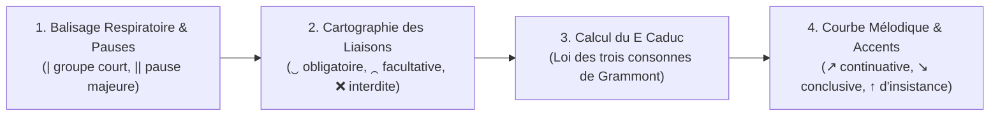

# Ateliers d'Élocution, Prosodie & Déclamation Oratoire

> **Statut** : Validé  
> **Alignement** : Référentiel de compétences ([`02-competency-framework/competency-framework.md`](../../02-competency-framework/competency-framework.md)) — Compétence `FR-ORAL-001` (Maîtrise orthoépique, phonétique articulatoire, découpage prosodique et déclamation classique)  
> **Cadre Théorique & Normatif** : Pierre Fouché (*Traité de prononciation française*), Pierre Delattre (*Les dix intonations de base du français*), Maurice Grammont (*Traité pratique de prononciation française*), Léon & Léon (*La Prononciation du français contemporain*).

L'oral cultivé ne s'improvise pas : il repose sur une **discipline mécanique de l'articulation**, une **respiration diaphragmatique calibrée** et une science rigoureuse des **groupes rythmiques et des liaisons**. Ces ateliers fournissent des textes annotés et des protocoles d'entraînement vocal pour transformer une lecture machinale en une parole oratoire claire, cadencée et souveraine.

---

## 1. Conventions de Notation Orthoépique & Prosodique

Pour annoter le texte avant la mise en voix, le protocole standardisé suivant est appliqué :

### A. Frontières de groupes et pauses
- `|` : **Frontière de groupe rythmique** (pause virtuelle ou micro-suspension sans reprise inspiratoire, accent tonique sur la dernière syllabe prononcée).
- `||` : **Pause majeure respiratoire** (fin de phrase ou incision syntaxique profonde, reprise d'air diaphragmatique silencieuse).

### B. Taxinomie des Liaisons
- `‿` : **Liaison obligatoire** (absence de liaison = faute orthoépique sanctionnée).
  - *Exemples* : Déterminant + Nom (`un‿homme`, `les‿arbres`) ; Pronom clitique + Verbe (`ils‿ont`, `on‿écoute`) ; Adjectif épithète antéposé + Nom (`un grand‿édifice`) ; Monosyllabes invariables (`en‿été`, `chez‿eux`, `sans‿effort`).
- `⁔` : **Liaison facultative** (marquage du registre oratoire et académique ; recommandée en lecture publique noble, proscrite si artificielle).
  - *Exemples* : Forme conjuguée de *être* ou *avoir* + participe/attribut (`c'est⁔impossible`, `ils sont⁔arrivés`) ; Pluriel nominal + adjectif postposé (`des discours⁔admirables`).
- `❌` : **Liaison strictement interdite** (la réaliser constitue un solécisme phonétique ou « pataquès »).
  - *Exemples* : Après la conjonction *et* (`et ❌ alors`) ; Devant un *h* aspiré (`les ❌ héros`, `en ❌ haut`) ; Après un nom singulier terminé par consonne muette (`le vent ❌ souffle`, `un savant ❌ illustre`) ; Sujet inversé (`sont-ils ❌ arrivés ?`).

### C. Gestion du « e » caduc (loi des trois consonnes de Grammont)
- `[ə]` prononcé : lorsque sa chute forcerait la rencontre de trois consonnes successives difficiles à articuler (`mercredi` -> `/mɛʁ.kʁə.di/`).
- `ø` élidé : en syllabe ouverte inaccentuée précédée d'une seule consonne (`la petite` -> `/laptit/` en registre courant, maintenu `/la pətit/` en diction solennelle).

### D. Profils Intonatifs
- `↗` : **Pente montante (continuative)** — Indique que la pensée est en suspens, en cours de déploiement (protase, énumération).
- `↘` : **Pente descendante (conclusive)** — Marque l'achèvement d'un cycle assertif (apodose, clôture de période).
- `↑` : **Accent d'insistance (ou oratoire)** — Report de force sur l'attaque consonantique d'un mot clé (`C'est une ↑honte absolue !`).

---

## 2. Grille d'Évaluation de la Déclamation Oratoire (Barème sur 20)

| Critère | Barème | Indicateurs de Performance |
| :--- | :---: | :--- |
| **Précision Orthoépique & Liaisons** | /6 | Respect absolu des liaisons obligatoires (+3) ; absence totale de liaisons interdites (+2) ; conformité des voyelles ouvertes/fermées et nasales (+1). *(Pénalité : -1 pt par cuir ou velours).* |
| **Rythme & Découpage Syllabique** | /5 | Isosyllabisme régulier ; accents toniques placés exclusivement sur la syllabe finale de chaque groupe de souffle ; maîtrise du *e* caduc. |
| **Courbe Mélodique & Portée Vocale** | /4 | Différenciation nette protase (montée) / apodose (descente) ; absence de chant monotone ; résonance thoracique/faciale sans forçage du larynx. |
| **Contrôle Respiratoire & Clarté Dictionnelle** | /3 | Inspirations diaphragmatiques inaudibles calées sur les pauses majeures `||` ; absence d'asphyxie en fin de période ; netteté des consonnes d'attaque. |
| **Intelligence du Texte & Tempérament** | /2 | Restitution du sens philosophique ou dramatique ; gravité et tenue corporelle sans théâtralité outrancière. |

---

## 3. Répertoire des Ateliers Pratiques

| Réf. | Semestre | Cycle | Titre de l'Atelier | Support Textuel & Objectif Phare |
| :--- | :---: | :---: | :--- | :--- |
| [`ORAL-WS-01`](./workshop-01-prosodie-et-liaisons.md) | S1 | C1 | *Architecture du Souffle, Liaisons et Cadences Oratoires* | Bossuet (*Oraison funèbre d'Henriette d'Angleterre*) & Chateaubriand (*Mémoires d'outre-tombe*). |
| [`ORAL-WS-02`](./workshop-02-diction-classique-et-alexandrin.md) | S2 | C1 | *L'Hémistiche, l'Enjambement et l'E caduc dans l'Alexandrin* | Racine (*Phèdre*) & Corneille (*Cinna*). |
| [`ORAL-WS-03`](./workshop-03-plaidoirie-et-controverse.md) | S4 | C2 | *La Joute Rhétorique et l'Accentuation Polémique* | Diderot (*Le Neveu de Rameau*) & Jaurès (*Discours à la jeunesse*). |
| [`ORAL-WS-04`](./workshop-04-grand-discours-et-cadence-de-periode.md) | S6 | C3 | *La Diction de la Grande Période Cicéronienne en Français* | De Gaulle (*Appels et Mémoires de guerre*) & Malraux (*Oraison funèbre de Jean Moulin*). |
