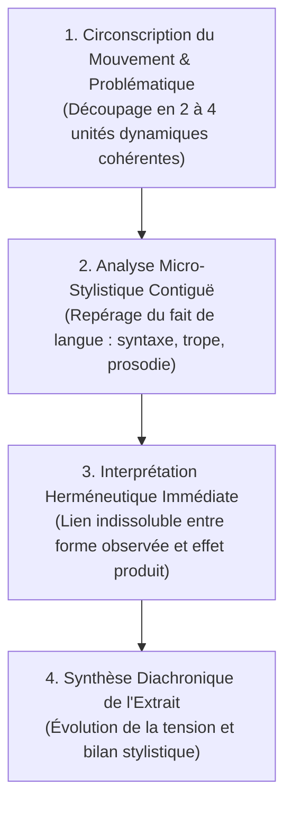

# Ateliers de Lecture Critique & Explication Linéaire de Texte

> **Statut** : Validé  
> **Alignement** : Référentiel de compétences ([`02-competency-framework/competency-framework.md`](../../02-competency-framework/competency-framework.md)) — Compétence `FR-STYLE-001` (Stylistique formelle, figures du discours et herméneutique textuelle)  
> **Cadre Méthodologique** : Georges Molinié (*Éléments de stylistique française*), Pierre Fontanier (*Les Figures du discours*), Gérard Genette (*Figures III*).

L'explication linéaire universitaire n'est ni un paraphrase paresseuse, ni un catalogue impressionniste de figures de rhétorique. C'est une **démonstration microscopique et continue** de la manière dont la matière linguistique (morphologie, syntaxe, lexique, sonorités, rythme) construit le sens singulier et la portée esthétique ou philosophique d'une page.

---

## 1. Méthode Canonique de l'Explication Linéaire en 4 Mouvements

### Le triptyque d'or de chaque remarque :
Pour chaque segment de texte examiné, l'étudiant formule son observation selon la formule stricte :
$$\text{Relevé formel précis (fait de langue)} \longrightarrow \text{Caractérisation grammaticale/rhétorique} \longrightarrow \text{Portée interprétative (sens)}$$

> [!WARNING]
> Tout relevé non contextualisé (*« l'auteur fait une métaphore »*) ou toute glose thématique sans citation précise (*« ici l'auteur est triste »*) est sanctionné par une note éliminatoire.

---

## 2. Grille d'Évaluation de l'Explication Linéaire (Barème sur 20)

| Composante de l'Évaluation | Poids | Critères d'Excellence |
| :--- | :---: | :--- |
| **Précision des faits de langue & Terminologie** | /6 | Emploi rigoureux du métalangage grammatical et stylistique (catégories morphosyntaxiques exactes, taxinomie exacte de Fontanier/Molinié). |
| **Cohérence herméneutique & Problématique** | /5 | Chaque remarque est rattachée au fil conducteur démonstratif ; absence totale de paraphrase plate. |
| **Architecture des mouvements textuels** | /4 | Découpage du texte justifié par des ruptures ou relances formelles (connecteurs, changements de temps, inversions). |
| **Correction de l'expression & Clarté oratoire** | /3 | Vocabulaire soutenu, syntaxe périodique maîtrisée, transitions fluides. |
| **Introduction & Conclusion synthétique** | /2 | Situation du passage, formulation nette de l'enjeu, élargissement littéraire pertinent. |

---

## 3. Répertoire des Ateliers Pratiques de Lecture

| Réf. | Semestre | Cycle | Titre de l'Atelier | Auteur & Œuvre Support |
| :--- | :---: | :---: | :--- | :--- |
| [`READ-WS-01`](./workshop-01-explication-lineaire.md) | S2 | C1 | *L'Analyse Stylistique Linéaire et le Fait de Langue* | Marcel Proust (*Du côté de chez Swann*, la scène de la madeleine). |
| [`READ-WS-02`](./workshop-02-lecture-poetique-hermetisme.md) | S3 | C2 | *Le Vers Moderne, l'Énallage et la Rupture Syntaxique* | Stéphane Mallarmé & Arthur Rimbaud. |
| [`READ-WS-03`](./workshop-03-polyphonie-ironie-voltairienne.md) | S4 | C2 | *L'Énonciation Polyphonique et l'Ironie Critique* | Voltaire (*Candide*) & Montesquieu (*De l'esprit des lois*). |
| [`READ-WS-04`](./workshop-04-hermeneutique-francophone-postcoloniale.md) | S5 | C3 | *Décentrement Poétique et Hybridation Stylistique* | Aimé Césaire (*Cahier d'un retour au pays natal*) & Ahmadou Kourouma. |
