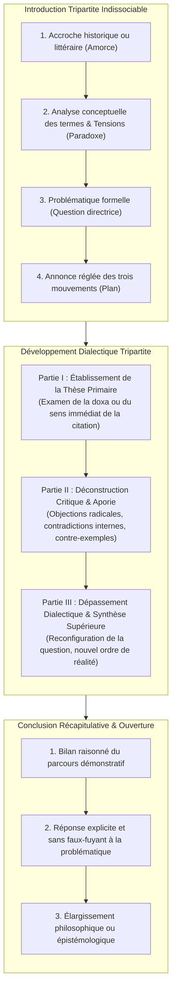

# Ateliers d'Écriture Académique, Rhétorique & Dissertation

> **Statut** : Validé  
> **Alignement** : Référentiel de compétences ([`02-competency-framework/competency-framework.md`](../../02-competency-framework/competency-framework.md)) — Compétence `FR-ARGUM-001` (Rigueur démonstrative, réfutation et détection des sophismes) & `FR-SYNTAX-002` (Macro-syntaxe et déploiement de la période oratoire)  
> **Cadre Théorique & Rhétorique** : Aristote (*Rhétorique*), Quintilien (*De institutione oratoria*), Chaim Perelman & Lucie Olbrechts-Tyteca (*Traité de l'argumentation : La nouvelle rhétorique*), Marc Fumaroli (*L'Âge de l'éloquence*).

L'écriture de haut niveau en français ne consiste ni à juxtaposer des opinions personnelles, ni à compiler des citations décoratives. Elle exige une **architecture logique dialectique** où chaque thèse est mise à l'épreuve de sa contradiction interne pour déboucher sur un **dépassement conceptuel rigoureusement argumenté**.

---

## 1. Morphologie Canonique de la Dissertation Dialectique (Structure en Triptyque)

---

## 2. L'Unité Argumentative Élémentaire : Le Paragraphe Rhétorique (Méthode A.E.I.)

Tout paragraphe de développement doit constituer une démonstration autonome articulée en quatre maillons indissolubles :

1. **Assertion (Idée directrice)** : Énoncé abstrait de l'argument qui répond directement à l'intitulé de la sous-partie.
2. **Explicitation (Élucidation conceptuelle)** : Déploiement logique de la pensée, définition des nuances, démonstration du lien causal.
3. **Illustration (Exemple probant analysé)** : Référence textuelle, historique ou philosophique précise (auteur, titre, épisode, citation exacte), soumise à une analyse critique (l'exemple illustre mais ne prouve pas sans exégèse).
4. **Impact (Conclusion partielle & transition)** : Raccordement explicite à la thèse de la partie et annonce du paragraphe suivant.

---

## 3. Grille d'Évaluation de la Dissertation Universitaire (Barème sur 20)

| Pôle d'Évaluation | Points | Exigences et Critères Décisifs |
| :--- | :---: | :--- |
| **Problématisation & Analyse Notionnelle** | /5 | Définition scrupuleuse des termes du sujet ; mise en évidence du paradoxe central ; formulation d'une problématique féconde qui évite le simple choix binaire oui/non. |
| **Rigueur Dialectique & Progression Logique** | /5 | Progression réelle entre les trois parties (la partie III ne doit pas être un tiède compromis, mais une refondation de l'enjeu) ; enchaînement déductif des paragraphes par des connecteurs logiques précis. |
| **Pertinence & Analyse des Exemples Culturels** | /4 | Exemples précis (au moins 2 œuvres canoniques par partie) ; absence de résumé d'intrigue ; analyse formelle de l'exemple au service de l'argument. |
| **Correction Syntaxique & Éloquence du Style** | /4 | Zéro faute d'orthographe ou de grammaire ; richesse du lexique conceptuel ; maîtrise de la période et des formules de transition sans lourdeur scolaire. |
| **Respect des Normes Formelles & Transitions** | /2 | Introduction et conclusion en blocs compacts non fragmentés ; équilibre des trois parties ; présence d'une transition récapitulative et interrogative entre chaque partie. |

---

## 4. Répertoire des Ateliers Pratiques d'Écriture

| Réf. | Semestre | Cycle | Titre de l'Atelier | Sujet & Défi Méthodologique |
| :--- | :---: | :---: | :--- | :--- |
| [`WRITE-WS-01`](./workshop-01-dissertation-academique.md) | S2 | C1 | *L'Analyse du Sujet, la Problématisation et le Plan Dialectique* | *« La littérature doit-elle consoler ou inquiéter ? »* |
| [`WRITE-WS-02`](./workshop-02-paragraphe-argumentatif-et-transitions.md) | S3 | C2 | *La Confection du Paragraphe AEI et l'Art de la Transition Oratoire* | *« Peut-on penser sans le langage ? »* (Laboratoire de rédaction de transitions). |
| [`WRITE-WS-03`](./workshop-03-commentaire-compose-structure.md) | S4 | C2 | *Le Commentaire Composé Universitaire en Trois Axes* | Baudelaire (*Les Fleurs du Mal*, « Le Cygne »). |
| [`WRITE-WS-04`](./workshop-04-note-de-synthese-et-rapport.md) | S5 | C3 | *La Note de Synthèse et le Rapport d'Aide à la Décision* | Dossier documentaire institutionnel sur le multilinguisme et la francophonie. |
