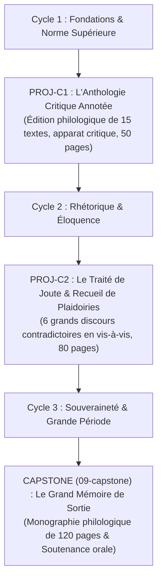

# Les Projets d'Intégration Semestriels & de Cycle

> **Statut** : Validé  
> **Alignement** : Charte de projet ([`00-governance/project-charter.md`](../00-governance/project-charter.md)) & Référentiel de compétences ([`02-competency-framework/competency-framework.md`](../02-competency-framework/competency-framework.md))  
> **Principe Pédagogique** : *Preuve observable de haut niveau* — L'apprenant ne se contente pas de réussir des exercices fractionnés ; il produit des ouvrages achevés, publiables et conformes aux normes professionnelles de l'édition et de l'académie.

Les projets d'intégration constituent les **chefs-d'œuvre intermédiaires** du cursus. Ils mobilisent conjointement l'exactitude morphosyntaxique, la précision lexicologique, l'art de la composition périodique et la rigueur typographique sur des productions d'envergure.

---

## 1. Cartographie des Projets de Cycle

---

## 2. Table Récapitulative des Cahiers des Charges

| Réf. Projet | Cycle Validé | Titre du Chef-d'Œuvre | Volume & Format | Exigence Normative Clé |
| :---: | :---: | :--- | :---: | :--- |
| [`PROJ-C1`](./project-cycle-1-anthologie-critique.md) | **Cycle 1** | *L'Anthologie Critique Annotée & Révisée* | 40 à 50 pages (Relié / PDF Pro) | Typographie de l'Imprimerie Nationale, apparat critique, zéro faute sur 15 000 mots. |
| [`PROJ-C2`](./project-cycle-2-recueil-plaidoiries.md) | **Cycle 2** | *Le Recueil des Plaidoiries Contradictoires* | 60 à 80 pages (Livre d'art) | Architecture des 5 parties de la rhétorique, réfutation formelle de sophismes, périodes cicéroniennes. |

---

## 3. Critères Généraux d'Homologation & Jury

1. **Dépôt du Manuscrit** : Le document doit être remis au format numérique normé (PDF/UA balisé respectant les canons de la typographie française classique).
2. **Double Évaluation Aveugle** : Chaque projet est évalué par deux relecteurs indépendants à l'aide d'une grille critériée sur 100 points.
3. **Seuil d'Approbation** : Une note minimale de **70 / 100 (14/20)** est exigée pour délivrer l'attestation de cycle correspondante.
