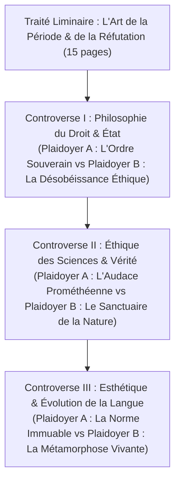

# Projet Majeur Cycle 2 : Le Recueil des Plaidoiries Contradictoires & Manuel de Joute

> **Code Projet** : `PROJ-C2`  
> **Cycle Validé** : Fin du Cycle 2 (Rhétorique, Éloquence & Stylistique)  
> **Volume Attendu** : 60 à 80 pages (20 000 à 25 000 mots)  
> **Barème d'Homologation** : 100 points (Seuil minimal : 70 / 100)  
> **Livrable** : Ouvrage d'apparat édité et soutenu lors d'un grand débat contradictoire public.

---

## 1. Description & Ambition du Projet

Le projet **`PROJ-C2`** couronne l'apprentissage de la **rhétorique délibérative, judiciaire et démonstrative**. L'apprenant y démontre sa capacité à penser contre lui-même en concevant un recueil de **trois grands procès d'idées**, où chaque cause est défendue et attaquée par deux discours d'apparat de haute tenue, construits selon les cinq canons de la rhétorique classique (Cicéron, Quintilien).

---

## 2. Structure Canonique de l'Ouvrage

L'ouvrage se compose d'un traité méthodologique suivi de trois diptyques oratoires :

---

## 3. Cahier des Charges de Chaque Diptyque Oratoire (20 pages par controverse)

Pour chacune des trois controverses, l'apprenant rédige :

### A. Le Discours d'Accusation (Plaidoyer A — 8 à 10 pages)
Rédigé dans une prose oratoire ample et cadencée, respectant le plan rhétorique en cinq parties :
1. **Exorde (Exordium)** : Captation de bienveillance (*captatio benevolentiae*), annonce solennelle de la gravité de la cause, tonus oratoire.
2. **Narration (Narratio)** : Exposé clair, vraisemblable et orienté des faits historiques ou conceptuels.
3. **Confirmation (Confirmatio)** : Déploiement de trois arguments majeurs articulés par la méthode AEI (Assertion, Explicitation, Illustration) et adossés à des syllogismes formels.
4. **Réfutation (Refutatio)** : Anticipation et anéantissement des objections adverses potentielles (usage de la prétérition et de l'antithèse).
5. **Péroraison (Peroratio)** : Émotion noble (*pathos* mesuré), amplification oratoire par la grande période ternaire et appel au jugement de l'auditoire.

### B. Le Discours de Défense (Plaidoyer B — 8 à 10 pages)
Réponse terme à terme au premier discours, sans jamais tomber dans la basse polémique :
- Démontage des sophismes et paralogismes insérés sciemment dans le Plaidoyer A.
- Concession courtoise de points secondaires (*concessio*) pour mieux consolider la thèse principale.
- Emploi de figures de retournement (rétorsion, chiasme oratoire, dilemme symétrique).

### C. L'Apparat Logique & Rhétorique (2 à 3 pages)
Une fiche d'audit critique accompagnant chaque diptyque :
- Formalisation des syllogismes sous forme symbolique ($\text{Prémisse Majeure} \wedge \text{Prémisse Mineure} \implies \text{Conclusion}$).
- Cartographie des figures de style employées (hypallages, anaphores périodiques, questions rhétoriques).
- Découpage métrique des grandes périodes oratoires composées par l'apprenant.

---

## 4. Grille d'Évaluation & Barème d'Homologation (sur 100 Points)

| Critère d'Évaluation | Poids | Indicateurs Décisifs |
| :--- | :---: | :--- |
| **Rigueur Logique & Démonstration Dialectique** | /30 | Validité formelle des syllogismes ; détection et réfutation brillante des paralogismes ; force persuasive sans sophismes vulgaires. |
| **Ampleur Stylistique & Architecture Périodique** | /30 | Déploiement souverain de grandes phrases oratoires de plus de 40 mots sans rupture syntaxique ; cadences majeures équilibrées ; absence de sécheresse. |
| **Respect des Canons Rhétoriques Classiques** | /20 | Intégration organique des 5 parties du discours (exorde, narration, confirmation, réfutation, péroraison) ; modulation parfaite de l'*ethos*, du *logos* et du *pathos*. |
| **Correction Grammaticale & Orthoépique** | /20 | Zéro faute de syntaxe ou d'accord sur l'ensemble des 25 000 mots ; partition vocale prête pour la mise en voix. |

> **Validation du projet** : Note $\ge 70 / 100$ requise. La note est inscrite au procès-verbal du Certificat CSERS.
