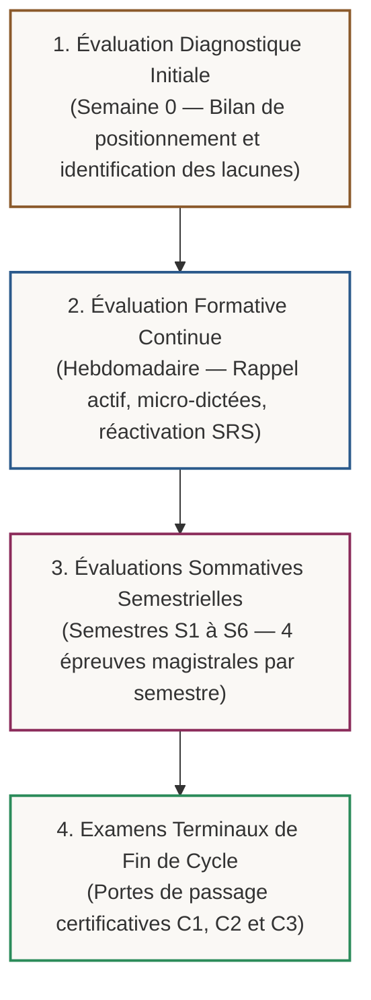

# Le Système d'Évaluation Certifiant & Docimologique

> **Statut** : Validé  
> **Alignement** : Charte du projet ([`00-governance/project-charter.md`](../00-governance/project-charter.md)) & Référentiel de compétences ([`02-competency-framework/competency-framework.md`](../02-competency-framework/competency-framework.md))  
> **Exigence Qualité** : Standard universitaire World-Class (Seuil d'admission minimal : 14/20 ou 70 % sans arrondi de complaisance).

Le cursus **World-Class French** ne délivre aucune attestation sur simple présomption ou assiduité passive. La maîtrise souveraine de la langue française repose sur un **système docimologique rigoureux**, fondé sur des épreuves critériées, des barèmes pénaux objectifs et des preuves observables de performance écrite et orale.

---

## 1. Architecture Globale du Système d'Évaluation

Le parcours d'évaluation s'articule en quatre paliers complémentaires :

---

## 2. Principes Docimologiques Fondamentaux

### A. Règle du Seuil Minimal de Maîtrise (14/20)
- Pour valider un module, un semestre ou un cycle, la moyenne générale pondérée doit être **supérieure ou égale à 14/20 (70 %)**.
- **Note éliminatoire** : Toute note inférieure à 10/20 à l'une des 4 composantes semestrielles (Dictée, Linguistique, Dissertation, Oral) invalide le semestre et exige une épreuve de rattrapage équivalente après remédiation dans [`04-practical-work/`](../04-practical-work/).
- **Élimination absolue des complaisances** : Aucun arrondi artificiel n'est consenti.

### B. Le Barème Pénal Officiel de l'Orthographe (Dictée & Écrits)
Toute faute relevée dans une dictée de contrôle ou dans une composition formelle est catégorisée et sanctionnée selon le barème officiel arrêté dans le référentiel de gouvernance :

| Code d'Erreur | Catégorie de Faute | Description Linguistique & Exemples | Pénalité |
| :--- | :--- | :--- | :---: |
| `ERR-GRAM-MAJ` | **Faute grammaticale majeure** | Rupture de la chaîne d'accord sujet-verbe, désaccord criant du participe passé avec *avoir* ou *être*, confusion modale majeure (indicatif au lieu du subjonctif après conjonction d'obligation). | **-2,0 pts** |
| `ERR-GRAM-MIN` | **Faute grammaticale mineure** | Désaccord de genre ou de nombre dans un syntagme nominal complexe éloigné, erreur d'accord d'un adjectif de couleur composé. | **-1,0 pt** |
| `ERR-LEX-USAGE` | **Faute d'usage lexical** | Erreur sur une consonne double (*apercevoir* écrit avec deux *p*), consonne muette dérivative erronée (*lait* sans *t*), confusion paronymique (*attention / intention*). | **-1,0 pt** |
| `ERR-PONCT-ACC` | **Accentuation & Ponctuation** | Accent aigu/grave/circonflexe erroné ou manquant sur voyelle pleine, omission de la virgule isolant une proposition incise ou un complément circonstanciel initial. | **-0,5 pt** |
| `ERR-TYPO-UNION` | **Trait d'union & Majuscule** | Omission ou ajout indu du trait d'union (*peut-être*, *grand-chose*), majuscule d'état ou d'institution omise. | **-0,5 pt** |

---

## 3. Matrice de Répartition des Épreuves

| Dossier | Niveau / Moment | Objectif Pédagogique | Nature des Épreuves & Format |
| :--- | :---: | :--- | :--- |
| [`diagnostic/`](./diagnostic/) | **Semaine 0** (Entrée) | Établir le profil de compétences réelles et orienter le parcours d'apprentissage. | Test multi-domaines de 2h30 (Orthographe, syntaxe, lexique, logique, élocution). |
| [`formative/`](./formative/) | **Semaines 1 à 12** | Consolider la mémoire de travail et vérifier la rétention active à court terme. | Micro-tests hebdomadaires, dictées flash de 50 mots, QCM d'analyse syntaxique. |
| [`summative/`](./summative/) | **Fin de Semestre (S1-S6)** | Certifier l'assimilation complète des 4 modules du semestre écoulé. | 4 épreuves : 1. Dictée sans document (300-400 mots) ; 2. Analyse linguistique ; 3. Dissertation (3h) ; 4. Soutenance orale. |
| [`final-examinations/`](./final-examinations/) | **Fin de Cycle (C1, C2, C3)** | Délivrer le brevet ou certificat de cycle et autoriser le passage au cycle supérieur. | Concours d'examen de 6 heures combinant haute analyse philologique, stylistique et déclamation publique. |
