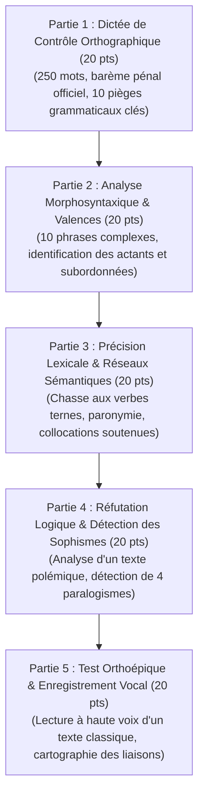

# Évaluation Diagnostique & Bilan de Positionnement Initial

> **Statut** : Validé  
> **Moment d'Exécution** : Semaine 0 (Préalable absolu à tout engagement dans le cursus)  
> **Durée** : 2 heures 30 minutes (Épreuve écrite de 2h + Épreuve audio d'orthoépie de 30 min)  
> **Alignement** : Référentiel de compétences ([`02-competency-framework/competency-framework.md`](../../02-competency-framework/competency-framework.md)) — Compétences fondamentales `FR-ORTHO-001` à `FR-ORAL-001`.

L'évaluation diagnostique initiale a pour vocation d'établir une **cartographie objective des compétences réelles** de l'apprenant, d'identifier ses automatismes défaillants ou ses insécurités linguistiques et de déterminer avec exactitude le palier d'entrée le plus adapté à sa progression.

---

## 1. Structure de l'Épreuve Diagnostique (Barème sur 100 Points)

L'épreuve se compose de 5 épreuves standardisées indépendantes :

---

## 2. Grille d'Aiguillage & Arbre de Décision Pédagogique

À l'issue de la correction complète du bilan diagnostique, le score global (sur 100) dicte le plan d'étude personnalisé :

| Score Global | Palier Diagnostiqué | Profil de l'Apprenant | Préconisation Pédagogique Officielle |
| :---: | :--- | :--- | :--- |
| **85 à 100 pts** | **Palier d'Excellence Normative** | Maîtrise spontanée des accords complexes, lexique riche, rigueur logique affirmée. | Admission directe en **Cycle 1 avec dispense** des modules `MOD-101` et `MOD-102` (accès direct aux ateliers d'écriture avancée ou anticipation du Cycle 2). |
| **70 à 84 pts** | **Palier Standard Supérieur** | Bon niveau d'ensemble, mais quelques hésitations sur les accords participiaux rares, le subjonctif ou les liaisons oratoires. | Parcours canonique **Cycle 1 complet** (`MOD-101` à `MOD-204`) à un rythme soutenu (6 heures/semaine). |
| **50 à 69 pts** | **Palier de Consolidation** | Fragilités morphosyntaxiques récurrentes, vocabulaire approximatif, tendance à la paraphrase. | Parcours **Cycle 1 renforcé** : doublement obligatoire des séances pratiques dans [`04-practical-work/`](../../04-practical-work/) (Dictées et Ateliers de relecture). |
| **< 50 pts** | **Palier de Remise à Niveau** | Prérequis fondamentaux non stabilisés (ruptures sujet-verbe fréquentes, confusion des homophones grammaticaux). | **Ajournement temporaire** : Réalisation préalable du module préparatoire intensif de remise à niveau avant réévaluation. |

---

## 3. Documents du Dossier Diagnostique

- **Sujet & Corrigé Officiel** : [`diagnostic-initial-positionnement.md`](./diagnostic-initial-positionnement.md) — Sujet intégral imprimable de 2h30 avec clés de correction détaillées, apparat critique et barème point par point.
