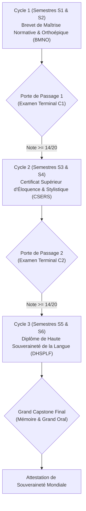

# Examens Terminaux de Fin de Cycle & Portes de Passage Certificatives

> **Statut** : Validé  
> **Alignement** : Charte pédagogique ([`00-governance/project-charter.md`](../../00-governance/project-charter.md)) & Référentiel de compétences ([`02-competency-framework/competency-framework.md`](../../02-competency-framework/competency-framework.md))  
> **Exigence Docimologique** : Seuil d'admission minimal fixé à **14/20**, avec obligation de zéro note $< 12/20$ aux épreuves constitutives.

Les examens terminaux de fin de cycle sont les **portes de passage souveraines** qui scellent la progression de l'apprenant entre les trois grandes étapes du cursus. Ils ne vérifient pas seulement des connaissances isolées, mais attestent de l'intégration organique, réflexe et élégante des compétences linguistiques acquises.

---

## 1. Les Trois Paliers de Diplomation du Cursus

---

## 2. Typologie des Titres Certifiés

| Cycle | Épreuve Terminale | Titre Académique Délivré | Compétences Majeures Certifiées |
| :---: | :--- | :--- | :--- |
| **C1** | [`final-exam-cycle-1.md`](./final-exam-cycle-1.md) | **Brevet de Maîtrise Normative & Orthoépique (BMNO)** | Éradication totale des fautes d'usage et d'accord ; syntaxe fonctionnelle sans rupture ; diction classique et liaisons irréprochables. |
| **C2** | `final-exam-cycle-2.md` | **Certificat Supérieur d'Éloquence, Rhétorique & Stylistique (CSERS)** | Rigueur dialectique, détection des sophismes, écriture de la période oratoire, commentaire stylistique d'œuvres complexes. |
| **C3** | `final-exam-cycle-3.md` | **Diplôme de Haute Souveraineté & Philologie Française (DHSPLF)** | Maîtrise sociolinguistique de la francophonie plurielle, déclamation de la grande période cicéronienne, soutenance d'un mémoire de recherche. |

---

## 3. Système des Mentions Officielles

| Moyenne Générale à l'Examen | Mention Attribuée | Prérogative Pédagogique |
| :---: | :--- | :--- |
| **18,0 à 20,0 / 20** | **Très Bien avec Félicitations du Jury** | Éligibilité au statut de tuteur académique et inscription d'honneur au registre des diplômés. |
| **16,0 à 17,9 / 20** | **Bien** | Admission de plein droit au cycle supérieur sans condition restrictive. |
| **14,0 à 15,9 / 20** | **Assez Bien** | Admission validée, avec recommandation de maintien des révisions SRS hebdomadaires. |
| **< 14,0 / 20** | **Ajournement** | Session de rattrapage unique après cycle de renforcement de 4 semaines dans [`04-practical-work/`](../../04-practical-work/). |
