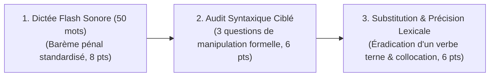

# Évaluations Formatives Continues & Contrôle Hebdomadaire

> **Statut** : Validé  
> **Fréquence** : Hebdomadaire (Fin de chaque semaine d'étude, Semaines S1-W01 à S6-W12)  
> **Durée** : 15 à 20 minutes par micro-évaluation  
> **Alignement** : Référentiel de compétences ([`02-competency-framework/competency-framework.md`](../../02-competency-framework/competency-framework.md)) & Algorithme SRS (SuperMemo SM-2).

L'évaluation formative n'est pas un examen sanctionateur mais un **instrument cognitif de consolidation mémorielle par rappel actif**. Elle empêche l'oubli précoce en forçant le cerveau à réactiver les règles fondamentales et permet une remédiation chirurgicale immédiate avant que les lacunes ne s'enkystent.

---

## 1. Structure Canonique d'un Micro-Contrôle Hebdomadaire (Barème sur 20)

Chaque fin de semaine d'enseignement donne lieu à une micro-épreuve en trois temps :

1. **La Dictée Flash (8 points)** : Un texte condensé de 50 mots focalisé sur les pièges orthographiques et accords abordés durant la semaine.
2. **L'Épreuve de Manipulation Syntaxique (6 points)** : Trois phrases à transformer (passivation, pronominalisation clitique, commutation de subordonnées).
3. **Le Laboratoire Lexical (6 points)** : Remplacement de termes vagues par des collocations soutenues et distinction de paronymes.

---

## 2. Boucle de Rétroaction & Protocole de Remédiation Immédiate

Dès l'achèvement du micro-contrôle, l'apprenant applique la grille de décision suivante :

| Note Obtenue | Statut de Maîtrise | Action Pédagogique Déclenchée |
| :---: | :--- | :--- |
| **16 à 20 / 20** | **Maîtrise Confirmée** | Poursuite fluide du cursus. Ajout des fiches SRS associées dans la file de révision à long terme (J+7, J+21). |
| **12 à 15,5 / 20** | **Fragilité Identifiée** | Relecture obligatoire de la **Fiche de Synthèse (Rubrique 17)** du chapitre concerné. Réalisation d'une fiche d'exercice complémentaire dans [`04-practical-work/`](../../04-practical-work/). |
| **< 12 / 20** | **Alerte Décrochage** | **Verrouillage de la semaine suivante**. Révision complète de la leçon et passage obligatoire d'un test de rattrapage équivalent avec note $\ge 14/20$. |

---

## 3. Livret de Référence

- [`formative-framework-and-weekly-checks.md`](./formative-framework-and-weekly-checks.md) : Cadre opératoire détaillé et deux sujets-types étalonnés (Semaine 4 du Semestre 1 et Semaine 8 du Semestre 2) avec corrigés commentés.
