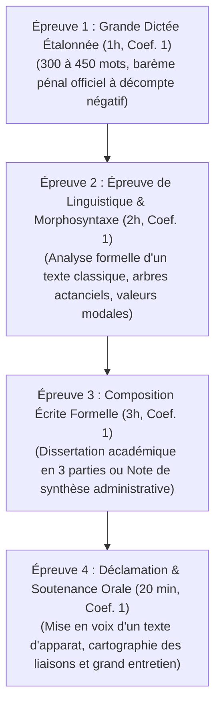

# Évaluations Sommatives Semestrielles (Examens S1 à S6)

> **Statut** : Validé  
> **Périodicité** : Semestrielle (Fin des semestres S1 à S6, Semaine 12 de chaque semestre)  
> **Durée Totale de la Session** : 6 heures d'épreuves écrites + 20 minutes d'épreuve orale  
> **Seuil de Validation du Semestre** : Moyenne générale pondérée $\ge 14/20$ sans aucune composante $< 10/20$.

Les évaluations sommatives semestrielles constituent la **validation académique officielle** des connaissances et savoir-faire acquis durant le semestre. Elles sanctionnent de manière impitoyable l'approximation et attestent de l'assimilation durable des notions enseignées dans les quatre modules semestriels.

---

## 1. Morphologie Standardisée de la Session Semestrielle (Triptyque Écrit + Oral)

Chaque fin de semestre donne lieu à 4 épreuves étalonnées :

---

## 2. Table Récapitulative des Examens Semestriels (S1 à S6)

| Semestre | Code Examen | Intitulé Thématique du Semestre | Épreuve Écrite Majeure (Épreuve 3) | Épreuve Orale Majeure (Épreuve 4) |
| :---: | :---: | :--- | :--- | :--- |
| **S1** | [`EXAM-S1`](./exam-s1-fondations-norme.md) | *Fondations & Norme Supérieure* | Dissertation littéraire inaugurale (*La règle et la liberté*) | Déclamation classique (Bossuet / Chateaubriand) |
| **S2** | [`EXAM-S2`](./exam-s2-syntaxe-architecture.md) | *Architecture Syntaxique & Morphologie Complexe* | Dissertation dialectique (*L'illusion du style sans grammaire*) | Lecture expressive et prosodie (Proust / Hugo) |
| **S3** | `EXAM-S3` | *Rhétorique, Logique & Argumentation Délibérative* | Plaidoyer contradictoire rédigé et réfutation | Joute oratoire contradictoire chronométrée |
| **S4** | `EXAM-S4` | *Stylistique, Poétique & Harmonie Classique* | Commentaire composé stylistique en trois axes | Récitation de la tragédie classique (Racine / Corneille) |
| **S5** | `EXAM-S5` | *Sociolinguistique, Variations & Francophonie Ouest-Africaine* | Essai critique sur les normes et variations francophones | Soutenance oratoire sur un texte de Senghor ou Césaire |
| **S6** | `EXAM-S6` | *Souveraineté Linguistique & Grande Période Cicéronienne* | Composition d'un grand discours d'apparat (1 500 mots) | Déclamation de la grande période oratoire (Malraux / De Gaulle) |

---

## 3. Modalités de Rattrapage & Réexamen

- Tout candidat ayant obtenu une note comprise entre 10/20 et 13,9/20 à une épreuve peut solliciter une **session de rattrapage** après avoir justifié d'un stage de révision dans [`04-practical-work/`](../../04-practical-work/).
- Toute note $< 10/20$ à une seule épreuve invalide immédiatement la session semestrielle et oblige à représenter la matière déficiente lors de la session suivante.
