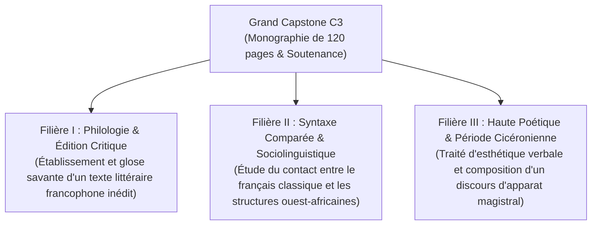

# Le Grand Capstone : Mémoire de Maîtrise & Soutenance Publique

> **Statut** : Validé  
> **Cycle Rattaché** : Cycle 3 — Semestre 6 (Couronnement de l'ensemble du cursus)  
> **Livrable Majeur** : Monographie de recherche ou traité de haute poétique (100 à 120 pages)  
> **Épreuve Ultime** : Soutenance orale académique de 45 minutes devant un jury de pairs  
> **Titre Conféré** : *Diplôme de Haute Souveraineté & Philologie de la Langue Française (DHSPLF)*.

Le Grand Capstone représente l'**accomplissement suprême** de l'étudiant. Après avoir consolidé la norme fondamentale (Cycle 1) et maîtrisé la puissance de l'argumentation oratoire (Cycle 2), l'impétrant démontre sa capacité à produire une œuvre scientifique et littéraire originale, rigoureuse et souveraine.

---

## 1. Les Trois Filières de Recherche Autorisées

L'étudiant choisit l'une des trois filières d'excellence pour son travail de fin d'études :

---

## 2. Morphologie du Mémoire Académique (100 à 120 pages)

Le manuscrit respecte les standards des thèses universitaires de lettres et sciences humaines :
1. **Prolégomènes (10 pages)** : Épistémologie, état de l'art, justification du corpus et méthodologie formelle.
2. **Corpus & Données (20 pages)** : Textes transcrits et balisés selon les normes de l'encodage philologique.
3. **Corps Démonstratif (60 pages en 3 parties)** : Démonstration rigoureuse appuyée sur les autorités de référence (Grevisse, Riegel, Molinié, Benveniste).
4. **Apparat Critique & Index (20 pages)** : Glossaire étymologique, bibliographie aux normes Z39.29/ISO 690, index verborum et index rerum.

---

## 3. Le Protocole de Soutenance Académique (45 minutes)

La soutenance se tient en séance solennelle devant un jury composé d'au moins deux examinateurs :
- **1. Exposé liminaire du candidat (20 min)** : Présentation synthétique des thèses défendues, sans lecture de notes.
- **2. Épreuve de déclamation souveraine (5 min)** : Déclamation debout d'une période de 300 mots extraite du mémoire.
- **3. Interrogatoire contradictoire (20 min)** : Questions du jury portant sur l'orthodoxie grammaticale, la cohérence logique et les choix stylistiques.

---

## 4. Documents du Dossier Capstone

- [`capstone-grand-memoire-et-soutenance.md`](./capstone-grand-memoire-et-soutenance.md) : Cahier des charges exhaustif, calendrier d'avancement, grille officielle de notation sur 100 points et procès-verbal de soutenance.
