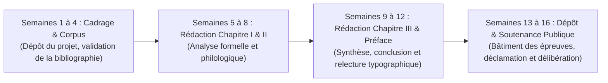

# Réglementation Générale du Grand Capstone & Protocole de Soutenance

> **Code Document** : `CAPS-001`  
> **Cycle Rattaché** : Cycle 3 (Haute Souveraineté & Philologie) — Semestre 6  
> **Livrable Final** : Mémoire académique relié (100 à 120 pages, 35 000 à 45 000 mots)  
> **Épreuve Ultime** : Soutenance orale solennelle de 45 minutes  
> **Barème d'Attribution** : 100 points (Mémoire écrit : 60 pts | Soutenance orale : 40 pts)  
> **Seuil d'Homologation** : $\ge 70 / 100$ avec zéro note éliminatoire.

---

## 1. Calendrier d'Avancement du Projet Capstone (Semestre 6)

L'élaboration du Grand Mémoire s'étend sur les 16 semaines du Semestre 6 :



---

## 2. Cahier des Charges selon la Filière Choisi

### Filière I : Philologie & Édition Critique d'un Texte Littéraire Inédit
- **Objet** : Transcription diplomatique et établissement du texte critique d'une œuvre littéraire ou oratoire (manuscrit d'archive, discours historique de l'indépendance, recueil poétique méconnu).
- **Contenu obligatoire** :
  - *Stemma codicum* ou histoire de la transmission du texte.
  - Apparat critique complet consignant les variantes textuelles.
  - Commentaire philologique ligne par ligne (analyses morphosyntaxiques, gloses lexicales, datations).
  - Introduction historique et esthétique de 30 pages.

### Filière II : Syntaxe Comparée & Sociolinguistique Francophone
- **Objet** : Étude contrastive approfondie entre la grammaire standard prescriptive (Grevisse) et les dynamiques syntaxiques ou stylistiques des variétés francophones d'Afrique de l'Ouest (Bénin, Sénégal, Côte d'Ivoire).
- **Contenu obligatoire** :
  - Enquête sur corpus attesté (enregistrements oraux, presse écrite, littérature subsaharienne).
  - Analyse formelle des phénomènes de contact : topicalisation, redoublement du sujet, réorganisation des valences verbales, calques sémantiques.
  - Évaluation sociolinguistique réfutant tout préjugé glottophobe et articulant la norme internationale d'apparat avec la légitimité des variations endogènes.

### Filière III : Haute Poétique & Réinvention de la Grande Période Cicéronienne
- **Objet** : Traité théorique sur la macro-syntaxe de la phrase d'art et composition d'un grand discours d'apparat inédit (1 500 mots) destiné à une célébration solennelle.
- **Contenu obligatoire** :
  - Étude diachronique de la période oratoire de Bossuet à Malraux et Césaire.
  - Traité des cadences (mineure, majeure, équilibrée, trimètre oratoire, ruptures maîtrisées).
  - Partition intégrale du discours avec transcription phonétique API des segments clés, cartographie des liaisons nobles et courbes mélodiques.

---

## 3. Grille d'Évaluation Officielle du Capstone (Barème sur 100 Points)

### Partie Écrite : Le Manuscrit (60 Points)

| Critère d'Évaluation Écrit | Poids | Indicateurs d'Excellence |
| :--- | :---: | :--- |
| **Rigueur Scientifique & Exactitude Linguistique** | /20 | Aucune affirmation empirique sans source ; utilisation scrupuleuse des grammaires de référence ; exactitude du métalangage morphosyntaxique. |
| **Correction Typographique & Orthographique Absolue** | /15 | Zéro faute d'accord ou d'usage sur 40 000 mots ; respect impératif du code typographique (ligatures, espaces insécables, tirets d'incise, majuscules accentuées). |
| **Profondeur Philologique & Richesse du Corpus** | /15 | Exégèse fine des textes ; appareil critique rigoureux ; mise en lumière des enjeux esthétiques ou sociolinguistiques. |
| **Architecture Démonstrative & Élégance du Style** | /10 | Plan en trois parties équilibrées ; transitions oratoires soignées ; prose d'une tenue constante sans afféterie ni sécheresse. |

---

### Partie Orale : La Soutenance Publique (40 Points)

| Critère d'Évaluation Oral | Poids | Indicateurs d'Excellence |
| :--- | :---: | :--- |
| **Exposé Liminaire & Synthèse des Thèses** | /15 | Capacité à exposer sans notes pendant 20 minutes une pensée claire, structurée et persuasive ; maîtrise du temps. |
| **Déclamation Oratoire & Diction Classique** | /15 | Mise en voix souveraine de la période choisie (5 min) : puissance respiratoire diaphragmatique, respect des liaisons obligatoires et interdiction des fautives, courbe intonative juste. |
| **Réponses à l'Interrogatoire Contradictoire** | /10 | Lucidité intellectuelle face aux objections du jury ; courtoisie universitaire ; justification instantanée des choix syntaxiques et lexicaux contestés. |

---

## 4. Modèle de Procès-Verbal de Soutenance & Décision du Jury

```text
ACADÉMIE DE HAUTE MAÎTRISE LINGUISTIQUE — WORLD-CLASS FRENCH
PROCES-VERBAL DE SOUTENANCE DU GRAND CAPSTONE

Nom & Prénom de l'Impétrant : .....................................................................
Matricule : WCF-C3-............................
Titre du Mémoire : ................................................................................
Filière de Recherche : [ ] I. Philologie  [ ] II. Sociolinguistique  [ ] III. Haute Poétique

NOTE DU MANUSCRIT ÉCRIT : .......... / 60 points
NOTE DE LA SOUTENANCE ORALE : .......... / 40 points
TOTAL GÉNÉRAL DU CAPSTONE : .......... / 100 points (soit .......... / 20)

DÉCISION DU JURY :
[ ] Admis avec la Mention Très Bien et Félicitations du Jury (Note >= 90/100)
[ ] Admis avec la Mention Très Bien (Note de 85 à 89/100)
[ ] Admis avec la Mention Bien (Note de 75 à 84/100)
[ ] Admis avec la Mention Assez Bien (Note de 70 à 74/100)
[ ] Ajourné avec prescription d'une révision sous 3 mois (Note < 70/100)

Observations du Président du Jury :
...................................................................................................
...................................................................................................

Fait en séance solennelle, le ........................................
Signatures des membres du Jury :
```
