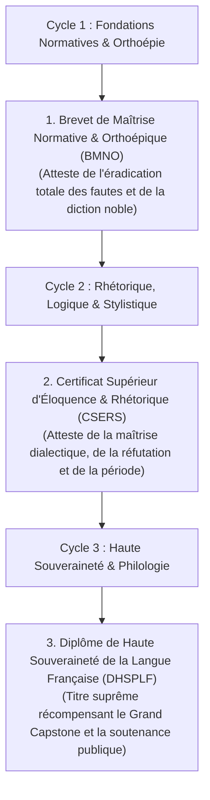

# Dossier de Diplomation Finale, Certification & Homologation Souveraine

> **Statut** : Validé  
> **Alignement** : Charte de projet ([`00-governance/project-charter.md`](../00-governance/project-charter.md)) & Référentiel de compétences ([`02-competency-framework/competency-framework.md`](../02-competency-framework/competency-framework.md))  
> **Exigence Finale** : Zéro complaisance — Toute diplomation exige la preuve documentaire observable de la maîtrise des 24 modules, des travaux pratiques, des projets d'intégration et du Grand Capstone.

Le dossier **`10-final`** régit l'attribution officielle des trois distinctions académiques certifiées par l'Institut **World-Class French**. Il définit les conditions d'homologation, la constitution du livret de compétences (portfolio de preuves) et la délivrance des diplômes d'apparat.

---

## 1. La Hiérarchie des Titres Académiques

---

## 2. Conditions Impératives d'Homologation

Aucun titre n'est délivré sans que les **quatre conditions cumulatives** suivantes ne soient vérifiées par la commission docimologique :

1. **Validation intégrale des Unités d'Enseignement** : Moyenne semestrielle $\ge 14/20$ (70 %) sur l'ensemble des modules du cycle, sans aucune note éliminatoire $< 10/20$.
2. **Réussite des Dictées Étalonnées de Contrôle** : Obtention d'une note $\ge 16/20$ aux dictées officielles sans document, corrigées selon le barème pénal officiel.
3. **Approbation des Projets Majeurs** : Dépôt et validation du projet de cycle (`PROJ-C1` ou `PROJ-C2`) avec une note $\ge 70 / 100$.
4. **Prestation Oratoire devant Jury** : Démonstration audio ou publique d'élocution et respect des liaisons obligatoires sans faute orthoépique.

---

## 3. Sommaire des Livrables de Diplomation

| Document | Rôle & Contenu |
| :--- | :--- |
| [`certification-standards-and-portfolio.md`](./certification-standards-and-portfolio.md) | Référentiel officiel du Portfolio de Preuves Observables (Livret d'attestation en 6 sections). |
| [`diploma-template.md`](./diploma-template.md) | Maquette officielle et solennelle du diplôme d'apparat pour les trois grades académiques. |
