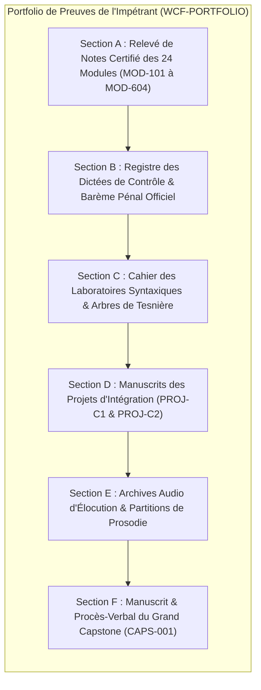

# Référentiel du Portfolio de Preuves Observables & Standards de Certification

> **Code Document** : `CERT-001`  
> **Statut** : Validé  
> **Rattachement** : Référentiel de compétences ([`02-competency-framework/competency-framework.md`](../02-competency-framework/competency-framework.md))  
> **Principe Docimologique** : *Toute compétence attestée doit être étayée par une trace matérielle vérifiable.*

Le présent référentiel définit la structure et les exigences d'intégrité du **Portfolio de Preuves Observables** que tout candidat doit constituer et archiver tout au long de sa scolarité. Ce dossier d'expertise constitue le fondement probatoire sur lequel repose la délivrance des diplômes de l'Institut **World-Class French**.

---

## 1. Structure du Livret de Preuves (Les Six Sections Obligatoires)

Le portfolio se compose d'un classeur d'archive numérique ou physique structuré en six sections distinctes :

---

## 2. Cahier des Charges Détaillé par Section

### Section A : Relevé de Notes Certifié des 24 Modules
- Relevé chronologique des notes obtenues à chaque chapitre (notes sur 20).
- Exigence : **Moyenne minimale de 14,0 / 20** sur chaque semestre, sans aucune note inférieure à 10,0 / 20.
- Attestation de la réalisation des micro-contrôles formatifs continus hebdomadaires.

### Section B : Registre des Dictées de Contrôle
- Copie intégrale ou retranscription horodatée d'au moins **six grandes dictées sans document** (au minimum une par semestre).
- Grille officielle de décompte pénal appliquée (`ERR-GRAM-MAJ`, `ERR-GRAM-MIN`, `ERR-LEX-USAGE`, `ERR-PONCT-ACC`, `ERR-TYPO-UNION`).
- Exigence : Note $\ge 16,0 / 20$ sur les dictées des semestres S1 et S2, et $\ge 14,0 / 20$ sur les dictées de haute complexité des semestres S3 à S6.

### Section C : Cahier des Laboratoires Syntaxiques & Arbres de Tesnière
- Recueil des 10 analyses fonctionnelles en constituants immédiats et arbres actanciels de Tesnière (A0 à A3).
- Justification raisonnée des rections modales (indicatif vs subjonctif) et de la concordance des temps sur 30 phrases controversées.
- Validation des épreuves de révision éditoriale (`CORR-LAB-01`).

### Section D : Manuscrits des Projets d'Intégration
- **Manuscrit `PROJ-C1`** : *L'Anthologie Critique Annotée* (50 pages, 15 textes établis, apparat critique et préface).
- **Manuscrit `PROJ-C2`** : *Le Recueil des Plaidoiries Contradictoires* (80 pages, 6 discours d'apparat en vis-à-vis).
- Rapports d'évaluation signés par les examinateurs.

### Section E : Archives Audio & Partitions de Prosodie
- Fichiers d'enregistrement audio haute fidélité (format FLAC ou WAV) des déclamations classiques :
  - Diction de la prose oratoire (Bossuet, Chateaubriand).
  - Déclamation de la tragédie en vers alexandrins (Racine, Corneille).
- Partitions textuelles annotées à la main par l'étudiant avec cartographie des liaisons obligatoires (`‿`), facultatives (`⁔`), interdites (`❌`) et des courbes mélodiques (`↗`, `↘`).

### Section F : Grand Capstone & Procès-Verbal de Soutenance
- Exemplaire définitif du Grand Mémoire de Recherche (100 à 120 pages).
- Procès-verbal officiel de la soutenance publique signé par les trois membres du jury académique.

---

## 3. Protocole d'Audit & Validation par la Commission Docimologique

Avant toute remise de diplôme :
1. **Contrôle d'Antiplagiat & Intégrité** : Le dossier complet est soumis à une analyse documentaire approfondie. Tout emprunt non crédité ou génération machinale non retravaillée entraîne l'annulation définitive de la candidature.
2. **Audit de Cohérence** : Deux jurés vérifient que les preuves observables correspondent point par point aux compétences terminales du référentiel ([`02-competency-framework/competency-framework.md`](../02-competency-framework/competency-framework.md)).
3. **Délibération & Enregistrement** : En cas de conformité absolue, le matricule officiel du candidat est inscrit au grand livre d'or de l'Institut et le diplôme d'apparat est émis.
