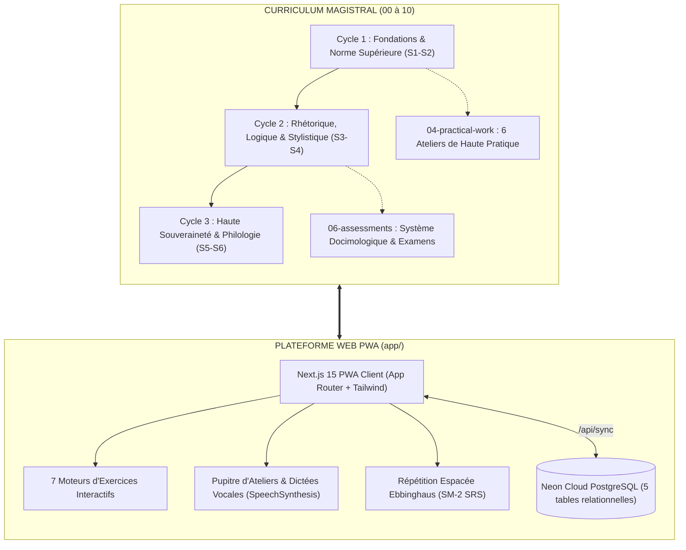

<div align="center">

# 🏛️ WORLD-CLASS FRENCH
### Institut Supérieur de Langue Française & Plateforme d'Ingénierie Pédagogique

[](https://github.com/Kinbor1994/world-class-french/actions)
[](https://nextjs.org/)
[](https://react.dev/)
[-3178C6?style=flat&logo=typescript)](https://www.typescriptlang.org/)
[](https://neon.tech/)
[](https://tailwindcss.com/)
[](https://www.w3.org/WAI/WCAG22/quickref/)
[](https://opensource.org/licenses/MIT)

<p align="center">
  <strong>Un cursus d'excellence universitaire complet couplé à une Progressive Web App (PWA) interactive de haute facture pour la maîtrise souveraine de la langue française.</strong>
</p>

[Explorer le Curriculum](#-architecture-du-curriculum) • [Architecture Technique](#-stack-technique--ingénierie) • [Démarrage Rapide](#-démarrage-rapide) • [Système d'Évaluation](#-système-dévaluation-certifiant) • [Gouvernance](#-gouvernance--qualité)

---

</div>

## 📌 Présentation Générale

**World-Class French** est un projet d'ingénierie linguistique et logicielle de calibre international. Il comble le fossé entre la haute tradition philologique française (*Le Bon Usage* de Grevisse & Goosse, *Grammaire méthodique du français* de Riegel, Pellat & Rioul) et les exigences de l'ingénierie logicielle contemporaine (Next.js 15 App Router, TypeScript strict sans compromis, synchronisation temps réel Neon PostgreSQL et PWA hors-ligne).

Le cursus s'adresse aux étudiants, enseignants, chercheurs et professionnels désireux d'atteindre une **maîtrise souveraine (C1-C2+) de l'expression écrite, rhétorique et oratoire**.



---

## ⚡ Fonctionnalités Clés de la Plateforme

### 1. Pupitre d'Ateliers & Dictées Étalonnées (`PracticalWorkModal.tsx`)
- **Dictées Sonores Pas-à-Pas** : Dictée découpée par groupes de souffle au tempo régulé (0.8x) via l'API native `window.speechSynthesis`.
- **Crible Pénal Automatisé** : Évaluation instantanée mot à mot selon le barème pénal officiel universitaire (`ERR-GRAM-MAJ` : -2 pts, `ERR-GRAM-MIN` : -1 pt, `ERR-LEX-USAGE` : -1 pt).
- **Laboratoire de Révision Éditoriale (30 Coquilles)** : Chasse aux solécismes et coquilles typographiques sur épreuves d'imprimerie avec apparat critique.
- **Studio d'Élocution & Liaisons Nobles** : Partitions classiques annotées (Bossuet, Chateaubriand) avec balisage des liaisons obligatoires (`‿`), facultatives (`⁔`) et interdites (`❌`).

### 2. Parcours d'Apprentissage & Exercices Interactifs
- **Syllabus Universitaire en 8 Paliers** : De l'orthographe grammaticale de base jusqu'aux périodes cicéroniennes et concours d'éloquence.
- **7 Moteurs d'Exercices Dédiés** :
  - `VoltaireErrorHunter` : Détection visuelle et correction d'erreurs en contexte réel.
  - `ClozeMorphologyInput` : Flexion morphologique et accords participiaux complexes.
  - `SyllableAndSentenceBricks` : Reconstruction d'arbres syntaxiques de Tesnière.
  - `InteractiveDictation` : Saisie guidée avec clavier d'accents français intégré.
  - `RhetoricAndRegisterStudio` : Manipulation de registres et figures de style.
  - `SmartDiagnosticMCQ` & `VisualSoundMatch` : Tests phonétiques et d'auto-positionnement.

### 3. Répétition Espacée (`fata.srs`) & Rétention Cognitive
- **Algorithme SM-2 / Ebbinghaus** : Calcul dynamique de la stabilité mémorielle et de la date de révision optimale.
- **Daily Sprint Minuté** : Défi quotidien de 6 questions en temps limité avec rapport de performance exportable.
- **Synchronisation Multi-Appareils Cloud** : Sauvegarde continue des scores, profils et états SRS sur **Neon PostgreSQL** via `@neondatabase/serverless`.

### 4. Design Éditorial 10/10 & Accessibilité Universelle (WCAG 2.2 AA)
- **Thème Tridimensionnel Persistant** : Mode Clair (Papier d'archive ivoire `#FAF8F5`), Mode Sombre (Midnight ink `#0B0C0E`) ou synchronisation système automatique.
- **Typographie Noble** : En-têtes en *Newsreader* et *Charter*, corps en *Plus Jakarta Sans*, code en *JetBrains Mono*.
- **Conformité Ergonomique** : Focus visible universel (`:focus-visible` or/ambre), zones tactiles $\ge 40\times 40\,\text{px}$, support natif de `prefers-reduced-motion`.

---

## 🛠️ Stack Technique & Ingénierie

| Couche | Technologies & Librairies | Rôle & Justification |
| :--- | :--- | :--- |
| **Framework Web** | **Next.js 15.5 (App Router)** | Rendu hybride (SSG pour les cours, Route Handlers dynamiques pour la synchronisation). |
| **Langage** | **TypeScript 5 (Strict Mode)** | Zéro type `any`, `noImplicitAny`, modélisation fine du domaine grammatical. |
| **Interface & Style** | **Tailwind CSS 3.4 & Framer Motion** | Charte graphique éditoriale sobre, animations subtiles, contraste WCAG AA validé. |
| **Gestion d'État** | **Zustand** | Store réactif avec persistance locale (`localStorage` via `partialize`) et écoute dynamique. |
| **Base de Données Cloud** | **Neon PostgreSQL (v17 Serverless)** | Base relationnelle managée en région Francfort (`aws-eu-central-1`) avec pooling haute performance. |
| **Pilote Base de Données** | **`@neondatabase/serverless`** | Client WebSocket / HTTP ultra-rapide pour architectures Edge et Serverless. |
| **Audio & Voix** | **Web Speech API (`SpeechSynthesis`)** | Synthèse vocale française native avec tempo pédagogique d'élocution. |
| **Intégration Continue** | **GitHub Actions (`ci.yml`)** | Compilation et validation automatique des types à chaque commit et pull request. |

---

## 📁 Architecture du Répertoire

```text
world-class-french/
├── 00-governance/               # Charte, directives d'écriture, décisions d'architecture (DEC-001 à DEC-054)
├── 01-architecture/             # Cartographie du cursus, structure des 3 cycles et graphe des prérequis
├── 02-competency-framework/     # Référentiel de compétences (FR-ORTHO, FR-SYNTAX, FR-ARGUM, etc.)
├── 03-curriculum/               # 24 Modules fondamentaux (MOD-101 à MOD-604) en 17 rubriques canoniques
│   ├── year-1/                  # Semestres S1 & S2 (Fondations, accords fondamentaux, indicatif, lexique)
│   ├── year-2/                  # Semestres S3 & S4 (Subordination complexe, système modal, rhétorique, stylistique)
│   └── year-3/                  # Semestres S5 & S6 (Sociolinguistique, variations, grande période cicéronienne)
├── 04-practical-work/           # Suite complète de travaux pratiques universitaires
│   ├── dictations/              # Dictées étalonnées (DICT-S1-01, DICT-S2-01) avec barème pénal
│   ├── correction-labs/         # Révision éditoriale (CORR-LAB-01, 30 pièges pré-calibrés)
│   ├── grammar-labs/            # Arbres actanciels de Tesnière et valences (GRAM-LAB-01)
│   ├── oral-workshops/          # Diction classique et cartographie des liaisons (ORAL-WS-01)
│   ├── reading-workshops/       # Explication de texte linéaire en 4 mouvements (READ-WS-01, Proust)
│   └── writing-workshops/       # Dissertation dialectique et méthode de paragraphe AEI (WRITE-WS-01)
├── 05-projects/                 # Projets majeurs de cycle (PROJ-C1 Anthologie, PROJ-C2 Plaidoiries)
├── 06-assessments/              # Système docimologique complet (DIAG-001, EXAM-S1, EXAM-S2, FINAL-EXAM-C1)
├── 07-resources/                # Registre des sources fiables (Grevisse, Riegel, Molinié)
├── 08-audits/                   # Rapports d'audits déterministes linguistiques et pédagogiques
├── 09-capstone/                 # Grand Mémoire académique (CAPS-001) et protocole de soutenance de 45 min
├── 10-final/                    # Référentiel de diplomation finale, portfolio de preuves et diplômes d'apparat
└── app/                         # Progressive Web App Next.js 15 (Code source, composants, store, API)
```

---

## 🚀 Démarrage Rapide

### Prérequis
- **Node.js** version 20 ou supérieure
- **npm** (inclus avec Node.js) ou **pnpm**
- Un compte **[Neon](https://neon.tech)** (optionnel pour la synchronisation cloud, l'application fonctionne parfaitement en mode local hors-ligne).

### Installation & Lancement

```bash
# 1. Cloner le dépôt
git clone https://github.com/Kinbor1994/world-class-french.git
cd world-class-french/app

# 2. Installer les dépendances
npm ci

# 3. Configurer l'environnement (optionnel : renseigner la chaîne Neon)
cp .env.example .env.local

# 4. Lancer le serveur de développement local
npm run dev
```

L'application est immédiatement accessible sur `http://localhost:3000` (ou `http://localhost:3001` si le port 3000 est occupé).

### Commandes Utiles

```bash
npm run build      # Vérifie la validité des types TypeScript et compile pour production
npm run lint       # Exécute l'analyse statique du code
npm run start      # Démarre le serveur optimisé de production
```

---

## 🎯 Système d'Évaluation Certifiant

Pour garantir la valeur académique des titres délivrés, le projet applique les règles de la charte docimologique :
- **Seuil d'Admission Minimal** : Moyenne semestrielle $\ge 14,0 / 20$ (70 %) sans aucune note éliminatoire $< 10,0 / 20$.
- **Barème Pénal Officiel de l'Orthographe** :
  - `ERR-GRAM-MAJ` (**-2,0 pts**) : Rupture d'accord sujet-verbe, faute majeure de participe passé ou de mode.
  - `ERR-GRAM-MIN` (**-1,0 pt**) : Accord dans un groupe nominal éloigné, adjectif de couleur composé.
  - `ERR-LEX-USAGE` (**-1,0 pt**) : Consonne double omise, consonne dérivative muette erronée.
  - `ERR-PONCT-ACC` (**-0,5 pt**) : Accent sur voyelle pleine, virgule d'incise omise.
  - `ERR-TYPO-UNION` (**-0,5 pt**) : Trait d'union ou majuscule d'état manquante.

---

## 🤝 Contribution & Bonnes Pratiques Git

Nous suivons le guide des conventions d'ingénierie [`CONTRIBUTING.md`](./CONTRIBUTING.md) :
- **Format Conventional Commits** : `feat(...)`, `fix(...)`, `docs(...)`, `refactor(...)`, `perf(...)`.
- **Politique Zéro `any`** : Tout code soumis doit compiler avec `npm run build` avec zéro avertissement de typage.
- **Intégrité de la Gouvernance** : Toute modification majeure d'architecture est consignée dans le journal des décisions [`00-governance/decisions-log.md`](./00-governance/decisions-log.md).

---

## 📄 Licence & Droits

Ce projet est distribué sous licence libre **MIT**. Consultez le fichier [`LICENSE`](./LICENSE) pour plus de détails.

---

<div align="center">
  <sub>Bâti avec rigueur, passion et fidélité à la langue française · 2026</sub>
</div>
